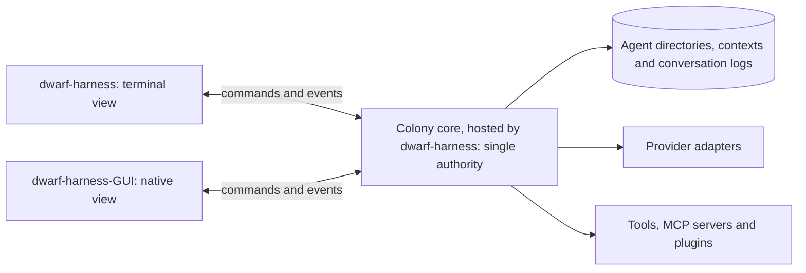

# Core and launchers design

**Status:** Draft 0.7 — current design and fresh-session handoff; requirements and proposals, not an implementation report. Each step's status is on the [status board](ROADMAPS.md#status-board), and each contract's in [`CONTRACTS.md`](CONTRACTS.md).
**Updated:** 2026-10-07 (D96 pre-alpha consolidation of D89–D95; producer, lifecycle and presentation requirements, not implementation or readiness advancement); 2026-10-06 (D89 fortress/RPG GUI extension and B16 baselines); 2026-10-05 (design resolutions in §13; adopted owner choices D80–D87 and assistant engineering choices B2–B15 recorded in `DECISIONS.md`); 2026-10-02 (measurements in Appendix A.7–A.9); 2026-09-30 (build order, action ledger and workspace model); prototype measurements date from 2026-09-28; local-IPC sources were checked on 2026-09-29.
**Scope:** `dwarf-harness`, an independent Go application with a plain terminal launcher and a native-window launcher, `dwarf-harness-GUI`. This document defines their shared core, agent/session ownership, hierarchical communication, relationship memory, Corps mythology, recipes, workflows and skills.

The Dwarf Fortress-inspired fortress overworld and RPG agent/party screens are **GUI only**. D89–D95 define the agreed visual, creation, alignment, succession and cosmetic-building requirements in the [fortress GUI design](../.scratch/fortress-gui/spec.md); [D96](DECISIONS.md#d96-pre-alpha-fortress-alignment-and-consolidation-boundary) authorizes their consolidation as a pre-alpha stopping point. B16's retained tooling is assistant-selected; its incompatible relationship, autocomplete and permanent cosmetic-history baselines are replaced below. [`ROADMAP-GUI.md`](ROADMAP-GUI.md)'s operational panels, accessibility gates, native Fyne client and plain terminal remain. Core owns every non-cosmetic operation; geometry, art and animation never change agent behavior or grants.

**Inputs:** the owner's decisions of 2026-09-28, 2026-09-29 and 2026-09-30, and subsequent decisions through 2026-10-07 recorded in `DECISIONS.md`; `RESEARCH-IMPLEMENTATION-LANGUAGE.md`; `DESIGN-ROUTING-LAYER.md`; the three expressly permitted early-design sections; and the throwaway measurements retained in Appendix A.
**Limited reconciliation:** only “What is worth learning from StarNet” (the section described as “What is worth saving”), “Recipes and workflows”, and “Skills” were incorporated from the original design. That original is now `superceeded-Design.md`, kept with the superseded browser-launcher proposals in the archive folder `../dwarfharness/`, outside this repository. The rest of the original and other existing design documents remain unreconciled. No other early-design section is adopted by implication.

**Independence:** DwarfHarness draws on ideas from other projects, but is not a StarNet fork, port or add-on. It runs no part of that project and has no upstream-runtime, compiler or behavioral-parity requirement. The retained ideas below are requirements for an independently designed implementation, not a commitment to imported code or catalogues.

Conventions:

- Owner decisions are distinguished from implementation proposals. **[INFERENCE]** marks a deduction or proposed mechanism that the owner has not specified. **[PROPOSAL]** marks a proposal made in another document, such as the validation research, that the owner has not decided.
- Model-token cost and device cost are reported separately. Unmeasured costs remain unmeasured.
- Historical measurements are not measurements of the new native GUI, a shared colony core or the multi-agent organization.
- The exact launcher names are `dwarf-harness` and `dwarf-harness-GUI`, retaining the owner's uppercase `GUI` suffix. Example types and commands are design contracts, not implemented APIs.

## Start here for a fresh session

**Current stopping point:** [D96](DECISIONS.md#d96-pre-alpha-fortress-alignment-and-consolidation-boundary) authorizes consolidation of D89–D95 as a pre-alpha design, not exhaustive design closure. This document incorporates that alignment; reconciliation no longer awaits another owner confirmation. [D97–D102](DECISIONS.md#d97-officer-service-loss-causes-onset-held-questions-and-restoration-evidence) add the ordinary service-loss and officer-recovery procedure (§13.11). Exact relationship attenuation/rubric/encoding, producer schemas and bounded presentation persistence remain explicit specification/testing work. C8/C9 wait on their actual capability dependencies, including C9 backend before C8 initial alignment, never whole C9 or GUI. §13 preserves approval, calibration and implementation gates.

| Read | Authority and purpose |
|---|---|
| **First:** [`ROADMAPS.md`](ROADMAPS.md) | Which roadmap step owns the work, what it waits for, where to stop and how several agents integrate (D19, D41) |
| **Then:** [`DECISIONS.md`](DECISIONS.md) | The decision log: every owner decision from D19 onward, continuing §2; build decisions; the open items awaiting the owner |
| **Then this document:** §13 for controlling engineering resolutions; §1–§12 for owner decisions, component boundaries and rationale | Current Core mechanisms, their interfaces, remaining approval/dependency gates and implementation evidence limits |
| [`DESIGN-ROUTING-LAYER.md`](DESIGN-ROUTING-LAYER.md) — routing design §5, §6 and §15 | Router contracts within those core boundaries; its provider facts and calculations retain their recorded research dates |
| [`FIELD-PHILOSOPHY.md`](FIELD-PHILOSOPHY.md) for the current environmental-layer discussion | Owner's universal-field direction, research-backed proposals and unresolved philosophical choices; not an adopted Field Design or a change to direct-message permissions |
| [`RESEARCH-IMPLEMENTATION-LANGUAGE.md`](RESEARCH-IMPLEMENTATION-LANGUAGE.md) when the language/build rationale or measurements matter | Historical comparison plus current-decision addendum; its earlier Rust/no-C/browser recommendations do not override the current Go/native-window decisions |
| [`RESEARCH-OPEN-SOURCE-HARNESSES.md`](RESEARCH-OPEN-SOURCE-HARNESSES.md) when evaluating prior-art tradeoffs | Historical research and optional ideas, not an implementation backlog or adopted runtime |

**How to read the status:** §2 records the owner's decisions D1–D18 with pointers to later amendments; `DECISIONS.md` records D19 onward. **[INFERENCE]**, “proposed” and “recommendation” identify deductions or mechanisms not independently selected by the owner. Present-tense API/behavior descriptions state the intended contract, not existing functionality. The core document owns organization, messaging and execution/context ownership; the routing document owns routing within those boundaries. Historical research cannot silently reopen a settled choice.

**Implementation and evidence:** these design rounds produced documents and throwaway experiments, not a completed implementation of this independent architecture. Existing legacy files have not been audited against it. Go/interface sketches and rollout gates are specifications, not runnable APIs or completed phases. Appendix A retains dated prototype measurements; Appendix B records the narrower relationship-model exercise and the runtime obligations still unverified. A fresh session need not repeat old benchmarks merely to resume the design.

**Recommended continuation:** follow `ROADMAPS.md`. After the owner's D52 approval of the specified boundary (D112), C2's mechanisms are no longer an open technical-design question. C8/C9 wait for their documented dependencies. The GUI roadmap names its gates and cycle-free dependency on the C9 backend capability. The owner answer provenance and delegated engineering decision IDs are marked adopted in §13; do not treat a specification as an implementation result or a frozen contract.

**Continuation scope:** the documents now live in `docs/` of this repository, their only living copy (D30). `superceeded-Design.md`, `recipes/` and the legacy code and data stay unread in the archive folder `../dwarfharness/`, outside this repository, unless the owner separately authorizes access; the permitted ideas have already been incorporated into §11–§12. Unreconciled design documents are not authority for this independent application. Git work in this repository follows D31 and D41: Conventional Commits; one worktree and branch per agent; `main` moves only by fast-forward after the full check (D42); changes touching a frozen contract, an owner decision or a new dependency wait for the owner; nothing is pushed without the owner.

## 1. Summary

- **Two programs, one core, one set of capabilities (D39).** `dwarf-harness` is the colony core host plus the terminal, always built without cgo. `dwarf-harness-GUI` opens a native window as a display client only: it starts `dwarf-harness` as its colony's host when none is running, then attaches, and it holds no colony logic and no API keys. Both expose the same harness functionality. The core owns transcripts, prompts, routing, credentials, permissions, tools and session state.
- **Native GUI toolkit.** Fyne v2.8.1 is the selected native toolkit under delegated engineering authority (B11); the isolated `gui/` module keeps cgo and native dependencies out of the Core/terminal. The actual GUI acceptance gate remains unrun.
- **A live session can appear in both launchers at once.** They are two views of one session, not two independent runs. A colony-scoped core authority serializes commands and supplies each view an independent durable cursor into the colony-ledger sequence, plus the separate ephemeral live-text channel (§3–§4; D49).
- **One GUI instance per colony.** Reopening the same colony addresses its existing GUI; different colonies may have separate instances. A Colony contains specialized Corps, with Grand Orchestrator, Grand Griot and Grand Diplomat roles at the top.
- **Separate relationships, not a session-count formula (D21).** Each agent has one execution session and many private contexts keyed by `(agent_id, context_id)`. The Core-owned durable broker, inboxes and conversation receipts are specified in §13; the ledger is their only authority.
- **Simultaneous turns (D22).** An agent may run turns in several of its contexts at once, up to a per-agent limit, with at most one turn per context. Versioned writes to agent-wide files, atomic core records for anything that must not be handed out twice, and budget reservations before each call guard those turns (§7.3); a second writer to one task gets temporary scratch (D23, §3.5).
- **Drift is intentional.** Birth begins from an immutable reviewed proposal and retains the initiating Orchestrator's superior-approval rule; clone state is independent. Memory is fresh unless an explicit manifest selects already-shareable lessons/artifacts (D85). New Orchestrators/Griots also require Core-enforced, human-approved initial Purpose alignment; no superior agent can accept it for the human. Birth choices do not copy credentials, grants, inbox ownership or private state.
- **Exactly one Orchestrator, Griot and Diplomat per Corps.** They share one mutable Purpose with role mandates; Grand leadership uses a Colony Purpose. Workers communicate through their Corps board; Griots reach workers only through story output there. Lateral inter-Corps direct communication belongs to Diplomats (§7.2). A prepared Aspirant remains outside an occupied officer slot until reviewed handover, after which the predecessor retires (§7.6).
- **Retained early ideas:** explicit capability grants; executable workflow graphs and guarded model calls; parameterized recipes with host-checked acceptance; and lazy, shared-format skills (§11–§12).
- **Efficiency remains a goal, not a reason to reject the native window.** Keep the terminal light, load skills on demand, use hand-written provider adapters where justified, and measure the native GUI separately. The adapter-only prototype was 6.86 MB; linking both official SDKs made its counterpart 18.21 MB (Appendix A.5).
- **Build order.** Harness and colony core first. The environmental field layer is a later package inside the harness, testable as a standalone engine against synthetic ledgers, and gated behind substantial testing before it may affect agents (§2 D14, §9 phase 5).
- **Action ledger, private scratch, fast-forward promotion.** The core records typed action deltas in one append-only colony log, our own JSON-lines format written with the standard library (D33–D38), through one in-process core-owned appender that serializes writes and assigns the colony sequence (D50); each work context has a private git-worktree scratch per workspace root. In each workspace, `main` is canonical and never checked out: people and agents work on branches. Bounded concurrent validation checks cumulative integration candidates; the core publishes only their successful prefix in durable request order, compare-and-swapping `main` through one serialized durable finalization sequence (D77). Direct Git movement can bypass the gate and is unsupported; C10 must establish the enforceable boundary before protection from child processes is claimed (§3.2, §3.5).
- **Testing-only until validated promotion (D52).** C2 proves workspace mechanics and explicit unavailable refusal, not accepted promotion. C3 and all other pre-C4 harness use are testing-only, including authorized live-provider tests; their output is not colony delivery. C4 may exercise real accepted/refused promotions on test workspaces to prove its gate. Only after that gate passes and C4 is Done may real colony work begin, still subject to later role, field and isolation gates (§3.5, §9).

## 2. Decisions and resolved assumptions

| ID | Current decision | Recorded |
|---|---|---|
| **D1** | Implement the harness in Go. A C toolchain is accepted for the native launcher; the earlier universal cgo ban is superseded. **Toolchain detail: D28.** | 2026-09-28; amended 2026-09-29 |
| **D2** | Program and terminal launcher: `dwarf-harness`. Native-window launcher: `dwarf-harness-GUI`. The browser launcher is superseded. | 2026-09-29 |
| **D3** | Control and trust stay in the harness; provider features remain optional (routing design T10). | 2026-09-28 |
| **D4** | No automatic provider switching in v1; user-chosen changes work; provider betas stay behind flags, off by default (routing design §9.8 and C5). | 2026-09-28 |
| **D5** | Both launchers have the same harness functionality and may show one live session simultaneously. Session spawning is available from the GUI as well as the terminal. | 2026-09-29 |
| **D6** | Each colony has at most one GUI instance. Another invocation for that colony reuses it; other colonies have their own instance scope. | 2026-09-29 |
| **D7** | Standalone, independently implemented application; inspiration does not impose an upstream code, runtime or compatibility dependency. | 2026-09-29 |
| **D8** | Each ordinary agent owns a directory and one session. Cloning copies `Agent.md`, with memory copying optional. | 2026-09-29 |
| **D9** | Preserve distinct conversational memory for every relationship, not just orchestrator–worker pairs. Reconsider the initial `n+1` sessions before adopting a wider count such as `n+3`; the uniform context model is adopted by D21, and B7 selects a Core-owned ledger broker (see §13.6/C6). | Amended 2026-09-29 |
| **D10** | Agent drift is a feature. Birth uses an explicit manifest of selected, already-shareable lessons/artifacts and hash-bound superior approval; B8/D85 specify the mechanism in §13.6 without changing owner authority. | 2026-09-29 |
| **D11** | Every Corps has an Orchestrator for logistics, a Griot for story/mythology and an embedded Diplomat representing its needs. Their permitted communication paths, including workers' board-only peer communication, are recorded in §7.2. | Expanded 2026-09-29 |
| **D12** | The hierarchy culminates in Grand Orchestrator, Grand Griot and Grand Diplomat roles. B8 specifies corresponding-chain coordination and authorized projections in §13.6; this grants no blanket descendant access. | 2026-09-29 |
| **D13** | Corps specialize within a Colony, for example Scouts, Researchers, Laborers and Diplomacy. Specialization and passing on lessons are design goals. | 2026-09-29 |
| **D14** | Build the harness and colony core first. The environmental field layer is implemented inside the harness as a package that can be tested as a standalone engine, and must pass substantial testing before it is allowed to affect agents. | 2026-09-30 |
| **D15** | The core records typed action deltas in an append-only action ledger; large bodies live in a content-addressed store under an operator retention policy (§3.2). Whether this logical ledger shares a physical event log/database with session-view events remains open. **Physical log settled by D33–D38.** | 2026-09-30 |
| **D16** | Private scratch per unit of work is the implementation design philosophy for work artifacts, intended to use git worktrees of the workspace repository; git clones are rejected as untenable. Canonical artifacts change only through core-performed promotion. D48 settles `main` as the canonical ref and the promoting-context authority; enforceability remains open (§3.5). | 2026-09-30 |
| **D17** | The unit of scratch is the bound work context per workspace root. A work context is task-shaped and owns its scratch, base commit, integration state and promotion record (§3.5, §7.3). **Amended by D23.** | 2026-09-30 |
| **D18** | Promotion is fast-forward only: it is refused when canonical has moved, and integration is the agent's own observed work inside its scratch (§3.5). **See also D77:** the original-only integration/stale-base rule is superseded by explicit host-derived cumulative candidates, exact validation and ordered publication; guarded fast-forward finalization remains (§3.5). | 2026-09-30 |

**Decisions from D19 onward** are recorded in [`DECISIONS.md`](DECISIONS.md), the append-only decision log, and are cited here by ID. Those this document applies:

| ID | Decision | Applied in |
|---|---|---|
| D19, D40 | Separate roadmaps that name their dependencies on one another; contracts between roadmaps | Start here, §3.1, §3.2, §9 |
| D20 | Core first; Undercurrent only against frozen contracts | Start here, §9 |
| D21 | One execution session per agent, many private contexts | §1, §7.3, §7.4, §7.6, §10 |
| D22 | Simultaneous turns, with four safeguards | §1, §3.2, §4.1, §7.3, §10, §12.3 |
| D23 | Temporary scratch for a second writer to one task (amends D17) | §3.5, §7.3 |
| D24, D25 | Accept prompt-cache double payments; a turn sees a list of its agent's other active contexts | §7.3 |
| D26 | One core and one ledger per colony | §3, §3.2, §3.5, §10 |
| D27 | Windows first; portable to macOS and Linux | §8 |
| D28 | Toolchain and cgo | §1, §6.3, §8.1, §8.5 |
| D29 | Dependency policy | §8.1, §8.2 |
| D43–D46 | Module path; a nested `gui/` module; package layout and import rules; the full check passes before `main` moves | §8.2; Start here |
| D47–D50 | Validation parameters in U1 law-format; canonical `main` and gated promotion; durable/live cursor split; core-owned serialized appender | §3.2, §3.5, §4, §8.2 |
| D52 | Path A: owner-approved boundary before C2/C3 implementation; C2 mechanics fail closed; harness agents testing-only until C4's integrated validation/promotion gate passes | Start here, §1, §3.5, §9, §10 |
| D70–D73 | Immediate capture-busy and protected capture; tree-identical no-change without promotion; real automated checks required at C4; Q48=A runs the full declared per-workspace required set without path/graph filtering | Start here, §3.5, §10 |
| D74–D76 | Git-compatible canonical candidate contents; imported/reviewed and pinned host-managed local/global ignore inputs; captured scratch `.gitignore` rules govern that capture's new-file eligibility | Start here, §3.5, §10 |
| D77–D78 | Bounded cumulative integration validation; ordered successful-prefix publication with serialized durable finalization; performance/capacity as architecture feasibility | Start here, §3.5, §8.6, §10 |
| D30, D31, D41 | Repository; decision log and working rules; several agents in one repository | Start here |
| D32 | `Agent.md` spelling | Throughout; §3.5 |
| D33–D38 | What the colony log holds; ledger storage; record format; integrity and retention; IDs and time; where colony data lives | §1, §3.2, §3.5, §4.1, §7.4, §8.2, §8.6, §10 |
| D39 | Two programs | §1, §2 (I3), §3, §3.1, §6.1, §8.5 |
| D42 | Check command and CI | Start here, §8.2, §8.5 |
| B1 | Line endings (build decision) | §3.5 |

The four earlier launcher assumptions are resolved as follows:

| Earlier assumption | Resolution |
|---|---|
| **I1 — Dwarf Fortress-style interface belongs only to the graphical launcher** | **Confirmed.** It is native-GUI only; the terminal is plain text. D89's [fortress/RPG design](../.scratch/fortress-gui/spec.md) now specifies the visual scope; B16 supplies technical baselines, not implementation evidence. |
| **I2 — Use the system's default browser** | **Superseded.** That describes the archived browser launcher, not the selected native window. It is not a third active launcher. |
| **I3 — Both launchers come from one program with the same functionality** | **Confirmed at the application/core level.** Two entry points use one core implementation and the same permissions and features. The exact executable packaging is an implementation choice, not two separate harnesses. **Packaging settled by D39:** two programs, `dwarf-harness` hosting the core and `dwarf-harness-GUI` as a display client. |
| **I4 — A session appears in only one launcher at a time** | **Replaced.** The same live session may appear in both. Spawning an agent's session inside the GUI is supported, subject to the agent/session ownership rules in §7. |

The owner's later references to the web and to a browser for colonies and session spawning are interpreted here as referring to the selected GUI. The explicit native-window decision governs; the previous browser bullets, transport and measurements are in `superceeded-Design.md`, in the archive folder `../dwarfharness/`, outside this repository.

## 3. Process model and colony ownership

**One writer, multiple views.** Each live session has one authoritative core owner. Attaching the other launcher adds a view; it must not start a second agent loop, duplicate provider calls or create another session. Each view has an independent read cursor (§4).

**Process arrangement (D26, D39):** one core host process per active colony, the sole writer of that colony's ledger. The `dwarf-harness` program is that host; `dwarf-harness-GUI` attaches to it as a display client and starts `dwarf-harness` first when no host is running (§3.1). This replaces the old rule that each launcher owns an isolated in-process core, and it does not require a permanently installed global service. Within the host, the core is a Go library and the router has no daemon or port of its own [INFERENCE]. The IPC transport between host and views is still the recommendation in §3.4.



The diagram shows one colony; another colony has its own core host, ledger and GUI instance scope (D26). The broker described in §7 lives inside this core, not in a separate service or in a Diplomat's model turn. The role hierarchy is logical, not a process tree.

### 3.1 Starting and attaching

- Both launchers identify the colony and ask its core to attach to the selected session, or to spawn an allowed agent/session.
- If no core host runs for the colony, `dwarf-harness-GUI` starts `dwarf-harness --host --no-terminal` as its detached host, then attaches over the local connection (D39, B11, §13.7). The host persists until explicit shutdown; closing or crashing a view never stops a turn or host. C7/GUI-A/B implementation and reconnect proof remain unrun gates, not open lifecycle policy.
- Core startup must have a single-owner claim so simultaneous launcher starts cannot produce two writers for one colony/session. The GUI has a separate per-colony instance claim: a terminal attachment does not consume that GUI slot. [INFERENCE]
- A second `dwarf-harness-GUI` invocation for the same colony activates the existing instance and passes it the requested session selection; it does not create a second window instance or session owner. A different colony can open its own GUI.
- The local channel is selected in §13.7: Windows uses a local-only named pipe with restrictive DACL and remote-client rejection; Unix platforms use a private per-colony socket directory and restrictive permissions. C7/GUI-A/B still require authenticated implementation, discovery and stale-host/reconnect proof; `run/host.json` is an advisory hint, not authority.
- Closing or disconnecting a view never stops the host or cancels its turns; the host remains until explicit shutdown. Turn cancellation and colony shutdown are separate operations. Lifecycle/recovery evidence belongs to C7/GUI-A/B; no last-view policy remains open (§13.7).

### 3.2 Files and credentials

- Each agent directory owns its execution-session audit trail and private context files (§7.3). Authorized shared exchanges live in colony-owned conversation logs, including Corps boards; neither participant owns the other's private memory.
- **Agent-wide files (D22).** The core writes `Agent.md`, general `Memory.md` and skill edits with a version check, because one agent's turns may run in several contexts at once. A write based on an out-of-date copy is refused, and the turn re-reads.
- The core is intended to be the sole writer of canonical harness state. A single in-process appender owned by the core serializes per-colony ledger writes and assigns the gapless sequence (D50); its contract is used only by core, router and `internal/undercurrent/graph`, while other Undercurrent packages read through ledger-reader. This is a protocol boundary, not an OS-enforced guarantee against same-user child processes; a lock prevents a second core, not a child from accessing files. Reconnection resumes from the durable colony-ledger cursor; restart reconstructs accepted messages and unfinished work from committed records. Context Markdown files are scoped materializations, not independent competing message queues.
- **Action ledger and bodies (D15; physical log settled by D26 and D33–D38).** The core records typed action deltas — actor, bound context, tool or operation, target paths/resources, outcome, cost, measurement path and hash references — when it performs or observes the action, never from an agent's report alone. Large payloads live in a content-addressed body store keyed by hash. The ledger is the world-facts substrate the environmental layer will read (`FIELD-PHILOSOPHY.md` §3), not a per-action full-workspace snapshot with retained file bodies. In summary, with the full entries in `DECISIONS.md`:
  - *One colony log (D26, D33).* The colony's core host is its only writer, and every record carries the colony's globally unique ID. One sequence orders actions; workspace and validation events; turn starts and ends; approvals and their outcomes; budget reservations and settlements; messages and inbox processing (§9 phase 2); and router measurements (routing design rule R11). Message bodies, diffs and run logs go in the body store, and streamed model text stays in memory (§4.1). The router's per-call decision record (routing design §11) stays a separate JSON-lines file.
  - *Our own JSON-lines log (D34, D35; Appendix A.8).* Standard library only. Each record is one JSON object per line, prefixed by its SHA-256, in segment files named by the sequence number of their first record. Each commit, one record or several that belong together, is one write followed by a flush, and its last record is marked; recovery truncates a half-written final commit. Lookup indexes are rebuilt in memory at startup. A SQLite index may be added later only on a measured trigger, and only as an index rebuildable from the log, which stays the only source of truth. A written record is never rewritten; formats evolve by optional fields and new type versions, as the `ledger-format` contract in `CONTRACTS.md` will define.
  - *Hash chain and retention (D36).* Bodies and the record chain use SHA-256; each record carries the previous record's hash, and external anchoring of the latest hash waits for assurance level A3. Git object IDs stay in each repository's own format. The log is never deleted or compacted; old segments may be compressed. Bodies may be garbage-collected under an operator policy, so each record holds everything replay needs.
  - *IDs and time (D37).* Every ID is a UUIDv7, and names never grant authority. A gapless per-colony sequence is the only order replay uses. Event time is UTC Unix nanoseconds, never decreasing within a colony; durations come from the monotonic clock. After a crash the core writes an `interrupted` end for every unmatched start and never assumes success.
  - *Colony data layout (D38).* Default root `%LOCALAPPDATA%\dwarf-harness\colonies\<colony>` on Windows, `~/.local/share/dwarf-harness` on Linux and `~/Library/Application Support/dwarf-harness` on macOS, with a per-colony override. It holds `colony.json`, `lock`, `log/`, `bodies/`, `agents/<name>-<short id>/` (`Agent.md`, `Memory.md`, `contexts/<id>/`, `audit/`), `workspaces/`, `scratch/<short id>/` and `runs/<short id>/`.
  - *Private content (D33, D38).* An agent's private context content stays in its agent directory; the log records each change by hash, never by content. The log record is the commit point: on restart a mismatch is reported, never guessed.
- API keys are read by the core from environment variables or the OS keychain. `zalando/go-keyring` supports macOS through `/usr/bin/security`, Linux through Secret Service over D-Bus, and Windows through Credential Manager ([README](https://github.com/zalando/go-keyring)).
- Neither launcher receives provider API keys. Agent instructions, memories, recipes and mythology do not confer tool authority.
- Authenticated colony **ADMINISTRATOR** inspection may read all colony records and agent-private memories, including both relationship perspectives (D90–D92). This is the administrator's action in either launcher, not impersonation, a model input, or a new agent recipient grant. Provider credentials remain Core-held and never enter GUI projections.
- D90 separates bounded per-GUI-run cosmetic undo/history from retained operational history. Saved presentation, drafts and Build TODO state remain durable under the Core-owned mechanism specified in §13.7; do not append every cosmetic edit forever or weaken operational ledger retention.

### 3.3 Child-process lifetime

Children belong to the core/session that runs them, not to whichever view happens to be open. Go's `exec.CommandContext` kills the direct child by default; descendants need separate management ([`os/exec`](https://github.com/golang/go/blob/master/src/os/exec/exec.go)).

- **Windows:** the core host uses a job object with `JOB_OBJECT_LIMIT_KILL_ON_JOB_CLOSE`. Child processes inherit job membership by default ([job limits](https://learn.microsoft.com/en-us/windows/win32/api/winnt/ns-winnt-jobobject_basic_limit_information); [Job Objects](https://learn.microsoft.com/en-us/windows/win32/procthread/job-objects)). The core's lifetime, not a terminal or GUI window closing, controls this job. Job membership is lifetime management, not a security sandbox.
- **Linux:** put tool/plugin children in process groups and use `Pdeathsig`. Go documents that this signal follows the creating thread's death, not necessarily process death ([`syscall`](https://github.com/golang/go/blob/master/src/syscall/exec_linux.go)); starting children from a goroutine locked to a long-lived OS thread is the proposed safeguard. [INFERENCE]
- **macOS:** process groups and explicit shutdown; descendant cleanup after a core crash still needs verification. [INFERENCE]
- **All systems:** use `exec.Cmd.WaitDelay` so inherited open pipes cannot hang shutdown indefinitely.

The native UI and its framework-managed processes need an explicit lifetime boundary separate from tool children. That boundary will be verified after toolkit selection; the old external-browser breakaway arrangement is not carried forward.

### 3.4 Recommended local IPC [INFERENCE]

**Use an embedded colony broker for agent messaging, and local OS IPC only across process boundaries.** Co-resident agents call the core's authorized messaging API in-process. A Go channel can wake a consumer, but cannot be the durable mailbox. Separate launchers, and any later out-of-process agent hosts, use the same command/event contract over:

- **Windows:** a named pipe, with an explicit intended-user/logon DACL and `PIPE_REJECT_REMOTE_CLIENTS`. Do not accept the default pipe security descriptor: Microsoft documents read access for Everyone and the anonymous account in its default ACL ([pipe security](https://learn.microsoft.com/en-us/windows/win32/ipc/named-pipe-security-and-access-rights); [remote-client mode](https://learn.microsoft.com/en-us/windows/win32/api/namedpipeapi/nf-namedpipeapi-createnamedpipew)).
- **Linux/macOS:** a Unix-domain socket in an owner-only directory, with restrictive endpoint permissions and peer authorization appropriate to the platform. Go's [`net.Listen`](https://go.dev/src/net/dial.go) supports the `unix` network.

Use a versioned, length-framed JSON command/event protocol with enforced frame limits and request IDs. Multiplex session views, conversation operations and event cursors over a client connection; allocate neither an OS endpoint nor a process per relationship. A transport acknowledgment is not a social reply or proof that an agent completed work.

The OS endpoint authenticates the local client; the core separately binds each agent operation to its executing agent, context and allowed destinations. Knowing a pipe name, conversation ID or another agent's name grants no messaging authority. Launcher owner commands and agent-originated commands must remain distinguishable.

This recommendation requires no network port, external message-broker service or distributed consensus within a colony. It does not design cross-colony or remote-host networking. Pipe bindings, endpoint discovery, stale-instance recovery, durable-store layout and platform security need implementation and runtime verification; choosing the messaging model does not choose a GUI toolkit.

### 3.5 Workspaces: private scratch per work context and fast-forward promotion

**Owner decisions (2026-09-30, D16–D18; D48):** a colony's agents do not work directly in one shared tree. Each bound work context has a private scratch checkout per workspace root, cut from canonical and intended to use a git worktree of the workspace's repository; git clones are rejected. In each registered workspace, `main` itself is canonical and is never checked out in a working tree. People and agents work on branches. The core advances `main` by compare-and-swap through the normal validation-gated promotion path; the promoting context has promotion authority subject to that gate. Human changes enter by the same branch-and-promotion path. A direct Git move of `main` can bypass validation and is unsupported; C10 must establish the enforceable boundary before protection from child processes is claimed (§10).

**Why this is a core-v1 concern:** earlier drafts had no workspace model. Without one, two workers editing one tree interleave silently and a parked task and strange-mood intervention share files. A scratch/promotion model provides workspace separation for ordinary host-managed operations and a place from which the host can derive promotion deltas. A git worktree alone, however, does not prevent a same-user child process from modifying canonical repository metadata; §10 records that unresolved boundary.

**Path A boundary and ownership (D52; updated 2026-10-05):** the order is C2 → C3 → C4. C2 owns workspace/promotion orchestration and final ref mutation; C3 binds agent/owner requests and displays results; C4 owns validation evidence and integration acceptance. The selected mechanisms live in §§13.2–13.4; they do not freeze a contract or satisfy owner approval. D52 is the formal owner-approval gate, not an unanswered mechanism.

**Selected promotion lifecycle (D53–D78, B4–B6; 2026-10-05):** Core records a durable request receipt before returning its ID/pending; this is separate from finalization intent. B4 replaces D62's former one-outstanding limit with `K=4` independently identified checkpoints per enrolled `(context, workspace)` (`Q=4N`), FIFO admission/processing and no coalescing. Reserve capacity before capture; D70 returns busy before an additional snapshot if safe capture cannot begin immediately. Root eligibility uses the Core-recorded scratch anchor; a successor uses its immutable latest admitted local parent's sealed tree. Capture walks and hashes full eligible content, includes tracked edits/deletions and eligible untracked files, and does not trust the mutable Git index or stat-only observations. Explicit-base integration records conflicts rather than silently resolving or substituting a candidate.

Each submission stays immutable while host-derived cumulative candidate generations, predecessors and attempts receive distinct identities. B5 preserves the durable successful prefix; validation uses provisional `P=4` lanes with at most four validations per workspace and colony and a bounded four-generation leading window. C4 runs every declared `WorkspaceChecks.required` item for each non-no-op candidate regardless of changed paths. D71's tree-identical result is terminal `no_change` without check-run, ref update or accepted-delivery claim. Ref-changing publication uses serialized durable intent → guarded Git update → durable acceptance → slot release; recovery reconciles proven facts and never restarts execution after a crash. The single full mechanism and evidence contract is §13.2–13.4.

Owner-authorized exact policy versions and controlled colony-wide cutover remain in §13.4; U1.L law-format is distinct from U1.E. C4's A1 visibility behavior is O4 plus same-process canaries under the finite V6 suite in `RESEARCH-ADMISSIBLE-VALIDATION.md` §4.9.1; no sampling, no automatic O1 relaxation and no A2 claim. C10's platform isolation is a separate unproven gate.

**Readiness and proof:** C3 remains testing-only; C4 requires C3, U1.L, owner-frozen `law-format` and successful end-to-end validation/capacity gates. No accepted promotion, implementation or runtime gate is claimed here.

**C2 mechanics versus C4 acceptance (D52, D77–D78):** without the real validator, requests return unavailable, leave canonical unchanged and record no accepted promotion. No allow-all validator, temporary bypass or direct-ref workaround is permitted. C2 acceptance proves workspace mechanics and unavailable refusal; disposable compare-and-swap checks are not accepted promotions. During C4, the integrated validator exercises accepted/refused scenarios on test workspaces and proves exact derived validated/promoted-tree identity, evidence/predecessor binding, ordered successful-prefix publication, invalidation/rebuild, cancellation cutoff, durable finalization/recovery, safe slot release and actual resource measurements. Process-crash evidence is not power-loss/storage-durability proof. C4's own scenarios do not require C4 to be Done first.

**C4 required set (D72/Q49=A, D73/Q48=A; updated 2026-10-05):** initial non-no-op promotion runs every check in the declared per-workspace required list regardless of changed paths, with passing bound evidence for every required check. This is not every available repository test. No initial path applicability or graph-based exclusion is adopted; C4 does not depend on U3. Empty, unconfigured or invalid gates are unavailable, never vacuous success or human-approval fallback. Checks not run yield no fabricated passed/skipped evidence. C5 failure/repair and human-oracle governance do not waive C4. D69 freshness and pinned historical failures remain.

**Use before C4 Done (D52):** C3 and otherwise-unblocked R0/R1/C6/C7 work remain testing-only, including authorized live-provider tests. Test output is not colony delivery; real assignments wait for the integrated C4 gate and C4 Done. This does not block engineers' ordinary DwarfHarness development under D41/D46, and passing C4 neither proves C10/A2 isolation nor waives later role/field release gates.

**Workspace mechanics and implementation notes:**

- *Registration.* A workspace root is registered per colony; in v1 it belongs to one colony (D26). In v1 it must also be a git repository; the core may offer `git init` but does not silently create one. A core-owned shadow repository for non-git roots is a later option, not a v1 requirement.
- *Scratch creation.* On a work context's first use of a workspace, the core creates a linked worktree from the canonical tip and gives it a context-specific branch. Linked worktrees share repository history and object storage, avoiding a separate clone of that history, but each materializes its own checkout of tracked files and therefore still consumes checkout-sized disk space ([git-worktree](https://git-scm.com/docs/git-worktree)). Linked worktrees also share common repository metadata; they are not independent repositories. Scratch paths are outside the canonical working tree.
- *Execution.* Host-performed file tools, agent shell escapes and plugin children use the bound context's scratch as their workspace. The routing permission ceiling `workspace_write` (routing design §6.3) means writes to that scratch, never a grant to promote or edit canonical refs.
- *Per-action observation (D60, D74–D76).* The host captures the selected root/local-parent eligibility baseline, derives paths and hashes from the complete declared tree and uses Git-compatible candidate content. The child-mutable Git index and stat-only change hints are never proof. Remaining costs and materialization correctness are C2/C4 measurement gates, not permission to narrow capture.
- *Temporary scratch (D23, amending D17).* Only a task's own turn writes to its scratch, and two turns never run in one context at once (D22). If a second of the same agent's turns writes to a task while that task's scratch is in use, the core gives it a temporary worktree on its own branch, cut from the task scratch's last commit and created on that turn's first write, not at turn start. At the end of every turn the core commits the changes it observed in that turn's scratch. A temporary scratch is merged back as soon as its turn ends and nothing else is writing to the task scratch, outside D70's protected capture window: the core fast-forwards the task scratch if it has not moved; otherwise it computes a three-way merge with `git merge-tree --write-tree`, commits it if clean, and turns a conflict into work for the agent. The task's next turn receives a note naming the files changed and the context that changed them. Other agents' work reaches a task's scratch only through canonical; D77's host-derived cumulative validation candidates do not write speculative work into that scratch. A promotion may carry changes written from several of one agent's contexts; the ledger records each change's authoring context. The selected capture window is specified in §13.2; implementation must prove its lock, exclusion and recovery behavior before C2 is ready.
- *Promotion (D18, D48, D77).* Canonical publication remains guarded fast-forward only. The host derives cumulative candidates and compare-and-swaps `main` against each candidate's expected, durably accepted predecessor through the serialized finalization gate. A mismatch blocks publication and invalidates dependent evidence. The promoting context may request publication subject to that gate; humans use the same branch-and-promotion path. The gate consumes U1.L's owner-authorized law values and frozen `law-format`; C4 starts after C3 and U1.L Done, not full U1, and C5 consumes those law parameters downstream (D47). Direct Git movement of `main` that bypasses validation is unsupported; C10 enforcement against hostile children remains unproven.

A worktree materializes tracked files per scratch but not untracked/ignored build output. C4 supplies declared immutable, integrity-checked dependency artifacts keyed by complete environment digest; writable shared caches and reused run directories are not selected (§13.4).

**Windows costs (Appendix A.7, measured 2026-10-02):**

- Creating a worktree costs about 2 ms per file on the owner's machine: `git worktree add` took 1.5–2.2 s for 1,000 files and 19–21 s for 10,000. Merging back is cheap by comparison: a fast-forward took 0.23–0.32 s and `git merge-tree --write-tree` 0.09–0.15 s.
- The first read of a freshly written file took about 23 ms, a repeat read about 0.2 ms. Hashing every file of a fresh 10,000-file worktree took 305 s; a stat-only walk took 0.6 s. Attributing the first-read cost to antivirus scanning is [INFERENCE].
- Consequences [INFERENCE]: a stat change may identify work to inspect but cannot establish candidate completeness; full-tree content traversal/hash is selected, and the historical fresh 10,000-file hash cost makes its runtime a blocking C2/C4 measurement. One dedicated worktree per context/workspace is selected; no spare-worktree pool is used. Fresh checkouts/materializations still cost about 2 ms per file in this one historical run.
- Defender remains enabled for design and verification; no `scratch/` or `runs/` exclusion is selected. Capacity must be measured under this configuration (§8.6).

**Illustrative capacity scenario (D77–D78; model, not a benchmark):**

Assume every change requires promotion: 12 or 20 agents each submitting one change every 10 minutes offer **72 or 120 changes/hour**. Agent count is demand, not a lane-count formula. Let `P` be concurrent validation lanes and `S` their per-candidate elapsed validation work, including materialization. The 50 s scenario combines the historical roughly 20 s synthetic 10,000-file checkout above with **assumed 30 s checks**; 60 s adds **assumed 10 s filters**. The filter allowance is a cost sensitivity, not approved external-filter support or D73 check-selection filtering. These inputs are not a concurrent benchmark; actual `S(P)` may grow with contention.

| Lanes `P` | Ideal attempts/hour, `S=50 s` | Ideal attempts/hour, `S=60 s` |
|---|---|---|
| 1 | 72 | 60 |
| 2 | 144 | 120 |
| 3 | 216 | 180 |
| 4 | 288 | 240 |
| 6 | 432 | 360 |
| 8 | 576 | 480 |

Ideal attempt capacity is `3600P/S`, not accepted-change throughput. D54's serial pipeline had a strong safety rationale—simple current-base validation and unambiguous finalization/recovery—but is workload-infeasible for this 20-agent scenario: one lane leaves **48 or 60 excess changes/hour** at 50 or 60 s, even before rework and other costs. At 12 agents, 50 s leaves no headroom and 60 s already falls short. Busy/refused submissions or a serialized backlog do not resolve that demand.

`P=4` is the provisional C4 calibration profile, not a measured capacity or fixed universal default. The C4 target is accepted throughput of at least 1.25× the declared every-change arrival demand—90/hour for 12 contexts or 150/hour for 20 at one change per 10 minutes—measured under real contention and Defender enabled; inability to meet it blocks the declared workload, not the required checks. If validation uses `A` full-run equivalents per accepted change, the ideal ceiling is `3600P/(S(P)A)`. With four lanes and **25% additional validation work per acceptance** (`A=1.25`), that ceiling is **192/hour at 60 s, 128/hour at 90 s and 96/hour at 120 s**. Accepted capacity is also bounded by integration preparation, ordered successful-prefix/head-of-line waiting, durable finalization (`3600/F` if its serialized sequence takes `F` seconds), and CPU/RAM/disk/process contention. A synchronized 12/20-change burst takes at least 3/5 ideal four-lane validation waves: 150/250 s at 50 s or 180/300 s at 60 s, before integration, rework and ordered publication; these are not latency promises. The full required-check set still runs. Bounds and backpressure require evidence under §8.6.

**Windows hazards [INFERENCE unless marked]:**

- *Line endings.* The owner's system git configuration set `core.autocrlf=true` in the 2026-10-02 measurement (A.7), so files on disk can differ byte-for-byte from what git stores, and host-computed raw hashes can disagree with Git candidate identity. B1 fixes LF for DwarfHarness only. D74 selects Git-canonical candidate contents under recorded workspace normalization settings and applicable repository attributes. §13.2 binds the complete `WorkspaceCaptureInputs` and refuses unsupported/lossy conversion or unapproved filters; materialization correctness remains a C2/C4 proof gate, not an open representation choice.
- *Long paths.* git's `core.longpaths` is unset by default (A.7), so scratch and run directories use short IDs: `scratch/<short id>/` and `runs/<short id>/` (D38).
- *Locked files.* Windows can refuse to delete or rename a file that another process, such as an editor, a running tool or a scanner, holds open. Worktree removal and merge-back can then fail part-way; the core records such a failure and retries or cleans up later, never assuming success.
- *Case-insensitive paths.* Windows file systems are usually case-insensitive, while git and Linux are case-sensitive. Two tracked paths that differ only in case collide in a Windows checkout, and observation must compare paths as git records them. D32 fixes the spelling `Agent.md` because Linux file names are case-sensitive.

**Isolation limit:** private scratch per work context is the workspace design philosophy, but a linked Git worktree is not a security sandbox. Its common repository metadata is shared; a same-user shell can discover and may be able to alter refs, objects, config or another worktree unless the host/OS prevents that access. Scratch therefore separates ordinary work paths but does not yet guarantee that canonical can change only through host promotion, nor close the same-user read hole in §7.4. The implementation needs an enforceable boundary for core-owned refs and private files before claiming either property against hostile tools.

**Remaining implementation gates (§10):** C2 must prove durable admission/capture, protected full-tree materialization, ancestry/integration, recovery and every-change capacity. C10 must prove its selected process/VM containment and positive shutdown before any A2 claim. The v1 workspace remains Git-only; no non-Git root or cross-context spare-worktree pool is selected. Defender stays on. Scratch closure/retention, locked-file/case-collision handling and setup/materialization cost require scoped C1 decisions or C2/C4 evidence; none reopens the selected promotion design.

The mechanisms above are selected in §13.2–13.4. Remaining readiness gates are owner-scoped C1 freezes and D41 dependencies, plus C2/C3/C4 implementation and evidence, C10 isolation proof and measured capacity—not another open promotion architecture decision.

## 4. The contract between the core and the launchers

Both launchers use the same commands and events. Transport may differ, but prompt construction, routing, approvals, tools, spawning and persistence do not. The following interface is a session-bound surface, not permission to allocate arbitrary sessions:

```go
// Session is a view of a core-owned session (design sketch).
type Session interface {
    // Since returns durable colony-ledger events after the ledger sequence and a wakeup.
    Since(cursor int64) ([]Event, <-chan struct{})
    // LiveText snapshots the current turn text atomically with its high-water index;
    // subsequent deltas on the stream have larger indexes. Neither is durable.
    LiveText(turnID string) (TextSnapshot, <-chan TextDelta)
    Do(ctx context.Context, cmd Command) error
}

type TextSnapshot struct {
    Text             string
    DeltaHighWater   uint64
}

type TextDelta struct {
    Index uint64
    Text  string
}
```

Durable events use the colony ledger sequence; live model text is a separate ephemeral
per-turn stream, not an `Event` or part of the durable cursor.

```go
type Event struct {
    Sequence  int64           // durable colony-ledger sequence; view reconnect cursor
    Type      string
    ContextID string          // required for turn-bound events; absent on unbound notifications
    TurnID    string          // empty when not associated with a turn
    Data      json.RawMessage
}
```

**Binding rule [INFERENCE]:** the authenticated `Session` handle supplies colony, agent and execution-session identity. Every turn-bound event carries its bound context and turn, regardless of the view's current selection. A conversation/inbox notification may have no turn; it identifies its conversation/message instead of fabricating an active turn. Durable view cursors use the colony-wide ledger sequence; conversation sequence and recipient processing cursor are distinct positions, not interchangeable acknowledgments. Live text uses a separate in-memory channel keyed by turn ID and delta index. Attach atomically receives a current-text snapshot with its included delta high-water index, then only deltas above that index; the stream is not durable or replayable after core exit (D49).

**Promotion command boundary (D53–D69, B4; 2026-10-05; design, not frozen API):** the initial durable receipt returns request ID/state independently of the requesting turn or view; it is not the post-validation finalization intent (§3.5). Later results stay bound to the original context and immutable submission. B4 amends D62 to a FIFO of `K=4` independent checkpoints per enrolled `(context, workspace)` pair, with workspace `Q=4×N` and colony `Q` the sum; a distinct fifth request is busy before capture when that pair's four slots are occupied. This admission bound is separate from `P=4` validation lanes. D70 can also return busy before capture when safe capture cannot begin. Same-ID/same-fingerprint returns original state without work; changed binding is an ID mismatch and different IDs never coalesce. D64/D69 policy/check/environment refresh stays inside the live request, not new admission from retrieval. A terminal interrupted/cancelled request requires a new ID for explicit retry; ID knowledge grants no authority. Only the colony owner authorizes an exact policy version for immediate or one-off scheduled activation; Core executes and records it, while agents may only propose (D65–D66). D63 makes durable terminal results queryable and available on the original context's next naturally scheduled turn, never a completion-only model wakeup. Promotion cancellation belongs to the submitting context or colony owner, not supervisors by position, and is independent of turn completion, `turn.cancel`, optional waiting and view disconnect; it prevents Git mutation only before durable finalization intent, otherwise reports too late. The current lifecycle and safety mechanics are in §§13.2–13.3. C1's owner-approved catalogue freeze still owns exact event types/payloads and fixtures; C7's owner-approved `launcher-protocol` freeze owns wire shapes. Neither contract is frozen or implementation proven by this design.


### 4.1 Shared live state

- Each terminal/GUI view retains its own cursor into the durable colony ledger sequence. A slow or reconnecting view catches up without losing approvals or turn completion. Streamed model text uses a separate ephemeral in-memory channel keyed by turn ID and delta index. Attach atomically receives a current-text snapshot including its delta high-water index, followed by deltas with larger indexes; this prevents a gap without making text durable or replayable after core exit. The colony log records the finished message (D33, D49).
- Commands are scoped to colony, agent and execution session, and agent work additionally binds an explicit `context_id` (§7.3). An execution session may run turns in several contexts at once, up to the per-agent limit, with at most one active turn per context (D22). The core orders competing starts per context and reports busy rather than silently creating another session or a second turn in that context; receiving a durable message queues work and need not start a turn immediately. [INFERENCE]
- An approval or router notice is resolved once by its ID. A stale answer from the other view cannot rerun an action; both views receive the resolved state. Cancellation likewise reaches the shared turn, not just one display. [INFERENCE]
- Routing continuation state, provider conversation IDs, cache ledgers, compaction and private memories follow the addressed agent/context, not merely the execution session. Approvals bind to that context and action/turn unless the owner explicitly grants broader authority. Switching a GUI tab or relationship does not switch an already running turn's context.
- A historical prototype showed that an append-only cursor avoids dropped durable events: all 5,002 prototype events arrived, while a bounded dropping-channel version lost the end-of-turn event (Appendix A.4). This evidence does not make streamed text durable; the current contract follows D49's separate ephemeral text channel.

### 4.2 Events and commands

| Event or live channel | Carries | Terminal launcher | Native GUI |
|---|---|---|---|
| `turn.started` | Agent, context, turn identity and input reference | Shows the bound work context | Adds it to that context's view |
| Live text (not a durable event) | Turn ID, monotonically increasing delta index and text; attach receives current-text snapshot plus its included delta high-water index, then only deltas above it | Appends live text | Appends rendered text |
| `tool.started`, `tool.output`, `tool.finished` | Tool, argument summary, output, status | Compact call/output lines | Expandable call details |
| `approval.requested`, `approval.resolved` | Approval ID, action, allowed choices or outcome | Prompt or resolution line | Dialog or resolved state |
| `router.notice`, `router.notice.resolved` | Cause, priced choices and outcome | Numbered choices | Dialog |
| `usage` | Tokens, cache usage and cost | Stats output | Status view |
| `turn.finished`, `turn.cancelled`, `turn.failed` | Stop reason or error | Returns to prompt | Closes the shared turn in its log |
| `conversation.appended` | Conversation ID, sequence and authorized message reference | Shows inbox/board activity | Updates the same inbox/board |
| `message.processed` | Message reference and committed processing outcome | Distinguishes receipt from processing | Updates delivery/processing status, not a fabricated reply |

| Command or operation | Required meaning |
|---|---|
| `message.send` | Submit owner text/attachments to an explicitly selected agent/context. Owner input is not a message attributed to that context's peer and is not automatically published to the conversation. |
| `approval.answer` | Resolve an approval by ID: once, this context, always or deny, bounded by the configured ceiling. Broader grants must name their actual scope; “this session” must not silently mean every relationship. |
| `turn.cancel` | Cancel the identified shared turn. |
| `notice.choose` | Resolve the identified router notice. |
| `command.run` | Run a core command such as route/provider/effort/session selection. |
| Session attach/resume | Open a view of an existing session; do not allocate a new session. |
| Agent/session spawn | Allocate identity, permitted execution session, Corps/parent assignments and conversation handles through the reviewed creation path; enforce initial leadership alignment and ordinary-work eligibility before work starts (§7). Available from either launcher. |
| Agent clone / birth request | Apply §7's exact-manifest birth/disclosure and unique-role rules; retain Create versus Create and activate intent, never treating a clone as a second occupied officer. |
| `conversation.send` | Send an agent-originated message through the authorized private relationship, bound to its sender/context (§7.4). |
| `board.post` / `story.publish` | Append discussion or Griot story under the board's role/audience rules; initial Grand/Corps founding-story publication requires human approval (§7.5). |

Raising a permission ceiling is a separate deliberate operation, not an incidental answer to one tool prompt. Launchers are views: they never independently build prompts, choose models, execute tools or mutate permission state.

C7's staged lifecycle surface must expose the same durable, versioned creation drafts, Purpose/interview progress, human alignment decisions, publication review and succession commands in both launchers. Inspection, reattachment and waiting neither create agents nor dispatch interview rounds. Exact schemas/command names require their C3/C6/C8/C9 producers and owner freeze; this table does not freeze them (§13.7).

## 5. Terminal launcher: `dwarf-harness`

**Input**

- **Line editing:** `golang.org/x/term` provides editing, history and bracketed paste; it added 0.18 MB in the prototype. For piped/scripted input, read plain lines.
- **Raw mode only during line editing:** restore normal mode while a turn streams. On Windows, `os.Interrupt` can receive Ctrl+C without exiting ([`os/signal`](https://github.com/golang/go/blob/master/src/os/signal/doc.go)); in raw mode `x/term` instead receives byte 3 and ends `ReadLine` with `io.EOF` ([source](https://github.com/golang/term/blob/master/terminal.go)).
- **Cancel versus detach:** Ctrl+C during an active turn requests core cancellation, visible in both launchers. At an empty prompt, Ctrl+C or Ctrl+D exits this terminal view without implicitly terminating the GUI or colony core.
- **Paste:** a multi-line paste is one message; `x/term` marks it with `ErrPasteIndicator`.

**Output and functionality**

- Scrollback output, no alternate screen, glyph map or full-screen renderer. The Dwarf Fortress-style presentation belongs only to the GUI.
- Concurrent turn output is appended in arrival order; each displayed line carries its bound agent/context/turn identity (short IDs), and new owner input names or selects a context. Events remain bound to their originating turn regardless of the view's current selection (§4.2).
- Color only for terminal output when `NO_COLOR` is unset ([NO_COLOR](https://no-color.org/)); enable Windows virtual-terminal processing first ([SetConsoleMode](https://learn.microsoft.com/en-us/windows/console/setconsolemode)).
- Go's Windows console path uses `WriteConsole` with UTF-16 conversion ([source](https://github.com/golang/go/blob/master/src/internal/poll/fd_windows.go)).
- Approvals accept a short line; router notices offer numbered choices. Workflow editing/execution, agents, cloning, skills and session spawning remain available through textual commands. GUI-only presentation does not mean GUI-only harness features.

- Creation and alignment are shared Core operations, not GUI-only wizards: review the exact scratch/clone batch, choose Create or Create and activate, read/answer the Orchestrator then Griot interview, and make the human alignment decision through the same versioned progress and approvals (§7.6). Create-only warns of paid first-turn work before confirmation; reopening a terminal must not repeat it.
- Native terminal embedding, when qualified, attaches this same plain terminal to the existing Core session/context. D92 prefers a suitable complete off-the-shelf native component within the approximately 5–10% overall-project integration/adaptation allowance; otherwise launch the user-selected default external terminal (§6.2). This is not a bespoke emulator, renderer or history project.

**Historical terminal-path measurements:** 7.1 MiB resident and about 1.0 million CPU cycles over 150 idle seconds; 21 ms for 200 deltas; 40 ms for 5,000 deltas. These came from the former combined prototype, not the new IPC design (Appendix A.3).

## 6. Native-window launcher: `dwarf-harness-GUI`

### 6.1 Surface and packaging

- Open an application-owned native window, not a tab in the system browser. Supply the GUI entry point/desktop launcher under the exact requested name.
- Packaging is decided by D39: two programs. `dwarf-harness` is the colony core host plus the terminal, always built without cgo. `dwarf-harness-GUI` is a display client with no colony logic and no API keys; it starts `dwarf-harness` as its colony's host when none is running and attaches over the local connection (§3.1). Both expose the same operations through the one core, so the shared session model is unchanged, and a GUI crash cannot stop a turn.
- Fyne v2.8.1 is the selected native widget toolkit under B11, isolated in `gui/`; Core and terminal remain cgo-free. Toolkit choice is not contingent on accepting a C toolchain. Native builds and accessibility remain unrun gates.
- D89–D95 extend the owner's Dwarf Fortress reference to original top-down pixel art, one dwarf per agent, role colors plus non-color markers, Corps/Grand offices, workshop siderooms/common halls, helper dogs and permitted-channel rails. Larger layered RPG sprites support agent/party, relationship and memory screens. The [fortress GUI design](../.scratch/fortress-gui/spec.md) retains native Fyne and passive PNG/manifest packs; D103 replaces Aseprite with a Go generator kept in the repository for the default art.
- Stockpiles show self-assigned/delegated **waiting tasks**, distinguishing ready from blocked; active tasks appear at workshops. They are not message inboxes or an understaffing diagnosis. Incoming messages travel on permitted rails. Batched/rate-limited representative horse-and-wheelbarrow departures, independent home cooldown/replacement and delivery fades never delay actual assignment or delivery.
- The inclusive build/navigation range is z-15 through z+2; higher reserved layers remain inaccessible. Digging/manual planning is toggleable, with default-on retained as an assistant baseline, and layout editing stays available. Functional construction, connections and non-waivable officer/worker work furniture govern Build TODO completion only, never operational eligibility. Human-disableable size/decorative requirements, previewed rearrangement/replacement and explicit worker-room reuse/reclamation remain GUI rules, not Core role changes.
- Core owns saved presentation, drafts, topology-review disposition and unfinished construction through typed C7 commands (§13.7). Per-run cosmetic undo/history is bounded and discarded on GUI close. No separate GUI database, file authority, model loop or permanent per-edit cosmetic ledger is introduced.

### 6.2 Colony instances and session views

- A colony permits one GUI instance, capable of displaying its sessions rather than requiring another application instance for every agent.
- Reopening a colony reuses its existing GUI; another colony may have a separate instance. `ROADMAP-GUI.md` GUI-A verifies that a second launch attaches instead of duplicating the client. C7 and GUI-A/B still owe implementation and reconnect proof; instance policy is selected, while implementation evidence remains pending.
- The GUI may spawn an agent's session and attach a view to it. The core must establish directory/session ownership, role/Corps membership, assigned parent links and permitted conversation handles before work starts. Opening a relationship panel loads a view, not an additional execution session.
- A terminal may display and control that same session simultaneously. Opening a panel, reconnecting a view or switching between agents never multiplies sessions.
- D92 prefers a suitable complete off-the-shelf **native embedded terminal**, with bounded integration/adaptation of approximately 5–10% of overall-project work; if unsuitable or over that allowance, use the user-selected default external terminal. It supersedes D91's literal “no off-the-shelf” condition. The [terminal research](../.scratch/fortress-gui/terminal-research.md) is historical candidate evidence with unresolved qualification blockers, including scrollback, not adoption, an effort estimate or runtime proof. Both paths require real Core session/context attachment, no duplicate model loop or provider secrets; no bespoke emulator/render/history implementation is authorized.

### 6.3 Trust and resource requirements

- Treat all model/tool output, memories, skills and mythology as content, never as executable UI code or authority to approve actions. If an embedded renderer is chosen, its bridge and output rendering need a framework-specific security design.
- Keep keys, execution and approval enforcement in the core. Validate every UI-originated command through the same path as terminal commands.
- Use state-driven rendering and bounded representative animation, not a physical simulation or model-polling loop. Suspend nonessential animation when hidden/minimized and preserve native accessibility/reduced-motion gates. These are design requirements, not measured properties of the selected toolkit.
- Closing a GUI view is not colony shutdown. A deliberate shutdown command must make the effect on active agents and attached terminals clear.

| Adds | Model-token cost | Device/build cost |
|---|---|---|
| Native window and graphical session views | No additional model calls merely to display the same events | Toolkit/runtime, rendering memory, startup and platform packaging: unmeasured |
| Fortress/RPG presentation (D89–D95) | None for viewing, building or cosmetic editing; actual leadership interviews and evidence-triggered classification use admitted/accounted Core calls, not GUI calls | Native tile/sprite rendering, bounded assets and representative animation: unmeasured implementation gates in the fortress GUI design |
| C toolchain availability | None | Compiler/SDK install, builds and platform maintenance. The chosen llvm-mingw (D28) is a 190.7 MB download and 750 MB extracted (A.9); the GUI toolkit's own SDK needs are unmeasured |
| Simultaneous terminal and GUI attachment | No duplicate model call for the same turn | IPC, another view and cursor bookkeeping: unmeasured |

The former browser server's memory, startup and 11 HTTP security checks are archived in `superceeded-Design.md`, in the archive folder `../dwarfharness/`, outside this repository. They are not evidence of native-GUI performance or security.

## 7. Hierarchy, relationships and messaging

### 7.1 Roles, identity and specialization

**Owner requirements:** a Colony contains specialized Corps. Every Corps has **exactly one Orchestrator, one Griot and one Diplomat**, plus its workers (D92). **Grand Orchestrator, Grand Griot and Grand Diplomat** sit at the top of the hierarchy. An agent keeps its own identity and directory; a clone or matching title cannot silently occupy an already-held officer role.

| Role | Responsibility |
|---|---|
| Orchestrator, at every level | Logistics and the effective operation of the workers/units it manages |
| Griot, at every level | Guide its Corps through story and mythology; memorialize achievements and develop culture |
| Diplomat, embedded in every Corps | Represent the Corps' needs to parent and fellow Diplomats; connect permitted local and inter-Corps conversations |
| Worker | Carry out the Corps' specialized work and contribute experience through permitted direct channels and the group board |

Scouts, Researchers, Laborers and Diplomacy are examples of **Corps specializations**, not a closed role catalogue. A Diplomacy-specialized Corps does not replace the embedded Diplomat in every other Corps.

**Grand-role projection [INFERENCE]:** the Grand Orchestrator coordinates colony-wide logistics through child Orchestrators; the Grand Griot connects the story traditions of child Griots; the Grand Diplomat coordinates needs through child Diplomats. A same-level Grand triad can use the same pairwise relationship mechanism as a Corps triad. These are broad deductions, not final mandates, birth-approval powers or an unrestricted right to inspect every descendant's private context.

The core's organization registry records identities, role, Corps membership and explicit parent links. Parent relationships are assigned edges, not permissions inferred from a title or a matching name. The number and arrangement of intermediate levels remain open; the communication rules apply at each level.

**Shared Purpose (D91–D93).** One mutable Purpose belongs to each Corps, with role-specific mandates beneath it; Grand leadership uses a Colony Purpose, not independently editable per-agent Purposes. Every new Orchestrator/Griot, including Grand counterparts and agent-initiated births, first runs pinned `grill-with-docs` against that Purpose in its own work/values domain. This is a Core runtime prerequisite, not prompt advice or a GUI convention (§12.4, §13.6).

A new Corps cannot do ordinary work until both initial leadership alignments have human approval. Alignment and inspection remain available; received messages do not bypass the gate. Added workers do not restart an already-aligned Corps interview. The human decides when alignment is sufficient, even with questions remaining; guidance should encourage stopping when questions no longer feel consequential, not exhausting a question tree. Initial new-leader alignment cannot be waived. Meaningful later work/value changes target Orchestrator/Griot re-alignment respectively; the human may skip, shorten or disable only that re-alignment while retaining ordinary grants and budgets.

### 7.2 Permitted communication paths

The owner's rules produce the following direct-message graph. A listed pair may exchange messages in both directions; parent/child rows describe the two ends of the same assigned relationship.

| Agent | Permitted direct counterparts | Shared-board output |
|---|---|---|
| Corps Orchestrator | Own Diplomat and Griot; its child workers; assigned parent and child Orchestrators | No additional posting right implied |
| Corps Griot | Own Orchestrator and Diplomat; assigned parent and child Griots | Story publications/updates to its Corps' communal worker board only |
| Corps Diplomat | Own Orchestrator, Griot and workers; assigned parent and child Diplomats; fellow Corps Diplomats in the Colony | No additional posting right implied |
| Worker | Its parent Orchestrator and own Corps Diplomat | Group discussion with its Corps' workers; reads Griot story output |
| Grand triad | Assigned child counterparts of the same role; same-level triad links are the projection in §7.1 | No automatic access to every Corps board or posting right |

**Vertical versus lateral [INFERENCE interpreting the stated rules]:** the explicit parent Orchestrator/Griot chains are vertical hierarchy links. The diplomat-only cross-Corps rule governs **lateral** direct communication. Otherwise the two requirements would contradict one another. An Orchestrator cannot privately message a peer Corps' Orchestrator, nor a Griot a peer Corps' Griot, merely because they hold the same role. A Diplomat may contact another Corps' Diplomat, not that Corps' workers or leadership directly.

**Default deny applies to unlisted pairs and operations.** In particular:

- no worker-to-worker direct messages, even inside one Corps;
- no private Griot–worker messages in either direction, nor conversational Griot replies to workers disguised as board chat;
- no direct worker contact with a foreign Corps' Diplomat, Orchestrator or workers;
- no arbitrary ancestor/descendant contact outside an assigned parent/child link;
- no cross-colony route by implication.

Group discussion is a genuine shared audience, not a private recipient list hidden behind a board name. A mention or reply reference does not create a private subchannel. Likewise, the broker never fabricates an intermediate Diplomat's message to turn a forbidden send into an apparently authorized route. Forwarding is an explicit act by an authorized participant, with provenance; content received from a superior is still not a tool grant.

### 7.3 Replace session multiplication with private relationship contexts (adopted: D21–D23, D25)

**Decision (D21, 2026-10-02): one execution session per agent, with many durable contexts.** The earlier `n+1` proposal used sessions to obtain distinct memory; adding a Diplomat, Griot, parent and peer relations makes a role-specific session formula the wrong abstraction. Keep the separation, not the multiplication. D21 adopts this section; B7 selects the Core-owned ledger broker, specified in §13.6/C6.

| Concept | Owns | Does not imply |
|---|---|---|
| Agent | Stable identity, one directory, `Agent.md`, explicit role/membership/capabilities | A process per agent or inherited authority from a role name |
| Execution session | Resumable execution lifecycle, turn scheduling and an audit trail; turns in several contexts at once, up to the per-agent limit (D22) | One pooled model transcript, or another session for each relationship/view |
| Conversation | Canonical exchanged messages: an authorized pair or a shared Corps board | Access to either participant's private thoughts or context files |
| Private context | Colony-scoped `(agent_id, context_id)` memory, handoff, prompt history, provider continuation, compaction, routing state and cache ledger; for a work context, also its scratch worktree, base commit, integration state and promotion record (§3.5) | Permission to send to the subject of that memory |
| Inbox | Pending authorized message references and processing state | Another transcript, model instance or duplicated copy of shared history |

For a private pair **A ↔ B**, store one exchanged-message history, **A's private context about B**, and **B's private context about A**. Those two contexts are neither aliases nor a jointly edited `Memory.md`. The same arrangement applies to Orchestrator–worker, worker–Diplomat, Orchestrator–Griot, Diplomat–Diplomat and parent-role relationships. Each side may remember and interpret the exchange differently.

Each agent also has a general-work context and a context for each board it participates in. Peer-specific observations from public board exchanges can live in that agent's own relationship memory even when no direct-message edge exists. Thus a worker can develop an attitude toward another worker without acquiring a private channel to it. To use those observations publicly, explicitly select authorized excerpts into the agent's **board context**, and compose in a board-bound turn; a peer-bound turn cannot retarget its output to the board.

**Owner decision (2026-09-30, D17):** a work context is task-shaped, not only relationship-shaped. It is the unit that owns a scratch per workspace root (§3.5). The general-work context above is one such context; a strange mood (`FIELD-PHILOSOPHY.md` §9) or a reassigned task is a new one, cut from current canonical, so the parked task's scratch is untouched and can be resumed or handed to a clone. Promotion originally carried exactly one context's changes; **D23 amends D17**: a promotion may carry changes written from several of one agent's contexts, each recorded with its authoring context (§3.5).

**Simultaneous turns (D22):** an agent may run turns in several of its contexts at once, up to a per-agent limit that is a setting (start near 3; a limit of 1 gives one turn at a time). Orchestrators and Diplomats hold many relationships and would otherwise become the colony's bottleneck. Four safeguards apply:

1. The core writes agent-wide files (`Agent.md`, general `Memory.md`, skill edits) with a version check; a write based on an out-of-date copy is refused, and the turn re-reads (§3.2).
2. Anything that must not be handed out twice, such as task assignments and reservations, is a core record changed atomically, never something the model remembers.
3. At most one turn is active per context. Only a task's own turn writes to its scratch; another context's write goes to temporary scratch (D23, §3.5).
4. Before a call, its maximum cost is reserved against every applicable budget scope; afterwards the reservation is settled against reported usage.

Each turn's prompt tail lists the agent's other active contexts by counterpart name or task title only, never their content (D25). The list sits after the cached prefix (routing design rule R3) and costs roughly 10–30 tokens per active context [INFERENCE]; `CONTRACTS.md` notes how C3 renders it before R1 freezes the `context-module` contract. The owner accepted the costs: a higher peak spend rate, peak memory and peak provider requests; an interleaved audit trail; race testing from the first concurrent code (D28); and possible cache-write double payments when several turns start on a cold shared prefix (D24).

**Context ownership and loading:**

- `Agent.md` remains the common identity/instruction starting point. General `Memory.md` contains deliberately retained general lessons; it is not an automatic aggregation of private relationship memories.
- Every relationship/board context has its own `Memory.md`, handoff and other context-management records. Exact subdirectory names are not fixed; independent writable ownership is required.
- Before a turn starts, the core binds the agent, execution session, active context and permitted destination. It renders only that context's private records, authorized exchanged messages and explicitly selected shared artifacts. Summaries transferred from another context retain their source and intended audience.
- To change counterpart or board, end/yield the current turn, make any deliberate cross-context handoff, and render a new turn bound to the new relationship/board context. The broker rejects an outbound destination that does not match the running turn's context even when that agent is otherwise allowed to contact it. Merely changing a destination field while retaining the old prompt is not isolation.
- Changing counterparts must not reuse the previous context's provider response ID, prompt history, tool continuation, router `Needs`/`Plan`, pending approval or private cache ledger. Common instructions may be reused; private histories may not. Provider-side cache boundaries remain those documented by the provider, not a locally invented isolation guarantee.
- The session-wide audit trail is for inspection/recovery, **not** a transcript fed wholesale to the model. Context compaction remains local; general coordination summaries are deliberate transfers, not accidental pooling.
- A paused relationship retains memory without a running model call, connection or dedicated goroutine. Only selected work needs active execution. A relationship panel in either launcher is merely a view.

For example, an Orchestrator with workers A and B, its own Griot and Diplomat, and one parent Orchestrator has **five direct relationships**, not five extra execution sessions. It holds its own side of each relationship separately; each counterpart holds theirs. A Diplomat's relationship count grows with its actual authorized peers, using exactly the same mechanism.

This is not a claim that more contexts are free: retrieving history, maintaining summaries and transferring lessons can cost tokens. Keeping distinct contexts avoids forcing every interaction to carry the agent's entire social history; the savings have not been measured.

**Inspection and relationship perspective (D90–D95).** An authenticated colony ADMINISTRATOR may inspect all colony records/private memories and both directions of a relationship without impersonating either agent. Agent-facing inputs still contain only evidence available to that agent; administrator-only failures or the counterpart's private memory cannot inform its classifier. D83's delivered-history limits continue to constrain retired agents, not administrator inspection. Keys remain Core-held.

Relationship labels use §13.6's trust/sentiment grid, not objective performance grading. From A's roster, selecting B opens an A/B pair with distinct A-about-B and B-about-A labels/memories; selecting either agent there opens its own roster. Unknown and partially known axes stay explicit. Relevant eligible evidence changes trigger coalesced, spend-bounded classification; viewing never spends. A still-authorized prior label may remain visibly outdated/updating during refresh, but revoked evidence cannot remain displayed.

### 7.4 Durable conversations and mailboxes (B7; details in §13.6)

**Selected broker boundary (B7):** a Core-owned broker inside the colony host, backed by the single committed message ledger and replayable inbox cursors. It is not another model agent or a separate service. The logical messaging contract is unchanged if agents later use local IPC (§3.4); exact message/event shapes remain subject to C1's owner-approved catalogue freeze.

The minimal stored message carries:

| Field | Meaning |
|---|---|
| `message_id`, `submission_id` | Core-assigned message identity; sender-scoped submission identity so reconnect resends can return the original acceptance rather than append twice |
| `conversation_id`, `sequence` | Durable pair/board address and order within it; not an authorization token |
| `sender_agent_id` | Core-derived actor, never authority accepted from model-written text |
| `kind` | Direct message, worker discussion or Griot story publication; validated against the operation and role |
| `in_reply_to` | Optional authorized message reference for asynchronous correlation; not an obligation to reply |
| `body`, attachment references | Content plus references checked against the receiver's access, not filesystem paths granting arbitrary reads |

The core keeps the sender's private context binding in its audit metadata, not as a payload that exposes private memory to recipients. The conversation registry determines recipients/audience.

**Send, delivery and processing contract:**

1. Resolve the authenticated sender and bound context. Require the outbound relationship/board to match that context; then check current role, actual Corps membership, assigned parent links, destination, operation and capability. Check read/reply/attachment references as well as send rights. A spoofed actor field, guessed ID or renamed agent cannot create an edge.
2. Append a valid message durably before returning **accepted**. Persist or reconstruct its inbox references from that committed record; do not rely on an in-memory wakeup for survival. Reusing a submission ID with different content is an error, not a replacement message.
3. Notify eligible receivers by message reference. A board post is stored once; readers have separate cursors. Recheck access on delivery and retrieval, including queued messages after a membership/grant change.
4. Schedule a receiver's work under its own context. **Delivered/read is not processed, and processed is not replied to.** Mark processed only with a committed processing checkpoint covering the resulting context changes and outgoing messages. Recovery must reconcile these together; unfinished work remains pending.
5. Permit replay/redelivery with stable IDs. This does **not** promise exactly-once provider calls or external tool effects after a crash; uncertain side effects need their normal recovery/approval path, not silent re-execution. The durable-store/checkpoint implementation must prove this contract before being called complete.

Only per-conversation order is required; independent conversations need no global conversational order. Enforce explicit message/inbox limits with visible backpressure rather than silently dropping accepted messages. A wakeup does not force a model call or a reply to every post.

**Do not block an agent while awaiting a peer.** Send asynchronously, checkpoint/yield its active turn, and correlate a later reply; no peer-response deadline or reply guarantee is part of v1. A synchronous chain of waiting Orchestrator, Diplomat and Griot turns could deadlock even when every edge is authorized. Fair ready-work scheduling is specified in §13.5; message/ref caps and bounded AC06 control reserves are specified in §13.6. C6 measures service fairness and latency but promises no response-time SLA.

At spawn, the agent receives its stable identity, Corps and parent assignments, permitted conversation handles and board rights before its first turn; these do not bypass §7.1's initial alignment/ordinary-work gate. Reconnect/resume restores them rather than allocating new relationships. Reassignment/revocation closes old grants; a role title cannot deliver new work to a successor. D83 retains only already-delivered messages and the participant's own private memory, read-only with sequence holes. D85 permits explicit already-shareable lessons/artifacts in the birth manifest; D93–D95 additionally authorize the recipient-scoped, transformed succession handoff in §13.6. Neither path transfers raw private contexts, counterpart memories or grants by default.

**Policy boundary:** send, read, file/attachment access and workflow dispatch all use the core's checks. Agents must not edit canonical message logs or read other agents' private context through unrestricted file tools. An arbitrary shell running as the same OS user can bypass file-based boundaries unless separately constrained; local IPC ACLs and role tables alone are not an OS sandbox.

### 7.5 Corps boards, Griot stories and passing on lessons

**Owner requirement:** workers communicate with other workers through a Corps group chat/message board; the Griot guides workers **only through story output posted there**. Private conversations and mythology remain different records.

**Selected board handling (B7/B8; authoritative ledger, role and story mechanics in §13.6 and C6/C8):**

- One logical communal board per Corps supports worker discussion and Griot story publications/updates, rather than allocating a model session or pairwise DM for each reader.
- The read audience is the Corps' members. Workers may post group discussion; the Griot may use `story.publish`, not worker-chat replies. Orchestrator/Diplomat moderation or additional posting rights are not assumed. Grand/parent titles alone do not grant membership in a child's board.
- A Griot may use public board evidence and its authorized Orchestrator, Diplomat and parent-Griot exchanges as story inputs. Reading the communal board does not open a worker DM or a chat-reply capability. Workers can discuss a story publicly or send needs through their Orchestrator/Diplomat; feedback needing a direct Griot conversation goes through those permitted relationships.
- Store story versions as board publications with provenance and a Corps-owned Markdown projection. It is a shared cultural artifact, not the Griot's private `Memory.md`. Story revisions do not overwrite operational evidence or earlier exchanged messages.
- Each reader keeps its own board cursor, selected excerpts and private interpretations. Do not inject the entire board or mythology into every prompt, nor trigger one model call per member merely because a post exists. Peer memories drawn from board exchanges follow §7.3.
- Publication rights are mechanically enforceable; meaningful storytelling rather than chat disguised as a story also needs role instructions and later behavioral evaluation. A `kind` label alone cannot prove semantic compliance.

A permitted lesson-sharing path is **worker → own Diplomat → fellow Corps Diplomat → that Corps' worker/Orchestrator/Griot**. Workers can also share lessons on their local board, Orchestrators coordinate logistics up/down their assigned chain, and Griots share narrative lessons up/down theirs. Each deliberate handoff names the useful lesson and evidence; it does not copy all private source contexts or silently grant their recipients access.

**Founding mythology (D93–D94).** The Grand Griot's interview creates deliberately loose, possibly fictional Colony prehistory, asks about/suggests present and future Corps, and may explain later arrivals. Corps Griots combine the approved shared source/version with their own Purpose and may creatively reinterpret its heroes/events. A story mention never creates a Corps, membership or approval. Delivery and publication retain the existing authorized Griot-channel/audience boundaries; shared lore gives no blanket private-memory or board access.

Human approval is required **before initial publication** of both the Grand source and Corps founding stories. Alignment/activation may finish while mythology is still an unpublished draft; there is no extra activation gate or blanket human-approval requirement for every later story. Keep approved mythology, the Orchestrator-produced Corp Creed, private raw interviews (administrator-inspectable) and separately reviewed project exports distinct. No interview automatically writes repository documentation; fictional lore remains distinguishable from real history, achievements and statistics.

The Griot memorializes achievements, connects them into a growing story and fosters a sense of team while agents drift independently. Mythology is not proof of completed work, a tool grant or a replacement for canonical records. B8/§13.6 selects authorized board/relationship source references, dirty-gated coalescing, at most one autonomous story turn per hour while dirty, one catch-up opportunity after a day, at most four autonomous starts per Griot per day, and excerpts capped at 256 tokens; no empty turn is scheduled. These are explicit provisional, unmeasured, non-owner-authored tunables. Prose composition is Griot output within those source, audience and cadence bounds, not a separate disclosure or authority policy.

### 7.6 Cloning, drift and the birth boundary

Cloning creates a new identity, directory and execution session under the uniform model (D21):

1. Copy the source's `Agent.md` as the starting instructions.
2. Start with fresh private memory. D85 permits only explicit, already-shareable lesson/artifact references named in the immutable `BirthProposal` manifest; do not copy full `Memory.md`, handoffs, transcripts or private context state.
3. Assign the clone its own Corps/parent links and authorized conversation handles before work starts. Do not copy the source's inbox ownership, participant identity, ACLs, credentials, provider continuation IDs or another participant's private files.

Copied shareable lessons/artifacts are inherited historical observations, not a claim that the clone participated in the source's conversations. Handoffs, transcripts and other private context state are not implicitly copied; D85's explicit manifest rule governs any allowed transfer (§13.6).

**Drift is intentional.** Shared starting instructions are not a requirement that agents remain behaviorally identical. Useful general lessons can be retained explicitly while distinct relationships develop different memories and attitudes.

An Orchestrator may initiate **birth** from explicitly selected aspects and must obtain its superior's exact-manifest approval; it cannot self-approve. B8/D85 define the immutable content-addressed `BirthProposal`, authorized shareable disclosure and owner-only approval at the Grand boundary (§13.6). This birth authority does not replace human acceptance of new leadership alignment, including agent-born leaders. Aspect choice transfers neither private traits/context nor authority. C8 retains the implementation/replay proof.

**Reviewed creation and activation intent (D90–D93).** One RPG entry covers a new Corps or one/multiple additions to an existing Corps, from scratch or batches of clones. Its space-first steps remain discrete, reversible drafts: establish Purpose, complete the leadership triad, then add workers and review the exact final batch. Changes invalidate final approval; cosmetic boundary extension is not a birth. Persist drafts without creating identities or spending on inspection. Both launchers use the same Core lifecycle, regardless of how it is presented.

Offer **Create** and **Create and activate**. Both start the first admitted leadership interview immediately, with an advance paid-work warning; team onboarding presents Orchestrator then Griot. Ordinary grants, capability/budget admission and human approval still apply. Waiting for answers, restart and reattach do not start unattended or duplicate paid turns. Once initial alignment is accepted, Create remains ready/inactive; Create and activate proceeds when actual gates permit, with no second mandatory Activate action.

**Officer succession (D93–D95).** Prepare and align a non-operational Aspirant outside the Incumbent's occupied officer slot. Its explicit recipient-authorized handoff covers ongoing processes, lessons and relationship roster, with deterministic normalized attenuation toward zero and stronger retention of trust than sentiment (§13.6). Keep exactly one role holder through reviewed Core cutover; no occupied officer slot becomes vacant without a ready successor. Retire the predecessor only **after successful handover**, preserving D83 retained records/private memories, not an automatic adviser role.

Officer service loss during succession follows the ordinary service-loss procedure (§13.11, D97–D102): the succession pauses at its last saved step and continues after service restoration, and an Aspirant's service loss pauses it the same way while the Incumbent stays the sole holder. The owner may declare a lost officer unrecoverable so that a prepared, aligned Aspirant succeeds it without the live handoff. Readiness proof and the exact atomic cutover mechanism still require their Core specification; a timeout, process failure or GUI animation never proves handover or grants successor authority. This is not a GUI-specific emergency bypass.

### 7.7 What this structure adds and costs

| Feature | Adds | Model-token cost | Device cost |
|---|---|---|---|
| Agent directory and one execution session | Durable identity and serialized ownership of active work | Selected instructions/general memory when used | Agent files and execution state; unmeasured |
| Private directional relationship contexts | Different memories/attitudes for every counterpart, across all roles | Selected history, summaries and explicit transfers; no call merely to keep a dormant context | Context files/indexing proportional to relationships actually retained, not a process per pair |
| Embedded durable broker | Authorized asynchronous delivery and resumable conversations | No inference needed simply to validate/store/deliver a message | Logs, cursors, queues and local IPC; unmeasured; no separate broker service |
| Corps board | Worker group exchange and one-to-many Griot story publication | Only readers' chosen processing/excerpts; fan-out does not itself require calls | One stored post plus per-reader state |
| Embedded Diplomats and Grand role chains | Explicit representation and cross-Corps/vertical lesson transfer | Deliberate synthesis/negotiation/relay may add calls and context | Additional agent/relationship records and active turns |
| Fresh-memory clone / reviewed birth and alignment | Independent descendants, explicit shareable inheritance, human-approved initial leadership understanding | Authorized synthesis and pinned first-action interview calls; no repeated turns from inspection | New identity/context files, versioned Purpose/Creed and interview records |
| Griot mythology | Approved founding lore, Purpose-shaped reinterpretations and evolving culture distinct from facts | Story generation/updates and selected excerpts | Source/version lineage, publications and separate private interview records |
| Two views of one session | Terminal and graphical access to the same work | No second inference merely for another view | View and event-delivery overhead |

All new hierarchy, broker and context costs are unmeasured. This model removes the need for `n+1`/`n+3` execution sessions; it does not remove the real token/storage cost of remembering and communicating across a growing relationship graph.

## 8. Go engineering rules

Windows is the first target; the goal is portability across Windows, macOS and Linux (D27).

### 8.1 C toolchain policy

Go remains the core language: go1.27.2, installed permanently with the official installer, with `go 1.27` and `toolchain go1.27.2` in `go.mod` (D28, D106). The former universal `CGO_ENABLED=0` requirement is retired, and D28 sets where cgo may be used:

- **The core and terminal program never uses cgo** (D28; `dwarf-harness` in D39). This replaces the earlier target of "cgo-free where practical". Keep that program's build independent of the GUI framework.
- **Every build states `CGO_ENABLED` explicitly,** because Go's default switches cgo on when a C compiler is on `PATH` (A.9).
- **C compiler: llvm-mingw 20260922** (clang 23.1.2, UCRT, x86_64 host), pinned and installed outside `PATH`. Builds point Go at it through `CC` only for race-detector test builds and the GUI build. TDM-GCC and Microsoft's compiler are not used (D28).
- The GUI build may enable cgo and use native dependencies. Its SDKs, its compilers on macOS and Linux, supported architectures and packaging will follow toolkit selection. Before the first GUI release, check the licences of toolchain libraries linked into a cgo build (D28).
- Pure-Go options for unrelated components remain useful, but are no longer mandatory merely because a C compiler was unavailable. Optional classifiers can still run in helper processes to make their lifetime and resource use explicit; separate helper programs may use cgo (D29).
- llvm-mingw is a 190.7 MB download and 750 MB (9,053 files) once extracted (A.9). The old Go zip (78.9 MB) and the MinGW-w64 download measured in the language research (274 MB) are historical download sizes; Microsoft's C++ Build Tools and the GUI toolkit's own SDKs were not measured.

**Findings behind D28 (Appendix A.9):**
- The race detector requires cgo and, outside Darwin, an installed C compiler; on Windows it needs mingw-w64 runtime libraries version 8 or later. For a typical program it may raise memory use 5–10× and execution time 2–20× ([race detector](https://go.dev/doc/articles/race_detector)). Both llvm-mingw and WinLibs GCC 16.2.0 include `libsynchronization.a` and caught a planted data race.
- Go's default `CGO_ENABLED` was 1 with a C compiler on `PATH` and 0 without, as the [cmd/cgo documentation](https://pkg.go.dev/cmd/cgo) describes.
- A minimal cgo program was 1.66 MB against 1.65 MB without cgo. It imported only `api-ms-win-crt-*` DLLs and kernel32.dll and ran with no toolchain on `PATH`; the Universal CRT ships with Windows 10 and later ([Universal CRT deployment](https://learn.microsoft.com/en-us/cpp/windows/universal-crt-deployment)).
- Cross-compiling to linux/amd64 and darwin/amd64 succeeded with `CGO_ENABLED=0` and failed with `CGO_ENABLED=1` under both toolchains.
- Three GUI toolkits document different build needs: [Gio](https://gioui.org/doc/install) needs no cgo on Windows, but a cross-compiler and the macOS SDK to cross-compile for macOS; [Fyne](https://docs.fyne.io/started/quick/) requires a C compiler on every platform; [Wails](https://wails.io/docs/gettingstarted/installation) v2.15 needs the WebView2 runtime on Windows, Xcode command-line tools on macOS, and gcc, libgtk3 and libwebkit on Linux. From these, D28 infers that a native GUI on macOS and Linux very probably needs cgo [INFERENCE].
- Not candidates: TDM-GCC, whose last release (v10.3.0) dates from 2021-05-26, and Microsoft's compiler, whose cgo support is open as [golang/go#20982](https://github.com/golang/go/issues/20982).

### 8.2 Dependencies

**Policy (D29):** the standard library is free; a `golang.org/x/*` module needs a decision-log entry; any other module needs a record of its function, licence, the modules it brings in, change in binary size, maintenance status, minimum Go version and how it would be removed. Test-only and tool-only dependencies (go.mod `tool` lines) need the same record but ship in no program. An import-boundary test enforces an allowlist per layer: Undercurrent packages use the standard library only; core and router packages add `golang.org/x/*` and recorded exceptions; GUI packages use the recorded toolkit; separate helper programs may use cgo, and the core never does. Write code ourselves only when the needed part is small, fully specified and fully testable; use a recorded library for anything security-sensitive, anything that differs across operating systems, and protocols or formats with many edge cases; never write our own cryptography. Vendoring needs a reason, and copied code lives only in `third_party/<name>/` with its licence, source and record.

**Layout and import rules (D44, D45, amended by D50 and D132):** the root module `github.com/Darius-PJ/dwarf-harness` (D43) holds `cmd/dwarf-harness/`, the standard-library-only contracts in `contract/` including the restricted `contract/ledger/appender`, `internal/{core,router,undercurrent}/` and `tools/check/`. D132 adds `helpers/go-analyzer/`, the Go analyzer helper program, which may import only `golang.org/x/tools/go/packages` besides the standard library. The GUI is a nested module at `gui/` and may import only `contract/...`. The import-boundary test enforces D45's package rules and D50's appender restriction: only core, router and `internal/undercurrent/graph` may use the appender interface; the core owns the concrete per-colony writer and sequencer.

Every dependency also states its token implications and device/build cost. Rows that cite a decision are decided; the others are researched candidates, not an installed lockfile, and need their D29 entry or record before use.

| Need | Choice | License | Measured cost |
|---|---|---|---|
| Ledger storage | Our own append-only log on the standard library (D34); a SQLite index only later, on a measured trigger, and rebuildable from the log | — | Candidate prototype: 2.91 MB binary, 0 third-party modules, 0.52 ms per durable one-event commit (Appendix A.8) |
| Ledger durability and locking adapter | `golang.org/x/sys` v0.48.0, imported only by `internal/core/durable` (B3) | BSD-3-Clause | Windows +134,144 bytes (+7.2%), Linux +0, macOS arm64 +80 bytes on probe programs (record below) |
| Line editing | `golang.org/x/term` v0.46.0 | BSD-3-Clause | +0.18 MB; brings `golang.org/x/sys` |
| Keychain | `github.com/zalando/go-keyring` v0.2.8 | MIT | Not measured |
| MCP client | Official `github.com/modelcontextprotocol/go-sdk` v1.8.0 ([source](https://github.com/modelcontextprotocol/go-sdk)) | MIT | Not measured |
| Provider adapters | Hand-written on `net/http` (§8.3) | — | Adapter-only prototype: 6.86 MB |
| Native UI | Fyne v2.8.1 selected under B11 (§6, §13.7) | Verify GUI-A–D build and accessibility gates | Not measured |
| Local attachment channel | B11 selects a local-only named pipe on Windows and private per-colony Unix socket (§13.7) | C7/GUI-A/B authenticated attach, discovery and reconnect gates | Not measured |
| Windows job objects and named pipes | `golang.org/x/sys`; x tier, so it needs a decision-log entry (D29) | BSD-3-Clause | Not measured separately; already a direct requirement through the durability adapter (record below) |
| WASM, only if future in-process plugins need it | `github.com/tetratelabs/wazero` ([source](https://github.com/tetratelabs/wazero)) | Apache-2.0 | Not measured |
| Static analysis (tool) | staticcheck 2026.2.1 (`honnef.co/go/tools` v0.8.1), a go.mod `tool` line (D42, B17) | MIT | None; ships in no program |
| Vulnerability check (tool) | govulncheck v1.8.0 (`golang.org/x/vuln`), a go.mod `tool` line (D42, B17) | BSD-3-Clause | None; ships in no program |
| Property-based tests (test-only) | rapid v1.3.0 (D42) | MPL-2.0 | Not measured; ships in no program |
| Go package resolution for U3's graph | `golang.org/x/tools/go/packages` v0.50.0, admitted only for the helper program `helpers/go-analyzer` (D132) | BSD-3-Clause | `dwarf-harness` unchanged; on windows/amd64 an unstripped helper probe is 4,084,224 bytes larger than a standard-library probe (record below) |
| CI source checkout (CI only) | `actions/checkout` v7.0.1 at commit `3d3c42e5aac5ba805825da76410c181273ba90b1`, the CI workflow's only action (D133) | MIT | None; ships in no program (record below) |
| Windows race compiler in CI (CI only) | llvm-mingw 20260922 `ucrt-x86_64`, D28's compiler, downloaded and checked by SHA-256 in each Windows CI job (D133) | Mixed, not fully audited: ISC, Apache-2.0 with LLVM exceptions, ZPL 2.1, GPL, PSF (record below) | None; ships in no program; 190,725,905 bytes downloaded per Windows job |

**Tool records (D29, B17).** Both tools run only inside `go run ./tools/check` and ship in no program, so neither changes any binary's size.

- **staticcheck** 2026.2.1 is module `honnef.co/go/tools` v0.8.1, released 2026-08-21 (MIT, with bundled code under `LICENSE-THIRD-PARTY`; minimum Go 1.26.0). It runs static analysis in check step 3. Its build brings in `github.com/BurntSushi/toml` (MIT) and `golang.org/x/exp/typeparams`, `golang.org/x/mod`, `golang.org/x/sync` and `golang.org/x/tools` (BSD-3-Clause). Maintenance: its repository, `dominikh/go-tools`, is not archived, was last changed on 2026-08-24 and has no deprecation notice. Removal: run `go get -tool honnef.co/go/tools/cmd/staticcheck@none`, then delete check step 3.
- **govulncheck** v1.8.0 is module `golang.org/x/vuln`, released 2026-09-08 (BSD-3-Clause; minimum Go 1.26.0), an official Go supplemental module. It checks the module and the standard library against the official Go vulnerability database in check step 4. Its build brings in `golang.org/x/mod`, `golang.org/x/sync`, `golang.org/x/sys`, `golang.org/x/telemetry` and `golang.org/x/tools`; the check leaves Go's telemetry mode unchanged. Maintenance: v1.8.0 is the latest release, and its repository, `golang/vuln`, is not archived and has no deprecation notice. Removal: run `go get -tool golang.org/x/vuln/cmd/govulncheck@none`, then delete check step 4.
- The `golang.org/x/...` modules above are x tier; B17 is the decision entry that admits them as tool-only dependencies. `go list -m all` also lists modules these tools require only for their own tests (`github.com/google/go-cmdtest`, `github.com/google/go-cmp`, `github.com/google/renameio`, `github.com/yuin/goldmark`, `golang.org/x/exp`, `golang.org/x/net` and two retired `golang.org/x/tools` test modules); none of them is compiled into anything.

**`golang.org/x/sys` record (D29, B3).** C1's OS durability and locking adapter, `internal/core/durable`, uses module `golang.org/x/sys` v0.48.0, released 2026-08-31 (BSD-3-Clause, with a PATENTS file; minimum Go 1.26.0; it requires no other module). On Windows it calls `LockFileEx`, `UnlockFileEx`, `CreateFile`, `FlushFileBuffers`, `CloseHandle` and `MoveFileEx`; on Linux and macOS it calls `Flock`. The module was already in the graph as a tool-only requirement through govulncheck and `golang.org/x/telemetry`; C1 makes it a direct production requirement.

- **Scope:** B3 confines it to that adapter. `tools/check` admits `golang.org/x/...` for every `internal/core/...` package, so the narrower rule is held by review, which lists the module's importers for each build target.
- **Binary-size change:** measured on two probe programs that lock a file, flush a directory and rename, built with go1.27.2 and `CGO_ENABLED=0 -trimpath -ldflags="-s -w"` as in Appendix A.8. Against the same program on the standard `syscall` package, windows/amd64 grows by 134,144 bytes (2,003,968 against 1,869,824, +7.2%), linux/amd64 is unchanged at 1,675,424 bytes, and darwin/arm64 grows by 80 bytes.
- **Maintenance:** its repository, `golang/sys`, is not archived, was last changed on 2026-10-06, and v0.48.0 is its newest tag.
- **Removal:** call `LockFileEx`, `UnlockFileEx` and `MoveFileExW` through `syscall.NewLazyDLL("kernel32.dll")` on Windows (`CreateFile`, `FlushFileBuffers` and `CloseHandle` already exist in `syscall`), use `syscall.Flock` on Linux and macOS, then run `go mod tidy`.
- **Platform status:** Windows behaviour is verified on NTFS on this machine; other file systems and network shares are unverified. Linux and macOS are only compiled until C3's CI exists (D42). This is not a power-loss guarantee (B3).

**`golang.org/x/tools` record (D29, D132).** D132 admits package `golang.org/x/tools/go/packages` of module `golang.org/x/tools` v0.50.0, released 2026-09-08 (BSD-3-Clause; minimum Go 1.26.0), an official Go supplemental module, for U3's Go analyzer helper, `helpers/go-analyzer`. The package runs the `go` command's `go list` and reads its output. The helper uses it to resolve a Go corpus's packages, files, imports and modules, under the inputs, configuration and descendant rules that D132 binds. The module was already in the graph as a tool-only requirement through staticcheck and govulncheck (B17); the helper makes it a direct requirement of that one program.

- **Scope:** only `helpers/go-analyzer` may import it, and only `golang.org/x/tools/go/packages`. The row that D132 adds to D45's table holds this in `tools/check` (ticket 61 S5).
- **Modules brought in:** the module's `go.mod` requires `github.com/google/go-cmp`, `github.com/yuin/goldmark`, `golang.org/x/mod`, `golang.org/x/net`, `golang.org/x/sync`, `golang.org/x/telemetry` and, indirectly, `golang.org/x/sys`. The helper's build compiles packages of three of them: eighteen of `golang.org/x/tools` v0.50.0, `go/packages` included, `golang.org/x/sync/errgroup` of v0.23.0 and `golang.org/x/mod/semver` of v0.41.0, all BSD-3-Clause and all already in `go.sum`, as `go list -deps` with go1.27.2 lists them.
- **Binary-size change:** none for `dwarf-harness`, since the helper is a separate executable. Built with go1.27.2, `CGO_ENABLED=0` and `-trimpath` for windows/amd64, a probe program that calls `packages.Load` is 8,254,464 bytes, against 4,170,240 bytes for a standard-library program that encodes `os/exec` arguments as JSON: 4,084,224 bytes more. Unlike the `golang.org/x/sys` record's probes, these were not stripped with `-ldflags="-s -w"`, so the two records' figures are not comparable. Linux and macOS are not measured.
- **Maintenance:** the `golang.org/x/...` repositories are part of the Go project, developed under looser compatibility requirements than the Go core, and in general support the previous two Go releases and tip. v0.51.0 and v0.52.0, released 2026-10-10, are newer; v0.50.0 is the version this module's graph already selects for the tools.
- **Removal:** delete `helpers/go-analyzer` and its row, return the graph's Go adapter to `dependency_unapproved`, then run `go mod tidy`, which leaves `golang.org/x/tools` a tool-only requirement.
- **Sources:** the [v0.50.0 release](https://proxy.golang.org/golang.org/x/tools/@v/v0.50.0.info), its [module metadata](https://proxy.golang.org/golang.org/x/tools/@v/v0.50.0.mod) and [BSD-3-Clause license](https://raw.githubusercontent.com/golang/tools/v0.50.0/LICENSE), the [latest release](https://proxy.golang.org/golang.org/x/tools/@latest), the Go wiki's [X repositories](https://go.dev/wiki/X-Repositories), and `go/packages`' launch of `go` in [golist.go](https://github.com/golang/tools/blob/v0.50.0/go/packages/golist.go), [external.go](https://github.com/golang/tools/blob/v0.50.0/go/packages/external.go) and [invoke.go](https://github.com/golang/tools/blob/v0.50.0/internal/gocommand/invoke.go).

**CI records (D29, D133).** Both run only in the CI workflow, `.github/workflows/check.yml`, on GitHub's hosted runners, so neither ships in a program, changes a binary's size or uses model tokens. The Go 1.27.2 archives the workflow installs are D28's toolchain, pinned by size and SHA-256 in the workflow and in D133, not a dependency of their own.

- **`actions/checkout`** v7.0.1, released 2026-07-20, is the lightweight tag on commit `3d3c42e5aac5ba805825da76410c181273ba90b1`, which the workflow pins (MIT; it runs on Node 24, and no minimum Go version applies). It checks out the event's commit at depth 1 with the job's read-only token and does not keep the token (`persist-credentials: false`). Its build bundles its five runtime npm packages, all MIT, into the `dist/index.js` the action runs: `@actions/core` 3.0.1, `@actions/exec` 3.0.0, `@actions/github` 9.1.1, `@actions/io` 3.0.2 and `@actions/tool-cache` 4.0.0. The [`package-lock.json`](https://github.com/actions/checkout/blob/3d3c42e5aac5ba805825da76410c181273ba90b1/package-lock.json) at the commit is the full inventory, and no npm install runs in CI. Cost: one shallow fetch per job; the bundle's size is not measured. Maintenance: its repository is not archived and was last pushed on 2026-10-17. Removal: replace the step with a scripted fetch of the event's commit by the image's Git, which then owns the token's handling and cleanup on three shells. `actions/setup-go` v7.0.0 was considered and not admitted: it compares no checksum and may install `actions/go-versions` builds instead of go.dev's archives.
- **llvm-mingw** 20260922 is D28's race compiler, clang 23.1.2 for `x86_64-w64-windows-gnu`, from the release tag `20260922` (source commit `0eca5ac93da14a74bc81c249e841356ececc5d95`, published 2026-09-22). Each Windows job downloads [`llvm-mingw-20260922-ucrt-x86_64.zip`](https://github.com/mstorsjo/llvm-mingw/releases/download/20260922/llvm-mingw-20260922-ucrt-x86_64.zip), 190,725,905 bytes, checks its size and SHA-256, `e3ad77d117a4bea19a7a3b333341824d79a5a371004a10e25b8504e7b3047666` (the release API's digest, which the coder recomputed on 2026-10-19), before extracting it, and sets `DWARF_CC` to its `bin/clang.exe`, which stays off `PATH`; Linux and macOS use their image's compiler. No minimum Go version applies; it serves go1.27.2. Its licences are mixed: ISC for llvm-mingw's own scripts ([LICENSE.txt](https://github.com/mstorsjo/llvm-mingw/blob/20260922/LICENSE.txt)); Apache 2.0 with LLVM exceptions for LLVM, Clang, LLD, the runtimes and lldb-mi; ZPL 2.1 with public-domain, BSD, LGPL and MIT-style notices for parts of mingw-w64; GPL version 3 for GNU make 4.4.1 and version 2 only for BusyBox-w32; the PSF licence for CPython; and an MIT-style licence for libffi. This list comes from the build scripts at the tag, not from the archive; some of its licence files were not read, and the supplier's notices for the unused gendef tool disagree (MIT-style in one file, GPL version 3 in its own). It is no distribution audit, nothing is redistributed, and D28's audit of linked libraries before the GUI stands. Cost: the download and its extraction in each Windows job; `tar.exe` extracted it in 9.6 s on the owner's machine. Maintenance: its repository is not archived and was last pushed on 2026-10-09. Removal: an owner-approved D28 compiler change, made in the workflow's step too; never a skipped race step.

The core needs no embedded scripting engine to reuse another project's implementation. Child-process plugins remain the default extensibility boundary; accepting a C toolchain does not change their permission or trust model.

### 8.3 Provider adapters: hand-written recommendation

| | Hand-written on `net/http` | Official SDKs |
|---|---|---|
| Binary for both providers | 6.86 MB | 18.21 MB |
| Third-party modules linked | 0 | 14 |
| One streamed call to each provider against a fake server (median run) | 90.7 ms; 8.1 MiB peak; 149.2 million cycles | 160.0 ms; 15.8 MiB; 264.8 million cycles |
| Extra identifying headers | None in this prototype | `User-Agent` and seven `X-Stainless-*` headers |
| Minimum Go version, at the research date | Whatever the harness uses | 1.24 for Anthropic's; 1.25 for openai-go from v3.45 |
| Who tracks API changes | The team | The vendors |

Both SDKs are viable and expose per-request headers, raw JSON/responses/stream events, usage, custom base URLs and HTTP clients. [OpenAI's library page](https://developers.openai.com/api/docs/libraries) described its Go library as beta at verification time.

**Recommendation:** hand-write the limited streaming/token-counting adapters, check recorded-response behavior, and use SDK sources as references. Revisit if maintenance grows beyond the size/control benefit. [INFERENCE] Appendix A.5 records the comparison; it is not a real-provider latency benchmark.

### 8.4 Memory and the garbage collector

- Keep default `GOGC`. On the router workload, `GOGC=50` cut working set by 20% and committed memory by 6%, but used 46% more CPU; `25` saved little more for 58% more CPU (Appendix A.6).
- Do not set `GOMEMLIMIT` by default. The [Go GC guide](https://go.dev/doc/gc-guide) cautions against it for desktop/CLI environments outside the program's control.
- The runtime's forced-collection interval was two minutes in the measured version ([`runtime/proc.go`](https://github.com/golang/go/blob/master/src/runtime/proc.go)); the 150-second idle measurement included that interval.
- Report both resident memory and private committed bytes. Measure native-renderer/helper processes as well as the Go host; measuring only the core would understate GUI cost. [INFERENCE]

### 8.5 Builds

- Keep one core implementation in two programs (D39): `dwarf-harness`, the colony core host plus the terminal, and `dwarf-harness-GUI`, a display client without colony logic or API keys. Neither program splits harness functionality.
- Every build states `CGO_ENABLED` explicitly (D28): `CGO_ENABLED=0` for `dwarf-harness` and its ordinary tests; cgo, with `CC` pointing at the pinned llvm-mingw, only for race-detector test builds and the GUI build. The check command also builds for Linux and macOS with `CGO_ENABLED=0` (D42).
- Build the headless Go portion with `-trimpath -ldflags="-s -w"` where applicable; add the selected native framework's platform build steps rather than promising pure-Go cross-compilation of every GUI target.
- Keep assets and distribution dependencies explicit. A single self-contained executable is not yet established for the native GUI.
- Follow the Go style rule `for i := range n` for integer-count loops.

### 8.6 Resource budgets

**Architecture feasibility (D78):** performance/capacity is part of choosing an architecture, not optimization deferred until after it is frozen. Before architecture choices, contract freeze or readiness, reason about realistic every-change arrival rates, steady and burst accepted throughput/latency, CPU/RAM/disk/process costs, contention, speculative rework and failure/recovery. State assumptions and distinguish models from measurements; a strong safety argument alone is insufficient, and refusing work or serializing a growing backlog is not throughput. Preserve the safety requirements rather than making a faster bypass. Set numerical thresholds only with evidence and owner agreement; no numerical SLA is selected here. The illustrative promotion model is centralized in §3.5, separate from historical Appendix A measurements.

**Runtime verification plan:** at the relevant implementation gate, use representative real workspaces and their full declared required checks, exercise steady arrivals and synchronized every-change bursts across candidate lane counts, and include failed/removed/cancelled predecessors, requirement refresh and crash/recovery. Measure attempts separately from durable accepted changes, queue/drain and end-to-end latency, validation amplification and head-of-line waiting, integration and full durable-finalization time, CPU, resident/committed RAM, disk I/O/space and the complete child-process tree. Compare observed capacity and contention with the declared model and chosen bounded admission/backpressure behavior; do not count busy/refused work as completion. Establish C2 mechanics costs at C2 and real integrated validation/accepted-throughput evidence at C4 before its gate passes. No benchmark has yet established these costs. Keep historical baselines distinct from unmeasured components.

| Surface | Existing evidence | Still needed |
|---|---|---|
| Terminal path | 7.1 MiB idle in the former combined prototype | Terminal client plus colony-core cost |
| Provider adapters | 6.86 MB adapter-only binary | Integrated core size and real request behavior |
| Native GUI | None | Full process-tree startup, idle, memory, rendering and install/build costs |
| Shared session views | Cursor-delivery prototype only | Two attached launchers, competing commands, reconnect and shutdown |
| Agent/Corps structure | Design only | Relationship/board context growth, broker queues, Diplomat/Grand fan-out, Griot updates and per-context accounting |
| Child cleanup | Design only | Surviving descendant count after normal and abnormal shutdown; target zero |
| Colony log | C1's ledger and body store (A.10): cold and warm recovery, durable appends under steady, burst and saturating load, body publication, old command-ID lookups, explicit collection, peak memory and disk, measured on one Windows NTFS machine against an assumed workload at 12, 20 and 60 contexts. Candidate prototypes (A.8): with our own log, 0.52 ms per durable one-event commit and 29 ms to read 20,000 events back | Budgets for startup replay time and index memory; the measured triggers for a SQLite index and for snapshots (D34); owner-agreed thresholds |
| Workspaces | C2's scratch creation and exact capture (A.11): creation, a fresh and a warm observe, a seal after ten edits and a closure's observe, at 1,000 and 10,000 files, one capture at a time, measured on one Windows NTFS machine. C2's checkpoints and integration (A.12): a root and a successor admission, and the integration of their two-request train and its rebuild after `main` moved, at the same sizes, one call at a time, with Git's loose-object counts, measured once on the same machine. C2's temporary scratches and merge-back (A.13): a task's and a temporary's observation, a temporary's creation, and a fast-forward and an explicit-base merge-back, at the same sizes, and a writer's lease at 10,000 files, one call at a time, with the retained scratch and body bytes, measured once on the same machine. C2's finalization and recovery (A.14): a no-change ending, each step of one finalization, and the reconciliation of an interrupted and of a completed update after a restart, at the same sizes, one call at a time and without validation, with the log's records and bytes, live pins and retained refs, measured once on the same machine. Git operations on synthetic repositories (A.7) | The concurrent cost of captures, admissions, integrations, observations, merge-backs and finalizations in a synchronized burst, with conflicts, full generation windows and several temporaries per task, C4's feasibility gate; a maintenance policy for loose objects, revisited at C4's capacity gate; observation, temporary-scratch merge-back and spare-worktree reuse on real workspaces |
| Promotion capacity | Illustrative model only (§3.5); no concurrent integrated benchmark | Real every-change accepted throughput/latency and burst drain; lane/queue bounds; speculative rework, ordered finalization and whole-process resource costs under the plan above |

## 9. Rollout (proposed)

| Phase | Steps (`ROADMAPS.md`) | Delivers | Observable gate |
|---|---|---|---|
| 1 | C0–C5 in `ROADMAP-CORE.md` | Independent Go core, terminal entry point, adapters, credentials, agent directories, uniform execution/context ownership and the action ledger with content-addressed bodies; C2 per-context scratch mechanics and fail-closed promotion boundary (§3.5); C3 testing-only agents; C4 real validation runner and integrated promotion gate (D47, D52–D59, D77–D78); C5 check registry and governance | One agent has one resumable execution session; switching contexts does not pool memory, continuations or approvals; context scratch paths are distinct. C2 proves mechanics and unavailable refusal, not successful promotion. C4 proves exact derived validated/promoted tree identity, predecessor-relative deltas, required-check refusal, successful-prefix publication, dependent invalidation/rebuild and the §3.5 lifecycle/durability boundaries, including identity, cancellation cutoff, full serialized finalization, refresh, no-change and conditional recovery without duplicate promotion/acceptance. The §8.6 capacity plan needs real integrated measurements. Real colony work waits for that gate and C4 Done; hostile-child protection still requires C10 |
| 2 | C6, C7; GUI implementation follows `ROADMAP-GUI.md` after C7 and C9 backend capability | Colony broker, role graph and boards; authenticated shared attachment; the selected native Fyne client has its own staged roadmap | C6's early testing-only private-relationship/restart milestone runs after C3, before waiting for C5's authority gate. Allowed paths work, forbidden paths fail before delivery, and accepted messages survive restart. C7 and the later GUI gates prove one shared turn without duplicate execution and single-instance reopening |
| 3 | C8, after actual C9 backend alignment capability | Specialized Corps, shared Purpose/Corp Creed, Grand role chains, reviewed creation, mandatory initial alignment, Aspirant succession and Griot publication under §13.6 | Unique role holders; fresh clone memory; exact birth approvals; human alignment gates/creation intent; scoped attenuated handoff, post-success retirement and ordinary-recovery dependency; approved initial mythology with source/version provenance |
| 4 | C9 backend, then GUI parity and whole C9 completion | Independently implemented recipes/workflows/skills under §13.8; backend supplies C8's pinned first-action capability before whole-step GUI parity | Core execution matches the selected workflow in either launcher; pinned alignment cannot be bypassed by skill discovery/editing, and acceptance/precedence work without importing another project's runtime |
| 5 | U1–U10 in `ROADMAP-UNDERCURRENT.md`, built only against their frozen contracts (D20); U1.L can precede C4 | Environmental field engine as a package inside the harness, driven by the action ledger, with no effect on agents until gated (D14) | The selected Undercurrent §14 properties, bounded simulation, source/disclosure gates and U7 exact-kind release criteria need actual evidence; U10 usefulness remains a separate unrun study |

The routing-layer rollout (routing design §14) applies to every agent/context through the core; `ROADMAP-ROUTER.md` orders it as R0–R5, with R0 waiting for C3. Under D52, C3 and any otherwise-unblocked R0/R1/C6/C7 work before C4 Done are testing-only, not delivery; R0 replay/drill data from that period comes from test-only runs, not production workloads or measured production savings. Authorized live-provider tests are permitted. C4 may run accepted/refused promotion scenarios on test workspaces to prove its own gate; it does not require prior readiness for real colony work. Real colony assignments begin only after that gate passes and C4 is Done. Normal engineering development under D41/D46 is unaffected.

C4 still waits for C3 Done, U1.L Done and owner-frozen `law-format` (D47), not full U1. C10, the isolation boundary and assurance A2, is a separate core track after C2 that addresses §10 item 8; passing C4 does not waive later role/field gates. These phase groupings add no dependencies beyond `ROADMAPS.md`'s capability graph: C6's early restart proof is testing-only after C3; C9 backend depends on C4/C5/C6 and supplies C8's pinned first-action capability; GUI parity follows that backend, never whole C9. C3 generic guards and C7 base host do not wait for C8 or GUI. D96 does not close the expressly open operational/recovery/encoding/testing work in §13.10.

## 10. Risks and implementation gates

| Risk | Required response |
|---|---|
| Two launchers accidentally start two cores or loops | Single core owner per colony (D26), per-session command serialization and independent read cursors |
| Distinct relationships collapse into one pooled context | Private directed memory/handoffs and context-bound prompts, routing, continuations and approvals |
| Clone/birth aliases a source's writable memory | Independent copies and new identities/channels |
| Shared-board or workflow edges bypass the role graph | Enforce audience and operation on send/read/dispatch; no private worker subchannels or fabricated Diplomat relay |
| Received, processed and replied are confused, or agents block on one another | Durable acceptance, explicit processing checkpoints, asynchronous send/yield and scoped reply correlation |
| Same-user tool access bypasses private-state boundaries | Restrict internal-state access through harness tools; do not mistake IPC ACLs for OS isolation. A linked worktree does not close the read hole or protect common Git metadata (§3.5) |
| Concurrent agents mutate one working tree, or a child bypasses host promotion through shared Git metadata | Per-context worktrees provide path separation; an enforceable OS/host boundary for the shared repository metadata is still required before claiming canonical integrity (§3.5) |
| One agent's simultaneous turns overwrite agent-wide files, hand out work twice or overspend | D22's safeguards: versioned writes to agent-wide files, atomic core records, one turn per context and budget reservations before each call (§7.3) |
| The evidence ledger grows with tree size or retained file bodies | Typed deltas only in the action ledger; bodies in a content-addressed store with operator retention. The physical log is settled by D33–D38 (§3.2) |
| Narrative grows into unbounded prompt overhead or false operational authority | Selective context loading; keep mythology separate from evidence and permissions |
| Safe promotion design cannot sustain every-change arrivals | D77 bounded cumulative validation preserves ordered durable finalization; D78 requires capacity/resource reasoning before architecture/freeze/readiness and real measurements at the relevant gate, not busy refusals counted as throughput (§3.5, §8.6) |
| Native dependencies add build/runtime weight | Measure the selected toolkit/process tree; keep terminal/core dependencies separate |
| Model output can control an embedded renderer | Data-only output handling and a restricted command bridge if that renderer is chosen |
| Children outlive the core | Platform lifetime controls and measured shutdown/crash behavior |
| Old archive is mistaken for the current specification | Superseded banner and explicit limited-reconciliation scope |

The former §10 mechanism list is superseded by §13. The following retain existing approval and implementation gates; D96 additionally leaves the named pre-alpha operational, encoding and testing work in §13.10 open rather than pretending every mechanism is selected:

1. D52 owner approval of the complete promotion boundary before C2/C3 implementation; owner-approved, explicitly scoped D40 contract/catalogue freezes and D41 dependency approval.
2. C1's producer-ready F0 ledger freeze before dependent producers; later F2–F6 freezes occur only when those producers are ready.
3. C2/C3 implementation and declared workloads; C4 waits for C3, U1.L and owner-frozen `law-format`, then must pass real declared-check, output-quarantine, recovery and every-change workload gates before any real colony work.
4. C5/C6 governed registry and durable broker/role graph; C7 authenticated local IPC and owner-frozen `launcher-protocol`; C9 backend then GUI parity.
5. C10 hostile-child containment and positive descendant/VM-stop proof before any A2 claim. Windows, Linux and Apple-silicon macOS have distinct requirements; Intel Mac has Core/GUI plus the separately budgeted Linux guest only.
6. Platform durability, locked-file/case-collision and authorized capture-materialization proof; actual memory, CPU, disk, latency, storage, turn and tool-cost measurements with Defender enabled under 12/20 and actual larger workloads.
7. U1.E and remaining field-specific dependencies still gate the field engine and field effects; this Core addendum neither supplies nor freezes those contracts.
8. C8 initial alignment requires C3 runtime guards plus the actual pinned C9 backend skill/workflow capability. Officer readiness/cutover, the service-loss records of §13.11, relationship attenuation/rubric, bounded presentation persistence and producer schemas must be specified and tested before their corresponding freezes or acceptance claims.

## 11. Retained capability, recipe and workflow ideas

These requirements carry forward the useful concepts in the permitted early sections, not their implementation files, imported recipe counts or upstream-parity checks.

### 11.1 Capabilities and guarded execution

- **Equipment/room metaphor → explicit capabilities.** In the GUI, equipment assigned to an agent's room can represent tool grants. In the core these are inspectable capability settings, equally editable through the terminal; visual decoration is not a second authority.
- Paid model calls require a current explicit capability and an atomic reservation; before each effect Core checks the bound context, current grant, ceilings, cancellation and budget. Owner consent is required when a grant is issued or expanded, not repeated inside its current scope. Tool dispatch checks authority, capability, argument schema, then only the consent that is actually due. No recipe, skill or mythology bypasses these guards.
- **One executable graph.** The core compiles and validates an independently specified workflow; the GUI draws/edits that same model, and the terminal can inspect/edit/run it. There are not separate graphical and terminal execution semantics.

### 11.2 Workflow primitives

| Primitive | Meaning retained from the early idea |
|---|---|
| Inbox | Input to the workflow |
| Dock | A reference to one agent, its execution session and a bound work context, not a hidden second identity/session |
| Splitter | Round-robin routing to branches |
| Filter | Route using the preceding output's tag |
| Joiner | Track all required branch completions without occupying an agent's active turn while waiting |
| Loop gate | Repeat until a reviewer verdict, with a pass cap and an escape path |
| Outbox | Workflow output |

A workflow is a multi-agent line/graph. Enforce per-line hop limits, money per message and money per day in the core. Referencing an existing worker reuses its execution session with an explicit context; a new independent agent requires its own identity. Validate every agent-to-agent edge against §7.2: a dock, splitter or joiner cannot turn forbidden worker DMs into authorized traffic. Cross-Corps lateral handoffs use the permitted Diplomat relationships, not an invented transport-only impersonation. Workflow control records and private agent conversations are not interchangeable.

### 11.3 Recipes and acceptance

A recipe describes one agent run: a task template with `{param}` blanks, optional launch-time decisions (`intake`), an ordered procedure (`steps`), and host-checked `acceptance` rows. A run is work within the agent's execution session and an explicitly bound context, not a new session or a grant to contact new peers.

Retain these behaviors in the independent design:

- normalize recipes and load built-ins followed by user JSON files overriding by ID;
- derive parameters from the template, report missing required values, fill the task and derive postconditions;
- allow a workflow dock to select a recipe for its agent;
- have the host evaluate only declared bounded file existence/content, configured required-check references, or typed connector readback; checks still use the normal authority and consent path;
- report an unsupported/unavailable acceptance check rather than treating it as passed. [INFERENCE]

No imported catalogue, legacy regeneration tool or compatibility fixture is adopted as the new implementation. Built-in counts and the old observation that those recipes lacked acceptance rows are historical, not targets for this application.

**Cost:** templating/graph validation can be local and require no model call; recipe text and procedures cost prompt tokens when used. Workflow execution adds each agent's calls, handoffs and context, plus tool/check processes and stored results. No new cost figures are claimed.

## 12. Skills

### 12.1 Availability, format and precedence

Every discovered skill is available to every agent. A recipe's `skills` field is a list of name hints, not an access restriction or an automatic permission grant. Skill instructions remain subject to Core tool policy. The mandatory pinned leadership alignment workflow in §12.4 is a runtime prerequisite, not an optional discovery hint that name precedence can override.

Use the shared Agent Skills layout, `<name>/SKILL.md`, with `name` and `description` frontmatter. Discovery order is first match by name:

1. DwarfHarness-owned skills: `<dh-data>/skills/<name>/SKILL.md`.
2. Project skills: `<project>/.agents/skills/<name>/SKILL.md`.
3. Global skills: `~/.agents/skills/<name>/SKILL.md`.
4. Other agents' skill roots explicitly opted into through `skills.otherAgentDirs`.

### 12.2 Indexing and lazy loading

- At session startup, build a name-to-path index, not a fresh filesystem search per request.
- Scan each root one level deep and read only frontmatter initially.
- Deduplicate by resolved real path, so junctions/symlinks to the same skill do not create duplicate entries.
- If different files have the same name, the first root wins and a collision warning is logged.
- Put only names/descriptions in the initial skill catalogue supplied to the agent; load a body when requested. The catalogue itself still costs tokens.
- The index is a one-level, frontmatter-only session snapshot. Rebuild it at the next session start; a harness-mediated skill edit invalidates the affected index immediately. External root changes are reflected at the next session start, not by polling or a new watcher dependency. Load skill bodies only on request and recheck the resolved path against the currently permitted root before reading.

This is format interoperability, not a promise that another harness's tool-specific commands work unchanged or that its skill library is bundled.

### 12.3 Skill updates

`skills.updateMode` controls edits:

| Mode | Behavior |
|---|---|
| `in-place` | Edit at the discovered location. Other harnesses sharing that folder see the change; editing a project skill changes that project's file. |
| `copy` | Copy the whole skill folder into DwarfHarness-owned skills, then edit the copy. Owned-skill precedence makes the copy take over while the source remains unchanged. |

Create new skills in DwarfHarness-owned storage. Both update modes obey normal file-write permissions and consent; discovery or a recipe hint does not authorize modifying a shared skill. The core writes skill edits with a version check, like other agent-wide files (D22, §3.2). No automatic import of another project's private skill library is implied.

**Cost:** frontmatter scanning, path resolution, an index and optional change observation use local resources; catalogue descriptions and requested bodies use prompt tokens. In `copy` mode, duplicated skill assets consume disk space. No measurements are yet available.

### 12.4 Pinned first-action Purpose alignment (D91–D93)

C9's **backend** must supply an executable, pinned `grill-with-docs` skill/workflow capability for every new Orchestrator and Griot, including Grand and agent-born leaders. Bind the actual skill/version/content and run to the new identity, shared Purpose revision and work/values domain; an unpinned slash-command string, optional catalogue entry or request in the prompt does not satisfy this contract. Ordinary skill edits/discovery cannot silently replace an in-progress pinned alignment. Exact pin/run encoding remains producer work.

C3 enforces first-action/continuation and ordinary-work guards; C8 owns leadership lifecycle, Purpose revisions, creation intent and human acceptance; C7 projects the same durable interview/artifact progress and approval paths to both launchers. Each paid turn still requires current grants and BudgetBook admission. A waiting interview yields to the human, and restart/reattach cannot duplicate its first paid turn or run unattended rounds. Human completion may retain unanswered questions; generic workflow loop limits must not turn a model verdict or an exhausted frontier into alignment approval.

C8 depends on this actual **C9 backend capability**, not whole C9 or GUI parity. C9 backend retains its C4/C5/C6 dependencies and can be implemented without C8/GUI; C8 binds it to the later lifecycle. This staging creates no backward C3 or C7 dependency and preserves `C9 backend → GUI parity → whole C9`.

## 13. Engineering dispositions, 2026-10-05

This section is the controlling Core design addendum. Where earlier sections or their open-question lists disagree with it, this section supersedes them. It selects mechanisms; it does not freeze a contract, pass an implementation gate, or claim a completed build, benchmark, security boundary or runtime test. The owner-adopted choices are recorded as adopted, not as owner-originated wording. The owner approved the now-specified C2 boundary under D52 (D112); C8 and C9 wait on their named dependencies.

**Owner choices adopted 2026-10-05:** D80 allows coarse resource-pressure and permission-scoped overlap hints, never private content; D81 selects explicit federation among independently sovereign operators, without implicit trust or a global coordinator; D82 gives the owner capability/budget ceilings and permits narrower explicit task grants without repeated consent inside their scope; D83 preserves exactly delivered history, with holes, but no unseen backlog, successor access or new posting rights; D84 makes Grand roles coordinators of their corresponding chains, with the owner apex and no blanket descendant access; D85 uses fresh memory unless an explicit manifest selects already-shareable lessons/artifacts; D86 excludes only the repairing context and its clones from check retirement, not every context of the same agent; D87 selects exactly one demand-started disposable native macOS guest slot on Apple Silicon, plus a separately budgeted Linux guest for Linux-declared work, with Intel Macs limited to Core/GUI and Linux-guest execution.

**Delegated engineering choices (assistant-authored, 2026-10-05):** B2 stages producer-ready catalogues and separates U1.L law-format from U1.E engine; B3 selects the persistent framed file ledger and bounded replay; B4 amends D62 to four independently identified checkpoints and specifies capture ancestry; B5 specifies cumulative train, evidence, durable activation and disclosure; B6 specifies C4 and C5 validation/governance; B7 specifies contexts, typed tasks, grants, broker and hard local accounting; B8 specifies roles, births, Griot publication and typed workflows; B9 specifies the single Core-owned BudgetBook; B10 owns routing defaults and headroom in the routing design; B11 selects Fyne v2.8.1 and specifies local launcher/IPC and execution boundaries; B12–B14 own field, perception and federation protocol details in the field design; B15 defines resource and evaluation gates. Their originators and remaining gates are recorded in `DECISIONS.md`.

**Pre-alpha consolidation, 2026-10-07 (D89–D96):** initial Purpose alignment, human completion, Corp Creed/mythology, scoped succession, administrator inspection and bounded cosmetic persistence amend the relevant B8/B16 baselines below. This is an authorized stopping point, not exhaustive design closure. The explicitly open mechanisms in §13.10 remain work for their producers; earlier broad claims of complete mechanism closure do not settle them.

### 13.1 Ledger, bounded replay and producer-ready freezes (B2–B3)

Keep one authoritative append-only colony ledger and one Core-owned serialized appender. D34's standard-library log choice allows only narrow operating-system adapters for durable flush and persistent locking; it does not authorize a second database or ledger. A record is `lowercase_hex(SHA256(json_bytes)) + TAB + compact_UTF8_JSON + LF`; the hash covers the exact JSON bytes. JSON records include schema/type version, colony sequence, previous-record hash and commit ID/index/count. A commit contains no more than 16 MiB, a record no more than 1 MiB and a segment targets at most 64 MiB; rotate only between complete commits. Those are explicit provisional deployment caps to calibrate, not workload measurements. A record/commit over a cap is rejected before publication; large content belongs in the body store.

Write every commit completely, flush the file through the selected platform adapter, and expose its sequence/cursor only after durability succeeds. Sync segment-directory metadata when creating/renaming a segment. A short write, failed flush or uncertain publication poisons that appender incarnation; it cannot acknowledge the commit or append later records until recovery reconciles the bytes. Recovery accepts only complete correctly hashed and chained commits in order; a torn trailing commit is not replayed, while corruption or a gap before the tail fails closed. Retain sequence and dedup tombstones in the authoritative segment catalogue. An evicted in-memory index is never proof that an old command ID is absent.

On Windows hold an exclusive nonblocking `LockFileEx` lock on the colony writer lockfile; on Linux/macOS hold `flock` on it. No PID-age heuristic steals a live/stale lock. The holder keeps the lock through recovery, Core lifetime and shutdown; another invocation may attach only to the authenticated local endpoint. Use OS file sync (`FlushFileBuffers`/`fsync` or the platform equivalent), durable atomic rename and directory synchronization where needed for body/segment publication; the exact adapters are part of B3 and require platform verification, not a claim made here. Primary references: [LockFileEx](https://learn.microsoft.com/en-us/windows/win32/api/fileapi/nf-fileapi-lockfileex), [FlushFileBuffers](https://learn.microsoft.com/en-us/windows/win32/api/fileapi/nf-fileapi-flushfilebuffers), [flock](https://man7.org/linux/man-pages/man2/flock.2.html), and [Git fsync configuration](https://git-scm.com/docs/git-config#Documentation/git-config.txt-corefsync).

Large bodies are streamed to a private temporary file with a finite byte cap, SHA-256 checked, flushed and atomically published before any ledger event can reference them. Replay-essential identities, inputs, transitions, acceptance and evidence references stay in the log. Never automatically delete a referenced body; collection is an explicit operator policy over reachability, active pins and legal/operational retention. An absent pruned body is recorded as unavailable, not as though its event never existed. Indefinite event/history retention means disk grows indefinitely; no constant-space claim is made.

Operational replay streams ordered commits into bounded live projections, publishing a durable cursor only after a whole commit. Keep only active request/context/queue state and configured indexes in memory; look up old operational IDs through the authoritative segment catalogue on cache miss. Operational replay snapshots are disposable, rebuildable acceleration only when a measured threshold justifies them; they cannot replace replay facts or make live state constant-space. D90's cosmetic state is different: §13.7 requires a Core-owned replaceable/bounded presentation snapshot/checkpoint mechanism and finite retry retention, not an immortal operational record for every cosmetic edit. Its exact persistence/recovery schema remains producer work. Measure recovery, peak memory, dedup lookup and retention costs at declared 12/20-context and actual larger workloads.

C1's initial **F0** catalogue freezes only the stable ledger envelope, framing, commit boundary, hash chain, sequence, reader/appender and their golden fixtures plus fully specified C1-owned record types. Each entry names type/version, payload owner, producer, permitted appender caller, consumer, privacy class, replay-essential facts and fixture version. No placeholder payloads for later work. Freeze **F2** for C2 promotion records before C2 producer implementation (D113); **F3** is frozen in parts, beginning with F3-10's four version-1 private-state types, `runtime.agent_registered`, `runtime.context_created`, `private.revision` and `runtime.command_receipt` (D139), then F3-11's ten version-1 grant, task, capacity, work, usage, scoped private-revision and receipt types (D140), then F3-12's three version-1 review and failure request, result and receipt types (D144); later F3 families freeze before their own producers; **F4** for C4 validation; **F5** for C5 governance; **F6** for C6 messaging; add R1 context-module, C7 launcher-protocol, U3 and U1.L records only when their own producer is ready. Under D125, the project manager freezes completed contract/catalogue slices after the build advisor's approval; breaking changes to a frozen contract (D40) and new dependencies (D29, D41) still need the owner. `ledger-format`, `ledger-reader` and `ledger-appender` remain C1-owned; `launcher-protocol` belongs to C7, `context-module` to R1 and `law-format` to U1. No separate task, broker, review, accounting or federation database is introduced.

U1.L supplies a strict versioned JSON law-format and parser; U1.E is the standalone field engine/replay. C4 requires **U1.L Done plus the owner-frozen law-format**, not full U1. U1.L hashes the exact canonical Git-blob bytes of the immutable approved law document; Core's local `PolicyActivationManifest` is a distinct ledger-bound record naming that law hash, affected workspaces, expected active revision and activation schedule/effective sequence. The manifest is not a second law or a substitute hash. U1 overall and engine-dependent field work still require U1.E. This is an explicit dependency clarification to D47/D52, not a claim that law-format is already frozen.

### 13.2 Capture, immutable checkpoints and validation train (B4–B5)

Keep separate identities for command/request, immutable submission, derived integration generation, validation attempt, finalization intent and accepted result. `request_id` is UUIDv7, deduplicated before capture; Core separately authenticates actor, context, workspace, scratch and grant. Same ID plus the original immutable fingerprint returns the original state without recapture; any changed binding is an ID mismatch. UUID knowledge conveys no permission, and UUID time never establishes train order.

Amend D62 to a FIFO of **K=4** independently identified checkpoints per enrolled code-working `(context, workspace)` pair. Q for a workspace is `4 × N` declared enrolled pairs; colony Q is their sum. Four is a bounded calibration envelope (one earlier outstanding plus three new required versions), not an observed arrival distribution or population cap; 12/20 pairs therefore reserve 48/80 slots, and the actual larger workload must still pass. Do not coalesce versions. Each request binds `scratch_lineage_id`, checkpoint number, expected revision and parent, local-parent request, physical scratch base, trusted eligibility baseline, delta base, sealed tree, raw manifest digest, capture-input digest, D23 authoring provenance and durable admitted sequence.

The root checkpoint's tracked-file eligibility baseline is its Core-recorded scratch anchor. A successor's baseline is the immutable sealed tree of its latest admitted local parent, even while pending; this preserves already-captured new files despite later `.gitignore` changes. Its delta base is separately bound and also names that parent tree. Neither an agent-mutated index nor a foreign speculative train predecessor sets eligibility. Capture uses a host-built manifest over Git-canonical contents and pinned `WorkspaceCaptureInputs`: Git/version/object format, supported conversion settings, reviewed/pinned local/global excludes, relevant non-repository attributes, filter grants, path/mode rules and digests. Enumerate tracked plus eligible untracked paths and read/hash every candidate file; stat metadata may optimize discovery only when content is still verified against the sealed result, never substitute for full-tree content traversal. Existing host excludes are displayed at setup; only an explicit update that the owner reviews and approves (D112) changes future captures, not an admitted submission.

Admission atomically reserves authority, scratch exclusion, K-slot, capture bytes and validator/workspace/colony resources before taking an additional snapshot. One active capture is allowed per physical scratch; independent quiescent scratches may capture concurrently within pre-reserved limits. D70 remains immediate capture-or-busy: no capture queue, wait, host retry or interrupted writer. If any bound/resource or parent/cursor check fails, roll back reservations and return not-admitted without a new snapshot. The request states are `reserved/capturing → admitted → pending_integration_or_validation → ready → finalizing → accepted`, or terminal `rejected`, `conflict`, `cancelled`, `interrupted`, `no_change`, `dependency_failed`. Cleanup remains resource-owning until descendants are positively stopped.

Each scratch lineage tracks `latest_admitted` and `latest_represented`; admission advances only the former. A checkpoint must name the actual current admitted local head; skip/mismatch is refused before capture. For each admitted request `Ri`, let `Bi` be its immutable local delta base, `Si` its sealed submission tree and `Pi` its current cumulative train predecessor. Derive `Ti = merge(Bi, Pi, Si)` using pinned Git's explicit-base `git merge-tree --write-tree`, controlled config and no unapproved merge drivers. Create a host integration commit with `Pi` first-parent and deterministic recorded provenance. Use Git's exit result, never conflict-marker text, to decide conflicts. A candidate success is not semantic correctness.

The local-parent edge and train-predecessor edge are distinct. `R(i+1)` changes from its parent checkpoint, so an `S1=M+a`, `S2=M+a+b` lineage contributes `a` then `b` rather than resubmitting `a`. A local parent must become accepted or durably proven `no_change` before its child can finalize. If it is cancelled, rejected, conflicted or interrupted, the live local suffix becomes `dependency_failed`; invalidate generations, stop all children and prove exit, and do not rebase `S2` from M (which could resurrect withdrawn `a`). The failed lineage needs an explicit new root request with `restart_from={failed_lineage_head,last_represented_anchor}`, fresh captured delta and visible recorded replacement; old children/IDs never revive. A foreign train predecessor removed from the canonical successful prefix instead causes surviving local submissions to rebuild against the changed cumulative predecessor and rerun the complete gate. A speculative failure is not terminal until predecessor dependencies resolve. Keep enough represented cursor/base to continue; completed unpinned ancestry remains replayable in the ledger, not an unbounded in-memory chain.

Run at most four validation lanes colony-wide; each workspace may consume at most four. Bound the leading speculative window to four generations per workspace, including prepared/running/result-held work, plus finite capture/materialization/RAM/CPU/process/output/time/body reservations from an explicit `CapacityProfile`. Missing/invalid profile, unavailable runner, or exceeded quota means unavailable/busy before expensive materialization; never silently shrink the enrolled workload or omit a required check. Use the existing deterministic scheduler: rotate across eligible workspaces, choose the earliest eligible unvalidated generation within workspace durable order and one complete finalizer per workspace. Each check is sequential in its lane unless its declared subprocess parallelism is reserved in the same quota. One checkpoint per version; no model call for admission/status/result/passive delivery. D55 replay never restarts capture, validation or submission.

Retain D77 whole-pipeline safety: validate exact cumulative derived trees, not branches independently; publish only the durably validated successful prefix in durable order through a serialized finalizer. Each generation binds exact submission fingerprint, predecessor request/generation or accepted sequence, predecessor commit/tree, derived commit/tree, integration config, evidence epoch and attempt IDs. Cumulative validation may run concurrently, but only one finalization sequence per workspace. A changed predecessor creates a new generation and invalidates all old evidence even if the tree hash coincides. D58 identity, D59 conditional reconciliation, D71 tree-identical no-change-without-promotion, D73 full declared gate, D70 capture-or-busy, and D55 no automatic post-crash execution remain.

Finalization is durable intent → guarded Git update against expected old ref → durable evidence that the update reached storage → durable acceptance event → release slot. A ref movement before durable acceptance is not accepted/canonical-visible. Intent binds exact request/generation, expected predecessor, candidate, policy/check/environment/law revisions and evidence. Recover an unfinished intent only under exclusive mutation lock, stopped/fenced old child, intact exact evidence, no later intent and proof from old/candidate ref. Old ref yields interrupted bookkeeping without reapplying Git; candidate ref permits only missing acceptance bookkeeping; any mismatch or absent proof blocks. Never infer acceptance or restart runs from a Git tip.

**Durable one-off policy activation (B5).** Core's existing sequencer owns one pending activation per colony, not a scheduler service. Before acknowledgment, commit an immutable activation request binding its UUIDv7, owner authorization, exact target law/validation/check/environment hashes and affected workspace IDs, expected active-manifest record hash, and `not_before_utc_ns`. Retain the approved artifact bytes before that ledger reference. Parse an explicitly offset RFC3339 timestamp to checked signed-64-bit UTC nanoseconds; reject ambiguous local time, overflow and an already-past scheduled time at admission. An explicit immediate request uses Core's admission UTC time. Same-ID/same-binding lookup returns its recorded state; changed binding is an ID mismatch. A different request while the slot is occupied is busy unless the owner explicitly replaces the expected pending ID/revision. Replacement atomically cancels that pending request and records the newly approved exact request; cancellation also requires the expected pending ID/revision. Neither operation rewrites history or undoes an already-applied activation. It removes only that request's activation hold, never unrelated recovery fences.

Before any new affected finalization intent, and on the single derived due-time wakeup, the sequencer checks pending eligibility. Before `not_before_utc_ns`, the old policy remains active without a new activation hold. At or after that time, durably install the affected-workspace hold before permitting another intent. A regressed or unavailable trusted Core clock leaves activation pending and blocks new affected finalization intents until trustworthy time returns; do not substitute UUID time or infer elapsed time from replay. Recheck the still-valid owner authorization, exact retained target and expected active-manifest hash. An invalidated authorization or stale expected manifest gets a durable rejected outcome that frees its pending slot and removes only its own activation hold, not silent rebinding; missing/corrupt target evidence blocks as unavailable. Already-intended finalizations must reach proven durable outcomes across every affected workspace. An unresolved effect keeps the hold and old policy, even after the scheduled time. Once safe, one ledger commit changes the colony-wide active manifest/epoch, records the actual effective sequence/time and releases the activation hold. The scheduled instant is never backdated into an effective activation. Fresh validation and confirmed stop of superseded children follow D64/D68/D69 under the unchanged request/submission rules.

Replay reconstructs pending/replaced/cancelled/rejected/applied activation state and all holds from committed records before admitting finalization work. Historical replay never fires a timer or invents an activation. On live restart, a due-but-unapplied request remains the same approved request: restore/install its hold, reconcile existing finalizations without re-executing them, and apply only once the same safety/authorization checks succeed. A recorded activation is not applied twice. This resumes durable control coordination, not capture, validation, promotion execution or a model turn; D55-interrupted work stays interrupted. C1/C2/C4 must prove crashes before/after the hold and activation commit, overdue restart with an unresolved finalization, clock rollback, cancellation/replacement races, stale authority/manifest, and same-ID replay. These are unrun implementation gates.

The initial design has no cross-attempt validation-evidence cache. A new attempt/generation requires fresh bound evidence for the full required set, including identical-tree cases that are not D71's proven no-change. Returning an existing request's recorded receipt or performing D59's strictly conditional acceptance bookkeeping is replay, not permission to reuse evidence for a new run or finalization.

### 13.3 Whole-generation disclosure barrier (B5)

The Core may validate a mixed cumulative subject in parallel without granting any submitter read authority over foreign inputs/results. Generation visibility is `sealed → eligible → released` or `sealed/eligible → audit_only_obsolete`; an invalidated withheld attempt never becomes releasable merely because similar content later becomes canonical. Bind visibility state, original context, authorization manifest, exact predecessor proof, release sequence and historical invalidation to the existing generation/attempt records; no parallel provenance store.

Before release seal stdout/stderr, reports/verdicts, conflicts, changed paths, content/tree/commit hashes, artifact names, dependency IDs, command errors and run-directory contents. A requesting context may see its own receipt and generic pending/coarse lifecycle only—no foreign predecessor identity, queue detail, candidate hash, diagnostic or speculative verdict. Apply the same authorization check before every status/event projection, search, body/artifact read/list, Git history helper, reconnect/replay, launcher panel, context note, compaction or provider prompt. Never stream then redact. Owner audit is explicit and private; rank as Grand, Orchestrator or Griot is not raw-audit authority.

Release to the original context only after the exact predecessor's canonical acceptance is durable, the ordered accepted prefix makes it canonical-reachable, every non-own input is allowed by the bound authorization manifest, the generation was not invalidated, and the authenticated requester still has current read authority. A proven `no_change` dependency resolves to its real accepted anchor. Hidden check/secret inputs gain no permission through predecessor acceptance. Record the exact acceptance witness and recheck current authority on every read; an intermediate ref update, pass result, human status or owner approval does not substitute. Already safely released evidence remains historical after later requirement refresh; withheld obsolete attempts remain owner-only. Keep real outcomes even when superseded, and pin bodies needed for active finalization/failure obligation. Unpinned diagnostic bodies follow a finite deterministic age/byte policy with `artifact_unavailable` on collection; overflow or truncated required evidence is nonpassing. Pressure/overlap projections carry only their separately authorized coarse schemas, not private validation diagnostics.

### 13.4 C4 evidence and C5 check governance (B6)

Every non-no-op candidate executes the complete ordered `WorkspaceChecks.required` set (D73), regardless of changed paths; no path filtering, human waiver, empty/vacuous success, automatic rollback, or U3 dependency. `WorkspaceChecks` is versioned JSON with workspace/revision/digest, required IDs and check definitions. Each `CheckSpec` binds adapter/version, executable identity and argv array, working directory, defining-file/fixture/config manifest, explicit or adapter-discovered test inventory, required outcomes, canary protocol, environment, network/secret grant references, and finite wall/output/process limits. `EnvironmentSpec` binds OS/architecture, toolchain versions/digests, dependency locks and resolved artifacts, declared values and controlled external inputs. A missing required check/adapter/evidence is unavailable or failed, never waived.

Run each attempt in a fresh candidate/run directory and fresh writable test state. Dependency/download caches are immutable, integrity checked and keyed by complete environment digest; publish from private staging atomically. No reused run directory, writable hard links, cross-run mutable dependency tree or verdict cache. Dependency/network unavailability is infrastructure failure/unavailable, never a pass. Keep normal Windows Defender scanning enabled during design/verification and profile it; no AV exclusion is selected.

Use small pinned adapters with real execution inventories: Go `go test -json -count=1` and package/test terminal reconciliation; pytest with host-selected JUnit/run nonce and trusted collection/terminal reconciliation; Node with a pinned TestsStream adapter where supported or pinned JUnit reporter plus wrapper. Reject no-test, skip/cache-only, partial/empty suite, missing summary, internal/usage/collection failure, exit/result disagreement, interruption and unbound output. Adapter pinning and fixture coverage are required; this detects common tampering but not targeted forgery by code executing inside its own test process.

Any authorized trigger—tool-completion hook, explicit validation request, schedule or promotion—may call the same Core-owned validation path. The host selects the exact subject/check and executes; only its trusted runner adapter submits ledger events. Bind colony/session/context, immutable subject/generation, check/environment/law and triggering operation. Child stdout is data; a task-text-only hook is not authority. A1 exposes remaining same-user attack surfaces. O4 plus same-process canaries stays on, sampling stays off, and no favorable observation relaxes to O1. Use the exact finite V6 matrix and pass/fail/inconclusive transitions in `RESEARCH-ADMISSIBLE-VALIDATION.md` §4.9.1; it is preregistered and release-blocking when incomplete or failed. `affordance` remains A2-only, with C10 proof separate. Provisional law parameters are flake prior `0.05`, nominal confidence `0.999`, quarantine candidate threshold `0.20`, max 12 fresh executions per evidence incident. They await U1.L owner approval/calibration and are not empirical defaults. Insufficient evidence returns inconclusive.
**V2 field-effect boundary:** F1 remains C4 validation evidence and may appear only in already-authorized private diagnostics; it creates no `dependency_strain` source and starts no follow-up job, retry or model turn. An explicitly authorized C4 reproduction remains available through the existing trigger path. F2 is the first grade eligible for a sustained source; F3 attribution is unchanged. Apply the existing field authorization and §13.3 output barrier without widening diagnostic disclosure (validation §§4.4, 5, 8; Undercurrent §9, `ROADMAP-UNDERCURRENT.md` §U4). This is the parent-selected `P-V2-F1-REPRODUCTION-ONLY` policy under delegated engineering authority, not an owner-authored choice; implementation and release gates remain unrun.

C5 owns attribution/retirement/reversible human verdicts, not C4 waivers. Attribute with bounded adjacent canonical before/after check evidence under the same environment; optional bounded backward search only. A repair needs reproduced fail-before/pass-after plus the law-required fresh passes and maintained prior checks. Promotion alone repairs nothing. An agent-written reproduction remains evidence, not an automatically canonical/required check; source promotion and check-bundle adoption are separate explicit governed operations. Keep clone/provenance lineages for independence; distinct model/agent names do not prove statistical independence. A reversible human verdict binds owner, exact subject/artifact digest, criterion revision, scope, reason and event; only an append-only owner correction referencing its current revision can reverse it.

Registry `active`, `quarantined`, `retired` is separate from whether a check is currently required. A quarantined required check makes promotion unavailable; never silently skip it. Release from quarantine requires an explicit authorized owner release and fresh qualification bound to the same digest/environment or a governed replacement, with all required outcomes; never a timer or passing promotion. Retirement packet is Core-built. Before C6, the authorized owning-Corps process may retire; owner is the interim authority, with Orchestrator overturn recorded. The repairing context and its clone descendants cannot retire its held check; another otherwise-authorized context of the same agent may. Preserve the narrow D86 exclusion; do not expand it to the whole agent.

### 13.5 Private contexts, typed tasks, capabilities and accounting (B7, B9)

One agent execution session may have simultaneous turns across independent private contexts; at most one active turn per context and provisionally at most three simultaneous turns per agent, calibrated with D22's 12/20 workloads. A fair ready-agent/context scheduler uses one ready marker per context, no goroutine per dormant relationship, and bounded queues. Explicit `StartTurn` is admitted-or-busy; already admitted eligible work is scheduled round-robin. Keep private state under `contexts/<id>/`: Core-managed `Memory.md` and `Handoff.md` materializations, rebuildable `core/state.json`, and immutable private `core/objects/<sha256>` revisions/transcript chunks; `router/` holds only router-owned context state/provider artifacts, and `undercurrent/` exists only when its producer exists. Write and durably publish private bytes before appending the `private.revision` event; ledger replay selects authority, and missing/mismatched materialization blocks/reports instead of guessing. Do not add a context/task database. R1 context-module owns the frozen package/interface and one-time migration of the fixed legacy prompt tail; Core does not maintain a second tail.

Tasks are typed Core records: schema/version, task ID, creator/assigner, scope/audience, private description reference, acceptance-spec digest, dependencies, assignment generation, target-bound context, state, blocked reason and exact evidence subject. State changes are version-checked atomic `create`, `claim(expected_version)`, `assign`, `start`, `wait`, `resume`, `submit`, `complete`, `fail`, `cancel`, `reassign`. Claims/assignments serialize on one record; stale versions refuse. Reviews/failures bind a closed `SubjectRef` to private immutable revision/artifact or integrated promotion generation, plus exact evidence/gate receipt references. A `ReviewRequest` additionally binds task/assignment version, reviewer, subject kind/digest, promotion generation/predecessor, acceptance/check/config hashes, required evidence, authorization revision and deadline; its typed result must bind that same subject. `FailureResult` binds the failing evidence and cause. Duplicate callbacks are idempotent; stale callbacks have no effect. No generic task/review hook can approve another subject.

C3 supplies generic first-action, continuation and ordinary-work eligibility guards without depending on whole C8 or GUI. C8 later binds new-leader Purpose alignment and recorded Create/Create and activate intent to those guards using the actual C9 backend (§12.4, §13.6). Alignment/inspection may proceed while ordinary work is blocked; durable message receipt, task assignment or a view attach cannot bypass the guard. C3 task projections expose actual self-assigned/delegated waiting work with ready/blocked distinction and separate active work, not an inbox count or inferred staffing diagnosis.

C3 owns the generic **service-loss** state of §13.11 (D97–D102), which a generic interrupted-turn record does not supply: its causes, onset, outages and restoration by a completed call apply to every agent, while officer consequences belong to C8. No timeout alone activates an Aspirant, and this state does not make base C3 depend on R1, C6, C8 or GUI.

`BudgetBook` is Core-owned, versioned and durable. It reserves and charges actual model/provider tokens and money, validation/run capacity, tool calls, storage, queue and autonomous opportunities before dispatch; release only on recorded terminal outcomes. Local budgets use integer minor units and immutable rate/model revisions. Hard ceilings are checked atomically in one ledger transition; no backend-specific local wallet, overspend fallback or inferred allowance. New/absent/revoked budget authorization refuses paid work. R1/router APIs provide estimate inputs; they cannot overrun a Core reservation.

**Provider dispatch binding (routing §9.4):** Core remains dispatch owner and BudgetBook authority. Seal each provider request with its non-secret semantic headers and immutable Core credential-version reference; never include secret material in the sealed binding or ledger. Input and output token maxima are independent inclusive hard limits; tool/system-prompt tokens count once within the inclusive input maximum. Do not derive the input limit by subtracting requested output. Canonical usage/quote handling stays in routing §9.4; this reuses the existing routed request/decision and adds no ledger, service or API freeze.

Owner-set capability and money ceilings are attenuated to explicit task grants by an authorized Orchestrator. A grant binds actor/target context, allowed operations, resources and data classes, recipient scope, time, budget, concurrency and delegation depth, plus revocation revision. A subgrant cannot exceed any parent ceiling. Within a current grant no per-operation repeat consent; any expansion returns to the owner. Role title is not authority. Model/provider calls are explicit capabilities; provider/model are selected statically, credentials come from explicit terminal environment configuration or the GUI's native OS credential store, never agent-readable context or the guest.

### 13.6 Broker, role hierarchy, birth, memory and story (B7–B8)

The single ledger is the durable broker. Messages bind message ID, sender/recipient or conversation, audience/membership epoch, conversation sequence, body/attachment refs, provenance and authorization revision. Authenticate and authorize before consuming capacity; then deduplicate by immutable sender-scoped submission ID before enqueue. A same-ID/same-content retry returns its original receipt even if queues are now full; changed binding/content is an ID mismatch. Provisional AC06 caps are 64 KiB/message, 16 attachments, 128 outstanding direct refs/context, 1,024 board refs/board and 4,096 colony refs; reserve control capacity and return visible busy before acceptance. Conversation ordering and recipient processing checkpoints are separate from the colony event cursor. Distinguish accepted, delivered, processed and replied; inbox entries are references, not copied transcripts. Delivery processing commits the private context revision/checkpoint and any outgoing envelope together. Reconnect/replay is idempotent at the command/receipt level but does not promise exactly-once network/UI delivery. These queue tunables require traffic/storage calibration; persistent history remains subject to D36 retention and grows over time.

**AC06 reserved control capacity (delegated engineering choice; provisional, not owner-authored or owner-accepted):** each colony has one bounded admission/service slot for a pending shutdown command and a separate slot for a pending grant-revocation command. They are authenticated Core controls, not ordinary direct/board messages, and ordinary traffic cannot consume either slot. A full same-class slot returns visible `busy` before acceptance or state change; a repeated ID with the same request returns its recorded receipt, while a different request is not queued. Release the slot only after its authoritative control record commits in the same colony ledger. The serialized appender finishes its current bounded commit, then serves pending controls in their admission order ahead of queued ordinary appends. Whenever ordinary work is waiting, at most two consecutive control commits may precede one ordinary commit, even if only one control class is continuously refilled. Thus ordinary queue saturation cannot occupy the reserves or starve shutdown/revocation, and controls cannot starve waiting ordinary writes. Controls mutate Core state regardless of whether a recipient is online; no offline-consumer delivery/acknowledgment is promised. Any paid follow-up remains subject to BudgetBook. C1's owner-approved catalogue freeze still determines event names and payloads; this capacity choice adds no frozen schema or performance claim.

Preserve permitted parent/child and same-role relationship edges; direct lateral cross-Corps routes require the actual Diplomat path, not a worker message or generic workflow node. Grand Orchestrator/Griot/Diplomat coordinate their corresponding chains, may see only their authorized projections, and cannot read all descendant contexts. Owner is the apex and approves Grand-initiated births; unusual-mood notification reaches owner without granting ordinary approval or inspection. A strange-mood event records its initiating context, bounded goal/constraints, current task and proposed support; owner is notified, not asked for ordinary approval. Closure records a scoped outcome and supporting evidence, never a model's unsupported self-judgment. An emergency interruption names the exact work, impact/deadline and alternatives and uses the same authorized cancellation path; it does not cancel an already-submitted promotion (D57). Cross-colony communication is a separate explicit federation enrollment/agreement with independently controlled operators, restricted projections and no global coordinator or implicit trust; the exact federation protocol belongs to B14, not the colony broker.

D80's field-facing signals are distinct coarse types: resource pressure and permission-scoped work-overlap hints. Each has explicit audience/grant, minimal payload and expiry; neither reveals private text, identity, outcome, hashes or diagnostic content. Do not create a general addressed-message channel from those signals.

Retirement removes future delivery and posting. Under D83 retain only messages already delivered to that participant and its own private memory, read-only, with sequence holes preserved; no unseen backlog, successor history or future messages. A retained ID grants no access, and agent history lookup reveals no unauthorized body, count or existence. D90–D92 separately permit authenticated colony ADMINISTRATOR inspection of all colony records/private memories in either launcher, including both relationship perspectives. Inspection never impersonates the participant, widens agent recipients or feeds administrator-only evidence to a model; provider credentials remain Core-held.

**Fortress/social producer handoff (D89–D95).** The [feature design](../.scratch/fortress-gui/spec.md) consumes stable authorized identities, relationship/context IDs, membership epochs and topology revisions from C3/C6/C8; only permitted direct edges and board hubs become rails. Keep general, task, board, directional relationship memory and shared delivered history separate, with provenance/freshness and current principal checks. C7 projects these facts; geometry or memory creates no communication edge. Helper associations/status come from their actual configured producer, never a model-name or room inference. Agent classifiers use only evidence available to that named perspective, including only failed tasks it is privy to; broad administrator inspection is not a classifier input grant.

C6 owns directional relationship annotation/evidence bindings: A-about-B binds A's context, membership epoch, source/evidence revisions, rubric/classifier version and observation time independently of B-about-A. Replace B16's mixed single-axis vocabulary with this adopted grid:

| Sentiment / Trust | Low | Medium | High |
|---|---|---|---|
| Negative | Hostile | Strained | Grudging |
| Neutral | Wary | Neutral | Trusted |
| Positive | Hopeful | Friendly | Bonded |

Keep `unknown` outside the grid; report partially known axes without fabricating a midpoint or a full label. Trust is signed and normalized: -1 distrust, 0 neutral, +1 trust. Exact band cutpoints, evidence rubric, numeric representation and sentiment normalization remain specification/testing work, not a frozen `relationship-sentiment/v1` schema. The label describes an agent's perspective, not independent competence or achievement; objective outcomes stay in telemetry.

Relevant eligible evidence changes automatically request a coalesced, spend-bounded refresh through the configured eligible Core producer; opening, hovering or repainting never spends. Bind immutable authorized inputs and apply normal capability/BudgetBook and applicable external-helper R5/C10 gates. During refresh the last **still-authorized** label may remain explicitly outdated/updating; revoked evidence is removed from display, not preserved behind a stale badge. Invalid/unavailable output has an explicit unknown/partial reason, not Neutral or a current-looking stale value. GUI annotations do not themselves grant authority or become routing/scheduling/field inputs; an explicitly authorized succession evidence handoff is the separate path below.

A `BirthProposal` is immutable and content addressed: source/parent identity, exact proposed batch/aspects, role/Corps/chain destinations, authorized shareable lesson/artifact refs and provenance, shared Purpose/mandates, Create or Create and activate intent, scope and grant/budget request, and expected authority revisions. Core checks the complete reviewed batch and exactly-one leadership cardinality; changed content invalidates approval. The initiating Orchestrator's current superior approves its exact birth manifest, with owner-only approval at the Grand boundary; GUI one-way-door creation also requires explicit final reviewed approval. Cosmetic boundary changes require no birth approval. Recheck authority/destinations at creation. Clone identities/sessions/contexts are fresh; credentials, continuations, cache, inboxes, grants, approvals and writable private source files never transfer.

**Initial alignment and intent (C3/C8/C9; D91–D93).** Every new Orchestrator/Griot, including Grand and agent-born counterparts, first executes C9 backend's pinned `grill-with-docs` against the shared Purpose in its work/values domain. Team onboarding orders Orchestrator then Griot. Both creation choices immediately start the first admitted interview turn after an advance paid-work warning; lack of capability, budget or admission leaves an explicit waiting/refused state, not permission to bypass alignment. Waiting questions, inspection, restart and reattach create no unattended/duplicate paid turns. Durable progress must bind the identity, Purpose revision, pinned run, turn/result and human decisions; exact schemas/recovery receipts remain producer work.

Only the human accepts initial alignment, even when a superior agent approved the birth. A new Corps's ordinary work waits for both leadership acceptances; alignment and inspection remain usable, messages do not confer work eligibility, and added workers do not restart an aligned Corps interview. Accepting alignment honors recorded intent: Create stays ready/inactive; Create and activate proceeds if all real gates permit, without another mandatory Activate action. Human completion may leave open questions; guidance says to stop when questions cease to matter, not to exhaust a tree or let the model certify itself.

**Purpose and artifacts (C8 with C6/C7).** Keep one shared Corps Purpose with role mandates and a Colony Purpose for Grand leadership. Stage a proposed revision while the approved prior revision governs work; cut over after the required human decision. Meaningful work/value changes target Orchestrator/Griot re-alignment respectively, corrections alone do not. The human may skip/shorten/disable re-alignment, never initial new-leader alignment. The Orchestrator interview produces a versioned **Corp Creed** containing Purpose, mandates and resolved vocabulary/decisions for affected agents; the Griot produces a distinct reviewable mythology/origin story. Approved shared artifacts, private raw interviews (administrator-inspectable) and separately reviewed project-document exports retain different audiences. No automatic repository documentation writes.

**Incumbent/Aspirant succession (C8 lifecycle, C6 handoff evidence).** Prepare and align the non-operational Aspirant outside the occupied officer slot. Authorize a specific handoff recipient and scoped ongoing processes, lessons and directional relationship roster; D93–D95 permit this transformed evidence, not raw private-context/counterpart-memory or grant inheritance. Use a deterministic normalized attenuation toward zero, with trust retained more strongly than sentiment, preserving source/direction and unknown versus known neutral. Thus both inherited trust and distrust soften. The exact function, coefficients, sentiment normalization, numeric encoding and classification cutpoints are **open pending testing**; the suggested linear example is not adopted.

Specify readiness proof and reviewed atomic role cutover so exactly one officer holds the slot and an occupied slot is not vacated without a ready successor. Retire the predecessor **after successful handover**, not after preparation, as an automatic adviser, or because a view reports success; retain its D83 records/private memories. If the Incumbent or Aspirant is in service loss, follow §13.11: the succession pauses at its last saved step and continues after service restoration, and the owner may declare a lost Incumbent unrecoverable. Exact handover mechanisms remain producer prerequisites; do not invent a GUI emergency succession exception, bypass the Incumbent or grant rights on timeout.

V3 recovery/check retirement eligibility still excludes the repairing context and its clone descendants only. Track context/clone provenance; another context of the same agent remains eligible if other authority/owning-Corps conditions pass. Griot receives bounded authorized board/relationship/shared-artifact sources, not private transcript dumps. The Grand Griot authors loose, possibly fictional Colony prehistory, asks/suggests present/future Corps and may explain later arrival. Corps Griots combine approved shared prehistory/version with their own Purpose and may creatively reinterpret heroes/events. Narrative mentions never create agents/Corps or authority; source/version provenance distinguishes fiction from actual history and achievements. Use existing authorized Griot-channel/publication paths, not broad board/private access.

Initial Grand and Corps founding-story publication requires human approval of the reviewed version. Alignment/activation may complete while the story remains draft; publication adds no ordinary-work gate and does not require blanket approval of every later story. Publications remain append-only and versioned, with audience, authorized source/version refs, covered evidence cursor and provenance; Markdown is only a Core-owned projection. For later autonomous story updates retain dirty-gated coalescing, at most one opportunity/hour while dirty, one daily catch-up, at most four starts/Griot/day and 256-token excerpts. These B8/AC15 tunables remain provisional/unmeasured; charge ordinary budgets and schedule no empty turn. Exact initial-publication approval, lineage, disclosure and artifact encodings still require producer specification/freeze.

### 13.7 Core launcher protocol and native GUI boundary (B11)

The Core host is independent of any view and remains the sole colony authority. Explicit `dwarf-harness --host --no-terminal` starts it detached, reports readiness and persists until explicit shutdown; `run/host.json` is advisory discovery, not authority. Lifecycle is `booting → recovering → ready → quiescing → stopped`. View close/disconnect never stops a host. The GUI starts/attaches to the same Core and never owns prompts, tokens, credentials, provider calls or permissions.

Local IPC uses a four-byte big-endian length followed by strict versioned JSON; 1 MiB frame cap is a provisional configuration bound. Negotiate versions; reject duplicate keys, unknown required variants, malformed lengths and out-of-order command sequence. Each command binds authenticated principal/session/colony/agent/context, UUIDv7 idempotency key, expected entity revision and authorization. Windows uses a local-only named pipe with restrictive DACL and remote-client rejection; Unix uses a private per-colony socket directory and restrictive permissions. Both launchers apply the same principal-specific rules: authenticated colony ADMINISTRATOR inspection can read all colony records/private memories, while agent projections retain their narrower grants and sealed-evidence boundaries. Viewing an agent never makes its model a recipient; neither launcher receives provider secrets.

Durable event streaming uses an independent `through_seq` cursor. Reconnect on a gap obtains an authorized snapshot plus high-water sequence, then deltas after it. Ephemeral live model text uses per-turn snapshot/high-water plus subsequent deltas and is not persisted/replayed. A GUI cursor never changes another view's cursor. Result surfaces remain passive under D63; completion creates no model turn.

**Bounded cosmetic persistence (D90–D96, replacing B16's permanent per-edit baseline).** Core remains the sole authoritative durable writer under the existing storage discipline; C7 exposes typed versioned presentation snapshots/commands and C1 catalogues only actual producer-ready records before owner freeze. Persist current appearance/tileset choices, applied geometry, drafts/blueprints, manual-mode setting, stable Build TODO dispositions/completion bindings and the reviewed topology baseline. Keep that baseline, pending construction and `through_seq` independent. GUI computes previews/rendering, never a separate database, operational ledger or direct colony-file writer.

Cosmetic undo/history is bounded **per GUI run** and discarded on close; saving current state does not require keeping every edit forever. Specify a replaceable/bounded presentation snapshot/checkpoint mechanism, revision/conflict recovery and finite retry-receipt retention before implementation/freeze; no storage schema, numeric retention window or compaction algorithm is selected here. This does not rewrite/delete retained append-only operational birth, alignment, Purpose, publication, succession, permission or work history. Cosmetic state never becomes a model/context, scheduler, authority or field input.

Each bounded save authenticates the principal and expected presentation/topology revisions, atomically persists related layout and TODO changes before acknowledgment, and binds an immutable command ID. Same-ID retries within the specified retention contract recover one result; stale/expired commands must be rejected or reconciled, never reapplied because an old ID was evicted or kept forever just to make cosmetic retry possible. Failed saves stay unsaved; incompatible schemas fail read-only, not reset. Startup/live terminal-created topology notices apply even with manual planning off; autocomplete/manual/later disposition and unfinished work survive shutdown. Idempotent reconciliation never creates agents, repeats paid work or infers role changes from rooms.

Stage C7's actual C3/C6/C8/C9-backed projections and commands for shared creation/interview progress, human approval, Purpose/Creed/mythology review and succession. Native and terminal attachment must observe one durable interview/run and avoid duplicated first turns after reconnect/restart. C7 provides authenticated ID-bound attachment to the actual existing colony/agent/session/context for either a qualified embedded native terminal or user-selected external fallback (§6.2), without secret arguments or a second loop. C7 base remains independent of C6/C8/GUI; these later extensions wait for real producers and owner-frozen schemas. Runtime/native interaction, terminal qualification, accessibility and durability gates remain unrun.

### 13.8 Typed recipes and C9 workflow backend (B8)

Recipe/workflow data are versioned JSON, content-addressed and compiled only into existing typed Core commands; no scripting/DSL, shell interpolation, second wallet, generic plugin authority or automatic agent creation. Recipe parameters substitute as data. Acceptance is a closed union of bounded file existence/content assertion, a configured required-check reference or a typed connector readback; arbitrary command/shell acceptance is not a recipe escape hatch. Unsupported/unavailable never passes.

`WorkflowSpec` v1 binds content hash, entry, nodes, edges, output and finite limits. Node variants are exactly inbox, dock (agent/session/context/recipe), round-robin splitter, finite-tag filter, required-branch joiner, bounded review loop and outbox. Compile and runtime both check edge authorization. A review loop has a positive default maximum of three iterations and mandatory escape; cycles without a capped gate reject. Bounds also include hops, in-flight branches, deadline, per-message/day budget and output. `WorkflowRun` durably pins spec/recipe hashes, task, branch/node completion keys, loop counters, receipts/results and budget reservations in the one ledger. Node completion plus next typed Core intent is one transition; replay does not repeat uncertain external side effects. A waiting join releases its worker/context and resumes only from its required typed branch result. Exact records and provisional caps require D40 freeze before implementation.

C9 backend additionally supplies the pinned `grill-with-docs` execution capability in §12.4. It must yield on human questions, preserve versioned progress/results across views/restart, and expose the actual pin/run provenance needed by C8's first-action gate. Generic capped workflow loops remain bounded, but neither loop exhaustion nor a model verdict accepts alignment; only the explicit human decision does. Normal capabilities/BudgetBook apply to every paid continuation. Backend implementation does not wait for C8 or GUI; C8 later binds its lifecycle/intent/approval records to this capability.

The dependency chain remains **C9 backend capability → GUI parity → whole C9 completion**, with a separate **C9 backend capability → C8 initial alignment** edge. Backend depends on C4/C5/C6; GUI parity depends on available backend and C7/Fyne, never whole C9. C8 requires C3 runtime guards/continuation, C6 and the actual pinned backend capability, not GUI parity. C3 and C7 base gain no backward C8/GUI dependency.

### 13.9 Execution isolation and macOS/Linux guests (B11, D87)

Threat model trusts the OS/kernel, Core, narrowly trusted platform helpers and unrestricted owner; it does not claim protection from admin/kernel compromise or timing/resource side channels. Treat model output, agent source, shell, tools, checks, package scripts, filters and every descendant as hostile. Protect canonical refs/common `.git`, ledger/body/private contexts, provider credentials, task/grant/budget/approval state, result quarantine and owner IPC. All file/tool operations bind current grants and context roots using traversal-resistant host APIs. Worktrees, hooks, ACL conventions or GUI hiding are not a sandbox. A2 is a measured boundary, not a label.

Windows execution uses per-run AppContainer profile/SID for filesystem/network access plus a non-breakaway Job Object for lifetime/resources. Launch suspended with an explicit handle allowlist, assign security/job restrictions before resume, retain handles, deny network by default and close only after positive process-tree exit. Job Objects alone are not access control; AppContainer alone is not closure. Linux combines private user/mount/PID/IPC/network namespaces, Landlock, capability dropping, `no_new_privs`, a narrow `--tool-init` and a real child-quiescence boundary; probe required kernel ABI/cgroup/namespace features and fail isolation closed when absent. References: [AppContainer](https://learn.microsoft.com/en-us/windows/security/application-security/application-isolation/appcontainer), [Windows Job Objects](https://learn.microsoft.com/en-us/windows/win32/procthread/job-objects), [Linux namespaces](https://man7.org/linux/man-pages/man7/namespaces.7.html), [Landlock](https://docs.kernel.org/userspace-api/landlock.html).

Do not claim complete arbitrary-CLI macOS host isolation from a separate UID, App Sandbox inheritance, Endpoint Security monitoring or process groups; current documentation does not prove persistent fail-closed containment after monitor death. Use Apple's Virtualization.framework guest route. There remains one Core/ledger/provider authority on host; a narrow signed Swift/Objective-C auxiliary executor uses the framework and an inherited private Core channel but creates no third launcher, Core or ledger. Tools never inherit that channel or host credentials. On Apple Silicon run exactly one demand-started disposable ARM64 macOS VM slot for native-macOS declared work, with a fresh guest disk/auxiliary state per protection domain and positive `stop` completion before slot reuse. Intel Macs do not offer native-macOS A2 and run Core/GUI plus Linux guest only.

Separately budget a demand-started Linux guest for Linux-declared work on Intel or Apple Silicon, with FP23 namespace/Landlock isolation per run; a Linux guest never satisfies a macOS-native check. Guest jobs bind run/attempt/generation, boot nonce, exact subject/predecessor, checks/environment/grants and output bounds. No shared `.git`, host workspace/home, keychain, provider credentials, writable cross-run cache, clipboard, host device, default NAT or arbitrary host path. Network-disabled profiles omit NICs. Bound input/output exchange by copied authorized regular files and run-specific channels; speculative outputs remain sealed. Host Core owns admission, cancel, acceptance and publication. Lost Core/guest supervisor/VM interrupts the attempt; fence boot generation, stop the VM, and never auto-reexecute. A slot is not reusable before positive shutdown.

macOS guest RAM/CPU/disk and the native helper's build/signing path are unmeasured. The one-slot policy serializes native checks and is not a throughput claim; larger native concurrency is not silently substituted. Honour Virtualization.framework host/guest architecture and API minimums; Apple-silicon macOS guests and the selected macOS 13+ shared-directory transport are not promises for Intel or every OS release. A copied immutable guest base plus clean private writable state prevents cross-run reuse; no dirty guest becomes the next baseline. References: [Virtualization.framework](https://developer.apple.com/documentation/virtualization) and [Apple's virtualization sample](https://developer.apple.com/documentation/virtualization/running-macos-in-a-virtual-machine-on-apple-silicon).

### 13.10 Remaining prerequisites and evidence boundaries

D96 authorizes the pre-alpha consolidation, not a claim that every technical/schema mechanism is closed. Explicit new producer work remains: the records and encodings of §13.11's service-loss procedure and the calibration of its question allotment, task-proposal cap and restart bursts; Aspirant readiness and atomic handover/recovery; deterministic attenuation function/coefficients, sentiment normalization, numeric representation and grid cutpoints/rubric pending testing; exact creation/Purpose/alignment/Creed/publication/handoff schemas; and Core-owned bounded presentation snapshots/checkpoints with finite retry expiry, atomic saves and conflict/restart behavior. Pinning and proving the actual C9 backend first-action skill is a prerequisite for C8, not satisfied by naming it in a document.

Existing gates remain: D40 scoped contract/catalogue freezes; D41 dependency approval; C3 before C4; C4's real declared-check, output-quarantine, recovery and every-change workload gates before colony delivery; C7 authenticated local IPC; C9 backend then GUI parity; C10 hostile-process/positive descendant-stop proof; and platform durability/resource measurements under normal Defender with 12/20 plus actual larger workloads. Native terminal suitability/scrollback and bounded adaptation effort, art/compositor proof, numerical/resource calibration, accessibility and GUI-F runtime acceptance are unproven. No implementation, freeze, readiness advancement or passed runtime gate is claimed.

The detailed GUI deliverable is [`ROADMAP-GUI.md`](ROADMAP-GUI.md); Core's contracts with routing and field remain in their own design documents. The old generic open-mechanism lists in §§3.5 and 10 must be read as superseded by this section; the cross-project dependency/status board remains owned by `ROADMAPS.md`.

### 13.11 Ordinary service loss and officer recovery (D97–D102)

This section specifies the ordinary procedure D94 deferred to operational documentation. It selects semantics, not record encodings: C3, C6, C7, C8 and R1 specify and freeze their families under D40. Nothing here adds a heartbeat, probe or model call, a new authority or an automatic retry.

**Service loss (C3).** An agent is in **service loss** while Core cannot run its required work for a recorded cause: a provider failure classified at its true scope (rate-limited beyond the router's 30-second silent wait, overloaded, unreachable, denied, or exhausted, including the provider account's own spend limit); an exhausted owner money limit that stops all of the agent's paid calls (its own, its provider account's or the colony's); an execution failure (descendant processes not confirmed stopped, so their resources stay locked off, or private state failing its restart integrity check); or lost contact with an out-of-process agent host, once such hosts exist. Being idle, busy or awaiting a reply, a turn interrupted by a restart, a detached view, a stopped colony host, a task or grant budget, unset spending authorization and revoked grants are not service loss. One cause that puts one or more agents into service loss is an **outage**. The state covers every agent; officer consequences are C8's.

**Onset.** Service loss begins once the agent's required work has stayed paused for a 2-minute grace counted from the router's pause (routing §9.8), or at once for causes only the owner can clear: refused credentials, provider quota or an owner money limit exhausted without a stated reset, locked-off processes and failed integrity checks. Until R1 exists, the static C3 provider path has no router pause and counts the grace from the first refused call. Detection uses existing records, and an idle agent enters service loss only when work it cannot run arrives. Service-loss and outage state change only through typed Core transitions; a restart neither starts nor ends them.

**Owner view.** The owner receives one durable notice when an outage begins and one when it ends, listing every affected agent. R1 gives one prompt per cause: wait or stop is chosen once for every turn that cause paused, with a per-turn override, while switching provider and compacting stay per-turn choices. A turn the same cause pauses later joins the prompt; an earlier wait covers it and stop applies only to the turns shown. The Corps status (the Corps party sheet in the GUI, the Corps status in the terminal, and the colony status for a Grand officer) shows how many members are paused and how many, and which, reserved questions are waiting, filtered for the inspecting principal. There is no separate notice when members begin pausing.

**Corps operation (C8 on C6).** For a lost officer, the covered members are those of its own Corps and, for a Grand officer, the officers it directly leads. They and the officer's superior find an outage notice at their next naturally scheduled turn; no notice starts a turn. Messages to the lost officer are accepted and queued within existing limits, and the sender is told at once that it is unavailable. A covered member's further messages to it are **reserved questions** counted against the member's **question allotment**, three by default and configurable per colony; other senders' messages queue and never count, and messages to a lost worker simply queue. At its allotment a member pauses all ordinary work under the C3 eligibility hold: running calls finish, nothing is cancelled or retried, held spending stays held, and it still receives messages and can be inspected. A paused officer still answers its own Corps and the officers it leads and makes the decisions they await, so an outage does not spread down the hierarchy. The Corps keeps working on current tasks, and no agent, superior or deputy decides in a lost officer's place.

**Outage work rules.** Covered members may claim tasks already waiting in their Corps' queue and split their own current tasks into subtasks that serve the parent's acceptance criteria, within existing grants. They may not create top-level tasks, change goals or acceptance criteria, or start work outside existing tasks. New work is drafted only as **task proposals**, at most three waiting per member by default (configurable per colony), with further drafts refused as busy. Proposals are pending decisions for the office and never count toward the allotment.

**Owner stand-in.** Whenever an officer is in service loss, the owner may answer its reserved questions, accept or reject task proposals and make its pending decisions through the office's channels and within its authority, labelled "the owner, acting for" that office; anything wider uses his ordinary owner commands. He never becomes the holder or impersonates the agent. A question he answers stops counting toward its sender's allotment and is not answered again. The restored officer finds his acts in its history and receives a list of the decisions made for its office at its next naturally scheduled turn; those decisions belong to the office's records.

**Restoration.** **Service restoration** is the agent's first successfully completed call after its cause clears, or after the cause stops applying because the owner moved all of its work off the failed provider. A reset passing, a credential fix, a raised limit or top-up, an explicit retry, confirmed process shutdown or a repaired state only permits another attempt. A turn switched alone runs on its new provider, and reserved questions it handles count as answered, without restoring the agent. On restoration Core sends a **Service Restoration message** in the officer's name, marked as from Core, to everyone told of the outage, at no model cost. A paused member resumes once the restored officer has processed every reserved question it sent, provided its remaining reserved questions to still-lost officers are below the allotment. Queued work is scheduled as usual, paused turns follow the owner's choice, and paid calls with unknown outcomes stay held and are never replayed. No colony-wide restart pacing is added: the workload gate measures restart bursts after a shared cause, and pacing is added only if they cause repeat outages.

**Succession and office handover (C8).** Incumbent service loss pauses a succession at its last saved step until restoration. Aspirant service loss does the same while the Incumbent stays the sole holder, and the owner can cancel the succession at any time. The owner may declare an officer in service loss **unrecoverable**: it stays the holder until a prepared, aligned Aspirant takes over through the normal reviewed cutover without the live handoff, then retires with its records kept. There is never a vacancy, second holder or timer. Core assembles that handoff from the officer's records only (its open tasks, the assignments it made, its pending decisions and its relationship roster attenuated as in an ordinary handoff), with no lessons and nothing from private memory. If the officer is restored before cutover, Core pauses the succession and asks the owner to cancel it, switch to an ordinary succession with a live handoff, or proceed as declared, while the officer works as the holder. At every succession, unanswered messages pass to the new holder with their original sender, marked as passed on, and each sender is told at its next naturally scheduled turn. Pending decisions, task proposals, the owner's decisions for the office and the outgoing officer's open tasks pass too; open tasks are listed in the cutover review and start in a fresh private context. Unsubmitted changes in the outgoing officer's private workspace do not carry over and are never submitted automatically. After an unrecoverable handover, members receive a handover notice instead of a Service Restoration message and are released in step as the new holder processes their reserved questions.

**Unchanged.** D94's prohibitions on emergency or timeout promotion, waived handoff (other than the owner's unrecoverable declaration) and GUI bypass; exactly one holder per office; D82 grants, D83 retirement history and D85 private-memory limits; D22/D63/D79 one-shot paid attempts, passive results and no bookkeeping model calls. Records, encodings and the calibration of the allotment, proposal cap and restart bursts remain producer work; no implementation is claimed.

## Appendix A — Retained measurements, 2026-09-28, 2026-10-02, 2026-10-09, 2026-10-10, 2026-10-12, 2026-10-13, 2026-10-15 and 2026-10-16

### A.1 Setup and limits

- One Windows development machine.
- Go 1.27.1, windows/amd64; prototypes used `CGO_ENABLED=0` and `-trimpath -ldflags="-s -w"`. This describes the experiment, not the new GUI build requirement.
- Process counters came from `GetProcessMemoryInfo`, `GetProcessTimes` and `QueryProcessCycleTime`. CPU-time ticks were 15.6 ms; small idle readings require cycle counts.
- Adapter runs used a local fake provider with canned streaming responses. Figures are medians of five runs unless noted.
- The machine ran about twice as slowly as during the earlier language study. Compare values within a table, not timing numbers across sessions.
- The old combined prototype included terminal and external-browser paths. Only relevant terminal/adapter/router results are retained below; its full record is archived in `superceeded-Design.md`, in the archive folder `../dwarfharness/`, outside this repository. No native UI, concurrent launcher attachment or Corps workload was measured.
- This setup applies to A.2–A.6, measured on 2026-09-28. A.7–A.9 date from 2026-10-02, A.10 from 2026-10-09 and 2026-10-10, A.11 from 2026-10-12, A.12 from 2026-10-13, A.13 from 2026-10-15, and A.14 from 2026-10-16; each states its own setup.

### A.2 Standalone prototype binary sizes

| Prototype | MB |
|---|---|
| `hello` — baseline | 1.65 |
| `term` — line-mode loop | 1.83 |
| `termx` — line editing added | 2.01 |
| `w1` — router workload | 2.92 |
| `raw` — both hand-written adapters | 6.86 |
| `sdkant` | 11.41 |
| `sdkoai` | 13.52 |
| `sdkboth` | 18.21 |

The line-editing delta was 0.18 MB; both official SDKs versus hand-written adapters added 11.35 MB. Neither is a prediction of the final native application size.

### A.3 Terminal path in the former combined prototype

| Scenario | Wall time | Working set | Private bytes | CPU cycles |
|---|---|---|---|---|
| Idle, 150 seconds after warm launch | — | 7.1 → 7.1 MiB | 44.3 MiB | 0.98 million |
| 200-delta turn | 21 ms | 7.2 MiB peak | Not recorded here | 2.6 million |
| 5,000-delta turn | 40 ms | 8.8 MiB peak | Not recorded here | 23.3 million |

Idle CPU time read 0 ms, below one tick; it was not literally zero CPU work.

### A.4 Event-log experiment

A historical event-delivery prototype replaced a 1,024-event per-reader dropping channel—which delivered only 1,102 events from a 5,000-delta turn and lost the end-of-turn event—with a cursor over an append-only log, delivering all 5,002 prototype events with consecutive IDs. This motivated durable cursors; it did not set the current live-text contract, which is ephemeral and separate under D49, and is not evidence of native transport performance.

### A.5 Provider adapters against the SDKs

Each binary made one streamed call to each provider it supports against the fake server. Wall time is the whole prototype run, not a per-request network-latency measurement.

| Binary | Wall time | Peak working set | Peak private bytes | CPU cycles |
|---|---|---|---|---|
| `raw` (both providers) | 90.7 ms | 8.1 MiB | 45.9 MiB | 149.2 million |
| `sdkant` | 105.5 ms | 10.5 MiB | 46.5 MiB | 178.8 million |
| `sdkoai` | 123.9 ms | 13.4 MiB | 48.8 MiB | 217.8 million |
| `sdkboth` | 160.0 ms | 15.8 MiB | 50.0 MiB | 264.8 million |

Output matched: 1,490 characters and the same provider usage—Anthropic 12 input, 42 output and 100 cache-read tokens; OpenAI 112 input, 42 output and 100 cached tokens. Both SDKs sent `User-Agent` and seven `X-Stainless-*` headers.

### A.6 `GOGC` on the router workload

The workload used a 0.91 MB transcript and 100 calls.

| `GOGC` | Peak private bytes | Peak working set | CPU time | Median per call |
|---|---|---|---|---|
| 100 (default) | 58.0 MiB | 18.7 MiB | 1,672 ms | 15.9 ms |
| 50 | 54.5 MiB | 14.9 MiB | 2,438 ms | 19.1 ms |
| 25 | 54.0 MiB | 14.5 MiB | 2,641 ms | 19.3 ms |

### A.7 Git worktrees on Windows

**Setup (also for A.8 and A.9):** 2026-10-02, on the owner's machine: Windows, git 2.55.0.windows.3. Throwaway workspaces under `%TEMP%`, deleted afterwards; `%AppData%\go` was not created. One session; compare figures within a table only. A.7 used synthetic repositories of files of about 0.8 KB.

| Operation | 1,000 files | 10,000 files |
|---|---|---|
| `git worktree add` (new checkout) | 1.5–2.2 s | 19–21 s |
| Reuse a spare worktree with `git switch` (few files differ / 2,000 files differ) | — | 0.3 s / 4.6 s |
| Fast-forward merge back | 0.23 s | 0.32 s |
| `git merge-tree --write-tree`, clean / conflicting (conflicting path listed) | 0.09 / 0.15 s | 0.14 / 0.11 s |
| `git worktree remove --force` | 0.43 s | 3.15 s |
| `git update-ref <ref> <new> <old>` with a stale expected old value | refused | refused |

- First read of a freshly written file: about 23 ms; repeat read: about 0.2 ms (1,000 fresh files took 23 s; re-reading them took 0.24 s). Attributing this to antivirus scanning is [INFERENCE].
- SHA-256 over every file of a freshly created 10,000-file worktree: 305 s. A stat-only walk of the same tree: 0.6 s. `git status --porcelain`: 0.08–0.13 s.
- git 2.55 still creates SHA-1 repositories by default (`git rev-parse --show-object-format` printed `sha1`).
- `HKLM\...\FileSystem\LongPathsEnabled` is 1 on this machine; git's `core.longpaths` is unset; the system git configuration sets `core.autocrlf=true`.
- Consequences [INFERENCE]: a stat change may identify work to inspect but cannot establish candidate completeness; full-tree content traversal/hash is selected, and the historical fresh 10,000-file hash cost makes its runtime a blocking C2/C4 measurement. One dedicated worktree per context/workspace is selected; no spare-worktree pool is used. Fresh checkouts/materializations still cost about 2 ms per file in this one historical run.

### A.8 Ledger storage candidates

**Setup:** as A.7, with go1.27.1, `CGO_ENABLED=0` and `-trimpath -ldflags="-s -w"`. The same JSON event of about 650 bytes was committed durably (a file flush, or a transaction commit with SQLite WAL and `synchronous=FULL`), then read back. Median of 3 runs after discarding the first launch.

| | Own append-only log (stdlib) | bbolt v1.5.0 | modernc.org/sqlite v1.60.1 | ncruces/go-sqlite3 v0.35.6 |
|---|---|---|---|---|
| Binary | 2.91 MB | 3.19 MB | 7.27 MB | 8.41 MB |
| Third-party modules linked | 0 | 2 | 9 | 4 |
| First build (stdlib already cached) | 3.0 s | 7.2 s | 25.4 s | 36.5 s |
| One event, durable commit | 0.52 ms | 1.29 ms | 0.85 ms | 0.54 ms |
| 20,000 events in commits of 100 | 0.42 s | 0.62 s | 0.85 s | 0.47 s |
| Read 20,000 events back | 29 ms | 13 ms | 55 ms | 37 ms |
| Open | 0.5 ms | 1.8 ms | 9.2 ms | 8.4 ms |
| Disk for 20,000 events | 13.0 MB | 33.6 MB | 13.7 MB | 13.7 MB |
| Peak working set | 12 MiB | 38 MiB (includes the memory map) | 19 MiB | 17 MiB |

- ncruces/go-sqlite3 now translates SQLite to Go with wasm2go and needs only `golang.org/x/sys` (per its README); the linked modules were go-sqlite3, go-sqlite3-wasm/v6, julianday and x/sys.
- mattn/go-sqlite3 needs cgo and was not measured.
- D34 chose our own log; SQLite remains only a possible future index, rebuilt from the log (§3.2).

### A.9 C toolchains and cgo builds

**Setup:** as A.7, with go1.27.1; one run each; toolchains extracted to `%TEMP%`, not installed.

| | llvm-mingw 20260922 (clang 23.1.2, UCRT, x86_64) | WinLibs GCC 16.2.0 + MinGW-w64 14.0.0 UCRT r2 |
|---|---|---|
| Download | 190.7 MB zip | 273.6 MB zip (109.8 MB .7z) |
| Extracted | 750 MB, 9,053 files | 960 MB, 11,873 files |
| `libsynchronization.a` present (race detector requirement) | yes | yes |
| `go test -race` reports a planted data race | yes | yes |
| First race build plus racy test | 68 s | 37 s |
| Concurrent test after the first build: without / with `-race` | 4.0 / 7.4 s | 3.4 / 5.8 s |

- Go's default `CGO_ENABLED` was 1 with a C compiler on `PATH` and 0 without. The [cmd/cgo documentation](https://pkg.go.dev/cmd/cgo) says cgo "is disabled by default when cross-compiling as well as when the CC environment variable is unset and the default C compiler (typically gcc or clang) cannot be found on the system PATH."
- A minimal cgo program was 1.66 MB, against 1.65 MB for the same program without cgo. The cgo build imported only `api-ms-win-crt-*` DLLs and kernel32.dll and ran with no toolchain on `PATH`; the pure-Go build imported only kernel32.dll. Microsoft states that the Universal CRT "is included as part of the operating system in Windows 10 or later" ([Universal CRT deployment](https://learn.microsoft.com/en-us/cpp/windows/universal-crt-deployment)).
- Cross-compiling from Windows to linux/amd64 and darwin/amd64 succeeded with `CGO_ENABLED=0` and failed with `CGO_ENABLED=1` under both toolchains.
- Race detector requirements and overhead ([race detector](https://go.dev/doc/articles/race_detector)): it requires cgo and, on non-Darwin systems, an installed C compiler; on Windows, mingw-w64 runtime libraries version 8 or later; "for a typical program, memory usage may increase by 5-10x and execution time by 2-20x."
- GUI toolkit build requirements, from their documentation: Gio states "no special compiler is needed, as we don't use CGo for Windows support", while cross-compiling for macOS needs a cross-compiler and the macOS SDK ([Gio](https://gioui.org/doc/install)). Fyne requires "a C compiler (to connect with system graphics drivers)" on every platform ([Fyne](https://docs.fyne.io/started/quick/)). Wails v2.15 needs the WebView2 runtime on Windows, Xcode command-line tools on macOS, and gcc, libgtk3 and libwebkit on Linux ([Wails](https://wails.io/docs/gettingstarted/installation)).
- Not candidates: TDM-GCC (last release v10.3.0, 2021-05-26) and MSVC, whose cgo support is open as [golang/go#20982](https://github.com/golang/go/issues/20982).
- D28 chose llvm-mingw, pinned and installed outside `PATH` (§8.1).

### A.10 Colony ledger and body store (C1, ticket 03)

**Setup:** 2026-10-09 and 2026-10-10, on the owner's machine: go1.27.2, windows/amd64, `CGO_ENABLED=0`, without the race detector. The colonies lay outside the repository on NTFS volume C:; `20x30` was deleted once the recovery runs, the only ones that used it, had finished. The harness is `TestWorkload` in `internal/core/ledgerstore/workload_test.go` at commit bce3213. Each scenario group ran as `go test ./internal/core/ledgerstore -count=1 -timeout 0 -v -run '^TestWorkload$/^<group>$'`, and each run was a child process that wrote one JSON line. The machine was restarted, a clean shutdown, at 2026-10-09 22:44, local time, between generation and the cold recovery runs; the owner allowed this. The raw results are `.scratch/dwarf-harness/c1-evidence/ticket-03-workload-results.jsonl`. Under each table, "Fields" names the JSON fields it reports.

**Model, an assumption.** The sources fix only promotion rates: 72 and 120 changes an hour at 12 and 20 contexts, with bursts of 48 and 80 requests (D78, B15; `ROADMAP-CORE.md` C2). They give no ledger rates and no record or body sizes. Each context makes 6 changes an hour, one every 10 minutes, and each change runs this 41-commit script twice:

| Commits | Content |
|---|---|
| c1 | `Submit` of a request: its command and a 1 KiB record referencing a 32 KiB diff body |
| c2–c11 | two plain records each; c5 and c9 each reference a 128 KiB run-log body |
| c12 | `ledger.body_pin` of the two run logs |
| c13–c17 | five `Submit` messages, each a command and a 1 KiB record referencing a 4 KiB body |
| c18–c19 | two `Submit` commands, each with a 1 KiB record and no body |
| c20–c40 | two plain records each |
| c41 | `ledger.body_unpin` of c12's pin |

Plain records are `fixture.sample` v1 with seeded payloads of 128 B (70% of records), 1 KiB (25%) or 8 KiB (5%). Their actor is `agent`, with the agent, execution-session, context and turn IDs, and the first record of each plain commit also has an operation ID. Per context-hour this is 492 commits, 960 records, 96 commands and 96 bodies of 3.61 MiB: 1.64, 2.73 and 8.20 commits a second at 12, 20 and 60 contexts (a calculation). The owner answered OG3: the larger workload is 60 contexts, and the load per agent is doubled, which the harness applies as two runs of the script per change (`scriptRepeats` 2). A burst is four `Submit` requests per context released at once, 48, 80 and 240 requests, each publishing a 32 KiB body first. Every result line carries `scriptRepeats` and the label "assumed workload, not a capacity claim"; its `perUnit` figures let a replaced model rescale.

**Colonies.** A colony is named `<contexts>x<days>`, with `b` when its bodies were written. `x1b` holds one modelled day with bodies; `x7` and `x30` hold seven and thirty days of log only, in which the pin and unpin records are plain records of the same size. A fast generator wrote each colony through the contract encoder, `ledger.EncodeCommit`, into 64 MiB segments. It used seeded IDs and payloads, with event times spread over the modelled hours up to just before generation. It flushed the segments and directories at the end but not each body file, and `Check` verified each log before the colony was used. The free-space gate allowed `20x30`.

**Generation** (`generate/<colony>`):

| Colony | Records | Log (GiB) | Segments | Body files | Bodies (GiB) | Log bytes per record | Disk per context-hour (MiB) | Generation (s) | `Check` (s) |
|---|---|---|---|---|---|---|---|---|---|
| `12x1b` | 276,480 | 0.348 | 6 | 27,648 | 1.02 | 1,350 | 4.85 | 64.6 | 6.11 |
| `12x7` | 1,935,360 | 2.43 | 39 | 0 | 0 | 1,350 | 1.23 | 49.6 | 54.5 |
| `20x1b` | 460,800 | 0.584 | 10 | 46,080 | 1.69 | 1,360 | 4.86 | 153 | 14.6 |
| `20x7` | 3,225,600 | 4.04 | 65 | 0 | 0 | 1,350 | 1.23 | 99.8 | 98.1 |
| `60x1b` | 1,382,400 | 1.75 | 28 | 138,240 | 5.08 | 1,360 | 4.85 | 449 | 35.9 |
| `60x7` | 9,676,800 | 12.1 | 195 | 0 | 0 | 1,350 | 1.23 | 299 | 279 |
| `20x30` | 13,824,000 | 17.4 | 278 | 0 | 0 | 1,350 | 1.23 | 441 | 399 |

Fields: `counts.records`, `logBytes`, `segments`, `counts.bodyFiles`, `bodyBytes`, `perUnit.logBytesPerRecord`, `perUnit.bytesPerContextHour` (log and bodies together), `timesMs.generate`, `timesMs.check`.

**Recovery, cold** (`recover/<colony>` with `cache` "cold"): the first access to each colony after the restart, one `Open`. `Open` runs `Check` over the whole log, then reads it again to rebuild the command index, the segment catalogue, the pins and the collection index.

| Colony | Log (GiB) | `Open` (s) | `Open` per GiB of log (s) | Peak working set (MiB) | Peak commit (MiB) | Go heap after GC (MiB) | Commands in the index | Active pin pairs |
|---|---|---|---|---|---|---|---|---|
| `12x1b` | 0.348 | 11.2 | 32.2 | 18.6 | 56.7 | 4.65 | 27,648 | 0 |
| `12x7` | 2.43 | 75.4 | 31.0 | 38.5 | 76.5 | 13.9 | 65,536 | 0 |
| `20x1b` | 0.584 | 19.3 | 33.1 | 23.7 | 61.9 | 7.34 | 46,080 | 0 |
| `20x7` | 4.04 | 133 | 32.9 | 38.6 | 77.3 | 13.6 | 65,536 | 0 |
| `60x1b` | 1.75 | 64.7 | 37.0 | 40.8 | 78.6 | 13.6 | 65,536 | 0 |
| `60x7` | 12.1 | 431 | 35.5 | 91.4 | 95.6 | 24.1 | 65,536 | 0 |
| `20x30` | 17.4 | 617 | 35.5 | 60.6 | 96.9 | 23.9 | 65,536 | 0 |

Fields: `logBytes`, `timesMs.open`, `perUnit.openMsPerGiBLog`, `peakWorkingSetBytes`, `peakCommitBytes`, `heapInUseBytes`, `hotEntries`, `pinPairs`.

**Recovery, warm** (`recover/<colony>` with `cache` "warm"): `Check` alone, then `Open` three times; the median `Open` is reported.

| Colony | `Check` (s) | `Open`, median of three (s) | `Open` − `Check` (s), a calculation | Peak working set (MiB) | Peak commit (MiB) | Go heap after GC (MiB) | Heap per indexed command (B), a calculation |
|---|---|---|---|---|---|---|---|
| `12x1b` | 5.73 | 12.6 | 6.90 | 18.3 | 56.5 | 4.64 | 149 |
| `12x7` | 45.2 | 84.1 | 38.9 | 39.2 | 77.2 | 14.0 | 210 |
| `20x1b` | 11.2 | 21.0 | 9.81 | 24.5 | 62.7 | 7.08 | 145 |
| `20x7` | 73.8 | 139 | 65.0 | 39.4 | 77.2 | 13.8 | 209 |
| `60x1b` | 31.8 | 60.8 | 29.0 | 40.5 | 78.3 | 13.7 | 208 |
| `60x7` | 219 | 431 | 212 | 58.2 | 96.2 | 23.6 | 366 |
| `20x30` | 310 | 610 | 300 | 58.5 | 96.5 | 24.0 | 372 |

Fields: `timesMs.check`, `timesMs.open`, their difference, `peakWorkingSetBytes`, `peakCommitBytes`, `heapInUseBytes`, `perUnit.heapBytesPerHotEntry` (the heap after `Open` less the heap before it, per indexed command).

**Recovery after a kill** (`recover/crash`): a `20x7` colony, generated again as `crash-20x7`. A writer process ran the saturation load on it with 20 contexts and was killed after 20 s; then one `Open`.

| Measure | Value |
|---|---|
| Last sequence the writer reported as acknowledged before the kill | 3,264,644 |
| Last sequence after `Open` | 3,264,948 |
| Bytes of a torn commit that `Open` truncated | 0 |
| `Open` (s) | 137 |
| Peak working set (MiB) | 41.1 |

Fields: `counts.ackedBeforeKill`, `counts.durableAfterOpen`, `counts.truncatedBytes`, `timesMs.open`, `peakWorkingSetBytes`.

**Sequential appends** (`append/sequential`): 2,000 one-record commits of about 650 bytes, actor `core`, no optional field, one writer, on a fresh colony. They are comparable in form only to A.8's single-event commit.

| Measure | Value |
|---|---|
| `Append`, p50 / p95 / p99 / max (ms) | 0.515 / 1.00 / 1.13 / 2.27 |
| Commits per second | 2,400 |
| Log bytes per commit | 667 |
| Peak working set (MiB) | 14.9 |
| Peak commit (MiB) | 51.7 |

Fields: `latencyMs.append`, `rates.commitsPerSec`, `perUnit.logBytesPerCommit`, `peakWorkingSetBytes`, `peakCommitBytes`.

**Steady load** (`append/steady/<contexts>`): 15 minutes on a fresh colony; each context runs the script with Poisson arrivals at 82 commits per 600 s. A call's latency is its duration. Arrival to acknowledgement also includes the body's publication and any wait behind the context's previous commit.

| Measure | 12 contexts | 20 contexts | 60 contexts |
|---|---|---|---|
| Requests offered | 1,448 | 2,426 | 7,415 |
| Commits acknowledged | 1,448 | 2,426 | 7,415 |
| Records acknowledged | 2,827 | 4,738 | 14,487 |
| Commits per second, measured (model) | 1.61 (1.64) | 2.70 (2.73) | 8.24 (8.20) |
| `Append` call, p50 / p95 / p99 / max (ms) | 3.24 / 4.27 / 4.93 / 215 | 3.21 / 4.28 / 4.89 / 8.40 | 2.67 / 4.20 / 4.87 / 46.8 |
| `Submit` call, p50 / p95 / p99 / max (ms) | 1.39 / 3.84 / 4.45 / 46.3 | 1.44 / 3.84 / 4.38 / 6.91 | 1.42 / 3.90 / 5.85 / 39.0 |
| Arrival to acknowledgement, p50 / p95 / p99 / max (ms) | 4.17 / 13.6 / 17.3 / 216 | 4.18 / 12.9 / 16.0 / 21.6 | 3.84 / 12.6 / 15.9 / 123 |
| Publication of a 4 KiB body, p50 / p99 / max (ms) | 8.52 / 15.9 / 64.1 | 7.89 / 13.8 / 15.2 | 7.65 / 15.3 / 89.2 |
| Publication of a 32 KiB body, p50 / p99 / max (ms) | 8.69 / 13.4 / 13.4 | 7.59 / 13.9 / 13.9 | 7.18 / 14.0 / 15.7 |
| Publication of a 128 KiB body, p50 / p99 / max (ms) | 11.2 / 16.2 / 16.2 | 10.3 / 15.1 / 17.6 | 9.06 / 15.3 / 16.9 |
| Most requests in flight | 2 | 2 | 3 |
| CPU, user + system (s) | 4.17 | 7.64 | 22.3 |
| Peak working set (MiB) | 18.0 | 17.8 | 20.7 |
| Peak commit (MiB) | 54.8 | 54.8 | 57.5 |
| Go heap at the end, after GC (MiB) | 1.23 | 1.16 | 1.38 |
| Failed calls | 0 | 0 | 0 |

Fields: `counts.offered`, `counts.commits`, `counts.records`, `rates.commitsPerSec` (`rates.modelCommitsPerSec`), `latencyMs.append`, `latencyMs.submit`, `latencyMs.ack`, `latencyMs["publish/4KiB"]`, `latencyMs["publish/32KiB"]`, `latencyMs["publish/128KiB"]`, `counts.maxInFlight`, `cpuUserSec` + `cpuSysSec`, `peakWorkingSetBytes`, `peakCommitBytes`, `heapInUseBytes`, and the sum of `failures`.

**Burst** (`append/burst/<contexts>`): the steady load again on a fresh colony, with four `Submit` requests per context released at once at minute 7 of 15. Each burst request publishes a 32 KiB body first.

| Measure | 12 contexts | 20 contexts | 60 contexts |
|---|---|---|---|
| Burst requests released | 48 | 80 | 240 |
| Burst requests: arrival to acknowledgement, p50 / p99 / max (ms) | 129 / 152 / 152 | 208 / 252 / 252 | 601 / 723 / 725 |
| Burst requests: 32 KiB publication, p50 / p99 / max (ms) | 120 / 141 / 141 | 199 / 239 / 239 | 570 / 702 / 706 |
| Burst requests: `Submit` call, p50 / p99 / max (ms) | 2.51 / 12.7 / 12.7 | 1.93 / 35.4 / 35.4 | 7.00 / 209 / 300 |
| Drain: release to the last burst acknowledgement (s) | 0.152 | 0.252 | 0.725 |
| Steady requests overlapping the burst: arrival to acknowledgement, p50 / p99 / max (ms); n = 1, 1 and 6 | 19.5 / 19.5 / 19.5 | 120 / 120 / 120 | 11.1 / 592 / 592 |
| Other steady requests: arrival to acknowledgement, p50 / p99 / max (ms) | 4.18 / 16.3 / 110 | 4.17 / 15.7 / 19.1 | 3.81 / 15.8 / 26.2 |
| Most requests in flight | 48 | 80 | 240 |
| Peak working set (MiB) | 23.3 | 25.9 | 39.3 |
| Failed calls | 0 | 0 | 0 |

Fields: `counts.burstRequests`, `latencyMs["burst/ack"]`, `latencyMs["burst/publish/32KiB"]`, `latencyMs["burst/submit"]`, `timesMs.burstDrain`, `latencyMs["ack@burst"]`, `latencyMs.ack`, `counts.maxInFlight`, `peakWorkingSetBytes`, and the sum of `failures`.

**Saturation** (`append/saturation/<contexts>`): one goroutine per context runs the script without waiting, for 60 s, on a fresh colony.

| Measure | 12 contexts | 20 contexts | 60 contexts |
|---|---|---|---|
| Commits per second | 1,090 | 976 | 917 |
| Records per second | 2,130 | 1,900 | 1,790 |
| Model commits per second, a calculation | 1.64 | 2.73 | 8.20 |
| Headroom: measured ÷ model commits per second, a calculation | 667 | 357 | 112 |
| `Append` call, p50 / p99 (ms) | 6.94 / 33.0 | 11.2 / 66.3 | 33.0 / 157 |
| `Submit` call, p50 / p99 (ms) | 14.2 / 40.9 | 33.3 / 147 | 132 / 404 |
| Arrival to acknowledgement, p50 / p99 (ms) | 8.00 / 37.8 | 12.7 / 80.6 | 37.4 / 228 |
| CPU, user + system (s) | 54.3 | 52.3 | 56.0 |
| Peak working set (MiB) | 51.5 | 48.0 | 52.5 |
| Failed calls | 0 | 0 | 0 |

Fields: `rates.commitsPerSec`, `rates.recordsPerSec`, `rates.modelCommitsPerSec`, `rates.headroom`, `latencyMs.append`, `latencyMs.submit`, `latencyMs.ack`, `cpuUserSec` + `cpuSysSec`, `peakWorkingSetBytes`, and the sum of `failures`.

**Body publication** (`bodies/publish`): bodies published one after another to a fresh colony, without references.

| Bodies | Published / attempted | p50 (ms) | max (ms) | MiB/s |
|---|---|---|---|---|
| 4 KiB | 200 / 200 | 3.38 | 104 | 0.758 |
| 64 KiB | 200 / 200 | 3.37 | 37.3 | 16.0 |
| 1 MiB | 50 / 50 | 9.32 | 28.6 | 99.8 |
| 16 MiB | 10 / 10 | 95.2 | 108 | 165 |
| 64 MiB | 5 / 5 | 366 | 370 | 175 |

Fields, where `<size>` is `4KiB`, `64KiB`, `1MiB`, `16MiB` or `64MiB`: `counts["published/<size>"]`, `counts["attempted/<size>"]`, `latencyMs["publish/<size>"]`, `rates["MiBPerSec/<size>"]`. Each body is generated inside the timed call, at 1,030 MiB/s (`rates.sourceMiBPerSec`). Failed publications, by error: none.

**Command-ID lookups** (`dedup/20x7`): `Submit` on the `20x7` colony after the recovery runs. Its log holds 322,560 commands, and the in-memory index holds at most 65,536 of them (`counts.hotCommandsBound`), so older IDs are looked up in the segments. The cases that record a command append to the colony.

| Case | Calls | p50 (ms) | max (ms) | Segments scanned |
|---|---|---|---|---|
| A recent command again, found in the index | 100 | 0 | 0 | 0 |
| A new command ID | 100 | 0.641 | 9.85 | 0 |
| A first-day command again, looked up in the segments | 20 | 465 | 1,020 | 20 |
| A first-day command ID with another submission: refused as a mismatch | 20 | 489 | 1,010 | 20 |
| An ID dated in the first day that the log never held: recorded | 20 | 993 | 1,050 | 20 |

Fields, where `<case>` is `hotDuplicate`, `freshID`, `firstDayDuplicate`, `firstDayMismatch` or `firstDayNeverRecorded`: `latencyMs["submit/<case>"]` (`n`, `p50`, `max`) and `counts["coldScans/<case>"]`, which counts the segment scans of all the case's calls; the commands in the log are `counts.commands` of `generate/20x7`. Every case ended as defined: `counts["unexpected/<case>"]` is 0. All 100 index hits measured 0 ms: they completed within one step of the monotonic clock (see Limits).

**Explicit collection** (`collect/20x1b`): `Collect` with actor `owner` and a cutoff 12 modelled hours after the colony's start, while one appender commits a 1 KiB record every 100 ms.

| Measure | Value |
|---|---|
| `Collect`, total (s) | 58.3 |
| Phase A: listing and log scan, outside the writer turn (s) | 9.24 |
| `ledger.bodies_collected` records written, one per batch with referenced bodies | 90 |
| Batch: record stamped to last body-file call, p50 / max (ms) | 111 / 200 |
| Referenced bodies recorded and deleted: count (GiB) | 23,040 (0.846) |
| Unreferenced bodies deleted without a record: count (GiB) | 0 (0) |
| Leftovers: deletions failed / earlier ones deleted | 0 / 0 |
| Appends before the collection, p50 / max (ms) | 3.18 / 4.13 |
| Appends during the collection, p50 / p99 / max (ms) | 3.24 / 674 / 677 |
| Longest append during the collection (ms) | 677 |
| `ReadBody` of 10 collected bodies, p50 / max (ms) | 456 / 516 |
| Body files, before → after | 46,080 → 23,040 |
| Body bytes, before → after (GiB) | 1.69 → 0.846 |
| Log bytes, before → after (GiB) | 0.584 → 0.586 |
| Free disk, before → after (GiB) | 26.2 → 27.0 |
| Failed appends | 0 |

Fields: `timesMs.collect`, `timesMs.phaseA`, `counts.batches`, `latencyMs.batch`, `counts.recorded` (`counts.recordedBytes`), `counts.unreferenced` (`counts.unreferencedBytes`), `counts.leftovers` / `counts.leftoversDeleted`, `latencyMs["append@idle"]`, `latencyMs["append@collect"]`, `timesMs.maxAppendStall`, `latencyMs.readBodyCollected`, `counts.bodyFilesBefore` → `counts.bodyFilesAfter`, `counts.bodyBytesBefore` → `counts.bodyBytesAfter`, `counts.logBytesBefore` → `logBytes`, `counts.freeBytesBefore` → `counts.freeBytesAfter`, and the sum of `failures`. Every collected body read back was reported unavailable, naming its collection record: `counts.classificationMismatches` is 0.

**Limits:**

- One machine: Windows 10 on NTFS. Linux and macOS, other file systems and network shares were not measured.
- Every figure is a measurement against the assumed model above, on synthetic `fixture.sample` records. No budget, threshold or pass mark is set, nothing passes or fails one, and no figure is a capacity claim (D78, §8.6). Model rates and headroom are calculations.
- A group fails only on a store invariant: an acknowledged commit missing after `Open`, a lookup case ending otherwise than defined, a misclassified collected body or a fatal store error. None failed.
- No power-loss claim (B3). The colonies were written without a flush of each body file, and the restart was a clean shutdown, not a power loss.
- Cold means the first access after a restart, because Windows documents no way for a non-administrator to evict one file's cached pages. Whether Windows prefetched colony files after the restart is unverified.
- A cold `Open` is a cold `Check` followed by a rebuild that reads the log again, mostly from the file cache when the log fits in memory. The `60x7` log is 12.1 GiB.
- Cold and warm `Open` times differ by at most 13% for each colony, warm being the slower in four of seven, and each recovery child used 1.0 to 1.2 CPU-seconds per second of wall time: a reading of the measurements is that on this machine `Open` was limited by processing the log, not by reading it from disk.
- Peak working set, peak commit and CPU time are those of the whole child process, load generator included. `append/sequential` is the nearest baseline for the store alone.
- The monotonic clock on this machine advanced in coarse steps: all 100 index hits measured 0 ms, and the sequential-append percentiles fall at 0.515, 1.00 and 1.13 ms. Latencies below a few milliseconds are therefore quantized to the clock's step, and their percentiles are coarse; a figure of 0 ms means at most one step. This is a reading of the measurements.
- The publication latency of the 16 MiB and 64 MiB bodies includes generating their bytes.
- A collection batch's time runs from its record's event time to its last body-file call. It excludes the scan of the log tail and the choice of bodies, which precede the record. The longest append during the collection is the end-to-end stall.
- The append, burst, saturation and publication figures are on fresh colonies. History affects `Open` and old command-ID lookups, which have their own tables.
- No other workload ran during the timed groups, with one exception: a directory-size scan of the colony folder ran for about a minute during generation. Build agents only read and wrote text files meanwhile.

### A.11 Workspace scratch and capture (C2, ticket 05)

**Setup:** 2026-10-12, on the owner's machine, the one A.10 used, with no antivirus exclusion added by the build; go1.27.2, windows/amd64, `CGO_ENABLED=0`, without the race detector; Git 2.55.0.windows.3. The workload's repositories, colonies and scratches lay in temporary directories under `%TEMP%`, outside the repository, on NTFS volume C:. The harness is `TestCaptureWorkload` in `internal/core/workspace/workload_test.go` at commit e40ffcb, S1b as rebased onto `main`. It ran once, in a worktree of f2942bd, S1b before its rebase, whose `internal/core/workspace` is byte-identical to e40ffcb's, as `go test -count=1 -timeout=45m -run '^TestCaptureWorkload$' -v ./internal/core/workspace` with `GOTOOLCHAIN=local`, an empty `GOFLAGS`, `CGO_ENABLED=0` and `DWARF_CAPTURE_WORKLOAD_OUT` naming a results file outside the repository, and wrote one JSON line per timed phase. The raw results are `.scratch/dwarf-harness/c2-evidence/ticket-05-capture-workload.jsonl`. Under each table, "Fields" names the JSON fields it reports.

**Workload, synthetic.** For each size, 1,000 and 10,000 files, the harness makes a fresh SHA-1 repository whose `main` holds only `src/00000.txt`, `src/00001.txt` and so on. Each file is 800 bytes: its number in eight digits, then `x` bytes, then an LF, its only line ending; A.7's synthetic files were also about 0.8 KB. The pinned inputs are those Git reports for that repository, with `core.autocrlf=true`, the owner's setting (B23), so the scratch's files are written with CRLF. Each size has its own colony directory, marker and scratch, and a capture-bytes pool under the provisional profile of 100,000 files, 1 GiB per capture and 20 GiB in flight (B23). Each phase is one call, timed from `time.Now` to `time.Since`, Git's child processes included:

- `creation`: the scratch is made from `main`, as B23 item 5 describes: the checks of the pinned Git version and of `main`, the case-collision listing of the anchor tree, the inputs' materialization, the anchor ref, `worktree add --no-checkout`, and `read-tree -u --reset`, which writes every file and the scratch's index;
- `fresh_observe`: the scratch's first capture, in observe mode, of the files creation has just written;
- `warm_observe`: the next capture, with nothing changed;
- `seal_10_edits`: outside the timer, the first byte of ten files is changed, keeping their size; then a capture in seal mode, which also creates its retention ref;
- `closure_observe`: the next capture, in observe mode, with nothing changed since the seal, like the observation a closure makes before its record; the harness closes nothing.

Each capture is against the anchor tree, under a reservation released when the call ends: it walks the scratch, reads every file, has Git add every file under the pinned conversion and streams every distinct blob back for the round-trip check (B23 item 7).

**Model, an assumption.** The sources fix only promotion rates: 12 or 20 code-working pairs, each offering one change per 600 s (72 and 120 an hour), and a synchronized burst of four checkpoints per pair, 48 and 80 requests (D78, B15; `ROADMAP-CORE.md` C2). They give no repository size; the two sizes are A.7's. One capture runs at a time in each scratch, and captures in different scratches run concurrently within the bytes in flight. The harness measures one capture at a time in one scratch: the cost of a single change, not of a burst. The design's cost model is a walk that reads no file, plus a full read of every candidate, plus Git's hashing and the writing of changed blobs (ticket 05's design brief, §2.16, in `.scratch/dwarf-harness/c2-evidence/`). For its parts, A.7 measured on the owner's machine a stat-only walk of 10,000 files in 0.6 s, about 23 ms for a freshly written file's first read and about 0.2 ms for a repeat, and 305 s for SHA-256 over every file of a freshly created 10,000-file worktree.

**Scratch creation** (`creation`):

| Files | Creation (s) | Per file (ms), a calculation |
|---|---|---|
| 1,000 | 0.641 | 0.641 |
| 10,000 | 3.78 | 0.378 |

Fields: `duration_ms` of the `creation` line with that `files`; per file, `duration_ms` ÷ `files`.

**Captures** (`fresh_observe`, `warm_observe`, `seal_10_edits` and `closure_observe`, in that order, in the scratch that creation made):

| Measure | 1,000 files | 10,000 files |
|---|---|---|
| Raw bytes Core read in each capture | 801,000 | 8,010,000 |
| Fresh observe (s) | 9.94 | 84.7 |
| Warm observe (s) | 0.519 | 2.84 |
| Seal after ten edits (s) | 0.659 | 3.01 |
| Closure observe (s) | 0.517 | 2.83 |
| Per file, fresh / warm / seal / closure (ms), a calculation | 9.94 / 0.519 / 0.659 / 0.517 | 8.47 / 0.284 / 0.301 / 0.283 |

Fields: `core_raw_bytes`, the same in the four lines of a size; `duration_ms` of the `fresh_observe`, `warm_observe`, `seal_10_edits` and `closure_observe` lines with that `files`; per file, `duration_ms` ÷ `files`. The harness fails unless both observes before the edits give the anchor tree and count every file, the seal gives the tree that reference Git staged from the same files under the same settings and counts every file, the closure observe gives the seal's tree, and no observe keeps a ref (`tree`); it did not fail.

**Limits:**

- One machine: Windows 10 on NTFS. Linux and macOS, other file systems and network shares were not measured.
- One run: each figure is a single measurement of one call, not a median, on a synthetic repository of one directory of small files, not on a real workspace. No budget, threshold or pass mark is set, nothing passes or fails one, and no figure is a capacity claim (D78, §8.6). Per-file figures are calculations.
- Single captures only: concurrent captures in several scratches and a synchronized burst were not run; their cost remains C4's blocking feasibility gate (`ROADMAP-CORE.md` C2). Each capture reads its files one at a time (B23).
- Fresh means the scratch's first capture, right after creation wrote its files; neither the file cache nor antivirus scanning was controlled or observed. A.7 attributes a freshly written file's slow first read to antivirus scanning, as an [INFERENCE]; this run does not test that.
- The harness records wall time only, with no CPU time, memory or disk figure. Creation excludes the service's records, and the closure figure excludes closure's record and the scratch's removal, which ticket 05's S3 adds.
- No other build or test ran during the run. The project manager's agent session, which ran no build or test, and background processes used about a third of one hardware thread in all, from per-process CPU times taken before and after the run.

### A.12 Workspace checkpoints and integration (C2, ticket 06)

**Setup:** 2026-10-13, on the owner's machine, the one A.11 describes, with no antivirus exclusion added by the build; go1.27.2, windows/amd64, without the race detector; Git 2.55.0.windows.3. The workload's repositories, colonies and scratches lay in temporary directories under `%TEMP%`, outside the repository, which the harness checks. The harness is `TestCaptureWorkload` in `internal/core/workspace/workload_test.go` at commit fcf23e4. It ran once, with `DWARF_CAPTURE_WORKLOAD_OUT` naming a results file outside the repository, and wrote one JSON line per timed phase; each line also records the Git and Go versions and the platform. The raw results are [`ticket-06-capture-workload.jsonl`](../.scratch/dwarf-harness/c2-evidence/ticket-06-capture-workload.jsonl). Under the table, "Fields" names the JSON fields it reports.

**Workload, synthetic.** For each size, 1,000 and 10,000 files, the harness builds A.11's repository, pinned inputs and colony and runs A.11's five phases, `creation` to `closure_observe`, as A.11 describes them, in a scratch the mechanism makes. It then sets `core.autocrlf=true` in the repository's own configuration, inspects the repository again, opens the workspace service on the colony's store with the provisional capacity profile (100,000 files, 1 GiB per capture, 20 GiB in flight, four checkpoints per pair and a window of four generations; B23 item 10 and the package documentation), registers the workspace and has the service create a scratch for a new context. Each phase is one call, timed from `time.Now` to `time.Since`, Git's child processes included:

- `admit_root`: a root request, admitted as C4 will admit one, `beginRequest` and then `admit`: the reservation of the scratch, a checkpoint slot and the capture bytes; a seal against the anchor tree, the scratch's first capture since the service created it; the manifest's publication; and one commit holding the admission record and its pin;
- `admit_successor`: outside the timer, the first byte of ten files is changed; then a successor naming the root as its head, admitted the same way, which seals against the root's sealed tree;
- `integrate_two`: one `integrate` call for the workspace, which derives a clean generation for each of the two requests in order, the root's over `main` and the successor's over the root's: each a `merge-tree` in the integration environment, the derived tree's case check, an integration commit, its ref and one record;
- `rebuild_two`: outside the timer, `main` moves to a new commit with the same tree; then one `integrate` call, which supersedes both generations, since their predecessor commits changed, and derives them again.

**Model, an assumption.** The sources fix only promotion rates: 12 or 20 code-working pairs, each offering one change per 600 s (72 and 120 an hour), and a synchronized burst of four checkpoints per pair, 48 and 80 requests (D78, B15; `ROADMAP-CORE.md` C2). A pair's checkpoints are admitted one after another, each naming the previous head, while pairs admit in parallel within the capture bytes in flight (B23 item 10). The design's cost model for an admission is A.11's seal plus one manifest publication and one append; for a derivation, one `git merge-tree --write-tree`, which took 0.09–0.15 s in A.7, plus a tree listing, `commit-tree`, `update-ref` and an append; and a move of `main` rebuilds at most the window's four generations per workspace (ticket 06's design brief, §2.17, in `.scratch/dwarf-harness/c2-evidence/`). The harness measures one admission or one integration call at a time, in one workspace with a train of two requests: the cost of a single change, not of a burst.

**Phases** (every line of the results, in the order the harness wrote them: the nine phases at 1,000 files, then at 10,000):

| Phase | Files | Time (s) | Raw bytes read | Manifest bytes | Loose objects | Loose (KiB) |
|---|---|---|---|---|---|---|
| `creation` | 1,000 | 0.684 | 0 | 0 | 1 | 0 |
| `fresh_observe` | 1,000 | 14.2 | 801,000 | 176,079 | 1 | 0 |
| `warm_observe` | 1,000 | 0.574 | 801,000 | 176,079 | 1 | 0 |
| `seal_10_edits` | 1,000 | 0.789 | 801,000 | 176,079 | 13 | 24 |
| `closure_observe` | 1,000 | 0.604 | 801,000 | 176,079 | 13 | 24 |
| `admit_root` | 1,000 | 4.69 | 801,000 | 176,079 | 13 | 24 |
| `admit_successor` | 1,000 | 0.801 | 801,000 | 176,079 | 25 | 48 |
| `integrate_two` | 1,000 | 0.402 | 0 | 0 | 27 | 49 |
| `rebuild_two` | 1,000 | 0.443 | 0 | 0 | 30 | 49 |
| `creation` | 10,000 | 5.03 | 0 | 0 | 1 | 0 |
| `fresh_observe` | 10,000 | 131 | 8,010,000 | 1,760,079 | 1 | 0 |
| `warm_observe` | 10,000 | 3.77 | 8,010,000 | 1,760,079 | 1 | 0 |
| `seal_10_edits` | 10,000 | 4.02 | 8,010,000 | 1,760,079 | 13 | 241 |
| `closure_observe` | 10,000 | 3.86 | 8,010,000 | 1,760,079 | 13 | 241 |
| `admit_root` | 10,000 | 129 | 8,010,000 | 1,760,079 | 13 | 241 |
| `admit_successor` | 10,000 | 4.12 | 8,010,000 | 1,760,079 | 25 | 483 |
| `integrate_two` | 10,000 | 0.399 | 0 | 0 | 27 | 483 |
| `rebuild_two` | 10,000 | 0.462 | 0 | 0 | 30 | 484 |

Fields: `phase`, `files`, `duration_ms` ÷ 1,000, `core_raw_bytes`, `manifest_bytes`, `loose_objects` and `loose_kib`. Raw bytes are those Core read in the phase's capture, for an admission the sum of the sizes its published manifest lists; manifest bytes are the length of the capture's manifest, for an admission the body it published; creation and the integrations capture nothing and report 0 for both. The loose figures are the `count` and `size` lines of `git count-objects -v` in the workspace repository just after the phase, so each also counts what the earlier phases of the same size left loose. The baseline commit's objects were not loose by the end of `creation`, which left one loose object at either size; the run did not record why. The harness fails unless A.11's checks hold (`tree`), the root admission seals the anchor tree, the successor's sealed tree is the one reference Git stages from the same files under the same settings, and after each integration the successor's newest generation derives that tree; it did not fail.

**Limits:**

- One machine and one run, as in A.11: Windows 10 on NTFS, and each figure a single measurement of one call, not a median, on a synthetic repository of one directory of small files, not on a real workspace. No budget, threshold or pass mark is set, nothing passes or fails one, and no figure is a capacity claim (D78, §8.6).
- One workspace with a train of two requests from one context, and `main` moved once, to a commit with the same tree, so every merge is clean and the rebuild changes no tree. Conflicts, failure cascades, a full window, several pairs or workspaces and a synchronized burst were not run; their concurrent cost remains C4's feasibility gate (`ROADMAP-CORE.md` C2).
- The loose figures are what `git count-objects -v` reported in one fresh repository per size. Core runs no maintenance (B25); whether Git's own automatic maintenance ran was not recorded. They are not a disk budget.
- `admit_root` is the service scratch's first capture after creation wrote its files, like A.11's fresh observe; neither the file cache nor antivirus scanning was controlled or observed.
- The harness records wall time and Git's loose-object figures only, with no CPU time or memory figure. The five phases before admission repeat A.11's, a second single measurement on the same machine.
- No other build or test ran during the run; the project manager's agent session only read and wrote text files.
- The harness ran at fcf23e4. The review's fix-up 02edd7b, to which `main` then moved, changed product code the phases time, the projection's scans and the locking of an ending commit, but not the harness, and the harness was not run again.

### A.13 Temporary scratches and merge-back (C2, ticket 07)

**Setup:** 2026-10-15, on the owner's machine, the one A.11 describes, with no antivirus exclusion added by the build; go1.27.2, windows/amd64, without the race detector; Git 2.55.0.windows.3. The workload's repositories, colonies and scratches lay in temporary directories under `%TEMP%`, outside the repository, which the harness checks. The harness is `TestCaptureWorkload` in `internal/core/workspace/workload_test.go` at commit 1ebb83b. It ran once, alone, with `DWARF_CAPTURE_WORKLOAD_OUT` naming a results file outside the repository, and wrote one JSON line per timed phase; each line also records the Git and Go versions and the platform. The raw results are [`ticket-07-capture-workload.jsonl`](../.scratch/dwarf-harness/c2-evidence/ticket-07-capture-workload.jsonl). Under the tables, "Fields" names the JSON fields each reports.

**Workload, synthetic.** For each size, 1,000 and 10,000 files, the harness runs A.12's nine phases, `creation` to `rebuild_two`, as A.11 and A.12 describe them. The service's scratch, whose context admitted the two requests, then serves as the task, holding the ten edits its successor sealed. Ticket 07's phases follow, each one call timed from `time.Now` to `time.Since`, Git's child processes included:

- `lease`, at 10,000 files only: the task's context takes a typed writer on its own scratch, then takes and releases 32 physical leases, one after another, with no edit; the time is the mean per lease;
- `observe_task`: one `CommitObserved` by that writer, the task's first observation: a capture against its acknowledged tip, still its anchor, with the anchor's and the tip's paths as trusted names; the observation's Core commit and retention ref; the manifest's publication; one commit holding `workspace.scratch_changed` and its pin; and the private branch's move;
- `temporary_first_write`: one `BeginWrite` by another context of the same agent, which creates a temporary scratch forked from the task's observed commit: its worktree and files, its anchor, and the `workspace.scratch_created` record naming its parent;
- `observe_temporary`: outside the timer, the first byte of ten files in the temporary is changed; then one `CommitObserved` by its writer, as for the task, after which the writer closes;
- `merge_back_ff`: one `MergeBack` of the temporary. The task has not moved since the fork, so the merge-back fast-forwards it to the temporary's observed commit, through the steps the package documentation describes: observing the temporary and the task to check that neither has unobserved edits, the prepared record and its pins, writing and verifying the task's files, index and branch, the applied record, and the temporary's closure with `temporary_merged_back` and the removal of its directory;
- `merge_back_explicit`: outside the timer, a new temporary for the same context forks the task's new tip, the first byte of ten of its files is changed and observed, and the task's writer changes the first byte of ten other files and observes them, so the task has moved since the fork; then one `MergeBack`, which merges the fork, the task's tip and the temporary's tip with the fork as the explicit base and makes one target commit on the task's tip, through the same steps.

Outside every timer, the harness then runs two writers at once, on the task and on a new temporary, first with a clean and then with a conflicting merge-back, and the conflicted temporary's author abandons it; these write no line.

**Model, an assumption.** The sources fix only promotion rates: 12 or 20 code-working pairs, each offering one change per 600 s, 72 and 120 an hour (D78, B15; `ROADMAP-CORE.md` C2). Ticket 07's design adds a provisional three active turns per agent, the task's writer and up to two writers from the agent's other contexts, and leaves the share of changes written through a temporary unmeasured, allowing for anything from none to all (ticket 07's design brief, §5.3, in `.scratch/dwarf-harness/c2-evidence/`). Its cost model: each temporary is a full checkout of its task's files; each observation, and each merge-back's checks and verification, read the scratch's files, O(files + raw bytes); a merge writes only the changed paths; and a merge-back holds only its own task. The harness measures one call at a time, in one task with one temporary at a time: the cost of a single change, not of a burst.

**Phases.** Two tables give every line of the results. The first holds ticket 07's phases, in the order the harness wrote them: five at 1,000 files, then `lease` and five at 10,000. The second holds the nine phases A.12 describes, at 1,000 files and then at 10,000, in the same order: a second single measurement of each on the same machine, and of the first five a third, after A.11's.

| Phase | Files | Time (s) | Raw bytes | Manifest bytes | Scratch bytes | Body bytes | Unresolved | Loose objects | Loose (KiB) |
|---|---|---|---|---|---|---|---|---|---|
| `observe_task` | 1,000 | 1.48 | 801,000 | 176,079 | 801,110 | 352,791 | 0 | 31 | 50 |
| `temporary_first_write` | 1,000 | 1.43 | 0 | 0 | 1,602,220 | 352,791 | 0 | 31 | 50 |
| `observe_temporary` | 1,000 | 1.40 | 801,000 | 176,079 | 1,602,220 | 528,870 | 0 | 44 | 74 |
| `merge_back_ff` | 1,000 | 3.85 | 801,000 | 176,079 | 801,110 | 528,870 | 0 | 44 | 74 |
| `merge_back_explicit` | 1,000 | 3.96 | 801,000 | 176,079 | 801,110 | 881,028 | 0 | 73 | 148 |
| `lease` | 10,000 | 0 | 0 | 0 | 8,010,112 | 3,520,791 | 0 | 30 | 484 |
| `observe_task` | 10,000 | 5.00 | 8,010,000 | 1,760,079 | 8,010,112 | 3,520,791 | 0 | 31 | 484 |
| `temporary_first_write` | 10,000 | 6.49 | 0 | 0 | 16,020,224 | 3,520,791 | 0 | 31 | 484 |
| `observe_temporary` | 10,000 | 4.67 | 8,010,000 | 1,760,079 | 16,020,224 | 5,280,870 | 0 | 44 | 726 |
| `merge_back_ff` | 10,000 | 16.5 | 8,010,000 | 1,760,079 | 8,010,112 | 5,280,870 | 0 | 44 | 726 |
| `merge_back_explicit` | 10,000 | 16.9 | 8,010,000 | 1,760,079 | 8,010,112 | 8,801,028 | 0 | 73 | 1,451 |

| Phase | Files | Time (s) | Raw bytes read | Manifest bytes | Loose objects | Loose (KiB) |
|---|---|---|---|---|---|---|
| `creation` | 1,000 | 0.876 | 0 | 0 | 1 | 0 |
| `fresh_observe` | 1,000 | 8.97 | 801,000 | 176,079 | 1 | 0 |
| `warm_observe` | 1,000 | 0.700 | 801,000 | 176,079 | 1 | 0 |
| `seal_10_edits` | 1,000 | 0.834 | 801,000 | 176,079 | 13 | 24 |
| `closure_observe` | 1,000 | 0.749 | 801,000 | 176,079 | 13 | 24 |
| `admit_root` | 1,000 | 3.79 | 801,000 | 176,079 | 13 | 24 |
| `admit_successor` | 1,000 | 1.06 | 801,000 | 176,079 | 25 | 48 |
| `integrate_two` | 1,000 | 0.653 | 0 | 0 | 27 | 49 |
| `rebuild_two` | 1,000 | 0.719 | 0 | 0 | 30 | 49 |
| `creation` | 10,000 | 5.87 | 0 | 0 | 1 | 0 |
| `fresh_observe` | 10,000 | 73.3 | 8,010,000 | 1,760,079 | 1 | 0 |
| `warm_observe` | 10,000 | 3.82 | 8,010,000 | 1,760,079 | 1 | 0 |
| `seal_10_edits` | 10,000 | 4.06 | 8,010,000 | 1,760,079 | 13 | 241 |
| `closure_observe` | 10,000 | 3.84 | 8,010,000 | 1,760,079 | 13 | 241 |
| `admit_root` | 10,000 | 73.2 | 8,010,000 | 1,760,079 | 13 | 241 |
| `admit_successor` | 10,000 | 4.02 | 8,010,000 | 1,760,079 | 25 | 483 |
| `integrate_two` | 10,000 | 0.648 | 0 | 0 | 27 | 483 |
| `rebuild_two` | 10,000 | 0.737 | 0 | 0 | 30 | 484 |

Fields: the first table reports `phase`, `files`, `duration_ms` ÷ 1,000, `core_raw_bytes`, `manifest_bytes`, `retained_scratch_bytes`, `retained_body_bytes`, `unresolved`, `loose_objects` and `loose_kib`; the second, A.12's fields. Raw bytes are the sum of the sizes that the phase's manifest lists: for an observation, the manifest it published; for a merge-back, the task's pre-write manifest that its prepared record pins. Manifest bytes are that manifest's length. A lease and a temporary's creation have no manifest and report 0 for both. Scratch bytes and body bytes are the total sizes of the regular files under the colony's `scratch/` and `bodies/` directories just after the phase, without a `.tmp` directory at their top; unresolved counts the service's merge-back attempts still pending. The loose figures are the `count` and `size` lines of `git count-objects -v` in the workspace repository just after the phase, so each also counts what the earlier phases of the same size left loose. The harness fails unless each observation's tree is the one reference Git stages from the same files under the same settings, the private branch points at its commit, its record names both, and neither `main` nor the scratch's index changed; the temporary's base is the task's observed commit and its files equal the task's; and after each merge-back the task's files, index and branch hold the expected target, `main` is unchanged, and the prepared and applied records name that target, which for the explicit merge is `git merge-tree --write-tree` of the two tips with the fork as base. It did not fail.

**Limits:**

- One machine and one run, as in A.11: Windows 10 on NTFS, and each figure a single measurement of one call, not a median, except the lease's mean of 32 in a row, on a synthetic repository of one directory of small files, not on a real workspace. No budget, threshold or pass mark is set, nothing passes or fails one, and no figure is a capacity claim (D78, §8.6).
- One task and one temporary at a time, from one other context, and both timed merges clean. Conflicts, a failed write and its retry, interference, several temporaries per task, several tasks and a synchronized burst were not timed; the two writers at once ran outside every timer. Their concurrent cost remains C4's feasibility gate (`ROADMAP-CORE.md` C2), and turn scheduling is C3's.
- `lease` ran at 1ebb83b, where a lease reads a flag the last tip repair left and runs no Git, with no other writer and no moved branch; at b6d2cf4, before the review's fix-up, a lease ran Git and took 107.3 ms (B26). Its 0 ms is the clock's step, not zero work: the 32 leases finished within one step of the monotonic clock, about 0.5 ms here (A.10).
- Scratch and body bytes cover the colony's directories only, not the workspace repository's objects or the worktrees' administrative files. The loose figures are what `git count-objects -v` reported in one fresh repository per size; Core runs no maintenance (B25). Neither is a disk budget.
- `observe_task` is the task's first observation; neither the file cache nor antivirus scanning was controlled or observed.
- The harness records wall time and the byte and object figures only, with no CPU time or memory figure.

### A.14 Finalization, cancellation and recovery (C2, ticket 08)

**Setup:** 2026-10-16, on the owner's machine, the one A.11 describes, with no antivirus exclusion added by the build; go1.27.2, windows/amd64, without the race detector; Git 2.55.0.windows.3. The workload's repositories, colonies and scratches lay in temporary directories under `%TEMP%`, outside the repository, which the harness checks. The harness is `TestCaptureWorkload` in `internal/core/workspace/workload_test.go` at commit 7a6624b. It ran once, alone, with `DWARF_CAPTURE_WORKLOAD_OUT` naming a results file outside the repository, and wrote one JSON line per timed phase; each line also records the Git and Go versions and the platform. The raw results are [`ticket-08-capture-workload.jsonl`](../.scratch/dwarf-harness/c2-evidence/ticket-08-capture-workload.jsonl). Under the tables, "Fields" names the JSON fields each reports.

**Workload, synthetic.** For each size, 1,000 and 10,000 files, the harness runs A.12's nine phases and A.13's six as those sections describe them, and, outside every timer, A.13's two writers at once. Ticket 08's phases follow on the same service, each timed from `time.Now` to `time.Since`, Git's child processes included. The five phases of one finalization are timed between the steps at which the service calls its test-only hook, `beforeFinalizeStep`, and together run from the preflight to the call's return:

- `no_change`: one `noChange` of the root request that A.12's `admit_root` admitted. It carries no change, so its current generation, built over the `main` that `rebuild_two` advanced, has its predecessor's tree, and the call ends it with one commit holding `workspace.promotion_no_change` and the admission's unpin, with no intent and no update of `main`. Outside the timer, one integration then rebuilds the successor's generation over `main`, since the no-change parent's commit was never accepted;
- `finalization_baseline`: in one `finalize` of the successor, which carries the ten edits its admission sealed, the preflight before the intent: the workspace's readiness, `main`'s commit and tree against the generation's predecessor, the tree comparison, the canonical checks (the `files` ref backend, a `main` that is not symbolic and is checked out nowhere, a target with the generation's tree and the old tip as its only parent), the changed path set and the encoded size of the acceptance. The phase's name notwithstanding, F2-08 has no baseline record (ticket 08's design ruling, P3);
- `intent`: the durable commit of `workspace.finalization_intended`;
- `guarded_main`: the same canonical checks again, one `update-ref --no-deref --end-of-options refs/heads/main <target> <old>`, and the read of `main` that decides its outcome;
- `durability`: `hardenCanonicalStorage`: the flushes of every existing object fan-out directory, `objects/pack`, `objects`, `refs/heads`, `refs` and the common directory, child before parent, then a re-read of `main`'s commit and tree;
- `acceptance_release`: one commit holding `workspace.promotion_accepted` and the admission's unpin; the release of the request's slot, the workspace's blocker and its train lock; and the deletion of each ref Core no longer retains, by `update-ref -d` against its recorded object;
- `recovery_old` and `recovery_intended`: outside the timer, a new scratch with one new file is admitted as a root request and integrated, and its `finalize` is stopped by cancelling its context at the step before the update of `main` or at the step after it, before the flushes; the service is closed and a new one opened on the same store, whose Open lists the workspace `promotion_recovery_pending`. The timed call is one `reconcilePromotions`, given the closed service as proof that its writers have stopped. With `main` still at the old tip, it ends the request `interrupted`, resolving the intent, with the admission's unpin; with `main` at the target, it runs the same flushes and records the acceptance with its unpin, without a second update of `main`.

**Model, an assumption.** The sources fix only promotion rates: 12 or 20 code-working pairs, each offering one change per 600 s, 72 and 120 an hour (D78, B15; `ROADMAP-CORE.md` C2). Finalization is one serialized sequence per workspace (D59, D77), so a workspace finalizes at most 3,600/F changes an hour, F being the whole sequence from the preflight to the release. The provisional target of 1.25 times steady demand, 150 an hour at 20 pairs, would need F ≤ 24 s if every pair shared one workspace, before validation or any other contention: a calculation, not a budget (ticket 08's design brief, §5, in `.scratch/dwarf-harness/c2-evidence/`). A finalization that moves `main` appends three records in two commits, and a no-change ending two in one. The harness measures one call at a time in one workspace, without validation: the mechanical cost of a single finalization, not of a burst or of accepted work.

**Phases.** Two tables give every line of the results. The first holds ticket 08's eight phases, in the order the harness wrote them, at 1,000 files and then at 10,000. The second holds the fifteen earlier phases, A.12's nine and A.13's six with `lease` at 10,000 files only, at 1,000 files and then at 10,000, in the same order: one more single measurement of each on the same machine.

| Phase | Files | Time (s) | Ledger records | Ledger bytes | Live pins | Retained refs | Unresolved | Loose objects | Loose (KiB) |
|---|---|---|---|---|---|---|---|---|---|
| `no_change` | 1,000 | 0.164 | 59 | 56,814 | 4 | 14 | 0 | 87 | 150 |
| `finalization_baseline` | 1,000 | 0.449 | 60 | 57,769 | 4 | 14 | 0 | 88 | 150 |
| `intent` | 1,000 | 0.000551 | 61 | 58,688 | 4 | 14 | 1 | 88 | 150 |
| `guarded_main` | 1,000 | 0.331 | 61 | 58,688 | 4 | 14 | 1 | 88 | 150 |
| `durability` | 1,000 | 0.0791 | 61 | 58,688 | 4 | 14 | 1 | 88 | 150 |
| `acceptance_release` | 1,000 | 0.0819 | 63 | 60,251 | 3 | 12 | 0 | 88 | 150 |
| `recovery_old` | 1,000 | 0.485 | 70 | 65,940 | 3 | 11 | 0 | 91 | 151 |
| `recovery_intended` | 1,000 | 0.508 | 77 | 72,030 | 3 | 13 | 0 | 93 | 151 |
| `no_change` | 10,000 | 0.163 | 59 | 56,816 | 4 | 14 | 0 | 87 | 1,453 |
| `finalization_baseline` | 10,000 | 0.435 | 60 | 57,771 | 4 | 14 | 0 | 88 | 1,453 |
| `intent` | 10,000 | 0.000566 | 61 | 58,690 | 4 | 14 | 1 | 88 | 1,453 |
| `guarded_main` | 10,000 | 0.347 | 61 | 58,690 | 4 | 14 | 1 | 88 | 1,453 |
| `durability` | 10,000 | 0.0829 | 61 | 58,690 | 4 | 14 | 1 | 88 | 1,453 |
| `acceptance_release` | 10,000 | 0.0890 | 63 | 60,253 | 3 | 12 | 0 | 88 | 1,453 |
| `recovery_old` | 10,000 | 0.432 | 70 | 65,942 | 3 | 11 | 0 | 91 | 1,453 |
| `recovery_intended` | 10,000 | 0.536 | 77 | 72,032 | 3 | 13 | 0 | 93 | 1,454 |

| Phase | Files | Time (s) | Raw bytes | Manifest bytes | Scratch bytes | Body bytes | Unresolved | Loose objects | Loose (KiB) |
|---|---|---|---|---|---|---|---|---|---|
| `creation` | 1,000 | 0.905 | 0 | 0 | 801,110 | 0 | 0 | 1 | 0 |
| `fresh_observe` | 1,000 | 10.8 | 801,000 | 176,079 | 801,110 | 0 | 0 | 1 | 0 |
| `warm_observe` | 1,000 | 0.765 | 801,000 | 176,079 | 801,110 | 0 | 0 | 1 | 0 |
| `seal_10_edits` | 1,000 | 0.940 | 801,000 | 176,079 | 801,110 | 0 | 0 | 13 | 24 |
| `closure_observe` | 1,000 | 0.737 | 801,000 | 176,079 | 801,110 | 0 | 0 | 13 | 24 |
| `admit_root` | 1,000 | 4.05 | 801,000 | 176,079 | 801,110 | 176,712 | 0 | 13 | 24 |
| `admit_successor` | 1,000 | 1.05 | 801,000 | 176,079 | 801,110 | 352,791 | 0 | 25 | 48 |
| `integrate_two` | 1,000 | 0.670 | 0 | 0 | 801,110 | 352,791 | 0 | 27 | 49 |
| `rebuild_two` | 1,000 | 0.773 | 0 | 0 | 801,110 | 352,791 | 0 | 30 | 49 |
| `observe_task` | 1,000 | 1.29 | 801,000 | 176,079 | 801,110 | 352,791 | 0 | 31 | 50 |
| `temporary_first_write` | 1,000 | 1.39 | 0 | 0 | 1,602,220 | 352,791 | 0 | 31 | 50 |
| `observe_temporary` | 1,000 | 1.45 | 801,000 | 176,079 | 1,602,220 | 528,870 | 0 | 44 | 74 |
| `merge_back_ff` | 1,000 | 3.97 | 801,000 | 176,079 | 801,110 | 528,870 | 0 | 44 | 74 |
| `merge_back_explicit` | 1,000 | 4.24 | 801,000 | 176,079 | 801,110 | 881,028 | 0 | 73 | 148 |
| `creation` | 10,000 | 6.30 | 0 | 0 | 8,010,112 | 0 | 0 | 1 | 0 |
| `fresh_observe` | 10,000 | 97.5 | 8,010,000 | 1,760,079 | 8,010,112 | 0 | 0 | 1 | 0 |
| `warm_observe` | 10,000 | 4.35 | 8,010,000 | 1,760,079 | 8,010,112 | 0 | 0 | 1 | 0 |
| `seal_10_edits` | 10,000 | 4.51 | 8,010,000 | 1,760,079 | 8,010,112 | 0 | 0 | 13 | 241 |
| `closure_observe` | 10,000 | 4.26 | 8,010,000 | 1,760,079 | 8,010,112 | 0 | 0 | 13 | 241 |
| `admit_root` | 10,000 | 97.0 | 8,010,000 | 1,760,079 | 8,010,112 | 1,760,712 | 0 | 13 | 241 |
| `admit_successor` | 10,000 | 4.60 | 8,010,000 | 1,760,079 | 8,010,112 | 3,520,791 | 0 | 25 | 483 |
| `integrate_two` | 10,000 | 0.712 | 0 | 0 | 8,010,112 | 3,520,791 | 0 | 27 | 483 |
| `rebuild_two` | 10,000 | 0.785 | 0 | 0 | 8,010,112 | 3,520,791 | 0 | 30 | 484 |
| `lease` | 10,000 | 0 | 0 | 0 | 8,010,112 | 3,520,791 | 0 | 30 | 484 |
| `observe_task` | 10,000 | 5.12 | 8,010,000 | 1,760,079 | 8,010,112 | 3,520,791 | 0 | 31 | 484 |
| `temporary_first_write` | 10,000 | 6.79 | 0 | 0 | 16,020,224 | 3,520,791 | 0 | 31 | 484 |
| `observe_temporary` | 10,000 | 5.22 | 8,010,000 | 1,760,079 | 16,020,224 | 5,280,870 | 0 | 44 | 726 |
| `merge_back_ff` | 10,000 | 18.0 | 8,010,000 | 1,760,079 | 8,010,112 | 5,280,870 | 0 | 44 | 726 |
| `merge_back_explicit` | 10,000 | 18.2 | 8,010,000 | 1,760,079 | 8,010,112 | 8,801,028 | 0 | 73 | 1,451 |

Fields: the first table reports `phase`, `files`, `duration_ms` ÷ 1,000, `ledger_records`, `ledger_bytes`, `live_pins`, `retained_refs`, `unresolved`, `loose_objects` and `loose_kib`; the second, the fields of A.13's first table. Ticket 08's lines report 0 raw and manifest bytes, since none of its phases captures or publishes a manifest, and their scratch and body bytes are in the raw lines only. Every figure but the time is read just after the phase, outside its timer. Ledger records is the sequence of the last durable record in the colony's log, and ledger bytes the total size of the regular files in the log's directory; live pins counts the body pins the log records and has not unpinned; retained refs counts the refs under `refs/dwarf-harness/` in the workspace repository; unresolved counts the service's pending merge-back attempts and unresolved intents. The loose figures are as A.13 describes them, so each also counts what the earlier phases of the same size left loose. The harness fails unless the no-change ending and the finalization succeed, the old-tip reconciliation leaves its request `interrupted` and the other leaves its request accepted, as `RequestPromotion` then reports, and unless the earlier phases pass A.12's and A.13's checks. It did not fail.

**Limits:**

- One machine and one run, as in A.11: Windows 10 on NTFS, and each figure a single measurement of one call, not a median, on a synthetic repository of one directory of small files, not on a real workspace. No budget, threshold or pass mark is set, nothing passes or fails one, and no figure is a capacity claim (D78, §8.6).
- Mechanical work only: nothing was validated, since C4's validator does not exist yet, and the harness calls `finalize`, `noChange` and `reconcilePromotions` as the package's tests do, not through the product, which still refuses (D52). One workspace and one request at a time; a cancellation, a blocked intent, a crashed process, several workspaces and contention were not timed. Accepted capacity under load remains C4's feasibility gate (`ROADMAP-CORE.md` C4).
- The five finalization phases leave out the train lock's acquisition and the candidate checks before the preflight; `acceptance_release` includes the ref deletions made after the train lock is released.
- `durability` flushes every existing object fan-out directory, so its time grows with their number [INFERENCE]; S1's evidence measured 188–213 ms per call in four runs on its test repository (ticket 08's evidence, `ticket-08-evidence.md`).
- The reconciliations reopen the service in the same process, on the same store, with the closed service as proof; the proof a host restarted in a new process gives, completed waits on the earlier Core and its Git children, was not timed.
- The ledger and loose figures cover the colony's log and the workspace repository only; Core runs no maintenance (B25). Neither is a disk budget.
- The harness records wall time and the byte, record, pin, ref and object figures only, with no CPU time or memory figure.
- On 2026-10-16 the owner changed the development machine's settings for the build's tests (B28 item 5); A.11–A.14 ran before the change, and a measurement taken after it is not comparable with theirs [INFERENCE].

## Appendix B — Sources and decision provenance

- Owner's decisions: 2026-09-28 and 2026-09-29, recorded in §2 and §7; 2026-09-30 (build order, action ledger, workspace scratch and promotion), recorded in §2 D14–D18, §3.2, §3.5 and §7.3. The narrower 2026-09-29 reconciliation scope controls which early ideas were adopted.
- Owner's decisions of 2026-10-02 (implementation walkthrough, D19–D42) and build decision B1: [`DECISIONS.md`](DECISIONS.md). Order of work, dependency graph and status board: [`ROADMAPS.md`](ROADMAPS.md); contracts between roadmaps: [`CONTRACTS.md`](CONTRACTS.md). Measurements of the same day: Appendix A.7–A.9.
- Permitted early-design source and superseded browser/experiment record: `superceeded-Design.md`, in the archive folder `../dwarfharness/`, outside this repository. Historical claims there are not current runtime requirements.
- Language measurements and ecosystem research: [`RESEARCH-IMPLEMENTATION-LANGUAGE.md`](RESEARCH-IMPLEMENTATION-LANGUAGE.md).
- Routing contracts and provider facts: [`DESIGN-ROUTING-LAYER.md`](DESIGN-ROUTING-LAYER.md).
- Go process execution — <https://github.com/golang/go/blob/master/src/os/exec/exec.go>
- Go interrupt handling — <https://github.com/golang/go/blob/master/src/os/signal/doc.go>
- Linux process attributes — <https://github.com/golang/go/blob/master/src/syscall/exec_linux.go>
- Windows console output — <https://github.com/golang/go/blob/master/src/internal/poll/fd_windows.go>
- Go runtime collection interval — <https://github.com/golang/go/blob/master/src/runtime/proc.go>
- Go garbage collector guide — <https://go.dev/doc/gc-guide>
- Terminal line editing — <https://github.com/golang/term/blob/master/terminal.go>
- Windows job limits — <https://learn.microsoft.com/en-us/windows/win32/api/winnt/ns-winnt-jobobject_basic_limit_information>
- Windows jobs — <https://learn.microsoft.com/en-us/windows/win32/procthread/job-objects>
- Windows named-pipe security — <https://learn.microsoft.com/en-us/windows/win32/ipc/named-pipe-security-and-access-rights>
- Windows local-only pipe mode — <https://learn.microsoft.com/en-us/windows/win32/api/namedpipeapi/nf-namedpipeapi-createnamedpipew>
- Go network/listener contract — <https://go.dev/src/net/dial.go>
- Console mode — <https://learn.microsoft.com/en-us/windows/console/setconsolemode>
- NO_COLOR — <https://no-color.org/>
- Keychain adapter — <https://github.com/zalando/go-keyring>
- git worktrees — <https://git-scm.com/docs/git-worktree>
- MCP Go SDK — <https://github.com/modelcontextprotocol/go-sdk>
- WASM option — <https://github.com/tetratelabs/wazero>
- OpenAI library information — <https://developers.openai.com/api/docs/libraries>
- cgo defaults — <https://pkg.go.dev/cmd/cgo>
- Race detector — <https://go.dev/doc/articles/race_detector>
- Universal CRT deployment — <https://learn.microsoft.com/en-us/cpp/windows/universal-crt-deployment>
- Gio installation — <https://gioui.org/doc/install>
- Fyne quick start — <https://docs.fyne.io/started/quick/>
- Wails installation — <https://wails.io/docs/gettingstarted/installation>
- cgo support for MSVC (open issue) — <https://github.com/golang/go/issues/20982>

**Historical design-model check, 2026-09-29:** a throwaway in-memory model with 21 agents matched 420 directed-pair decisions (76 allowed, 344 denied), 16 board-policy cases and 15 context/lifecycle boundary checks. It exercised the proposed role graph, directed memory, counterpart switching, approval scope, revocation and yielding. The model was not retained as a product test or reusable fixture. It did not exercise IPC, durable storage, provider execution, semantic storytelling or OS isolation; these counts are evidence of that design exercise, not a runtime release gate.

**Not yet verified:** native toolkit build requirements beyond their documentation (A.9) and installed size; native startup/idle/security; colony IPC/instance recovery; broker durability and crash/side-effect recovery; the colony log's recovery and replay in the application (A.8 measured candidate prototypes; A.10 measured C1's ledger store on one Windows NTFS machine, before C3 wires it into the host); D22's safeguards under simultaneous turns; temporary scratch and merge-back in the application (A.7 timed git operations on synthetic repositories only); the locked-file and case-insensitive-path hazards in §3.5; role-graph enforcement and scoped context reconstruction in the application; simultaneous launcher command races; descendant cleanup; Griot and multi-agent token/device costs. Design-model exercises are not implementation or IPC runtime verification.
