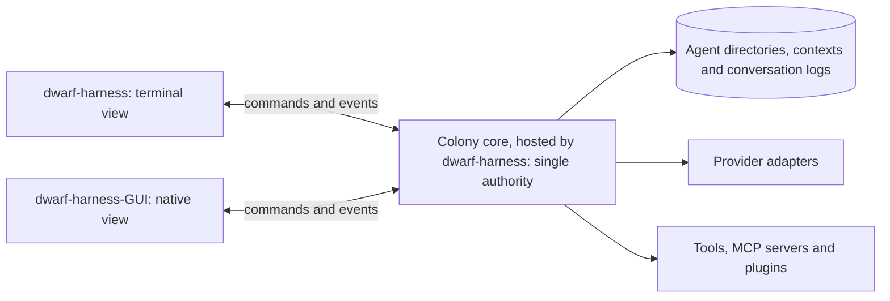

# Core and launchers design

**Status:** Draft 0.6 — current design and fresh-session handoff; requirements and proposals, not an implementation report
**Updated:** 2026-10-02 (implementation walkthrough decisions D19–D42 in `DECISIONS.md`; measurements in Appendix A.7–A.9); 2026-09-30 (build order, action ledger and workspace model); prototype measurements date from 2026-09-28; local-IPC sources were checked on 2026-09-29.
**Scope:** `dwarf-harness`, an independent Go application with a plain terminal launcher and a native-window launcher, `dwarf-harness-GUI`. This document defines their shared core, agent/session ownership, hierarchical communication, relationship memory, Corps mythology, recipes, workflows and skills.

The Dwarf Fortress-style interface is **GUI only**. Its visual and interaction design is still being developed and will have its own design document.

**Inputs:** the owner's decisions of 2026-09-28, 2026-09-29 and 2026-09-30, and those of 2026-10-02 recorded in `DECISIONS.md`; `RESEARCH-IMPLEMENTATION-LANGUAGE.md`; `DESIGN-ROUTING-LAYER.md`; the three expressly permitted early-design sections; and the throwaway measurements retained in Appendix A.
**Limited reconciliation:** only “What is worth learning from StarNet” (the section described as “What is worth saving”), “Recipes and workflows”, and “Skills” were incorporated from the original design. That original is now `superceeded-Design.md`, kept with the superseded browser-launcher proposals in the archive folder `../dwarfharness/`, outside this repository. The rest of the original and other existing design documents remain unreconciled. No other early-design section is adopted by implication.

**Independence:** DwarfHarness draws on ideas from other projects, but is not a StarNet fork, port or add-on. It runs no part of that project and has no upstream-runtime, compiler or behavioral-parity requirement. The retained ideas below are requirements for an independently designed implementation, not a commitment to imported code or catalogues.

Conventions:

- Owner decisions are distinguished from implementation proposals. **[INFERENCE]** marks a deduction or proposed mechanism that the owner has not specified. **[PROPOSAL]** marks a proposal made in another document, such as the validation research, that the owner has not decided.
- Model-token cost and device cost are reported separately. Unmeasured costs remain unmeasured.
- Historical measurements are not measurements of the new native GUI, a shared colony core or the multi-agent organization.
- The exact launcher names are `dwarf-harness` and `dwarf-harness-GUI`, retaining the owner's uppercase `GUI` suffix. Example types and commands are design contracts, not implemented APIs.

## Start here for a fresh session

**Current stopping point:** the 2026-10-02 implementation walkthrough decisions are recorded in `DECISIONS.md` (D19–D42 and build decision B1), and the work is ordered by `ROADMAPS.md`. No code exists yet. Among those decisions, the one-execution-session/many-private-contexts model is adopted (D21–D23, D25; §7.3), the colony log and colony data layout are settled (D33–D38; §3.2), and the product is two programs (D39). The broker (§7.4) and the local IPC transport (§3.4) remain proposals. The 2026-09-30 decisions on build order, the action ledger and the workspace model stand (§2 D14–D18, §3.2, §3.5). The universal-field philosophy in `FIELD-PHILOSOPHY.md` remains pre-design.

| Read | Authority and purpose |
|---|---|
| **First:** [`ROADMAPS.md`](ROADMAPS.md) | Which roadmap step owns the work, what it waits for, where to stop and how several agents integrate (D19, D41) |
| **Then:** [`DECISIONS.md`](DECISIONS.md) | The decision log: every owner decision from D19 onward, continuing §2; build decisions; the open items awaiting the owner |
| **Then this document:** §1–§2, §7, then §3 (including §3.5), §4 and §10 | Owner decisions D1–D18 with pointers to later ones, role graph, the adopted relationship-context model, workspace model, launcher/core boundary and unresolved mechanisms |
| [`DESIGN-ROUTING-LAYER.md`](DESIGN-ROUTING-LAYER.md) — routing design §5, §6 and §15 | Router contracts within those core boundaries; its provider facts and calculations retain their recorded research dates |
| [`FIELD-PHILOSOPHY.md`](FIELD-PHILOSOPHY.md) for the current environmental-layer discussion | Owner's universal-field direction, research-backed proposals and unresolved philosophical choices; not an adopted Field Design or a change to direct-message permissions |
| [`RESEARCH-IMPLEMENTATION-LANGUAGE.md`](RESEARCH-IMPLEMENTATION-LANGUAGE.md) when the language/build rationale or measurements matter | Historical comparison plus current-decision addendum; its earlier Rust/no-C/browser recommendations do not override the current Go/native-window decisions |
| [`RESEARCH-OPEN-SOURCE-HARNESSES.md`](RESEARCH-OPEN-SOURCE-HARNESSES.md) when evaluating prior-art tradeoffs | Historical research and optional ideas, not an implementation backlog or adopted runtime |

**How to read the status:** §2 records the owner's decisions D1–D18 with pointers to later amendments; `DECISIONS.md` records D19 onward. **[INFERENCE]**, “proposed” and “recommendation” identify deductions or mechanisms not independently selected by the owner. Present-tense API/behavior descriptions state the intended contract, not existing functionality. The core document owns organization, messaging and execution/context ownership; the routing document owns routing within those boundaries. Historical research cannot silently reopen a settled choice.

**Implementation and evidence:** these design rounds produced documents and throwaway experiments, not a completed implementation of this independent architecture. Existing legacy files have not been audited against it. Go/interface sketches and rollout gates are specifications, not runnable APIs or completed phases. Appendix A retains dated prototype measurements; Appendix B records the narrower relationship-model exercise and the runtime obligations still unverified. A fresh session need not repeat old benchmarks merely to resume the design.

**Recommended continuation:** follow `ROADMAPS.md`: core first (D20), starting with step C0 in `ROADMAP-CORE.md`. Its status board shows what each step waits for, and each step names where to stop. Record new decisions in `DECISIONS.md` rather than treating this document's recommendations as adopted.

**Reserved choices:** native toolkit and GUI visual design, Griot cadence, birth-selection policy/process/protocol, detailed Grand mandates, the open items awaiting the owner in `DECISIONS.md` and the remaining mechanisms in §10 stay open.

**Continuation scope:** the documents now live in `docs/` of this repository, their only living copy (D30). `superceeded-Design.md`, `recipes/` and the legacy code and data stay unread in the archive folder `../dwarfharness/`, outside this repository, unless the owner separately authorizes access; the permitted ideas have already been incorporated into §11–§12. Unreconciled design documents are not authority for this independent application. Git work in this repository follows D31 and D41: Conventional Commits; one worktree and branch per agent; `main` moves only by fast-forward after the full check (D42); changes touching a frozen contract, an owner decision or a new dependency wait for the owner; nothing is pushed without the owner.

## 1. Summary

- **Two programs, one core, one set of capabilities (D39).** `dwarf-harness` is the colony core host plus the terminal, always built without cgo. `dwarf-harness-GUI` opens a native window as a display client only: it starts `dwarf-harness` as its colony's host when none is running, then attaches, and it holds no colony logic and no API keys. Both expose the same harness functionality. The core owns transcripts, prompts, routing, credentials, permissions, tools and session state.
- **Native GUI replaces the external-browser launcher.** A C toolchain will be acquired (llvm-mingw, D28). Go remains the implementation language, but `CGO_ENABLED=0` is no longer a requirement for every build. The native toolkit is not selected here.
- **A live session can appear in both launchers at once.** They are two views of one session, not two independent runs. A colony-scoped core authority serializes commands and supplies an event cursor to each view (§3–§4).
- **One GUI instance per colony.** Reopening the same colony addresses its existing GUI; different colonies may have separate instances. A Colony contains specialized Corps, with Grand Orchestrator, Grand Griot and Grand Diplomat roles at the top.
- **Separate relationships, not a session-count formula (D21).** The earlier `n+1` proposal is replaced, not extended to `n+3`: each agent has one execution session and many private contexts keyed by `(agent_id, context_id)`, for general work, tasks, relationships and boards (§7.3). The durable messaging broker and the board mechanics (§7.4–§7.5) remain proposals.
- **Simultaneous turns (D22).** An agent may run turns in several of its contexts at once, up to a per-agent limit, with at most one turn per context. Versioned writes to agent-wide files, atomic core records for anything that must not be handed out twice, and budget reservations before each call guard those turns (§7.3); a second writer to one task gets temporary scratch (D23, §3.5).
- **Drift is intentional.** Clones begin with the same `Agent.md` and optionally selected memory copies, then develop independently. Birth still requires an orchestrator's superior's permission; its selection policy, process and protocol remain open.
- **Every Corps has an Orchestrator, Griot and Diplomat.** Their direct communication paths differ. Workers communicate with one another through the Corps board; Griots reach workers only through story output there. Lateral inter-Corps direct communication belongs to Diplomats (§7.2).
- **Retained early ideas:** explicit capability grants; executable workflow graphs and guarded model calls; parameterized recipes with host-checked acceptance; and lazy, shared-format skills (§11–§12).
- **Efficiency remains a goal, not a reason to reject the native window.** Keep the terminal light, load skills on demand, use hand-written provider adapters where justified, and measure the native GUI separately. The adapter-only prototype was 6.86 MB; linking both official SDKs made its counterpart 18.21 MB (Appendix A.5).
- **Build order.** Harness and colony core first. The environmental field layer is a later package inside the harness, testable as a standalone engine against synthetic ledgers, and gated behind substantial testing before it may affect agents (§2 D14, §9 phase 5).
- **Action ledger, private scratch, fast-forward promotion.** The core records typed action deltas in one append-only colony log, our own JSON-lines format written with the standard library (D33–D35), and stores larger bodies content-addressably; each work context has a private git-worktree scratch per workspace root. Canonical artifacts are intended to change only through core-performed fast-forward promotion, but enforcement against child access to shared Git metadata remains open (§3.2, §3.5).

## 2. Decisions and resolved assumptions

| ID | Current decision | Recorded |
|---|---|---|
| **D1** | Implement the harness in Go. A C toolchain is accepted for the native launcher; the earlier universal cgo ban is superseded. **Toolchain detail: D28.** | 2026-09-28; amended 2026-09-29 |
| **D2** | Program and terminal launcher: `dwarf-harness`. Native-window launcher: `dwarf-harness-GUI`. The browser launcher is superseded. | 2026-09-29 |
| **D3** | Control and trust stay in the harness; provider features remain optional (routing design T10). | 2026-09-28 |
| **D4** | No automatic provider switching in v1; user-chosen changes work; provider betas stay behind flags, off by default (routing design §9.8 and C5). | 2026-09-28 |
| **D5** | Both launchers have the same harness functionality and may show one live session simultaneously. Session spawning is available from the GUI as well as the terminal. | 2026-09-29 |
| **D6** | Each colony has at most one GUI instance. Another invocation for that colony reuses it; other colonies have their own instance scope. | 2026-09-29 |
| **D7** | Standalone, independently implemented application; inspiration does not impose an upstream code, runtime or compatibility dependency. | 2026-09-29 |
| **D8** | Each ordinary agent owns a directory and one session. Cloning copies `Agent.md`, with memory copying optional. | 2026-09-29 |
| **D9** | Preserve distinct conversational memory for every relationship, not just orchestrator–worker pairs. Reconsider the initial `n+1` sessions before adopting a wider count such as `n+3`; the uniform context/broker model in §7 is a recommendation. **Open question resolved by D21; the broker remains a proposal.** | Amended 2026-09-29 |
| **D10** | Agent drift is a feature. Birth of a new agent from selected aspects of others requires its initiating orchestrator's superior's permission. Selection policy, process and protocol are not yet chosen. | 2026-09-29 |
| **D11** | Every Corps has an Orchestrator for logistics, a Griot for story/mythology and an embedded Diplomat representing its needs. Their permitted communication paths, including workers' board-only peer communication, are recorded in §7.2. | Expanded 2026-09-29 |
| **D12** | The hierarchy culminates in Grand Orchestrator, Grand Griot and Grand Diplomat roles. Their detailed functions will be specified later. | 2026-09-29 |
| **D13** | Corps specialize within a Colony, for example Scouts, Researchers, Laborers and Diplomacy. Specialization and passing on lessons are design goals. | 2026-09-29 |
| **D14** | Build the harness and colony core first. The environmental field layer is implemented inside the harness as a package that can be tested as a standalone engine, and must pass substantial testing before it is allowed to affect agents. | 2026-09-30 |
| **D15** | The core records typed action deltas in an append-only action ledger; large bodies live in a content-addressed store under an operator retention policy (§3.2). Whether this logical ledger shares a physical event log/database with session-view events remains open. **Physical log settled by D33–D38.** | 2026-09-30 |
| **D16** | Private scratch per unit of work is the implementation design philosophy for work artifacts, intended to use git worktrees of the workspace repository; git clones are rejected as untenable. Canonical artifacts are intended to change only through core-performed promotion, with enforcement still open (§3.5). | 2026-09-30 |
| **D17** | The unit of scratch is the bound work context per workspace root. A work context is task-shaped and owns its scratch, base commit, integration state and promotion record (§3.5, §7.3). **Amended by D23.** | 2026-09-30 |
| **D18** | Promotion is fast-forward only: it is refused when canonical has moved, and integration is the agent's own observed work inside its scratch (§3.5). | 2026-09-30 |

**Decisions from D19 onward** are recorded in [`DECISIONS.md`](DECISIONS.md), the append-only decision log, and are cited here by ID. Those this document applies:

| ID | Decision | Applied in |
|---|---|---|
| D19, D40 | Separate roadmaps that name their dependencies on one another; contracts between roadmaps | Start here, §3.1, §3.2, §9 |
| D20 | Core first; Undercurrent only against frozen contracts | Start here, §9 |
| D21 | One execution session per agent, many private contexts | §1, §7.3, §7.4, §7.6, §10 |
| D22 | Simultaneous turns, with four safeguards | §1, §3.2, §4.1, §7.3, §10, §12.3 |
| D23 | Temporary scratch for a second writer to one task (amends D17) | §3.5, §7.3 |
| D24, D25 | Accept prompt-cache double payments; a turn sees a list of its agent's other active contexts | §7.3 |
| D26 | One core and one ledger per colony | §3, §3.2, §3.5, §10 |
| D27 | Windows first; portable to macOS and Linux | §8 |
| D28 | Toolchain and cgo | §1, §6.3, §8.1, §8.5 |
| D29 | Dependency policy | §8.1, §8.2 |
| D43–D46 | Module path; a nested `gui/` module; package layout and import rules; the full check passes before `main` moves | §8.2; Start here |
| D30, D31, D41 | Repository; decision log and working rules; several agents in one repository | Start here |
| D32 | `Agent.md` spelling | Throughout; §3.5 |
| D33–D38 | What the colony log holds; ledger storage; record format; integrity and retention; IDs and time; where colony data lives | §1, §3.2, §3.5, §4.1, §7.4, §8.2, §8.6, §10 |
| D39 | Two programs | §1, §2 (I3), §3, §3.1, §6.1, §8.5 |
| D42 | Check command and CI | Start here, §8.2, §8.5 |
| B1 | Line endings (build decision) | §3.5 |

The four earlier launcher assumptions are resolved as follows:

| Earlier assumption | Resolution |
|---|---|
| **I1 — Dwarf Fortress-style interface belongs only to the graphical launcher** | **Confirmed.** It is native-GUI only; the terminal is plain text. The visual design is a separate future document. |
| **I2 — Use the system's default browser** | **Superseded.** That describes the archived browser launcher, not the selected native window. It is not a third active launcher. |
| **I3 — Both launchers come from one program with the same functionality** | **Confirmed at the application/core level.** Two entry points use one core implementation and the same permissions and features. The exact executable packaging is an implementation choice, not two separate harnesses. **Packaging settled by D39:** two programs, `dwarf-harness` hosting the core and `dwarf-harness-GUI` as a display client. |
| **I4 — A session appears in only one launcher at a time** | **Replaced.** The same live session may appear in both. Spawning an agent's session inside the GUI is supported, subject to the agent/session ownership rules in §7. |

The owner's later references to the web and to a browser for colonies and session spawning are interpreted here as referring to the selected GUI. The explicit native-window decision governs; the previous browser bullets, transport and measurements are in `superceeded-Design.md`, in the archive folder `../dwarfharness/`, outside this repository.

## 3. Process model and colony ownership

**One writer, multiple views.** Each live session has one authoritative core owner. Attaching the other launcher adds a view; it must not start a second agent loop, duplicate provider calls or create another session. Each view has an independent read cursor (§4).

**Process arrangement (D26, D39):** one core host process per active colony, the sole writer of that colony's ledger. The `dwarf-harness` program is that host; `dwarf-harness-GUI` attaches to it as a display client and starts `dwarf-harness` first when no host is running (§3.1). This replaces the old rule that each launcher owns an isolated in-process core, and it does not require a permanently installed global service. Within the host, the core is a Go library and the router has no daemon or port of its own [INFERENCE]. The IPC transport between host and views is still the recommendation in §3.4.



The diagram shows one colony; another colony has its own core host, ledger and GUI instance scope (D26). The broker described in §7 lives inside this core, not in a separate service or in a Diplomat's model turn. The role hierarchy is logical, not a process tree.

### 3.1 Starting and attaching

- Both launchers identify the colony and ask its core to attach to the selected session, or to spawn an allowed agent/session.
- If no core host runs for the colony, `dwarf-harness-GUI` starts `dwarf-harness` as that colony's host, then attaches over the local connection (D39). Host and view check protocol versions when they connect (D39; the `launcher-protocol` contract in `CONTRACTS.md`). A GUI crash cannot stop a turn. How a host started this way runs without a terminal view, and how a hosting `dwarf-harness` outlives its own terminal view while other views remain (§5), are open (§10 item 2).
- Core startup must have a single-owner claim so simultaneous launcher starts cannot produce two writers for one colony/session. The GUI has a separate per-colony instance claim: a terminal attachment does not consume that GUI slot. [INFERENCE]
- A second `dwarf-harness-GUI` invocation for the same colony activates the existing instance and passes it the requested session selection; it does not create a second window instance or session owner. A different colony can open its own GUI.
- A local attachment channel must restrict access to the intended OS user and colony, validate commands, and keep provider credentials in the core. §3.4 recommends a transport; instance discovery and recovery still need implementation design.
- Closing or disconnecting one view does not cancel a turn still owned by the core or terminate another view. Explicit turn cancellation and colony shutdown are distinct operations. The policy after the last view disconnects is open (§10).

### 3.2 Files and credentials

- Each agent directory owns its execution-session audit trail and private context files (§7.3). Authorized shared exchanges live in colony-owned conversation logs, including Corps boards; neither participant owns the other's private memory.
- **Agent-wide files (D22).** The core writes `Agent.md`, general `Memory.md` and skill edits with a version check, because one agent's turns may run in several contexts at once. A write based on an out-of-date copy is refused, and the turn re-reads.
- The core is intended to be the sole writer of canonical harness state. This is a protocol boundary, not an OS-enforced guarantee against same-user child processes; a lock prevents a second core, not a child from accessing files. Reconnection resumes from an event cursor; restart reconstructs accepted messages and unfinished work from committed records. Context Markdown files are scoped materializations, not independent competing message queues.
- **Action ledger and bodies (D15; physical log settled by D26 and D33–D38).** The core records typed action deltas — actor, bound context, tool or operation, target paths/resources, outcome, cost, measurement path and hash references — when it performs or observes the action, never from an agent's report alone. Large payloads live in a content-addressed body store keyed by hash. The ledger is the world-facts substrate the environmental layer will read (`FIELD-PHILOSOPHY.md` §3), not a per-action full-workspace snapshot with retained file bodies. In summary, with the full entries in `DECISIONS.md`:
  - *One colony log (D26, D33).* The colony's core host is its only writer, and every record carries the colony's globally unique ID. One sequence orders actions; workspace and validation events; turn starts and ends; approvals and their outcomes; budget reservations and settlements; messages and inbox processing (§9 phase 2); and router measurements (routing design rule R11). Message bodies, diffs and run logs go in the body store, and streamed model text stays in memory (§4.1). The router's per-call decision record (routing design §11) stays a separate JSON-lines file.
  - *Our own JSON-lines log (D34, D35; Appendix A.8).* Standard library only. Each record is one JSON object per line, prefixed by its SHA-256, in segment files named by the sequence number of their first record. Each commit, one record or several that belong together, is one write followed by a flush, and its last record is marked; recovery truncates a half-written final commit. Lookup indexes are rebuilt in memory at startup. A SQLite index may be added later only on a measured trigger, and only as an index rebuildable from the log, which stays the only source of truth. A written record is never rewritten; formats evolve by optional fields and new type versions, as the `ledger-format` contract in `CONTRACTS.md` will define.
  - *Hash chain and retention (D36).* Bodies and the record chain use SHA-256; each record carries the previous record's hash, and external anchoring of the latest hash waits for assurance level A3. Git object IDs stay in each repository's own format. The log is never deleted or compacted; old segments may be compressed. Bodies may be garbage-collected under an operator policy, so each record holds everything replay needs.
  - *IDs and time (D37).* Every ID is a UUIDv7, and names never grant authority. A gapless per-colony sequence is the only order replay uses. Event time is UTC Unix nanoseconds, never decreasing within a colony; durations come from the monotonic clock. After a crash the core writes an `interrupted` end for every unmatched start and never assumes success.
  - *Colony data layout (D38).* Default root `%LOCALAPPDATA%\dwarf-harness\colonies\<colony>` on Windows, `~/.local/share/dwarf-harness` on Linux and `~/Library/Application Support/dwarf-harness` on macOS, with a per-colony override. It holds `colony.json`, `lock`, `log/`, `bodies/`, `agents/<name>-<short id>/` (`Agent.md`, `Memory.md`, `contexts/<id>/`, `audit/`), `workspaces/`, `scratch/<short id>/` and `runs/<short id>/`.
  - *Private content (D33, D38).* An agent's private context content stays in its agent directory; the log records each change by hash, never by content. The log record is the commit point: on restart a mismatch is reported, never guessed.
- API keys are read by the core from environment variables or the OS keychain. `zalando/go-keyring` supports macOS through `/usr/bin/security`, Linux through Secret Service over D-Bus, and Windows through Credential Manager ([README](https://github.com/zalando/go-keyring)).
- Neither launcher receives provider API keys. Agent instructions, memories, recipes and mythology do not confer tool authority.

### 3.3 Child-process lifetime

Children belong to the core/session that runs them, not to whichever view happens to be open. Go's `exec.CommandContext` kills the direct child by default; descendants need separate management ([`os/exec`](https://github.com/golang/go/blob/master/src/os/exec/exec.go)).

- **Windows:** the core host uses a job object with `JOB_OBJECT_LIMIT_KILL_ON_JOB_CLOSE`. Child processes inherit job membership by default ([job limits](https://learn.microsoft.com/en-us/windows/win32/api/winnt/ns-winnt-jobobject_basic_limit_information); [Job Objects](https://learn.microsoft.com/en-us/windows/win32/procthread/job-objects)). The core's lifetime, not a terminal or GUI window closing, controls this job. Job membership is lifetime management, not a security sandbox.
- **Linux:** put tool/plugin children in process groups and use `Pdeathsig`. Go documents that this signal follows the creating thread's death, not necessarily process death ([`syscall`](https://github.com/golang/go/blob/master/src/syscall/exec_linux.go)); starting children from a goroutine locked to a long-lived OS thread is the proposed safeguard. [INFERENCE]
- **macOS:** process groups and explicit shutdown; descendant cleanup after a core crash still needs verification. [INFERENCE]
- **All systems:** use `exec.Cmd.WaitDelay` so inherited open pipes cannot hang shutdown indefinitely.

The native UI and its framework-managed processes need an explicit lifetime boundary separate from tool children. That boundary will be verified after toolkit selection; the old external-browser breakaway arrangement is not carried forward.

### 3.4 Recommended local IPC [INFERENCE]

**Use an embedded colony broker for agent messaging, and local OS IPC only across process boundaries.** Co-resident agents call the core's authorized messaging API in-process. A Go channel can wake a consumer, but cannot be the durable mailbox. Separate launchers, and any later out-of-process agent hosts, use the same command/event contract over:

- **Windows:** a named pipe, with an explicit intended-user/logon DACL and `PIPE_REJECT_REMOTE_CLIENTS`. Do not accept the default pipe security descriptor: Microsoft documents read access for Everyone and the anonymous account in its default ACL ([pipe security](https://learn.microsoft.com/en-us/windows/win32/ipc/named-pipe-security-and-access-rights); [remote-client mode](https://learn.microsoft.com/en-us/windows/win32/api/namedpipeapi/nf-namedpipeapi-createnamedpipew)).
- **Linux/macOS:** a Unix-domain socket in an owner-only directory, with restrictive endpoint permissions and peer authorization appropriate to the platform. Go's [`net.Listen`](https://go.dev/src/net/dial.go) supports the `unix` network.

Use a versioned, length-framed JSON command/event protocol with enforced frame limits and request IDs. Multiplex session views, conversation operations and event cursors over a client connection; allocate neither an OS endpoint nor a process per relationship. A transport acknowledgment is not a social reply or proof that an agent completed work.

The OS endpoint authenticates the local client; the core separately binds each agent operation to its executing agent, context and allowed destinations. Knowing a pipe name, conversation ID or another agent's name grants no messaging authority. Launcher owner commands and agent-originated commands must remain distinguishable.

This recommendation requires no network port, external message-broker service or distributed consensus within a colony. It does not design cross-colony or remote-host networking. Pipe bindings, endpoint discovery, stale-instance recovery, durable-store layout and platform security need implementation and runtime verification; choosing the messaging model does not choose a GUI toolkit.

### 3.5 Workspaces: private scratch per work context and fast-forward promotion

**Owner decisions (2026-09-30, D16–D18):** a colony's agents do not work directly in one shared tree. Each bound work context has a private scratch checkout per workspace root, cut from canonical and intended to use a git worktree of the workspace's repository; git clones are rejected. The selected promotion rule is fast-forward only: it refuses if canonical has moved, so the agent integrates canonical into its scratch as ordinary work before retrying. Canonical is intended to change through core-performed promotion; how to enforce that against child processes remains open (§10). This is the implementation design philosophy for work artifacts, in line with private memory and individually held relationships: what an agent is doing is its own until it is promoted.

**Why this is a core-v1 concern:** earlier drafts had no workspace model. Without one, two workers editing one tree interleave silently and a parked task and strange-mood intervention share files. A scratch/promotion model provides workspace separation for ordinary host-managed operations and a place from which the host can derive promotion deltas. A git worktree alone, however, does not prevent a same-user child process from modifying canonical repository metadata; §10 records that unresolved boundary.

**Mechanics [INFERENCE unless marked]:**

- *Registration.* A workspace root is registered per colony; in v1 it belongs to one colony (D26). In v1 it must also be a git repository; the core may offer `git init` but does not silently create one. A core-owned shadow repository for non-git roots is a later option, not a v1 requirement.
- *Scratch creation.* On a work context's first use of a workspace, the core creates a linked worktree from the canonical tip and gives it a context-specific branch. Linked worktrees share repository history and object storage, avoiding a separate clone of that history, but each materializes its own checkout of tracked files and therefore still consumes checkout-sized disk space ([git-worktree](https://git-scm.com/docs/git-worktree)). Linked worktrees also share common repository metadata; they are not independent repositories. Scratch paths are outside the canonical working tree.
- *Execution.* Host-performed file tools, agent shell escapes and plugin children use the bound context's scratch as their workspace. The routing permission ceiling `workspace_write` (routing design §6.3) means writes to that scratch, never a grant to promote or edit canonical refs.
- *Per-action observation [INFERENCE].* The host must derive changed paths and content hashes from the scratch after execution; the Git index is mutable by child processes and is not, by itself, trusted evidence. Inclusion of untracked/ignored files, scan bounds and the exact observation mechanism remain to be specified. These action records describe private work and are not automatically shareable field sources.
- *Temporary scratch (D23, amending D17).* Only a task's own turn writes to its scratch, and two turns never run in one context at once (D22). If a second of the same agent's turns writes to a task while that task's scratch is in use, the core gives it a temporary worktree on its own branch, cut from the task scratch's last commit and created on that turn's first write, not at turn start. At the end of every turn the core commits the changes it observed in that turn's scratch. A temporary scratch is merged back as soon as its turn ends and nothing else is writing to the task scratch: the core fast-forwards the task scratch if it has not moved; otherwise it computes a three-way merge with `git merge-tree --write-tree`, commits it if clean, and turns a conflict into work for the agent. The task's next turn receives a note naming the files changed and the context that changed them. Other agents' work reaches a task only through canonical. Under the amendment, a promotion may carry changes written from several of one agent's contexts; the ledger records each change's authoring context, and scratch events gain parent-scratch and authoring-context fields. D18 still governs canonical, and promotion checks test the merged result.
- *Promotion (D18).* The core's intended promotion rule is fast-forward only: refuse when canonical has moved, require the agent to integrate canonical in scratch, then compare-and-swap the canonical ref against the expected old tip. The selected canonical ref, authorization to promote, safety when it is checked out elsewhere, and protection against child processes directly changing shared Git metadata remain open. If implemented with a protected core-owned ref and metadata boundary, the host records the promotion delta and provenance in the action ledger; bodies may be stored by hash under its retention policy. Fast-forward promotion does not itself certify that tests were run or passed.
A worktree materializes tracked files per scratch but does not carry untracked or ignored material (`node_modules`, virtual environments, build output). Per-workspace setup or shared caches may address this; their policy, security and cost remain open.

**Windows costs (Appendix A.7, measured 2026-10-02):**

- Creating a worktree costs about 2 ms per file on the owner's machine: `git worktree add` took 1.5–2.2 s for 1,000 files and 19–21 s for 10,000. Merging back is cheap by comparison: a fast-forward took 0.23–0.32 s and `git merge-tree --write-tree` 0.09–0.15 s.
- The first read of a freshly written file took about 23 ms, a repeat read about 0.2 ms. Hashing every file of a fresh 10,000-file worktree took 305 s; a stat-only walk took 0.6 s. Attributing the first-read cost to antivirus scanning is [INFERENCE].
- Consequences [INFERENCE]: change observation hashes only files whose stat data changed; a pool of spare worktrees, reused with `git switch` after deleting untracked files (0.3 s when few files differ), avoids the per-file creation cost; otherwise every new work context, temporary scratch and fresh validation directory pays about 2 ms per file on this machine unless scanning is excluded.
- Whether to exclude the colony's `scratch/` and `runs/` from Windows Defender scanning is a security decision awaiting the owner; `DECISIONS.md` lists it as an open item blocking C2 and C4.

**Windows hazards [INFERENCE unless marked]:**

- *Line endings.* The owner's system git configuration sets `core.autocrlf=true` (A.7), so files on disk can differ byte-for-byte from what git stores, and host-computed hashes can disagree with git's. B1 fixes LF for this repository only; how C2 handles the line endings of repositories agents work on is a C2 question (B1).
- *Long paths.* git's `core.longpaths` is unset by default (A.7), so scratch and run directories use short IDs: `scratch/<short id>/` and `runs/<short id>/` (D38).
- *Locked files.* Windows can refuse to delete or rename a file that another process, such as an editor, a running tool or a scanner, holds open. Worktree removal, reuse of a spare worktree and merge-back can then fail part-way; the core records such a failure and retries or cleans up later, never assuming success.
- *Case-insensitive paths.* Windows file systems are usually case-insensitive, while git and Linux are case-sensitive. Two tracked paths that differ only in case collide in a Windows checkout, and observation must compare paths as git records them. D32 fixes the spelling `Agent.md` because Linux file names are case-sensitive.

**Isolation limit:** private scratch per work context is the workspace design philosophy, but a linked Git worktree is not a security sandbox. Its common repository metadata is shared; a same-user shell can discover and may be able to alter refs, objects, config or another worktree unless the host/OS prevents that access. Scratch therefore separates ordinary work paths but does not yet guarantee that canonical can change only through host promotion, nor close the same-user read hole in §7.4. The implementation needs an enforceable boundary for core-owned refs and private files before claiming either property against hostile tools.

**Open (§10 item 8):** what "canonical" is — a core-owned branch ref that is never checked out in the human's main worktree is recommended because moving a checked-out branch ref without updating its files can leave the checkout inconsistent; who may promote and whether approval or workflow acceptance is required; the human's participation; scratch-branch retention/garbage collection; setup costs; non-git roots; the enforceable boundary protecting shared Git metadata and private files from child processes; and whether to exclude the colony's `scratch/` and `runs/` from Windows Defender scanning, an owner security decision (Appendix A.7).

## 4. The contract between the core and the launchers

Both launchers use the same commands and events. Transport may differ, but prompt construction, routing, approvals, tools, spawning and persistence do not. The following interface is a session-bound surface, not permission to allocate arbitrary sessions:

```go
// Session is a view of a core-owned session (design sketch).
type Session interface {
    // Since returns events after cursor and a signal that more may be available.
    Since(cursor int64) ([]Event, <-chan struct{})
    Do(ctx context.Context, cmd Command) error
}

type Event struct {
    ID        int64           // consecutive within this session; display/reconnect cursor
    Type      string
    ContextID string          // required for turn-bound events; absent on unbound notifications
    Turn      int64           // 0 when the notification is not associated with a turn
    Data      json.RawMessage
}
```

**Binding rule [INFERENCE]:** the authenticated `Session` handle supplies colony, agent and execution-session identity. Every turn-bound event carries its bound context and turn, regardless of the view's current selection. A conversation/inbox notification may have no turn; it identifies its conversation/message instead of fabricating an active turn. The session event cursor, conversation sequence and recipient processing cursor are distinct positions, not interchangeable acknowledgments.

### 4.1 Shared live state

- The core appends to an ordered event log; each terminal/GUI view retains its own cursor. A slow or reconnecting view catches up without losing approvals or turn completion. Text streamed from a model during a turn is held in memory only, for the views watching that turn; the colony log records the finished message (D33).
- Commands are scoped to colony, agent and execution session, and agent work additionally binds an explicit `context_id` (§7.3). An execution session may run turns in several contexts at once, up to the per-agent limit, with at most one active turn per context (D22). The core orders competing starts per context and reports busy rather than silently creating another session or a second turn in that context; receiving a durable message queues work and need not start a turn immediately. [INFERENCE]
- An approval or router notice is resolved once by its ID. A stale answer from the other view cannot rerun an action; both views receive the resolved state. Cancellation likewise reaches the shared turn, not just one display. [INFERENCE]
- Routing continuation state, provider conversation IDs, cache ledgers, compaction and private memories follow the addressed agent/context, not merely the execution session. Approvals bind to that context and action/turn unless the owner explicitly grants broader authority. Switching a GUI tab or relationship does not switch an already running turn's context.
- Prototype evidence supports cursors rather than dropping broadcasts: all 5,002 events arrived with cursors, while a bounded dropping-channel version lost the end-of-turn event (Appendix A.4). Simultaneous native/terminal attachment has not yet been implemented or measured.

### 4.2 Events and commands

| Event | Carries | Terminal launcher | Native GUI |
|---|---|---|---|
| `turn.started` | Agent, context, turn identity and input reference | Shows the bound work context | Adds it to that context's view |
| `text.delta` | Text | Prints it into scrollback | Appends rendered text |
| `tool.started`, `tool.output`, `tool.finished` | Tool, argument summary, output, status | Compact call/output lines | Expandable call details |
| `approval.requested`, `approval.resolved` | Approval ID, action, allowed choices or outcome | Prompt or resolution line | Dialog or resolved state |
| `router.notice`, `router.notice.resolved` | Cause, priced choices and outcome | Numbered choices | Dialog |
| `usage` | Tokens, cache usage and cost | Stats output | Status view |
| `turn.finished`, `turn.cancelled`, `turn.failed` | Stop reason or error | Returns to prompt | Closes the shared turn in its log |
| `conversation.appended` | Conversation ID, sequence and authorized message reference | Shows inbox/board activity | Updates the same inbox/board |
| `message.processed` | Message reference and committed processing outcome | Distinguishes receipt from processing | Updates delivery/processing status, not a fabricated reply |

| Command or operation | Required meaning |
|---|---|
| `message.send` | Submit owner text/attachments to an explicitly selected agent/context. Owner input is not a message attributed to that context's peer and is not automatically published to the conversation. |
| `approval.answer` | Resolve an approval by ID: once, this context, always or deny, bounded by the configured ceiling. Broader grants must name their actual scope; “this session” must not silently mean every relationship. |
| `turn.cancel` | Cancel the identified shared turn. |
| `notice.choose` | Resolve the identified router notice. |
| `command.run` | Run a core command such as route/provider/effort/session selection. |
| Session attach/resume | Open a view of an existing session; do not allocate a new session. |
| Agent/session spawn | Allocate identity, permitted execution session, Corps/parent assignments and authorized conversation handles before work starts (§7). Available from either launcher. |
| Agent clone / birth request | Apply the cloning or superior-approved birth rules in §7; not a shortcut around them. |
| `conversation.send` | Send an agent-originated message through the authorized private relationship, bound to its sender/context (§7.4). |
| `board.post` / `story.publish` | Append a group discussion or Griot story under the board's role and audience rules (§7.5). |

Raising a permission ceiling is a separate deliberate operation, not an incidental answer to one tool prompt. Launchers are views: they never independently build prompts, choose models, execute tools or mutate permission state.

## 5. Terminal launcher: `dwarf-harness`

**Input**

- **Line editing:** `golang.org/x/term` provides editing, history and bracketed paste; it added 0.18 MB in the prototype. For piped/scripted input, read plain lines.
- **Raw mode only during line editing:** restore normal mode while a turn streams. On Windows, `os.Interrupt` can receive Ctrl+C without exiting ([`os/signal`](https://github.com/golang/go/blob/master/src/os/signal/doc.go)); in raw mode `x/term` instead receives byte 3 and ends `ReadLine` with `io.EOF` ([source](https://github.com/golang/term/blob/master/terminal.go)).
- **Cancel versus detach:** Ctrl+C during an active turn requests core cancellation, visible in both launchers. At an empty prompt, Ctrl+C or Ctrl+D exits this terminal view without implicitly terminating the GUI or colony core.
- **Paste:** a multi-line paste is one message; `x/term` marks it with `ErrPasteIndicator`.

**Output and functionality**

- Scrollback output, no alternate screen, glyph map or full-screen renderer. The Dwarf Fortress-style presentation belongs only to the GUI.
- Color only for terminal output when `NO_COLOR` is unset ([NO_COLOR](https://no-color.org/)); enable Windows virtual-terminal processing first ([SetConsoleMode](https://learn.microsoft.com/en-us/windows/console/setconsolemode)).
- Go's Windows console path uses `WriteConsole` with UTF-16 conversion ([source](https://github.com/golang/go/blob/master/src/internal/poll/fd_windows.go)).
- Approvals accept a short line; router notices offer numbered choices. Workflow editing/execution, agents, cloning, skills and session spawning remain available through textual commands. GUI-only presentation does not mean GUI-only harness features.

**Historical terminal-path measurements:** 7.1 MiB resident and about 1.0 million CPU cycles over 150 idle seconds; 21 ms for 200 deltas; 40 ms for 5,000 deltas. These came from the former combined prototype, not the new IPC design (Appendix A.3).

## 6. Native-window launcher: `dwarf-harness-GUI`

### 6.1 Surface and packaging

- Open an application-owned native window, not a tab in the system browser. Supply the GUI entry point/desktop launcher under the exact requested name.
- Packaging is decided by D39: two programs. `dwarf-harness` is the colony core host plus the terminal, always built without cgo. `dwarf-harness-GUI` is a display client with no colony logic and no API keys; it starts `dwarf-harness` as its colony's host when none is running and attaches over the local connection (§3.1). Both expose the same operations through the one core, so the shared session model is unchanged, and a GUI crash cannot stop a turn.
- A native widget toolkit or an embedded renderer may be evaluated later. Accepting a C toolchain removes the earlier rejection criterion; it does not select a toolkit or commit to a particular renderer.
- The Dwarf Fortress-style glyph map and related visual treatment are GUI only. This document does not pre-empt the forthcoming interface design.

### 6.2 Colony instances and session views

- A colony permits one GUI instance, capable of displaying its sessions rather than requiring another application instance for every agent.
- Reopening that colony brings forward the existing instance. Opening another colony can create another instance. Detection, focus handoff and stale-instance recovery are implementation details still to be designed.
- The GUI may spawn an agent's session and attach a view to it. The core must establish directory/session ownership, role/Corps membership, assigned parent links and permitted conversation handles before work starts. Opening a relationship panel loads a view, not an additional execution session.
- A terminal may display and control that same session simultaneously. Opening a panel, reconnecting a view or switching between agents never multiplies sessions.

### 6.3 Trust and resource requirements

- Treat all model/tool output, memories, skills and mythology as content, never as executable UI code or authority to approve actions. If an embedded renderer is chosen, its bridge and output rendering need a framework-specific security design.
- Keep keys, execution and approval enforcement in the core. Validate every UI-originated command through the same path as terminal commands.
- Redraw on state changes; idle windows should not run a continuous animation/polling loop. Suspend optional animation when hidden or minimized. These are design requirements, not measured properties of a selected toolkit.
- Closing a GUI view is not colony shutdown. A deliberate shutdown command must make the effect on active agents and attached terminals clear.

| Adds | Model-token cost | Device/build cost |
|---|---|---|
| Native window and graphical session views | No additional model calls merely to display the same events | Toolkit/runtime, rendering memory, startup and platform packaging: unmeasured |
| Dwarf Fortress-style presentation | None for drawing existing core state | Drawing and optional animation: to be measured after the visual design |
| C toolchain availability | None | Compiler/SDK install, builds and platform maintenance. The chosen llvm-mingw (D28) is a 190.7 MB download and 750 MB extracted (A.9); the GUI toolkit's own SDK needs are unmeasured |
| Simultaneous terminal and GUI attachment | No duplicate model call for the same turn | IPC, another view and cursor bookkeeping: unmeasured |

The former browser server's memory, startup and 11 HTTP security checks are archived in `superceeded-Design.md`, in the archive folder `../dwarfharness/`, outside this repository. They are not evidence of native-GUI performance or security.

## 7. Hierarchy, relationships and messaging

### 7.1 Roles, identity and specialization

**Owner requirements:** a Colony contains specialized Corps. Every Corps includes an **Orchestrator**, **Griot**, **Diplomat** and its workers. **Grand Orchestrator, Grand Griot and Grand Diplomat** sit at the top of the hierarchy. An agent keeps its own identity and directory; sharing a role title does not make two agents interchangeable.

| Role | Responsibility |
|---|---|
| Orchestrator, at every level | Logistics and the effective operation of the workers/units it manages |
| Griot, at every level | Guide its Corps through story and mythology; memorialize achievements and develop culture |
| Diplomat, embedded in every Corps | Represent the Corps' needs to parent and fellow Diplomats; connect permitted local and inter-Corps conversations |
| Worker | Carry out the Corps' specialized work and contribute experience through permitted direct channels and the group board |

Scouts, Researchers, Laborers and Diplomacy are examples of **Corps specializations**, not a closed role catalogue. A Diplomacy-specialized Corps does not replace the embedded Diplomat in every other Corps.

**Grand-role projection [INFERENCE]:** the Grand Orchestrator coordinates colony-wide logistics through child Orchestrators; the Grand Griot connects the story traditions of child Griots; the Grand Diplomat coordinates needs through child Diplomats. A same-level Grand triad can use the same pairwise relationship mechanism as a Corps triad. These are broad deductions, not final mandates, birth-approval powers or an unrestricted right to inspect every descendant's private context.

The core's organization registry records identities, role, Corps membership and explicit parent links. Parent relationships are assigned edges, not permissions inferred from a title or a matching name. The number and arrangement of intermediate levels remain open; the communication rules apply at each level.

### 7.2 Permitted communication paths

The owner's rules produce the following direct-message graph. A listed pair may exchange messages in both directions; parent/child rows describe the two ends of the same assigned relationship.

| Agent | Permitted direct counterparts | Shared-board output |
|---|---|---|
| Corps Orchestrator | Own Diplomat and Griot; its child workers; assigned parent and child Orchestrators | No additional posting right implied |
| Corps Griot | Own Orchestrator and Diplomat; assigned parent and child Griots | Story publications/updates to its Corps' communal worker board only |
| Corps Diplomat | Own Orchestrator, Griot and workers; assigned parent and child Diplomats; fellow Corps Diplomats in the Colony | No additional posting right implied |
| Worker | Its parent Orchestrator and own Corps Diplomat | Group discussion with its Corps' workers; reads Griot story output |
| Grand triad | Assigned child counterparts of the same role; same-level triad links are the projection in §7.1 | No automatic access to every Corps board or posting right |

**Vertical versus lateral [INFERENCE interpreting the stated rules]:** the explicit parent Orchestrator/Griot chains are vertical hierarchy links. The diplomat-only cross-Corps rule governs **lateral** direct communication. Otherwise the two requirements would contradict one another. An Orchestrator cannot privately message a peer Corps' Orchestrator, nor a Griot a peer Corps' Griot, merely because they hold the same role. A Diplomat may contact another Corps' Diplomat, not that Corps' workers or leadership directly.

**Default deny applies to unlisted pairs and operations.** In particular:

- no worker-to-worker direct messages, even inside one Corps;
- no private Griot–worker messages in either direction, nor conversational Griot replies to workers disguised as board chat;
- no direct worker contact with a foreign Corps' Diplomat, Orchestrator or workers;
- no arbitrary ancestor/descendant contact outside an assigned parent/child link;
- no cross-colony route by implication.

Group discussion is a genuine shared audience, not a private recipient list hidden behind a board name. A mention or reply reference does not create a private subchannel. Likewise, the broker never fabricates an intermediate Diplomat's message to turn a forbidden send into an apparently authorized route. Forwarding is an explicit act by an authorized participant, with provenance; content received from a superior is still not a tool grant.

### 7.3 Replace session multiplication with private relationship contexts (adopted: D21–D23, D25)

**Decision (D21, 2026-10-02): one execution session per agent, with many durable contexts.** The earlier `n+1` proposal used sessions to obtain distinct memory; adding a Diplomat, Griot, parent and peer relations makes a role-specific session formula the wrong abstraction. Keep the separation, not the multiplication. D21 adopts this section; the broker in §7.4 remains a proposal.

| Concept | Owns | Does not imply |
|---|---|---|
| Agent | Stable identity, one directory, `Agent.md`, explicit role/membership/capabilities | A process per agent or inherited authority from a role name |
| Execution session | Resumable execution lifecycle, turn scheduling and an audit trail; turns in several contexts at once, up to the per-agent limit (D22) | One pooled model transcript, or another session for each relationship/view |
| Conversation | Canonical exchanged messages: an authorized pair or a shared Corps board | Access to either participant's private thoughts or context files |
| Private context | Colony-scoped `(agent_id, context_id)` memory, handoff, prompt history, provider continuation, compaction, routing state and cache ledger; for a work context, also its scratch worktree, base commit, integration state and promotion record (§3.5) | Permission to send to the subject of that memory |
| Inbox | Pending authorized message references and processing state | Another transcript, model instance or duplicated copy of shared history |

For a private pair **A ↔ B**, store one exchanged-message history, **A's private context about B**, and **B's private context about A**. Those two contexts are neither aliases nor a jointly edited `Memory.md`. The same arrangement applies to Orchestrator–worker, worker–Diplomat, Orchestrator–Griot, Diplomat–Diplomat and parent-role relationships. Each side may remember and interpret the exchange differently.

Each agent also has a general-work context and a context for each board it participates in. Peer-specific observations from public board exchanges can live in that agent's own relationship memory even when no direct-message edge exists. Thus a worker can develop an attitude toward another worker without acquiring a private channel to it. To use those observations publicly, explicitly select authorized excerpts into the agent's **board context**, and compose in a board-bound turn; a peer-bound turn cannot retarget its output to the board.

**Owner decision (2026-09-30, D17):** a work context is task-shaped, not only relationship-shaped. It is the unit that owns a scratch per workspace root (§3.5). The general-work context above is one such context; a strange mood (`FIELD-PHILOSOPHY.md` §9) or a reassigned task is a new one, cut from current canonical, so the parked task's scratch is untouched and can be resumed or handed to a clone. Promotion originally carried exactly one context's changes; **D23 amends D17**: a promotion may carry changes written from several of one agent's contexts, each recorded with its authoring context (§3.5).

**Simultaneous turns (D22):** an agent may run turns in several of its contexts at once, up to a per-agent limit that is a setting (start near 3; a limit of 1 gives one turn at a time). Orchestrators and Diplomats hold many relationships and would otherwise become the colony's bottleneck. Four safeguards apply:

1. The core writes agent-wide files (`Agent.md`, general `Memory.md`, skill edits) with a version check; a write based on an out-of-date copy is refused, and the turn re-reads (§3.2).
2. Anything that must not be handed out twice, such as task assignments and reservations, is a core record changed atomically, never something the model remembers.
3. At most one turn is active per context. Only a task's own turn writes to its scratch; another context's write goes to temporary scratch (D23, §3.5).
4. Before a call, its maximum cost is reserved against every applicable budget scope; afterwards the reservation is settled against reported usage.

Each turn's prompt tail lists the agent's other active contexts by counterpart name or task title only, never their content (D25). The list sits after the cached prefix (routing design rule R3) and costs roughly 10–30 tokens per active context [INFERENCE]; `CONTRACTS.md` notes how C3 renders it before R1 freezes the `context-module` contract. The owner accepted the costs: a higher peak spend rate, peak memory and peak provider requests; an interleaved audit trail; race testing from the first concurrent code (D28); and possible cache-write double payments when several turns start on a cold shared prefix (D24).

**Context ownership and loading:**

- `Agent.md` remains the common identity/instruction starting point. General `Memory.md` contains deliberately retained general lessons; it is not an automatic aggregation of private relationship memories.
- Every relationship/board context has its own `Memory.md`, handoff and other context-management records. Exact subdirectory names are not fixed; independent writable ownership is required.
- Before a turn starts, the core binds the agent, execution session, active context and permitted destination. It renders only that context's private records, authorized exchanged messages and explicitly selected shared artifacts. Summaries transferred from another context retain their source and intended audience.
- To change counterpart or board, end/yield the current turn, make any deliberate cross-context handoff, and render a new turn bound to the new relationship/board context. The broker rejects an outbound destination that does not match the running turn's context even when that agent is otherwise allowed to contact it. Merely changing a destination field while retaining the old prompt is not isolation.
- Changing counterparts must not reuse the previous context's provider response ID, prompt history, tool continuation, router `Needs`/`Plan`, pending approval or private cache ledger. Common instructions may be reused; private histories may not. Provider-side cache boundaries remain those documented by the provider, not a locally invented isolation guarantee.
- The session-wide audit trail is for inspection/recovery, **not** a transcript fed wholesale to the model. Context compaction remains local; general coordination summaries are deliberate transfers, not accidental pooling.
- A paused relationship retains memory without a running model call, connection or dedicated goroutine. Only selected work needs active execution. A relationship panel in either launcher is merely a view.

For example, an Orchestrator with workers A and B, its own Griot and Diplomat, and one parent Orchestrator has **five direct relationships**, not five extra execution sessions. It holds its own side of each relationship separately; each counterpart holds theirs. A Diplomat's relationship count grows with its actual authorized peers, using exactly the same mechanism.

This is not a claim that more contexts are free: retrieving history, maintaining summaries and transferring lessons can cost tokens. Keeping distinct contexts avoids forcing every interaction to carry the agent's entire social history; the savings have not been measured.

### 7.4 Durable conversations and mailboxes [INFERENCE]

**Recommend a small broker inside the colony core, backed by committed message records and replayable inbox cursors.** It is a harness component, not another model agent. The logical messaging contract is the same whether agents share a process or later use the local IPC adapter (§3.4). Message and inbox-processing records belong to the colony log (D33, §3.2); the broker itself remains a proposal (D21).

The minimal stored message carries:

| Field | Meaning |
|---|---|
| `message_id`, `submission_id` | Core-assigned message identity; sender-scoped submission identity so reconnect resends can return the original acceptance rather than append twice |
| `conversation_id`, `sequence` | Durable pair/board address and order within it; not an authorization token |
| `sender_agent_id` | Core-derived actor, never authority accepted from model-written text |
| `kind` | Direct message, worker discussion or Griot story publication; validated against the operation and role |
| `in_reply_to` | Optional authorized message reference for asynchronous correlation; not an obligation to reply |
| `body`, attachment references | Content plus references checked against the receiver's access, not filesystem paths granting arbitrary reads |

The core keeps the sender's private context binding in its audit metadata, not as a payload that exposes private memory to recipients. The conversation registry determines recipients/audience.

**Send, delivery and processing contract:**

1. Resolve the authenticated sender and bound context. Require the outbound relationship/board to match that context; then check current role, actual Corps membership, assigned parent links, destination, operation and capability. Check read/reply/attachment references as well as send rights. A spoofed actor field, guessed ID or renamed agent cannot create an edge.
2. Append a valid message durably before returning **accepted**. Persist or reconstruct its inbox references from that committed record; do not rely on an in-memory wakeup for survival. Reusing a submission ID with different content is an error, not a replacement message.
3. Notify eligible receivers by message reference. A board post is stored once; readers have separate cursors. Recheck access on delivery and retrieval, including queued messages after a membership/grant change.
4. Schedule a receiver's work under its own context. **Delivered/read is not processed, and processed is not replied to.** Mark processed only with a committed processing checkpoint covering the resulting context changes and outgoing messages. Recovery must reconcile these together; unfinished work remains pending.
5. Permit replay/redelivery with stable IDs. This does **not** promise exactly-once provider calls or external tool effects after a crash; uncertain side effects need their normal recovery/approval path, not silent re-execution. The durable-store/checkpoint implementation must prove this contract before being called complete.

Only per-conversation order is required; independent conversations need no global conversational order. Enforce explicit message/inbox limits with visible backpressure rather than silently dropping accepted messages. A wakeup does not force a model call or a reply to every post.

**Do not block an agent while awaiting a peer.** Send asynchronously, checkpoint/yield its active turn, and correlate a later reply. Its execution session can then handle other eligible work. A synchronous chain of waiting Orchestrator, Diplomat and Griot turns could deadlock even when every edge is authorized. Fair scheduling, response deadlines and detailed queue limits remain implementation choices, not a new Griot cadence.

At spawn, the agent receives its stable identity, Corps and parent assignments, permitted conversation handles and board rights before its first turn. Reconnect/resume restores these rather than allocating new relationships. Reassignment/revocation closes the old grants; an old address cannot deliver new work to a successor just because the role title matches. History retention and any memory transfer are explicit policies still to be selected, not an automatic privilege of the replacement agent.

**Policy boundary:** send, read, file/attachment access and workflow dispatch all use the core's checks. Agents must not edit canonical message logs or read other agents' private context through unrestricted file tools. An arbitrary shell running as the same OS user can bypass file-based boundaries unless separately constrained; local IPC ACLs and role tables alone are not an OS sandbox.

### 7.5 Corps boards, Griot stories and passing on lessons

**Owner requirement:** workers communicate with other workers through a Corps group chat/message board; the Griot guides workers **only through story output posted there**. Private conversations and mythology remain different records.

**Proposed board handling [INFERENCE]:**

- One logical communal board per Corps supports worker discussion and Griot story publications/updates, rather than allocating a model session or pairwise DM for each reader.
- The read audience is the Corps' members. Workers may post group discussion; the Griot may use `story.publish`, not worker-chat replies. Orchestrator/Diplomat moderation or additional posting rights are not assumed. Grand/parent titles alone do not grant membership in a child's board.
- A Griot may use public board evidence and its authorized Orchestrator, Diplomat and parent-Griot exchanges as story inputs. Reading the communal board does not open a worker DM or a chat-reply capability. Workers can discuss a story publicly or send needs through their Orchestrator/Diplomat; feedback needing a direct Griot conversation goes through those permitted relationships.
- Store story versions as board publications with provenance and a Corps-owned Markdown projection. It is a shared cultural artifact, not the Griot's private `Memory.md`. Story revisions do not overwrite operational evidence or earlier exchanged messages.
- Each reader keeps its own board cursor, selected excerpts and private interpretations. Do not inject the entire board or mythology into every prompt, nor trigger one model call per member merely because a post exists. Peer memories drawn from board exchanges follow §7.3.
- Publication rights are mechanically enforceable; meaningful storytelling rather than chat disguised as a story also needs role instructions and later behavioral evaluation. A `kind` label alone cannot prove semantic compliance.

A permitted lesson-sharing path is **worker → own Diplomat → fellow Corps Diplomat → that Corps' worker/Orchestrator/Griot**. Workers can also share lessons on their local board, Orchestrators coordinate logistics up/down their assigned chain, and Griots share narrative lessons up/down theirs. Each deliberate handoff names the useful lesson and evidence; it does not copy all private source contexts or silently grant their recipients access.

The Griot memorializes achievements, connects them into a growing story and fosters a sense of team while agents drift independently. Mythology is not proof of completed work, a tool grant or a replacement for canonical records. **Griot update cadence and excerpt-selection policy remain open.**

### 7.6 Cloning, drift and the birth boundary

Cloning creates a new identity, directory and execution session under the uniform model (D21):

1. Copy the source's `Agent.md` as the starting instructions.
2. Start with fresh memory unless inheritance is selected. Copy only explicitly selected source `Memory.md` contexts into independent files; do not merge all relationships by default.
3. Assign the clone its own Corps/parent links and authorized conversation handles before work starts. Do not copy the source's inbox ownership, participant identity, ACLs, credentials, provider continuation IDs or another participant's private files.

Copied memories are inherited historical observations, not a claim that the clone participated in the source's conversations. Handoffs/transcripts are not implicitly copied with instructions. Exact memory-selection and disclosure policy remains open.

**Drift is intentional.** Shared starting instructions are not a requirement that agents remain behaviorally identical. Useful general lessons can be retained explicitly while distinct relationships develop different memories and attitudes.

An orchestrator may initiate **birth** from useful aspects of existing agents, and must obtain its superior's permission. It cannot self-approve. This is the retained authorization prerequisite, **not a chosen birth-selection policy, process or protocol**. How traits are selected/combined, how a birth proposal and approval are represented, and who handles approval at the Grand boundary will be designed later. Whatever process is chosen must create an independent identity/context and cannot use inherited memory or mythology to grant new authority.

### 7.7 What this structure adds and costs

| Feature | Adds | Model-token cost | Device cost |
|---|---|---|---|
| Agent directory and one execution session | Durable identity and serialized ownership of active work | Selected instructions/general memory when used | Agent files and execution state; unmeasured |
| Private directional relationship contexts | Different memories/attitudes for every counterpart, across all roles | Selected history, summaries and explicit transfers; no call merely to keep a dormant context | Context files/indexing proportional to relationships actually retained, not a process per pair |
| Embedded durable broker | Authorized asynchronous delivery and resumable conversations | No inference needed simply to validate/store/deliver a message | Logs, cursors, queues and local IPC; unmeasured; no separate broker service |
| Corps board | Worker group exchange and one-to-many Griot story publication | Only readers' chosen processing/excerpts; fan-out does not itself require calls | One stored post plus per-reader state |
| Embedded Diplomats and Grand role chains | Explicit representation and cross-Corps/vertical lesson transfer | Deliberate synthesis/negotiation/relay may add calls and context | Additional agent/relationship records and active turns |
| Optional-memory clone / superior-approved birth | Independent descendants with selected useful starting traits | Synthesis/approval if models perform them; inherited material when read | New independent identity/context files |
| Griot mythology | Memorialized achievements and evolving culture | Story generation/updates and selected excerpts | Story versions/projection plus Griot context files |
| Two views of one session | Terminal and graphical access to the same work | No second inference merely for another view | View and event-delivery overhead |

All new hierarchy, broker and context costs are unmeasured. This model removes the need for `n+1`/`n+3` execution sessions; it does not remove the real token/storage cost of remembering and communicating across a growing relationship graph.

## 8. Go engineering rules

Windows is the first target; the goal is portability across Windows, macOS and Linux (D27).

### 8.1 C toolchain policy

Go remains the core language: go1.27.1, installed permanently with the official installer, with `go 1.27` in `go.mod` (D28). The former universal `CGO_ENABLED=0` requirement is retired, and D28 sets where cgo may be used:

- **The core and terminal program never uses cgo** (D28; `dwarf-harness` in D39). This replaces the earlier target of "cgo-free where practical". Keep that program's build independent of the GUI framework.
- **Every build states `CGO_ENABLED` explicitly,** because Go's default switches cgo on when a C compiler is on `PATH` (A.9).
- **C compiler: llvm-mingw 20260922** (clang 23.1.2, UCRT, x86_64 host), pinned and installed outside `PATH`. Builds point Go at it through `CC` only for race-detector test builds and the GUI build. TDM-GCC and Microsoft's compiler are not used (D28).
- The GUI build may enable cgo and use native dependencies. Its SDKs, its compilers on macOS and Linux, supported architectures and packaging will follow toolkit selection. Before the first GUI release, check the licences of toolchain libraries linked into a cgo build (D28).
- Pure-Go options for unrelated components remain useful, but are no longer mandatory merely because a C compiler was unavailable. Optional classifiers can still run in helper processes to make their lifetime and resource use explicit; separate helper programs may use cgo (D29).
- llvm-mingw is a 190.7 MB download and 750 MB (9,053 files) once extracted (A.9). The old Go zip (78.9 MB) and the MinGW-w64 download measured in the language research (274 MB) are historical download sizes; Microsoft's C++ Build Tools and the GUI toolkit's own SDKs were not measured.

**Findings behind D28 (Appendix A.9):**

- The race detector requires cgo and, outside Darwin, an installed C compiler; on Windows it needs mingw-w64 runtime libraries version 8 or later. For a typical program it may raise memory use 5–10× and execution time 2–20× ([race detector](https://go.dev/doc/articles/race_detector)). Both llvm-mingw and WinLibs GCC 16.2.0 include `libsynchronization.a` and caught a planted data race.
- Go's default `CGO_ENABLED` was 1 with a C compiler on `PATH` and 0 without, as the [cmd/cgo documentation](https://pkg.go.dev/cmd/cgo) describes.
- A minimal cgo program was 1.66 MB against 1.65 MB without cgo. It imported only `api-ms-win-crt-*` DLLs and kernel32.dll and ran with no toolchain on `PATH`; the Universal CRT ships with Windows 10 and later ([Universal CRT deployment](https://learn.microsoft.com/en-us/cpp/windows/universal-crt-deployment)).
- Cross-compiling to linux/amd64 and darwin/amd64 succeeded with `CGO_ENABLED=0` and failed with `CGO_ENABLED=1` under both toolchains.
- Three GUI toolkits document different build needs: [Gio](https://gioui.org/doc/install) needs no cgo on Windows, but a cross-compiler and the macOS SDK to cross-compile for macOS; [Fyne](https://docs.fyne.io/started/quick/) requires a C compiler on every platform; [Wails](https://wails.io/docs/gettingstarted/installation) v2.15 needs the WebView2 runtime on Windows, Xcode command-line tools on macOS, and gcc, libgtk3 and libwebkit on Linux. From these, D28 infers that a native GUI on macOS and Linux very probably needs cgo [INFERENCE].
- Not candidates: TDM-GCC, whose last release (v10.3.0) dates from 2021-05-26, and Microsoft's compiler, whose cgo support is open as [golang/go#20982](https://github.com/golang/go/issues/20982).

### 8.2 Dependencies

**Policy (D29):** the standard library is free; a `golang.org/x/*` module needs a decision-log entry; any other module needs a record of its function, licence, the modules it brings in, change in binary size, maintenance status, minimum Go version and how it would be removed. Test-only and tool-only dependencies (go.mod `tool` lines) need the same record but ship in no program. An import-boundary test enforces an allowlist per layer: Undercurrent packages use the standard library only; core and router packages add `golang.org/x/*` and recorded exceptions; GUI packages use the recorded toolkit; separate helper programs may use cgo, and the core never does. Write code ourselves only when the needed part is small, fully specified and fully testable; use a recorded library for anything security-sensitive, anything that differs across operating systems, and protocols or formats with many edge cases; never write our own cryptography. Vendoring needs a reason, and copied code lives only in `third_party/<name>/` with its licence, source and record.

**Layout and import rules (D44, D45):** the root module `github.com/Darius-PJ/dwarf-harness` (D43) holds `cmd/dwarf-harness/`, `contract/` (the five D40 contracts, standard library only), `internal/{core,router,undercurrent}/` and `tools/check/`. The GUI is a nested module at `gui/`, so its toolkit and cgo never enter the root module; it may import only `contract/...`. The import table in D45 is the allowlist the import-boundary test enforces: `contract` imports nothing else; Undercurrent imports only `contract`; the router and the core add `golang.org/x/...` and recorded exceptions; the dependency direction is one way, `cmd` → core → router and Undercurrent → `contract`. Go's `internal` rule checks import paths, so the test, not the compiler, keeps the GUI module out of `internal/...`.

Every dependency also states its token implications and device/build cost. Rows that cite a decision are decided; the others are researched candidates, not an installed lockfile, and need their D29 entry or record before use.

| Need | Choice | License | Measured cost |
|---|---|---|---|
| Ledger storage | Our own append-only log on the standard library (D34); a SQLite index only later, on a measured trigger, and rebuildable from the log | — | Candidate prototype: 2.91 MB binary, 0 third-party modules, 0.52 ms per durable one-event commit (Appendix A.8) |
| Line editing | `golang.org/x/term` v0.46.0 | BSD-3-Clause | +0.18 MB; brings `golang.org/x/sys` |
| Keychain | `github.com/zalando/go-keyring` v0.2.8 | MIT | Not measured |
| MCP client | Official `github.com/modelcontextprotocol/go-sdk` v1.8.0 ([source](https://github.com/modelcontextprotocol/go-sdk)) | MIT | Not measured |
| Provider adapters | Hand-written on `net/http` (§8.3) | — | Adapter-only prototype: 6.86 MB |
| Native UI | Toolkit selection deferred (§6) | To verify when selected | Not measured |
| Local attachment channel | Named-pipe/Unix-domain-socket recommendation (§3.4); bindings and discovery still open | To verify for selected bindings | Not measured |
| Windows job objects and named pipes | `golang.org/x/sys`; x tier, so it needs a decision-log entry (D29) | BSD-3-Clause | Not measured separately; `golang.org/x/term` already brings it |
| WASM, only if future in-process plugins need it | `github.com/tetratelabs/wazero` ([source](https://github.com/tetratelabs/wazero)) | Apache-2.0 | Not measured |
| Static analysis (tool) | staticcheck 2026.2.1, a go.mod `tool` line (D42) | MIT | Not measured; ships in no program |
| Vulnerability check (tool) | govulncheck, a go.mod `tool` line (D42) | To record under D29 | Not measured; ships in no program |
| Property-based tests (test-only) | rapid v1.3.0 (D42) | MPL-2.0 | Not measured; ships in no program |

The core needs no embedded scripting engine to reuse another project's implementation. Child-process plugins remain the default extensibility boundary; accepting a C toolchain does not change their permission or trust model.

### 8.3 Provider adapters: hand-written recommendation

| | Hand-written on `net/http` | Official SDKs |
|---|---|---|
| Binary for both providers | 6.86 MB | 18.21 MB |
| Third-party modules linked | 0 | 14 |
| One streamed call to each provider against a fake server (median run) | 90.7 ms; 8.1 MiB peak; 149.2 million cycles | 160.0 ms; 15.8 MiB; 264.8 million cycles |
| Extra identifying headers | None in this prototype | `User-Agent` and seven `X-Stainless-*` headers |
| Minimum Go version, at the research date | Whatever the harness uses | 1.24 for Anthropic's; 1.25 for openai-go from v3.45 |
| Who tracks API changes | The team | The vendors |

Both SDKs are viable and expose per-request headers, raw JSON/responses/stream events, usage, custom base URLs and HTTP clients. [OpenAI's library page](https://developers.openai.com/api/docs/libraries) described its Go library as beta at verification time.

**Recommendation:** hand-write the limited streaming/token-counting adapters, check recorded-response behavior, and use SDK sources as references. Revisit if maintenance grows beyond the size/control benefit. [INFERENCE] Appendix A.5 records the comparison; it is not a real-provider latency benchmark.

### 8.4 Memory and the garbage collector

- Keep default `GOGC`. On the router workload, `GOGC=50` cut working set by 20% and committed memory by 6%, but used 46% more CPU; `25` saved little more for 58% more CPU (Appendix A.6).
- Do not set `GOMEMLIMIT` by default. The [Go GC guide](https://go.dev/doc/gc-guide) cautions against it for desktop/CLI environments outside the program's control.
- The runtime's forced-collection interval was two minutes in the measured version ([`runtime/proc.go`](https://github.com/golang/go/blob/master/src/runtime/proc.go)); the 150-second idle measurement included that interval.
- Report both resident memory and private committed bytes. Measure native-renderer/helper processes as well as the Go host; measuring only the core would understate GUI cost. [INFERENCE]

### 8.5 Builds

- Keep one core implementation in two programs (D39): `dwarf-harness`, the colony core host plus the terminal, and `dwarf-harness-GUI`, a display client without colony logic or API keys. Neither program splits harness functionality.
- Every build states `CGO_ENABLED` explicitly (D28): `CGO_ENABLED=0` for `dwarf-harness` and its ordinary tests; cgo, with `CC` pointing at the pinned llvm-mingw, only for race-detector test builds and the GUI build. The check command also builds for Linux and macOS with `CGO_ENABLED=0` (D42).
- Build the headless Go portion with `-trimpath -ldflags="-s -w"` where applicable; add the selected native framework's platform build steps rather than promising pure-Go cross-compilation of every GUI target.
- Keep assets and distribution dependencies explicit. A single self-contained executable is not yet established for the native GUI.
- Follow the Go style rule `for i := range n` for integer-count loops.

### 8.6 Resource budgets

Set thresholds only after measuring the selected design. Keep historical baselines distinct from unmeasured components.

| Surface | Existing evidence | Still needed |
|---|---|---|
| Terminal path | 7.1 MiB idle in the former combined prototype | Terminal client plus colony-core cost |
| Provider adapters | 6.86 MB adapter-only binary | Integrated core size and real request behavior |
| Native GUI | None | Full process-tree startup, idle, memory, rendering and install/build costs |
| Shared session views | Cursor-delivery prototype only | Two attached launchers, competing commands, reconnect and shutdown |
| Agent/Corps structure | Design only | Relationship/board context growth, broker queues, Diplomat/Grand fan-out, Griot updates and per-context accounting |
| Child cleanup | Design only | Surviving descendant count after normal and abnormal shutdown; target zero |
| Colony log | Candidate prototypes only (A.8): with our own log, 0.52 ms per durable one-event commit and 29 ms to read 20,000 events back | Budgets for startup replay time and index memory, the measured triggers for a SQLite index (D34) |
| Workspaces | git operations on synthetic repositories (A.7) | Observation, temporary-scratch merge-back and spare-worktree reuse on real workspaces |

## 9. Rollout (proposed)

| Phase | Steps (`ROADMAPS.md`) | Delivers | Observable gate |
|---|---|---|---|
| 1 | C0–C5 in `ROADMAP-CORE.md` | Independent Go core, terminal entry point, adapters, credentials, agent directories, uniform execution/context ownership, the action ledger with content-addressed bodies, and per-context scratch worktrees with fast-forward promotion (§3.2, §3.5); the validation runner and promotion gate (C4), placed in this phase per `RESEARCH-ADMISSIBLE-VALIDATION.md` §6 [PROPOSAL]; the check registry and governance (C5) | One agent has one resumable execution session; switching contexts does not pool memory, continuations or approvals; context scratch paths are distinct; promotion refuses after canonical moves; the host-derived promotion delta equals the promoted tree diff. Any claim that child processes cannot alter canonical or another context must pass a separate adversarial OS-boundary check; a Git worktree alone is insufficient |
| 2 | C6, C7; the native GUI itself follows in the GUI roadmap, not yet written | Colony broker, role graph and boards, then native GUI/shared live attachment | Allowed direct/board paths work; forbidden paths fail before delivery; accepted messages survive restart; one turn appears in both views without duplicate execution; GUI reopening reuses the colony instance |
| 3 | C8 | Specialized Corps, Grand role chains, clones, approved birth after its protocol is designed, and Griot story publication | Peer/parent contexts survive resume; clone memory is independent; birth cannot bypass superior permission; worker/Griot board rules and explicit lesson handoffs hold |
| 4 | C9; the graphical treatment belongs to the GUI roadmap | Independently implemented recipes/workflows/skills and the separately designed graphical treatment | Core execution matches the selected workflow in either launcher; acceptance and skill precedence work without an inspirational project's runtime |
| 5 | U1–U10 in `ROADMAP-UNDERCURRENT.md`, built only against frozen contracts (D20) | Environmental field engine as a package inside the harness, driven by the action ledger, with no effect on agents until gated (D14) | Standalone testing exercises boundedness, adjustable decay/propagation and replay against synthetic ledgers. Substantial test evidence and explicit acceptance criteria must be satisfied before any agent-visible observation; the criteria remain for Field Design |

The routing-layer rollout (routing design §14) applies to every agent/context through the core; `ROADMAP-ROUTER.md` orders it as R0–R5, with R0 waiting for C3. C10, the isolation boundary and assurance A2, is a separate core track after C2 that addresses §10 item 8. `ROADMAPS.md` holds the dependency graph and status board (D19). These phases order implementation, not reduce the end-state requirements above. Grand mandates, birth protocol and Griot cadence must not be invented to claim a rollout gate passed.

## 10. Risks and genuinely open mechanisms

| Risk | Required response |
|---|---|
| Two launchers accidentally start two cores or loops | Single core owner per colony (D26), per-session command serialization and independent read cursors |
| Distinct relationships collapse into one pooled context | Private directed memory/handoffs and context-bound prompts, routing, continuations and approvals |
| Clone/birth aliases a source's writable memory | Independent copies and new identities/channels |
| Shared-board or workflow edges bypass the role graph | Enforce audience and operation on send/read/dispatch; no private worker subchannels or fabricated Diplomat relay |
| Received, processed and replied are confused, or agents block on one another | Durable acceptance, explicit processing checkpoints, asynchronous send/yield and scoped reply correlation |
| Same-user tool access bypasses private-state boundaries | Restrict internal-state access through harness tools; do not mistake IPC ACLs for OS isolation. A linked worktree does not close the read hole or protect common Git metadata (§3.5) |
| Concurrent agents mutate one working tree, or a child bypasses host promotion through shared Git metadata | Per-context worktrees provide path separation; an enforceable OS/host boundary for the shared repository metadata is still required before claiming canonical integrity (§3.5) |
| One agent's simultaneous turns overwrite agent-wide files, hand out work twice or overspend | D22's safeguards: versioned writes to agent-wide files, atomic core records, one turn per context and budget reservations before each call (§7.3) |
| The evidence ledger grows with tree size or retained file bodies | Typed deltas only in the action ledger; bodies in a content-addressed store with operator retention. The physical log is settled by D33–D38 (§3.2) |
| Narrative grows into unbounded prompt overhead or false operational authority | Selective context loading; keep mythology separate from evidence and permissions |
| Native dependencies add build/runtime weight | Measure the selected toolkit/process tree; keep terminal/core dependencies separate |
| Model output can control an embedded renderer | Data-only output handling and a restricted command bridge if that renderer is chosen |
| Children outlive the core | Platform lifetime controls and measured shutdown/crash behavior |
| Old archive is mistaken for the current specification | Superseded banner and explicit limited-reconciliation scope |

The former questions about program name, shared live views, upstream runtime reuse and one GUI per colony are answered (§2). The uniform execution/context model is adopted (D21; §7.3); the broker (§7.4) is still a proposal, so its implementation details are not fixed. `DECISIONS.md` lists the open items awaiting the owner. Still open:

1. Native toolkit/renderer, OS packaging and the GUI's build requirements for each supported target; the Dwarf Fortress-style visual design belongs in its own document. The C toolchain is decided (D28); the toolkit is still open, and Appendix A.9 records three toolkits' documented build requirements.
2. Local IPC implementation/bindings, colony/GUI instance discovery, focus handoff, recovery and the core's lifetime after its last view disconnects. §3.4 recommends named pipes/Unix-domain sockets; it is not a verified implementation.
3. Broker persistence/checkpoint layout, scheduling/queue limits, relationship reassignment/retirement, historical-read retention and the exact file layout inside each context directory (D38 fixes the directories). The communication graph and context-isolation requirements are specified in §7. The action ledger's physical relation to the session/view events is resolved: one colony log (D33) in our own append-only format (D34; §3.2). Causal-history recovery and the operator policy for body retention/GC remain open.
4. Detailed Grand-role mandates, intermediate organizational levels and Grand-boundary birth approval. The named Grand triad, Corps specializations and role communication paths are no longer unspecified.
5. Griot update cadence and selection of story excerpts; birth-selection policy, process and protocol; optional memory inheritance's selection/disclosure policy.
6. Independent recipe/workflow catalogues and schemas, plus any future reconciliation beyond the three expressly incorporated early-design sections.
7. Universal environmental fields: settle the philosophy in [`FIELD-PHILOSOPHY.md`](FIELD-PHILOSOPHY.md), including admissible consequences, disclosure, individuality and law governance, before selecting field mechanics or cross-colony transport. The build order is decided (D14): the field engine follows the core, reads the action ledger and is gated before it can affect agents. This is a separate indirect information channel, not an implied expansion of §7's direct-message routes.
8. Workspace model details (§3.5): canonical identity, promotion authority and approval, human participation, scratch retention/GC, per-workspace setup and non-git roots. Most importantly, an enforceable boundary must protect canonical refs/common Git metadata and private context files from same-user child processes; git worktrees alone are not that boundary. Also open: the owner's security decision whether to exclude the colony's `scratch/` and `runs/` from Windows Defender scanning (Appendix A.7).

## 11. Retained capability, recipe and workflow ideas

These requirements carry forward the useful concepts in the permitted early sections, not their implementation files, imported recipe counts or upstream-parity checks.

### 11.1 Capabilities and guarded execution

- **Equipment/room metaphor → explicit capabilities.** In the GUI, equipment assigned to an agent's room can represent tool grants. In the core these are inspectable capability settings, equally editable through the terminal; visual decoration is not a second authority.
- Preserve the ability to gate paid model calls themselves: an agent without the model-call capability cannot make one. The default grants and exact graphical metaphor remain to be designed.
- Before every paid call, enforce cancellation, turn limits, budget and required consent. Tool dispatch checks authority → capability → argument schema → consent. No recipe, skill or mythology bypasses these guards.
- **One executable graph.** The core compiles and validates an independently specified workflow; the GUI draws/edits that same model, and the terminal can inspect/edit/run it. There are not separate graphical and terminal execution semantics.

### 11.2 Workflow primitives

| Primitive | Meaning retained from the early idea |
|---|---|
| Inbox | Input to the workflow |
| Dock | A reference to one agent, its execution session and a bound work context, not a hidden second identity/session |
| Splitter | Round-robin routing to branches |
| Filter | Route using the preceding output's tag |
| Joiner | Track all required branch completions without occupying an agent's active turn while waiting |
| Loop gate | Repeat until a reviewer verdict, with a pass cap and an escape path |
| Outbox | Workflow output |

A workflow is a multi-agent line/graph. Enforce per-line hop limits, money per message and money per day in the core. Referencing an existing worker reuses its execution session with an explicit context; a new independent agent requires its own identity. Validate every agent-to-agent edge against §7.2: a dock, splitter or joiner cannot turn forbidden worker DMs into authorized traffic. Cross-Corps lateral handoffs use the permitted Diplomat relationships, not an invented transport-only impersonation. Workflow control records and private agent conversations are not interchangeable.

### 11.3 Recipes and acceptance

A recipe describes one agent run: a task template with `{param}` blanks, optional launch-time decisions (`intake`), an ordered procedure (`steps`), and host-checked `acceptance` rows. A run is work within the agent's execution session and an explicitly bound context, not a new session or a grant to contact new peers.

Retain these behaviors in the independent design:

- normalize recipes and load built-ins followed by user JSON files overriding by ID;
- derive parameters from the template, report missing required values, fill the task and derive postconditions;
- allow a workflow dock to select a recipe for its agent;
- have the host evaluate declared acceptance: file existence/content, successful check commands and connector read-back matching. Check commands still require the normal authority and consent path;
- report an unsupported/unavailable acceptance check rather than treating it as passed. [INFERENCE]

No imported catalogue, legacy regeneration tool or compatibility fixture is adopted as the new implementation. Built-in counts and the old observation that those recipes lacked acceptance rows are historical, not targets for this application.

**Cost:** templating/graph validation can be local and require no model call; recipe text and procedures cost prompt tokens when used. Workflow execution adds each agent's calls, handoffs and context, plus tool/check processes and stored results. No new cost figures are claimed.

## 12. Skills

### 12.1 Availability, format and precedence

Every discovered skill is available to every agent. A recipe's `skills` field is a list of name hints, not an access restriction or an automatic permission grant. Skill instructions remain subject to the core's tool policy.

Use the shared Agent Skills layout, `<name>/SKILL.md`, with `name` and `description` frontmatter. Discovery order is first match by name:

1. DwarfHarness-owned skills: `<dh-data>/skills/<name>/SKILL.md`.
2. Project skills: `<project>/.agents/skills/<name>/SKILL.md`.
3. Global skills: `~/.agents/skills/<name>/SKILL.md`.
4. Other agents' skill roots explicitly opted into through `skills.otherAgentDirs`.

### 12.2 Indexing and lazy loading

- At session startup, build a name-to-path index, not a fresh filesystem search per request.
- Scan each root one level deep and read only frontmatter initially.
- Deduplicate by resolved real path, so junctions/symlinks to the same skill do not create duplicate entries.
- If different files have the same name, the first root wins and a collision warning is logged.
- Put only names/descriptions in the initial skill catalogue supplied to the agent; load a body when requested. The catalogue itself still costs tokens.
- Rescan when a root folder changes or at the next session start. Refresh/invalidate the relevant index when the harness changes a skill. [INFERENCE]

This is format interoperability, not a promise that another harness's tool-specific commands work unchanged or that its skill library is bundled.

### 12.3 Skill updates

`skills.updateMode` controls edits:

| Mode | Behavior |
|---|---|
| `in-place` | Edit at the discovered location. Other harnesses sharing that folder see the change; editing a project skill changes that project's file. |
| `copy` | Copy the whole skill folder into DwarfHarness-owned skills, then edit the copy. Owned-skill precedence makes the copy take over while the source remains unchanged. |

Create new skills in DwarfHarness-owned storage. Both update modes obey normal file-write permissions and consent; discovery or a recipe hint does not authorize modifying a shared skill. The core writes skill edits with a version check, like other agent-wide files (D22, §3.2). No automatic import of another project's private skill library is implied.

**Cost:** frontmatter scanning, path resolution, an index and optional change observation use local resources; catalogue descriptions and requested bodies use prompt tokens. In `copy` mode, duplicated skill assets consume disk space. No measurements are yet available.

## Appendix A — Retained measurements, 2026-09-28 and 2026-10-02

### A.1 Setup and limits

- One Windows development machine.
- Go 1.27.1, windows/amd64; prototypes used `CGO_ENABLED=0` and `-trimpath -ldflags="-s -w"`. This describes the experiment, not the new GUI build requirement.
- Process counters came from `GetProcessMemoryInfo`, `GetProcessTimes` and `QueryProcessCycleTime`. CPU-time ticks were 15.6 ms; small idle readings require cycle counts.
- Adapter runs used a local fake provider with canned streaming responses. Figures are medians of five runs unless noted.
- The machine ran about twice as slowly as during the earlier language study. Compare values within a table, not timing numbers across sessions.
- The old combined prototype included terminal and external-browser paths. Only relevant terminal/adapter/router results are retained below; its full record is archived in `superceeded-Design.md`, in the archive folder `../dwarfharness/`, outside this repository. No native UI, concurrent launcher attachment or Corps workload was measured.
- This setup applies to A.2–A.6, measured on 2026-09-28. A.7–A.9 date from 2026-10-02 and state their own setup.

### A.2 Standalone prototype binary sizes

| Prototype | MB |
|---|---|
| `hello` — baseline | 1.65 |
| `term` — line-mode loop | 1.83 |
| `termx` — line editing added | 2.01 |
| `w1` — router workload | 2.92 |
| `raw` — both hand-written adapters | 6.86 |
| `sdkant` | 11.41 |
| `sdkoai` | 13.52 |
| `sdkboth` | 18.21 |

The line-editing delta was 0.18 MB; both official SDKs versus hand-written adapters added 11.35 MB. Neither is a prediction of the final native application size.

### A.3 Terminal path in the former combined prototype

| Scenario | Wall time | Working set | Private bytes | CPU cycles |
|---|---|---|---|---|
| Idle, 150 seconds after warm launch | — | 7.1 → 7.1 MiB | 44.3 MiB | 0.98 million |
| 200-delta turn | 21 ms | 7.2 MiB peak | Not recorded here | 2.6 million |
| 5,000-delta turn | 40 ms | 8.8 MiB peak | Not recorded here | 23.3 million |

Idle CPU time read 0 ms, below one tick; it was not literally zero CPU work.

### A.4 Event-log experiment

A 1,024-event per-reader channel that dropped events when full delivered only 1,102 events from a 5,000-delta turn and lost the end-of-turn event. Replacing it with a cursor over an append-only log delivered all 5,002 events with consecutive IDs. This establishes the reason for the log/cursor contract, not the performance of an unbuilt native transport.

### A.5 Provider adapters against the SDKs

Each binary made one streamed call to each provider it supports against the fake server. Wall time is the whole prototype run, not a per-request network-latency measurement.

| Binary | Wall time | Peak working set | Peak private bytes | CPU cycles |
|---|---|---|---|---|
| `raw` (both providers) | 90.7 ms | 8.1 MiB | 45.9 MiB | 149.2 million |
| `sdkant` | 105.5 ms | 10.5 MiB | 46.5 MiB | 178.8 million |
| `sdkoai` | 123.9 ms | 13.4 MiB | 48.8 MiB | 217.8 million |
| `sdkboth` | 160.0 ms | 15.8 MiB | 50.0 MiB | 264.8 million |

Output matched: 1,490 characters and the same provider usage—Anthropic 12 input, 42 output and 100 cache-read tokens; OpenAI 112 input, 42 output and 100 cached tokens. Both SDKs sent `User-Agent` and seven `X-Stainless-*` headers.

### A.6 `GOGC` on the router workload

The workload used a 0.91 MB transcript and 100 calls.

| `GOGC` | Peak private bytes | Peak working set | CPU time | Median per call |
|---|---|---|---|---|
| 100 (default) | 58.0 MiB | 18.7 MiB | 1,672 ms | 15.9 ms |
| 50 | 54.5 MiB | 14.9 MiB | 2,438 ms | 19.1 ms |
| 25 | 54.0 MiB | 14.5 MiB | 2,641 ms | 19.3 ms |

### A.7 Git worktrees on Windows

**Setup (also for A.8 and A.9):** 2026-10-02, on the owner's machine: Windows, git 2.55.0.windows.3. Throwaway workspaces under `%TEMP%`, deleted afterwards; `%AppData%\go` was not created. One session; compare figures within a table only. A.7 used synthetic repositories of files of about 0.8 KB.

| Operation | 1,000 files | 10,000 files |
|---|---|---|
| `git worktree add` (new checkout) | 1.5–2.2 s | 19–21 s |
| Reuse a spare worktree with `git switch` (few files differ / 2,000 files differ) | — | 0.3 s / 4.6 s |
| Fast-forward merge back | 0.23 s | 0.32 s |
| `git merge-tree --write-tree`, clean / conflicting (conflicting path listed) | 0.09 / 0.15 s | 0.14 / 0.11 s |
| `git worktree remove --force` | 0.43 s | 3.15 s |
| `git update-ref <ref> <new> <old>` with a stale expected old value | refused | refused |

- First read of a freshly written file: about 23 ms; repeat read: about 0.2 ms (1,000 fresh files took 23 s; re-reading them took 0.24 s). Attributing this to antivirus scanning is [INFERENCE].
- SHA-256 over every file of a freshly created 10,000-file worktree: 305 s. A stat-only walk of the same tree: 0.6 s. `git status --porcelain`: 0.08–0.13 s.
- git 2.55 still creates SHA-1 repositories by default (`git rev-parse --show-object-format` printed `sha1`).
- `HKLM\...\FileSystem\LongPathsEnabled` is 1 on this machine; git's `core.longpaths` is unset; the system git configuration sets `core.autocrlf=true`.
- Consequences [INFERENCE]: change observation must hash only files whose stat data changed; a pool of spare worktrees reused with `git switch` (after deleting untracked files) avoids the per-file creation cost; every new work context and every fresh validation directory pays roughly 2 ms per file on this machine unless scanning is excluded, which is an open owner security decision (§3.5).

### A.8 Ledger storage candidates

**Setup:** as A.7, with go1.27.1, `CGO_ENABLED=0` and `-trimpath -ldflags="-s -w"`. The same JSON event of about 650 bytes was committed durably (a file flush, or a transaction commit with SQLite WAL and `synchronous=FULL`), then read back. Median of 3 runs after discarding the first launch.

| | Own append-only log (stdlib) | bbolt v1.5.0 | modernc.org/sqlite v1.60.1 | ncruces/go-sqlite3 v0.35.6 |
|---|---|---|---|---|
| Binary | 2.91 MB | 3.19 MB | 7.27 MB | 8.41 MB |
| Third-party modules linked | 0 | 2 | 9 | 4 |
| First build (stdlib already cached) | 3.0 s | 7.2 s | 25.4 s | 36.5 s |
| One event, durable commit | 0.52 ms | 1.29 ms | 0.85 ms | 0.54 ms |
| 20,000 events in commits of 100 | 0.42 s | 0.62 s | 0.85 s | 0.47 s |
| Read 20,000 events back | 29 ms | 13 ms | 55 ms | 37 ms |
| Open | 0.5 ms | 1.8 ms | 9.2 ms | 8.4 ms |
| Disk for 20,000 events | 13.0 MB | 33.6 MB | 13.7 MB | 13.7 MB |
| Peak working set | 12 MiB | 38 MiB (includes the memory map) | 19 MiB | 17 MiB |

- ncruces/go-sqlite3 now translates SQLite to Go with wasm2go and needs only `golang.org/x/sys` (per its README); the linked modules were go-sqlite3, go-sqlite3-wasm/v6, julianday and x/sys.
- mattn/go-sqlite3 needs cgo and was not measured.
- D34 chose our own log; SQLite remains only a possible future index, rebuilt from the log (§3.2).

### A.9 C toolchains and cgo builds

**Setup:** as A.7, with go1.27.1; one run each; toolchains extracted to `%TEMP%`, not installed.

| | llvm-mingw 20260922 (clang 23.1.2, UCRT, x86_64) | WinLibs GCC 16.2.0 + MinGW-w64 14.0.0 UCRT r2 |
|---|---|---|
| Download | 190.7 MB zip | 273.6 MB zip (109.8 MB .7z) |
| Extracted | 750 MB, 9,053 files | 960 MB, 11,873 files |
| `libsynchronization.a` present (race detector requirement) | yes | yes |
| `go test -race` reports a planted data race | yes | yes |
| First race build plus racy test | 68 s | 37 s |
| Concurrent test after the first build: without / with `-race` | 4.0 / 7.4 s | 3.4 / 5.8 s |

- Go's default `CGO_ENABLED` was 1 with a C compiler on `PATH` and 0 without. The [cmd/cgo documentation](https://pkg.go.dev/cmd/cgo) says cgo "is disabled by default when cross-compiling as well as when the CC environment variable is unset and the default C compiler (typically gcc or clang) cannot be found on the system PATH."
- A minimal cgo program was 1.66 MB, against 1.65 MB for the same program without cgo. The cgo build imported only `api-ms-win-crt-*` DLLs and kernel32.dll and ran with no toolchain on `PATH`; the pure-Go build imported only kernel32.dll. Microsoft states that the Universal CRT "is included as part of the operating system in Windows 10 or later" ([Universal CRT deployment](https://learn.microsoft.com/en-us/cpp/windows/universal-crt-deployment)).
- Cross-compiling from Windows to linux/amd64 and darwin/amd64 succeeded with `CGO_ENABLED=0` and failed with `CGO_ENABLED=1` under both toolchains.
- Race detector requirements and overhead ([race detector](https://go.dev/doc/articles/race_detector)): it requires cgo and, on non-Darwin systems, an installed C compiler; on Windows, mingw-w64 runtime libraries version 8 or later; "for a typical program, memory usage may increase by 5-10x and execution time by 2-20x."
- GUI toolkit build requirements, from their documentation: Gio states "no special compiler is needed, as we don't use CGo for Windows support", while cross-compiling for macOS needs a cross-compiler and the macOS SDK ([Gio](https://gioui.org/doc/install)). Fyne requires "a C compiler (to connect with system graphics drivers)" on every platform ([Fyne](https://docs.fyne.io/started/quick/)). Wails v2.15 needs the WebView2 runtime on Windows, Xcode command-line tools on macOS, and gcc, libgtk3 and libwebkit on Linux ([Wails](https://wails.io/docs/gettingstarted/installation)).
- Not candidates: TDM-GCC (last release v10.3.0, 2021-05-26) and MSVC, whose cgo support is open as [golang/go#20982](https://github.com/golang/go/issues/20982).
- D28 chose llvm-mingw, pinned and installed outside `PATH` (§8.1).

## Appendix B — Sources and decision provenance

- Owner's decisions: 2026-09-28 and 2026-09-29, recorded in §2 and §7; 2026-09-30 (build order, action ledger, workspace scratch and promotion), recorded in §2 D14–D18, §3.2, §3.5 and §7.3. The narrower 2026-09-29 reconciliation scope controls which early ideas were adopted.
- Owner's decisions of 2026-10-02 (implementation walkthrough, D19–D42) and build decision B1: [`DECISIONS.md`](DECISIONS.md). Order of work, dependency graph and status board: [`ROADMAPS.md`](ROADMAPS.md); contracts between roadmaps: [`CONTRACTS.md`](CONTRACTS.md). Measurements of the same day: Appendix A.7–A.9.
- Permitted early-design source and superseded browser/experiment record: `superceeded-Design.md`, in the archive folder `../dwarfharness/`, outside this repository. Historical claims there are not current runtime requirements.
- Language measurements and ecosystem research: [`RESEARCH-IMPLEMENTATION-LANGUAGE.md`](RESEARCH-IMPLEMENTATION-LANGUAGE.md).
- Routing contracts and provider facts: [`DESIGN-ROUTING-LAYER.md`](DESIGN-ROUTING-LAYER.md).
- Go process execution — <https://github.com/golang/go/blob/master/src/os/exec/exec.go>
- Go interrupt handling — <https://github.com/golang/go/blob/master/src/os/signal/doc.go>
- Linux process attributes — <https://github.com/golang/go/blob/master/src/syscall/exec_linux.go>
- Windows console output — <https://github.com/golang/go/blob/master/src/internal/poll/fd_windows.go>
- Go runtime collection interval — <https://github.com/golang/go/blob/master/src/runtime/proc.go>
- Go garbage collector guide — <https://go.dev/doc/gc-guide>
- Terminal line editing — <https://github.com/golang/term/blob/master/terminal.go>
- Windows job limits — <https://learn.microsoft.com/en-us/windows/win32/api/winnt/ns-winnt-jobobject_basic_limit_information>
- Windows jobs — <https://learn.microsoft.com/en-us/windows/win32/procthread/job-objects>
- Windows named-pipe security — <https://learn.microsoft.com/en-us/windows/win32/ipc/named-pipe-security-and-access-rights>
- Windows local-only pipe mode — <https://learn.microsoft.com/en-us/windows/win32/api/namedpipeapi/nf-namedpipeapi-createnamedpipew>
- Go network/listener contract — <https://go.dev/src/net/dial.go>
- Console mode — <https://learn.microsoft.com/en-us/windows/console/setconsolemode>
- NO_COLOR — <https://no-color.org/>
- Keychain adapter — <https://github.com/zalando/go-keyring>
- git worktrees — <https://git-scm.com/docs/git-worktree>
- MCP Go SDK — <https://github.com/modelcontextprotocol/go-sdk>
- WASM option — <https://github.com/tetratelabs/wazero>
- OpenAI library information — <https://developers.openai.com/api/docs/libraries>
- cgo defaults — <https://pkg.go.dev/cmd/cgo>
- Race detector — <https://go.dev/doc/articles/race_detector>
- Universal CRT deployment — <https://learn.microsoft.com/en-us/cpp/windows/universal-crt-deployment>
- Gio installation — <https://gioui.org/doc/install>
- Fyne quick start — <https://docs.fyne.io/started/quick/>
- Wails installation — <https://wails.io/docs/gettingstarted/installation>
- cgo support for MSVC (open issue) — <https://github.com/golang/go/issues/20982>

**Historical design-model check, 2026-09-29:** a throwaway in-memory model with 21 agents matched 420 directed-pair decisions (76 allowed, 344 denied), 16 board-policy cases and 15 context/lifecycle boundary checks. It exercised the proposed role graph, directed memory, counterpart switching, approval scope, revocation and yielding. The model was not retained as a product test or reusable fixture. It did not exercise IPC, durable storage, provider execution, semantic storytelling or OS isolation; these counts are evidence of that design exercise, not a runtime release gate.

**Not yet verified:** native toolkit build requirements beyond their documentation (A.9) and installed size; native startup/idle/security; colony IPC/instance recovery; broker durability and crash/side-effect recovery; the colony log's recovery and replay in the application (A.8 measured candidate prototypes only); D22's safeguards under simultaneous turns; temporary scratch and merge-back in the application (A.7 timed git operations on synthetic repositories only); the locked-file and case-insensitive-path hazards in §3.5; role-graph enforcement and scoped context reconstruction in the application; simultaneous launcher command races; descendant cleanup; Griot and multi-agent token/device costs. Design-model exercises are not implementation or IPC runtime verification.
