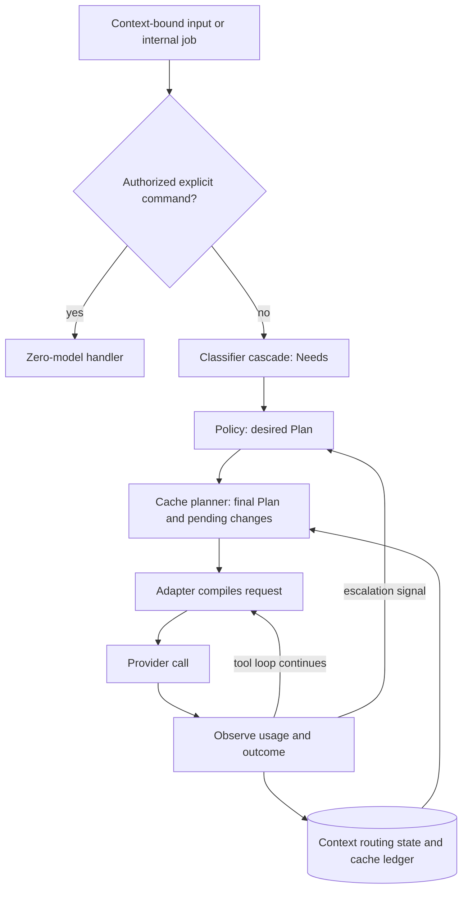

# Routing layer design

**Status:** Draft 0.6, for review; design decisions and proposals, not implementation claims. No router code exists yet.
**Date:** 2026-10-01 (environmental-layer contract); 2026-09-30 (workspace-model alignment); provider research and worked examples: 2026-09-28
**Scope:** The component between the harness's agent loop and the model providers. Anthropic and OpenAI first; more providers later.
**Inputs:** The open-source harness survey (`RESEARCH-OPEN-SOURCE-HARNESSES.md`), the implementation-language research (`RESEARCH-IMPLEMENTATION-LANGUAGE.md`), the core-and-launchers design (`DESIGN-CORE-AND-LAUNCHERS.md`), and the provider-efficiency and router surveys from the same research rounds. Provider facts were re-verified against primary documentation on 2026-09-28 (Appendix B).
**Reconciliation scope:** The 2026-09-29 incorporation is limited to the three owner-authorized idea sections recorded in `DESIGN-CORE-AND-LAUNCHERS.md` §11 and §12. The original is archived as `superceeded-Design.md`; its remaining material is not reconciled. This update does not inspect legacy code or data.

**Fresh session:** Start with [the core design's canonical handoff](DESIGN-CORE-AND-LAUNCHERS.md#start-here-for-a-fresh-session) for reading order, authority and continuation scope. This document specifies the proposed router; its context/broker assumptions depend on the still-proposed mechanism in core §7.3–§7.5. It does not approve that mechanism or report an implementation.

**Related philosophy and field design:** [`FIELD-PHILOSOPHY.md`](FIELD-PHILOSOPHY.md) explores the owner's universe-wide indirect environmental layer, separate from DMs, Corps boards and Griot stories. [`DESIGN-UNDERCURRENT.md`](DESIGN-UNDERCURRENT.md) is a draft design for that layer, working title Undercurrent. Its fields do not grant permissions, pool private contexts, override budget scopes or authorize provider changes. The router's obligations toward it are limited to writing its measurements to the core action ledger (R11) and hosting its rendered impressions as a tail context module (§5.5). Field sensing and disclosure remain undesigned and unapproved; this link does not adopt a Field Design.

**Changes in 0.6**, from the environmental-layer design discussion of 2026-10-01:

- New requirement R11: provider status transitions, headroom samples, budget threshold crossings and usage attribution are written to the core action ledger as typed events when observed, not held only in memory or in the JSONL decision record (§5.4).
- New §5.5 describes the relationship between the router and Undercurrent: what flows in each direction, and what the field layer may never do to routing.
- Rollout (§14) records that router phase 1 must be complete before Undercurrent's `resource_pressure` field can be validated on real data and before any field impression can reach a prompt.

**Changes in 0.2**, from the owner's decisions of 2026-09-28:

- The harness keeps control: its transcript, permission checks, tool gating, compaction and spend accounting are the source of truth, and provider-side features are optional (T10, §8.5).
- No automatic provider switching in v1. The router tracks whether each provider is still serving, tells the user when one stops, and makes the provider change the user chooses safe (§9.8).
- Every provider beta stays behind its own flag, off by default. This now covers OpenAI's Flex processing too.
- Plugins run as child processes (§12).

**Historical changes in 0.3**, from 2026-09-28; the toolchain and browser-launcher decisions below are superseded by 0.4:

- Go was selected with a no-cgo build constraint. The router's placement as a library inside the Go core remains current.
- The two proposed launchers were a plain terminal and an external-browser launcher.

**Changes in 0.4**, from the owner's decisions of 2026-09-29:

- Go remains the core language. A C toolchain will be acquired; blanket `CGO_ENABLED=0` is no longer a product constraint (`DESIGN-CORE-AND-LAUNCHERS.md` §8.1).
- `dwarf-harness` is the program and plain terminal entry point; `dwarf-harness-GUI` opens a native window, replacing the external-browser proposal. Both expose identical harness functionality through the same Go core, and the same live session is visible in both simultaneously. Each view has its own event cursor; the proposed colony-scoped core-host topology is described in `DESIGN-CORE-AND-LAUNCHERS.md` §3 and §4.
- At most one GUI instance serves a colony; launching it again reuses/focuses that instance. Other colonies may have their own instances. The GUI can spawn agent sessions within core ownership limits. Dwarf Fortress styling is GUI-only; its visual design comes later (`DESIGN-CORE-AND-LAUNCHERS.md` §5 and §6).
- DwarfHarness is a standalone product inspired by ideas, not a StarNet fork, port or addon; it has no StarNet runtime, compiler, JavaScript/goja, compatibility or parity contract.

**Changes in 0.5**, from the owner's communication requirements and the proposed relationship-memory model of 2026-09-29:

- The Colony's Grand roles and each specialized Corps' Orchestrator, Griot, Diplomat and workers follow the hierarchy and communication policy in `DESIGN-CORE-AND-LAUNCHERS.md` §7.1 and §7.2; routing does not grant additional channels.
- One execution session per agent, including every leadership role, can serve many independently owned contexts. Routing state, private relationship memory, provider continuations and cache ledgers belong to `(agent_id, context_id)`, with each turn bound to that context (§5.1 and §6). [INFERENCE: proposed mechanism, not a newly approved owner implementation choice]
- Logical conversations do not require a process or socket per relationship. The proposed colony broker and physical IPC boundary are defined in `DESIGN-CORE-AND-LAUNCHERS.md` §7.4 and §3.4. [INFERENCE]

Conventions:

- **[INFERENCE]** marks design reasoning that no cited source establishes. Router mechanisms, defaults and rollout below are proposals unless identified as owner decisions; router-specific unresolved choices are in §15.
- Numbers in Appendix A are computed from verified list prices. They illustrate the decision rules; they aren't measurements.
- Go is the selected implementation language. TypeScript-like blocks are design pseudocode for data and call shapes, not implemented Go APIs or selected plugin/launcher wire schemas. `Promise`, `Map` and named helper types describe concepts; serialization and complete error/result shapes still need design. Plugin transport is discussed in §12.

## 1. Summary

For every new turn — user input, an authorized agent message, or an internal job — the routing layer decides how much model capability to spend and how to send it:

- whether to call a model at all;
- which rung of a model-and-effort ladder to use;
- the output ceiling;
- which tools and context modules to include;
- the service tier;
- the permission level.

Regular users get cheap defaults without configuring anything. Advanced users change the rules declaratively or with plugins.

It has three stages, all running inside the harness process:

1. **Classifier cascade → `Needs`.** What the prompt requires: kind, difficulty, capabilities, context, urgency, risk. The cheapest stages run first. The default stages make no model calls and download nothing.
2. **Policy → `Plan`.** A provider-neutral decision built from a ladder, a profile and declarative rules. Rules merge order-independently.
3. **Cache planner.** Reconciles the desired plan with the selected context's provider state. It knows which changes break which cached segments on each provider, and prices them with that context's cache ledger:
   - cache-neutral changes and capability upgrades apply immediately;
   - optional cache-breaking changes ordinarily wait for a *change point*, unless the break-even rule in §9.5 justifies applying them sooner.

Provider adapters compile the plan into API requests and report usage back.

The harness, not the provider, holds the conversation, the permissions, tool gating, compaction summaries and spend accounting (T10). The router also tracks whether each provider is still serving the user. When one stops — a spend limit, an empty credit balance, a long rate limit — the router says why and offers the alternatives, but in v1 it never changes provider on its own (§9.8).

No open-source project surveyed combines needs classification, multi-setting policy and provider-cache-aware planning. The closest projects each contribute specific mechanisms, credited in §4.

## 2. Goals, non-goals and constraints

**Goals**

- **G1** — Lowest cost per *successful* task for regular users, with no configuration.
- **G2** — Minimal router overhead: default classification and policy add no model tokens, network calls or downloads. Optional token-count confirmation near a limit is a separate provider call (§9.2), not part of that zero-call claim.
- **G3** — Cache awareness: never trade a large cache loss for a small saving, and use cold moments.
- **G4** — Modularity: advanced users add rules, classifiers, context modules and providers without editing core code.
- **G5** — Provider-neutral decisions, provider-specific compilation. Adding a provider means adding an adapter and a capability file.
- **G6** — Explainability and measurement: every decision is logged with its cause and its predicted and actual cost.
- **G7** — Safe degradation: a routing failure falls back within the bound context; it never bypasses authorization or context isolation.
- **G8** — Harness-owned control: everything works with every optional provider-side feature turned off (T10).

**Non-goals for v1**

- Load balancing across accounts or deployments of the same model. LiteLLM does this and can sit behind an adapter (§12).
- Semantic response caching, i.e. returning stored answers to similar prompts. In agentic work a stale answer can trigger wrong actions. [INFERENCE]
- Re-routing inside a tool loop: continuation calls reuse the turn's plan (§7.3). The only exceptions are escalation (§10) and a provider change the user chooses mid-turn (§9.8).
- Routing through MCP. MCP servers are tools the harness calls; they can't rewrite provider requests. Sampling, the only MCP mechanism with model-preference hints, was [deprecated in the 2026-07-28 specification](https://modelcontextprotocol.io/specification/2026-07-28/client/sampling).
- Learned or online routing, such as LiteLLM's Thompson-sampled pools. Revisit once real decision logs exist.
- Compressing the cached prefix.
- Automatic provider switching, on failure or to save money. In v1 the provider changes only when the user chooses (§9.8).
- Provider-held conversation state: stored responses, `previous_response_id`, or provider compaction as the only copy of the history (T10).

**Constraints**

- **C1** — The router is a library inside the Go core, with no daemon or port of its own. Optional plugins run as child processes (§12).
- **C2** — The default stages are deterministic and testable offline.
- **C3** — Provider facts change often. OpenAI renamed Priority processing to Fast mode on 2026-07-30, and several of Anthropic's cache-safe controls are betas dated July to September 2026. Provider facts are therefore data, not code.
- **C4** — The audience isn't chosen yet, so the `Needs` vocabulary must not assume coding.
- **C5** — Provider betas are off by default, each behind its own flag (owner's decision, 2026-09-28).

## 3. Design tenets

| | Tenet | Basis |
|---|---|---|
| **T1** | Default classification and policy use rules and arithmetic, with no model calls. | LiteLLM's heuristic scorer makes "zero API calls" and is "sub-millisecond"; the project's lightweight goal. |
| **T2** | Classify needs, not models. | Arch-Router matches prompts to user-described domain/action routes and maps routes to models separately, supporting "new domains/actions without retraining the router". |
| **T3** | Parameters before prose. | API settings cost no prompt tokens; injected instructions do, and most of them stay in history. [INFERENCE] |
| **T4** | Keep the prefix stable and vary the tail: appends are cheap, edits are expensive. | Anthropic's cache hierarchy (tools → system → messages); OpenAI's list of prefix-affecting settings. |
| **T5** | Escalate immediately; de-escalate lazily. | Under-provisioning fails tasks, over-provisioning only costs money, and downgrades usually lose a warm cache (Appendix A, example A). [INFERENCE] |
| **T6** | Price model changes; don't forbid them. | LiteLLM measured 4,684 real switch-backs: 97.4% found the cache warm at a 5-minute TTL and 99.3% at 1 hour. Yet moving a long history to a cold model can cost more than it saves (Appendix A). Provider changes are the user's call in v1 (§9.8). |
| **T7** | Routing degrades to safe defaults within the bound context; authorization and scope failures still stop the call. | LiteLLM: "A plugin that is down degrades routing; it never fails the request." Context isolation is a harness requirement, not a classifier fallback. [INFERENCE] |
| **T8** | Provider facts are data, validated at load; unsupported settings fail loudly. | LiteLLM warns that silently dropped parameters produce "a ladder that changed nothing", and rejects misplaced keys at load "rather than silently ignored". |
| **T9** | Every feature must show net savings in the logs. | LiteLLM reports signed savings, net of the classifier's own cost. |
| **T10** | The harness owns the truth. The transcript, permissions, tool gating, compaction summaries and spend accounting live in the harness; provider-side state is at most a cache of them. | The owner's direction. OpenAI's compaction item "is opaque and not intended to be human-interpretable"; reasoning carries over only within a model family; and reading usage or spend needs admin credentials on both providers (Appendix B). |

## 4. Prior art: what this design takes

Licenses and status checked on 2026-09-28.

| Project | Adopted | Left out, and why |
|---|---|---|
| [LiteLLM Auto Routing](https://docs.litellm.ai/docs/proxy/auto_routing) (beta; MIT outside the `enterprise/` directory; very active) | Classifier cascade: keyword rules, heuristic scorer, optional LLM classifier, custom plugin. Escalate-to-highest merge for matching rules. Stripping harness reminder blocks before classification. Classifying user turns only and carrying the decision through tool continuations. Context-window escalation. Effort ladders. Abstain or failure falls back. A cause marker on every decision. Signed savings with a warm-cache baseline and TTL expiry. Load-time rejection of bad configuration. | Taking LiteLLM as a dependency: it's a Python package, while Go is now selected for this harness, and it doesn't plan around cache state. Adaptive pools (non-goal). The binary `session_affinity` pin, replaced by priced switching (T6). |
| [vLLM Semantic Router](https://github.com/vllm-project/semantic-router) (Apache-2.0; very active) | Continuity signals: turn index, previous model, `previous_response_id`, history tokens, and context-window fit bands at 50/75/100% of the window ([source](https://github.com/vllm-project/semantic-router/blob/445ab860de326c3226fe13c6455ce260dd2fc38c/src/semantic-router/pkg/selection/cache_affinity.go)). The principle that continuity must not override quality: their adjustment is capped at 0.14 and only acts when the top two candidates score within 0.20 of each other. `prompt_cache_key` as continuity evidence ([issue #4184](https://github.com/vllm-project/semantic-router/issues/4184), accepted 2026-09-26). | The ModernBERT classifier and Envoy deployment (weight). The additive tie-breaker, replaced by explicit cost arithmetic because provider prices and TTLs are known. |
| [claude-code-router](https://github.com/musistudio/claude-code-router) v3.1.0 (MIT; very active) | One stable interface in front of many providers, which becomes our adapter layer. Its retries, credential pools and ordered fallbacks illustrate transport concerns; this design takes bounded retries, not automatic provider fallback or account balancing. Logging the resolved provider, model and credential with tokens and estimated cost. Conditions over request headers and bodies. | A separate gateway process and desktop app (C1); automatic provider switching and account/deployment balancing in v1 (§2). |
| [Plano](https://github.com/katanemo/plano) (formerly archgw; Apache-2.0) with [Arch-Router-1.5B](https://huggingface.co/katanemo/Arch-Router-1.5B) (weights under the custom `katanemo-research` license) | A route vocabulary described in natural language as *domain* plus *action*, with an explicit "other" outcome. The descriptions double as the optional LLM classifier's rubric. | The 1.5B model as a default: download, CPU or GPU cost, and license. |
| [semantic-router](https://github.com/aurelio-labs/semantic-router) (Aurelio; MIT) | An optional local embedding stage that matches utterances to named routes and returns `None` when nothing matches. | On by default: it needs an encoder download or remote embedding calls. |
| [Portkey Gateway](https://portkey.ai/docs/product/ai-gateway/conditional-routing) (MIT; last change May 2026) | Declarative query operators (`$eq`, `$ne`, `$in`, `$nin`, `$regex`, `$gt`, `$gte`, `$lt`, `$lte`, `$and`, `$or`). Missing keys evaluate to false. | Portkey evaluates conditions in order ("the order of your conditions is important") and treats malformed conditions as false. Here all matching rules merge order-independently, and malformed rules are rejected at load. |
| [RouteLLM](https://github.com/lm-sys/RouteLLM) (Apache-2.0; no changes since August 2024) | Calibrating thresholds against a cost/quality target on a labelled set. | Using it as a dependency. |
| MCP tool gateways: [lazy-mcp](https://github.com/voicetreelab/lazy-mcp) (MIT), [ToolHive](https://github.com/stacklok/toolhive) (Apache-2.0), [Klavis Strata](https://github.com/Klavis-AI/klavis) (Apache-2.0) | Progressive tool disclosure through a fixed pair of meta-tools (lazy-mcp's `get_tools_in_category(path)` and `execute_tool(tool_path, arguments)`). lazy-mcp's warning that permission checks must inspect the dispatched tool path. | MCP as the routing layer (§2). |
| [LLMLingua](https://github.com/microsoft/LLMLingua) (MIT) | Optional compression, for tail content only. | Compressing cached prefixes (T4). |

Not used: [TensorZero](https://github.com/tensorzero/tensorzero) (archived on 2026-06-12), [NVIDIA llm-router](https://github.com/NVIDIA-AI-Blueprints/llm-router) (deprecated in favour of NeMo Switchyard), and Not Diamond (a proprietary service).

## 5. Architecture

### 5.1 Placement

The router remains a library inside the Go core. Under the proposed colony-scoped host arrangement, that core is the single writer for its sessions (`DESIGN-CORE-AND-LAUNCHERS.md` §3). [INFERENCE: process topology, not a separate owner decision]

- It needs the exact rendered state of the conversation — segment fingerprints, token counts, idle time — which the harness already holds.
- MCP can't host it (§2).
- A proxy adds a process, a port and a serialization step per call, and has to reconstruct conversation state from wire traffic. vLLM Semantic Router's [issue #4184](https://github.com/vllm-project/semantic-router/issues/4184) shows the failure mode: to a proxy, stateless clients look like first turns.

Advanced users who want LiteLLM's multi-deployment balancing can point an adapter at a LiteLLM proxy, with LiteLLM's auto-router disabled so that two routers don't make conflicting decisions. [INFERENCE]

**Execution and context ownership (2026-09-29 proposal).** A launcher is a view, not an agent or a second execution owner. The proposed model gives every agent one execution session, including Orchestrators and the Grand roles. A session owns lifecycle, scheduling, turns and an audit trail; it is not one continuously pooled provider conversation. Terminal and native GUI commands address that same execution, with a cursor per view (`DESIGN-CORE-AND-LAUNCHERS.md` §4 and §7.3). [INFERENCE]

Private state is addressed by `(agent_id, context_id)` within a colony. General work, a directed peer relationship and participation in a Corps board are separate contexts, each with its own memory/handoff, rendered history, compaction, routing decisions and provider/cache state. A's memory about B is not B's memory about A. One session may hold many dormant contexts without a permanent process or model call for each. Common `Agent.md` and shareable general `Memory.md` must not silently pool private relationship details. The audit trail across the whole session is not fed back wholesale to the provider. [INFERENCE]

The owner-defined Grand/Corps roles and allowed communication paths live in `DESIGN-CORE-AND-LAUNCHERS.md` §7.1 and §7.2; the same context mechanism applies to all roles. A private observation about another worker, learned from the Corps board, does not authorize a worker-to-worker DM. A leadership title does not grant access to subordinate private contexts. Authorized pairwise or board logs supply shared exchanges; only the active context's private records and explicitly authorized shared materials supply its prompt (`DESIGN-CORE-AND-LAUNCHERS.md` §7.3 and §7.5). [INFERENCE: context/rendering mechanism]

Bind each routing decision to colony, agent, execution session, context and turn. `Needs`, `Plan`, pending changes, overrides, provider response IDs, tool continuations and cache ledgers cannot follow the last-used context when the same agent addresses another counterpart. Returning to a dormant context restores only its own state. View focus does not select or mutate an active model turn. The default is one active turn per agent; waiting for a social reply pauses/yields rather than opening a recursively blocking agent-call chain. [INFERENCE]

Changing a message counterpart is a context transition, not just changing a destination field: pause/yield or finish the old turn, then compose in a freshly rendered turn bound to the destination relationship or board context. A send must match that context's authorized channel and operation. For example, a worker moving from its Orchestrator to its Diplomat cannot continue from the Orchestrator prompt, tool results or provider response ID; only explicitly shareable material may be carried over. [INFERENCE]

Approvals and one-turn tool grants resolve against the bound agent, context and turn. A reusable private grant is labelled **this context**, not **this session**; any wider grant requires an explicit wider scope. Agent role/base policy and explicitly scoped agent/account budgets remain shared constraints, not private conversation state or implicit approval. [INFERENCE]

Logical message channels and physical transport are separate. The proposed core broker authorizes messages using authenticated identity, membership, hierarchy edge, destination and operation (`DESIGN-CORE-AND-LAUNCHERS.md` §7.4). Agents inside the core use method/queue calls; external launchers/processes use the colony IPC connection described in `DESIGN-CORE-AND-LAUNCHERS.md` §3.4. There is no OS socket per agent, context or relationship, and a transport command acknowledgement is not a counterpart's reply. [INFERENCE]

### 5.2 Pipeline



Classification runs once per new turn. Tool-loop calls reuse that turn's decision; escalation (§10) may revise its plan, and a user-chosen provider change uses the handover in §9.8. Neither requires classifying a tool result as a new ask. Compile and observe run for every API call in the bound turn; the scheduler must not substitute a newly focused context.

### 5.3 Router interface

The interface below sketches successful decisions only. If no rung satisfies both floor and ceiling, there is no model dispatch; the blocked-result shape and owner-facing resolution remain open (§15). This is not a complete callable API.

```ts
interface Router {
  // Once per new user/message turn, and once per harness-internal job.
  beginTurn(input: RouteInput): TurnDecision

  // Model routes only, once per API call in the tool loop. Same inputs, same bytes.
  compile(turn: TurnDecision, transcript: ContextTranscript): ProviderRequest

  // After every API call. Updates the ledger and statistics, and may return a revised
  // decision for the next call (escalation) or request a change point (e.g. compaction).
  observe(turn: TurnDecision, result: ProviderResponse | ProviderError): Observation
}
```

The core creates the protected bindings and scoped transcript below (§6.1). `compile` checks that the transcript and cache plan belong to the decision's context; `observe` records results against the initiating turn even if a view has moved elsewhere. A mismatch fails closed rather than falling back to another context. These are proposed contracts, not implemented APIs. [INFERENCE]

### 5.4 What the router requires from the rest of the harness

| | Requirement | Why |
|---|---|---|
| **R1** | Canonical append-only, provider-neutral source records: authorized pairwise/board logs and each agent's private context records. A `ContextTranscript` is rendered from the addressed context and explicitly authorized shared materials, never from the whole session audit trail. Provider artifacts (thinking blocks and signatures, encrypted reasoning, tool-call ids) are opaque attachments tagged with their owning context, provider and model family. Cache markers are added only at compile time. | Context isolation and provider switching (§5.1 and §9.8). [INFERENCE: scoped rendering] |
| **R2** | Deterministic rendering: unchanged authorized content and settings produce a byte-identical request prefix. Key order and tool order are stable, and the prefix contains no timestamps or random ids. | Anthropic matches cached prefixes "exactly, byte for byte"; OpenAI requires "the entire rendered prefix to match". |
| **R3** | Volatile content (date and time, environment status, per-turn reminders) goes in the tail. | T4. |
| **R4** | The harness enforces agent base policy plus the bound context/turn's permissions on every tool dispatch. The router sets a ceiling and approval rules; meta-tool gates inspect the dispatched tool path. "This context" and explicit wider grants are distinct; neither another view, another relationship nor the session identity supplies implicit approval. Messaging also passes the core's communication policy. | lazy-mcp: routing every call through `execute_tool` bypasses per-tool permission rules; protected bindings preserve authority within a multi-context session. [INFERENCE] |
| **R5** | Raw usage and the service tier actually served are passed to `observe`. | Ledger correction; OpenAI can serve a Fast request at standard speed. |
| **R6** | Each call is labelled as a new turn (user or authorized message), a tool continuation, or an internal job (compaction, summaries, subagents), with the protected agent/context/turn binding. | §7.3 and §8.4. |
| **R7** | A registry of command handlers. | The zero-model route (§7.2). |
| **R8** | Context-bound phase events (mode switch, new task, `/clear`) reach the router; an explicit wider configuration change is applied separately to each affected context. | Change points (§9.6). |
| **R9** | `dwarf-harness` and `dwarf-harness-GUI` show the same notice identifying its agent, context and paused turn, and accept wait, change provider, compact first, or stop. The terminal prints numbered choices; the native GUI presents controls. The core accepts a choice only for its still-valid bound turn, applies it once and publishes the resolved state to both views (`DESIGN-CORE-AND-LAUNCHERS.md` §4). | User-chosen provider changes (§9.8); view focus cannot retarget a pending choice. [INFERENCE] |
| **R10** | Preserve completed tool effects and enough canonical state for safe retry/handover. Reconcile unfinished calls or uncertain effects through the core's recovery/approval path; never fabricate success or blindly rerun an effect. Target rendering must contain matched tool-call/result pairs; incomplete streamed content is completed or excluded from that render without erasing the audit record. Late results remain with their initiating context. | Safe handover (§9.8) and core §7.4's recovery boundary. [INFERENCE] |
| **R11** | The core action ledger accepts typed router events, and the router writes them at the moment of observation: `ProviderStatus` transitions (scope, state, cause, `resumesAt`), headroom samples when headroom moves to a different bucket, budget threshold crossings (named scope, fraction, period), and usage attribution per bound context and provider account. The ledger write is a side effect of observation; it never delays or alters the routing decision. | The environmental layer reads only the ledger and must be replayable from it (`DESIGN-UNDERCURRENT.md` §5 and §15.1). In-memory status and the JSONL decision record are not replayable field inputs. [INFERENCE] |

### 5.5 Relationship to the environmental layer (Undercurrent)

The router and Undercurrent are separate packages inside the Go core with no direct calls between them. They meet in two places: the core action ledger, and the router's tail context-module slot. [INFERENCE: proposal; neither layer has been implemented]

| Direction | What flows | Mechanism | Router requirement |
|---|---|---|---|
| Router to Undercurrent | Provider status transitions, headroom samples, budget threshold crossings, usage attribution | Typed events in the core action ledger | R11 |
| Undercurrent to router | Rendered impressions for the bound context's turn | A tail context module with a declared token budget, placed after the cached prefix | R3 and §6.5 |
| Neither direction | Routing decisions, budgets, provider choice, permissions, cache planning | Not available to the field layer | — |

**The router owns control; the field layer owns awareness.** The router already acts on provider exhaustion, rate limits and budgets within their scopes (§9.8, §11). Undercurrent turns the same measurements into colony-wide environmental conditions so that agents who are not currently blocked can see pressure building and choose their work accordingly. A field reading never changes a `Plan`, never marks a provider unavailable, never relaxes or tightens a budget and never triggers a provider change. If the two layers ever disagree, the router's state is authoritative, because it reflects the enforced constraint.

**Impressions follow the same binding rules as every other tail module.** A field impression is rendered for the bound agent, context and turn (§5.1). It is volatile content, so it goes in the tail (R3) and does not affect prefix caching. Its token cost is declared through the context-module interface (§6.5) and counted in the turn's accounting like any other module. An impression rendered for one context is never carried into another on a context switch.

**Measurements are written when observed, at their true scope.** A provider status event carries the scope at which the status applies (provider, account, and model or region where relevant), matching `ProviderStatus.scope`. A budget event carries its named scope. An agent's exhausted budget is recorded as that agent's budget event, never as account-wide provider exhaustion, preserving the distinction in §9.8 and §11.

**Dependencies on router phases.** Undercurrent's engine is built and tested against synthetic ledgers and does not wait for router code. Two of its capabilities do wait for router phase 1 (§14): validating its `resource_pressure` field against real provider and budget data, which requires R11 events, and showing any impression to an agent, which requires tail context modules. The field layer's other initial kinds, which are drawn from the core's workspace and promotion events, depend on core phase 1 rather than on the router (`DESIGN-UNDERCURRENT.md` §15.2).

## 6. Contracts

### 6.1 Input

The core binds this input and its resulting decision to one colony, agent, execution session, context and turn (§5.1). A launcher or plugin cannot substitute another context's transcript, continuation or permissions. The identifiers below are core-validated bindings, not model-supplied claims of authority; agent/account budgets are separately scoped constraints (§11). The sketches in this section are proposed interfaces. [INFERENCE]

```ts
interface ContextKey {
  colonyId: string; agentId: string; contextId: string
}

interface TurnBinding extends ContextKey {
  sessionId: string; turnId: string    // execution owner and this particular turn
}

interface ContextTranscript {
  key: ContextKey
  transcript: Transcript              // scoped render, not the whole execution audit
}

interface TurnDecision {
  binding: TurnBinding
  needs?: Needs                       // required for model routes; absent for zero-model handlers
  plan: Plan
}

interface RouteInput {
  binding: TurnBinding                // supplied and protected by the core
  origin: "user" | "message" | "internal"
  text: string                        // harness reminder blocks already stripped
  attachments: { images: number; files: number }
  explicit?: { command?: string; override?: PlanOverride }   // core-authorized metadata, not peer text
  signals: Record<string, number | boolean | string>         // cheap facts (§7.4)
  context: {
    turnIndex: number; historyTokens: number; idleSeconds: number
    lastNeeds?: Needs; lastPlan?: Plan; failuresThisPhase: number; mode?: string
  }
}
```

### 6.2 Needs (classifier output)

```ts
interface Needs {
  version: 1
  kind: "chat" | "answer" | "edit" | "execute" | "research" | "plan" | string  // extensible (§12)
  domain?: string                      // optional, user-defined
  difficulty: 0 | 1 | 2 | 3             // trivial, low, medium, high
  capabilities: ("read" | "search" | "edit" | "execute" | "web" | "vision")[]
  context: string[]                     // requested modules, e.g. "recent_files", "repo_map", "memory"
  urgency: "interactive" | "deferrable"
  risk: "none" | "read" | "write" | "destructive" | "external"
  output: "short" | "medium" | "long"   // expected size of the visible answer
  confidence: number                    // 0..1
  evidence: string[]                    // causes, for the decision log
}
```

Rules of the contract:

- Classifiers never name models, providers or prices, and the policy never reads raw prompt text. This separation is what lets a classifier be reused across providers, and a policy be edited without touching classifiers (T2).
- Stages may return a partial `Needs`. Later stages fill the gaps, and conflicts resolve upward: higher difficulty, broader capabilities, higher risk.
- Extension kinds and domains must carry a one-line description, which the optional LLM classifier uses as its rubric (the Arch-Router pattern).

### 6.3 Plan (policy output)

```ts
type Plan = { route: "no_model"; handler: string } | {
  route: "model"
  floor: string; ceiling: string       // ladder range allowed by policy (§8.1)
  rung: string                         // chosen by the cache planner within [floor, ceiling] (§9.5)
  outputBudget: number                 // hard ceiling on output, including reasoning (§8.4)
  tools: string[]                      // subset of agent policy and this context/turn's authorized surface
  context: { module: string; budgetTokens: number }[]
  serviceTier: "standard" | "flex" | "batch"
  permission: "read_only" | "workspace_write" | "full"   // ceiling within core grants, not a grant
  approvalRequired: boolean
  turnNote?: string                    // only when no API parameter can express the intent (T3)
  maxEscalations: number
}
```

**Workspace binding (core design §3.5):** for an agent workspace operation, `workspace_write` applies to that bound work context's scratch; promotion is a separate core operation. A routing permission is not an OS sandbox: linked Git worktrees share repository metadata, and protecting canonical refs and private files from same-user child processes remains unresolved.

### 6.4 Context state and cache ledger

Keep one `ContextRouteState` per `(agent_id, context_id)` within its colony, not per execution session or launcher (§5.1). Each owns render history, compaction and continuation records as well as the routing state below. `CacheEntry.scope` describes the provider's cache-isolation boundary; it does not permit pooling local contexts or ledgers. Separate local ledgers do not promise provider-side isolation beyond documented provider boundaries. [INFERENCE]

Provider availability is a separate core registry keyed by the actual provider/account and, where relevant, model/region scope. All affected contexts may consult it without sharing private history. An explicit agent budget or account budget is another independent constraint: exhausting one agent's budget must not mark the entire account unavailable (§9.8 and §11). [INFERENCE]

```ts
interface ContextRouteState {
  key: ContextKey
  active: {
    provider: string; model: string; region: string; speed: "standard" | "fast"
    toolSurface: string                // fingerprint of the tools array
    contextEffort?: string             // top-level effort, where no cache-safe per-turn control exists
    systemFingerprint: string
  }
  ledger: CacheEntry[]                 // one per (provider, model, scope); kept after switching away
  pending: PendingChange[]             // optional cache-breaking changes awaiting a change point
  continuations: ProviderContinuation[]   // owned by this context; never borrowed on a context switch
  spend: Map<string, number>           // attributable usage cost by provider; not a budget boundary
  stats: { callsPerTurn: Ewma; idleGapSeconds: Ewma; outputTokens: Map<string, Ewma> }
}

interface ProviderContinuation {
  provider: string; modelFamily: string
  previousResponseId?: string         // only when stored responses are explicitly enabled
  artifactRefs: string[]              // this context's compatible reasoning/tool artifacts
  toolLoop?: { binding: TurnBinding; pendingToolCallIds: string[] }
}

interface CacheEntry {
  provider: string; model: string
  scope: string                        // the provider's cache-isolation boundary (account, region)
  segments: {
    kind: "tools" | "system" | "history"
    fingerprint: string; tokens: number; ttlSeconds: number; lastWriteOrHit: Time
  }[]
  hitRate: Ewma                        // observed ÷ predicted cached tokens
}

interface PendingChange { field: string; value: unknown; reason: string; since: Time }

interface ProviderStatus {
  scope: { provider: string; accountId: string; model?: string; region?: string }
  state: "available" | "rate_limited" | "overloaded" | "exhausted" | "denied" | "unreachable"
  cause?: string                       // e.g. "anthropic 429 enforced_spend_limit_reached"
  resumesAt?: Time                     // from retry-after, reset headers, or the error text when it gives a date
  headroom?: Headroom                  // remaining requests and tokens, from rate-limit headers
  since: Time
}
```

### 6.5 Extension interfaces

```ts
interface Classifier {
  id: string
  cost: { kind: "free" | "local-cpu" | "local-model" | "remote"; typicalLatencyMs: number; typicalTokens?: number; residentMb?: number }
  classify(input: RouteInput, deadlineMs: number): Promise<Partial<Needs> | null>   // null = abstain
}

interface ContextModule {
  id: string
  cost: { typicalTokens: number }      // declared; checked against the decision log
  wants(needs: Needs, input: RouteInput): boolean
  render(binding: TurnBinding, budgetTokens: number): Block[]   // scoped tail only; never edits earlier content
}

interface ProviderAdapter {
  id: string
  capabilities(model: string): ModelCapabilities           // from the versioned capability file (Appendix B)
  impact(model: string, change: Change): Invalidation        // "none" | "tail" | "history" | "system" | "all"
  compile(turn: TurnDecision, transcript: ContextTranscript, cache: CachePlan): ProviderRequest
  convert(transcript: ContextTranscript, target: ModelRef): { transcript: ContextTranscript; dropped: DroppedArtifact[] }
  countTokens?(request: ProviderRequest): Promise<number>
  usage(response: ProviderResponse): {
    uncached: number; cacheRead: number; cacheWrite: number
    output: number; reasoning: number; servedTier: string
    headroom?: Headroom                // parsed from rate-limit headers (§9.8)
  }
  classifyError(error: ProviderError): ErrorClass          // §10
}
```

`ContextModule.render` may read only records authorized for the protected binding; passing an ID does not grant filesystem access. Module caches/results, adapter artifacts and `CachePlan` carry the owning context key and are checked before use. Plugins do not receive the session-wide audit transcript. `convert` returns a target-compatible render with the same context key and a dropped-artifact report; it does not mutate canonical records. [INFERENCE]

## 7. Classification cascade

### 7.1 Stages and their costs

| Stage | Decides | Model tokens | Added latency | Device cost | Default |
|---|---|---|---|---|---|
| 0. Commands and overrides | Core-authorized zero-model route; pinned settings | 0 | Negligible | None | On |
| 1. Continuation | Tool-loop calls reuse the bound turn's decision; short follow-ups inherit only the selected context's last `Needs` | 0 | Negligible | None | On |
| 2. Rules | Signals → partial `Needs` | 0 | Negligible | None | On |
| 3. Heuristic scorer | Difficulty and confidence | 0 | Target: sub-millisecond, as LiteLLM documents for its scorer | None | On |
| 4. Local embedding matcher | Kind or domain | 0 | Not measured | Encoder download and memory. A lazy helper remains preferred for isolation and no running helper when the stage is off; an in-process cgo integration is no longer excluded (`DESIGN-CORE-AND-LAUNCHERS.md` §8.1) | Off |
| 5. LLM classifier | Full `Needs` via structured output | Classifier prompt and output | One round trip, bounded by a timeout | Network | Off; value-gated (§7.6) |
| Plugins | Anything; may abstain | Declared | Declared | Declared | Off |

Tool-loop continuation dispatch bypasses classification (§7.3). For new turns, rules still run on new content before inherited confidence can end the cascade. It then stops once the required `Needs` fields are filled and the merged confidence reaches the profile's threshold.

### 7.2 Commands and the zero-model route

- v1 recognizes explicit syntax only: slash commands, a shell escape (for example `!cmd`), and aliases the user configures. Guessing from natural language ("run the tests") isn't a zero-model route, because a wrong guess executes the wrong thing. [INFERENCE]
- The core authorizes explicit command/override metadata before this path runs. An incoming agent message or internal-job prompt containing `/provider`, another slash command or `!cmd` remains content, not an owner's command. Text or plugin output cannot promote itself to trusted `explicit` metadata. Zero-model handlers still obey core permissions and the bound context; skipping the model does not skip authorization. [INFERENCE]
- For an agent's shell or plugin action in a registered workspace, the core binds the working root to that context's scratch (§3.5); `!cmd` itself grants no canonical-write or promotion authority. Owner-originated shell commands need their own explicit workspace scope. The worktree binding alone does not prevent same-user access to shared Git metadata.
- Queries the harness can answer itself (cost, status, routing explanation) are handlers.
- Overrides (`/effort high`, `/tier large`, `/provider openai`) pin fields in the addressed context until cleared or that context's phase ends. Applying an override to an agent or account requires an explicit wider selection; it never copies private context state. [INFERENCE]

### 7.3 Continuations

- Tool-loop calls bypass `beginTurn` and never reclassify; they reuse the decision only when the full agent/context/turn binding matches, subject to the explicit escalation/handover exceptions (§5.2). They do not create a fresh `RouteInput` or classifier-produced continuation flag. This follows LiteLLM's `classification_mode: user_turn` ("Classify new user asks only, carrying the decision through continuation turns"), with the harness's context boundary added. [INFERENCE]
- A short follow-up inherits the selected context's previous `Needs` when it matches continuation cues ("yes", "go ahead", "same for X") and no rule fires on new content. Rules still run, so a follow-up naming new files contributes their signals. A newly selected context with no history uses the profile default, not the last active context's `Needs`. [INFERENCE]
- A worker's "go ahead" to its Diplomat must not inherit an Orchestrator conversation just because both run in one execution session. Switching the message counterpart requires the fresh context-bound turn described in §5.1; provider response IDs, pending tool calls, approvals and rendered artifacts remain with their originating context. These boundaries are also the defence against misrouting "do it again". [INFERENCE]

### 7.4 Rules

- Signals are facts computed without a model: token count, referenced paths, error traces, image count, failures in this context's phase, harness mode, call origin.
- Rules use Portkey's operators, plus `$contains` for sets, over `needs.*`, `signals.*` and `context.*` (§6.1). They do not read another context's private signals or a pooled session history. [INFERENCE]
- All matching rules apply. Classification rules emit partial `Needs` and merge per §6.2; policy rules constrain `Plan` after classification and merge per §8.2. The configuration examples in §12 are policy rules. Neither kind reads raw prompt text as policy or gains access to another context.
- Malformed rules and unknown fields are rejected at load; a missing key evaluates to false.

### 7.5 Heuristic scorer

- The initial features and weights are LiteLLM's documented defaults:
  - code presence 0.30
  - reasoning markers 0.25
  - technical terms 0.25
  - token count 0.10
  - simple indicators 0.05
  - multi-step patterns 0.03
  - question complexity 0.02

  Difficulty boundaries sit at scores 0.15, 0.35 and 0.60, and two or more reasoning markers force the top difficulty.
- Add harness-native signals: files referenced, error traces, scope words ("refactor", "migrate", "across"), failures this phase. [INFERENCE — to calibrate]
- Output: difficulty from the boundaries, and confidence from the distance to the nearest boundary, scaled to 0–1.
- All weights are starting values, to calibrate on the replay set (§13).

### 7.6 Optional classifiers and the value gate

Call a paid or slow classifier only when it can pay for itself: [INFERENCE]

```
call if  (1 − confidence) × |cost(upper rung) − cost(lower rung)| × expected calls this turn
         > classifier cost × safety factor
```

The two rungs are those on either side of the heuristic's nearest boundary. LiteLLM deducts the classifier's cost from reported savings after the fact; this gate applies the same accounting before the call is made.

The LLM classifier follows LiteLLM's documented behaviour for its limits, within the harness's selected context:

- Structured output is validated against the `Needs` schema. A timeout, empty output or schema mismatch falls back to the heuristic result.
- Its context is the current input plus up to 3 prior input turns within 8,000 characters, all from the same agent/context. The count and size limits are LiteLLM's defaults; treating an authorized incoming agent message as input does not permit reading another relationship. Assistant turns are excluded by default. [INFERENCE: context binding]
- A stable rubric prefix lets the classifier's own prompt be cached. Its history and any continuation/cache hints remain context-bound just like the main call. Mind each model's minimum: Claude Haiku 4.5 caches nothing under 4,096 tokens.
- Privacy: this sends the selected context's text to a model provider and is opt-in. The proposed default is the same provider as that context's main model; whether to permit an explicit cross-provider classifier remains open (§15), not silently enabled by this sketch.

### 7.7 Failure semantics

Any stage may abstain (`null`) or fail (exception, timeout, invalid output). Either way the cascade continues. If nothing remains, the turn uses the selected context's previous `Needs` or the profile default, never another context's last result. The failure is logged and the request proceeds only if authorization and scope checks still pass (T7); a binding mismatch stops the call. [INFERENCE]

## 8. Policy

### 8.1 Ladder and profiles

- **The ladder** is an ordered list of rungs from cheapest to most capable. Each rung is a (tier, effort) pair; tiers map to concrete models per provider in configuration.
- **Effort before tier.** Place effort rungs on a cheaper model before a jump in tier. LiteLLM: "climbing effort on a cheap model is often the cheaper next step and worth exhausting before the tier ladder reaches for a frontier model."
- **Load-time validation.** Every rung must be satisfiable on every enabled provider: the model exists and supports the effort level. Otherwise loading fails — unless the rung is marked `clamp`, in which case the adapter maps to the nearest supported level and logs it (T8). `effort: default` is a harness sentinel for omitting the effort parameter, not an API value. Anthropic's effort documentation doesn't cover Claude Haiku 4.5, so a rung specifying effort on the Anthropic small tier fails validation until support is confirmed; the omission sentinel remains usable.
- **Output of the policy.** A range: the floor is the lowest rung that meets the `Needs`; the ceiling is the profile's budget limit. The cache planner picks the final rung within that range (§9.5).
- **Profiles** give regular users defaults: difficulty floors, visible-output sizes, reasoning reserve per effort level, the service tier for deferrable work, a ceiling rung and an escalation limit. Proposed profiles are `economy`, `balanced` and `quality`; selecting `balanced` as the shipping default remains open (§15).

### 8.2 Merge semantics

| Field | Merge rule | Reason |
|---|---|---|
| Floor rung | Highest wins | LiteLLM escalates to the highest matched tier "so rule order does not silently change behavior" |
| Ceiling rung (including the profile's) | Lowest wins | Budget guard |
| Floor above ceiling | No valid in-range plan; no model dispatch. Owner-facing resolution is still open (§15) | Neither silently lower the capability requirement nor exceed the user's budget |
| Output ceiling | Largest wins | Avoid truncation |
| Permission | Most restrictive wins | Safety |
| An action needs approval or exceeds the permission ceiling | Require approval where already allowed; an out-of-ceiling action remains blocked | An approval is not a ceiling increase; that is a separate core operation |
| Tools, context modules | Union, then intersected with agent base policy, the bound context/turn's permissions and authorized source records; context is trimmed to budget | Predictable composition without granting cross-context access [INFERENCE] |
| Service tier | Fastest wins (standard, then flex, then batch) | Interactive work is never deferred by accident |

### 8.3 When each setting may change, and what it costs the cache

This table is the core of the design. The provider cache columns come from the providers' documentation (Appendix B); timing and rules are harness policy within one selected context, not session-wide settings. [INFERENCE]

| Setting | May change | Anthropic cache | OpenAI cache | Rule |
|---|---|---|---|---|
| Zero-model route | Every new turn | — | — | Immediate; still bound to its context |
| Output ceiling | Every call | Not in the invalidation table | Not in the list of prefix-affecting settings | Immediate; a guardrail only (§8.4) |
| Add context | Every new turn | Appended to the tail | Appended to the tail | Only authorized materials; becomes this context's cached history next turn |
| Remove context | Ordinarily at change points for optional trimming; priced exceptions in §9.5 | Editing earlier content invalidates from the edit onward; clearing tool results invalidates at the clear point | Compaction or truncation resets reuse from the first changed token | Defer optional trimming only; revoked access or a context switch requires a scoped re-render before the next call |
| Allowed tools | Every new turn; authorization checked on every dispatch | Changing `tool_choice` invalidates the messages cache. `tool_removal`/`tool_addition` blocks (beta) keep it, on supported models | `allowed_tools` and `tool_choice: "none"` keep the prefix (OpenAI's recommended method) | Harness gate always; prefer cache-safe provider restrictions, but authorization changes cannot wait for a warm cache; betas require their flag |
| Tool definitions | Required additions/revocations immediately; optional edits priced by §9.5 | Invalidates everything. Toggling server web search or citations invalidates system and messages | `tools` is prefix-affecting | Defer optional edits when cheaper; use inline tool addition where supported and its beta flag is on |
| Effort | New-turn changes and in-turn escalation; optional cache-breaking downgrades priced by §9.5 | A top-level change invalidates messages (and, on some models, system and tools). Per-message effort (beta) keeps the cache on Fable 5.1, Mythos 5.1, Opus 5.5, Opus 5 and Sonnet 5.5 | Request-level `reasoning.effort` is prefix-affecting; `configuration_update` keeps the prefix on GPT-6 models | Required upgrades apply even without a cache-safe control; Anthropic per-message effort requires its beta flag |
| Verbosity | Per context | No API setting (use a turn note) | `text.verbosity` is prefix-affecting | Sticky |
| Images | When attached | Adding or removing images anywhere invalidates the messages cache | Not listed as prefix-affecting | Priced by the planner |
| Model, same provider | New-turn boundaries, or mandatory escalation within a turn (§10) | Each model has its own cache. Replaying a thinking block the target can't read changes the prefix from that block. On Haiku and earlier Opus/Sonnet models, new non-tool user content strips cached thinking blocks | Each model has its own cache; reasoning is reused only within a model family | Priced for the selected context by the planner (§9.5) |
| Provider | When the user chooses (v1) | Price the target prefix after history conversion; it is cold unless that context's target ledger supports reuse | Price the target prefix after history conversion; it is cold unless that context's target ledger supports reuse | User-initiated only in v1; the router prepares the handover (§9.8) |
| Service tier | Every call | Switching `speed: "fast"` on or off invalidates system and messages | Not listed as prefix-affecting; reuse across tiers unverified | Flex only with its beta flag; Fast only by opt-in |
| Region | Per context, subject to account configuration | `inference_geo: "us"` costs 1.1× on all token types; rate limits are shared across regions | +10% on eligible models; caches never cross regional boundaries | Configuration |
| Permission | Every new turn; rechecked on every dispatch | — | — | Immediate; no inherited approval from another context |
| Turn note | Every new turn | A turn-scoped system message (beta) neither accumulates nor breaks the cache; otherwise appended text stays in history | Appended text stays in history | Only when no parameter exists (T3); stays in this context |

### 8.4 Guidance for each setting

**Effort** is the main lever on output:

- Anthropic: effort "affects all tokens in the response", and lower effort means "fewer and terser tool calls". OpenAI bills reasoning tokens as output.
- Set effort explicitly when the selected rung uses a supported effort control; `effort: default` omits it (§8.1). Anthropic's default is `high`, except `medium` on Opus 5.5.
- Setting effort to the model's default is equivalent to omitting it, and doesn't invalidate the cache.

**The output ceiling is a guardrail, not a savings lever.** A ceiling saves tokens only on responses it truncates, and a truncated response is usually a failure.

- Size it as the visible budget for `needs.output` plus the reasoning reserve for the rung's effort, learned from observed usage (for example, the 95th percentile).
- Anthropic: `max_tokens` doesn't count toward output-token rate limits, and Anthropic recommends a large value at high effort.
- OpenAI: hitting `max_output_tokens` during reasoning returns `incomplete` and can bill reasoning with no visible output. OpenAI suggests reserving at least 25,000 tokens when starting out.
- Truncation is an escalation signal (§10).

**Tools**

- Keep each context's rendered tool surface small and stable, within the agent's base policy. Anthropic says plain tool calling beats tool search "when you have fewer than 10 tools, every tool is used in every request, or your tool definitions are small (less than 100 tokens total)"; tool selection degrades beyond 30–50 tools.
- Narrow tools per turn with the harness gate, which is authoritative on every provider and rechecks the protected context/turn binding on each dispatch. Messaging destinations must match the context and core communication policy (§5.1). Provider-side:
  - OpenAI: use `allowed_tools`.
  - Anthropic: `tool_removal`/`tool_addition` (beta, behind a flag), for phase-level changes rather than per-turn toggling — each change is appended to history permanently.
- For large catalogs, the default is lazy-mcp's meta-tool pair. It keeps the tools array fixed on every provider and keeps tool selection in the harness (T10). It moves argument validation into the harness, and the permission gate must inspect `tool_path`.
- Provider-native deferred loading is an opt-in optimization (§8.5):
  - Anthropic: the tool search tool with `defer_loading`, or inline `tool_addition` (beta).
  - OpenAI: `tool_search` (gpt-5.4 and later), which injects loaded tools at the end of context. OpenAI recommends namespaces of fewer than 10 functions.

**Context modules**

- Per-turn modules append authorized materials to the selected context's tail and become its cached history next turn: cheap to add, expensive to remove.
- Pinned modules, such as shareable project instructions, live in that context's prefix and ordinarily change at change points. Private relationship memory is never silently promoted into a shared agent-level module. [INFERENCE]
- Optional removal is priced by §9.5 and ordinarily happens at a change point through harness compaction or trimming. Revocation or a context mismatch takes precedence over cache savings: exclude the material and rebuild before another call. Provider-side context editing and compaction are opt-in (§8.5). [INFERENCE]
- Compression plugins may process authorized tail modules only, with their output stored in the same context.

**Service tier**

- Interactive work: standard.
- Deferrable work (harness-internal summaries, background research, scheduled jobs):
  - Sets of independent requests that can wait: Batch, at 50% off on either provider. Anthropic batches stack with caching, and Anthropic recommends the 1-hour cache when batches share context.
  - OpenAI Flex, only when its beta flag is on: Batch API rates plus caching discounts for single requests, on a limited set of models. A 429 "Resource Unavailable" isn't charged: retry with backoff, or fall back with `service_tier: "auto"`.
  - Otherwise, standard.
  - Anthropic has no Flex-style tier. Its tiers are Standard, Priority (existing commitments only) and Batch.
- Fast mode is opt-in context configuration, tracked separately as `ContextRouteState.active.speed`, not an automatic choice in `Plan.serviceTier`. Anthropic's speed switch invalidates system and message caches, so the planner keeps the choice sticky within each context.
- Record the tier actually served.

**Internal jobs**

- A newly created agent starts with its own identity and fresh context, so its initial job can use any rung without abandoning an existing warm cache. Dispatching a job to an existing agent does not reset or borrow its contexts. Anthropic recommends `low` effort for subagents. [INFERENCE: lifecycle distinction]
- Summaries and compaction are bound internal turns over one context's authorized records, not the whole execution audit. A summary of a long history is usually cheapest on the model that already has it cached, because a cheaper model would have to write the whole history cold. The cost model (§9.4) derives this automatically. [INFERENCE]

**Turn notes** are a last resort (T3):

- On supported Anthropic models, with its beta flag on, use a turn-scoped system message (`clear_at: "next_user_message"`). It stops rendering after the turn without breaking the cache.
- Elsewhere, append the note to the bound turn, where it stays in that context's history.

### 8.5 What the harness owns, and which provider features are optional

The harness keeps everything it needs to continue each context's conversation on any provider (T10). A provider feature is used only as an optimization, and only when:

1. it's generally available, or its beta flag is on;
2. the conversation never depends on it: nothing needed to continue exists only on the provider's side, or only in a form the harness can't read;
3. turning it off changes cost or speed, not what the harness can do.

| Function | Harness-owned default | Optional provider feature | Default |
|---|---|---|---|
| Conversation history | Scoped rendering from canonical local records (R1); every request carries only its authorized history | OpenAI stored responses and `previous_response_id`, which still bill all prior input tokens; IDs remain owned by the originating context | Off (`store: false`) |
| Compaction | A context-bound model call with the harness's summary prompt; its plain-text summary remains in that context and works on any provider | Anthropic compaction (beta): a readable summary in a signed block that must be replayed exactly. OpenAI compaction: an item that "is opaque and not intended to be human-interpretable" | Off |
| Trimming old tool results | At a change point, render stale tool results as short placeholders; the transcript keeps the originals | Anthropic context editing (beta) | Off |
| Tool narrowing | The harness gate (R4) and a small, stable tool surface | OpenAI `allowed_tools`, which keeps the prefix cached; Anthropic `tool_addition`/`tool_removal` (beta) | `allowed_tools` on; the beta off |
| Large tool catalogs | lazy-mcp-style meta-tools | Anthropic's tool search tool; OpenAI `tool_search` | Off |
| Effort changes within a context | Required upgrades immediately; optional cache-breaking changes priced by §9.5 | OpenAI `configuration_update`; Anthropic per-message effort (beta) | `configuration_update` on; the beta off |
| Web search, code execution | The harness's own tools | Provider-hosted tools | Off |
| Token counts | Calibrated local estimates (§9.2) | Counting endpoints | Only near a limit |
| Spend tracking | Reported usage × the capability file's prices (§11) | Usage and cost APIs, which need admin credentials | Off |
| Reasoning continuity | Context ownership checked before replay | Thinking blocks and encrypted reasoning items, kept as opaque attachments (R1) and replayed within the same model family and owning context | On |
| Prompt caching | Deterministic scoped rendering (R2) and the per-context cache planner (§9) | Anthropic `cache_control`; OpenAI implicit and explicit caching | On |

Each beta has its own flag, off by default (§12).

## 9. Cache planner

### 9.1 A request, as the planner sees it

Every request renders one selected context as an ordered list of segments: tools → system (plus pinned modules) → history → tail (new input, tool results, turn notes, per-turn modules). Each provider and model keeps its own cache of these segments. The planner must not price or send the previous counterpart's history when an agent switches contexts. [INFERENCE: context boundary]

### 9.2 The ledger

- **Entries.** Within each `ContextRouteState`, one per provider, model and provider cache-isolation scope; OpenAI documents that caches aren't shared across organizations or regional processing boundaries. Each segment records a fingerprint (a hash of its rendered bytes), token count, TTL, and time of last write or hit. Identical authorized shared prefixes may benefit from provider caching, but that is not permission to combine local relationship histories or claim a hit from another context's ledger. [INFERENCE: local ownership]
- **Prediction.** A segment is warm if its fingerprint matches and it was written or read within its TTL. Reads refresh the TTL on both providers.
- **Correction.** After every call, read the usage fields and update the segments and `hitRate`:
  - Anthropic: `cache_read_input_tokens` and `cache_creation_input_tokens`.
  - OpenAI: `cached_tokens`.

  OpenAI states that keeping a session going "doesn't guarantee a cache hit", and traffic above 15 requests per minute on one prefix can overflow to machines without it. `hitRate` absorbs this.
- **Token counts.**
  - Take counts from reported usage.
  - Estimate new content with a characters-per-token ratio per model family, calibrated from usage, so no tokenizer dependency is needed.
  - Near a limit — the target's context window or a long-context price threshold — confirm with the provider's counting endpoint when one is available. Anthropic's is free, rate-limited and returns an estimate; OpenAI's accepts the same payload as `responses.create`. Elsewhere, the calibrated estimate plus a margin decides.
  - Accounting (§11) uses reported usage only. LiteLLM notes that "a local tokenizer or invented message cannot establish a cache hit".
- **Minimum cacheable length.** Below it nothing is cached, and no error is returned. It's 512 tokens on current Anthropic flagships, 4,096 on Claude Haiku 4.5, and 1,024 on OpenAI GPT-5.6 and later. The planner prices such segments as uncached input, not writes. A short system prompt and tool set may not be cacheable on some models until the history grows. [INFERENCE]
- **Retention.** Each context keeps its ledger across model/provider changes and while dormant. Returning to that context within the TTL may retain a warm cache, subject to its fingerprints and observed hit rate (T6); another context's activity does not refresh its local timestamps. [INFERENCE]

### 9.3 Change impact

`adapter.impact(model, change)` returns which segments a change invalidates, using the capability file (Appendix B). Changes that invalidate nothing apply immediately.

### 9.4 Cost model

```
callCost(c, i) = Σ segments  tokens(c) × priceIn(c) × m(segment, c, i)
                 + expectedOutput(c) × priceOut(c)

m = cache read multiplier    if the segment is warm on c at call i
    cache write multiplier   if it is cold and at or above the minimum cacheable length
    1                        otherwise (below the minimum, or not marked for caching)
```

- `priceIn` and `priceOut` include service-tier and region multipliers.
- `expectedOutput` comes from observed usage per (model, effort, kind).
- An option's cost over the horizon is the sum of `callCost` over n = H × k calls, where H is the expected number of remaining input turns in this context and k its calls per turn (both moving averages). Idle gaps and reuse horizons are measured per context, not by activity elsewhere in the same session. Later calls price a segment as warm only while modeled reuse keeps its TTL valid, adjusted by the observed hit rate (§9.2); a first write does not make it warm for the entire horizon. [INFERENCE: planner scope]

### 9.5 Decision rule

- **Mandatory changes** apply now. They arise when the plan's floor needs more capability, the provider can't serve the current configuration, the user overrides, or authorization removes access. Use the cheapest authorized mechanism: a cache-safe control first (`configuration_update`, or per-message effort and inline tool addition when their beta flags are on), and a cache-breaking one otherwise. A context switch selects that context's own state and re-renders; it never defers isolation to save a warm cache. [INFERENCE: scope/authorization precedence]
- **Optional changes** — downgrades, trimming tools, removing still-authorized context — apply now only if `cost(apply) × (1 + downgrade_margin) < cost(defer)` over this context's horizon. Otherwise they join its `pending`.
- **The final rung** is the cheapest option over the horizon within [floor, ceiling], counting the current rung's warm cache. No candidate below the floor is ever considered: cost decides only among options that meet the floor (the vLLM principle). An empty range yields no model dispatch, not a clamped successful `Plan` (§8.2 and §15).
- Appendix A, example A: on a warm 100,000-token history, downgrading from Sonnet 5.5 to Haiku 4.5 pays back only from the 7th call. When the cache has already expired, the same downgrade is 61% cheaper over six calls.

### 9.6 Pending changes and change points

A **change point** is a moment when the selected context's cache is being rebuilt anyway:

- first use of the context, whether or not its execution session is already running;
- the active cache has expired (the idle gap exceeded the TTL);
- a model change, a user-chosen provider change, or a region or speed change that leaves the target prefix cold or invalidated;
- compaction or trimming;
- a phase event in that context (R8) that actually changes its rendered prefix;
- a user configuration change that actually invalidates that context's cache.

At a change point the planner re-prices that context's pending changes against the rebuild already happening, and applies those whose marginal cost is now below their benefit — usually all of them. An event or cache-neutral configuration change alone is not a rebuild; neither is switching focus or running another context. Appendix A, examples B and C: removing 2,000 tokens from a warm 30,000-token prefix pays back only after 160 calls, but at a change point it's cheaper on the first call.

The planner can also create change points:

- compact when history passes a threshold while the cache is cold;
- compact before a user-chosen provider change, when the user agrees (§9.8).

On OpenAI, compaction can also keep requests below the long-context price tier.

### 9.7 Breakpoints and TTL

**Anthropic adapter**

- Up to four breakpoints:
  - the end of tools and system;
  - the end of stable history, on the last block that's identical across requests;
  - an extra anchor when a tool loop would push the last write more than 20 blocks back. This is Anthropic's lookback window; a run of consecutive `tool_use` or `tool_result` blocks counts as one position.

  The volatile tail sits after the last breakpoint.
- **TTL:** 5 minutes by default. Use 1 hour when the expected gap before the next use exceeds 5 minutes and at least two more reuses are expected: 1-hour writes cost 2× and break even after two reads, versus one read for 5-minute writes. Batches that share context also use 1 hour. Appendix A, example E: with about 8 minutes between turns, 1 hour is 38% cheaper over three turns on a 100,000-token history.

**OpenAI adapter**

- GPT-5.6 and later: implicit caching by default, with the breakpoint at the end of the latest eligible message. Add explicit breakpoints at the end of the stable prefix when the tail contains volatile content (at most 4 cache writes per request; a TTL of at least 30 minutes).
- Earlier models: an opaque, stable `prompt_cache_key` per colony/agent/context and provider/account scope, not per execution session. It is a locality hint, not an ACL; keep private names and contents out of the key. Provider facts remain about 15 requests per minute per key, and retention per model (`in_memory` or `24h`; organizations with Zero Data Retention default to `in_memory`). [INFERENCE: key ownership]
- Prewarm (`prompt_cache_options.prewarm`) only for a planned model change in the selected context, using its authorized rendered prefix; it still costs a write.
- Requests set `store: false`. Reasoning items then come back with encrypted content, which the harness keeps as opaque attachments (R1) and replays only in the owning context and compatible model family. If stored responses are explicitly enabled, `previous_response_id` is looked up in that same context's continuation record, never in a session-wide "last response" slot. [INFERENCE: local ownership]

### 9.8 Model and provider changes

**Same provider, different model.** The planner picks rungs within the selected context's active provider ladder, priced by §9.5, at new-turn boundaries or on mandatory in-turn escalation (§10). The adapter must also predict what happens to that context's reasoning artifacts, and price it:

- OpenAI reuses reasoning only within a model family, and omits incompatible reasoning when families change.
- Anthropic drops thinking blocks the receiving model can't read, which changes the cached prefix from that block onward.

**Provider changes are the user's decision in v1.** The router never changes provider by itself. The user can change the addressed context's provider at any time with `/provider` (§7.2), or when the router reports that its active provider has stopped serving; either way, the same context-bound handover runs. A wider default/provider change must be explicitly selected and cannot merge contexts. The harness signs in with API keys only: both providers' consumer terms restrict automated use of consumer plans (Appendix B). [INFERENCE: command scope]

The router's part has three pieces.

**1. Track availability at its actual scope.** Shared `ProviderStatus` (§6.4) is updated from errors classified by the adapter (§10) and rate-limit headers. Anthropic's `anthropic-ratelimit-*` headers give reset times in RFC 3339; OpenAI's `x-ratelimit-*` headers give durations such as `6m0s`.

The bound turn's effective availability also applies explicit agent/account budgets (§11). Reading usage or spend from either provider needs admin credentials, so reported usage provides the local early warning. A budget exhausted for one agent affects that agent's calls, not other agents using the same account; an account limit affects all its callers. Keep those scoped budget decisions separate from observed provider status and private routing state. [INFERENCE]

| Effective state | Typical causes | Clears |
|---|---|---|
| `rate_limited` | 429 with `retry-after` | After the stated wait |
| `overloaded` | Anthropic 529; OpenAI 503 `server_is_overloaded` | After a backoff |
| `exhausted` | Anthropic 402 `billing_error`, the spend-cap 429 (`enforced_spend_limit_reached`), or the 400 for a user-set spend limit; OpenAI 429 with `insufficient_quota` codes such as `credit_balance_exhausted`; an explicit local budget reached within its named scope | At the date the error states, after a top-up, or when the user raises the applicable budget |
| `denied` | 401 or 403: key, permission or region | When the user fixes the cause |
| `unreachable` | Network errors that outlast the transport's retries | On the next successful call |

**2. Tell the user, with the options priced.** Waits shorter than `rate_limit_wait_seconds` pass silently. Anything else pauses the bound turn and shows its agent/context, the cause and affected availability/budget scope, the resume time if known, and these choices:

- wait until the resume time;
- continue this context on another configured provider allowed by the applicable budgets, with its estimated first-call cost priced against this context's retained target ledger — including a cold write where no reusable prefix exists — and a list of what won't carry over;
- compact this context first, then continue there, when the policy allows compaction;
- stop.

**3. Make the chosen change safe (the handover).**

1. Validate the still-current agent/context/turn binding on the choice, and bring that context's transcript to a resumable state (R10). View focus or activity in another context cannot retarget it.
2. Render from that context's canonical records for the target: keep authorized portable content, drop foreign reasoning artifacts, translate tool-call formats and ids, and regenerate cache markers. Reuse no response ID or continuation from another context; report what was dropped.
3. Check the fit. Estimate the tokens; near the target's context window or a long-context price threshold, confirm with the target's counting endpoint (§9.2). If the history is too large, trim stale tool results first (no model call), then consider compaction. A summary request must itself fit the model receiving it; an oversized history cannot simply be sent to the target for compaction.
4. Compact on the source only while the source is still serving. When it has stopped, target-side compaction requires a fitting input after the preceding step, priced against the target ledger including any cold write. If neither source-side compaction nor a fitting target request is available, the handover remains blocked; the bounded-compaction/reduction mechanism is still open (§15). Compaction in either location loses detail and needs the user's agreement. Compacting first on a warm source was 76% cheaper over six calls in Appendix A, example D.
5. Map the plan. Rungs are provider-neutral, so the ladder's tiers resolve to the target's models from configuration, validated at load. A rung the target can't satisfy clamps or fails as in §8.1.
6. Re-price this context's pending changes against the target's actual cache state and apply those justified by §9.5–§9.6. A provider change does not make every edit free when a reusable target prefix remains warm.
7. Record the change in the context's transcript and the decision log: binding, from, to, reason, dropped artifacts, and the estimated and actual cost of the first call.
8. Keep the source's ledger entry in this context. When the source serves again (its reset time has passed, or the user says so), the router says so once for the affected context, with the cost of changing back; it doesn't change back by itself. An exhausted provider usually stays out longer than its cache TTL, so changing back is usually cold. [INFERENCE]

Automatic provider switching, on failure or to save money, may come later. It would reuse this handover and the pricing in §9.5.

## 10. Escalation and failure handling

Failure counters, correction history, escalation ceilings and pinned overrides belong to the bound context/turn. Account/provider errors may update shared availability, but they do not import another context's history or approvals. [INFERENCE]

**Signals within a turn**

- Truncation (Anthropic `stop_reason: "max_tokens"`; OpenAI `status: "incomplete"` with reason `max_output_tokens`) → raise the output ceiling one step. This isn't a rung change.
- Two or more consecutive schema or argument failures, or the same failing tool result repeated → climb one rung.
- Context overflow → compaction with an input that fits the summarizing model, then retry. If no such request is available, stop dispatch rather than repeat an oversized call; the unresolved bounded-compaction case is in §9.8 and §15.

**Signals across turns in the same context**

- A user correction ("that's wrong", "try again") → that context's next-turn floor becomes its previous rung plus one, for the rest of its phase.
- An explicit override → pinned in the scope the user selected (§7.2).

**Climbing.** Move to the next ladder rung as a mandatory change (§9.5). Ladder order puts effort before tier. After `maxEscalations` climbs in one turn, the harness stops and asks the user. There's no de-escalation within a turn.

**Errors**

| Error | Action |
|---|---|
| Anthropic 429 with `retry-after`; OpenAI 429 rate limit with `Retry-After` | Wait if shorter than `rate_limit_wait_seconds`; otherwise mark `rate_limited` and ask the user (§9.8) |
| OpenAI 429 `slow_down` (the request rate rose too quickly) | Back off, then retry at a steadier rate |
| Anthropic 529 `overloaded_error`; OpenAI 503 `server_is_overloaded` | The transport retries with backoff, following `Retry-After` when present; if that fails, mark `overloaded` and ask the user |
| Anthropic 402 `billing_error` | Mark `exhausted`; ask the user; don't retry |
| Anthropic 429 with `enforced_spend_limit_reached` (no `retry-after`) | Mark `exhausted` until the date in the message; ask the user; don't retry |
| Anthropic 400 "You have reached your specified API usage limits" (or the workspace variant) | Mark `exhausted` until the time the message states; ask the user |
| OpenAI 429 with `insufficient_quota`: `credit_balance_exhausted`, `organization_spend_limit_exceeded`, `project_spend_limit_exceeded`, `organization_usage_limit_exceeded` | Mark `exhausted`; ask the user; don't retry. OpenAI: retrying these "won't restore API access" |
| 401 or 403 on either provider | Mark `denied`; ask the user |
| OpenAI Flex 429 "Resource Unavailable" (not charged; only with the Flex flag on) | Back off up to N times, then use `service_tier: "auto"` only if standard service is allowed for this job; otherwise surface the inability to serve (§9.8) |
| OpenAI Fast request served as `service_tier: "default"` (downgraded and billed at standard rates) | Record it; no retry |
| Router-internal runtime failure (classifier or plugin) | Fall back within the bound context (T7) and log. Invalid configuration/capability data is rejected at load (T8); unsupported settings, authorization or binding failures do not become a fallback call |
| Network errors and other 5xx | The transport retries; after that, mark `unreachable` and ask the user |

## 11. Observability and accounting

**Decision record**, one per call, written locally as JSONL:

- colony, agent, execution session, context, turn and call index; origin;
- the cause chain, e.g. `continuation`, or `rule:multi-file-change` followed by `heuristic`;
- `Needs` and `Plan`;
- changes applied (with their invalidation class), and changes deferred (with the break-even numbers);
- predicted cache reads and writes per segment, plus provider-reported aggregate usage; attribute observations to segments only as far as the response supports;
- estimated and actual cost; baseline cost and signed savings;
- tier requested and tier served; escalations; latency added by the router;
- provider state changes and explicit budget scope, with cause and resume time.

**Privacy.** By default the record stores prompt hashes and signals. Prompt text is stored only in debug mode. Logs keep context ownership and access restrictions; neither debug output nor an execution-wide audit is a prompt source for another context. [INFERENCE]

**For users.** `/route` explains the addressed context's last decision in one paragraph. `/route stats` shows that context's cost, predicted versus observed cache hit rate, escalations and savings, with provider availability and explicitly labelled agent/account budget totals. An execution-session aggregate is an optional accounting view, never a merged conversation. [INFERENCE]

**Savings**, following LiteLLM:

```
savings = cost(baseline) − cost(actual) − cost(router overhead)
```

- The baseline is the profile's default rung on the context's first provider, with no routing. It's priced against that context's shadow ledger, which tracks its own warm and cold history, including TTL expiry.
- The result is signed, and can be negative after a switch.
- Like LiteLLM's, it assumes the same outputs would have been produced.

**Health check.** A persistent gap between predicted and observed cache hits points to stale capability data or a rendering bug (R2).

**Local spend and budgets.** The harness attributes reported usage × capability-file prices to each agent/context/turn, and rolls totals up separately by execution session, agent, provider/account, day and month. Context isolation is not a new budget boundary: budgets must explicitly name an agent or provider/account scope. An agent cap continues across its contexts; an account cap covers every agent using that account. The router warns at `warn_at` (80% by default) and blocks further calls only within an exhausted budget's scope, then offers choices that still obey every applicable cap (§9.8). It does not mark a shared provider account exhausted solely because one agent's cap was reached. The provider's own records stay authoritative; the local count is an early warning that works with ordinary API keys. [INFERENCE: accounting scopes]

## 12. Extension model

**Proposed eventual defaults [INFERENCE]**, not installed behavior: the `balanced` profile; commands, continuation, rules and heuristic stages; no LLM classifier; explicit effort where supported (§8.1); standard service, with Batch for eligible jobs that can wait; a small, stable tool surface; harness-owned compaction and tool narrowing; the cache planner active after its rollout gate; provider changes only when the user chooses; every provider beta off. The profile choice, offered-provider list and budget defaults remain open (§15).

Illustrative proposed configuration, not a selected shipping configuration (model ids are validated against the capability file at load):

```yaml
router:
  version: 1
  profile: balanced
  cascade: [commands, continuation, rules, heuristic]    # optional: embedding, llm, plugin:<id>

  ladder:                            # cheapest → most capable; effort rungs before tier jumps
    - {id: small,    tier: small, effort: default}       # no effort sent; see §8.1 on Haiku 4.5
    - {id: mid-low,  tier: mid,   effort: low}
    - {id: mid-med,  tier: mid,   effort: medium}
    - {id: mid-high, tier: mid,   effort: high}
    - {id: large,    tier: large, effort: medium}

  profiles:
    balanced:
      floor: {0: small, 1: mid-low, 2: mid-med, 3: mid-high}   # by needs.difficulty
      ceiling: large
      visible_output: {short: 1024, medium: 4096, long: 16384}
      reasoning_reserve: learned        # p95 of observed reasoning tokens per (model, effort)
      deferrable_tier: standard         # batch for jobs that can wait; flex needs its beta flag
      max_escalations_per_turn: 2
      confidence_threshold: 0.6

  rules:                               # order-independent; merged per §8.2
    - id: multi-file-change
      when: {needs.kind: {$eq: edit}, signals.files_referenced: {$gte: 3}}
      then: {floor: mid-high}
    - id: read-only-question
      when: {needs.kind: {$eq: answer}, needs.risk: {$in: [none, read]}}
      then: {permission: read_only, tools: [read, search]}

  cache:
    horizon_turns: 3                  # remaining input turns in the selected context
    downgrade_margin: 0.10
    anthropic_ttl: auto                # 5m | 1h | auto

  provider_changes:                    # v1: the user decides (§9.8)
    offer: [anthropic, openai]         # example offer order; shipping choices remain open (§15)
    rate_limit_wait_seconds: 30        # shorter waits pass without asking

  budgets:                             # explicit scopes (§11); this example sets no limits
    warn_at: 0.8
    limits: []
    # - {scope: account, provider: anthropic, account_id: personal, monthly_usd: 50}
    # - {scope: agent, colony_id: home, agent_id: worker-1, monthly_usd: 10}

  beta:                                # each off until judged stable (C5)
    anthropic_per_message_effort: false
    anthropic_inline_tools: false
    anthropic_turn_scoped_system: false
    anthropic_compaction: false
    anthropic_context_editing: false
    openai_flex: false

  provider_features:                   # generally available but optional; the harness has its own equivalent (§8.5)
    openai_allowed_tools: true
    openai_configuration_update: true
    provider_tool_search: false
    openai_compaction: false
    openai_stored_responses: false

  providers:
    anthropic: {small: claude-haiku-4-5, mid: claude-sonnet-5-5, large: claude-opus-5-5}
    openai:    {small: gpt-6-luna,       mid: gpt-6-sol,         large: gpt-6-astra}
```

- **Plugins** (classifiers and context modules) run as child processes that speak JSON-RPC over stdio, the pattern MCP and LSP use.
  - They're registered in configuration only and started from local paths.
  - A plugin can be written in any language. A separate process isolates its address space, not its filesystem access; it is not an OS sandbox. Validate plugin results and apply the configured OS permissions. Its children belong to the core/session lifetime and stop when that session ends, not when a launcher view disconnects (`DESIGN-CORE-AND-LAUNCHERS.md` §3).
  - A session-lived plugin must still isolate retained state and caches by context, receive only scoped authorized inputs, and return results to the initiating binding. Process lifetime does not make its remembered data safe for the next counterpart (§6.5). [INFERENCE]
  - Each declares its cost, including resident memory, and the router refuses plugins whose declared cost exceeds configured limits.
  - Go's native `plugin` package doesn't work on Windows. Child processes are the selected default for isolation and language independence, not the only portable option: sandboxed WASM is another option (`RESEARCH-IMPLEMENTATION-LANGUAGE.md` §5), not a required runtime.
  - Provider adapters are compiled into the core.

  See `RESEARCH-IMPLEMENTATION-LANGUAGE.md` §5 and §8.
- **Kinds and domains** can be added by advanced users, each with a one-line description (§6.2).
- **A new provider** needs a capability file and an adapter in the core that implements the interface in §6.5.

## 13. Evaluation plan

The following is proposed evaluation work, not executed verification of a router or the context/broker architecture. Historical source research and Appendix A's arithmetic do not satisfy these gates.

- **Replay set.** Recorded context conversations (with consent): prompts, transcripts, usage and protected bindings. Replaying their decisions against separate shadow ledgers gives counterfactual cost without new model calls; the execution audit supplies ordering, not pooled model history.
- **Labelled subset.** Re-run tasks at several rungs; the ground truth is the cheapest rung that succeeds. This follows RouterBench's precomputed-outcomes approach. [LLMRouterBench](https://github.com/ynulihao/LLMRouterBench) is a methodology reference, though its tasks aren't agentic.
- **Provider-change drills.** Replay a context with the active provider marked `exhausted` mid-turn, and check handover requests on every allowed configured provider: tool calls paired, within the context window, dropped artifacts reported, same context/turn binding. Include an agent budget exhausted while another agent on the same account remains eligible.
- **Same-session context-switch drills.** Have one worker address its Orchestrator, then its Diplomat, then its Corps board. A short follow-up, classifier fallback, late tool result or approval from the first conversation must not import its private history, plan, response IDs or grants into either later context. Switching back restores only the first context's records, and changing launcher focus does not mutate a running turn. Private observations of a peer must not create a worker-to-worker DM. These are proposed evaluation cases, not executed verification. [INFERENCE]
- **Metrics:**
  - task success rate;
  - cost per successful task, net of router overhead;
  - escalation rate and cost;
  - under- and over-provisioning rates;
  - cache calibration (predicted versus observed hit tokens);
  - latency added by the router (p50, p95);
  - model switches and provider changes per context, and handover failures, with separate session/agent accounting rollups.
- **Gate.** Context/turn isolation and authorization must hold before any routing stage ships; cache savings never override them. A stage or feature also needs replayed net savings with no meaningful drop in success. Numerical thresholds are for the team to set. [INFERENCE]

## 14. Rollout (proposed)

These are conditional implementation stages, not completed milestones or approval of the core's proposed session/context/broker arrangement. §12 describes the intended end-state proposal; each stage still needs the applicable §13 gates and core prerequisites.

| Phase | Enables | Exit criterion |
|---|---|---|
| 0. Observe | Context-bound router runs in shadow: classifies, plans, predicts the cache and logs while the harness uses a static configuration | Context-switch isolation holds; cache predictions calibrated per context; classifier agreement measured on the labelled subset |
| 1. Safe per-turn settings and provider awareness | Zero-model commands, output guardrails, tail context modules, Batch for deferrable work, bound permission ceilings and continuation inheritance; scoped provider/budget status and user-chosen provider changes (§9.8); ledger events for status, headroom, budget crossings and usage attribution (R11) | No success regression; measurable savings on internal jobs; bound handover drills pass; every status transition and budget crossing in the drills appears in the action ledger with its correct scope |
| 2. Effort ladder | Effort changes through cache-safe controls; escalation | Net savings after escalation costs |
| 3. Cache planner active | Pending changes, change points, TTL selection, scheduled compaction | Observed hit rate at or above the static baseline |
| 4. Priced model changes | Priced tier changes within the active provider | Net savings; no conversion failures |
| 5. Optional modules | LLM and embedding classifiers, provider tool search and meta-tools, a stable plugin protocol | Each passes the value gate on replay |

Automatic provider switching isn't planned for v1. If it's added later, it reuses the handover in §9.8.

**Phase 1 is a prerequisite for parts of the environmental layer.** Undercurrent's `resource_pressure` field cannot be validated on real data, and no field impression can reach an agent's prompt, until router phase 1 is complete (§5.5; `DESIGN-UNDERCURRENT.md` §15.2). R11 should therefore be built with phase 1 rather than added afterwards: retrofitting it would change every emitting path and leave the ledger without history from before the change. Phase 0 may emit the same events in shadow, which lets the field engine test against real event shapes before phase 1 enables provider awareness. [INFERENCE]

## 15. Risks and open questions

**Risks**

| Risk | Mitigation |
|---|---|
| Provider behaviour and prices change monthly, and several key controls are betas | Versioned capability data with sources and verification dates; beta flags off by default; the prediction health check (§11) |
| Misclassified context-dependent follow-ups | Inheritance only within the selected context; escalation; explicit user overrides |
| One execution session accidentally pools counterpart history or grants | Protected agent/context/turn bindings; separate continuations and ledgers; scoped rendering on every context switch; isolation drills (§13) |
| A wrong horizon estimate skews break-even decisions | Conservative defaults; lazy de-escalation; calibration from logs |
| Thinking and reasoning artifacts don't port between models or providers | Deterministic dropping at render time, priced as cache loss (§9.8) |
| A plugin misbehaves | Plugins run as child processes with declared costs, are registered in configuration only, and end with the session |
| Accounting errors | Reported usage only; signed savings; stated counterfactual limits |
| A provider stops serving mid-turn | A resumable transcript (R10); the user-chosen handover (§9.8); handover drills (§13) |
| A provider feature changes or disappears | Every provider feature is optional, with a harness-owned equivalent (§8.5); betas are off by default |

**Decisions from 2026-09-28 that remain current**

- The harness keeps control and trust; provider-side features are optional (T10, §8.5).
- No automatic provider switching in v1, but provider changes the user chooses must work mid-conversation (§9.8).
- Anthropic's betas stay behind flags, off by default. This design applies the same rule to every provider beta, including OpenAI's Flex.

**Updated on 2026-09-29**

- Go remains selected; a C toolchain will be acquired, superseding the blanket no-cgo constraint (`RESEARCH-IMPLEMENTATION-LANGUAGE.md`, Decision).
- `dwarf-harness` and native `dwarf-harness-GUI` are simultaneous views of the same core-owned live session, with identical harness functionality. Only the GUI gets Dwarf Fortress styling; its visual design is deferred (`DESIGN-CORE-AND-LAUNCHERS.md` §3, §5 and §6).
- The owner-defined Grand/Corps roles use the communication policy in `DESIGN-CORE-AND-LAUNCHERS.md` §7. The proposal is one execution session per agent with independent relationship/general/board contexts, not extra sessions per relationship; routing is context-bound and approvals are context/turn-bound (§5.1). Physical IPC is separate from those logical conversations. [INFERENCE: mechanism]
- There is no StarNet runtime, port or compatibility requirement.

**Open questions for the team**

1. Should `balanced` be the default profile for regular users?
2. May the optional LLM classifier send prompts to a different provider from the main model?
3. Which providers should the harness offer when the active one stops serving, and should local budgets ship with default values?
4. Whether and how to reconcile the remaining material in `superceeded-Design.md`, beyond the three owner-authorized idea sections already incorporated in `DESIGN-CORE-AND-LAUNCHERS.md` §11 and §12.
5. How should the owner-facing flow resolve a required floor above the budget ceiling? No valid `Plan` means no model dispatch; task revision, an explicit budget change or stopping must not be silently chosen. The blocked-result API shape remains to be designed (§5.3 and §8.2).
6. What bounded-compaction or owner-approved reduction mechanism handles a history that cannot fit the target while the source is unavailable? A full-history target summary is not a valid fallback in that case (§9.8).
7. What headroom buckets should adapters use for R11 samples, and should the bucket boundaries live in router configuration or be versioned with the environmental layer's law files (`DESIGN-UNDERCURRENT.md` Q28)?
8. Which disclosure scope applies to usage attribution in the ledger? Attribution is needed to build consumer-to-resource edges, but who may perceive it is an unresolved field-layer decision (`DESIGN-UNDERCURRENT.md` Q5).

## Appendix A — Worked examples

Computed from list prices verified on 2026-09-28 (Appendix B). History growth between calls is ignored, since it affects both options about equally. Figures are in US dollars.

These historical examples each describe one provider conversation. Under the current proposal that conversation is one context, not an agent's pooled execution session; the prices, assumptions and calculations below are unchanged. [INFERENCE: terminology mapping]

**A. Downgrading for a simple follow-up.** A Claude Sonnet 5.5 session with a warm 100,000-token history. Each call adds 500 tokens of new input and produces 300 output tokens; the horizon is 3 user turns of 2 calls each. Haiku 4.5 uses the older tokenizer, so the same history is about 76,900 tokens there. (Anthropic: Claude 4.7 and later produce about 30% more tokens for the same text.)

| | Stay on Sonnet 5.5 (warm) | Switch to Haiku 4.5 (cold) |
|---|---|---|
| First call | $0.0243 | $0.0981 |
| Each later call | $0.0243 | $0.0097 |
| Six calls | **$0.1455** | **$0.1465** |

- The switch pays back only from the 7th call, and only if Haiku handles every one of those calls.
- If the idle gap has already expired Sonnet's cache, staying costs $0.3755 over the same six calls, and the switch is 61% cheaper. That's why downgrades wait for change points (T5).
- The example assumes extended thinking is off on Haiku. On Haiku, new user turns strip cached thinking blocks, which invalidates the cache from those blocks onward.

**B. Trimming the tool set mid-session.** A warm 30,000-token prefix on Sonnet 5.5 includes a 2,000-token tool block.

- Keeping it costs $0.0060 per call in cache reads.
- Removing it costs $0.0700 on the next call (rewriting 28,000 tokens), then $0.0056 per call.
- The trim pays back only after **160 calls**, so it's deferred.

**C. The same trim at a change point.** After the TTL has expired, keeping the tools means rewriting 30,000 tokens ($0.0750), while removing them means writing 28,000 ($0.0700). The trim is cheaper on the first call, so it's applied at the change point.

**D. Switching provider with a long history.** Moving a warm 120,000-token Sonnet 5.5 session to gpt-6-sol. Token counts are assumed equal and short-context pricing is assumed.

| | Carry the full history | Compact on Sonnet first, then switch |
|---|---|---|
| Summary call on the warm source | — | $0.0645 (cached read plus a 4,000-token summary; thinking tokens excluded) |
| First target call | $0.3030 (writes 120,000) | $0.0180 (writes 6,000) |
| Each later call | $0.0270 | $0.0042 |
| Six calls | **$0.4380** | **$0.1035** (76% cheaper) |

The saving comes with lost detail, so compacting before a change needs the user's agreement (§9.8). It also needs the source to be serving. When the change happens because the source stopped, the summary can only run on the target, after a cold write of the history.

**E. Choosing the cache TTL.** A 100,000-token history on Sonnet 5.5, with about 8 minutes between user turns, and three turns of two calls each.

- With 5-minute caching, every turn starts cold: $0.8100.
- With 1-hour caching: $0.5000, which is 38% cheaper.
- This ignores the small amount of new content per turn, which is written at 2× with a 1-hour TTL and 1.25× with a 5-minute one.

## Appendix B — Provider capability data (initial values, verified 2026-09-28)

These values belong in the versioned capability file, each with its source and verification date. The router reads them; it never hard-codes them.

### Anthropic

| Fact | Value | Source |
|---|---|---|
| Cache hierarchy | tools → system → messages. A change invalidates its own level and everything after it | [Prompt caching](https://platform.claude.com/docs/en/build-with-claude/prompt-caching) |
| What invalidates what | Tool definitions: all levels. Web search or citations toggle: system and messages. Speed: system and messages. `tool_choice`: messages. Images added or removed: messages. Thinking parameters and top-level effort: messages, plus tools and system on some models. Dropped thinking blocks: from that block onward | Same |
| Price multipliers | 5-minute write 1.25×; 1-hour write 2×; read 0.1× (0.05× on Opus 5.5; 0.025× on Fable 5.1 and Mythos 5.1) | [Pricing](https://platform.claude.com/docs/en/about-claude/pricing) |
| Prices, USD per million tokens (input / 5-min write / 1-hour write / read / output) | Opus 5.5: 4 / 5 / 8 / 0.20 / 20. Sonnet 5.5: 2 / 2.50 / 4 / 0.20 / 10. Haiku 4.5: 1 / 1.25 / 2 / 0.10 / 5 | Same |
| Minimum cacheable length | 512 tokens: Fable 5.1, Mythos 5.1, Opus 5.5, Opus 5, Sonnet 5.5, Fable 5, Mythos 5. 1,024: Opus 4.8, Sonnet 5, Sonnet 4.6, Sonnet 4.5. 2,048: Mythos Preview, Opus 4.7. 4,096: Opus 4.6, Opus 4.5, Haiku 4.5 | Prompt caching |
| Breakpoints | At most 4; a 20-block lookback window; runs of consecutive `tool_use` or `tool_result` blocks count as one position | Same |
| Cache-safe mid-conversation controls | Appended system messages (no beta header) on Fable 5.1, Mythos 5.1, Fable 5, Mythos 5, Opus 5.5, Opus 4.8, Opus 5 and Sonnet 5.5, but not Sonnet 5. `tool_addition`/`tool_removal` (beta `inline-tools-2026-09-15`) on the same models. Turn-scoped system messages (beta `mid-conversation-system-clear-at-2026-08-21`). Per-message effort (beta `mid-conversation-output-config-2026-07-01`) on Fable 5.1, Mythos 5.1, Opus 5.5, Opus 5 and Sonnet 5.5 | [Mid-conversation system messages](https://platform.claude.com/docs/en/build-with-claude/mid-conversation-system-messages) |
| Effort | Default `high`, except `medium` on Opus 5.5. Affects all output tokens. Setting the default explicitly doesn't invalidate the cache. The effort documentation doesn't cover Haiku 4.5 | [Effort](https://platform.claude.com/docs/en/build-with-claude/effort) |
| Rate limits | Cache reads don't count toward input tokens per minute (except on Haiku 3.5). `max_tokens` doesn't count toward output tokens per minute. Limits are per model, and shared across `inference_geo` values. The spend-cap 429 has no `retry-after` | [Rate limits](https://platform.claude.com/docs/en/api/rate-limits) |
| Service tiers | Standard, Priority (existing commitments only) and Batch; no Flex-style tier | [Service tiers](https://platform.claude.com/docs/en/api/service-tiers) |
| Batch | 50% off; stacks with caching; most batches finish within an hour; the 1-hour cache is recommended when batches share context | [Batch processing](https://platform.claude.com/docs/en/build-with-claude/batch-processing) |
| Region | `inference_geo: "us"` costs 1.1× on all token categories (Claude 4.6 and later) | Pricing |
| Tokenizer | Claude 4.7 and later produce about 30% more tokens than Sonnet 4.6 and earlier models | Pricing |
| Context pricing | The full 1M-token window at standard rates on Claude 4.6 and later | Pricing |
| Token counting | Free, rate-limited, returns an estimate; generally available (no beta header) | [Token counting](https://platform.claude.com/docs/en/build-with-claude/token-counting) |
| Tool search guidance | Generally available (no beta header). Not worthwhile with fewer than 10 tools, when every tool is used every request, or when definitions total under 100 tokens; tool selection degrades beyond 30–50 tools | [Tool search tool](https://platform.claude.com/docs/en/agents-and-tools/tool-use/tool-search-tool) |
| Context management | Context editing (beta `context-management-2025-06-27`): clearing tool results invalidates the cache at the clear point. Compaction on demand (beta `compact-2026-09-04`) or at a token threshold. The compaction block holds "the summary as text you can read, and a signature", and must be sent back exactly as returned | [Context editing](https://platform.claude.com/docs/en/build-with-claude/context-editing); [Compaction](https://platform.claude.com/docs/en/build-with-claude/compaction); [Compaction on demand](https://platform.claude.com/docs/en/build-with-claude/compaction-on-demand) |
| Errors | 400 `invalid_request_error`, also returned when usage reaches an organization or workspace spend limit you set ("You have reached your specified API usage limits"), with the time access resumes. 401 `authentication_error`. 402 `billing_error`. 403 `permission_error`. 429 `rate_limit_error`, including the tier spend cap: `error.details.error_code` is `enforced_spend_limit_reached`, there's no `retry-after`, and retries fail until access resumes. 529 `overloaded_error` | [Errors](https://platform.claude.com/docs/en/api/errors); Rate limits |
| Rate-limit headers | `retry-after` in seconds. `anthropic-ratelimit-requests-*`, `-tokens-*`, `-input-tokens-*` and `-output-tokens-*`, each with `limit`, `remaining` and `reset`. Resets are RFC 3339 times; remaining tokens are rounded to the nearest thousand | Rate limits |
| Usage and cost API | Admin API only: "workspace API keys don't work" | [Usage and Cost API](https://platform.claude.com/docs/en/manage-claude/usage-cost-api) |
| Consumer plans | The consumer terms prohibit accessing the services "through automated or non-human means" except through an API key or where Anthropic explicitly permits it | [Consumer terms](https://www.anthropic.com/legal/consumer-terms) |

### OpenAI

| Fact | Value | Source |
|---|---|---|
| Prefix-affecting settings | `model`, `tools`, `parallel_tool_calls`, `text.format`, `reasoning.effort`, `text.verbosity`, `context_management` | [Prompt caching](https://developers.openai.com/api/docs/guides/prompt-caching) |
| Cache-safe controls | `tool_choice: "none"`; `allowed_tools`; `tool_search`, with loaded tools injected at the end of context (gpt-5.4 and later); `additional_tools` items; `configuration_update` for effort on GPT-6 (two updates may not be adjacent) | Prompt caching; [Tool search](https://developers.openai.com/api/docs/guides/tools-tool-search); [Reasoning](https://developers.openai.com/api/docs/guides/reasoning) |
| Caching, GPT-5.6 and later | Write 1.25×, read 0.1×; minimum 1,024 tokens; implicit or explicit breakpoints; at most 4 writes per request; TTL at least 30 minutes; prewarm available | Prompt caching |
| Caching, earlier models | `prompt_cache_key` routing (about 15 requests per minute per key); retention `in_memory` or `24h`; Zero Data Retention organizations default to `in_memory` | Same |
| Cache scope | Not shared across organizations or regional processing boundaries; more than 15 requests per minute on one prefix can overflow | Same |
| Prices, USD per million tokens, short context (input / cached / cache write / output) | gpt-6-astra: 10 / 1 / 12.50 / 50. gpt-6-sol: 2 / 0.20 / 2.50 / 10. gpt-6-luna: 0.10 / 0.01 / 0.125 / 0.50. Long context doubles the input price on GPT-6; GPT-5.5's short-context tier is below 272K | [Pricing](https://developers.openai.com/api/docs/pricing) |
| Tiers | Flex: Batch rates, beta, limited models, 429s not charged. Batch: 50% off. Fast (renamed from Priority on 2026-07-30): 2×, and may be downgraded to standard speed and rates, reported as `service_tier: "default"` | [Flex processing](https://developers.openai.com/api/docs/guides/flex-processing); [Fast mode](https://developers.openai.com/api/docs/guides/fast-mode); Pricing |
| Region | +10% for eligible models released on or after 2026-03-05 | Pricing |
| Reasoning | Reused only within a model family; `reasoning.context` is `current_turn` or `all_turns`; supported effort values vary by model (GPT-6 Astra rejects `none`) | Reasoning |
| Output ceiling | Hitting `max_output_tokens` during reasoning returns `incomplete` and may bill reasoning with no visible output; reserve at least 25,000 tokens to start | Reasoning |
| Server-side state | Even with `previous_response_id`, all previous input tokens are billed | [Conversation state](https://developers.openai.com/api/docs/guides/conversation-state) |
| Stateless mode | With `store: false`, reasoning items come back with encrypted content that can be passed to later calls. "Persisted reasoning can be reused only within the same model family" | Reasoning |
| Compaction | `context_management` with `compact_threshold`, or standalone `/responses/compact`; resets cache reuse from the first changed token. The compaction item "is opaque and not intended to be human-interpretable" | [Compaction](https://developers.openai.com/api/docs/guides/compaction) |
| Errors | 429 with `error.type` `insufficient_quota` and codes such as `credit_balance_exhausted`, `organization_spend_limit_exceeded`, `project_spend_limit_exceeded` and `organization_usage_limit_exceeded`; retrying these "won't restore API access". 429 rate limits, with `Retry-After` when present. 429 `slow_down`. 503 `server_is_overloaded`. 401 authentication; 403 unsupported region | [Error codes](https://developers.openai.com/api/docs/guides/error-codes) |
| Rate-limit headers | `x-ratelimit-limit-*`, `x-ratelimit-remaining-*` and `x-ratelimit-reset-*` for requests and tokens. Resets are durations such as `1s` or `6m0s`; `Retry-After` is in seconds | [Rate limits](https://developers.openai.com/api/docs/guides/rate-limits) |
| Usage and costs API | Administration API: needs an Admin API key, and admin keys "cannot be used for non-administration endpoints" | [Administration](https://developers.openai.com/api/reference/administration/overview) |
| Consumer plans | The terms of use prohibit using the services to "automatically or programmatically extract data or Output" | [Terms of use](https://openai.com/policies/row-terms-of-use/) |

## Appendix C — Tunables

Proposed starting values, not calibrated shipping defaults. Historical source values and worked-example inputs remain dated as above; unresolved product defaults are listed in §15.

| Tunable | Initial value | Calibrate from |
|---|---|---|
| `horizon_turns` (H) | 3 | Observed remaining input turns per context |
| Calls per turn (k) | Moving average, starting at 2 | Observed in the selected context |
| `downgrade_margin` | 0.10 | Quality impact of downgrades on replay |
| `confidence_threshold` | 0.6 | Labelled subset |
| Heuristic weights and boundaries | LiteLLM's defaults (§7.5) | Labelled subset |
| `max_escalations_per_turn` | 2 | Escalation success rate |
| Anthropic TTL (`auto`) | 1 hour when the expected gap exceeds 5 minutes and at least 2 reuses are expected | Observed idle gaps per context |
| Flex retries before falling back to standard (only with the Flex flag on) | 2 | 429 frequency |
| `rate_limit_wait_seconds` | 30 | User tolerance |
| Reasoning reserve per effort | Learned (95th percentile) | Usage logs |
| Budget warning threshold (`warn_at`) | 0.8 | User preference |
| Margin for confirming token counts with a counting endpoint | Within 10% of a limit | Observed estimate error |

## Appendix D — Sources

Projects and specifications:

- LiteLLM Auto Routing — <https://docs.litellm.ai/docs/proxy/auto_routing>
- LiteLLM, prompt caching with routing — <https://docs.litellm.ai/docs/auto_router/prompt_caching>
- LiteLLM license — <https://github.com/BerriAI/litellm/blob/main/LICENSE>
- vLLM Semantic Router — <https://github.com/vllm-project/semantic-router>
- vLLM Semantic Router cache-affinity scorer — <https://github.com/vllm-project/semantic-router/blob/445ab860de326c3226fe13c6455ce260dd2fc38c/src/semantic-router/pkg/selection/cache_affinity.go>
- vLLM Semantic Router issue #4184 — <https://github.com/vllm-project/semantic-router/issues/4184>
- claude-code-router — <https://github.com/musistudio/claude-code-router>
- Plano — <https://github.com/katanemo/plano>
- Arch-Router-1.5B — <https://huggingface.co/katanemo/Arch-Router-1.5B>; paper <https://arxiv.org/abs/2506.16655>
- semantic-router (Aurelio) — <https://github.com/aurelio-labs/semantic-router>
- Portkey conditional routing — <https://portkey.ai/docs/product/ai-gateway/conditional-routing>
- RouteLLM — <https://github.com/lm-sys/RouteLLM>
- lazy-mcp — <https://github.com/voicetreelab/lazy-mcp>
- ToolHive — <https://github.com/stacklok/toolhive>
- Klavis Strata — <https://github.com/Klavis-AI/klavis>
- LLMLingua — <https://github.com/microsoft/LLMLingua>
- LLMRouterBench — <https://github.com/ynulihao/LLMRouterBench>
- TensorZero (archived) — <https://github.com/tensorzero/tensorzero>
- NVIDIA llm-router (deprecated) — <https://github.com/NVIDIA-AI-Blueprints/llm-router>
- MCP sampling, 2026-07-28 specification — <https://modelcontextprotocol.io/specification/2026-07-28/client/sampling>

Anthropic documentation:

- Prompt caching — <https://platform.claude.com/docs/en/build-with-claude/prompt-caching>
- Pricing — <https://platform.claude.com/docs/en/about-claude/pricing>
- Mid-conversation system messages — <https://platform.claude.com/docs/en/build-with-claude/mid-conversation-system-messages>
- Effort — <https://platform.claude.com/docs/en/build-with-claude/effort>
- Rate limits — <https://platform.claude.com/docs/en/api/rate-limits>
- Service tiers — <https://platform.claude.com/docs/en/api/service-tiers>
- Batch processing — <https://platform.claude.com/docs/en/build-with-claude/batch-processing>
- Token counting — <https://platform.claude.com/docs/en/build-with-claude/token-counting>
- Tool search tool — <https://platform.claude.com/docs/en/agents-and-tools/tool-use/tool-search-tool>
- Context editing — <https://platform.claude.com/docs/en/build-with-claude/context-editing>
- Compaction — <https://platform.claude.com/docs/en/build-with-claude/compaction>
- Compaction on demand — <https://platform.claude.com/docs/en/build-with-claude/compaction-on-demand>
- Errors — <https://platform.claude.com/docs/en/api/errors>
- Usage and Cost API — <https://platform.claude.com/docs/en/manage-claude/usage-cost-api>
- Consumer terms — <https://www.anthropic.com/legal/consumer-terms>

OpenAI documentation:

- Prompt caching — <https://developers.openai.com/api/docs/guides/prompt-caching>
- Pricing — <https://developers.openai.com/api/docs/pricing>
- Reasoning — <https://developers.openai.com/api/docs/guides/reasoning>
- Tool search — <https://developers.openai.com/api/docs/guides/tools-tool-search>
- Flex processing — <https://developers.openai.com/api/docs/guides/flex-processing>
- Fast mode — <https://developers.openai.com/api/docs/guides/fast-mode>
- Conversation state — <https://developers.openai.com/api/docs/guides/conversation-state>
- Compaction — <https://developers.openai.com/api/docs/guides/compaction>
- Error codes — <https://developers.openai.com/api/docs/guides/error-codes>
- Rate limits — <https://developers.openai.com/api/docs/guides/rate-limits>
- Administration API — <https://developers.openai.com/api/reference/administration/overview>
- Terms of use — <https://openai.com/policies/row-terms-of-use/>
