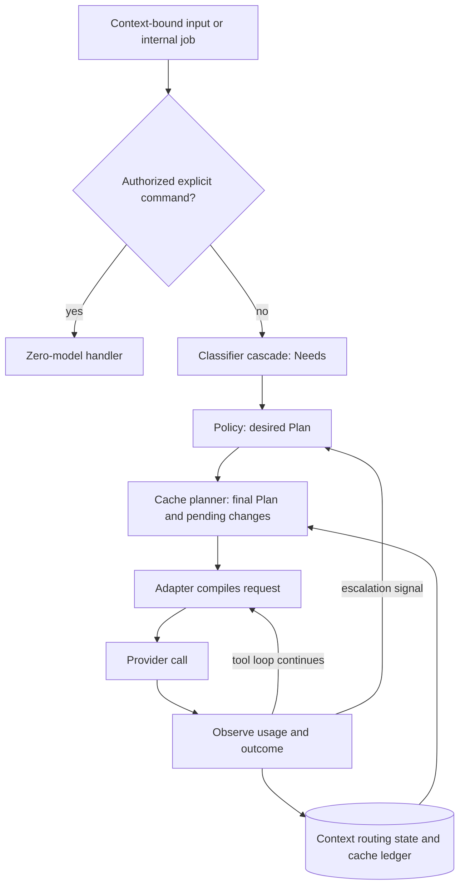

# Routing layer design

**Status:** Draft 0.8, for review; selected engineering design, not implementation or contract-freeze evidence. No router code exists yet.
**Date:** 2026-10-05 (engineering closure and selected endpoint/tariff verification); earlier research and worked examples retain their recorded dates.
**Scope:** The component between the harness's agent loop and the model providers. Anthropic and OpenAI first; more providers later.
**Inputs:** The open-source harness survey (`RESEARCH-OPEN-SOURCE-HARNESSES.md`), the implementation-language research (`RESEARCH-IMPLEMENTATION-LANGUAGE.md`), the core-and-launchers design (`DESIGN-CORE-AND-LAUNCHERS.md`), and the provider-efficiency and router surveys from the same research rounds. Appendix B records the earlier primary-source research; the initial endpoint bounds and tariffs in §9.4 were rechecked on 2026-10-05.
**Reconciliation scope:** The 2026-09-29 incorporation is limited to the three owner-authorized idea sections recorded in `DESIGN-CORE-AND-LAUNCHERS.md` §11 and §12. The original, `superceeded-Design.md`, is kept in the archive folder `../dwarfharness/`, outside this repository; its remaining material is not reconciled. This update does not inspect legacy code or data.

**Fresh session:** Start with [`ROADMAPS.md`](ROADMAPS.md) for the order of work, then [the core design's canonical handoff](DESIGN-CORE-AND-LAUNCHERS.md#start-here-for-a-fresh-session) for authority and continuation scope. [`DECISIONS.md`](DECISIONS.md) distinguishes adopted owner policies from assistant-selected engineering mechanisms. D21 supplies the private-context model; B7–B8 and core §13.5–§13.6 select the broker, boards and role mechanisms. Their implementation and producer-owned contract freezes remain unrun.

**Related philosophy and field design:** [`FIELD-PHILOSOPHY.md`](FIELD-PHILOSOPHY.md) and [`DESIGN-UNDERCURRENT.md`](DESIGN-UNDERCURRENT.md) specify the universe-wide indirect environmental layer, separate from DMs, Corps boards and Griot stories. D80–D81 settle scoped coarse disclosure and sovereign opt-in federation; the field design selects the engineering rules. Fields do not grant permissions, pool private contexts, override budget scopes or authorize provider changes. The router writes scoped measurements to the Core ledger (R11) and hosts authorized rendered impressions as a tail context module (§5.5). This selected design does not claim a frozen law, field implementation or passed disclosure/effectiveness gate.

**Changes in 0.8**, 2026-10-05:

- B9–B10 select Core-owned durable accounting, inclusive endpoint cost bounds, sealed request/quote identity, one-attempt dispatch and scoped R1 observations.
- Context-module limits, headroom publication, cache/classifier defaults and transport rules are concrete selections below; formal freezes and empirical gates remain explicit.
- D80–D87 and the Core/field roadmaps replace the earlier unresolved social, disclosure, federation and platform-policy forks. C0 remains Ready; D52 owner approval and the six contract freezes are not completed by this document.

**Historical changes in 0.7**, from the owner's implementation decisions of 2026-10-02 (`DECISIONS.md`):

- D21 adopts one execution session per agent with many private contexts (core §7.3), so the context-bound router state in §5.1 and §6.4 now rests on an owner decision. The broker in core §7.4 is still a proposal.
- D22 lets an agent run turns in several of its contexts at once, up to a per-agent limit, with at most one active turn per context (§5.1).
- D24 accepts that simultaneous turns starting on a cold shared prefix may each pay the cache-write price; D51 adds a shared-prefix cache record without changing that behavior (§9.2; §15).
- D25 adds a tail note listing the agent's other active contexts by name only (§5.1).
- D22 safeguard 4: each call's maximum cost is reserved against every applicable budget scope before the call and settled against reported usage afterwards (§11).
- D33: the per-call decision record stays a separate JSON-lines file, outside the colony log (§11).
- D28 keeps cgo out of the core, so the local embedding matcher's encoder can only be a separate helper program (§7.1).
- The rollout is tracked as steps R0–R5 in `ROADMAP-ROUTER.md` (§14).

**Historical changes in 0.6**, from the environmental-layer design discussion of 2026-10-01:

- New requirement R11: provider status transitions, headroom samples, budget threshold crossings and usage attribution are written to the core action ledger as typed events when observed, not held only in memory or in the JSONL decision record (§5.4).
- New §5.5 describes the relationship between the router and Undercurrent: what flows in each direction, and what the field layer may never do to routing.
- Rollout (§14) records that router phase 1 must be complete before Undercurrent's `resource_pressure` field can be validated on real data and before any field impression can reach a prompt.

**Historical changes in 0.2**, from the owner's decisions of 2026-09-28:

- The harness keeps control: its transcript, permission checks, tool gating, compaction and spend accounting are the source of truth, and provider-side features are optional (T10, §8.5).
- No automatic provider switching in v1. The router tracks whether each provider is still serving, tells the user when one stops, and makes the provider change the user chooses safe (§9.8).
- Every provider beta stays behind its own flag, off by default. This now covers OpenAI's Flex processing too.
- Plugins run as child processes (§12).

**Historical changes in 0.3**, from 2026-09-28; the toolchain and browser-launcher decisions below are superseded by 0.4:

- Go was selected with a no-cgo build constraint. The router's placement as a library inside the Go core remains current.
- The two proposed launchers were a plain terminal and an external-browser launcher.

**Historical changes in 0.4**, from the owner's decisions of 2026-09-29:

- Go remains the core language. A C toolchain will be acquired; blanket `CGO_ENABLED=0` is no longer a product constraint (`DESIGN-CORE-AND-LAUNCHERS.md` §8.1).
- `dwarf-harness` is the program and plain terminal entry point; `dwarf-harness-GUI` opens a native window, replacing the external-browser proposal. Both expose identical harness functionality through the same Go core, and the same live session is visible in both simultaneously. Each view has its own event cursor; the proposed colony-scoped core-host topology is described in `DESIGN-CORE-AND-LAUNCHERS.md` §3 and §4.
- At most one GUI instance serves a colony; launching it again reuses/focuses that instance. Other colonies may have their own instances. The GUI can spawn agent sessions within core ownership limits. Dwarf Fortress styling is GUI-only; its visual design comes later (`DESIGN-CORE-AND-LAUNCHERS.md` §5 and §6).
- DwarfHarness is a standalone product inspired by ideas, not a StarNet fork, port or addon; it has no StarNet runtime, compiler, JavaScript/goja, compatibility or parity contract.

**Historical changes in 0.5**, from the owner's communication requirements and the proposed relationship-memory model of 2026-09-29:

- The Colony's Grand roles and each specialized Corps' Orchestrator, Griot, Diplomat and workers follow the hierarchy and communication policy in `DESIGN-CORE-AND-LAUNCHERS.md` §7.1 and §7.2; routing does not grant additional channels.
- One execution session per agent, including every leadership role, can serve many independently owned contexts. Routing state, private relationship memory, provider continuations and cache ledgers belong to `(agent_id, context_id)`, with each turn bound to that context (§5.1 and §6). [INFERENCE: proposed mechanism, not a newly approved owner implementation choice]
- Logical conversations do not require a process or socket per relationship. The proposed colony broker and physical IPC boundary are defined in `DESIGN-CORE-AND-LAUNCHERS.md` §7.4 and §3.4. [INFERENCE]

Conventions:

- **[INFERENCE]** marks reasoning not established by a cited source. Selected engineering defaults are distinct from adopted owner policy and from unrun implementation/approval gates; §15 records their disposition.
- Appendix A's dated price calculations illustrate decision rules, not measurements or the current admission tariff. The pinned initial admission profiles are in §9.4.
- Go is the selected implementation language. TypeScript-like blocks describe data and call shapes, not implemented Go APIs. `Promise`, `Map` and helper names are explanatory notation. The selected serialization, dispatch and error mechanisms are in §9.4, §11 and §12; producer-owned exported signatures and golden encodings are frozen at the named implementation gates, not implicitly by these sketches.

## 1. Summary

For every new turn — user input, an authorized agent message, or an internal job — the routing layer decides how much model capability to spend and how to send it:

- whether to call a model at all;
- which rung of a model-and-effort ladder to use;
- the output ceiling;
- which tools and context modules to include;
- the service tier;
- the permission level.

Regular users get cheap defaults without configuring anything. Advanced users change the rules declaratively or with plugins.

It has three stages, all running inside the harness process:

1. **Classifier cascade → `Needs`.** What the prompt requires: kind, difficulty, capabilities, context, urgency, risk. The cheapest stages run first. The default stages make no model calls and download nothing.
2. **Policy → `Plan`.** A provider-neutral decision built from a ladder, a profile and declarative rules. Rules merge order-independently.
3. **Cache planner.** Reconciles the desired plan with the selected context's provider state. It knows which changes break which cached segments on each provider, and prices them with that context's cache ledger:
   - cache-neutral changes and capability upgrades apply immediately;
   - optional cache-breaking changes ordinarily wait for a *change point*, unless the break-even rule in §9.5 justifies applying them sooner.

Provider adapters compile the plan into API requests and report usage back.

The harness, not the provider, holds the conversation, the permissions, tool gating, compaction summaries and spend accounting (T10). The router also tracks whether each provider is still serving the user. When one stops — a spend limit, an empty credit balance, a long rate limit — the router says why and offers the alternatives, but in v1 it never changes provider on its own (§9.8).

No open-source project surveyed combines needs classification, multi-setting policy and provider-cache-aware planning. The closest projects each contribute specific mechanisms, credited in §4.

## 2. Goals, non-goals and constraints

**Goals**

- **G1** — Lowest cost per *successful* task for regular users, with no configuration.
- **G2** — Minimal router overhead: default classification and policy add no model tokens, network calls or downloads. Optional token-count confirmation near a limit is a separate provider call (§9.2), not part of that zero-call claim.
- **G3** — Cache awareness: never trade a large cache loss for a small saving, and use cold moments.
- **G4** — Modularity: advanced users add rules, classifiers, context modules and providers without editing core code.
- **G5** — Provider-neutral decisions, provider-specific compilation. Adding a provider means adding an adapter and a capability file.
- **G6** — Explainability and measurement: every decision is logged with its cause and its predicted and actual cost.
- **G7** — Safe degradation: a routing failure falls back within the bound context; it never bypasses authorization or context isolation.
- **G8** — Harness-owned control: everything works with every optional provider-side feature turned off (T10).

**Non-goals for v1**

- Load balancing across accounts or deployments of the same model. LiteLLM does this and can sit behind an adapter (§12).
- Semantic response caching, i.e. returning stored answers to similar prompts. In agentic work a stale answer can trigger wrong actions. [INFERENCE]
- Re-routing inside a tool loop: continuation calls reuse the turn's plan (§7.3). The only exceptions are escalation (§10) and a provider change the user chooses mid-turn (§9.8).
- Routing through MCP. MCP servers are tools the harness calls; they can't rewrite provider requests. Sampling, the only MCP mechanism with model-preference hints, was [deprecated in the 2026-07-28 specification](https://modelcontextprotocol.io/specification/2026-07-28/client/sampling).
- Learned or online routing, such as LiteLLM's Thompson-sampled pools. Revisit once real decision logs exist.
- Compressing the cached prefix.
- Automatic provider switching, on failure or to save money. In v1 the provider changes only when the user chooses (§9.8).
- Provider-held conversation state: stored responses, `previous_response_id`, or provider compaction as the only copy of the history (T10).

**Constraints**

- **C1** — The router is a library inside the Go core, with no daemon or port of its own. Optional plugins run as child processes (§12).
- **C2** — The default stages are deterministic and testable offline.
- **C3** — Provider facts change often. OpenAI renamed Priority processing to Fast mode on 2026-07-30, and several of Anthropic's cache-safe controls are betas dated July to September 2026. Provider facts are therefore data, not code.
- **C4** — The audience isn't chosen yet, so the `Needs` vocabulary must not assume coding.
- **C5** — Provider betas are off by default, each behind its own flag (owner's decision, 2026-09-28).

## 3. Design tenets

| | Tenet | Basis |
|---|---|---|
| **T1** | Default classification and policy use rules and arithmetic, with no model calls. | LiteLLM's heuristic scorer makes "zero API calls" and is "sub-millisecond"; the project's lightweight goal. |
| **T2** | Classify needs, not models. | Arch-Router matches prompts to user-described domain/action routes and maps routes to models separately, supporting "new domains/actions without retraining the router". |
| **T3** | Parameters before prose. | API settings cost no prompt tokens; injected instructions do, and most of them stay in history. [INFERENCE] |
| **T4** | Keep the prefix stable and vary the tail: appends are cheap, edits are expensive. | Anthropic's cache hierarchy (tools → system → messages); OpenAI's list of prefix-affecting settings. |
| **T5** | Escalate immediately; de-escalate lazily. | Under-provisioning fails tasks, over-provisioning only costs money, and downgrades usually lose a warm cache (Appendix A, example A). [INFERENCE] |
| **T6** | Price model changes; don't forbid them. | LiteLLM measured 4,684 real switch-backs: 97.4% found the cache warm at a 5-minute TTL and 99.3% at 1 hour. Yet moving a long history to a cold model can cost more than it saves (Appendix A). Provider changes are the user's call in v1 (§9.8). |
| **T7** | Routing degrades to safe defaults within the bound context; authorization and scope failures still stop the call. | LiteLLM: "A plugin that is down degrades routing; it never fails the request." Context isolation is a harness requirement, not a classifier fallback. [INFERENCE] |
| **T8** | Provider facts are data, validated at load; unsupported settings fail loudly. | LiteLLM warns that silently dropped parameters produce "a ladder that changed nothing", and rejects misplaced keys at load "rather than silently ignored". |
| **T9** | Every feature must show net savings in the logs. | LiteLLM reports signed savings, net of the classifier's own cost. |
| **T10** | The harness owns the truth. The transcript, permissions, tool gating, compaction summaries and spend accounting live in the harness; provider-side state is at most a cache of them. | The owner's direction. OpenAI's compaction item "is opaque and not intended to be human-interpretable"; reasoning carries over only within a model family; and reading usage or spend needs admin credentials on both providers (Appendix B). |

## 4. Prior art: what this design takes

Licenses and status checked on 2026-09-28.

| Project | Adopted | Left out, and why |
|---|---|---|
| [LiteLLM Auto Routing](https://docs.litellm.ai/docs/proxy/auto_routing) (beta; MIT outside the `enterprise/` directory; very active) | Classifier cascade: keyword rules, heuristic scorer, optional LLM classifier, custom plugin. Escalate-to-highest merge for matching rules. Stripping harness reminder blocks before classification. Classifying user turns only and carrying the decision through tool continuations. Context-window escalation. Effort ladders. Abstain or failure falls back. A cause marker on every decision. Signed savings with a warm-cache baseline and TTL expiry. Load-time rejection of bad configuration. | Taking LiteLLM as a dependency: it's a Python package, while Go is now selected for this harness, and it doesn't plan around cache state. Adaptive pools (non-goal). The binary `session_affinity` pin, replaced by priced switching (T6). |
| [vLLM Semantic Router](https://github.com/vllm-project/semantic-router) (Apache-2.0; very active) | Continuity signals: turn index, previous model, `previous_response_id`, history tokens, and context-window fit bands at 50/75/100% of the window ([source](https://github.com/vllm-project/semantic-router/blob/445ab860de326c3226fe13c6455ce260dd2fc38c/src/semantic-router/pkg/selection/cache_affinity.go)). The principle that continuity must not override quality: their adjustment is capped at 0.14 and only acts when the top two candidates score within 0.20 of each other. `prompt_cache_key` as continuity evidence ([issue #4184](https://github.com/vllm-project/semantic-router/issues/4184), accepted 2026-09-26). | The ModernBERT classifier and Envoy deployment (weight). The additive tie-breaker, replaced by explicit cost arithmetic because provider prices and TTLs are known. |
| [claude-code-router](https://github.com/musistudio/claude-code-router) v3.1.0 (MIT; very active) | One stable interface in front of many providers, which becomes our adapter layer. Its retries, credential pools and ordered fallbacks illustrate transport concerns; this design takes bounded retries, not automatic provider fallback or account balancing. Logging the resolved provider, model and credential with tokens and estimated cost. Conditions over request headers and bodies. | A separate gateway process and desktop app (C1); automatic provider switching and account/deployment balancing in v1 (§2). |
| [Plano](https://github.com/katanemo/plano) (formerly archgw; Apache-2.0) with [Arch-Router-1.5B](https://huggingface.co/katanemo/Arch-Router-1.5B) (weights under the custom `katanemo-research` license) | A route vocabulary described in natural language as *domain* plus *action*, with an explicit "other" outcome. The descriptions double as the optional LLM classifier's rubric. | The 1.5B model as a default: download, CPU or GPU cost, and license. |
| [semantic-router](https://github.com/aurelio-labs/semantic-router) (Aurelio; MIT) | An optional local embedding stage that matches utterances to named routes and returns `None` when nothing matches. | On by default: it needs an encoder download or remote embedding calls. |
| [Portkey Gateway](https://portkey.ai/docs/product/ai-gateway/conditional-routing) (MIT; last change May 2026) | Declarative query operators (`$eq`, `$ne`, `$in`, `$nin`, `$regex`, `$gt`, `$gte`, `$lt`, `$lte`, `$and`, `$or`). Missing keys evaluate to false. | Portkey evaluates conditions in order ("the order of your conditions is important") and treats malformed conditions as false. Here all matching rules merge order-independently, and malformed rules are rejected at load. |
| [RouteLLM](https://github.com/lm-sys/RouteLLM) (Apache-2.0; no changes since August 2024) | Calibrating thresholds against a cost/quality target on a labelled set. | Using it as a dependency. |
| MCP tool gateways: [lazy-mcp](https://github.com/voicetreelab/lazy-mcp) (MIT), [ToolHive](https://github.com/stacklok/toolhive) (Apache-2.0), [Klavis Strata](https://github.com/Klavis-AI/klavis) (Apache-2.0) | Progressive tool disclosure through a fixed pair of meta-tools (lazy-mcp's `get_tools_in_category(path)` and `execute_tool(tool_path, arguments)`). lazy-mcp's warning that permission checks must inspect the dispatched tool path. | MCP as the routing layer (§2). |
| [LLMLingua](https://github.com/microsoft/LLMLingua) (MIT) | Optional compression, for tail content only. | Compressing cached prefixes (T4). |

Not used: [TensorZero](https://github.com/tensorzero/tensorzero) (archived on 2026-06-12), [NVIDIA llm-router](https://github.com/NVIDIA-AI-Blueprints/llm-router) (deprecated in favour of NeMo Switchyard), and Not Diamond (a proprietary service).

## 5. Architecture

### 5.1 Placement

The router remains a library inside the Go core. Under the proposed colony-scoped host arrangement, that core is the single writer for its sessions (`DESIGN-CORE-AND-LAUNCHERS.md` §3). [INFERENCE: process topology, not a separate owner decision]

- It needs the exact rendered state of the conversation — segment fingerprints, token counts, idle time — which the harness already holds.
- MCP can't host it (§2).
- A proxy adds a process, a port and a serialization step per call, and has to reconstruct conversation state from wire traffic. vLLM Semantic Router's [issue #4184](https://github.com/vllm-project/semantic-router/issues/4184) shows the failure mode: to a proxy, stateless clients look like first turns.

Advanced users who want LiteLLM's multi-deployment balancing can point an adapter at a LiteLLM proxy, with LiteLLM's auto-router disabled so that two routers don't make conflicting decisions. [INFERENCE]

**Execution and context ownership (2026-09-29 proposal, adopted 2026-10-02 as D21).** A launcher is a view, not an agent or a second execution owner. The model gives every agent one execution session, including Orchestrators and the Grand roles. A session owns lifecycle, scheduling, turns and an audit trail; it is not one continuously pooled provider conversation. Terminal and native GUI commands address that same execution, with a cursor per view (`DESIGN-CORE-AND-LAUNCHERS.md` §4 and §7.3). [INFERENCE: the session and view mechanics beyond D21]

Private state is addressed by `(agent_id, context_id)` within a colony. General work, a directed peer relationship and participation in a Corps board are separate contexts, each with its own memory/handoff, rendered history, compaction, routing decisions and provider/cache state. A's memory about B is not B's memory about A. One session may hold many dormant contexts without a permanent process or model call for each. Common `Agent.md` and shareable general `Memory.md` must not silently pool private relationship details. The audit trail across the whole session is not fed back wholesale to the provider. [INFERENCE]

The owner-defined Grand/Corps roles and allowed communication paths live in `DESIGN-CORE-AND-LAUNCHERS.md` §7.1 and §7.2; the same context mechanism applies to all roles. A private observation about another worker, learned from the Corps board, does not authorize a worker-to-worker DM. A leadership title does not grant access to subordinate private contexts. Authorized pairwise or board logs supply shared exchanges; only the active context's private records and explicitly authorized shared materials supply its prompt (`DESIGN-CORE-AND-LAUNCHERS.md` §7.3 and §7.5). [INFERENCE: context/rendering mechanism]

Bind each routing decision to colony, agent, execution session, context and turn. `Needs`, `Plan`, pending changes, overrides, provider response IDs, tool continuations and cache ledgers cannot follow the last-used context when the same agent addresses another counterpart. Returning to a dormant context restores only its own state. View focus does not select or mutate an active model turn. [INFERENCE]

An agent may run turns in several of its contexts at once, up to a per-agent limit that is a setting, with at most one active turn per context (D22 in `DECISIONS.md`; a limit of 1 gives one turn at a time). Each such turn has its own binding, and its routing state never crosses into another context's concurrent turn. Waiting for a social reply still pauses/yields that context's turn rather than opening a recursively blocking agent-call chain. [INFERENCE: the yield rule]

Each turn's tail lists the agent's other active contexts by counterpart name or task title only, never their content (D25). The list sits after the cached prefix (R3) and costs roughly 10–30 tokens per active context [INFERENCE]. Until the context-module interface (§6.5) is frozen, the runtime renders it as a fixed tail section; afterwards it becomes a context module (`ROADMAP-ROUTER.md` R1).

Changing a message counterpart is a context transition, not just changing a destination field: pause/yield or finish the old turn, then compose in a freshly rendered turn bound to the destination relationship or board context. A send must match that context's authorized channel and operation. For example, a worker moving from its Orchestrator to its Diplomat cannot continue from the Orchestrator prompt, tool results or provider response ID; only explicitly shareable material may be carried over. [INFERENCE]

Approvals and one-turn tool grants resolve against the bound agent, context and turn. A reusable private grant is labelled **this context**, not **this session**; any wider grant requires an explicit wider scope. Agent role/base policy and explicitly scoped agent/account budgets remain shared constraints, not private conversation state or implicit approval. [INFERENCE]

Logical message channels and physical transport are separate. The proposed core broker authorizes messages using authenticated identity, membership, hierarchy edge, destination and operation (`DESIGN-CORE-AND-LAUNCHERS.md` §7.4). Agents inside the core use method/queue calls; external launchers/processes use the colony IPC connection described in `DESIGN-CORE-AND-LAUNCHERS.md` §3.4. There is no OS socket per agent, context or relationship, and a transport command acknowledgement is not a counterpart's reply. [INFERENCE]

### 5.2 Pipeline



Classification runs once per new turn. Tool-loop calls reuse that turn's decision; escalation (§10) may revise its plan, and a user-chosen provider change uses the handover in §9.8. Neither requires classifying a tool result as a new ask. Compile and observe run for every API call in the bound turn; the scheduler must not substitute a newly focused context.

### 5.3 Router interface

The interface below sketches successful decisions; it does not authorize dispatch. Every paid model call—including classifier, compaction, helper/social work and any explicit retry—must pass through the single Core admission service and its durable per-colony ledger. Adapter compilation supplies a complete finite `CostBound` and pinned capability/tariff version; Core atomically checks all applicable explicit scopes, persists the maximum reservation, and returns an immutable `BoundCall` before a provider request can be sent. Missing/unbounded prices, stale capability versions, floor/ceiling conflicts or exhausted caps return a typed `RouteBlocked`; they never dispatch or trigger a fallback model call (§11).

```ts
interface Router {
  // Once per new user/message turn, and once per harness-internal job.
  beginTurn(input: RouteInput): TurnDecision

  // Model routes only, once per API call in the tool loop. Same inputs, same bytes.
  compile(turn: TurnDecision, transcript: ContextTranscript): ProviderRequest

  // After every API call. Updates the ledger and statistics, and may return a revised
  // decision for the next call (escalation) or request a change point (e.g. compaction).
  observe(turn: TurnDecision, result: ProviderResponse | ProviderError): Observation
}

type SealedProviderRequest = {
  readonly provider: string; readonly endpoint: string; readonly model: string; readonly region: string
  readonly method: "POST"; readonly path: string; readonly serviceTier: string // exact escaped path; initial profiles allow no query
  readonly credentialScopeID: string; readonly credentialVersion: string // non-secret immutable Core credential binding
  readonly headers: readonly (readonly [name: string, value: string])[] // sealed non-secret application headers
  readonly bodyUTF8: string; readonly requestHash: string // exact serialized wire body, sealed before pricing
}
type ExactPricedDimension = {
  classes: string[]                // unique mutually exclusive billable classes, sorted for hashing
  maxUnits: bigint                 // nonnegative inclusive token maximum, not an expected allocation
  rateNumerator: string            // nonnegative base-10 integer; exact USD per 1,000,000 tokens
  rateDenominator: string          // positive base-10 integer; never a floating-point rate
}
interface CostBound {
  currency: "USD"; maximumMicros: bigint
  components: readonly ExactPricedDimension[]
  requestHash: string; capabilityVersion: string; tariffVersion: string; tariffHash: string
  quoteHash: string
}
interface BoundCall {
  readonly attemptId: string; readonly binding: TurnBinding; readonly request: SealedProviderRequest
  readonly requestHash: string; readonly quoteHash: string; readonly credentialScopeID: string
  readonly capabilityVersion: string; readonly tariffVersion: string; readonly tariffHash: string
  readonly admissionPeriod: string; readonly budgetScopes: readonly BudgetScope[]
  readonly maximumMicros: bigint
}
interface RouteBlocked {
  reason: "floor_above_ceiling" | "budget_exposure" | "spend_authorization_required" | "bound_overflow" | "unbounded_endpoint" | "stale_capability" | "provider_unavailable"
  requiredFloor?: string; eligibleCeiling?: string; scopes?: BudgetScopeRef[]
  actions: ("revise_task" | "explicit_budget_change" | "owner_enroll" | "wait_or_configured_provider" | "stop")[]
}
```

The adapter seals the endpoint, body and non-secret application headers once before pricing. `Bound` accepts only that immutable `SealedProviderRequest`; `Core.admit` validates its digest and the quote, then atomically persists and reserves the maximum before returning `BoundCall`. Seal API-version, beta and organization/project-routing headers as well as ordinary content headers; reject unsupported headers, duplicate case-insensitive names, control characters, endpoint user-info/fragments and queries in the initial profiles. Header names are lowercase ASCII tokens sorted by byte order; values are the exact validated strings sent. Authentication bytes are excluded from hashes/logs and resolved only from the pinned, still-authorized Core credential version—not a mutable “current key” lookup. Transport-derived Host/Content-Length come from the sealed authority/body. Transport never reserializes or changes this semantic envelope after admission.

Hash bytes are precisely defined, with no canonicalization library: `frame(bytes) = u64be(byteLength) || bytes`; text is valid UTF-8 as-is, without escaping or Unicode normalization. The request preimage is the concatenation of individually framed fields, in order: `router-provider-request/v1`, provider, exact HTTPS authority, model, region, method, exact escaped path, requested service tier, opaque non-secret `credentialScopeID`, `credentialVersion`; then `u32be(headerCount)`, each sorted header's framed name and framed value, then the framed exact body bytes. `requestHash` is lowercase-hex SHA-256 of that preimage.

The quote preimage starts with individually framed `router-cost-quote/v1`, raw 32-byte request hash, capability version, tariff version, tariff hash, `USD`, and canonical-decimal total `maximumMicros`; append `u32be(componentCount)` and the components. Each component is `u32be(classCount)`, its unique class strings sorted by UTF-8 bytes and individually framed, then framed canonical-decimal `maxUnits`, rate numerator and rate denominator. Sort components by their encoded bytes and frame each complete component. Recompute the exact rational total and round upward once; there is no redundant independently rounded component amount. Reject overlapping billable classes, duplicate components, invalid UTF-8, overflow or unsupported fields. Canonical decimals are ASCII `0` or a nonzero digit followed by digits, without sign, leading zero or exponent; denominators are positive. `quoteHash` is lowercase-hex SHA-256 of that preimage. No map iteration, floats or mutable reserialization determines either digest.

Core stores both digests with the immutable hold and verifies the endpoint, credential scope/version, sealed headers and body before `dispatch_intent`; digests provide local integrity/correlation, not provider proof or invoice evidence. The reservation separately stores the admission period, `TurnBinding`, and sorted de-duplicated scope IDs; the pinned credential must belong to that credential/account scope and remain authorized at dispatch. Scopes are colony, agent, credential/account-within-colony, active task/grant budget and every attenuated grant ancestor. A grant conveys narrower authority, not pre-reserved capacity: each attempt checks and holds against every applicable scope in Core's existing `BudgetBook`; no parallel grant-accounting service is introduced.

Illustrative API boundary (not frozen): `ProviderAdapter.Seal(request, credentialScopeID, credentialVersion) -> SealedProviderRequest`, with the non-secret scope/version pair resolved by Core; `ProviderAdapter.Bound(sealedRequest, capability) -> CostBound`; `Core.admit(sealedRequest, quote) -> BoundCall`; `Core.dispatchIntent(boundCall)` durably writes intent/`SENT` before authorizing exactly one physical POST; `Core.settle(attemptId, finalUsage)` idempotently settles complete normalized usage; `Core.releaseUnsent(attemptId)` may release only a still-`reserved` attempt with no intent. Callers never write the ledger directly. A recovered reservation with no intent may be released only because code is forbidden to send before intent; sent/no-final-usage remains unknown and fully held through rollover.

The core creates the protected bindings and scoped transcript below (§6.1). `compile` checks that the transcript and cache plan belong to the decision's context; `observe` records results against the initiating turn even if a view has moved elsewhere. A mismatch fails closed rather than falling back to another context. These are proposed contracts, not implemented APIs. [INFERENCE]

### 5.4 What the router requires from the rest of the harness

| | Requirement | Why |
|---|---|---|
| **R1** | Canonical append-only, provider-neutral source records: authorized pairwise/board logs and each agent's private context records. A `ContextTranscript` is rendered from the addressed context and explicitly authorized shared materials, never from the whole session audit trail. Provider artifacts (thinking blocks and signatures, encrypted reasoning, tool-call ids) are opaque attachments tagged with their owning context, provider and model family. Cache markers are added only at compile time. | Context isolation and provider switching (§5.1 and §9.8). [INFERENCE: scoped rendering] |
| **R2** | Deterministic rendering: unchanged authorized content and settings produce a byte-identical request prefix. Key order and tool order are stable, and the prefix contains no timestamps or random ids. | Anthropic matches cached prefixes "exactly, byte for byte"; OpenAI requires "the entire rendered prefix to match". |
| **R3** | Volatile content (date and time, environment status, per-turn reminders) goes in the tail. | T4. |
| **R4** | The harness enforces agent base policy plus the bound context/turn's permissions on every tool dispatch. The router sets a ceiling and approval rules; meta-tool gates inspect the dispatched tool path. "This context" and explicit wider grants are distinct; neither another view, another relationship nor the session identity supplies implicit approval. Messaging also passes the core's communication policy. | lazy-mcp: routing every call through `execute_tool` bypasses per-tool permission rules; protected bindings preserve authority within a multi-context session. [INFERENCE] |
| **R5** | Raw usage and the service tier actually served are passed to `observe`. | Ledger correction; OpenAI can serve a Fast request at standard speed. |
| **R6** | Each call is labelled as a new turn (user or authorized message), a tool continuation, or an internal job (compaction, summaries, subagents), with the protected agent/context/turn binding. | §7.3 and §8.4. |
| **R7** | A registry of command handlers. | The zero-model route (§7.2). |
| **R8** | Context-bound phase events (mode switch, new task, `/clear`) reach the router; an explicit wider configuration change is applied separately to each affected context. | Change points (§9.6). |
| **R9** | `dwarf-harness` and `dwarf-harness-GUI` show the same notice identifying its agent, context and paused turn, and accept wait, change provider, compact first, or stop. The terminal prints numbered choices; the native GUI presents controls. The core accepts a choice only for its still-valid bound turn, applies it once and publishes the resolved state to both views (`DESIGN-CORE-AND-LAUNCHERS.md` §4). | User-chosen provider changes (§9.8); view focus cannot retarget a pending choice. [INFERENCE] |
| **R10** | Preserve completed tool effects and enough canonical state for safe retry/handover. Reconcile unfinished calls or uncertain effects through the core's recovery/approval path; never fabricate success or blindly rerun an effect. Target rendering must contain matched tool-call/result pairs; incomplete streamed content is completed or excluded from that render without erasing the audit record. Late results remain with their initiating context. | Safe handover (§9.8) and core §7.4's recovery boundary. [INFERENCE] |
| **R11** | Core's single per-colony action ledger accepts typed router events. R1 writes `ProviderStatus` transitions, versioned `router-headroom/v1` samples on the exact band/knownness/freshness changes in §5.5, configured budget-exposure threshold crossings, and per-attempt usage attribution at the real provider/account/model/region and bound-context scopes. A headroom sample names metric `requests`, `tokens`, `input_tokens` or `output_tokens`; carries validated `limit`/`remaining`, categorical band, observed ledger time, `validUntil`, and optional provider-reset `renewal` time. It is not a money balance. Exposure includes settled admission-period cost plus every still-open hold for that scope across periods, deduplicated by attempt. Exact usage stays bound to its source context; field projection follows D79 and never changes routing or admission. A `SENT` attempt without final usage retains its hold. R0 emits no R11 events, but this never disables C3's durable reservation, dispatch-intent, usage settlement or recovery path for real paid calls. The ledger write is durable/replayable and does not become a router-local budget store. | Field consumes only canonical ledger data; in-memory status and diagnostic JSONL are not field inputs. [INFERENCE] |

### 5.5 Relationship to the environmental layer (Undercurrent)

The router and Undercurrent are separate packages inside the Go core with no direct calls between them. They meet in two places: the core action ledger, and the router's tail context-module slot. [INFERENCE: proposal; neither layer has been implemented]

| Direction | What flows | Mechanism | Router requirement |
|---|---|---|---|
| Router to Undercurrent | Provider status transitions, headroom samples, budget threshold crossings, usage attribution | Typed events in the core action ledger | R11 |
| Undercurrent to router | Rendered impressions for the bound context's turn | A tail context module with a declared token budget, placed after the cached prefix | R3 and §6.5 |
| Neither direction | Routing decisions, budgets, provider choice, permissions, cache planning | Not available to the field layer | — |

**The router owns control; the field layer owns awareness and disclosure.** Router applies provider availability and configured local budgets (§9.8, §11); a field reading never changes a `Plan`, permission, budget or provider choice. Router records actual measurements at their true provider/account/model/region/metric and originating-context scopes. Exact usage and attributed amounts remain bound to their source context. Other audiences receive only an expressly authorized coarse shared-resource pressure band and freshness, without consumer, task, amount, account or private provider identifier; access requires an explicit scope grant (D79). The router records typed facts; it does not choose who sees them or emit a social/message channel.

**Impressions follow the same binding rules as every other tail module.** A field impression is rendered for the bound agent, context and turn (§5.1). It is volatile content, so it goes in the tail (R3) and does not affect prefix caching. Its token cost is declared through the context-module interface (§6.5) and counted in the turn's accounting like any other module. An impression rendered for one context is never carried into another on a context switch.

**Measurements are written when observed, at their true scope.** A provider-status/headroom event carries the scope and supported metric at which it applies; headroom's categorical band is versioned with the adapter/capability (`router-headroom/v1`), not `law-format`. A budget event carries its named local scope and period. An agent's cap or one colony's account-credential budget is never represented as provider-wide exhaustion or a global provider-account cap.

**`router-headroom/v1` normalization and publication.** These are selected R1 producer rules, not `law-format` parameters or measured optimal tuning:

- Parse adapter-supported metrics as nonnegative integers no greater than `2^63−1`; require a positive `limit`. Missing, malformed, negative, overflowing or unsupported values are unknown, never a fabricated healthy reading. For a valid pair, clamp `remaining` to `limit` if larger; this observational normalization is not permission to clamp financial usage or cost. Keep normalized counts protected at their actual scope. Field v1 consumes the band/freshness, not these counts or a reconstructed continuous ratio.
- For `r = remaining / limit`, choose `empty` at zero, `critical` for `(0, 0.10]`, `low` for `(0.10, 0.25]`, `constrained` for `(0.25, 0.50]`, and `ample` for `(0.50, 1]`. Integer comparisons against `floor(limit/10)`, `floor(limit/4)` and `floor(limit/2)` avoid floating-point boundary drift and multiplication overflow.
- Convert a valid reset to the Core time domain. Set `validUntil = min(reset, observedAt + 15 minutes)`; without a supplied reset, use `observedAt + 15 minutes`. A malformed supplied reset or a resulting expiry no later than observation yields unknown. Expired evidence is effectively unknown even if its stored band was known.
- Compare a new observation with the last **durably published** sample for that exact scope/metric. Publish a known sample when none exists, its band changes, the prior evidence has expired/is unknown, expiry extends by at least five minutes, or the old expiry is within five minutes and the new expiry lies beyond five minutes. In particular, fresh same-band evidence after a short reset expiry must publish; the five-minute coalescing threshold cannot suppress it.
- If a formerly known/supported metric becomes missing or unknown, publish unknown once; repeated unknown or never-observed absent metrics do not emit a stream. Consumers derive expiry locally without inventing a provider sample. Piggyback qualifying samples on existing usage/status commits, retaining a bounded latest sample per configured scope/metric; never persist every raw header observation or make a probe/model call just to refresh the field.
- `ProviderStatus` remains the separate typed availability state in §6.4. Field's `provider_status/v1` response and freshness lease belong to field law; a field lease expiring never clears a Router block, changes a budget or starts a retry.

**Dependencies on router phases.** Undercurrent's engine is built and tested against synthetic ledgers and does not wait for router code. Two of its capabilities do wait for router phase 1 (§14): validating its `resource_pressure` field against real provider and budget data, which requires R11 events, and showing any impression to an agent, which requires tail context modules. The field layer's other initial kinds, which are drawn from the core's workspace and promotion events, depend on core phase 1 rather than on the router (`DESIGN-UNDERCURRENT.md` §15.2).

## 6. Contracts

### 6.1 Input

The core binds this input and its resulting decision to one colony, agent, execution session, context and turn (§5.1). A launcher or plugin cannot substitute another context's transcript, continuation or permissions. The identifiers below are core-validated bindings, not model-supplied claims of authority; agent/account budgets are separately scoped constraints (§11). The sketches in this section are proposed interfaces. [INFERENCE]

```ts
interface ContextKey {
  colonyId: string; agentId: string; contextId: string
}

interface TurnBinding extends ContextKey {
  sessionId: string; turnId: string    // execution owner and this particular turn
}

interface ContextTranscript {
  key: ContextKey
  transcript: Transcript              // scoped render, not the whole execution audit
}

interface TurnDecision {
  binding: TurnBinding
  needs?: Needs                       // required for model routes; absent for zero-model handlers
  plan: Plan
}

interface RouteInput {
  binding: TurnBinding                // supplied and protected by the core
  origin: "user" | "message" | "internal"
  text: string                        // harness reminder blocks already stripped
  attachments: { images: number; files: number }
  explicit?: { command?: string; override?: PlanOverride }   // core-authorized metadata, not peer text
  signals: Record<string, number | boolean | string>         // cheap facts (§7.4)
  context: {
    turnIndex: number; historyTokens: number; idleSeconds: number
    lastNeeds?: Needs; lastPlan?: Plan; failuresThisPhase: number; mode?: string
  }
}
```

### 6.2 Needs (classifier output)

```ts
interface Needs {
  version: 1
  kind: "chat" | "answer" | "edit" | "execute" | "research" | "plan" | string  // extensible (§12)
  domain?: string                      // optional, user-defined
  difficulty: 0 | 1 | 2 | 3             // trivial, low, medium, high
  capabilities: ("read" | "search" | "edit" | "execute" | "web" | "vision")[]
  context: string[]                     // requested modules, e.g. "recent_files", "repo_map", "memory"
  urgency: "interactive" | "deferrable"
  risk: "none" | "read" | "write" | "destructive" | "external"
  output: "short" | "medium" | "long"   // expected size of the visible answer
  confidence: number                    // 0..1
  evidence: string[]                    // causes, for the decision log
}
```

Rules of the contract:

- Classifiers never name models, providers or prices, and the policy never reads raw prompt text. This separation is what lets a classifier be reused across providers, and a policy be edited without touching classifiers (T2).
- Stages may return a partial `Needs`. Later stages fill the gaps, and conflicts resolve upward: higher difficulty, broader capabilities, higher risk.
- Extension kinds and domains must carry a one-line description, which the optional LLM classifier uses as its rubric (the Arch-Router pattern).

### 6.3 Plan (policy output)

```ts
type Plan = { route: "no_model"; handler: string } | {
  route: "model"
  floor: string; ceiling: string       // ladder range allowed by policy (§8.1)
  rung: string                         // chosen by the cache planner within [floor, ceiling] (§9.5)
  outputBudget: number                 // hard ceiling on output, including reasoning (§8.4)
  tools: string[]                      // subset of agent policy and this context/turn's authorized surface
  context: { module: string; budgetTokens: number }[]
  serviceTier: "standard"             // initial supported direct-call tier; Fast needs an explicit bounded setting
  permission: "read_only" | "workspace_write" | "full"   // ceiling within core grants, not a grant
  approvalRequired: boolean
  turnNote?: string                    // only when no API parameter can express the intent (T3)
  maxEscalations: number
}
```

**Workspace binding (core design §3.5):** for an agent workspace operation, `workspace_write` applies to that bound work context's scratch; promotion is a separate core operation. A routing permission is not an OS sandbox: linked Git worktrees share repository metadata, and protecting canonical refs and private files from same-user child processes remains unresolved.

### 6.4 Context state and cache ledger

Keep one `ContextRouteState` per `(agent_id, context_id)` within its colony, not per execution session or launcher (§5.1). Each owns render history, compaction and continuation records as well as the routing state below. `CacheEntry.scope` describes the provider's cache-isolation boundary; it does not permit pooling local contexts or ledgers. Separate local ledgers do not promise provider-side isolation beyond documented provider boundaries. [INFERENCE]

Provider availability is a separate Core registry keyed by the actual configured provider/credential and, where relevant, model/region scope. An account budget means calls through that credential in this colony's single Core only; it is not a provider-side or cross-colony spend limit. All affected contexts may consult scoped status without sharing private history. An exhausted agent budget does not mark the account unavailable (§9.8 and §11). [INFERENCE]

```ts
interface ContextRouteState {
  key: ContextKey
  active: {
    provider: string; model: string; region: string; speed: "standard" | "fast"
    toolSurface: string                // fingerprint of the tools array
    contextEffort?: string             // top-level effort, where no cache-safe per-turn control exists
    systemFingerprint: string
  }
  ledger: CacheEntry[]                 // bounded routing cache metadata, retained per context
  pending: PendingChange[]             // bounded by validated active config
  continuations: ProviderContinuation[] // originating context only; never borrowed
  stats: { callsPerTurn: Ewma; idleGapSeconds: Ewma; outputTokens: Ewma }
}

interface ProviderContinuation {
  provider: string; modelFamily: string
  previousResponseId?: string         // only when stored responses are explicitly enabled
  artifactRefs: string[]              // this context's compatible reasoning/tool artifacts
  toolLoop?: { binding: TurnBinding; pendingToolCallIds: string[] }
}

interface CacheEntry {
  provider: string; model: string
  scope: string                        // the provider's cache-isolation boundary (account, region)
  segments: {                           // At most four priced provider breakpoints per entry
    kind: "tools" | "system" | "history"
    fingerprint: string; tokens: number; ttlSeconds: number; lastWriteOrHit: Time
  }[]
  hitRate: Ewma                         // observed ÷ predicted cached tokens
}

interface PendingChange { field: string; value: unknown; reason: string; since: Time }

interface ProviderStatus {
  scope: { provider: string; accountId: string; model?: string; region?: string }
  state: "available" | "rate_limited" | "overloaded" | "exhausted" | "denied" | "unreachable"
  cause?: string                       // e.g. "anthropic 429 enforced_spend_limit_reached"
  resumesAt?: Time                     // from retry-after, reset headers, or the error text when it gives a date
  headroom?: RateHeadroom              // normalized provider rate-limit measurement (§11)
  since: Time
}
interface RateHeadroom {
  scheme: "router-headroom/v1"
  metric: "requests" | "tokens" | "input_tokens" | "output_tokens"
  limit?: bigint                      // positive integer ≤ 2^63−1 when known; malformed/overflow is unknown
  remaining?: bigint                  // nonnegative integer ≤ 2^63−1, then clamped to limit
  band: "empty" | "critical" | "low" | "constrained" | "ample" | "unknown"
  observedAt: Time; validUntil: Time; renewal?: Time // next provider reset/renewal, when known
  scope: { provider: string; accountId: string; model?: string; region?: string }
}
```

### 6.5 Extension interfaces

```ts
interface Classifier {
  id: string
  cost: { kind: "free" | "local-cpu" | "local-model" | "remote"; typicalLatencyMs: number; typicalTokens?: number; residentMb?: number }
  classify(input: RouteInput, deadlineMs: number): Promise<Partial<Needs> | null>   // null = abstain
}
```
```go
type AuthorizedSnapshot struct { ID string } // opaque Core-issued handle to an immutable, access-filtered view
type RenderRequest struct {
  Binding TurnBinding
  Snapshot AuthorizedSnapshot
  ObservationPosition string
  ObservedAt time.Time
  TokenAllowance int // maximum declared module estimate; not provider fit or billing usage
  MaxOutputBytes int  // hard cap on canonical JSON-encoded RenderResult
}
type Block struct {
  ModuleID, Version string
  Binding TurnBinding
  Content json.RawMessage
  Provenance []string
  EstimatedTokens int
}
type RenderResult struct {
  Blocks []Block
  EstimatedTokens int
  OmittedCount int
  Continuation string // opaque authorized cursor; empty when none or disclosure is not allowed
}
type ContextModule interface {
  ID() string
  Version() string
  Required() bool // a required module failure/omission blocks prompt compilation
  Render(context.Context, AuthorizedReader, RenderRequest) (RenderResult, error)
}

type ProviderAdapter interface {
  Capabilities(model string) ModelCapabilities // dated endpoint/tariff data (Appendix B)
  Impact(model string, change Change) Invalidation
  Seal(request ProviderRequest, credentialScopeID, credentialVersion string) (SealedProviderRequest, error) // Core-resolved binding; serialize once before pricing
  Bound(request SealedProviderRequest, caps ModelCapabilities) (CostBound, error)
  Convert(transcript ContextTranscript, target ModelRef) (ContextTranscript, []DroppedArtifact)
  CountTokens(request ProviderRequest) (int64, error) // optional fit/calibration only
  Usage(response ProviderResponse) (NormalizedUsage, error)
  ClassifyError(error ProviderError) ErrorClass
}

type NormalizedUsage struct {
  Input  map[InputClass]int64  // mutually exclusive priced classes
  Output map[OutputClass]int64 // text and reasoning; mutually exclusive
  ServedTier string
  Headroom *RateHeadroom
}
```

First-party Go classifiers and context modules run in trusted Core code; they are not isolated plugins. Core-side `ContextModule.Render` reads only records authorized for the protected binding; an ID alone grants no filesystem access. External/native modules do not receive `AuthorizedReader` or a host-query RPC: Core materializes only the invocation's immutable, access-filtered snapshot as bounded input in the C10 execution compartment and accepts one bounded result channel. They never receive Core private roots, credentials or general host IPC. Caches/results, adapter artifacts and `CachePlan` remain keyed to and checked against their owning context. `convert` returns a target-compatible render with the same context key and a dropped-artifact report; it does not mutate canonical records. [INFERENCE]
**External extension boundary (R5; reuses C10).** A child-process boundary alone is not isolation. External plugins/native helpers may run only through C10's existing supported, qualified execution profile after its filesystem/IPC/egress, finite-resource and positive descendant-stop gates pass; do not add a plugin-specific sandbox/service. Each helper configuration must either supply finite positive per-invocation bounds for wall time, CPU, memory, process count, input bytes and output bytes, or bind one complete existing C10 host-limit profile that enforces them; never infer a bound from typical cost/latency/RAM declarations. C10 enforces the profile on the bounded authorized snapshot, result channel and process tree. Validate schema/binding, discard late output, and do not reuse resources until every descendant is positively stopped. Children receive no provider credentials or adapter and have no provider egress; paid/remote classifier work is a Core adapter call with its own exact `CostBound`/admission. Missing or unenforceable profile means disabled. [INFERENCE]
The router's hot prediction state is bounded: at most 16 `(provider, model, cache-scope)` entries per context and at most four cache segments per entry; fixed-size EWMAs replace per-call histories. Load rejects a configuration that would exceed these active-state bounds. LRU eviction discards prediction and means cold—it never prewarms or removes provider-side cache. Dormant context state is lazy-loaded from its own storage. Active-turn memory still scales with admitted concurrency; durable per-call diagnostics and the D36 ledger grow with workload/retention, so this is not a constant-process or constant-disk claim.

The R1 `context-module` contract is a small standard-library-only Go interface owned by R1 and frozen by the owner before U6 consumes it (D40). Core supplies an access-filtered reader/immutable snapshot, never unrestricted filesystem, ledger or session-transcript access. A `RenderResult` is accepted only when every block carries the request binding, its declared estimates sum exactly to `EstimatedTokens` and do not exceed `TokenAllowance`, and the canonical JSON encoding of the whole result is at most `MaxOutputBytes` (initial default 64 KiB per module invocation). These token estimates bound module contribution only; they are not exact tokenizer output, provider fit or a money bound. Modules return complete blocks; the host never truncates arbitrary JSON. `Blocks=[]`, zero estimates/count and empty continuation is a valid no-op when no authorized/applicable content exists. `OmittedCount>0` explicitly reports partial omission; include an opaque continuation only when authorized. Optional-module timeout/error/oversize is omitted with a diagnostic; a required module failure or omission blocks prompt compilation. The mandatory D25 active-context note comes from an atomic scheduler snapshot and includes titles/counterparts only; it may return the valid no-op when there are no other active contexts. The 512-token allowance and 64-KiB output cap are provisional resource defaults, not benchmarks. No service or general plugin framework is added here.
Provider `Bound` runs on the compiled request and its versioned endpoint capability/tariff before `Core.admit`. Token-count endpoints and tokenizer estimates may help fit/calibration only; neither is the money bound. Usage normalization produces mutually exclusive billable classes; cumulative stream snapshots replace, not add, earlier snapshots. A final usage response settles the admitted attempt; absent or incomplete usage leaves it unknown and held. For the initial boundable route, only Anthropic Messages and OpenAI Responses text input/output are enabled. Local function-tool schemas/results may be used only when included in request/response token limits and separately bounded per call; provider-hosted tools, extra iterations, images, audio/video, PDFs, search, containers and other separately billed features are refused.
One Core attempt permits one physical paid HTTP POST. Disable SDK/middleware retries and redirects. Keep HTTP/1.1 keep-alive, set the request body non-rewindable with `GetBody == nil`, send no `Idempotency-Key` or `X-Idempotency-Key`, and disable HTTP/2 (including its retry path). Any alternative transport profile must document and gate the same one-shot property; a timeout/network error after `SENT` is unknown, not a free retry. A physical resend requires a new Core admission and attempt.

## 7. Classification cascade

### 7.1 Stages and their costs

| Stage | Decides | Model tokens | Added latency | Device cost | Default |
|---|---|---|---|---|---|
| 0. Commands and overrides | Core-authorized zero-model route; pinned settings | 0 | Negligible | None | On |
| 1. Continuation | Tool-loop calls reuse the bound turn's decision; short follow-ups inherit only the selected context's last `Needs` | 0 | Negligible | None | On |
| 2. Rules | Signals → partial `Needs` | 0 | Negligible | None | On |
| 3. Heuristic scorer | Difficulty and confidence | 0 | Target: sub-millisecond, as LiteLLM documents for its scorer | None | On |
| 4. Local embedding matcher | Kind or domain | 0 | Not measured | Encoder download and memory. A lazy helper remains preferred for isolation and no running helper when the stage is off; the core never uses cgo (D28), so a native encoder can run only as a separate helper program (D29) | Off |
| 5. LLM classifier | Full `Needs` via structured output | Classifier prompt and output | One round trip, bounded by a timeout | Network | Off; value-gated (§7.6) |
| Plugins | Anything; may abstain | Declared | Declared | Declared | Off |

Tool-loop continuation dispatch bypasses classification (§7.3). For new turns, rules still run on new content before inherited confidence can end the cascade. It then stops once the required `Needs` fields are filled and the merged confidence reaches the profile's threshold.

### 7.2 Commands and the zero-model route

- v1 recognizes explicit syntax only: slash commands, a shell escape (for example `!cmd`), and aliases the user configures. Guessing from natural language ("run the tests") isn't a zero-model route, because a wrong guess executes the wrong thing. [INFERENCE]
- The core authorizes explicit command/override metadata before this path runs. An incoming agent message or internal-job prompt containing `/provider`, another slash command or `!cmd` remains content, not an owner's command. Text or plugin output cannot promote itself to trusted `explicit` metadata. Zero-model handlers still obey core permissions and the bound context; skipping the model does not skip authorization. [INFERENCE]
- For an agent's shell or plugin action in a registered workspace, the core binds the working root to that context's scratch (§3.5); `!cmd` itself grants no canonical-write or promotion authority. Owner-originated shell commands need their own explicit workspace scope. The worktree binding alone does not prevent same-user access to shared Git metadata.
- Queries the harness can answer itself (cost, status, routing explanation) are handlers.
- Overrides (`/effort high`, `/tier large`, `/provider openai`) pin fields in the addressed context until cleared or that context's phase ends. Applying an override to an agent or account requires an explicit wider selection; it never copies private context state. [INFERENCE]

### 7.3 Continuations

- Tool-loop calls bypass `beginTurn` and never reclassify; they reuse the decision only when the full agent/context/turn binding matches, subject to the explicit escalation/handover exceptions (§5.2). They do not create a fresh `RouteInput` or classifier-produced continuation flag. This follows LiteLLM's `classification_mode: user_turn` ("Classify new user asks only, carrying the decision through continuation turns"), with the harness's context boundary added. [INFERENCE]
- A short follow-up inherits the selected context's previous `Needs` when it matches continuation cues ("yes", "go ahead", "same for X") and no rule fires on new content. Rules still run, so a follow-up naming new files contributes their signals. A newly selected context with no history uses the profile default, not the last active context's `Needs`. [INFERENCE]
- A worker's "go ahead" to its Diplomat must not inherit an Orchestrator conversation just because both run in one execution session. Switching the message counterpart requires the fresh context-bound turn described in §5.1; provider response IDs, pending tool calls, approvals and rendered artifacts remain with their originating context. These boundaries are also the defence against misrouting "do it again". [INFERENCE]

### 7.4 Rules

- Signals are facts computed without a model: token count, referenced paths, error traces, image count, failures in this context's phase, harness mode, call origin.
- Rules use Portkey's operators, plus `$contains` for sets, over `needs.*`, `signals.*` and `context.*` (§6.1). They do not read another context's private signals or a pooled session history. [INFERENCE]
- All matching rules apply. Classification rules emit partial `Needs` and merge per §6.2; policy rules constrain `Plan` after classification and merge per §8.2. The configuration examples in §12 are policy rules. Neither kind reads raw prompt text as policy or gains access to another context.
- Malformed rules and unknown fields are rejected at load; a missing key evaluates to false.

### 7.5 Heuristic scorer

- The initial features and weights are LiteLLM's documented defaults:
  - code presence 0.30
  - reasoning markers 0.25
  - technical terms 0.25
  - token count 0.10
  - simple indicators 0.05
  - multi-step patterns 0.03
  - question complexity 0.02

  Difficulty boundaries sit at scores 0.15, 0.35 and 0.60, and two or more reasoning markers force the top difficulty.
- Add harness-native signals: files referenced, error traces, scope words ("refactor", "migrate", "across"), failures this phase. [INFERENCE — to calibrate]
- Output: difficulty from the boundaries, and confidence from the distance to the nearest boundary, scaled to 0–1.
- All weights are starting values, to calibrate on the replay set (§13).

### 7.6 Optional classifiers and the value gate

The optional classifier is off by default. Commands, authorized overrides, continuation reuse, rules and local heuristics run first; tool continuations reuse the original decision and never reclassify. The classifier is called at most once per new user/message turn, never for each tool call or escalation.

Enable a local embedding matcher only if its bounded resident-memory and replay value gates pass; it adds no remote endpoint. A paid/slow classifier is eligible only if a local replay-calibrated expected reduction in misroute loss exceeds its **full** cost (including its own reservation, input/output, latency and CPU/RAM):

```
(1 − confidence) × |expected cost(upper rung) − expected cost(lower rung)| × expected remaining calls
  > classifier maximum reserved cost × (1 + calibrated value margin)
```

The estimate is a selection heuristic, never a money bound. Do not add a remote token-count/judge preflight to compute it. When enabled, send only the current input plus at most three previous user inputs / 8,000 characters in this same context; these are finite starting limits, not performance findings. Omit attachments unless the endpoint profile can bound them.

Structured output is checked against `Needs`; abstention, invalid output or timeout uses the local heuristic, with no second classifier call. The classifier's call is charged/reserved independently. Its input can disclose private context text: use the same provider as the context's active model unless the owner explicitly grants this exact destination provider for this exact context. A missing, expired or mismatched grant denies that send and retains the local heuristic. Provider changes elsewhere do not grant classifier permission. Any classifier must demonstrate net value on replay after cost, success, latency and device overhead; otherwise it stays off.

### 7.7 Failure semantics

Any stage may abstain (`null`) or fail (exception, timeout, invalid output). Either way the cascade continues. If nothing remains, the turn uses the selected context's previous `Needs` or the profile default, never another context's last result. The failure is logged and the request proceeds only if authorization and scope checks still pass (T7); a binding mismatch stops the call. [INFERENCE]

## 8. Policy

### 8.1 Ladder and profiles

- **The ladder** is an ordered list of rungs from cheapest to most capable. Each rung is a (tier, effort) pair; tiers map to concrete models per provider in configuration.
- **Effort before tier.** Place effort rungs on a cheaper model before a jump in tier. LiteLLM: "climbing effort on a cheap model is often the cheaper next step and worth exhausting before the tier ladder reaches for a frontier model."
- **Load-time validation.** Every rung must be satisfiable on every enabled provider: the model exists and supports the effort level. Otherwise loading fails — unless the rung is marked `clamp`, in which case the adapter maps to the nearest supported level and logs it (T8). `effort: default` is a harness sentinel for omitting the effort parameter, not an API value. Anthropic's effort documentation doesn't cover Claude Haiku 4.5, so a rung specifying effort on the Anthropic small tier fails validation until support is confirmed; the omission sentinel remains usable.
- **Output of the policy.** A range: the floor is the lowest rung that meets the `Needs`; the ceiling is the profile's budget limit. The cache planner picks the final rung within that range (§9.5).
**Profiles** give regular users difficulty floors, visible-output targets, an output/reasoning guardrail, service tier, ceiling rung and escalation limit. `balanced` is the selected default; its values in §12 are initial tunables, not measured optimal values. Profiles never select an unconfigured provider/model or make an additional paid call.

### 8.2 Merge semantics

| Field | Merge rule | Reason |
|---|---|---|
| Floor rung | Highest wins | LiteLLM escalates to the highest matched tier "so rule order does not silently change behavior" |
| Ceiling rung (including the profile's) | Lowest wins | Budget guard |
| Floor above ceiling | No valid in-range plan. Return `RouteBlocked{reason:"floor_above_ceiling", requiredFloor, eligibleCeiling, authorized scopes, actions:[revise task, owner enrollment or explicit cap/permission change, wait/configured provider, stop]}` and send no model call. No clamp, automatic budget change, reclassification, or hidden approval. | Neither silently lower the capability requirement nor exceed an explicit ceiling |
| Output ceiling | Largest wins | Avoid truncation |
| Permission | Most restrictive wins | Safety |
| An action needs approval or exceeds the permission ceiling | Require approval where already allowed; an out-of-ceiling action remains blocked | An approval is not a ceiling increase; that is a separate core operation |
| Tools, context modules | Union, then intersected with agent base policy, the bound context/turn's permissions and authorized source records; context is trimmed to budget | Predictable composition without granting cross-context access [INFERENCE] |
| Service tier | Only an explicit, capability-supported request tier is eligible. Standard is the default; an opt-in Fast request uses the maximum applicable Fast/standard tariff when either could serve it. Unknown or unbound tiers return `RouteBlocked` before dispatch; Batch/Flex endpoints are outside the initial hard-bound allowlist. | Service choice never weakens the cost bound |

### 8.3 When each setting may change, and what it costs the cache

This table is the core of the design. The provider cache columns come from the providers' documentation (Appendix B); timing and rules are harness policy within one selected context, not session-wide settings. [INFERENCE]

| Setting | May change | Anthropic cache | OpenAI cache | Rule |
|---|---|---|---|---|
| Zero-model route | Every new turn | — | — | Immediate; still bound to its context |
| Output ceiling | Every call | Not in the invalidation table | Not in the list of prefix-affecting settings | Immediate; a guardrail only (§8.4) |
| Add context | Every new turn | Appended to the tail | Appended to the tail | Only authorized materials; becomes this context's cached history next turn |
| Remove context | Ordinarily at change points for optional trimming; priced exceptions in §9.5 | Editing earlier content invalidates from the edit onward; clearing tool results invalidates at the clear point | Compaction or truncation resets reuse from the first changed token | Defer optional trimming only; revoked access or a context switch requires a scoped re-render before the next call |
| Allowed tools | Every new turn; authorization checked on every dispatch | Changing `tool_choice` invalidates the messages cache. `tool_removal`/`tool_addition` blocks (beta) keep it, on supported models | `allowed_tools` and `tool_choice: "none"` keep the prefix (OpenAI's recommended method) | Harness gate always; prefer cache-safe provider restrictions, but authorization changes cannot wait for a warm cache; betas require their flag |
| Tool definitions | Required additions/revocations immediately; optional edits priced by §9.5 | Invalidates everything. Toggling server web search or citations invalidates system and messages | `tools` is prefix-affecting | Defer optional edits when cheaper; use inline tool addition where supported and its beta flag is on |
| Effort | New-turn changes and in-turn escalation; optional cache-breaking downgrades priced by §9.5 | A top-level change invalidates messages (and, on some models, system and tools). Per-message effort (beta) keeps the cache on Fable 5.1, Mythos 5.1, Opus 5.5, Opus 5 and Sonnet 5.5 | Request-level `reasoning.effort` is prefix-affecting; `configuration_update` keeps the prefix on GPT-6 models | Required upgrades apply even without a cache-safe control; Anthropic per-message effort requires its beta flag |
| Verbosity | Per context | No API setting (use a turn note) | `text.verbosity` is prefix-affecting | Sticky |
| Images/media | Not in the initial bound route | Cache invalidation is irrelevant to admission | No bound in this profile | Reject attached image/audio/video/PDF or transformation input before dispatch |
| Model, same provider | New-turn boundaries, or mandatory escalation within a turn (§10) | Each model has its own cache. Replaying a thinking block the target can't read changes the prefix from that block. On Haiku and earlier Opus/Sonnet models, new non-tool user content strips cached thinking blocks | Each model has its own cache; reasoning is reused only within a model family | Priced for the selected context by the planner (§9.5) |
| Provider | When the user chooses (v1) | Price the target prefix after history conversion; it is cold unless that context's target ledger supports reuse | Price the target prefix after history conversion; it is cold unless that context's target ledger supports reuse | User-initiated only in v1; the router prepares the handover (§9.8) |
| Service tier | Every call | Fast changes Anthropic system/message cache; OpenAI cross-tier reuse is unverified | No tier change is implied by policy | Standard direct text is the initial allowlist. Flex/Batch are unsupported; Fast requires explicit authorization, an exact bound profile and pinned served-tier tariff |
| Region | Per context, subject to account configuration | `inference_geo: "us"` costs 1.1× on all token types; rate limits are shared across regions | +10% on eligible models; caches never cross regional boundaries | Configuration |
| Permission | Every new turn; rechecked on every dispatch | — | — | Immediate; no inherited approval from another context |
| Turn note | Every new turn | A turn-scoped system message (beta) neither accumulates nor breaks the cache; otherwise appended text stays in history | Appended text stays in history | Only when no parameter exists (T3); stays in this context |

### 8.4 Guidance for each setting

**Effort** is the main lever on output:

- Anthropic: effort "affects all tokens in the response", and lower effort means "fewer and terser tool calls". OpenAI bills reasoning tokens as output.
- Set effort explicitly when the selected rung uses a supported effort control; `effort: default` omits it (§8.1). Anthropic's default is `high`, except `medium` on Opus 5.5.
- Setting effort to the model's default is equivalent to omitting it, and doesn't invalidate the cache.

**The output ceiling is a guardrail, not a savings lever.** A ceiling saves tokens only on responses it truncates, and a truncated response is usually a failure.

- Size it as the visible budget for `needs.output` plus the reasoning reserve for the rung's effort, learned from observed usage (for example, the 95th percentile).
- Anthropic: `max_tokens` doesn't count toward output-token rate limits, and Anthropic recommends a large value at high effort.
- OpenAI: hitting `max_output_tokens` during reasoning returns `incomplete` and can bill reasoning with no visible output. OpenAI suggests reserving at least 25,000 tokens when starting out.
- Truncation is an escalation signal (§10).

**Tools**

- Keep each context's rendered tool surface small and stable, within the agent's base policy. Anthropic says plain tool calling beats tool search "when you have fewer than 10 tools, every tool is used in every request, or your tool definitions are small (less than 100 tokens total)"; tool selection degrades beyond 30–50 tools.
- Narrow tools per turn with the harness gate, which is authoritative on every provider and rechecks the protected context/turn binding on each dispatch. Messaging destinations must match the context and core communication policy (§5.1). Provider-side:
  - OpenAI: use `allowed_tools`.
  - Anthropic: `tool_removal`/`tool_addition` (beta, behind a flag), for phase-level changes rather than per-turn toggling — each change is appended to history permanently.
- For large catalogs, the default is lazy-mcp's meta-tool pair. It keeps the tools array fixed on every provider and keeps tool selection in the harness (T10). It moves argument validation into the harness, and the permission gate must inspect `tool_path`.
- Provider-native tool search/deferred loading is off and outside the hard-bound route; enabling it requires a separately versioned endpoint profile bounding every fee and iteration (§8.5). The harness may continue to use its authorized local tool catalog.

**Context modules**

- Per-turn modules append authorized materials to the selected context's tail and become its cached history next turn: cheap to add, expensive to remove.
- Pinned modules, such as shareable project instructions, live in that context's prefix and ordinarily change at change points. Private relationship memory is never silently promoted into a shared agent-level module. [INFERENCE]
- Optional removal is priced by §9.5 and ordinarily happens at a change point through harness compaction or trimming. Revocation or a context mismatch takes precedence over cache savings: exclude the material and rebuild before another call. Provider-side context editing and compaction are opt-in (§8.5). [INFERENCE]
- Compression plugins may process authorized tail modules only, with their output stored in the same context.

**Service tier**

- The initial hard-bound allowlist is standard Anthropic Messages and OpenAI Responses text calls. Batch endpoints, Flex, automatic tier selection, hosted server tools and any service whose served tier or price cannot be bounded are unavailable; an owner request alone does not make an unsupported path safe.
- Fast mode may be added only as an explicit supported request setting. `Bound` uses the maximum exact tier/region input and output rates the service could apply (including the documented 2× Fast multiplier); record the served tier and settle against the pinned tariff.
- All tiers use the one-shot transport rule (§10). A documented no-charge response may settle zero, but no response triggers a hidden retry or fallback.

**Internal jobs**

- A newly created agent starts with its own identity and fresh context, so its initial job can use any rung without abandoning an existing warm cache. Dispatching a job to an existing agent does not reset or borrow its contexts. Anthropic recommends `low` effort for subagents. [INFERENCE: lifecycle distinction]
- Summaries and compaction are bound internal turns over one context's authorized records, not the whole execution audit. A summary of a long history is usually cheapest on the model that already has it cached, because a cheaper model would have to write the whole history cold. The cost model (§9.4) derives this automatically. [INFERENCE]

**Turn notes** are a last resort (T3):

- On supported Anthropic models, with its beta flag on, use a turn-scoped system message (`clear_at: "next_user_message"`). It stops rendering after the turn without breaking the cache.
- Elsewhere, append the note to the bound turn, where it stays in that context's history.

### 8.5 What the harness owns, and which provider features are optional

The harness keeps everything it needs to continue each context's conversation on any provider (T10). A provider feature is used only as an optimization, and only when:

1. it's generally available, or its beta flag is on;
2. the conversation never depends on it: nothing needed to continue exists only on the provider's side, or only in a form the harness can't read;
3. turning it off changes cost or speed, not what the harness can do.

| Function | Harness-owned default | Optional provider feature | Default |
|---|---|---|---|
| Conversation history | Scoped rendering from canonical local records (R1); every request carries only its authorized history | OpenAI stored responses and `previous_response_id`, which still bill all prior input tokens; IDs remain owned by the originating context | Off (`store: false`) |
| Compaction | A context-bound summary call only after its input fits; summary stays in the same context | Anthropic compaction (beta), OpenAI compaction opaque | Off; an unavailable source is never sent full-history for target compaction |
| Trimming old tool results | At a change point, render stale tool results as short placeholders; the transcript keeps the originals | Anthropic context editing (beta) | Off |
| Tool narrowing | The harness gate (R4) and a small, stable tool surface | OpenAI `allowed_tools`, which keeps the prefix cached; Anthropic `tool_addition`/`tool_removal` (beta) | `allowed_tools` on; the beta off |
| Large tool catalogs | lazy-mcp-style meta-tools | Anthropic's tool search tool; OpenAI `tool_search` | Off |
| Effort changes within a context | Required upgrades immediately; optional cache-breaking changes priced by §9.5 | OpenAI `configuration_update`; Anthropic per-message effort (beta) | `configuration_update` on; the beta off |
| Web search, code execution | The harness's own tools | Provider-hosted tools | Off |
| Token counts | Calibrated local estimates (§9.2) | Counting endpoints | Optional for fit/calibration only; never required for cost admission |
| Spend tracking | Core-owned per-attempt reported usage × pinned capability tariff, with durable reservation/settlement (§11) | Usage/cost APIs requiring admin credentials | Not an admission or per-attempt settlement substitute |
| Reasoning continuity | Context ownership checked before replay | Thinking blocks and encrypted reasoning items, kept as opaque attachments (R1) and replayed within the same model family and owning context | On |
| Prompt caching | Deterministic scoped rendering (R2) and the per-context cache planner (§9) | Anthropic `cache_control`; OpenAI implicit and explicit caching | On |

Each beta has its own flag, off by default (§12).

Optional provider features that can create billable work (web search, containers/code execution, file/vector-store search, advisor sub-inferences, external tool search, media transformation, or stored state) remain off unless a versioned endpoint profile defines a finite maximum for every fee, unit/count, size, duration and iteration. In hard-cap mode, an unknown or unbounded charge means the feature/route is rejected before sending; no generic safety percentage can bound an unlimited number of searches, a session duration or a nested inference. Provider data is an optimization, never the only copy of conversation state. Previous-response IDs can save retransmission but do not make prior input tokens free.

## 9. Cache planner

### 9.1 A request, as the planner sees it

Every request renders one selected context as an ordered list of segments: tools → system (plus pinned modules) → history → tail (new input, tool results, turn notes, per-turn modules). Each provider and model keeps its own cache of these segments. The planner must not price or send the previous counterpart's history when an agent switches contexts. [INFERENCE: context boundary]

### 9.2 The ledger

- **Context entries.** Within each `ContextRouteState`, one per provider, model and provider cache-isolation scope; OpenAI documents that caches aren't shared across organizations or regional processing boundaries. Each segment records a fingerprint (a hash of its rendered bytes), token count, TTL, and time of last write or hit. Context entries hold only their context's history and context-local segments; the tools-plus-system prefix is tracked only in the separate shared-prefix record. Context entries never borrow another context's history or claim a cross-context history hit. [INFERENCE: local ownership]
  
  **Shared-prefix record (D51).** Keep one separate record keyed by provider, model, cache-isolation scope and prefix hash for the tools-plus-system prefix. It may price that shared prefix across contexts that render it identically, but contains no context history and cannot establish a cross-context history hit. The key's cache-isolation scope does not authorize combining local contexts or ledgers.
- **Prediction.** A segment is warm if its fingerprint matches and it was written or read within its TTL. Reads refresh the TTL on both providers.
- **Correction.** After every call, read the usage fields and update the matching context entries and shared-prefix record, plus `hitRate`:
  - Anthropic: `cache_read_input_tokens` and `cache_creation_input_tokens`.
  - OpenAI: `cached_tokens`.

  OpenAI states that keeping a session going "doesn't guarantee a cache hit", and traffic above 15 requests per minute on one prefix can overflow to machines without it. `hitRate` absorbs this.
- Reported, mutually exclusive usage classes update cache observations; segment-level attribution is made only when the provider reports it.
- Local tokenizer/character estimates are fit and calibration hints only, never conservative bounds. Anthropic counting is an estimate; OpenAI's optional Responses count returns the model-received input count. Neither is needed for money admission.
- The provider enforces documented context and endpoint input maxima. The router's local fit check may conservatively refuse a candidate, but must not claim an estimate proves acceptance. If the endpoint rejects an oversized request, do not trigger hidden compaction or retry; recovery and any new attempt are explicit.
- Admission reserves the full supported endpoint maximum at the maximum applicable documented input/output rates (§9.4), independent of predicted cache hits and local estimates. An unbounded or undocumented wrapper/charge makes the route ineligible.
- **Minimum cacheable length.** Below it nothing is cached, and no error is returned. It's 512 tokens on current Anthropic flagships, 4,096 on Claude Haiku 4.5, and 1,024 on OpenAI GPT-5.6 and later. The planner prices such segments as uncached input, not writes. A short system prompt and tool set may not be cacheable on some models until the history grows. [INFERENCE]
- **Retention.** Each context keeps its ledger across model/provider changes and while dormant. Returning to that context within the TTL may retain a warm cache, subject to its fingerprints and observed hit rate (T6); another context's activity does not refresh its local timestamps. [INFERENCE]

**Simultaneous turns on a cold shared prefix (D24).** When several of one agent's turns start together while the shared prefix (tools and system instructions) is cold, each may pay the cache-write price. The owner accepted this: there are no staggered starts and no pre-warm requests. D51's separate shared-prefix record lets the planner price the shared tools-plus-system prefix using state keyed by provider, model, cache-isolation scope and prefix hash; per-context history/cache state remains separate, and activity on the shared prefix never implies a history hit in another context. Simultaneous cache writes may still each be charged.

### 9.3 Change impact

`adapter.impact(model, change)` returns which segments a change invalidates, using the capability file (Appendix B). Changes that invalidate nothing apply immediately.

### 9.4 Cost model

The cache planner's cost is an **expected-cost estimate** for comparing authorized cache/rung choices; it never admits a call:

```
planCost(c, i) = expected input/output units × expected unit prices
               + predicted cache read/write price + expected finite feature cost
```

- Estimates may use observed output usage, calibrated cache-hit ratios, warm/cold state and the per-context horizon. They are optimization hypotheses, not billing bounds.
- For every candidate request, `Bound` uses the endpoint's documented **inclusive hard input maximum** `M_I`, context maximum `C`, output maximum `M_O`, and exact requested output cap `O_req ≤ M_O` (including reasoning). Set `I_cap = min(M_I, C)`; all billed input classes, including provider-injected tool/system tokens, must fit that inclusive bound. **Do not subtract `O_req` from `I_cap`.** [Anthropic's overflow contract](https://platform.claude.com/docs/en/build-with-claude/context-windows#context-window-overflow-behavior) accepts input plus `max_tokens` beyond the window on 4.5+ and stops generation at the window. For example, 950,000 input tokens with a 128,000 requested cap can be accepted in a 1,000,000-token window; 872,000 is therefore not an input maximum. Missing inclusive bounds or a billable dimension outside them makes the profile unsupported; local token estimates never establish a hard bound.
- Anthropic input is partitioned into mutually exclusive classes: `I = I_uncached + I_cacheRead + I_write5m + I_write1h ≤ I_cap`. Choose `pI` as the maximum rate among classes that the sealed request can actually incur, after its pinned model/region/allowed-tier modifiers. The documented injected tool prompt—286 tokens for Opus/Sonnet 5.5 `auto|none`, 496 for Haiku 4.5 `auto|none`, 588 for Haiku `any|tool`—is part of inclusive input, not an additional out-of-window fee. It may inform fit diagnostics but is neither subtracted from the hard maximum nor added again to reported usage. The initial allowlist retains the exclusion of Opus/Sonnet forced-tool settings pending complete capability evidence.
- OpenAI Responses input is likewise `I = I_uncached + I_cached + I_cacheWrite ≤ I_cap`. Choose `pI` as the maximum applicable class rate across every permitted region/service tier and possible short/long threshold. GPT-6's inclusive 922,000-input maximum can exceed the 272,000 threshold, so use long-context rates for the whole bound. Wrappers already included in the documented input total need no separate guessed allowance; an unbounded separately billed wrapper or sub-inference is unsupported.
- In either provider, `O_text + O_reasoning ≤ O_req`; reasoning is not a second output cap. Let `pO` be the highest applicable output rate. With `pI` and `pO` expressed in **USD per 1,000,000 tokens**, the conservative rectangular bound is `maximumMicros = ceil(I_cap × pI + O_req × pO)`: the per-million-token denominator and million-microdollars-per-dollar conversion cancel. Use checked exact rational arithmetic and one final upward rounding. Input and output maxima need not be simultaneously attainable; this deliberately over-reserves rather than assuming an input/output tradeoff or requiring a preflight call. Separately billed hosted fees, media and nested inferences are unsupported, never assigned a guessed zero.
- The capability record pins endpoint, model snapshot, input/context/output maxima, exclusive usage schema, cache classes, region/tier modifiers, tariff/source versions and verification date. Missing, stale or ambiguous bounds, currencies, prices or usage classes fail closed. List-tariff settlement is local accounting, not an invoice guarantee; no cross-colony/provider-account cap is claimed.
- Settlement uses the provider's normalized exclusive usage classes, inclusive of tool/system input exactly once, and the tariff pinned at admission. The normalizer must not add a second fixed-tool-prompt amount to already inclusive counters. Initial text profiles price the inclusive generated-output total; reasoning details are subsets, not additional output units. Likewise, aggregate cache-write/input totals must not be added to their own component counters. A final cumulative stream snapshot replaces earlier snapshots. Actual usage above a genuine inclusive maximum or cost above `maximumMicros` is recorded without clamping and marks the guarantee failed; partial or unnormalizable usage keeps the full hold. Cache predictions never reduce reservation.
- `max_output_tokens` / `max_tokens` is a generation guardrail, including reasoning where the endpoint defines it; it does not promise reduced spend. Top-level caps do not bound separately billed nested tools/inferences.
- For hard admission, reserve the full endpoint maximum; no generic percentage, expected cache hit or horizon estimate makes an unsupported/unbounded profile finite. The expected planner horizon starts at `H=3` remaining user turns, `k=2` calls/turn and `downgrade_margin=0.10`; these remain tunable calibration hypotheses only.

### 9.5 Decision rule

- **Mandatory changes** apply now. They arise when the plan's floor needs more capability, the provider can't serve the current configuration, the user overrides, or authorization removes access. Use the cheapest authorized mechanism: a cache-safe control first (`configuration_update`, or per-message effort and inline tool addition when their beta flags are on), and a cache-breaking one otherwise. A context switch selects that context's own state and re-renders; it never defers isolation to save a warm cache. [INFERENCE: scope/authorization precedence]
- **Optional changes** — downgrades, trimming tools, removing still-authorized context — apply now only if `cost(apply) × (1 + downgrade_margin) < cost(defer)` over this context's horizon. Otherwise they join its `pending`.
- **The final rung** is the cheapest expected-cost option over the horizon within [floor, ceiling], counting the selected context's predicted cache state. No candidate below the floor is considered. An empty range returns `RouteBlocked` and no call (§8.2, §11).
- Appendix A, example A: on a warm 100,000-token history, downgrading from Sonnet 5.5 to Haiku 4.5 pays back only from the 7th call. When the cache has already expired, the same downgrade is 61% cheaper over six calls.

### 9.6 Pending changes and change points

A **change point** is a moment when the selected context's cache is being rebuilt anyway:

- first use of the context, whether or not its execution session is already running;
- the active cache has expired (the idle gap exceeded the TTL);
- a model change, a user-chosen provider change, or a region or speed change that leaves the target prefix cold or invalidated;
- compaction or trimming;
- a phase event in that context (R8) that actually changes its rendered prefix;
- a user configuration change that actually invalidates that context's cache.

At a change point the planner re-prices that context's pending changes against the rebuild already happening, and applies those whose marginal cost is now below their benefit — usually all of them. An event or cache-neutral configuration change alone is not a rebuild; neither is switching focus or running another context. Appendix A, examples B and C: removing 2,000 tokens from a warm 30,000-token prefix pays back only after 160 calls, but at a change point it's cheaper on the first call.

The planner can also create change points:

- compact when history passes a threshold while the cache is cold;
- compact before a user-chosen provider change, when the user agrees (§9.8).

On OpenAI, compaction can also keep requests below the long-context price tier.

### 9.7 Breakpoints and TTL

**Anthropic adapter**

- Up to four breakpoints:
  - the end of tools and system;
  - the end of stable history, on the last block that's identical across requests;
  - an extra anchor when a tool loop would push the last write more than 20 blocks back. This is Anthropic's lookback window; a run of consecutive `tool_use` or `tool_result` blocks counts as one position.

  The volatile tail sits after the last breakpoint.
- **TTL:** 5 minutes by default. Use 1 hour when the expected gap before the next use exceeds 5 minutes and at least two more reuses are expected: 1-hour writes cost 2× and break even after two reads, versus one read for 5-minute writes. Appendix A, example E: with about 8 minutes between turns, 1 hour is 38% cheaper over three turns on a 100,000-token history.

**OpenAI adapter**

- GPT-5.6 and later: implicit caching by default, with the breakpoint at the end of the latest eligible message. Add explicit breakpoints at the end of the stable prefix when the tail contains volatile content (at most 4 cache writes per request; a TTL of at least 30 minutes).
- Earlier models: an opaque, stable `prompt_cache_key` per colony/agent/context and provider/account scope, not per execution session. It is a locality hint, not an ACL; keep private names and contents out of the key. Provider facts remain about 15 requests per minute per key, and retention per model (`in_memory` or `24h`; organizations with Zero Data Retention default to `in_memory`). [INFERENCE: key ownership]
- Prewarm (`prompt_cache_options.prewarm`) only for a planned model change in the selected context, using its authorized rendered prefix; it still costs a write.
- Requests set `store: false`. Reasoning items then come back with encrypted content, which the harness keeps as opaque attachments (R1) and replays only in the owning context and compatible model family. If stored responses are explicitly enabled, `previous_response_id` is looked up in that same context's continuation record, never in a session-wide "last response" slot. [INFERENCE: local ownership]

### 9.8 Model and provider changes

**Same provider, different model.** The planner picks rungs within the selected context's active provider ladder, priced by §9.5, at new-turn boundaries or on mandatory in-turn escalation (§10). The adapter must also predict what happens to that context's reasoning artifacts, and price it:

- OpenAI reuses reasoning only within a model family, and omits incompatible reasoning when families change.
- Anthropic drops thinking blocks the receiving model can't read, which changes the cached prefix from that block onward.

**Provider changes are the user's decision in v1.** The router never changes provider by itself. The user can change the addressed context's provider at any time with `/provider` (§7.2), or when the router reports that its active provider has stopped serving; either way, the same context-bound handover runs. A wider default/provider change must be explicitly selected and cannot merge contexts. The harness signs in with API keys only: both providers' consumer terms restrict automated use of consumer plans (Appendix B). [INFERENCE: command scope]

The router's part has three pieces.

**1. Track availability at its actual scope.** Shared `ProviderStatus` (§6.4) is updated from errors classified by the adapter (§10) and rate-limit headers. Anthropic's `anthropic-ratelimit-*` headers give reset times in RFC 3339; OpenAI's `x-ratelimit-*` headers give durations such as `6m0s`.

The bound turn's effective availability also applies explicit agent/account budgets (§11). Reading usage or spend from either provider needs admin credentials, so reported usage provides the local early warning. A budget exhausted for one agent affects that agent's calls, not other agents using the same account; an account limit affects all its callers. Keep those scoped budget decisions separate from observed provider status and private routing state. [INFERENCE]

| ProviderStatus state | Provider-side evidence | Clears |
|---|---|---|
| `rate_limited` | 429 with `retry-after` | After the stated wait |
| `overloaded` | Anthropic 529; OpenAI 503 `server_is_overloaded` | After a backoff |
| `exhausted` | Anthropic 402 `billing_error`, the spend-cap 429 (`enforced_spend_limit_reached`), or the 400 for a user-set spend limit; OpenAI 429 with `insufficient_quota` codes such as `credit_balance_exhausted` | At the date the error states or after a top-up |
| `denied` | 401 or 403: key, permission or region | When the user fixes the cause |
| `unreachable` | Network error after the one-shot transport attempt; a `SENT` call without final usage remains unknown and held | After a later successful call or explicit user retry |
Effective route eligibility also checks the bound turn's `BudgetBook` scopes. Local cap exhaustion returns `RouteBlocked{reason:"budget_exposure"}` only for attempts intersecting that scope; it is not `ProviderStatus` and emits no R11 provider-status transition. [INFERENCE]

**2. Tell the user, with the options priced.** Waits shorter than `rate_limit_wait_seconds` pass silently. Anything else pauses the bound turn. The owner gets one prompt per cause (D100) rather than one per turn: it lists the paused turns' agents/contexts, the cause and affected availability/budget scope and the resume time if known. Wait or stop is chosen once for every listed turn, with a per-turn override; a turn the same cause pauses later joins the prompt, where an earlier wait covers it and stop applies only to the turns shown. The choices are:

- wait until the resume time;
- continue this context on another provider only if its exact destination was configured and authorized; show dropped artifacts and the first-call `CostBound`/maximum exposure against this context's retained ledger and every applicable budget scope;
- compact this context first, then continue there, when the policy allows compaction;
- stop.

Continuing on another provider and compacting stay per-turn choices, each with its own dropped-artifact report and maximum exposure. The pause also starts the 2-minute service-loss grace of Core §13.11 (D97–D102). Moving all of an agent's work off the failed provider lets its first completed call end its service loss; a single switched turn runs without restoring the agent.

**3. Make the chosen change safe (the handover).**

1. Validate the still-current agent/context/turn binding on the choice, and bring that context's transcript to a resumable state (R10). View focus or activity in another context cannot retarget it.
2. Render from that context's canonical records for the target: keep authorized portable content, drop foreign reasoning artifacts, translate tool-call formats and ids, and regenerate cache markers. Reuse no response ID or continuation from another context; report what was dropped.
3. Check fit against documented input/context/output maxima and `I_cap` (§9.2, §9.4); an optional count endpoint helps fit only and is not a cost bound. Remove stale tool results deterministically at a change point. If the source is unavailable and the target still cannot fit, offer owner-approved exact truncation of earlier complete turns into a handover excerpt; preserve canonical source history. Never send full history for target summarization or start a chunk-summary cascade. If no approved excerpt fits the target's finite input bound, keep the handover blocked.
4. Every summary, compaction or target request is its own paid attempt: compute its `CostBound`, reserve all scopes, and persist `dispatch_intent` before the first byte. Compaction loses detail and requires owner agreement; it may receive only a bounded authorized excerpt, never the full canonical history.
5. Map the plan. Rungs are provider-neutral, so the ladder's tiers resolve to configured models, validated at load. If the target cannot satisfy the required floor or finite bounds, return `RouteBlocked`; never lower the floor implicitly.
6. Re-price this context's pending changes against the target's actual cache state and apply those justified by §9.5–§9.6. A provider change does not make every edit free when a reusable target prefix remains warm.
7. Record the change in the context transcript and decision log: binding, from, to, reason, dropped artifacts, first-call maximum `CostBound` and actual settled usage/cost.
8. Keep the source's ledger entry in this context. When the source serves again (its reset time has passed, or the user says so), the router says so once for the affected context, with the cost of changing back; it doesn't change back by itself. An exhausted provider usually stays out longer than its cache TTL, so changing back is usually cold. [INFERENCE]

Automatic provider switching, on failure or to save money, may come later. It would reuse this handover and the pricing in §9.5.

## 10. Escalation and failure handling

Failure counters, correction history, escalation ceilings and pinned overrides belong to the bound context/turn. Account/provider errors update shared availability only at their real scope; they never import another context's history or approval. Every paid retry, escalation or compaction is a separate call with its own `CostBound`, durable reservation and `attemptId`. [INFERENCE]

**Signals within a turn**

- A final truncated response (Anthropic `stop_reason: "max_tokens"`; OpenAI `status: "incomplete"` with reason `max_output_tokens`) may raise the output ceiling one step only if the new request remains within the profile and spend authorization. It is a new reserved attempt, not a transport retry.
- Two consecutive schema/argument failures or the same failing tool result may climb one rung, within the configured escalation limit; the next request is separately admitted.
- Context overflow never triggers blind resend or a hidden summary. Use the bounded handover reduction in §9.8; if nothing authorized fits, return `RouteBlocked`.
- After the escalation ceiling, or a required floor above the configured ceiling/budget, return `RouteBlocked`; do not clamp the floor or silently rewrite the task.

**Signals across turns in the same context**

- A user correction may raise only that context's next-turn floor by one rung for the rest of its phase.
- An explicit override is pinned only in the scope the user selected (§7.2); grants and parent scopes remain subject to the same budget admission.

**Errors**

| Error | Action |
|---|---|
| Anthropic 429 with `retry-after`; OpenAI 429 rate limit/`slow_down` | Record `rate_limited` and the reset. No transport/SDK retry; wait, then only an explicit retry creates a new attempt and reservation. |
| Anthropic 529 `overloaded_error`; OpenAI 503 `server_is_overloaded` | Record `overloaded`. Do not replay the paid POST; a user-approved retry is a new admitted attempt. |
| Anthropic 402 `billing_error`, 429 `enforced_spend_limit_reached`, or documented usage-limit 400 | Record `exhausted` at provider or local scope; show the stated resume time; do not retry automatically. |
| OpenAI 429 `insufficient_quota` (`credit_balance_exhausted`, organization/project spend or usage limit) | Record `exhausted`; retrying does not restore access; ask the owner to resolve it. |
| 401 or 403 on either provider | Record `denied`; request owner credential/permission/region correction. |
| OpenAI Fast request served at `service_tier: "default"` | Record the served tier and settle at its pinned tariff; no retry. |
| Final provider response has no complete normalized usage, or transport fails after `SENT` | Keep the attempt `unknown` and retain its full maximum. A retry, if the owner chooses one, needs a new attempt and must fit alongside the unknown hold. Settle zero only on a documented final no-charge result. |
| Router-internal classifier/plugin failure | Continue only with the same context's authorized local fallback. Any fallback provider call requires a fresh Core admission; unsupported settings, authorization or binding failures stop. |
| Configuration/capability/tariff invalid or unbounded feature | Fail closed before dispatch; no guess, fallback or second model judge. |

The initial transport profile is one-shot for every paid POST: SDK/middleware retries are disabled, redirects return the first response without following it, the body is non-rewindable (`GetBody == nil`), no idempotency-key header is set, and HTTP/2 retry paths are disabled. HTTP/1.1 keep-alive remains enabled. If that profile cannot be established for a transport version, use another explicitly bounded profile and prove one physical send per attempt before enabling paid dispatch.

## 11. Observability and accounting

**Accounting owner.** Core's existing per-colony durable action ledger and `BudgetBook` exclusively own money admission, holds, settlement, correction and scope rollups. The router's JSONL decision log is diagnostic only; it is not a second ledger or budget store. Every paid model/helper/classifier/compaction attempt, including an owner-authorized retry, reaches this Core path (D22 safeguard 4; D33).

**Per-attempt state.**

1. `Core.admit` verifies the immutable quote/request digests, then writes one durable `reserved` record containing the exact `CostBound`, `requestHash`, `quoteHash`, pinned capability/tariff versions and hash, admission period and de-duplicated scope IDs. It returns `BoundCall` only after the maximum hold is durable.
2. Before transport can write any network byte, it verifies the sealed endpoint/method, credential version, non-secret headers and body against `requestHash` and current authority; Core then durably appends `dispatch_intent` and sets `SENT`. A mismatch fails before intent and is an unsent reservation. This ordering is an invariant, not an estimate of whether bytes left.
3. On recovery, `reserved` without `dispatch_intent` can release its hold because code is forbidden to send before intent. `SENT` without a final normalized usage response is `unknown` and keeps the entire hold, even if no bytes may have left. Never retry it or infer zero cost.
4. A complete final response settles the same attempt idempotently using mutually exclusive provider-reported billable units and the tariff pinned at admission; it releases the one hold. Cumulative streaming usage snapshots replace earlier snapshots. If final usage is absent/partial or a separately billed dimension is unnormalized, keep the attempt unknown/held. A documented final no-charge outcome may settle zero.
5. If actual reported usage/cost exceeds the bound, record the true amount without clamping, mark the finite-bound guarantee failed, and preserve the resulting cap overage. Corrections update the same attempt; duplicate settlements never create another charge or release another hold.

**Budget scopes and periods.** Core's existing `BudgetBook` forms a de-duplicated applicable-scope set for each attempt: colony, agent, configured provider credential/account within that colony, the active task/grant budget, and every attenuated grant ancestor. A delegated grant authorizes narrower work but reserves no capacity in advance; each actual attempt atomically checks and holds its maximum in every scope. Two child grants therefore consume their shared parent ceiling independently when they dispatch. Rollup and session/agent views must not add one attempt twice.

For a scope `s` and admission period `P`:

```
occupied(s, P) = settled cost whose admission period is P
               + every still-outstanding hold for s from any admission period
```

The hold is deduplicated by attempt. A prior-period unknown call remains in current exposure until final usage resolves it, so calendar rollover cannot release uncertain spend. Late usage settles to the attempt's original admission period and removes that one hold. Scope-period settled cost and exposure are views over the canonical attempts, not additive ledgers.

**Enrollment and caps.** Missing spend authorization is not unlimited: paid dispatch stays unavailable until the owner explicitly enrolls the credential/task authority with finite ceiling(s) or explicitly chooses `unlimited`. A finite ceiling is enforced against occupied exposure and may warn at 80%; unlimited removes only the configured cap, not endpoint `CostBound`, durable reservation, one-shot transport or accounting. Delegated scopes are attenuated beneath owner authorization and cannot expand it. Provider-account ceilings are local to this colony/Core; separate colonies cannot claim a global invoice cap.

**Money and reporting.** Store USD as checked integer microdollars (`1 USD = 1,000,000`), parse cap decimals exactly to at most six places, price exact mutually exclusive usage dimensions with the pinned decimal/rational tariff, sum and round up once per attempt. Never use binary floats or round down for admission. The provider invoice remains authoritative; local list-tariff cost is not a global spend guarantee and excludes unknown taxes/repricing. Warn only against an explicitly finite cap.

The separate decision record may store prompt hashes and signals by default; prompt text is debug-only and remains context-protected. Exact usage and amounts are visible only within their authorized source-context/accounting scope. Other audiences receive only D79-authorized coarse shared-resource band/freshness projections; no task, consumer, amount, account or private provider identifier is projected. `/route stats` may show disjoint views, but a rollup never adds a child attempt again through its parent grant.

## 12. Extension model

**Selected defaults, not implemented behavior:** `balanced` is the default profile; commands, continuation, rules and heuristic stages are on; LLM/embedding classifiers and plugins are off; provider changes are always owner-selected to a configured destination; betas and provider-hosted billable tools are off. The active provider/model and credential are always explicitly configured—there is no implicit vendor/model fallback. Hard-bound paid dispatch requires the supported text endpoint and a finite `CostBound`; missing spend authorization fails closed until the owner chooses finite ceiling(s) or explicit `unlimited` (§11). These are design selections and still require implementation gates.

Illustrative proposed configuration, not a selected shipping configuration (model ids are validated against the capability file at load):

```yaml
router:
  version: 1
  profile: balanced
  cascade: [commands, continuation, rules, heuristic]    # optional: embedding, llm, plugin:<id>
  active_provider: null                 # owner-selected configured provider; unset/null blocks paid dispatch
  active_model: null                    # no default model or implicit provider fallback
  credential_ref: null                  # must be configured and validated before dispatch
  ladder:                            # cheapest → most capable; effort rungs before tier jumps
    - {id: small,    tier: small, effort: default}       # no effort sent; see §8.1 on Haiku 4.5
    - {id: mid-low,  tier: mid,   effort: low}
    - {id: mid-med,  tier: mid,   effort: medium}
    - {id: mid-high, tier: mid,   effort: high}
    - {id: large,    tier: large, effort: medium}

  profiles:
    balanced:
      floor: {0: small, 1: mid-low, 2: mid-med, 3: mid-high}   # by needs.difficulty
      ceiling: large
      visible_output: {short: 1024, medium: 4096, long: 16384}
      reasoning_reserve: learned        # p95 of observed reasoning tokens per (model, effort)
      deferrable_tier: standard         # supported direct text tier only; other endpoints need their own bound
      max_escalations_per_turn: 2
      confidence_threshold: 0.6

  rules:                               # order-independent; merged per §8.2
    - id: multi-file-change
      when: {needs.kind: {$eq: edit}, signals.files_referenced: {$gte: 3}}
      then: {floor: mid-high}
    - id: read-only-question
      when: {needs.kind: {$eq: answer}, needs.risk: {$in: [none, read]}}
      then: {permission: read_only, tools: [read, search]}

  cache:
    horizon_turns: 3                  # remaining input turns in the selected context
    downgrade_margin: 0.10
    anthropic_ttl: auto                # 5m | 1h | auto

  provider_changes:                    # v1: the user decides (§9.8)
    # Only an owner-selected destination that is explicitly configured is eligible.
    rate_limit_wait_seconds: 30        # wait policy; retry is a new bound attempt

  spend_authorization:
    mode: unset # fail closed: no paid dispatch until owner chooses finite or unlimited
    # owner-selected alternatives:
    # mode: finite
    # ceilings: [{scope: colony, usd: "50"}]
    # mode: unlimited

  budgets:                             # Core BudgetBook scope limits (§11)
    warn_at: 0.8                       # only for an explicitly finite ceiling
    ceilings: []                       # colony/agent/credential/task/grant scopes; omit means no authorization

  beta:                                # each off until judged stable (C5)
    anthropic_per_message_effort: false
    anthropic_inline_tools: false
    anthropic_turn_scoped_system: false
    anthropic_compaction: false
    anthropic_context_editing: false
    openai_flex: false

  provider_features:                   # generally available but optional; the harness has its own equivalent (§8.5)
    openai_allowed_tools: true
    openai_configuration_update: true
    provider_tool_search: false
    openai_compaction: false
    openai_stored_responses: false

  providers:
    anthropic: {small: claude-haiku-4-5, mid: claude-sonnet-5-5, large: claude-opus-5-5}
    openai:    {small: gpt-6-luna,       mid: gpt-6-sol,         large: gpt-6-astra}
```

- **External plugins and helpers** are advanced optional extensions registered in configuration; each executable runs only inside the existing C10-qualified execution compartment (§6.5; `ROADMAP-CORE.md` C10). JSON-RPC uses only its bounded request/result channel. No plugin-specific sandbox, service or unrestricted stdio/IPC is added.
- First-party Go classifier and context-module implementations remain trusted in-process Core code, not isolated plugins.
- Core supplies an immutable, access-filtered, context-bound snapshot with finite input bytes; an external module receives no Core `AuthorizedReader`, private roots, credentials or general host IPC. Core validates output binding/schema and finite output bytes; late output is discarded.
- Each helper config must give finite positive limits for wall time, CPU, memory, process count, input bytes and output bytes, or bind one complete existing C10 host-limit profile that supplies all six; missing, partial or inferred bounds keep it disabled.
- C10 enforces filesystem/IPC/egress and process/resource limits under its qualified platform profile; cancellation/timeout stops and positively reaps every descendant before the compartment or its resources can be reused.
- Provider adapters are compiled into Core; remote/paid classifiers are Core-admitted calls. External code receives neither provider credentials nor provider egress.
- Declared cost, latency and resident memory are eligibility estimates, not runtime caps. A local encoder that must run as a separate native helper uses C10 too; native Go plugins are not the selected mechanism. Record each plugin/helper dependency under D29.

  See `RESEARCH-IMPLEMENTATION-LANGUAGE.md` §5 and §8.
- **Kinds and domains** can be added by advanced users, each with a one-line description (§6.2).
- **A new provider** needs a capability file and an adapter in the core that implements the interface in §6.5.

## 13. Evaluation plan

The following is proposed evaluation work, not executed verification of a router or the context/broker architecture. Historical source research and Appendix A's arithmetic do not satisfy these gates.

- **Replay set.** Recorded context conversations (with consent): prompts, transcripts, usage and protected bindings. Replaying their decisions against separate shadow ledgers gives counterfactual cost without new model calls; the execution audit supplies ordering, not pooled model history.
- **Labelled subset.** Re-run tasks at several rungs; the ground truth is the cheapest rung that succeeds. This follows RouterBench's precomputed-outcomes approach. [LLMRouterBench](https://github.com/ynulihao/LLMRouterBench) is a methodology reference, though its tasks aren't agentic.
- **Provider-change drills.** Replay a context with the active provider marked `exhausted` mid-turn, and check handover requests on every allowed configured provider: tool calls paired, within the context window, dropped artifacts reported, same context/turn binding. Include an agent budget exhausted while another agent on the same account remains eligible.
- **Same-session context-switch drills.** Have one worker address its Orchestrator, then its Diplomat, then its Corps board. A short follow-up, classifier fallback, late tool result or approval from the first conversation must not import its private history, plan, response IDs or grants into either later context. Switching back restores only the first context's records, and changing launcher focus does not mutate a running turn. Private observations of a peer must not create a worker-to-worker DM. These are proposed evaluation cases, not executed verification. [INFERENCE]
- **Metrics:**
  - task success rate;
  - cost per successful task, net of router overhead;
  - escalation rate and cost;
  - under- and over-provisioning rates;
  - cache calibration (predicted versus observed hit tokens);
  - latency added by the router (p50, p95);
  - model switches and provider changes per context, and handover failures, with separate session/agent accounting rollups.
- **Gate.** Context/turn isolation and authorization must hold before any routing stage ships; cache savings never override them. A stage or feature also needs replayed net savings with no meaningful drop in success. Numerical thresholds are for the team to set. [INFERENCE]

## 14. Rollout (proposed)

These are conditional implementation stages, not completed milestones or approval of the core's proposed broker arrangement; the session/context model they assume is adopted (D21). §12 describes the intended end-state proposal; each stage still needs the applicable §13 gates and core prerequisites.

`ROADMAP-ROUTER.md` tracks these phases as steps R0–R5. R0 waits for core C3; each later step waits for the preceding step. The roadmap records dependencies, resolved choices and status; these gates remain the acceptance criteria.

| Phase | Enables | Exit criterion |
|---|---|---|
| 0. Observe | Context-bound router runs in shadow: classifies, plans, predicts the cache and logs while C3 keeps its static configuration and ordinary Core admission | Context-switch isolation holds; cache predictions calibrated per context; classifier agreement measured on the labelled subset. No R11 events are emitted. |
| 1. Safe per-turn settings and provider awareness | Zero-model commands, output guardrails, tail context modules, bound permission ceilings, continuation inheritance; scoped provider/budget status and user-chosen provider changes (§9.8); one-shot bound-call admission and recovery; R11 events for status, headroom, budget crossings and usage attribution | No success regression; measurable savings on internal jobs; bound handover and crash/retry drills pass; holds, settlements and R11 samples appear once with their correct scope |
| 2. Effort ladder | Effort changes through cache-safe controls; escalation | Net savings after separately admitted escalation costs |
| 3. Cache planner active | Pending changes, change points, TTL selection, bounded scheduled compaction | Observed hit rate at or above the static baseline; each paid compaction has its own bound admission |
| 4. Priced model changes | Priced tier changes within the active provider | Net savings; no conversion failures |
| 5. Optional modules | LLM and embedding classifiers under the explicit value/privacy gates; a stable local plugin protocol | Each passes the value gate on replay. Provider-hosted iteration/tools/media remain refused absent a separate finite capability profile and gate. |

Automatic provider switching isn't planned for v1. If it's added later, it reuses the handover in §9.8.

**Phase 1 is a prerequisite for parts of the environmental layer.** Undercurrent's `resource_pressure` field cannot be validated on real data, and no field impression can reach an agent's prompt, until router phase 1 is complete (§5.5; `DESIGN-UNDERCURRENT.md` §15.2). R11 is an additional R1 measurement stream, not the budget ledger: R0 emits no R11, and this never disables C3's real paid-call Core `BudgetBook` admission, durable hold, settlement or dispatch-intent recovery. R1 emits R11 only after the required ledger contracts are frozen. [INFERENCE]

## 15. Risks and resolved choices

**Risks**

| Risk | Mitigation |
|---|---|
| Provider behaviour and prices change monthly, and several key controls are betas | Versioned capability data with sources and verification dates; beta flags off by default; the prediction health check (§11) |
| Misclassified context-dependent follow-ups | Inheritance only within the selected context; escalation; explicit user overrides |
| One execution session accidentally pools counterpart history or grants | Protected agent/context/turn bindings; separate continuations and ledgers; scoped rendering on every context switch; isolation drills (§13) |
| A wrong horizon estimate skews break-even decisions | Treat it only as a tunable expected-cost hypothesis; lazy de-escalation; calibration from logs |
| Thinking and reasoning artifacts don't port between models or providers | Deterministic dropping at render time, priced as cache loss (§9.8) |
| A plugin misbehaves | Plugins run as child processes with declared costs, are registered in configuration only, and end with the session |
| Accounting errors, crashes or ambiguous final usage | Core-owned durable holds, dispatch intent before send, unknown/full-hold recovery, idempotent settlement and per-attempt reconciliation (§11); report actual over-bound usage without clamping |
| A provider stops serving mid-turn | A resumable transcript (R10); the user-chosen handover (§9.8); handover drills (§13) |
| A provider feature changes or disappears | Every provider feature is optional, with a harness-owned equivalent (§8.5); betas are off by default |

**Decisions from 2026-09-28 that remain current**

- The harness keeps control and trust; provider-side features are optional (T10, §8.5).
- No automatic provider switching in v1, but provider changes the user chooses must work mid-conversation (§9.8).
- Anthropic's betas stay behind flags, off by default. This design applies the same rule to every provider beta, including OpenAI's Flex.

**Updated on 2026-09-29**

- Go remains selected; a C toolchain will be acquired, superseding the blanket no-cgo constraint (`RESEARCH-IMPLEMENTATION-LANGUAGE.md`, Decision).
- `dwarf-harness` and native `dwarf-harness-GUI` are simultaneous views of the same core-owned live session, with identical harness functionality. Only the GUI gets Dwarf Fortress styling; its visual design is deferred (`DESIGN-CORE-AND-LAUNCHERS.md` §3, §5 and §6).
- The owner-defined Grand/Corps roles use the communication policy in `DESIGN-CORE-AND-LAUNCHERS.md` §7. The proposal is one execution session per agent with independent relationship/general/board contexts, not extra sessions per relationship; routing is context-bound and approvals are context/turn-bound (§5.1). Physical IPC is separate from those logical conversations. [INFERENCE: mechanism]
- There is no StarNet runtime, port or compatibility requirement.

**Resolved by D51.** R0 keeps one shared-prefix cache record for the tools-plus-system prefix, keyed by provider, model, cache-isolation scope and prefix hash, separate from per-context history/cache state. It lets the router price the shared prefix without borrowing history or claiming a cross-context history hit. D24's accepted simultaneous cache-write double-payment behavior remains unchanged.

**Resolved choices (2026-10-05; implementation gates remain)**

| Topic | Selection |
|---|---|
| Default profile | `balanced` is selected. Commands, continuation, rules and local heuristics run before optional stages; paid/embedding classifiers and plugins start off. |
| Provider/model | No implicit provider or model. Paid dispatch requires an owner-selected configured provider/model/credential and current capability record. Provider changes happen only when the owner selects a configured, authorized destination; never auto-failover. |
| Classifier privacy | At most one paid classification per new user message; tool continuations/escalations never reclassify. Same provider as the selected context by default; cross-provider use requires an explicit grant naming that exact provider and context (§7.3, §7.6). |
| Spend enrollment | Missing authorization blocks paid dispatch. The owner chooses finite ceiling(s) or explicitly unlimited; both still require a finite per-attempt bound, durable Core hold and settlement (§11). |
| Admission and recovery | Core `BudgetBook` alone owns admission and money state. Persist reservation and `dispatch_intent`/`SENT` before the first byte; a no-intent reservation can release, but an intent with no final usage remains unknown/full-held. Never retry automatically. |
| Scope and rollover | Check/hold the de-duplicated colony, agent, credential/account, active task/grant and attenuated ancestor scopes. No grant pre-reserves capacity. All still-open holds survive period rollover; late actual usage charges its original period and releases one hold (§11). |
| Blocked floor, budget or bound | Return the scoped `RouteBlocked` options in §5.3. Never lower a required floor, increase a budget, edit a task or change a provider without the owner. |
| Handover when source is unavailable | Remove stale tool payloads deterministically; if needed, offer owner-approved exact truncation of earlier complete turns. Preserve the canonical history. No full-history target summary or chunk cascade; block if nothing approved fits (§9.8). |
| Headroom and attribution | R1 owns versioned `router-headroom/v1` bands in adapter/capability data, not `law-format`. Exact usage stays with its authorized source context; only D79-authorized coarse band/freshness projections may be shared (§5.5, §11). |
| Shared-prefix cache | D51: record only the shared tools-plus-system prefix; never merge context histories or claim a cross-context history hit. Accept D24 simultaneous cache-write double payment (§9.2). |
| Historical archive reconciliation | Out of this router slice and a blocker to no step. Do not inspect or merge archived material; reconsider only under a separate owner-authorized request. |

## Appendix A — Worked examples

Computed from list prices verified on 2026-09-28 (Appendix B). History growth between calls is ignored, since it affects both options about equally. Figures are in US dollars.

These historical examples each describe one provider conversation. Under the current proposal that conversation is one context, not an agent's pooled execution session; the prices, assumptions and calculations below are unchanged. [INFERENCE: terminology mapping]

**A. Downgrading for a simple follow-up.** A Claude Sonnet 5.5 session with a warm 100,000-token history. Each call adds 500 tokens of new input and produces 300 output tokens; the horizon is 3 user turns of 2 calls each. Haiku 4.5 uses the older tokenizer, so the same history is about 76,900 tokens there. (Anthropic: Claude 4.7 and later produce about 30% more tokens for the same text.)

| | Stay on Sonnet 5.5 (warm) | Switch to Haiku 4.5 (cold) |
|---|---|---|
| First call | $0.0243 | $0.0981 |
| Each later call | $0.0243 | $0.0097 |
| Six calls | **$0.1455** | **$0.1465** |

- The switch pays back only from the 7th call, and only if Haiku handles every one of those calls.
- If the idle gap has already expired Sonnet's cache, staying costs $0.3755 over the same six calls, and the switch is 61% cheaper. That's why downgrades wait for change points (T5).
- The example assumes extended thinking is off on Haiku. On Haiku, new user turns strip cached thinking blocks, which invalidates the cache from those blocks onward.

**B. Trimming the tool set mid-session.** A warm 30,000-token prefix on Sonnet 5.5 includes a 2,000-token tool block.

- Keeping it costs $0.0060 per call in cache reads.
- Removing it costs $0.0700 on the next call (rewriting 28,000 tokens), then $0.0056 per call.
- The trim pays back only after **160 calls**, so it's deferred.

**C. The same trim at a change point.** After the TTL has expired, keeping the tools means rewriting 30,000 tokens ($0.0750), while removing them means writing 28,000 ($0.0700). The trim is cheaper on the first call, so it's applied at the change point.

**D. Switching provider with a long history.** Moving a warm 120,000-token Sonnet 5.5 session to gpt-6-sol. Token counts are assumed equal and short-context pricing is assumed.

| | Carry the full history | Compact on Sonnet first, then switch |
|---|---|---|
| Summary call on the warm source | — | $0.0645 (cached read plus a 4,000-token summary; thinking tokens excluded) |
| First target call | $0.3030 (writes 120,000) | $0.0180 (writes 6,000) |
| Each later call | $0.0270 | $0.0042 |
| Six calls | **$0.4380** | **$0.1035** (76% cheaper) |

The saving comes with lost detail, so compacting before a change needs the user's agreement (§9.8). It also needs the source to be serving and a bounded excerpt. If the source stops, no full-history target summary is allowed: remove stale tool payloads and, if necessary, hand over only an owner-approved exact truncation of earlier complete turns; preserve the canonical history or block.

**E. Choosing the cache TTL.** A 100,000-token history on Sonnet 5.5, with about 8 minutes between user turns, and three turns of two calls each.

- With 5-minute caching, every turn starts cold: $0.8100.
- With 1-hour caching: $0.5000, which is 38% cheaper.
- This ignores the small amount of new content per turn, which is written at 2× with a 1-hour TTL and 1.25× with a 5-minute one.

## Appendix B — Provider capability evidence

The initial hard-bound direct-text allowlist below uses vendor documentation verified 2026-10-05. The remaining provider rows are historical observations verified 2026-09-28: useful background, not current authority. Before enabling a model/tier, snapshot and revalidate its complete maxima, exclusive usage schema, prices, modifiers and source in the versioned capability file; the router does not hard-code prices.

### Current hard-bound direct text allowlist (verified 2026-10-05)

Supported requests are standard Anthropic Messages and OpenAI Responses text calls only. Unsupported media, billable dimensions outside documented token maxima, provider-hosted tools/iterations, unbounded features, Batch/Flex endpoints and unknown service tiers are rejected before dispatch. Reserve the independent inclusive maxima in §9.4; token counting is an optional fit/calibration aid only.

| Anthropic model | Context | Maximum input | Maximum output |
|---|---:|---:|---:|
| Claude Opus 5.5 | 1,000,000 | 1,000,000 | 128,000 |
| Claude Sonnet 5.5 | 1,000,000 | 1,000,000 | 128,000 |
| Claude Haiku 4.5 | 200,000 | 200,000 | 64,000 |

Anthropic standard USD per million tokens (input / 5-minute cache write / 1-hour cache write / cache read / output): Opus 5.5 `4 / 5 / 8 / 0.20 / 20`; Sonnet 5.5 `2 / 2.50 / 4 / 0.20 / 10`; Haiku 4.5 `1 / 1.25 / 2 / 0.10 / 5`. US inference is 1.1× all token categories for eligible Claude 4.6+ models (Opus/Sonnet here); other regions/tier modifiers require a separately pinned capability.

With local tools, Anthropic documents these injected tool-system-prompt input counts: Opus 5.5/Sonnet 5.5 `286` for `tool_choice:auto|none`; Haiku 4.5 `496` for `auto|none` and `588` for `any|tool`. These consume the inclusive input/context allowance and are counted once in normalized usage; do not add them again to the full-input bound or settlement. The initial allowlist excludes Opus/Sonnet `any|tool` without complete capability evidence. Normal tool definitions/results are also input; text and reasoning share the output cap. No provider-hosted tool is in this allowlist.

| OpenAI Responses model | Context | Maximum input | Maximum output |
|---|---:|---:|---:|
| GPT-6 Luna | 1,050,000 | 922,000 | 128,000 |
| GPT-6 Sol | 1,050,000 | 922,000 | 128,000 |
| GPT-6 Astra | 1,050,000 | 922,000 | 128,000 |

OpenAI USD per million tokens; each row is input / cached input / cache write / output. Standard short-context price applies through 272,000 input tokens; the long-context price applies above 272,000 to all input/cache/output classes. Since the hard-bound maximum can exceed the threshold, reserve at the long rate for the entire maximum.

| Model | Short-context | Long-context (`>272K`) |
|---|---|---|
| GPT-6 Luna | `0.10 / 0.01 / 0.125 / 0.50` | `0.20 / 0.02 / 0.25 / 0.75` |
| GPT-6 Sol | `2 / 0.20 / 2.50 / 10` | `4 / 0.40 / 5 / 15` |
| GPT-6 Astra | `10 / 1 / 12.50 / 50` | `20 / 2 / 25 / 75` |

Eligible OpenAI regional processing adds 10% per model capability; Fast is 2× and may be served at standard rates. The initial supported profile is standard; only a separately enabled Fast profile may use it, with the maximum possible served-tier rate reserved. Text and reasoning share the output cap; any tier, region, token class or wrapper not exactly bounded is refused.

### Historical provider capability observations (verified 2026-09-28)

These values belong in the versioned capability file only after current revalidation. The router reads that file; it never hard-codes them.

### Anthropic

| Fact | Value | Source |
|---|---|---|
| Cache hierarchy | tools → system → messages. A change invalidates its own level and everything after it | [Prompt caching](https://platform.claude.com/docs/en/build-with-claude/prompt-caching) |
| What invalidates what | Tool definitions: all levels. Web search or citations toggle: system and messages. Speed: system and messages. `tool_choice`: messages. Images added or removed: messages. Thinking parameters and top-level effort: messages, plus tools and system on some models. Dropped thinking blocks: from that block onward | Same |
| Price multipliers | 5-minute write 1.25×; 1-hour write 2×; read 0.1× (0.05× on Opus 5.5; 0.025× on Fable 5.1 and Mythos 5.1) | [Pricing](https://platform.claude.com/docs/en/about-claude/pricing) |
| Prices, USD per million tokens (input / 5-min write / 1-hour write / read / output) | Opus 5.5: 4 / 5 / 8 / 0.20 / 20. Sonnet 5.5: 2 / 2.50 / 4 / 0.20 / 10. Haiku 4.5: 1 / 1.25 / 2 / 0.10 / 5 | Same |
| Minimum cacheable length | 512 tokens: Fable 5.1, Mythos 5.1, Opus 5.5, Opus 5, Sonnet 5.5, Fable 5, Mythos 5. 1,024: Opus 4.8, Sonnet 5, Sonnet 4.6, Sonnet 4.5. 2,048: Mythos Preview, Opus 4.7. 4,096: Opus 4.6, Opus 4.5, Haiku 4.5 | Prompt caching |
| Breakpoints | At most 4; a 20-block lookback window; runs of consecutive `tool_use` or `tool_result` blocks count as one position | Same |
| Cache-safe mid-conversation controls | Appended system messages (no beta header) on Fable 5.1, Mythos 5.1, Fable 5, Mythos 5, Opus 5.5, Opus 4.8, Opus 5 and Sonnet 5.5, but not Sonnet 5. `tool_addition`/`tool_removal` (beta `inline-tools-2026-09-15`) on the same models. Turn-scoped system messages (beta `mid-conversation-system-clear-at-2026-08-21`). Per-message effort (beta `mid-conversation-output-config-2026-07-01`) on Fable 5.1, Mythos 5.1, Opus 5.5, Opus 5 and Sonnet 5.5 | [Mid-conversation system messages](https://platform.claude.com/docs/en/build-with-claude/mid-conversation-system-messages) |
| Effort | Default `high`, except `medium` on Opus 5.5. Affects all output tokens. Setting the default explicitly doesn't invalidate the cache. The effort documentation doesn't cover Haiku 4.5 | [Effort](https://platform.claude.com/docs/en/build-with-claude/effort) |
| Rate limits | Cache reads don't count toward input tokens per minute (except on Haiku 3.5). `max_tokens` doesn't count toward output tokens per minute. Limits are per model, and shared across `inference_geo` values. The spend-cap 429 has no `retry-after` | [Rate limits](https://platform.claude.com/docs/en/api/rate-limits) |
| Service tiers | Standard, Priority (existing commitments only) and Batch; no Flex-style tier | [Service tiers](https://platform.claude.com/docs/en/api/service-tiers) |
| Batch | 50% off; stacks with caching; most batches finish within an hour; the 1-hour cache is recommended when batches share context | [Batch processing](https://platform.claude.com/docs/en/build-with-claude/batch-processing) |
| Region | `inference_geo: "us"` costs 1.1× on all token categories (Claude 4.6 and later) | Pricing |
| Tokenizer | Claude 4.7 and later produce about 30% more tokens than Sonnet 4.6 and earlier models | Pricing |
| Context pricing | The full 1M-token window at standard rates on Claude 4.6 and later | Pricing |
| Token counting | Free, rate-limited, returns an estimate; generally available (no beta header) | [Token counting](https://platform.claude.com/docs/en/build-with-claude/token-counting) |
| Tool search guidance | Generally available (no beta header). Not worthwhile with fewer than 10 tools, when every tool is used every request, or when definitions total under 100 tokens; tool selection degrades beyond 30–50 tools | [Tool search tool](https://platform.claude.com/docs/en/agents-and-tools/tool-use/tool-search-tool) |
| Context management | Context editing (beta `context-management-2025-06-27`): clearing tool results invalidates the cache at the clear point. Compaction on demand (beta `compact-2026-09-04`) or at a token threshold. The compaction block holds "the summary as text you can read, and a signature", and must be sent back exactly as returned | [Context editing](https://platform.claude.com/docs/en/build-with-claude/context-editing); [Compaction](https://platform.claude.com/docs/en/build-with-claude/compaction); [Compaction on demand](https://platform.claude.com/docs/en/build-with-claude/compaction-on-demand) |
| Errors | 400 `invalid_request_error`, also returned when usage reaches an organization or workspace spend limit you set ("You have reached your specified API usage limits"), with the time access resumes. 401 `authentication_error`. 402 `billing_error`. 403 `permission_error`. 429 `rate_limit_error`, including the tier spend cap: `error.details.error_code` is `enforced_spend_limit_reached`, there's no `retry-after`, and retries fail until access resumes. 529 `overloaded_error` | [Errors](https://platform.claude.com/docs/en/api/errors); Rate limits |
| Rate-limit headers | `retry-after` in seconds. `anthropic-ratelimit-requests-*`, `-tokens-*`, `-input-tokens-*` and `-output-tokens-*`, each with `limit`, `remaining` and `reset`. Resets are RFC 3339 times; remaining tokens are rounded to the nearest thousand | Rate limits |
| Usage and cost API | Admin API only: "workspace API keys don't work" | [Usage and Cost API](https://platform.claude.com/docs/en/manage-claude/usage-cost-api) |
| Consumer plans | The consumer terms prohibit accessing the services "through automated or non-human means" except through an API key or where Anthropic explicitly permits it | [Consumer terms](https://www.anthropic.com/legal/consumer-terms) |

### OpenAI

| Fact | Value | Source |
|---|---|---|
| Prefix-affecting settings | `model`, `tools`, `parallel_tool_calls`, `text.format`, `reasoning.effort`, `text.verbosity`, `context_management` | [Prompt caching](https://developers.openai.com/api/docs/guides/prompt-caching) |
| Cache-safe controls | `tool_choice: "none"`; `allowed_tools`; `tool_search`, with loaded tools injected at the end of context (gpt-5.4 and later); `additional_tools` items; `configuration_update` for effort on GPT-6 (two updates may not be adjacent) | Prompt caching; [Tool search](https://developers.openai.com/api/docs/guides/tools-tool-search); [Reasoning](https://developers.openai.com/api/docs/guides/reasoning) |
| Caching, GPT-5.6 and later | Write 1.25×, read 0.1×; minimum 1,024 tokens; implicit or explicit breakpoints; at most 4 writes per request; TTL at least 30 minutes; prewarm available | Prompt caching |
| Caching, earlier models | `prompt_cache_key` routing (about 15 requests per minute per key); retention `in_memory` or `24h`; Zero Data Retention organizations default to `in_memory` | Same |
| Cache scope | Not shared across organizations or regional processing boundaries; more than 15 requests per minute on one prefix can overflow | Same |
| Prices, USD per million tokens, short context (input / cached / cache write / output) | gpt-6-astra: 10 / 1 / 12.50 / 50. gpt-6-sol: 2 / 0.20 / 2.50 / 10. gpt-6-luna: 0.10 / 0.01 / 0.125 / 0.50. Long context doubles the input price on GPT-6; GPT-5.5's short-context tier is below 272K | [Pricing](https://developers.openai.com/api/docs/pricing) |
| Tiers | Flex: Batch rates, beta, limited models, 429s not charged. Batch: 50% off. Fast (renamed from Priority on 2026-07-30): 2×, and may be downgraded to standard speed and rates, reported as `service_tier: "default"` | [Flex processing](https://developers.openai.com/api/docs/guides/flex-processing); [Fast mode](https://developers.openai.com/api/docs/guides/fast-mode); Pricing |
| Region | +10% for eligible models released on or after 2026-03-05 | Pricing |
| Reasoning | Reused only within a model family; `reasoning.context` is `current_turn` or `all_turns`; supported effort values vary by model (GPT-6 Astra rejects `none`) | Reasoning |
| Output ceiling | Hitting `max_output_tokens` during reasoning returns `incomplete` and may bill reasoning with no visible output; reserve at least 25,000 tokens to start | Reasoning |
| Server-side state | Even with `previous_response_id`, all previous input tokens are billed | [Conversation state](https://developers.openai.com/api/docs/guides/conversation-state) |
| Stateless mode | With `store: false`, reasoning items come back with encrypted content that can be passed to later calls. "Persisted reasoning can be reused only within the same model family" | Reasoning |
| Compaction | `context_management` with `compact_threshold`, or standalone `/responses/compact`; resets cache reuse from the first changed token. The compaction item "is opaque and not intended to be human-interpretable" | [Compaction](https://developers.openai.com/api/docs/guides/compaction) |
| Errors | 429 with `error.type` `insufficient_quota` and codes such as `credit_balance_exhausted`, `organization_spend_limit_exceeded`, `project_spend_limit_exceeded` and `organization_usage_limit_exceeded`; retrying these "won't restore API access". 429 rate limits, with `Retry-After` when present. 429 `slow_down`. 503 `server_is_overloaded`. 401 authentication; 403 unsupported region | [Error codes](https://developers.openai.com/api/docs/guides/error-codes) |
| Rate-limit headers | `x-ratelimit-limit-*`, `x-ratelimit-remaining-*` and `x-ratelimit-reset-*` for requests and tokens. Resets are durations such as `1s` or `6m0s`; `Retry-After` is in seconds | [Rate limits](https://developers.openai.com/api/docs/guides/rate-limits) |
| Usage and costs API | Administration API: needs an Admin API key, and admin keys "cannot be used for non-administration endpoints" | [Administration](https://developers.openai.com/api/reference/administration/overview) |
| Consumer plans | The terms of use prohibit using the services to "automatically or programmatically extract data or Output" | [Terms of use](https://openai.com/policies/row-terms-of-use/) |

## Appendix C — Tunables

Proposed starting values, not calibrated shipping defaults or correctness bounds. `balanced` is selected; other tunables remain hypotheses. Resolved choices and owner-authorized spend enrollment are in §15 and §11.

| Tunable | Initial value | Calibrate from |
|---|---|---|
| `horizon_turns` (H) | 3 | Observed remaining input turns per context |
| Calls per turn (k) | Moving average, starting at 2 | Observed in the selected context |
| `downgrade_margin` | 0.10 | Quality impact of downgrades on replay |
| `confidence_threshold` | 0.6 | Labelled subset |
| Heuristic weights and boundaries | LiteLLM's defaults (§7.5) | Labelled subset |
| `max_escalations_per_turn` | 2 | Escalation success rate |
| Anthropic TTL (`auto`) | 1 hour when the expected gap exceeds 5 minutes and at least 2 reuses are expected | Observed idle gaps per context |
| `rate_limit_wait_seconds` | 30 seconds | Owner tolerance; no paid-request retries |
| Reasoning reserve per effort | Learned (95th percentile) | Usage logs |
| Budget warning threshold (`warn_at`) | 0.8 | User preference |

## Appendix D — Sources

Projects and specifications:

- LiteLLM Auto Routing — <https://docs.litellm.ai/docs/proxy/auto_routing>
- LiteLLM, prompt caching with routing — <https://docs.litellm.ai/docs/auto_router/prompt_caching>
- LiteLLM license — <https://github.com/BerriAI/litellm/blob/main/LICENSE>
- vLLM Semantic Router — <https://github.com/vllm-project/semantic-router>
- vLLM Semantic Router cache-affinity scorer — <https://github.com/vllm-project/semantic-router/blob/445ab860de326c3226fe13c6455ce260dd2fc38c/src/semantic-router/pkg/selection/cache_affinity.go>
- vLLM Semantic Router issue #4184 — <https://github.com/vllm-project/semantic-router/issues/4184>
- claude-code-router — <https://github.com/musistudio/claude-code-router>
- Plano — <https://github.com/katanemo/plano>
- Arch-Router-1.5B — <https://huggingface.co/katanemo/Arch-Router-1.5B>; paper <https://arxiv.org/abs/2506.16655>
- semantic-router (Aurelio) — <https://github.com/aurelio-labs/semantic-router>
- Portkey conditional routing — <https://portkey.ai/docs/product/ai-gateway/conditional-routing>
- RouteLLM — <https://github.com/lm-sys/RouteLLM>
- lazy-mcp — <https://github.com/voicetreelab/lazy-mcp>
- ToolHive — <https://github.com/stacklok/toolhive>
- Klavis Strata — <https://github.com/Klavis-AI/klavis>
- LLMLingua — <https://github.com/microsoft/LLMLingua>
- LLMRouterBench — <https://github.com/ynulihao/LLMRouterBench>
- TensorZero (archived) — <https://github.com/tensorzero/tensorzero>
- NVIDIA llm-router (deprecated) — <https://github.com/NVIDIA-AI-Blueprints/llm-router>
- MCP sampling, 2026-07-28 specification — <https://modelcontextprotocol.io/specification/2026-07-28/client/sampling>
- Go 1.26 `net/http.Transport` retry eligibility and idempotency conditions — <https://github.com/golang/go/blob/go1.26.0/src/net/http/transport.go#L89-L96>, <https://github.com/golang/go/blob/go1.26.0/src/net/http/transport.go#L815-L855>

Anthropic documentation:

- Prompt caching — <https://platform.claude.com/docs/en/build-with-claude/prompt-caching>
- Pricing — <https://platform.claude.com/docs/en/about-claude/pricing>
- Models overview — <https://platform.claude.com/docs/en/models/overview>
- Context windows — <https://platform.claude.com/docs/en/build-with-claude/context-windows>
- Models list API — <https://platform.claude.com/docs/en/api/models/list>
- Streaming usage — <https://platform.claude.com/docs/en/build-with-claude/streaming>
- Mid-conversation system messages — <https://platform.claude.com/docs/en/build-with-claude/mid-conversation-system-messages>
- Effort — <https://platform.claude.com/docs/en/build-with-claude/effort>
- Rate limits — <https://platform.claude.com/docs/en/api/rate-limits>
- Service tiers — <https://platform.claude.com/docs/en/api/service-tiers>
- Batch processing — <https://platform.claude.com/docs/en/build-with-claude/batch-processing>
- Token counting — <https://platform.claude.com/docs/en/build-with-claude/token-counting>
- Tool search tool — <https://platform.claude.com/docs/en/agents-and-tools/tool-use/tool-search-tool>
- Context editing — <https://platform.claude.com/docs/en/build-with-claude/context-editing>
- Compaction — <https://platform.claude.com/docs/en/build-with-claude/compaction>
- Compaction on demand — <https://platform.claude.com/docs/en/build-with-claude/compaction-on-demand>
- Errors — <https://platform.claude.com/docs/en/api/errors>
- Usage and Cost API — <https://platform.claude.com/docs/en/manage-claude/usage-cost-api>
- Consumer terms — <https://www.anthropic.com/legal/consumer-terms>

OpenAI documentation:

- Prompt caching — <https://developers.openai.com/api/docs/guides/prompt-caching>
- Pricing — <https://developers.openai.com/api/docs/pricing>
- GPT-6 Luna model — <https://developers.openai.com/api/docs/models/gpt-6-luna>
- GPT-6 Sol model — <https://developers.openai.com/api/docs/models/gpt-6-sol>
- GPT-6 Astra model — <https://developers.openai.com/api/docs/models/gpt-6-astra>
- Responses token counting — <https://developers.openai.com/api/docs/guides/token-counting>
- Reasoning — <https://developers.openai.com/api/docs/guides/reasoning>
- Tool search — <https://developers.openai.com/api/docs/guides/tools-tool-search>
- Flex processing — <https://developers.openai.com/api/docs/guides/flex-processing>
- Fast mode — <https://developers.openai.com/api/docs/guides/fast-mode>
- Conversation state — <https://developers.openai.com/api/docs/guides/conversation-state>
- Compaction — <https://developers.openai.com/api/docs/guides/compaction>
- Error codes — <https://developers.openai.com/api/docs/guides/error-codes>
- Rate limits — <https://developers.openai.com/api/docs/guides/rate-limits>
- Administration API — <https://developers.openai.com/api/reference/administration/overview>
- Terms of use — <https://openai.com/policies/row-terms-of-use/>
