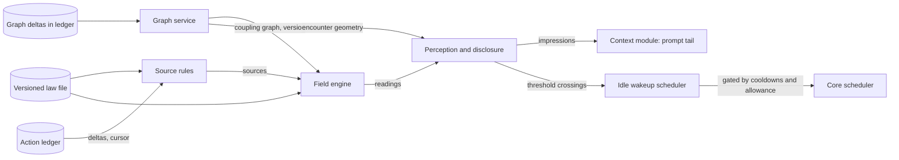

# Undercurrent: design for the environmental field layer

**Status:** Draft 0.3, 2026-10-01. A proposal assembled from an ongoing design conversation. It is not an owner decision, not an approved Field Design, and not an implementation report. No code exists yet for any layer of the harness: the core, the router and Undercurrent are all designs. Every mechanism below is a recommendation unless it is labelled as a constraint carried from the prospective project documents.

**Changes in 0.3:** a proposed answer to Q4, the admissible validation path for failure and repair, is set out in `RESEARCH-ADMISSIBLE-VALIDATION.md` and folded in here: source rules for `dependency_strain`, `affordance` and `epistemic_uncertainty` (section 9), validation and check-governance events in the ledger contract (section 15.1), a validation runner as a core phase 1 dependency (section 15.2), new adversarial cases (section 14.2), and a proposed answer to Q12.

**Changes in 0.2:** the ledger contract that the core and the router must honor is now part of Phase A (section 15.1). Cross-layer dependencies on core and router phases are recorded in section 15.2. Interference is split into a post-promotion part that needs no private-work disclosure and a pre-promotion part that still does (section 9). The promotion pipeline replaces resource pressure as the first design walkthrough topic (section 15.3).

**Audience:** the engineer who will build the layer, and the reviewers who will interrogate it. Section 17 lists what is genuinely unresolved; reviewers should start there if they want the weak points.

**Working title history:** "pheromone layer" during early discussion. Section 0 proposes a trial name.

## 0. Name

**Recommended trial name: Undercurrent.**

An undercurrent is felt rather than heard, it carries the effects of things happening elsewhere, and it moves whether or not anyone announces it. That is the distinguishing property of this harness: agents perceive the consequences of work they cannot see, without messages, without broader permissions, and without anyone being able to talk the signal into existence. The name also covers both directions of the layer. An undercurrent can pull toward an opportunity as easily as it warns of a hazard.

Two alternatives were considered. "Tremor" suits the Dwarf Fortress theme of life underground and the physics of propagating waves, but it reads as hazard-only and would mislabel the affordance field. "Wake", the disturbance a moving vessel leaves behind, captures "consequence of action" well but implies the signal always trails behind the actor, which is not true of sustained conditions such as an unrepaired defect.

## 1. Purpose

Undercurrent answers one question: what should an agent on a team, inside a larger colony, know about its environment that it cannot see in its own state, cannot read without permissions it does not have, and should not have to be told through a message?

The answer is a set of derived environmental conditions: pressure on shared resources, unresolved breakage that other work depends on, new capabilities that have become available, regions of the world that have gone unobserved, disturbances arriving from outside the colony. These are computed by the harness from observed actions and delivered to agents as situated, authorized impressions. They are data. They grant no permission, carry no instruction, and cannot be raised by an agent declaring that something matters.

A state file records what is. Undercurrent records what is moving, what is under strain, what has opened up, and how much of the colony is already headed somewhere. In physical terms the state file is position; the field is pressure, potential and flux.

## 2. Authority and inputs

This document draws on the design conversation of 2026-10-01 and on three prospective project documents supplied for context: `FIELD-PHILOSOPHY.md`, `DESIGN-CORE-AND-LAUNCHERS.md` and `DESIGN-ROUTING-LAYER.md`. It also draws on `RESEARCH-ADMISSIBLE-VALIDATION.md`, which proposes the answer to Q4. The owner has stated that those documents are not authoritative. Where this design depends on one of their requirements, the dependency is recorded in section 3 so that a change to the prospective documents can be traced to its effect here.

Section numbers such as "philosophy §9" or "core §3.5" refer to those documents.

## 3. Constraints carried from the prospective documents

| Constraint | Source | Effect on this design |
|---|---|---|
| Only concrete actions seed the field; intentions, hypotheses and announcements do not | Philosophy §3 | No declared-intent tool. "Intent" survives only as committed action (section 9). |
| Agents act on the world, never on their own field strength; field derivation never depends on agent self-report | Philosophy §3; core §3.2 | Every source rule reads host-observed ledger deltas. No agent-facing write API exists. |
| Causal history must be recoverable | Philosophy §3 | Field state is defined as a projection of the append-only ledger (section 5). Recoverability lives in the ledger. |
| Decay and propagation speed must be adjustable; the field catalogue must be extensible | Philosophy §1, §5 | Laws are versioned data, per field kind. Propagation speed is retained as a parameter but no longer carries stability (section 7.4). |
| Known dependencies cannot be the exclusive gate for perception | Philosophy §4 | Two geometries: a coupling graph for propagation and an encounter geometry for perception, plus an ambient channel (sections 8 and 10). |
| An unresolved hazard must not fade because time passed; confidence, age and severity are distinct | Philosophy §5 | Sustained sources that do not decay; freshness tracked separately from amplitude (section 6). |
| Repetition and identity count are not independent evidence | Philosophy §5, §8 | Evidential kinds deduplicate by lineage and saturate (section 6). |
| No field grants authority | Philosophy §3 | Undercurrent has no path to permissions, budgets, tool grants or message routes. |
| Reading a field must not reinforce its source | Philosophy §8 | Sampling emits nothing to the ledger. Earlier "attention from field reads" proposal withdrawn. |
| Observable consequences can leak private information | Philosophy §9 (Lampson) | Disclosure is an explicit projection policy, and its absence blocks several phenomena (section 9). |
| Idle agents must be able to encounter the field efficiently | Philosophy §9 | Threshold-crossing wakeups, gated by cooldowns and an allowance (section 11). |
| Build the core first; the field engine is a package testable standalone against synthetic ledgers; substantial testing before it affects agents | Core D14, §9 phase 5 | Build order in section 15; acceptance gate in section 14. |
| Typed action deltas in an append-only ledger; bodies content-addressed | Core D15, §3.2 | The ledger is Undercurrent's only input. |
| Private scratch per work context, fast-forward-only promotion | Core D16 to D18, §3.5 | Supplies exact staleness and refused-promotion signals. Creates the private-work disclosure problem. |
| Volatile per-turn content goes in the prompt tail; context modules declare cost | Routing R3, §6.5 | Rendering is a context module appended to the tail (section 11). |
| Turns and approvals bind to agent, context and turn | Routing §5.1 | Perception is bound to the work context, not the agent identity. |
| The router owns provider status, headroom and spend accounting; the harness, not the provider, holds the truth | Routing T10, §6.4, §9.8, §11 | Undercurrent never queries the router. It reads the router's measurements only as ledger events (section 15.1), and it never changes routing decisions, budgets or provider choice. |

## 4. Architecture

Undercurrent keeps the five layers from philosophy §3 strictly separate. The engine owns the third; the perception service owns the fourth; it touches neither the first nor the fifth.

| Layer | Owner | Undercurrent's relationship |
|---|---|---|
| Laws | Operator, versioned files | Reads the active law version; never modifies it |
| World facts | Core action ledger | Reads deltas through a cursor; never writes |
| Fields | Undercurrent engine | Owns entirely |
| Perception | Undercurrent perception service | Produces impressions for a bound work context under a disclosure policy |
| Choice | The agent | None. Impressions are inputs to the agent's own judgment. |



The engine runs inside the colony core process as a Go package with no dependency on the rest of the core beyond a ledger-reader interface and a graph-delta stream. It must never block the core. It consumes the ledger asynchronously, reports how far behind it is, and the core proceeds regardless.

## 5. Core model: the field is a projection of the ledger

The defining design choice is that field state is a pure function:

```
FieldState = F(ledger[0..seq], law version, graph history, t)
```

Nothing in the engine reads the wall clock. Every value is evaluated at an explicit time, and every input comes from the ledger or the versioned law. Snapshots are caches that can be discarded and rebuilt.

This one choice settles several requirements at once. Causal history is recoverable because the ledger is append-only and the field can be recomputed from it. Law versioning becomes testable because the same ledger can be replayed under two laws and the difference inspected. The standalone testing gate becomes natural because a synthetic ledger is all the engine needs. Adjusting decay or propagation is a replay, not a migration.

Three obligations follow. Graph changes must themselves be ledger events, or replay cannot reproduce which paths existed at a given moment. Law changes must be recorded with their effective ledger position. Floating-point results must be reproducible enough for replay comparison (section 13.5).

## 6. Field kinds, quantity classes and source modes

Each field kind is defined by its law. Two properties matter more than any parameter.

**Quantity class.** An *extensive* kind measures something real that adds up: two agents each consuming capacity produce twice the pressure, because twice the capacity is gone. An *evidential* kind measures evidence that a condition exists: one hundred reports of the same failure are one failure. Evidential contributions are deduplicated by lineage (the underlying event and its provenance), taking the maximum per lineage, then summed across distinct lineages, then capped at a saturation value. Getting this distinction wrong is the most likely way to build a field that rewards noise.

**Source mode.** An *impulse* is a one-time deposit that decays. A *level* is a measured quantity that replaces its own previous value, such as a queue depth or budget ratio. A *sustained* source is present until an explicit end event and does not decay, such as an unresolved defect. A *rising* source grows with elapsed time, such as how long a region has gone unobserved.

| Mode | Example | Decays | Ends by |
|---|---|---|---|
| Impulse | A new reproducible failure is observed | Yes, by half-life | Decay below cutoff |
| Level | Retrieval executor queue depth | No; replaced by next measurement | A measurement of zero, or the resource leaving the graph |
| Sustained | The award-notice parser remains broken | No | A validated repair event |
| Rising | No validation has touched a module in 30 days | Inverse: grows | An observation of the region |

Amplitude, freshness and support are recorded separately. An old sustained hazard is still at full amplitude; its freshness field says how recently it was confirmed; its support says how many independent lineages confirm it. The renderer can show all three, and the agent decides how to weigh them.

## 7. Propagation

### 7.1 Default kernel: event arrivals with first-arrival deduplication

When a source appears at an origin node, the engine runs a bounded best-path search over the coupling graph. The gain to each reachable node is the product of edge weights and a per-hop attenuation factor, taking the single best path. The search stops where amplitude times gain falls below the kind's cutoff, which gives every source a hard radius. Each node records the source's contribution once.

Best path is found with Dijkstra's algorithm in negative-log space: maximizing a product of gains in (0, 1] is the same as minimizing the sum of their negative logarithms. Direction policy per kind filters which edges are traversed: strain flows from a dependency to its dependents; pressure may flow both ways along usage edges.

Because each source's reach is a closed-form function of origin, graph version and law, a node's value at time t is:

```
value(n, k, t) = Σ over active sources s reaching n:
                   amp(s) × gain(s → n) × decay_k(t − arrival(s, n))
```

with the evidential deduplication and saturation of section 6 applied for evidential kinds, and no decay factor for level and sustained sources.

### 7.2 Why first-arrival deduplication is required

Naive forwarding copies rather than moves. On a triangle A, B, C with every pair connected, a deposit of 1 at A forwarded with attenuation 0.5 per hop produces waves whose totals never shrink, because each node has two neighbors and 2 × 0.5 = 1. The signal also returns to A, so a source amplifies itself through any cycle. With attenuation 0.4 the series converges, but to five times the original deposit.

| Rule on the triangle, deposit 1 at A | A | B | C | Graph total |
|---|---:|---:|---:|---:|
| Naive forwarding, attenuation 0.5 | Grows without limit | Grows | Grows | Unbounded |
| Naive forwarding, attenuation 0.4 | Converges above 1 | Converges | Converges | 5.0 |
| First-arrival deduplication, attenuation 0.4 | 1.0 | 0.4 | 0.4 | 1.8 |
| Diffusion (philosophy §7), before decay | Redistributes | Redistributes | Redistributes | 1.0 |

With deduplication, each node's value is bounded by the deposit times its best-path gain, and no source can hear its own echo. The graph-wide total is not conserved. A defect in a widely used component reaches many nodes, which is the intended behavior: consequential events have wider effects. Nothing in the design reads the graph-wide total.

### 7.3 Alternative kernel: diffusion

Diffusion moves amount between nodes instead of copying it, so the graph-wide total changes only through decay and new sources, and no node can be pushed above its neighbors by spreading alone. It also mixes signals from different sources into smooth landscapes, which produces richer emergent patterns than independent arrivals.

Its costs are that it must be stepped on a tick while any node is active, it has no hard radius, and it cannot be evaluated in closed form, so replay means re-stepping. If adopted for a kind, it should use degree-normalized weights so the stability condition from philosophy §7 holds regardless of how many edges a node gains, and it should step only an active set (nodes with nonzero values and their neighbors), stopping when the set empties.

**Recommendation:** arrivals by default for every initial kind. The law format supports a per-kind kernel choice so diffusion can be trialled where its mixing semantics are wanted. No initial kind requires it.

### 7.4 Propagation speed

Each kind has a per-hop latency parameter, defaulting to zero. With nonzero latency, arrivals are scheduled rather than immediate, which lets nearby dependents perceive a disturbance before distant ones.

The parameter is retained because the owner asked for adjustable speed and because it costs nothing in the arrival kernel. It is **not** a stability mechanism, and nothing in section 12 depends on it. Two facts drove that change. Agents perceive the field only when they sample it, at turn boundaries or on an idle cadence measured in seconds to minutes, so any latency shorter than the sampling interval is invisible. And delay in a feedback loop reduces stability rather than improving it: oscillation comes from agents acting on information that no longer reflects what others are already doing, and adding delay makes that information older.

## 8. Graphs

### 8.1 Two geometries

**The coupling graph** says which nodes causally affect one another. Propagation runs on it and only on it. Its edges must be evidenced, because an invented edge manufactures reach.

**The encounter geometry** says what an agent at a given position may perceive. It includes the coupling graph plus weaker relationships that suggest relevance without proving causation, plus the ambient channel of section 10.3. It exists to satisfy the requirement that agents be able to discover connections nobody mapped. It never carries propagation.

Keeping them separate resolves a real conflict. Learned co-access edges (two resources touched together in one task) are useful hints for discovery but are correlation, and an agent can manufacture them by touching things together. Admitting them to the coupling graph would let any agent widen its influence. Admitting them only to the encounter geometry lets them widen what an agent may notice, which is lower risk.

### 8.2 Edge sources

| Source | Graph | Obtained by | Updated when | Lifetime |
|---|---|---|---|---|
| Static references | Coupling | Parsing imports and references: `golang.org/x/tools/go/packages` for Go, tree-sitter for Python and JavaScript, query parsing for SQL | A promotion changes a file; reparse only changed files | Until the code changes |
| Declared relationships | Coupling | Task specifications, resource assignments, workspace registrations | A task or assignment changes | Life of the declaration |
| Resource usage | Coupling | Ledger: which nodes' work consumed which resources | Each consuming action, aggregated | Decays when usage stops |
| Co-access | Encounter only | Ledger: resources touched by one work context within one task | Each action | Decays; reinforced by repeated independent co-access |

Every edge change is emitted as a graph delta into the ledger with a monotonic graph version. Static analysis runs incrementally on promotion and as a periodic full rebuild to correct drift; the rebuild's net changes are also recorded as deltas.

### 8.3 Nodes

A node is a location where a condition can exist: an artifact or module, a shared resource (an executor, a provider account, a budget scope, a retrieval cache), or a work domain. Agents are not nodes. An agent's position is the footprint of its bound work context (section 10.1).

Node granularity is unresolved (Q1). File-level nodes are precise but produce large graphs and fine-grained leakage; module-level nodes are cheaper and coarser.

## 9. Phenomenon catalogue

This maps the phenomena discussed in the conversation to field kinds, under the constraints in section 3.

| Phenomenon | Kind | Class and mode | Host-observed sources | Propagation | Status |
|---|---|---|---|---|---|
| Saturation, contention | `resource_pressure` | Extensive; level | Router headroom and provider status, scoped budget ratios, executor queue depth, active reservations | Resource to consumers via usage edges, both directions | Ready to build; disclosure of attribution open (Q5) |
| Staleness and check uncertainty | `epistemic_uncertainty` | Evidential; rising, level and impulse | Scratch base versus canonical tip with path overlap; time since a region was last validated; `flaky` validation summaries and quarantined checks at the check's node; retired checks; the dependency closure of an unattributed failing check | Local; minimal propagation | Context-local part ready; validation-derived parts follow the Q4 proposal |
| Failure residue | `dependency_strain` | Evidential; sustained plus impulse | Failures on canonical subjects only, graded F1 to F4 (`RESEARCH-ADMISSIBLE-VALIDATION.md` §4.4): an observed failure seeds a reduced impulse, a reproduced failure a sustained source. Ended by an R2 or R3 repair using the same pinned check, or by check retirement. Refused promotions and scratch failures are private and do not count. | Unattributed: at the failing check's node. Attributed: from the culprit promotion's changed nodes to their dependents. | Design proposed; needs the validation runner (section 15.2) and Q4 sub-questions V1 to V8 |
| Success trails | `affordance` | Evidential; sustained plus impulse | Promotions that passed their gate checks at an admissible assurance level; R3 attributed repairs; a short impulse at nodes whose strain an R2 repair ended; reuse by distinct lineages. Self-judged repairs count only after another lineage corroborates. | Artifact to potential users via coupling; widely via ambient channel | Needs lineage definition (Q2) |
| External perturbation | `perturbation` | Extensive; impulse | Canonical changes not from colony promotions, upstream version changes, provider status transitions | From the boundary node inward | Ready; universe boundary open (Q13) |
| Surprise | `surprise` | Derived; impulse | Deviation of a node's measured quantity from its own baseline | Local | Ready once metrics are chosen (Q17) |
| Interference, after promotion | `interference` | Evidential; level | A promotion's changed paths, and the coupling-graph neighbors of those paths, compared against each open scratch's changed paths; reported only to the owner of the affected scratch | Coupling graph, downstream from the promoted change | Ready; needs no disclosure decision because the promoted change is canonical and the recipient owns the scratch |
| Interference, before promotion | `interference` | Evidential; level | Overlap between two scratches that are both still unpromoted | Local to overlapping nodes | Blocked on private-work disclosure (Q3) |
| Intent | Folded into `crowding` | Extensive; level | Committed action only: scratch creation, reservations, in-flight tool calls | Local | Blocked on Q3 |
| Crowding | `crowding` | Extensive; level | In-flight committed work per node | Local | Canonical-level part ready; scratch-level blocked on Q3 |
| Attention | Folded into `crowding` | Extensive; level | Resource reads in the ledger | Local | Low priority; blocked on Q3 |
| Agent silence | Dropped | — | — | — | An orchestration concern, not a world consequence |
| Colony regime | Not adopted | — | No concrete-action source identified | — | Risks becoming a global morale field (Q18) |

**Note on interference and promotion refusals.** Promotion is fast-forward only, so a promotion is refused whenever canonical has moved at all. A refusal is therefore not evidence of interference. Overlap is the evidence: either shared changed paths, or a change to a node that the refused context's changes depend on through the coupling graph. A refusal without overlap is plain staleness. Post-promotion interference and the "staleness with path overlap" source of `epistemic_uncertainty` are the same measurement; the promotion-pipeline walkthrough must decide whether they become one kind or two kinds sharing a source rule (Q27).

**Note on intent.** The earlier proposal for a `claim(resource, op)` tool is withdrawn because it seeds the field from a declaration. What can be observed is commitment: an agent that has cut a scratch, reserved a resource or started a long tool call has committed. That evidence is admissible, but nearly all of it happens inside private scratch, so it cannot be shown to others until the disclosure question is answered.

## 10. Perception and disclosure

### 10.1 Position

An agent perceives from the footprint of its currently bound work context: the set of nodes that context has touched, weighted by recency. A strange mood or reassigned task is a new work context with a new footprint, so perception follows the work rather than the agent's identity. A dormant context keeps its footprint; its perceived history is its own.

### 10.2 Sampling

A sample collects readings for each kind at the nodes within the footprint's bounded encounter neighborhood, then passes them through the disclosure projection, then through the agent's perception filters.

### 10.3 Ambient channel

The encounter neighborhood alone would still make known relationships the gate for discovery. The ambient channel adds a coarse, colony-wide view: a small number of the strongest regions per kind, at coarse resolution, subject to disclosure, sampled with probability proportional to strength. This is how the researcher in the illustrative story noticed a new testing capability with no mapped connection to her work. Its exact form is unresolved (Q6).

### 10.4 Disclosure projection

Disclosure is a policy mapping (field kind, origin scope, audience scope) to a resolution: exact, bucketed, delayed, aggregated, or hidden. Organizational structure belongs here, in what each audience may see, and not in how consequences propagate. A colony boundary may coarsen what another colony perceives about a shared parser; it does not change whether the parser's defect affects them.

Aggregation, coarsening and delay reduce but do not eliminate leakage. A field that reflects private work at any resolution reveals that the work exists. The disclosure policy is an owner decision that has not been made (Q3, Q5).

### 10.5 Perception filters

Each bound context holds a smoothed perceived value per (node, kind), an exponential average at roughly the agent's sampling rate. Changes faster than the agent can sample would otherwise be misread at whatever instant the sample happened to land; filtering at the sampling rate removes information the agent could not use correctly anyway.

Each agent holds its own response thresholds per kind, with separate entry and exit levels (hysteresis). Thresholds differ between agents and drift with experience. Section 12 explains why.

## 11. Rendering and idle sensing

### 11.1 Rendering for an active turn

At turn start, the perception service produces impressions that crossed a threshold or changed since the context's previous turn. The renderer emits them as a compact, structured block registered as a routing-layer context module, placed in the prompt tail so it does not disturb cached prefixes, with a declared token budget. If nothing changed, nothing is rendered.

```
[environment · law v3 · observed 2026-10-01T14:02Z]
resource_pressure      retrieval-executor      high       rising
dependency_strain      award-notice-parser     sustained  3d  support 1
epistemic_uncertainty  capability-inventory    your base is 4 promotions behind
affordance             materials-testing       new        ambient
```

The block is framed as observation, never instruction. Node labels are generated by the harness from identifiers, not copied from artifact contents, because names and descriptions can carry hostile text (Q22). Each impression carries a stable ID so that a strange-mood notification to a superior can cite the signal that prompted it.

### 11.2 Idle sensing

Contexts that are idle subscribe to threshold crossings over their footprint and the ambient channel. The engine evaluates subscriptions when relevant sources change, which costs nothing while the colony is quiet. A crossing becomes a wakeup candidate. The scheduler applies jitter, a probabilistic response draw, the agent's two cooldowns, and a per-agent sensing allowance before it asks the core to start a model turn. Every wakeup is a real model call with real token cost, so the allowance is a budget, not a formality (Q7).

## 12. Stability

The field update is stable by construction: bounded inputs produce bounded values. The closed loop is not. Agents read the field, act, and their actions change the field. Two failure modes follow. Herding is positive feedback: a strong attractant draws everyone, which strengthens it. Oscillation is negative feedback acting on stale information: many agents see the same pressure, all leave, pressure drops, all return.

Neither is solved by slowing propagation. Both are solved in the loop.

| Mechanism | Corrects | Lives in | Cost | Dependency |
|---|---|---|---|---|
| Count committed work immediately | Loop delay: others see a response the moment it begins | Source rules: tool-call start and reservation events | None | Scratch-level part blocked on Q3 |
| Crowding term | Herding: in-flight work reduces a region's pull | Perception: attractants are discounted by crowding | Negligible | Same as above |
| Smoothed perception | Reaction to transient spikes | Perception filter | Negligible | None |
| Hysteresis | Repeated triggering near a threshold | Per-agent thresholds | Negligible | None |
| Heterogeneous thresholds | Synchronized response by identical agents | Per-agent parameters that drift with experience | Negligible | Drift rule open (Q8) |
| Jittered sampling, probabilistic response | Many agents acting on one snapshot | Idle scheduler | Negligible | None |
| Refractory periods | The same agent re-entering immediately | The two cooldowns in philosophy §9 | Already designed | Durations open |

Committed-work counting is the strongest mechanism because it shortens the loop at its source. Heterogeneous thresholds follow response-threshold models of division of labor in social insects, where individuals with different thresholds for the same stimulus divide work without oscillating; they also suit the project's commitment to agents drifting into individuals. Jittered and probabilistic response follows the fix internet congestion control adopted when TCP flows began backing off and recovering in unison.

**Known gap.** The two strongest anti-herding mechanisms depend on showing other agents committed work that mostly lives in private scratch. Until the disclosure question is resolved, the first agent-visible release must rely on the remaining mechanisms plus crowding derived from canonical-level and shared-resource actions only. Closed-loop simulation (section 14.3) must demonstrate that this reduced set is sufficient for the kinds being released.

## 13. Go implementation

### 13.1 Packages

| Package | Responsibility | Depends on |
|---|---|---|
| `undercurrent/law` | Load, validate, hash and version law files; source rules | Standard library only |
| `undercurrent/graph` | Coupling graph and encounter geometry; apply graph deltas; versioning; bounded best-path search; reach caches | `law` |
| `undercurrent/engine` | Owner goroutine; ledger cursor; source application; node state; reads at explicit times | `law`, `graph`, a ledger-reader interface |
| `undercurrent/perceive` | Footprints, sampling, ambient draws, disclosure projection, smoothing, thresholds, subscriptions | `engine`, `graph` |
| `undercurrent/render` | Impression formatting and the context-module adapter | `perceive` |
| `undercurrent/sim` | Synthetic ledgers, stub agents, closed-loop simulation | All of the above; test-only |

The engine imports nothing from the router, the broker or the launchers. It sees the rest of the harness through two interfaces: a ledger reader with a cursor, and a time value passed into every read.

### 13.2 Core types (sketch, not a final API)

```go
type NodeID uint32    // dense index assigned by the graph service
type Kind uint16
type LineageID uint64
type SourceID uint64

type QuantityClass uint8

const (
	Extensive  QuantityClass = iota // real consumption; contributions sum
	Evidential                      // evidence of a condition; max per lineage, sum, saturate
)

type SourceMode uint8

const (
	Impulse   SourceMode = iota // one-time deposit; decays
	Level                       // replaces this source's previous value
	Sustained                   // present until an explicit end event
	Rising                      // grows with elapsed time until reset
)

type KindLaw struct {
	Class       QuantityClass
	HalfLife    time.Duration // impulses only
	Attenuation float64       // per-hop gain, 0 < a < 1
	Cutoff      float64       // arrivals below this are not recorded
	HopLatency  time.Duration // default 0
	Direction   Direction     // Downstream, Upstream, Both
	Saturation  float64       // evidential cap
	Kernel      Kernel        // Arrival (default) or Diffusion
}

type Law struct {
	Version uint32
	Hash    [32]byte // of the canonical law file
	Kinds   map[Kind]KindLaw
	Rules   []SourceRule // ledger delta pattern -> sources
}

// decaying is a lazily evaluated exponential: no ticker ever touches it.
type decaying struct {
	V float64 // amplitude as of T
	T int64   // ledger time, unix nanoseconds
}

type nodeKind struct {
	transient    decaying               // extensive impulses, summed
	byLineage    map[LineageID]decaying // evidential impulses, max per lineage
	steady       float64                // level and sustained contributions present here
	lastEvidence int64                  // freshness, kept apart from amplitude
}

type activeSource struct {
	id     SourceID
	kind   Kind
	mode   SourceMode
	origin NodeID
	amp    float64
	reach  []reached // (node, gain); recomputed when the graph version changes
	graphV uint64
}
```

Level and sustained sources record their reach so that ending or replacing them subtracts exactly what was added. When the graph version changes, the engine recomputes reach for active level and sustained sources only; impulses keep the reach they had when they occurred, which is the correct historical behavior.

### 13.3 Concurrency

One goroutine owns all engine state. It consumes ledger deltas from a cursor, applies source rules, updates node state and answers read requests over a channel, returning copies. No locks are needed inside the engine. If read volume ever makes this a bottleneck, the next step is sharding node state by node ID with a mutex per shard; agent turns occur at human-scale frequencies, so this is not expected early.

The engine never blocks the core. If it falls behind the ledger, readings carry the ledger position they reflect, and the perception service may decline to render stale readings.

### 13.4 Configuration

Law files are versioned, hashed, and recorded in the ledger with the position at which they take effect. JSON keeps the engine free of third-party dependencies; YAML would match the routing layer's configuration style at the cost of one dependency (Q24). Load-time validation rejects unknown fields, attenuation outside (0, 1), cutoffs at or below zero, and direction policies that reference undefined edge types, following the routing layer's rule that misconfiguration fails loudly.

### 13.5 Determinism

The engine never calls `time.Now`; all times come from ledger events or the read request. Iteration over maps must not affect results: sums over lineages and sources iterate in sorted order.

Bitwise-identical replay across machine architectures is not guaranteed. The Go specification permits an implementation to fuse floating-point operations, and some architectures do; an explicit `float64(...)` conversion forces rounding at that point. The engine should apply explicit conversions at accumulation boundaries, and replay tests should compare within a stated relative tolerance across architectures and exactly on the same architecture (Q15).

### 13.6 Dependencies

The engine itself needs only the standard library: `container/heap` for best-path search and scheduled arrivals, `math`, `sort`, `encoding/json`. Graph construction uses `golang.org/x/tools/go/packages` for Go sources and tree-sitter bindings for other languages; these belong to the graph service's static analyzers, which can run as separate processes if their weight or crash behavior is a concern.

### 13.7 Resource targets (to be measured, not claims)

A `nodeKind` without lineage entries is roughly 40 to 60 bytes. A colony with tens of thousands of nodes and half a dozen kinds, most of them empty at any moment, should fit in single-digit megabytes. Ingesting a delta is dominated by best-path search, bounded by the cutoff radius. A read over a footprint is proportional to the encounter neighborhood size. These estimates must be replaced by measurements from the standalone engine against synthetic ledgers of realistic size before any budget is set.

## 14. Testing and the acceptance gate

### 14.1 Properties the standalone engine must satisfy

| Property | Test |
|---|---|
| Boundedness | Random graphs and bounded random sources; no node exceeds deposit × best-path gain for impulses or the saturation cap for evidential kinds |
| No echo | On graphs with cycles, an origin's value equals only its own deposits |
| Deduplication | Multiple paths to a node yield one contribution per source |
| Hard radius | No node beyond the cutoff receives a contribution |
| Disconnection | A node with no path from a source is unaffected |
| Persistence | A sustained source keeps full amplitude for any elapsed time until its end event |
| Exact removal | Ending a sustained or level source returns every reached node to its prior value, including after graph changes |
| Lineage | One hundred copies of one failure produce the same evidential value as one; one hundred clones reporting it count as one lineage under the chosen lineage rule |
| Read neutrality | Sampling and rendering append nothing to the ledger and change no field value |
| Replay | Recomputing from the ledger reproduces snapshots within tolerance, under the original law version |
| Law comparison | Replaying under a different law version changes only the kinds whose laws changed |
| Disclosure | Hidden kinds and scopes never appear in impressions for unauthorized audiences, including through ambient draws |

### 14.2 Adversarial cases

Synthetic ledgers should include cloned agents reporting the same evidence, bursts of co-access designed to widen encounter reach, repeated failure reports without new evidence, resource consumption designed to fabricate pressure (which is real harm and should register as real pressure, but should not raise the actor's influence anywhere else), and node labels containing instruction-like text. Validation-specific cases come from observed agent behavior (`RESEARCH-ADMISSIBLE-VALIDATION.md` §3.2): a patch that prints fake pass lines, a check that is skipped or never runs, a test edited to pass, a fix that deletes functionality, a check retired by the context whose repair it judges, an Orchestrator reopening a retired check, impossible-task runs measuring forged passes at each assurance level, canary checks reported as passing, flaky checks producing failures, and agent-authored checks from cloned lineages.

### 14.3 Closed-loop simulation

Before any agent sees the field, the `sim` package runs stub agents with no model calls against the live engine. Each stub has response thresholds, a sampling cadence, a cooldown, and a simple action policy such as moving toward affordance and away from pressure. The simulation sweeps law parameters and stability mechanisms, and measures herding (concentration of agents on one region), oscillation (periodic swings in regional occupancy), and recovery after a perturbation. It must show stable behavior for the released kinds using only the mechanisms available at that release (section 12, known gap).

Stub agents are crude stand-ins for language models, which may ignore impressions or overreact to them in ways a threshold policy will not capture. The simulation establishes that the layer does not create instability on its own; it cannot establish that real agents will use the field well.

### 14.4 Acceptance gate

The gate before Undercurrent may affect any agent is: all properties in 14.1 pass; the adversarial cases in 14.2 behave as specified; the closed-loop simulation in 14.3 shows stability for the kinds being released; and resource measurements from 13.7 exist. Numerical thresholds for the simulation are not yet set (Q25). After the gate, a shadow period renders impressions to the decision log without placing them in prompts, so their content and volume can be inspected before agents see them.

## 15. Build order

| Phase | Delivers | Exit criterion |
|---|---|---|
| A, within core phase 1 and router phase 1 | The ledger contract in section 15.1: the core's general action fields, its workspace and promotion events, its scheduling events, and the router's provider, headroom and budget events. Graph deltas are ledger events. | A synthetic ledger can be produced from the schema without information missing for any planned kind. This cannot be retrofitted later. |
| B | Standalone engine: law loader, arrival kernel, node state, `dependency_strain`, `interference` (post-promotion), context-local `epistemic_uncertainty`, and `resource_pressure` | Section 14.1 properties for these kinds. All are tested against synthetic ledgers; `resource_pressure` cannot be checked against real data until router phase 1 exists (section 15.2). |
| C | Graph service: static and declared coupling edges, usage edges, versioning, incremental and full rebuilds | Replay reproduces reach across graph changes |
| D | Perception and rendering in shadow mode | Impressions logged for real colony activity; volume and token cost measured |
| E | Acceptance gate (section 14.4), then agent-visible rendering for active turns | Gate passes for the released kinds |
| F | Idle sensing, wakeup scheduler, integration with strange-mood notification | Wakeup volume stays within allowances in simulation and shadow |
| G | `affordance` with lineage, `perturbation`, `surprise`, encounter geometry, ambient channel | Properties and simulation extended to these kinds |
| H | `interference` and scratch-level `crowding`, after the disclosure decision | Disclosure tests pass for the chosen policy |
| I, optional | Diffusion kernel for any kind that benefits | Diffusion-specific boundedness and stability tests |

### 15.1 Ledger contract (Phase A)

Undercurrent reads nothing but the ledger. Any measurement a field needs must therefore be written to the ledger by the component that observes it, at the moment it observes it. Measurements held only in memory, or only in the router's JSONL decision record, are invisible to the field and cannot be replayed. Because no code exists yet, this contract can be built in from the start at no extra cost; adding it later would mean changing every emitting component and losing history from before the change.

The contract has three parts.

**General fields on every action delta (core).**

| Field | Purpose |
|---|---|
| Ledger sequence and event time | Ordering and replay; the engine never reads the wall clock |
| Colony, agent, execution session, bound context, turn | Attribution and footprint construction; perception binds to the context |
| Operation type and targets (paths, resources, accounts) | Node mapping for sources |
| Outcome and measurement path | Distinguishes host-observed results from reports; admissibility (Q4) |
| Start and end times, or a pending marker | Lets in-flight work count immediately (section 12) |
| Lineage hints: clone ancestry, input content hashes, model and provider | Evidential deduplication (Q2) |
| Content-addressed body references | Larger payloads without bloating the ledger |

**Workspace and promotion events (core phase 1).**

| Event | Fields Undercurrent needs | Feeds |
|---|---|---|
| Scratch created | Context, workspace root, base commit | Staleness; crowding (subject to Q3) |
| Scratch changed paths | Context, changed path set, the scratch commit it reflects | Interference; staleness with overlap |
| Promotion attempted | Context, scratch tip, canonical tip at the time | Pipeline accounting |
| Promotion accepted | Context, old and new canonical tips, changed paths | Interference, staleness, affordance |
| Promotion refused | Context, reason, canonical tip that caused it | Staleness; interference only where overlap exists |
| Validation run | Trigger reference (promotion, schedule, agent request, perturbation); check digest and check lineage; subject tree hash computed by the host; environment digest; every attempt's outcome state (`passed`, `failed`, `timeout`, `skipped`, `incomplete`, `infra_failure`, `no_status`); summary (`passed`, `failed`, `flaky`, `inconclusive`); exit status and evidence that the suite ran; cache-bypass flag; runner identity; assurance level (A1 to A3); log body hash | Dependency strain, affordance, interference grading, epistemic uncertainty (`RESEARCH-ADMISSIBLE-VALIDATION.md` §4) |
| Check added, modified, retired or quarantined | Check digest before and after, lineage, the context or owner that caused it, open failures affected | Ends strain by retirement; epistemic uncertainty |
| Culprit attribution | Failing check, culprit promotion, parent results, rerun counts and confidence | F3 and R3 grades; strain origin |
| Human-oracle verdict | Owner identity, subject, verdict, scope | The only failure or repair source for work with no automated oracle |
| Revert or repair of a promoted change | Which promotion it undoes or repairs | Ends sustained strain; weakens affordance |

**Scheduling and resource events (core, from phase 1).**

| Event | Fields | Feeds |
|---|---|---|
| Queue entry, start, finish | Resource, bound context, wait duration | `resource_pressure`, crowding |
| Turn start and end | Bound context, provider account | In-flight load on provider accounts |

**Provider and budget events (router phase 1).**

| Event | Emitted by | Fields | Feeds |
|---|---|---|---|
| Provider status transition | Router, from adapter error classification | Provider, account scope, model and region where relevant, new state, cause, resume time | `resource_pressure`, `perturbation` |
| Headroom sample | Adapter, from rate-limit headers | Account scope, remaining requests and tokens, reset time; written when headroom moves to a different bucket, not on every response | `resource_pressure` |
| Budget threshold crossing | Router spend accounting | Named budget scope, fraction used, period | `resource_pressure` |
| Usage attribution | Router spend accounting | Bound context, provider account, reported usage | Usage edges from consumers to resources (Q11) |

Bucketing headroom keeps the ledger from recording every response while still capturing every change that matters; bucket boundaries are law-adjacent configuration and should be versioned with the law (Q28).

### 15.2 Cross-layer dependencies

| Undercurrent capability | Depends on | Consequence |
|---|---|---|
| Any real-data field | Core phase 1: action ledger | Nothing beyond synthetic testing is possible before core phase 1 |
| Interference (post-promotion), staleness, promotion-based affordance | Core phase 1: scratch worktrees and fast-forward promotion | The first kinds that can see real data |
| `dependency_strain` from validation | A host-owned validation runner (proposed for core phase 1, assurance A1) and the Q4 proposal; recipe acceptance rows in core phase 4 add one more check source | Without the runner there is no admissible failure or repair evidence at all |
| Validation assurance above A1 | The core's same-user isolation boundary (core §10 item 8) | Until then, validation evidence protects against mistakes and casual gaming but not against deliberate tampering by code under test |
| `resource_pressure` from providers and budgets | Router phase 1: scoped provider and budget status | Engine work can proceed on synthetic ledgers; real-data validation waits |
| Agent-visible rendering (Phase E) | Router phase 1: tail context modules | Impressions cannot reach a prompt before the router can place a tail module |
| Turn binding of impressions | Router and core context binding | Perception follows the bound context, never the view or session |
| Strange-mood notification citing an impression (Phase F) | Core phase 2 broker and role graph | Notification travels only along permitted paths |

The router design records the reverse side of these dependencies in its own sections 5.5 and 14.

### 15.3 Design walkthrough order

The walkthrough now starts with the promotion pipeline, because its sources arrive first (core phase 1) and because the waste it addresses is invisible to every other part of the harness: colliding changes in private scratch, repeated dead ends, and validated capabilities nobody knows about. Within it, the order is interference (post-promotion), staleness, failure residue, then success trails. Resource pressure follows once the router's phase 0 and 1 design settles, then external perturbation and surprise, then pre-promotion interference, intent and attention after the disclosure decision.

## 16. Limitations

**Undercurrent is an information channel, and channels leak.** Any observable consequence of private work reveals something about that work, at minimum its existence and timing. Coarsening and delay reduce this; nothing eliminates it. An agent that wants to signal can encode bits in real resource consumption.

**It enforces nothing.** A field cannot stop an action. Budgets, permissions and resource limits are enforced by the core regardless of what the field shows.

**It is only as true as its graph.** The coupling graph is a model of causation built by static analysis and declarations. Missing edges hide consequences; wrong edges spread false ones. Static analysis will not see runtime-only relationships such as a configuration file read by a service.

**It perceives at turn granularity.** Agents see the field when they sample it. Anything that rises and falls between samples is, from their perspective, smoothed or missed.

**Independence is hard to establish.** Agents sharing a model, an operator, an input document or a clone ancestor produce correlated evidence. The lineage rule reduces this but cannot detect every correlation.

**Validation is evidence of plausibility, not correctness.** A repair record means the pinned check that exposed a failure now passes and previously passing checks still pass. Overfitted repairs pass; wrong checks produce real-looking failures until retired. Grades and assurance levels make this visible but do not remove it.

**Language models are not threshold agents.** Whether real agents attend to impressions, weigh them sensibly, or overreact is an empirical question that simulation cannot answer.

**Workspace isolation is not a sandbox.** Linked Git worktrees share repository metadata, and a same-user child process can read or alter it. Any disclosure policy that assumes scratch is private inherits this gap until the core closes it.

**Optimization pressure will find the proxy.** If agents are evaluated on outcomes that correlate with field values, they will learn to move the field rather than the outcome. Sources derived from host-observed consequences resist this better than self-reports, but not completely.

**Arrivals do not mix.** The default kernel treats each source independently and sums them. Patterns that arise from interacting signals, which diffusion would produce, will not appear unless a kind adopts the diffusion kernel.

## 17. Open questions

| ID | Question | Why it matters | Blocks |
|---|---|---|---|
| Q1 | What is a node: file, module, directory, resource, work domain? | Graph size, propagation precision, leakage granularity | Phase C |
| Q2 | What makes two pieces of evidence independent: event fingerprint, clone ancestry, shared model, shared input? | Without it, evidential kinds reward repetition and cloning | `affordance`, `dependency_strain` support counts |
| Q3 | May actions inside private scratch affect outward fields, and at what resolution? | Interference, intent, attention and the strongest anti-herding mechanisms depend on it | Phase H; stability known gap |
| Q4 | What counts as an admissible validation path for failure and repair? | Determines when strain starts and ends; prevents fabricated failures | Proposal in `RESEARCH-ADMISSIBLE-VALIDATION.md`; awaiting owner decision. V3 (retirement authority) decided 2026-10-02; V6 (visibility floor) to be settled by an adversarial test suite; the other sub-questions remain open. |
| Q5 | Who may see which kinds at what resolution, across agents, corps and colonies? | The disclosure projection has no policy to enforce yet | Phase D beyond the owner's own view |
| Q6 | What does the ambient channel show, how much, and how is it sampled? | The only mechanism satisfying the unanticipated-discovery requirement | Phase G |
| Q7 | What is each agent's idle-sensing allowance and cadence? | Every wakeup is a paid model turn | Phase F |
| Q8 | How are per-agent thresholds initialized, and what experience makes them drift? | Heterogeneity is a stability mechanism; badly designed drift could teach agents to ignore the field | Phase E |
| Q9 | Can co-access be manufactured to widen encounter reach, and what admission rule prevents it? | Encounter geometry is lower risk than coupling, not zero risk | Phase G |
| Q10 | What direction policy does each kind use? | Determines who perceives a disturbance | Phase B for initial kinds |
| Q11 | How are consumers mapped to the resources they use for pressure propagation? | Pressure without usage edges stays at the resource | `resource_pressure` |
| Q12 | When exactly does a sustained source end, and does ending emit a transient? | Defines how repairs appear in the field | Proposed with Q4: an R2 repair ends the source and emits a short `affordance` impulse; an R3 repair also makes the repairing promotion an `affordance` source; retirement emits an `epistemic_uncertainty` impulse only |
| Q13 | What is one universe, and how do fields cross colony or installation boundaries? | Cross-colony propagation, transport and trust | Any multi-colony deployment |
| Q14 | How are persisted field states handled across law versions: full replay or carried state? | Replay cost grows with ledger length | Law governance |
| Q15 | What replay tolerance is acceptable across architectures? | Determinism claims depend on it | Phase B tests |
| Q16 | Can ledger retention or compaction remove deltas the engine needs for replay? | Snapshot plus tail must cover everything retention removes | Recoverability claim |
| Q17 | Which measured quantities have baselines for `surprise`? | Surprise is undefined without them | Phase G |
| Q18 | Should a colony-wide regime field exist, and from what concrete source? | Without a concrete source it becomes a morale signal | None until answered |
| Q19 | Is dropping agent silence acceptable, with orchestration handling stalled agents? | Confirms the boundary between field and logistics | None |
| Q20 | Will any kind ever use nonzero hop latency? | If not, the parameter is vestigial | None |
| Q21 | Which kinds, if any, should use the diffusion kernel? | Richer emergence versus cost and replay complexity | Phase I |
| Q22 | What is the rendering format and per-turn token budget, and how are labels kept free of hostile text? | Prompt cost and injection surface | Phase D |
| Q23 | How does a strange-mood notification reference the impression that prompted it, and who may read that reference? | Links the field to the strange-mood lifecycle without disclosing more than the agent saw | Phase F |
| Q24 | JSON or YAML for law files? | Dependency count versus consistency with routing configuration | Phase B |
| Q25 | What simulation results constitute "stable enough" for the gate? | The gate has no numbers yet | Phase E |
| Q26 | How will usefulness be measured: duplicated work, time to repair, task success, opportunities found? | Without a counterfactual, the layer's value cannot be shown | Post-gate evaluation |
| Q27 | Are post-promotion interference and staleness with overlap one field kind or two sharing a source rule? | They are the same measurement presented two ways | Promotion-pipeline walkthrough |
| Q28 | What headroom buckets should the adapter use, and are they versioned with the law or with router configuration? | Too fine floods the ledger; too coarse hides pressure | Phase A (router phase 1) |

## 18. Prior art and references

Digital pheromone infrastructure (Parunak, Brueckner and colleagues) established the four functions this design keeps: aggregation, evaporation, propagation and sensing, over a graph-structured environment. See for example US patent 7,921,066, <https://patents.google.com/patent/US7921066>.

TOTA, Tuples On The Air (Mamei and Zambonelli), propagated field-like tuples across a network and reshaped them when the topology changed; its hop-count gradients are the precedent for first-arrival propagation. <https://unimore.unifind.cineca.it/resource/item/13164>

Aggregate computing and the field calculus (Viroli, Beal and colleagues) give a formal account of computational fields and how they compose. <https://www.arxiv.org/pdf/1607.02231>

Blackboard architectures for LLM multi-agent systems share full content among agents rather than derived conditions, which is the main contrast with this design. Han and Zhang, 2025, <https://arxiv.org/abs/2507.01701>; Salemi and colleagues, 2025, <https://arxiv.org/abs/2510.01285>.

SwarmWorld (Pal, Wang and Buehler, 2026) separates LLM deliberation from deterministic world execution, the same separation Undercurrent depends on. <https://www.alphaxiv.org/abs/2608.26081>

The threat and limits analysis follows the references in philosophy §8 and §9: Lampson on confinement (1973), Douceur on Sybil identities (2002), and Manheim and Garrabrant on Goodhart variants (2018).

Response-threshold models of division of labor in social insects (Bonabeau and colleagues, 1990s) and random early detection in TCP congestion control (Floyd and Jacobson, 1993) inform the stability mechanisms in section 12. These two were cited from background knowledge and were not re-verified during this design round.
