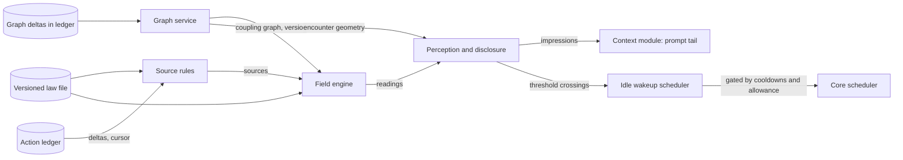

# Undercurrent: design for the environmental field layer

**Status:** Draft 0.4, 2026-10-05. This remains a design proposal, not an implementation report or frozen contract. It records adopted owner-selected choices with their provenance, separates technical proposals from those choices, and keeps all runtime gates unclaimed. Earlier draft history below remains for context; this revision supersedes conflicting open-question and proposal language where a dated resolution is now recorded.

**Changes on 2026-10-02:** constraints from the implementation decisions (section 3); a mapping from build phases to roadmap steps (section 15); in the ledger contract, the D37 identity and time rules, temporary-scratch and authoring-context fields (D23), and three proposed events: graph delta, law activation and interference-check result (section 15.1); Q16 resolved by D36 (section 17).

**Changes in 0.3:** a proposed answer to Q4, the admissible validation path for failure and repair, is set out in `RESEARCH-ADMISSIBLE-VALIDATION.md` and folded in here: source rules for `dependency_strain`, `affordance` and `epistemic_uncertainty` (section 9), validation and check-governance events in the ledger contract (section 15.1), a validation runner as a core phase 1 dependency (section 15.2), new adversarial cases (section 14.2), and a proposed answer to Q12.
**Changes in 0.4 (2026-10-05):** separates U1.L law-format readiness from U1.E engine/replay; resolves source and lineage identity, bounded best-path arrivals, graph/node model, replay and numeric limits, projection-before-selection disclosure, novelty sampling, idle sensing, mood authority/closure, and sovereign federation; records router-owned `router-headroom/v1` inputs and provisional stability/usefulness gates. This corrective pass also selects explicit initial fixed-point, source, capacity, surprise, cooldown, co-access and shadow profiles for preregistration. All remain unmeasured design proposals; no implementation, C1 freeze or release is claimed.

**Changes in 0.2:** the ledger contract that the core and the router must honor is now part of Phase A (section 15.1). Cross-layer dependencies on core and router phases are recorded in section 15.2. Interference is split into a post-promotion part that needs no private-work disclosure and a pre-promotion part that still does (section 9). The promotion pipeline replaces resource pressure as the first design walkthrough topic (section 15.3).

**Audience:** the engineer who will build the layer, and the reviewers who will interrogate it. Section 17 lists what is genuinely unresolved; reviewers should start there if they want the weak points.

**Working title history:** "pheromone layer" during early discussion. Section 0 proposes a trial name.

## 0. Name

**Recommended trial name: Undercurrent.**

An undercurrent is felt rather than heard, it carries the effects of things happening elsewhere, and it moves whether or not anyone announces it. That is the distinguishing property of this harness: agents perceive the consequences of work they cannot see, without messages, without broader permissions, and without anyone being able to talk the signal into existence. The name also covers both directions of the layer. An undercurrent can pull toward an opportunity as easily as it warns of a hazard.

Two alternatives were considered. "Tremor" suits the Dwarf Fortress theme of life underground and the physics of propagating waves, but it reads as hazard-only and would mislabel the affordance field. "Wake", the disturbance a moving vessel leaves behind, captures "consequence of action" well but implies the signal always trails behind the actor, which is not true of sustained conditions such as an unrepaired defect.

## 1. Purpose

Undercurrent answers one question: what should an agent on a team, inside a larger colony, know about its environment that it cannot see in its own state, cannot read without permissions it does not have, and should not have to be told through a message?

The answer is a set of derived environmental conditions: pressure on shared resources, unresolved breakage that other work depends on, new capabilities that have become available, regions of the world that have gone unobserved, disturbances arriving from outside the colony. These are computed by the harness from observed actions and delivered to agents as situated, authorized impressions. They are data. They grant no permission, carry no instruction, and cannot be raised by an agent declaring that something matters.

A state file records what is. Undercurrent records what is moving, what is under strain, what has opened up, and how much of the colony is already headed somewhere. In physical terms the state file is position; the field is pressure, potential and flux.

**Operational scope.** Initial source evidence and lifecycles are catalogued in §9; bound-context and grant rules in §§10.2–10.4; durable inputs and replay in §§5 and 15.1; release requirements in §14.4. A listed phenomenon is a design target, not a promise that denied/incomplete evidence becomes a source or that every kind is already agent-visible.

## 2. Authority and inputs

This document draws on the design conversation of 2026-10-01 and on three prospective project documents supplied for context: `FIELD-PHILOSOPHY.md`, `DESIGN-CORE-AND-LAUNCHERS.md` and `DESIGN-ROUTING-LAYER.md`. It also draws on `RESEARCH-ADMISSIBLE-VALIDATION.md`, which proposes the answer to Q4. The owner has stated that those documents are not authoritative. Where this design depends on one of their requirements, the dependency is recorded in section 3 so that a change to the prospective documents can be traced to its effect here.

Section numbers such as "philosophy §9" or "core §3.5" refer to those documents.

## 3. Constraints carried from the prospective documents

| Constraint | Source | Effect on this design |
|---|---|---|
| Only concrete actions seed the field; intentions, hypotheses and announcements do not | Philosophy §3 | No declared-intent tool. "Intent" survives only as committed action (section 9). |
| Agents act on the world, never on their own field strength; field derivation never depends on agent self-report | Philosophy §3; core §3.2 | Every source rule reads host-observed ledger deltas. No agent-facing write API exists. |
| Causal history must be recoverable | Philosophy §3 | Field state is defined as a projection of the append-only ledger (section 5). Recoverability lives in the ledger. |
| Decay and propagation speed must be adjustable; the field catalogue must be extensible | Philosophy §1, §5 | Laws are versioned data, per field kind. Propagation speed is retained as a parameter but no longer carries stability (section 7.4). |
| Known dependencies cannot be the exclusive gate for perception | Philosophy §4 | Two geometries: a coupling graph for propagation and an encounter geometry for perception, plus an ambient channel (sections 8 and 10). |
| An unresolved hazard must not fade because time passed; confidence, age and severity are distinct | Philosophy §5 | Sustained sources that do not decay; freshness tracked separately from amplitude (section 6). |
| Repetition and identity count are not independent evidence | Philosophy §5, §8 | Evidential kinds deduplicate by lineage and saturate (section 6). |
| No field grants authority | Philosophy §3 | Undercurrent has no path to permissions, budgets, tool grants or message routes. |
| Reading a field must not reinforce its source | Philosophy §8 | Sampling emits nothing to the ledger. Earlier "attention from field reads" proposal withdrawn. |
| Observable consequences can leak private information | Philosophy §9 (Lampson) | Disclosure is an explicit projection policy, and its absence blocks several phenomena (section 9). |
| Idle agents must be able to encounter the field efficiently | Philosophy §9 | Threshold-crossing wakeups, gated by cooldowns and an allowance (section 11). |
| Build the core first; the field engine is a package testable standalone against synthetic ledgers; substantial testing before it affects agents | Core D14, §9 phase 5 | Build order in section 15; acceptance gate in section 14. |
| Typed action deltas in an append-only ledger; bodies content-addressed | Core D15, §3.2 | The ledger is Undercurrent's only input. |
| One colony log with one sequence (D33), kept as our own append-only log of JSON-lines records. It is never deleted or compacted; bodies may be garbage-collected, so everything replay needs lives in the record itself | `DECISIONS.md` D33–D36 | Replay never depends on a body: source rules read only record fields (changed paths and their hashes, check digests, outcomes, measurements). The engine declares the event types it consumes and stops with a clear error on one it cannot decode (D35). Full replay from the first record stays possible, which resolves Q16. |
| Private scratch per work context; bounded cumulative integration validation and ordered, fast-forward-only publication | Core D16 to D18, §3.5; `DECISIONS.md` D77 | Distinguish the immutable original submission from each derived integration generation and its expected predecessor. Supplies exact staleness and refused-promotion signals; creates the private-work disclosure problem. |
| An agent may run turns in several of its contexts at once. A second writer to a task gets a temporary scratch, merged back after its turn, and the ledger records the authoring context of each change | `DECISIONS.md` D22, D23 | Scratch events carry a parent scratch and the authoring context, and a merge-back is an event of its own (section 15.1). Source rules and footprints can tell which context wrote a change, not only which context promoted it. Merge-backs are private work, under Q3. One agent's turns can overlap, so in-flight load counts every active turn. |
| Volatile per-turn content goes in the prompt tail; context modules declare cost | Routing R3, §6.5 | Rendering is a context module appended to the tail (section 11). |
| Turns and approvals bind to agent, context and turn | Routing §5.1 | Perception is bound to the work context, not the agent identity. |
| The router owns provider status, headroom and spend accounting; the harness, not the provider, holds the truth | Routing T10, §6.4, §9.8, §11 | Undercurrent never queries the router. It reads the router's measurements only as ledger events (section 15.1), and it never changes routing decisions, budgets or provider choice. |

## 4. Architecture

Undercurrent keeps the five layers from philosophy §3 strictly separate. The engine owns the third; the perception service owns the fourth; it touches neither the first nor the fifth.

| Layer | Owner | Undercurrent's relationship |
|---|---|---|
| Laws | Operator, versioned files | Reads the active law version; never modifies it |
| World facts | Core action ledger | Reads deltas through a cursor; never writes |
| Fields | Undercurrent engine | Owns entirely |
| Perception | Undercurrent perception service | Produces impressions for a bound work context under a disclosure policy |
| Choice | The agent | None. Impressions are inputs to the agent's own judgment. |



The engine runs inside the colony core process as a Go package with no dependency on the rest of the core beyond a ledger-reader interface and a graph-delta stream. It must never block the core. It consumes the ledger asynchronously, reports how far behind it is, and the core proceeds regardless. The graph service is the only Undercurrent package that appends graph-delta events, through the restricted appender contract; the core owns the concrete writer and the single per-colony sequencer (D50). Other Undercurrent packages, including the engine, remain ledger readers.

## 5. Core model: the field is a projection of the ledger

The defining design choice is that field state is a pure function:

```
FieldState = F(ledger[0..seq], law version, graph history, t)
```

Nothing in the engine reads the wall clock. Every value is evaluated at an explicit time, and every input comes from the ledger or the versioned law. Snapshots are caches that can be discarded and rebuilt.

This one choice settles several requirements at once. Causal history is recoverable because the ledger is append-only and the field can be recomputed from it. Law versioning becomes testable because the same ledger can be replayed under two laws and the difference inspected. The standalone testing gate becomes natural because a synthetic ledger is all the engine needs. Adjusting decay or propagation is a replay, not a migration.

Three obligations follow. Graph changes must themselves be ledger events, or replay cannot reproduce which paths existed at a given moment. Law changes must be recorded with their effective ledger position. Floating-point results must be reproducible enough for replay comparison (section 13.5).
Historical replay follows the recorded law activation timeline and producer evidence exactly. A counterfactual law comparison replays the same retained facts with an explicitly named alternate law and is labelled hypothetical: it does not invent observations or validation, alter accepted history, or prove changed agent behavior. A disposable projection cache is keyed by colony, engine semantic version, law hash/timeline, committed ledger cursor and chain hash, graph version, and evaluation time. Its full state and cursor are one atomic, checksummed cache image; on any mismatch discard it and replay. A cached cursor can never outpace the state it represents. The permanent log remains authoritative and grows on disk under D36.

## 6. Field kinds, quantity classes and source modes

Each field kind is defined by its law. Two properties matter more than any parameter.

**Quantity class.** An *extensive* kind measures something real that adds up: two agents each consuming capacity produce twice the pressure, because twice the capacity is gone. An *evidential* kind measures evidence that a condition exists: one hundred reports of the same failure are one failure. Evidential contributions are deduplicated by lineage (the underlying event and its provenance), taking the maximum per lineage, then summed across distinct lineages, then capped at a saturation value. Getting this distinction wrong is the most likely way to build a field that rewards noise.

**Source mode.** An *impulse* is a one-time deposit that decays. A *level* is a measured quantity that replaces its own previous value, such as a queue depth or budget ratio. A *sustained* source is present until an explicit end event and does not decay, such as an unresolved defect. A *rising* source grows with elapsed time, such as how long a region has gone unobserved.

| Mode | Example | Decays | Ends by |
|---|---|---|---|
| Impulse | A new reproducible failure is observed | Yes, by half-life | Decay below cutoff |
| Level | Retrieval executor queue depth | No; replaced by next measurement | A measurement of zero, or the resource leaving the graph |
| Sustained | The award-notice parser remains broken | No | A validated repair event |
| Rising | No validation has touched a module in 30 days | Inverse: grows | An observation of the region |

Amplitude, freshness and support are recorded separately. An old sustained hazard is still at full amplitude; its freshness field says how recently it was confirmed; its support says how many independent lineages confirm it. The renderer can show all three, and the agent decides how to weigh them.
Keep four identities separate: the ledger effect reference deduplicates delivery/application; a condition reference names the underlying open episode across repeated evidence; a provenance group conservatively groups evidence with shared origins; and observation authority determines who may read a projected fact. None is an agent count. Evidence support is the number of distinct provenance groups, not proven statistical independence: retries, clone families, copied checks and shared input/evidence roots conservatively remain one group; model/provider family is only a correlation hint. A check's admissibility and assurance come from its host-bound evidence, not whether a hook started it. Unknown lineage cannot mint corroboration. For an evidential condition, repeated reports update its support/freshness without deposit amplification; contributions use the maximum per group, then sum across groups and cap. Real resource consumption remains extensive and is never collapsed as a witness count.

## 7. Propagation

### 7.1 Bounded best-path arrivals

For each source revision, traverse only its kind's approved coupling-edge types. Source amplitude is an integer in the kind's units. On each edge, compute `next_units = floor(current_units * attenuation_ppm * edge_weight_ppm / 1,000,000,000,000)` with checked wide integer arithmetic; attenuation and edge weights are their integer-millionth law values from §13.4. Never round a hop upward or force a positive result to one. Because `attenuation_ppm < 1,000,000` and `edge_weight_ppm <= 1,000,000`, every nonzero hop strictly decreases integer amplitude. The final route comparator is greatest resulting integer amplitude, then fewer hops, then lexicographically smaller stable edge-ID byte sequence. Search each revision with a FIFO queue of immutable route candidates; sort each node's eligible outgoing adjacency by stable edge-ID bytes. On pop, update that node's winner only if the candidate's integer amplitude is strictly greater than its current winner; equal amplitude retains the first candidate. Expand an accepted candidate only to eligible neighbors whose floored amplitude is at least the positive kind cutoff `epsilon`; prune a non-winning candidate at pop. FIFO order is increasing hop count, then lexicographic path edge-ID sequence, so any pruned prefix is no better in either strength or secondary order than an already processed prefix at that node; integer-floor propagation is monotone under a common suffix, so the pruned prefix cannot produce a better descendant. Candidate prefixes are immutable: never discard or rewrite a descendant already queued merely because a later, stronger route updates an intermediate node. This retains shorter/lexically earlier routes when distinct strengths later floor to an equal result. Keep per-node results private until the whole queue drains, then publish one final contribution per source/node only if the source revision, graph version and law hash still match. A revision change or any route/work/memory cap invalidates the whole traversal, publishes no partial reach and marks coverage incomplete/unknown. The route queue is FIFO, not a priority heap; §7.2's delayed-arrival heap remains separate. A node receives the source at most once: diamonds and cycles never amplify evidence. For a starting amplitude `A >= cutoff_units`, at most `A - cutoff_units + 1` hop applications can precede that cutoff. This finite numeric bound is not an operational work budget: a high-degree node or many candidate paths can still make a search expensive, so explicit visit/byte/work caps in §13.7 remain mandatory.

Route ordering and node contributions use bounded fixed-scale integer edge/attenuation weights and §7.1's FIFO candidate order; they do not depend on map iteration or architecture-specific floating-point logs. Values may use `float64` for decay and smoothing, with explicit rounding at accumulation boundaries. For an impulse, its selected integer arrival amplitude decays as `arrival_units * 2^(-age / half_life)` from its selected arrival time. A level replaces its own prior value; a sustained source remains until its explicit end transition and does not decay; rising values use the law's typed age rule. Extensive values add actual quantities; evidential values deduplicate by provenance group as in §6.

The graph-wide sum is not conserved and is not an invariant or merit score. A consequential source may reach many nodes, but each node gets at most its best single route from that source.

**Causal orientation and per-kind direction (selected typed policy).** A coupling edge is oriented `from_dependency → to_consumer` and carries type, binary initial weight, provenance, geometry and effective graph version. Static imports/data inputs point from dependency to consumer. A per-kind law contains an explicit edge-type/traversal whitelist; direction is not guessed from names such as upstream/downstream. Binary static weights express modeled exposure, not measured causal probability. Encounter edges are never in this whitelist and never carry propagation.

| Kind/source | Traversal |
|---|---|
| `dependency_strain`, delivered-overlap exposure, `affordance`, `perturbation` | Downstream only over each kind's approved dependency/dataflow edge types. An unrelated upstream dependency is not reached. |
| `epistemic_uncertainty` | Local by default. A permitted delivered-overlap relevance lookup may inspect approved downstream closure without turning every uncertainty into a broadcast. Own-scratch staleness/private overlap is recipient-scoped, not public propagation. |
| `resource_pressure` | Starts at a registered resource. Traverse only its registered context/resource usage links in the direction(s) explicitly allowed by that kind's law; never walk arbitrary import/co-access edges, pool consumers implicitly, or transfer one resource's budget to another. |
| `surprise` and any future local anomaly | Local only. No causal travel is assumed. |

Disclosure grants remain an independent prerequisite to observation. Direction changes no C4 check selection: initial required-check validation still runs every declared per-workspace check (D73).

### 7.2 Adjustable latency

The versioned per-kind law may set a nonnegative integer-millisecond per-hop latency, including zero. The host-supplied `source_time_utc_ns` must fit signed `int64`. For each selected route, compute `delta_ns = hop_count * latency_ms * 1,000,000` using checked wide intermediates; reject negative hop counts, latencies or deltas and reject overflow before any narrowing/conversion. Require `delta_ns` to fit nonnegative signed `int64`, then compute `due_at_utc_ns = checked_add(source_time_utc_ns, delta_ns)` in signed `int64`. If any route for one source revision has an unrepresentable delta or due time, fail that source generation atomically: publish no reach or pending arrivals from it and mark its coverage `incomplete/unknown/unavailable`; never wrap into an early time, saturate, silently drop the route or present healthy zero. This is delayed strongest-route delivery, not simulation of every weaker or faster physical wave. Nonzero latency uses a bounded min-heap ordered by due time, source revision and destination. A newer level/sustained revision or an explicit end invalidates its obsolete pending arrivals, so a resolved condition cannot appear later as newly active. Existing contributions end through their recorded source transition.

Latency is observable work and retained state, not free, and it is not a stability control. More delay may make feedback information older. The calibration gate must test whether latency shorter than sensing intervals is useful, and charge heap traffic, pending bytes and cancellation/revision work. No initial law selects an unsupported kernel.

### 7.3 Diffusion is not an initial kernel

Every initial kind uses the best-path arrival kernel. U1.L rejects an unsupported kernel/version explicitly; U1.E never silently substitutes arrivals for a requested diffusion law. A later optional diffusion experiment first needs a named kind with useful mixing semantics, a specified discrete operator and boundedness argument, and separate replay, capacity and closed-loop gates. A mathematical bound on an isolated operator would not establish agent-loop stability.

### 7.4 Propagation speed

Each kind may configure an integer-millisecond per-hop latency, including zero. At nonzero latency, strongest-path arrivals are queued as in §7.2 and incur real work, retained state and cancellation costs. This preserves adjustable propagation speed without claiming a physical wave simulation. Latency is not a stability mechanism; longer delays can worsen stale-feedback loops. Calibration must relate delay to actual sensing cadence, and no initial kind depends on a latency value too short for agents to observe.

## 8. Graphs

### 8.1 Two geometries

**The coupling graph** says which nodes causally affect one another. Propagation runs on it and only on it. Its edges must be evidenced, because an invented edge manufactures reach.

**The encounter geometry** says what an agent at a given position may perceive. It includes the coupling graph plus weaker relationships that suggest relevance without proving causation, plus the ambient channel of section 10.3. It exists to satisfy the requirement that agents be able to discover connections nobody mapped. It never carries propagation.

Keeping them separate resolves a real conflict. Learned co-access edges (two resources touched together in one task) are useful hints for discovery but are correlation, and an agent can manufacture them by touching things together. Admitting them to the coupling graph would let any agent widen its influence. Admitting them only to the encounter geometry lets them widen what an agent may notice, which is lower risk.

### 8.2 Edge sources and graph mutations

| Source | Geometry | Evidence and update | Limit |
|---|---|---|---|
| Static code dependencies | Coupling | Reanalyze changed accepted artifacts; resolve package/module dependencies using a bounded language adapter | Unresolved/dynamic imports stay unknown, not guessed edges |
| Declared relationships | Coupling | Task specifications, explicit resource assignments and owner-registered work domains | Declaration is scoped and versioned; not an implicit permission |
| Resource use | Coupling | Host ledger measurements of which bound contexts actually consumed a registered resource | Aggregate only within the real resource/scope; never infer resource use from code footprint |
| Co-access | Encounter only | Host-observed use of two registered resources by the same task context, excluding sensing/rendering/enumeration | One bounded observation per task/provenance group and window; cannot carry propagation or evidential support |

Use sparse typed adjacency maps, not a graph database or symbol-level graph. Go package resolution uses `golang.org/x/tools/go/packages` with its toolchain/build configuration bound; an imports-only `go/parser` pass may identify affected packages but does not resolve modules/build tags. Python uses an installed interpreter's short-lived standard-library AST parser without importing project code. Node/TypeScript uses an already-installed native compiler/parser in a bounded child, never an automatic package install. SQL references use bounded query parsing. Other languages and dynamic relationships report explicit coverage gaps; no analyzer runs on Core's sequencer path. An analyzer's output is untrusted project-derived input.

Co-access candidates are context-local encounter hints only. Admit a pair only from host-observed use of two registered resources by one task context, excluding sensing, rendering, directory enumeration and recursive encounter reads. A stable task/provenance-group identity contributes at most once per pair in each rolling 30-day window; require two distinct groups. Retain at most 64 group identities per pair. Below the cap, the distinct-group count is exact. At the cap, expose only the saturated lower-bound marker `at_least_64` and mark coverage capped; never report an exact count of groups that were not retained.

After saturation, a repeated or new event whose identity is not in the retained set cannot increase a guessed count: mark the pair dirty and use the existing bounded deterministic rebuild from authoritative ledger facts to re-deduplicate the complete current window. Any expiry or other window change while identities are incomplete also invalidates the cached support; do not decrement the lower bound by guess. Publish an exact count below 64 or `at_least_64` only after a complete rebuild. Until that rebuild commits, treat the pair as incomplete/unknown and omit its encounter edge. If the rebuild hits a work/retention cap or has incomplete ledger coverage, keep it unknown and report the exhausted bound; never turn forgotten group evidence into an exact count or a stale edge. Expire support 30 days after its last qualifying use. Retain at most eight neighbors per node, ordered by distinct-group count descending, last-use time descending, then stable `NodeKey`; ties are deterministic. Apply both endpoint grants before ranking. These provisional bounds affect encounter opportunity only, never propagation or evidential support; the ambient channel remains independent.

Graph changes are versioned ledger deltas through the existing Core appender, referencing C1's authoritative accepted effect rather than inventing a second promotion identity or consumer database. Each logical graph version is visible only after all bounded mutation chunks and its commit record are durable; replay-essential content lives in records, not bodies. Analyzer configuration and coverage are recorded. A source whose accepted subject is not yet covered remains graph-pending, not empty-reach. Incremental updates consume only actual accepted predecessor-to-target deltas. Run a deterministic full rebuild at initial graph load, after every 100 accepted structural changes since the last committed rebuild, on analyzer/configuration-epoch change, or when a graph-version/digest mismatch is detected; no continuous polling. Rebuild against an immutable canonical tip in a bounded low-priority slot, compare normalized digests, and append net mutations atomically. A rebuild racing newer acceptance cannot replace the newer graph as current. Exact producer schemas remain C1 staged-contract work.

### 8.3 Typed nodes and identity

A node is an artifact, dependency package/module, explicit check, registered shared resource or owner-registered work domain. Agents are never nodes. Use a stable key shaped as `NodeKey{namespace, workspace_or_origin, kind, opaque_local_key}`. A file key uses normalized workspace-relative path plus a generation for delete/recreate; content hash is a version, not identity. Treat rename as remove/add unless the host proves a relation. A module node is registered from a manifest or native resolver; containment is distinct from causality. Resource IDs are opaque host registrations, not secret-bearing URLs/account names. Check nodes bind pinned check digests. A document hyperlink alone is reference/encounter evidence, not runtime dependency; actual input/dataflow declarations can justify typed edges.

Bounded language adapters, rather than a universal granularity or guessed directory nodes, keep graph size and evidence honest. Directory names may aggregate display but never create all-to-all dependency edges. Q1's node model is resolved by this selected typed graph; supported-language coverage and rebuild cadence remain measured implementation details.


## 9. Phenomenon catalogue

This maps the phenomena discussed in the conversation to field kinds, under the constraints in section 3.

| Phenomenon | Initial kind | Class and mode | Host-observed source and lifecycle | Propagation / qualification |
|---|---|---|---|---|
| Saturation, contention | `resource_pressure` | Extensive; scoped level | R1 finite provider headroom; Core-ledger typed budget exposure/crossing; actual registered-resource use and actual runner-attempt queue. Each source is separately normalized under §15.1 and keyed by exact metric/resource/scope. | Resource/consumer edges only. Never sum unlike metrics or nested scopes, count an included reservation twice, pool consumers implicitly, or expose raw provider/account details (§10.4). |
| Staleness, flakiness and overlap | `epistemic_uncertainty` | Evidential; rising, level or impulse | Context base age; path overlap with canonical or permitted private work; check flakiness, quarantine/retirement. F1 is reproduction-only and seeds no local or federated field source; authorized private diagnostics remain available. An existing C4 reproduction may be explicitly requested, but P-V2-F1-REPRODUCTION-ONLY schedules no autonomous validation job or model/provider turn. Repeated eligible observations update the same condition, not repeated votes. | Local by default. Post-promotion overlap and staleness-with-overlap are one measurement/reason family, not separate evidential votes. |
| Confirmed unresolved failure | `dependency_strain` | Evidential; sustained plus impulse | Preserve the host-bound F1–F4 validation/reproduction evidence path in `RESEARCH-ADMISSIBLE-VALIDATION.md` §4.4–4.7. F1 is reproduction-only and seeds no field source; F2 reproduced failure is the minimum failure-field evidence and may sustain after its required evidence; F3 attribution moves origin only to proven culprit nodes; F4 adds support metadata, not amplitude. | Check-local when unattributed; otherwise from the culprit's predecessor-relative accepted change to approved downstream dependents. Ends only on its exact confirmed repair or authorized retirement. |
| Validated capability and repair trail | `affordance` | Evidential; sustained plus impulse | Only actual durable accepted promotions with passing declared checks at required assurance; R2 repair emits a short impulse at repaired nodes, R3 repair also makes the repair promotion a sustained source. | Approved downstream coupling only; retirement emits uncertainty, never affordance; ambient discovery is a separate permission-filtered encounter path. |
| External change | `perturbation` | Extensive; impulse or scoped level | Host-observed upstream/canonical changes and typed provider-status transitions, including admitted federated facts with their originating trust/assurance labels. | From a registered boundary node along permitted dependencies; no implicit cross-colony access. |
| Typed operational anomaly | `surprise` | Derived; impulse | Only completed canonical validation duration by pinned check/environment/resource class, canonical check-outcome frequency under that identity, and authorized shared-resource pressure by exact resource/scope/configuration. Use the bounded baseline in §9 below; private per-task timing and provider prompt metadata are not sources. | Local and secondary to its measured event; never a prose/importance/morale classifier. |
| Colony regime | Not an initial kind | — | No distinct admissible concrete source was selected. Represent actual capacity or disruption using existing resource/perturbation kinds; future candidates must specify a concrete source, units, persistence/end semantics, propagation and disclosure, then pass ordinary gates. | Q18's non-adoption is selected; no regime enum, empty source rule or placeholder feature. |

There is no separate `interference` kind: delivered overlap, private overlap and base staleness are distinguishable reason/evidence grades within `epistemic_uncertainty`; one observation cannot count twice. Scratch-only failures never become public strain. `agent_silence` is a scheduling/logistics concern, not a field source. No intention, hypothesis, status story, field read or self-assigned magnitude seeds a source.
**Note on accepted changes and overlap.** Publication stays fast-forward only, but D77 permits explicit cumulative integration over expected predecessors. For B in `M+A`, `M+A+B`, the delivered effect is only `(M+A) → (M+A+B)`, bound to B's original context and D23 authoring provenance. A proven predecessor advance is not a stale refusal. A mismatch invalidates old evidence and is not itself interference: only observed shared changed paths or authorized coupling exposure create an overlap reason. Post-promotion overlap and staleness-with-overlap are the same measurement. A true no-change result, capture-busy refusal, intent or interrupted operation is not accepted delivery, repair or evidence of no effects.
**Note on private commitment.** No `claim(resource, op)` tool exists. A host-observed scratch, reservation or in-flight operation is concrete evidence only within its source rule and permitted scope. It may contribute to measured resource pressure or a coarse overlap projection; it never reveals another context's contents, creates an addressed signal or authorizes a recipient.

**Initial typed source-strength profile (provisional; evaluator v1 candidate, not an owner decision).** Every kind uses its closed registered fixed-point unit at the scale in §13.4; values are bounded evidence strength, never probability, merit or agent rank. F1 is reproduction-only under P-V2-F1-REPRODUCTION-ONLY and contributes no local or federated field source; authorized private diagnostics remain, and an existing C4 reproduction may be explicitly requested without this rule scheduling an autonomous validation job or model/provider turn. F2 is the minimum failure-field evidence. A permitted overlap, retirement or quarantine contributes `250,000` units to its single uncertainty condition; repeated observations update that condition. F2/F3 confirmed strain is `1,000,000` units and persists until its exact R2 repair or authorized retirement; F3 re-anchors that same condition, and F4 adds support metadata without amplitude. The F2 impulse and sustained modes share one effect, condition and provenance group, not two independent votes. R2 repair emits one `250,000`-unit affordance impulse; R3 emits a `1,000,000`-unit attributed impulse and sustained affordance, sharing the originating repair effect and provenance group rather than doubling support. One canonical accepted-change effect contributes one `250,000`-unit perturbation impulse, regardless of how many changed nodes it contains; retries/replay of that effect do not add another source. Flakiness uses the producer's typed observed flake fraction; base staleness uses the rising rule below. Resource pressure and surprise use their explicit transforms, not these event constants. Unknown, denied or incomplete evidence remains unknown, never zero.

Provider availability is a separate `perturbation` level, not headroom/cost pressure: one source per true Router status scope, at `1,000,000` units for any typed `ProviderStatus.state` other than `available`; `available` or absent/expired evidence withdraws it. Use a 15-minute field-freshness lease from the durable status event. This binary source never infers severity from state cause, prose or headroom bands and is not cloned per affected context. Expiry removes only the field source; it cannot clear Router's availability block or trigger a provider call, probe or retry. A newer durable status replaces the prior state. The typed enum and scope are defined by Routing §6.4.

Surprise uses a per-key rolling window of 128 prior admissible observations and emits nothing but explicit `unknown` until 32 are available. Compare the current event against the prior window, then insert it once. For completed canonical validation duration and authorized pressure series, compute `z = abs(x - median) / max(1.4826*MAD, floor)`, then `strength = min(1, z/6)`; use a 100 ms duration floor and 10,000 pressure-unit floor. For categorical check outcomes, use Laplace-smoothed `p=(count(outcome)+1)/(n+K)` where `K` is the versioned producer's finite outcome count, then `strength=clamp(-ln(p)/ln(20),0,1)`. Bind the baseline to metric, exact resource/check scope, operation class and environment/configuration epoch; reset it on any definition/version change. Missing, censored and incomplete measurements do not enter a duration series. Duplicate delivery cannot train or emit twice. These are bounded sensitivity choices, not a false-alarm or usefulness claim.


## 10. Perception and disclosure

### 10.1 Position

An agent perceives from the ledger-derived footprint of its exact currently bound `(agent, context, work scope)`: only nodes linked to that context by host-recorded work/use evidence, never an agent-wide memory pool. The footprint is an encounter candidate set, not a dependency-only gate: §10.2 applies grants before selection, and §10.3 provides authorized ambient and reserved exploration beyond the footprint. For situated rows, recency is the latest eligible ledger sequence, following §10.3's sort after salience; no separate wall-clock or unspecified recency weighting is used. A strange mood or reassignment uses the new context's own footprint; a dormant context's footprint remains derivable from retained ledger facts, not a private-history grant.

### 10.2 Sampling and projection order

Perception is bound to the exact `(agent, context, work scope)` at the request, never to a view, session, rank or agent-wide memory pool. For each sample, first apply the current origin/audience/source-class grant to every candidate measurement; discard unauthorized candidates before aggregation, counting, sorting, top-k selection, sampling or scheduling. Coarsen each surviving value to its permitted projection before deriving any aggregate. Only then combine it with the requesting context's authorized encounter footprint, ambient catalogue, salience and thresholds. Recheck authority at delivery. Hidden sources cannot influence the number, membership, order, timing or metadata of what is shown. Unknown policy or incomplete scope fails closed as `unknown`/withheld, not zero.

Exact router accounting remains bound to the originating context. A superior or owner does not pool another relationship context's private records by rank. A notification exposes no more trigger detail than both the original impression and the current audience grant allow. A stable impression reference identifies the cause but is not a bearer capability or an unrestricted history link.

### 10.3 Ambient channel and unexpected discovery

U6 selects the initial six-item envelope: at most four situated/encounter rows, one strength-biased ambient row and one reserved exploration row. The `ProjectedImpressionIndex` is keyed by the exact bound `(colony_id, agent_id, context_id, turn_id)` and current law/projection/grant revisions; it contains only authorized, already-coarsened rows with an opaque context-local `projection_ref`, released `kind_id`, host-registered `safe_region_id`, integer `salience_ppm`, display bands, source revision/ledger sequence, channel eligibility and visibility expiry. For `resource_pressure`, the safe region label distinguishes an authorized coarse metric class as well as its registered region; distinct metrics/scopes remain distinct rows and are never collapsed into a universal score. Projection and current grant checks happen before index insertion; no raw source, private path, workspace/check identity, credential or denied candidate enters the index. Query only rows for that bound turn and current revisions.

Situated rows sort by `salience_ppm` descending, latest eligible ledger sequence descending, kind enum order, `safe_region_id` ASCII bytes, then `projection_ref` bytes; take the first four. For the ambient slot, sort remaining eligible authorized rows by `(kind_id, safe_region_id, projection_ref)` and assign each weight `max(1, salience_ppm)`. Sum weights with checked `uint64` arithmetic; a zero or overflowing total makes the ambient slot `incomplete/unknown`. For positive total `W`, encode the SHA-256 preimage exactly as `context UUIDv7 raw 16 bytes || field_law_sha256 raw 32 bytes || ASCII "undercurrent-strength/v1\0" || ambient_counter u64 big-endian || rejection_index u8`. The per-context persisted `ambient_counter` starts at zero and never wraps; the rejection index is `0..63`. Interpret the digest's first eight bytes as unsigned big-endian `x`, set `threshold = ((0 - W) mod 2^64) mod W` with `0 - W` wrapping in `uint64`, reject `x < threshold`, and select ticket `x mod W` otherwise. Allow at most 64 SHA-256 evaluations for one draw. If all are rejected, emit no ambient row and mark the slot incomplete/unknown; do not fall back to biased modulo or retry within the same projection. Increment the ambient counter only when a complete ambient row is emitted; at `UINT64_MAX`, fail the slot closed rather than wrap. Counters survive retries and process restarts. This is deterministic per context/law and does not require an LLM or wall clock.

The exploration catalogue is the sorted set of all remaining authorized unseen/changed `(kind_id, safe_region_id, projection_ref)` rows, not a global top-k later redacted; apply grants before constructing it, so denied rows cannot affect catalogue size, order or timing. Its initial cursor is `first_u64(SHA256(context UUIDv7 bytes || field_law_sha256 || "undercurrent-explore/v1")) mod catalogue_count`; thereafter begin at the first key strictly after the context's last emitted exploration key, wrapping to the first. For each render, make at most one cyclic pass over the current authorized catalogue (no more than `catalogue_count` candidates), charging candidate inspections and complete-row fit attempts to the existing bounded projection/request-work accounting. Skip a row that cannot be encoded whole within the reserved exploration slot, hard block/available `TokenAllowance` limits after whole lower-priority rows are removed as specified in §11.1; a skipped row stays unseen and eligible. Emit the first complete fitting row and advance the cursor only to that row, only after emission. If a due exploration catalogue exists, keep its slot reserved during the scan; local traffic cannot consume it. If the scan finds no complete fitting exploration row, emit the valid zero-block/zero-estimate no-op and leave the cursor unchanged; if work is exhausted before the catalogue is fully scanned, mark the slot incomplete/unknown, return the same no-op, and leave the cursor unchanged. Never truncate JSON or rows. If no exploration row is due, its slot may be borrowed. After base quotas, fill unoccupied non-reserved slots to six with remaining situated rows in their order, then ambient rows by the same weighted draw without replacement. Catalogue churn, oldest unseen age, renderability, omissions and coverage are host-side metrics only.

### 10.4 Disclosure projection

The adopted owner-selected choice permits two scoped consequences: pressure on explicitly shared resources and coarse private-work overlap hints (D80). This deliberately reveals some existence, relevance and timing; it is not anonymity or a noninterference guarantee. Lampson's confinement analysis notes that billing/system-load observations can leak; Sabelfeld and Sands describe release as scoped by what, who, where and when ([Lampson](https://www.cs.cornell.edu/andru/cs711/2003fa/reading/lampson73note.pdf); [Sabelfeld–Sands](https://www.cse.chalmers.se/~andrei/sabelfeld-sands-jcs07.pdf)). These motivate explicit projection boundaries, not a blanket claim of privacy.

Use a host-owned projection matrix keyed by universe/colony, source kind/metric, origin scope, audience grant (including bound context), resolution, freshness and policy revision. Deny absent grants. For an explicitly shared resource, a permitted audience may receive its versioned pressure band and coarse freshness, not individual consumers, task names, usage amounts, account identifiers or private provider details. For unpromoted work, return only `possible_overlap=true|false|unknown` and an already-authorized coarse region intersecting the recipient's own currently permitted footprint. Never send the other scratch's paths, hashes, contents, author/clone lineage, private task name or conversation. `unknown` covers stale/incomplete coverage and denied visibility; it is not evidence of no overlap. Resource and scratch effects remain subject to separate source-class grants.

Apply disclosure before aggregate, ranking, ambient draws, occupancy intersection and idle-wakeup eligibility. Revocation rechecks queued and streamed candidates before delivery; it cannot retract knowledge already received. Low-resolution numbers can still identify activity, and shared timing remains a covert channel; cohorts, aggregation, pseudonyms and delays are not differential privacy. No disclosure choice grants a tool, budget, DM route, private-memory access or ability to choose recipients.

### 10.5 Perception filters

Smooth each `(context, node, kind)` independently with an elapsed-time EWMA initialized from the first authorized sample; never mix private contexts or average unknown/stale into healthy zero. The provisional time constant is five minutes. Convert the smoothed typed amplitude to `salience_ppm = round_half_up(1,000,000 * clamp(value_units / saturation_units, 0, 1))`. Each kind has a separately typed transform; for resource pressure use §15.1's exact scoped transform. `salience_ppm` is a presentation ordering key only: it does not add or compare raw quantities, create authority, or make unlike resource metrics interchangeable.

Initialize each agent/kind entry threshold around `500,000` ppm with SHA-256-derived jitter of `±50,000` ppm, clamped to `[250,000,750,000]`; exit is entry minus `100,000` ppm. Maintain private experience `e∈[0,1]`; only a host-confirmed action materially changing that exact condition updates `e ← e + 0.05(1-e)`, and `e` decays toward zero with a seven-day half-life. Entry becomes `clamp(initial_entry - 100,000e)` while the exit gap remains fixed. These are initial simulation candidates, not literature constants. Heterogeneity changes presentation/wakeup eligibility only, never permissions, authority, source amplitude or access to a persistent hazard.

### 10.6 Federated universes

Federation is an adopted, complete capability of U9 across independently administered operators. It is not one shared operator, a merged global ledger or an unspecified optional future layer. Each participating colony keeps its own authority, ledger, validation policy, private scopes and local decisions. Owners/operators explicitly enroll one another; both ends separately grant export and import by source class, assurance class, domain, field and rate. Each side pins the peer's authenticated host key and separately accepts the exact field protocol version and law hash. Source-class attestation trust is explicit and bilateral; transport authentication proves who sent a fact, not that the fact is true or independently assured.
The shared agreement identity is only `field_law_sha256` from the immutable field-law artifact plus the accepted protocol version. Each operator separately activates that exact artifact through its existing local policy-activation manifest, whose identity/sequence and D47 validation-policy, check-set and execution-environment hashes are local. Identical field-law hashes therefore do not imply identical check sets, workspace IDs, grants, credentials or C4 evidence; none of those local identities or secrets is placed in the shared artifact or exported. Each peer authorizes its own local policy and independently grants the exact source classes it accepts/exports. A matching field hash permits interpretation of the same field physics, not trust in a remote validation result.


Use bounded Core-owned signed projection streams over mutually authenticated TLS, using existing Core processes, the existing ledger and standard-library transport; no broker, global coordinator, central membership service or per-agent process. Explicitly provisioned peer descriptors are untrusted until locally approved; there is no broadcast discovery, transitive enrollment/trust, automatic relay/gossip, raw-ledger federation or model-selected recipient. Each side must hold a matching peer grant before exchange. A grant includes source/import/export classes, assurance limits, permitted domains and fields, exact law hash, byte/rate bounds and revision. Independent operators may revoke or leave without a global vote.

An exporter derives only approved coarse facts from local concrete sources. A recipient appends each admitted external fact with its origin, evidence/assurance, law and grant provenance; it never rebrands imported data as an independent local source. For overlap, the exporter releases coarse occupancy only in a mutually authorized domain, and the recipient intersects that projection with each local context's currently authorized footprint; it never sends the local footprint back. Shared-resource pressure crosses only for an explicitly shared resource; budgets/accounts are never implicitly pooled. No exported record chooses a receiver agent/context, creates a DM path or grants downstream permission.

Carry bounded per-view export/import cursors and signed projection batches; commit admitted records and the matching import cursor atomically to the receiver's existing ledger before acknowledging. Replay is idempotent; the same identity with a different digest is an integrity refusal; a gap requests bounded continuation, not unbounded buffering. A provisional transport envelope is at most 128 records/256 KiB per batch, one in-flight batch per peer/view, eight active connections with fair rotation, 5 s connect/30 s long-poll deadlines and jittered reconnect capped at 60 s. These are tunables to calibrate, not frozen protocol limits. Peer/network failure never blocks local work.

Exact-law incompatibility pauses only that crossing; there is no global activation barrier. Imported measurements retain their origin assurance and policy version. Revocation blocks new projections and unseen backlog but does not erase facts already delivered. A disconnected or expired stream means unknown coverage, never empty pressure/no overlap or repaired hazard. Local replay uses retained ledger events without contacting the peer; D36's permanent history implies storage growth. NATS's explicit matching export/import pattern is a useful precedent for bilateral scope ([accounts](https://docs.nats.io/learn/security/accounts-and-multitenancy), [cross-account grants](https://docs.nats.io/learn/security/cross-account.md)), not a dependency or a truth/side-channel guarantee. This is a proposed transport design, not a frozen event schema or deployed federation.

## 11. Rendering and idle sensing

### 11.1 Rendering for an active turn

The field module ID is `dwarfharness.undercurrent/v1`. For each bound turn it returns either zero blocks or one complete ASCII block in the Router's scoped context-module tail, after the cached prefix and before the current user message, in Router's stable module-ID order. It uses the `ProjectedImpressionIndex` and selection order in §10.3; it performs no LLM/rendering call. Recheck the current grant revision before producing bytes and immediately before provider dispatch. On a changed revision, re-query the newly authorized projection; if that cannot complete, omit the whole block. Revocation after dispatch cannot retract bytes already sent, but blocks future rendering and notice resolution.

When at least one row fits, the exact block grammar is a fixed `[undercurrent/v1]` line, one to six JSON objects (one per line), then `[/undercurrent/v1]`; JSON keys occur in this exact order: `ref`, `kind`, `region`, `signal`, `freshness`, `support`. `ref` is the stable context-local UUIDv7 impression reference; `kind` is one of the six kind IDs; `region` is a host-registered safe label matching `[a-z0-9][a-z0-9._-]{0,47}`; `signal` is `low|moderate|high|unknown`; `freshness` is `fresh|aging|stale|unknown`; `support` is `single|multiple|unknown`. Values are JSON strings from those enums or the safe-label registry; no free-form text, timestamps, raw magnitude, source/producer/workspace/check ID, path, artifact content, account/provider detail, grant, credential, local policy hash or operator identity is rendered. If no safe registered label exists, omit the whole row; never escape, truncate or paraphrase an unsafe label.

Six items and 384 estimated tokens are the selected initial per-turn calibration profile, not a candidate or universal exact-token guarantee. The module uses `min(384, TokenAllowance)` and estimates block tokens as `ceil(UTF8-byte-count/4)`; this is only a reproducible planning estimate and may differ by provider/tokenizer. Its complete framed field block has a hard 4,096 UTF-8-byte maximum, within R1's proposed 64 KiB serialized-result cap. Count framing and JSON bytes; if either bound would be exceeded, drop whole rows in reverse order of ordinary-fill priority, then ambient, then weakest situated, to preserve a due exploration row whenever a complete one fits. The exploration scan in §10.3 tests candidates one at a time against the available envelope after those whole-row drops; if none fits, return the valid zero-block/zero-estimate no-op without advancing the cursor. Never truncate/slice a block. Report `OmittedCount` only from already-authorized eligible rows to the host module result, and return only a bounded opaque context-local continuation when permitted; neither is part of the prompt block. ProviderAdapter/Core owns exact request-token and cost admission through `Bound`; an unprovable final admission is rejected, not inferred from this heuristic.

An authorized but stale/incomplete row uses the explicit `unknown` enum in the affected fields; it is never encoded as zero or a healthy band. A row hidden by absent/revoked authority is omitted without an unknown placeholder. A scan with no complete fitting exploration row, no eligible row or zero token allowance returns a valid zero-block/zero-estimate no-op, not an error or an "all clear" message. Hidden candidates do not affect selected membership, order, item/omission counts, cursor movement, timing or any prompt metadata.

### 11.2 Idle sensing

Use a Core-local keyed dirty queue, not one model call per field event or a periodic scan of every context. Relevant ledger/graph/law/grant changes mark affected `(context, kind, region)` keys dirty; repeated hints coalesce while preserving durable facts in the existing ledger. Persistent conditions and timer-driven salience/cooldown expiry enqueue bounded reevaluation at their next due time, so silence is not mistaken for zero. A deterministic per-key jitter/backoff spreads eligible work; due-but-denied candidates retain explicit stale/unknown coverage and fairness age. No field reader writes an event merely by sampling.

The initial sensing profile is at most 12 paid sensing turns per colony per rolling hour, four per agent per rolling 24 hours, and 5% of the configured monthly sensing allocation, always subordinate to owner-set capability/budget ceilings. A missing monetary ceiling denies paid sensing; an Orchestrator may issue narrower scoped grants but cannot expand or manufacture a ceiling. Every admitted provider call, retry and helper reserves/settles under Core's ordinary accounting; rate and monetary limits are separate. Sampling itself costs no model turn. The ideal first sweep is about 60 minutes for 12 eligible idle agents or 100 minutes for 20 before jitter, provider service, fairness and denials; this is demand arithmetic, not a latency result.

### 11.3 Self-initiated moods, notice and closure

A mood begins only when its bound context has received an impression and the agent supplies an insight plus a scoped goal; the agent need not prove a verified diagnosis first. Record BeginMood and its trigger/reference atomically under the existing Core owner. The goal and notification are not field sources, permissions or an approval request. Investigation stays within the context's existing access and may disprove the insight.

Before intervention work proceeds, enqueue a durable typed notice with the shareable scoped goal and the audience-authorized trigger projection (or a withheld marker). Ordinary work does not wait for acknowledgment, agreement or an extra model turn. A non-Grand agent notifies its actually assigned permitted superior through existing notification semantics; a Grand notifies the owner's durable operational inbox. Each Grand coordinates only its corresponding chain, with no blanket descendant access. Neither a field source nor its sender chooses the recipient; no new DM route is created. The owner approves Grand-initiated births. If the Orchestrator reassigns parked work to a clone, the clone starts with fresh private memory; only an explicit inheritance manifest may select already-shareable lessons/artifacts, never private relationship history or a shared mutable context.

Close a mood against its motivating insight and declared scope, recording a concrete reason: goal met, hypothesis disproved, required resources unavailable, or no step can materially advance the scoped goal. “No further action is useful” alone is not enough; retain the attempted steps, evidence and why each plausible next step cannot advance. A superior may interrupt only for an emergency: a time-sensitive commitment plus recorded grounds that no other agent or authorized clone can adequately cover it. Keep agent reasoning and superior reasoning distinct. Pause, close and cancel a submitted promotion are separate transitions; a pause does not consume closure/cooldowns, and mood interruption never implies promotion cancellation.

After closure, enforce two independent persistent cooldowns: 30 minutes agent-wide across insights, and 24 hours for `(agent_id, insight_family_id)`. Core assigns the opaque `insight_family_id` from the host-evidenced trigger's stable `condition_ref` plus kind and authorized coarse region; when no condition exists, use the stable source/impression reference. Free-text insight/goal wording is never normalized, embedded or LLM-deduplicated. Revisions of one condition stay in the same family; a genuinely different host condition is a different family. Start both deadlines at the durable close event using D37's nondecreasing Core UTC event time; persist the UTC `eligible_at` and never persist a process-monotonic clock. Pause does not close or consume a mood; a crash-interrupted active mood receives one durable `interrupted` close and the same deadlines. Recovery reloads deadlines from Core history; if time moves backward or its ordering is uncertain, hold eligibility until logical nondecreasing time safely passes the deadline—never expire early.

Only a new host-evidenced material state revision may enqueue reconsideration; it never shortens either deadline, resets a quota or bypasses current grants, sensing rates or owner budgets. Eligibility requires a current authorized impression/grant, enabled agent, no active mood, both cooldowns expired and ordinary Core admission. Cancel queued sensing on grant revocation or agent disablement and recheck authorization immediately before dispatch. Natural turns and paid sensing use the same mood-start gate; wakeups remain paid ordinary turns. New notices are idempotent per mood and current authorized recipient, notify-not-ask, with Grand coordination confined to its chain and the owner as apex. Another agent is never subject to this agent-bound cooldown. Mood ownership does not redefine validation retirement independence, which stays scoped to the repairing context and its clones.

The lifecycle records choices, not semantic proofs: no schema can establish an insight is true, a superior's emergency claim honest, or every useful future action impossible. Parked-task logistics, hard permissions/budgets, ordinary birth authority and direct-message rules remain owned by Core.

## 12. Stability


The field's bounded arithmetic does not prove closed-loop stability. Agents react to impressions, changing future sources, task occupancy and other agents' behavior. Herding can amplify attractors; synchronized departures or stale observations can oscillate. Adjustable propagation latency is not a fix: added delay can worsen feedback.

| Mechanism | Effect and boundary | Cost / dependency |
|---|---|---|
| Observe committed reservations, starts and accepted resource use promptly | Reveals a real response before its result; source and audience remain permission-scoped | Ledger ingestion and projection work; private details never become public by default |
| Scoped pressure and possible-overlap hints | Lets agents account for actual shared pressure/occupancy without exposing task contents or choosing recipients | Deliberately leaks some existence/timing; can be denied by policy and then is unavailable |
| Context-local smoothing and hysteresis | Reduce sensitivity to transient changes and repeated crossings | EWMA/threshold state and delayed detection; no signal shorter than sampling is recovered |
| Deterministic heterogeneous thresholds and experience | Reduce synchronized response without a global reward/quality score | Private per-agent state; provisional coefficients in §10.5 require calibration |
| Keyed dirty work, jitter, response draw and independent cooldowns | Spreads wakeups and blocks immediate reentry | Real inference/provider/token cost and fairness delay; rate and monetary ceilings are separate |
| Mandatory exploration slot | Prevents strong/local candidates from permanently consuming all encounter capacity | Does not guarantee discovery time in an unbounded/churning catalogue; measure unseen age/coverage |

The response-threshold literature models insect task allocation, and AWS describes deterministic jitter for synchronized service work; Kubernetes' keyed dirty-queue is a pattern for coalescing derived sensing hints, not durable promotion requests ([Theraulaz et al.](https://pmc.ncbi.nlm.nih.gov/articles/PMC1688885/), [AWS jitter guidance](https://aws.amazon.com/builders-library/timeouts-retries-and-backoff-with-jitter/), [client-go workqueue](https://raw.githubusercontent.com/kubernetes/client-go/v0.34.1/util/workqueue/queue.go)). None is an LLM stability proof or a dependency recommendation.

**Required gate.** U2 must exercise adversarial model-free response policies and the exact released source/disclosure configuration. Include disabled-mechanism negative controls that reproduce herding/oscillation, then quantify whether the enabled configuration suppresses them without making agents inert. U7 releases only the per-kind configuration whose synthetic invariants, adversarial cases, actual resource calibration and closed-loop gate pass. When private-work grants are absent, use only the remaining visible mechanisms and re-prove that configuration; never silently widen disclosure. Stability is unmeasured until those gates run.


## 13. Go implementation

### 13.1 Packages

| Package | Responsibility | Depends on |
|---|---|---|
| `undercurrent/law` | Load, validate, hash and version law files; source rules | Standard library only |
| `undercurrent/graph` | Coupling graph and encounter geometry; apply graph deltas; versioning; bounded best-path search; reach caches | `law` |
| `undercurrent/engine` | Owner goroutine; ledger cursor; source application; node state; reads at explicit times | `law`, `graph`, a ledger-reader interface |
| `undercurrent/perceive` | Footprints, sampling, ambient draws, disclosure projection, smoothing, thresholds, subscriptions | `engine`, `graph` |
| `undercurrent/render` | Impression formatting and the context-module adapter | `perceive` |
| `undercurrent/sim` | Synthetic ledgers, stub agents, closed-loop simulation | All of the above; test-only |

The engine imports nothing from the router, the broker or the launchers. It sees the rest of the harness through two interfaces: a ledger reader with a cursor, and a time value passed into every read.

### 13.2 Core types (sketch, not a final API)

```go
// Illustrative identities and types, not a frozen C1 or Core event schema.
type NodeKey struct {
	OwnerNamespace, Workspace, Domain, Kind, OpaqueLocalKey string
}
type EffectRef string          // C1's authoritative delivered effect
type SourceRef string           // derived delivery/application identity
type ConditionRef string        // one underlying open condition/episode
type ProvenanceGroupRef string  // conservative shared-origin group
type AudienceScope string       // host-granted observer scope, never a source target
type Kind string
type RuleID string              // enumerated implemented reducer; no user DSL

type QuantityClass uint8
const (
	Extensive QuantityClass = iota
	Evidential
)
type SourceMode uint8
const (
	Impulse SourceMode = iota
	Level
	Sustained
	Rising
)
type SourceLaw struct {
	RuleID RuleID
	Mode SourceMode
	Unit string
	HalfLifeSeconds, RiseUnitsPerDay uint64
	AgeRuleID string
	CouplingProfile, Direction string
	EdgeTypes []string
}
type KindLaw struct {
	Class QuantityClass
	Unit string
	Sources []SourceLaw
	HopLatencyMillis int64
	AttenuationPPM uint32
	CutoffUnits, SaturationUnits uint64
}
type Law struct {
	SchemaVersion, EvaluatorVersion uint32
	LawID string
	LawVersion uint32
	Hash [32]byte // SHA-256 of exact shared field-law artifact bytes
	Kinds map[Kind]KindLaw
}
type WorkspacePolicyHashes struct {
	WorkspaceID string // local only
	CheckPolicyHash, EnvironmentPolicyHash [32]byte
}
// This is the existing Core activation-chain record, not another policy store.
type PolicyActivationManifest struct {
	FieldLawHash, ValidationPolicyHash [32]byte
	WorkspacePolicies []WorkspacePolicyHashes // sorted by local workspace ID
	ActivationID, OwnerApprovalID string
	ExpectedActiveRecordHash, ActivationRequestRecordHash [32]byte
	NotBeforeUTCNS int64 // local checked UTC eligibility; never shared-law bytes
	Epoch, EffectiveSequence uint64
	ActivationRecordHash [32]byte // existing D36 record identity
}
type FieldSource struct {
	Ref SourceRef
	Effect EffectRef
	Condition ConditionRef
	Kind Kind
	Metric, Unit string
	Origin NodeKey
	Scope AudienceScope
	Mode SourceMode
	Value uint64
	StartedAt, LastEvidenceAt int64
	EvidenceRefs []string
	Provenance ProvenanceGroupRef
	Assurance string
	Revision uint64
	EndReason string
}
```

Derive `SourceRef` from C1's effect reference, rule version and origin; it deduplicates delivery, not the underlying condition or evidence. `ConditionRef` remains stable across repeated runs for one open episode. `ProvenanceGroupRef` groups evidence conservatively. `AudienceScope` is checked separately at projection time and is never a caller-selected recipient. Actual identity/evidence fields bind to producer-ready C1 contracts; the sketch does not freeze them.

An active source retains its reached nodes/gains so replacement/end removes exactly its prior contributions. Graph changes recompute active level/sustained reach; impulses keep the graph version/path on which they occurred. Source-to-reach indexes and pending arrivals count against §13.7 limits.

### 13.3 Concurrency

One goroutine owns all engine state. It consumes ledger deltas from a cursor, applies source rules, updates node state and answers read requests over a channel, returning copies. No locks are needed inside the engine. D78 requires workload/capacity feasibility before treating this choice as ready: model every-change traffic, concurrent validation attempts and replay, not only agent-turn frequency. If measured capacity requires sharding, node-ID shards with a mutex per shard are a possible next design, not an automatic change.

The engine never blocks the core. If it falls behind the ledger, readings carry the ledger position they reflect, and the perception service may decline to render stale readings.

### 13.4 Configuration

The U1.L shareable field-law artifact is one strict UTF-8 JSON object with `format="dwarf-harness/undercurrent-law"`, `schema_version=1` and `evaluator_version=1` (integer tokens), `law_id` (string matching `^[a-z0-9][a-z0-9._-]{0,63}$`), `law_version` (integer `1..2147483647`), `kernel="bounded_best_arrival/v1"`, `weight_scale_ppm=1000000`, and `kinds` (array of exactly six entries). No omitted field receives a default. The evaluator and schema versions identify implementation semantics and JSON shape; `law_id/law_version` are human policy labels, not identity substitutes for the digest.

Each kind entry requires `id` (closed kind enum), `quantity_class` (`extensive|evidential`), `unit` (the kind's closed registry unit: `affordance_units`, `strain_units`, `uncertainty_units`, `perturbation_units`, `pressure_units`, or `surprise_units` respectively), `sources` (array of 1–8 unique objects), `hop_latency_ms`, `attenuation_ppm`, `cutoff_units`, and `saturation_units` (integer tokens). Raw metric units and resource/scope identity stay on producer records; U5's typed transforms never pool unlike or nested scopes. Each source object requires `rule_id`, `mode`, `unit`, `half_life_seconds`, `age_rule_id`, `rise_units_per_day`, and `coupling`; `coupling` requires `profile`, `direction`, and `edge_types`. Rule, mode, unit and coupling values are closed enums or values checked against the registered rule; no custom rule string, conversion or edge is executable.

| Kind | Built-in source-rule IDs | Required mode / coupling profile |
|---|---|---|
| `resource_pressure` | `router_headroom/v1`, `core_budget_exposure/v1`, `core_resource_usage/v1`, `core_runner_queue/v1` | `level`; `registered_resource_outward/v1` |
| `epistemic_uncertainty` | `base_staleness/v1`, `check_flakiness/v1`, `check_quarantine/v1`, `check_retirement/v1`, `private_overlap/v1`, `promotion_overlap/v1` | respectively `rising/local/v1`, `level/local/v1`, `level/local/v1`, `level/local/v1`, `level/local/v1`, `impulse/overlap_relevance/v1` |
| `dependency_strain` | `validation_f2_impulse/v1`, `validation_f2_sustained/v1`, `validation_f3_attributed/v1` | respectively `impulse/local/v1`, `sustained/local/v1`, `sustained/dependency_downstream/v1` |
| `affordance` | `repair_r2_impulse/v1`, `repair_r3_impulse/v1`, `repair_r3_sustained/v1` | respectively `impulse/dependency_downstream/v1`, `impulse/dependency_downstream/v1`, `sustained/dependency_downstream/v1` |
| `perturbation` | `canonical_change/v1`, `provider_status/v1`, `federated_perturbation/v1` | respectively `impulse/dependency_downstream/v1`, `level/dependency_downstream/v1`, `impulse/dependency_downstream/v1` |
| `surprise` | `check_duration_anomaly/v1`, `check_outcome_anomaly/v1`, `shared_resource_pressure_anomaly/v1` | each `impulse`; `local/v1` |

`router-headroom/v1` is R1's upstream band/expiry scheme; the table's `router_headroom/v1` is the distinct field-law extractor rule that consumes that scheme. The R1 ledger-event identity is specified in §15.1; no additional producer event or extractor is implied.

`P-V2-F1-REPRODUCTION-ONLY` is adopted: F1 seeds no local or federated field source, though authorized private diagnostics remain. An existing C4 reproduction may be explicitly requested, but this rule schedules no autonomous validation job or model/provider turn. F2 is the minimum failure-field evidence. A future F1 field effect requires an explicitly revised law/profile and existing approvals; evaluator v1 has no `validation_f1_unconfirmed/v1` source rule.

An owner may omit a built-in source rule to disable that source; each kind still requires at least one source. Rule IDs select the existing §9 typed reducers, not C1 event type names, user-defined expressions or imports. C1 still freezes producer event fields. `coupling` is a JSON object whose `profile` is a closed string enum, `direction` is exactly `local|dependency_to_consumer|resource_to_consumer`, and `edge_types` is a sorted array of zero to two edge-type enum strings. V1 profiles are closed: `local/v1` = `local`, `[]`; `dependency_downstream/v1` = `dependency_to_consumer`, `[declared_dataflow, static_dependency]`; `registered_resource_outward/v1` = `resource_to_consumer`, `[registered_resource_use]`; `overlap_relevance/v1` = `dependency_to_consumer`, `[declared_dataflow, static_dependency]`. The rule registry fixes which profile each rule may use. Unknown, extra, mismatched or encounter-edge references reject the whole law. Edge weights are integer millionths in `[1,1000000]`; no floating-point edge weights or configurable scale are accepted.

Numeric law fields are JSON integers, never decimal/exponent numbers: `hop_latency_ms` is `0..86400000`, `attenuation_ppm` is `1..999999`, and `cutoff_units` and `saturation_units` are `1..1000000000000` with saturation strictly greater than cutoff. Source amplitudes use the declared kind unit and cannot exceed saturation. `half_life_seconds` is `1..31536000` only for `impulse` and exactly `0` otherwise. `age_rule_id="linear_per_day/v1"` and `rise_units_per_day` in `1..1000000000000` are required only for `rising`; other modes require `age_rule_id="none"` and `rise_units_per_day=0`. The rising evaluator is `min(saturation, base_amplitude + floor(elapsed_seconds * rise_units_per_day / 86400))`, measured from the source's typed last-evidence time with checked integer arithmetic that saturates before overflow; it never reads wall-clock time. No mode, unit, edge, kernel or numeric defaults exist. `kinds`, `sources`, and `edge_types` are sorted by stable ASCII IDs and contain no duplicates.

The initial preregistration candidate for all six kinds is `hop_latency_ms=0`, `attenuation_ppm=800,000`, `cutoff_units=1,000`, and `saturation_units=1,000,000`. Each registered unit has one million integer units per normalized strength 1.0; units remain type-specific and are not mutually comparable. Convert producer-provided typed rationals in `[0,1]` to source units only, using checked integer arithmetic and round-half-up, `round(n*1,000,000/d)`; represent a positive input that rounds to zero as one source unit before the explicit cutoff. This input-conversion rule does not apply to graph hops: §7.1 floors every hop product, with no positive-minimum correction. `base_staleness/v1` rises by 20,000 units per elapsed day, reaching saturation from zero after 50 days. Initial impulse half-lives are 3,600 seconds for the three registered surprise rules; they are 86,400 seconds for `promotion_overlap/v1`, `validation_f2_impulse/v1`, `repair_r2_impulse/v1`, `repair_r3_impulse/v1`, `canonical_change/v1` and `federated_perturbation/v1`. Level and sustained sources do not decay; all six numeric configurations and source amplitudes remain preregistration candidates until the owner chooses an exact artifact.

Parser resource limits are host-selected `LawLoadLimits` profiles, never values supplied by an untrusted law: `compact-v1` is 65,536 raw bytes / depth 12 / 64 members per object / 128 elements per array / 128 UTF-8 bytes per string / 2,048 JSON tokens; `standard-v1` is 262,144 bytes / depth 16 / 128 object members / 256 array elements / 256 string bytes / 8,192 tokens. `standard-v1` is the initial default; an operator may select the tighter profile or a configuration that tightens each bound, never silently widen it. Exceeding any bound rejects the whole artifact before activation; no truncation or partial parse. The loader rejects invalid UTF-8, BOM, duplicate object keys at every depth, trailing JSON values, unknown fields/enums/versions, non-integer numeric tokens, out-of-range values, invalid source-kind/unit/mode/coupling references, unsorted/duplicate arrays and unsupported kernels. It uses the Go standard library only: a bounded token walk detects duplicate keys, followed by a version-specific strict typed decode and semantic validation; no schema-library runtime is added.

`field_law_sha256` is SHA-256 over the exact immutable Git-blob bytes approved for this artifact (valid UTF-8 JSON, no BOM). Whitespace, line endings or object-key order changes produce a different hash and require a new approval/activation; there is no semantic canonicalizer and no hash field inside the hashed object. The hash identifies shared field physics for federation; it excludes workspace IDs, local C4 parameters, check/environment manifests, grants, credentials and activation timing. The existing Core policy-activation manifest is the sole local activation record; its required tuple is `activation_id` (UUIDv7), `epoch` and Core-assigned `effective_sequence` (unsigned integers), `field_law_sha256`, the local D47 `validation_policy_hash`, a list sorted by local workspace ID of each workspace ID plus exact check-policy and execution-environment hashes, and the owner-authorization reference. It also binds the durable activation-request record, expected prior active-manifest hash and checked signed-64-bit `not_before_utc_ns`; Core §13.2 owns its one-pending-request, cancellation/replacement, overdue-restart and atomic activation procedure. The effective sequence/time comes only from the actual activation commit, never the planned instant. Its identity is the existing D36 activation-record hash, carried by the ledger envelope rather than hashed into itself; it creates no separate activation log or policy store. D47's flake-rate prior, failure/repair confidence and quarantine threshold remain typed, versioned rational parameters in that existing local policy chain (`numerator` and `denominator` are positive integers with numerator less than denominator), not a second settings file. `contract/law` defines them as a strict JSON validation-policy artifact: the bytes Core retains and binds by `validation_policy_hash`, which is the SHA-256 of exactly those bytes (ticket 04, B22). Every C4 attempt/finalization binds `activation_id`, activation-record hash and effective sequence plus the law hash, local workspace/check/environment hashes and exact request/candidate/generation/predecessor. One operator's local identities and checks need not match another's. Federation requires the same field-law hash and protocol, but never exports or compares a local activation manifest, validation/check hashes, workspace identities, grants, credentials or C4 evidence. This preserves D65 local owner authority and D67's colony-wide activation while allowing sovereign operators to share field physics without sharing validator configuration.

The field-law artifact contains no effective sequence: Core's existing activation record supplies the exact sequence and active manifest identity. This separates immutable law identity from local runtime activation and from the independent U1.E replay/capacity proof. The owner froze the selected `law-format` schema and vectors at version 1 under D40 (D114); neither this design selection nor that freeze claims any validation or readiness gate.

The initial law is a closed six-kind catalogue, not a permanent limit on the philosophy's extensibility. A future kind requires an explicit schema/evaluator version and typed registry entry specifying unit, source rules, lifecycle, coupling, disclosure, replay behavior and compatibility vectors; a new source rule likewise requires a versioned built-in reducer and admissible typed producer facts. Preserve each old artifact's exact bytes and evaluator semantics for replay; newer versions must continue to decode old versions or fail clearly, never reinterpret them. Reuse existing typed events where possible; any genuinely new evidence shape goes through C1's staged versioned contract process. Arbitrary scripts, plugins, imports, free-text source authority and agent-supplied magnitudes are never legal law extensions.

U1 is split into U1.L (law-format and versioned validation-policy bindings) and U1.E (standalone field engine, source projection, graph traversal and replay). U1.L may be frozen and delivered independently; C4 consumes that same owner-frozen format and the existing local activation manifest, not U1.E or a parallel validator config. U1.E retains the full standalone engine/replay gate. Exact producer event families still require C1's staged contract process; no runtime or contract status advances here.

D64–D67 select controlled activation and same-request revalidation (Q38a B; Q41 A, Q42 B, Q43 A). Only the colony owner authorizes each exact validation-policy version; agents may propose but cannot activate it. Core executes and records the authorized activation; U1.L remains the sole law-format source. Activation may be immediate or one-off scheduled for that exact approved version: the scheduled time is not-before eligibility, not guaranteed completion or a bypass of the safety boundary. No recurring/nightly scheduler or mutable-file autoactivation is authorized.

There is one active validation-policy version colony-wide, not a per-workspace rollout; workspaces may still use different checks and toolchains. Hold new finalization intents across every affected workspace's parallel lanes; already-intended finalizations must reach proven durable outcomes before the affected workspaces switch together. One unresolved affected workspace delays shared activation. Then freshly validate affected pre-intent requests under the original immutable submission/base/capture, request ID and context; unvalidated queued requests start on the new policy. A still-current derived integration tree may remain fixed across a requirement refresh, with fresh bound evidence. A changed predecessor instead requires a distinct candidate generation and full validation.

D68 stops superseded old validation children after activation and confirms their exit before replacement validation for that request; if cleanup cannot be established, that request waits. Across D77's lanes, obsolete generation children likewise must exit before replacement or resource reuse; old and replacement validation for the superseded work never overlap. Activation itself does not wait for old checks merely because they are running. Retain their evidence and actual outcomes: supersession or termination is not a failed check, and an actual failure is not erased by supersession. D69 applies the same controlled cutover and fresh validation to deliberately adopted host-side required-check or execution-environment changes even when law is unchanged.

Core §13.2 selects durable holds, the one-off request/not-before representation, exact expected-manifest binding, owner CAS replacement/cancellation, and missed-time/restart behavior; Core §13.9 owns positive child stop. C1 must still freeze activation/evidence event shapes, and C2/C4 must implement and exercise cross-lane cutover, fencing and recovery. Those are unrun contract/implementation gates, not deferred mechanism choices. The initial design forbids cross-attempt validation-evidence reuse; same-ID receipt replay is not a new validation. D47's sole policy source, D55 no-auto-retry recovery, D58 replay semantics and D63 passive delivery remain unchanged. D77 supersedes D54's whole-pipeline serialization but retains one complete durable finalization sequence per workspace.

### 13.5 Determinism

All event order, time ticks, graph topology, source transitions, condition/provenance membership and chosen routes must match exactly. Sort sources, edges and provenance groups; route choice follows §7.1's integer-amplitude, hop-count and lexicographic edge-ID-byte comparator, with FIFO traversal establishing secondary order. Reject NaN, infinity and overflow and normalize negative zero at serialization. Use explicit `float64` rounding at accumulation boundaries for decay/smoothing. Same-build/same-architecture numeric replay is exact; cross-architecture bitwise identity is not promised.

Candidate cross-architecture value comparison is `abs(a-b) <= 1e-10 + 1e-8*max(abs(a),abs(b))`; this is a provisional test tolerance, not a measured error bound. Exercise long replay, cancellation, law changes and high fan-in before any freeze. Structural/topology divergence is always a failure, regardless of numeric tolerance. A value arbitrarily close to an entry threshold can change a branch across architectures; do not claim identical historic threshold decisions. Persist actual impression/scheduler decisions where historical decision identity is required.

### 13.6 Dependencies

The engine and Core-resident Undercurrent packages use the standard library only. `container/heap` supports deterministic bounded delayed arrivals; route search is FIFO (§7.1). `math`/`sort` support decay and ordered accumulation, and the selected file encoding uses only an approved standard-library parser. Producer-specific analyzers run in bounded isolated helper processes. Go package resolution's `golang.org/x/tools/go/packages` selection needs its explicit D29 dependency record/approval; without it, report graph coverage unknown rather than silently add a module. Python's installed interpreter uses its standard-library AST without importing target code. Node/TypeScript uses only an already-installed native compiler/parser; SQL query parsing is bounded. No target project code executes inside an analyzer.

### 13.7 Bounded work, reach and retained state

Sparse representation is not a capacity bound. The following is the initial fail-closed `engine-limits/v1` feasibility profile for U1/U2, not a throughput claim or a frozen C1 limit:

| Resource | Initial limit |
|---|---:|
| Graph nodes / total coupling plus encounter edges | 50,000 / 200,000 |
| Active source revisions | 10,000 |
| Per-source reach | 50,000 destinations and 200,000 examined edges |
| Cumulative work per source-search / logical analysis task | 250,000 / 2,000,000 work units |
| One scheduling quantum | 10,000 work units maximum, then yield; not a budget reset |
| Retained engine state, including graph, source-to-reach indexes, lineage and pending arrivals | 512 MiB |
| Temporary graph/replay request state, including route FIFO candidates and immutable route-prefix storage | 64 MiB |
| Pending-arrival heap | 50,000 entries and 64 MiB |
| Provenance groups retained per evidential condition | 256; support then saturates as `at_least_256` |

One work unit is one route-candidate enqueue or dequeue, one graph-edge examination for a candidate, one delayed-arrival heap operation or one provenance comparison; each operation is charged separately. Allocating an immutable route prefix also consumes a work unit, and its bytes count against the temporary request-state cap. Edge examinations count repeated graph edges when reached by different candidate prefixes. The source-search visit ceiling separately bounds reached destinations and edge examinations; high-degree hubs and many paths still pay for every candidate. Work yields between quanta; graph analysis never runs on Core's sequencer path. The source-to-reach index records exactly which contributions to remove on source end/replacement.

The source-search counter is keyed by `(source_ref, source_revision, graph_version, law_hash, engine-limits_version)`; the logical-task counter is keyed by its immutable request/input cursor, bound scope, graph/law versions and limits profile. Counters and the verified cursor travel together across quanta, retries, restarts, cache rebuilds and replay; repeating work charges it again to the same cumulative budget. A quantum yield preserves the counters and may resume only with remaining budget. Reaching either cumulative cap is terminal for that key: retain an exhaustion marker and report the affected reading/coverage as `incomplete/unknown`, never empty or zero. Do not automatically requeue the same exhausted key or restart it with a fresh allowance. Recovery requires a genuinely new input/version or an explicitly versioned limits-profile change followed by a bounded rebuild; if the cursor/counters cannot be recovered, the same key remains unknown. Coalesce only derived rebuild requests while retaining every ledger event. A permanently over-limit projection stays unknown until that explicit recovery succeeds. D36's source log is never truncated.

## 14. Testing and the acceptance gate

### 14.1 Properties the standalone engine must satisfy

| Invariant | Required evidence (not yet run) |
| Deterministic route and source identity | Exact chosen route/event order with stable IDs; integer-amplitude, fewer-hop, then lexicographic stable edge-ID-byte comparator; FIFO candidate traversal preserves floored ties; only the initial first-arrival kernel |
| Exact lifecycle and no echo | Impulses, levels, sustained ends/replacements, rising age and delayed arrivals survive cycles without self-return; unrelated sources stay distinct |
| Evidence independence | F1 is reproduction-only: it creates no local/federated field source or autonomous validation/model/provider turn; an existing C4 reproduction may be explicitly requested. F2 is minimum failure-field evidence. Copies/retries of one condition in one provenance group do not multiply support; distinct groups are conservative and provenance is not called independent merely because IDs differ |
| Extensive accounting | Real consumption/reservations are combined only inside the exact same metric, unit, resource scope and period; settled reservation is not counted twice; nested or unlike scopes never pool |
| Graph atomicity | One graph delta applies at a single logical graph version; replay or restart observes wholly before or wholly after it |
| Graph coverage truth | Incremental output agrees with the deterministic rebuild schedule in §8.2; unsupported syntax, missing analyzer, visit-budget exhaustion, stale graph or graph-cap excess is incomplete/unknown, never a complete empty graph |
| Exact source end/removal | Ending or replacing a level/sustained source removes exactly its recorded reach, including after a graph-version change |
| Latency and cancellation | Due arrivals use checked `int64` nanosecond delta/addition (§7.2); a negative/overflowing conversion or due time invalidates the whole source generation to `incomplete/unknown/unavailable`, with no partial reach or pending arrivals. Source end/replacement cancels future arrivals; no stale delayed impulse appears afterward |
| Replay and cache | Original law timeline and ledger/graph chain recover state, read cursors and checksum; corrupt, wrong-version or mismatched cache is discarded and rebuilt |
| Cross-architecture numerics | Same-build structure/numerics replay exactly; cross-architecture comparisons meet §13.5's provisional mixed tolerance without claiming identical threshold decisions |
| Unknown is not zero | Stale, missing, expired, unauthorized or over-budget inputs cannot render as healthy zero or proven empty |
| Disclosure before selection | Denied sources cannot affect ranking, slot count, sampling order, timing, mood trigger or selected-region metadata; revocation is rechecked before delivery |
| Ambient discovery | Eligible authorized renderable remote regions can be explored when local/top-ranked candidates dominate; each context makes at most one cyclic scan of its current authorized catalogue, skipping non-fitting rows without marking them seen and advancing only on emission. Fairness counts only renderable authorized context–region pairs; withheld/denied regions leave no side channel |
| R1 headroom | Normalization, band and expiry transitions match §15.1; malformed or expired values become unknown |
| Federation boundary | Import requires exact bilateral grant, peer key, source/assurance class and law/protocol version; revocation/mismatch cannot relay or inherit trust |
| Prompt/impression budget | Sanitized bounded values fit the selected envelope; hostile labels and hidden identities cannot change prompt text, length or selection |
| Read neutrality | Sampling/rendering append nothing to the action ledger and do not mutate field state |
| Capacity bounds | The explicit §13.7 graph/source/reach/visit/byte/work/heap caps preserve authoritative facts; per-source/task budgets remain cumulative across quanta, retries, restart and replay; exhausted keys stay unknown with no same-key auto-retry. Saturated/expired co-access identity sets require bounded authoritative rebuild or remain unknown, and ambient rejection/overflow/counter limits fail closed without biased fallback |

### 14.2 Adversarial cases

Exercise duplicate/cloned evidence and correlated shared inputs; forged/repeated validation; real adverse resource use attempting to earn unrelated influence; malicious source names and instruction-like labels; private path overlap with absent/revoked grants; hidden top-ranked candidates; catalogue churn/starvation, oversized exploration rows before later fitting rows, a catalogue with no complete fitting row, bounded-scan exhaustion and denied-row timing/count perturbation; late/expired/malformed provider headroom and rollback; high-degree fan-out, unsupported syntax and interrupted graph-delta commits; delayed-arrival end/replacement races and negative/overflowing hop-count × latency conversions plus due-time addition at both signed-`int64` boundaries, requiring the whole affected generation to become unknown with no partial reach/heap entries; per-source/task work limits across quantum yield, retry, restart and cache loss, including no same-key auto-requeue after exhaustion; the cutoff-preserved equal-strength route tie where a stronger three-hop prefix and a weaker two-hop prefix yield the same destination amplitude; compare FIFO traversal against exhaustive simple-path enumeration on small exact-integer graphs, and verify queued descendants survive later intermediate-winner changes; force a cap or source/graph/law revision mid-traversal and require unknown with no partial publication; co-access saturation, duplicate identities, expiry and ledger rebuild, verifying no exact count while identity history is incomplete; SHA rejection through all 64 attempts, `uint64` weight-sum overflow and ambient-counter exhaustion, verifying no biased fallback or wrap; mismatched federation hashes, revoked peers, replayed origin facts and transitive-relay attempts; mood notices to an unauthorized Grand/clone/owner; clock rewind, duplicate feed, ledger gap, corrupt snapshot and interrupted replay. Exercise F1 reproduction-only behavior (no local/federated source or autonomous job/model/provider turn) and the explicitly requested existing C4 reproduction path; run F2–F4 lineage/assurance and D53–D77 promotion-generation cases rather than infer validation evidence from summaries; see `RESEARCH-ADMISSIBLE-VALIDATION.md` §3.2 and §4.4–4.7. No model-produced behavior counts as host evidence.

### 14.3 Closed-loop simulation

The `sim` package exercises the real deterministic engine with model-free threshold/greedy, heterogeneous-threshold/cooldown and bounded-random exploratory policies; no LLM or live-agent claim follows. Freeze one exact law/graph/disclosure manifest before each run. For each of 20 fixed seeds, run 1,000 decision epochs over a 30-day explicit ledger-time horizon, 10 regions, and each of 12, 20 and 40 active agent-context pairs (one agent per context); per-agent turn limits are fixed by the manifest. Include balanced feasible workloads, an asymmetric feasible-allocation case, a 20-epoch hotspot/pressure perturbation, denied/stale inputs, high-degree graphs and disabled-mechanism negative controls.

| Outcome (denominator) | Provisional pass rule |
|---|---|
| Safety, source identity, replay, unknown-not-zero and disclosure invariants | Every applicable §14.1/§14.2 case passes in every seed; denied candidates have zero effect on visible membership/order/timing/metadata; preserve the 100-copy/clone-lineage case |
| Balanced occupancy | In each seed's final 200 epochs, `max_region_agents / active_contexts ≤ 0.30` at every epoch |
| Immediate reversal (whole-seed aggregate) | `moves followed by a return to the prior region at the next decision / moves with a next decision ≤ 0.10` over the whole seed; also report numerator and denominator. A zero denominator makes the fixture invalid, not a vacuous pass |
| Useful work / inertness | Paired same-seed field-on completions divided by field-hidden completions `≥0.90`; each case has at least one feasible completion, otherwise the fixture is invalid, not a pass |
| Perturbation recovery | After the 20-epoch hotspot ends, both balanced occupancy and a rolling recovery-reversal rate `≤0.10` must hold for 10 consecutive recovery epochs within 100 epochs. At each candidate recovery epoch, use the most recent 20 decision epochs; numerator = attempted moves followed by a return to the prior region at that agent's next decision, denominator = attempted moves in the window whose next decision is observed by the candidate epoch. A zero denominator makes that recovery window invalid, not a pass. This rolling measure is separate from the whole-seed aggregate above |
| Ambient coverage | In the fixed 10-region catalogue, each context receives at least 9/10 authorized, eligible and renderable regions within 1,000 epochs. A context–region pair is renderable only when at least one complete sanitized exploration row for it fits by itself in the reserved slot under the actual `TokenAllowance` and 4,096-byte cap. The p95 age across renderable context–region pairs is at most 100 epochs, starting at the first epoch both authorized and renderable and ending at first sample; denied regions are excluded while unauthorized. Count no unrenderable pair in the coverage denominator, but report its count/duration separately; it remains unseen and starts the coverage clock if it later becomes renderable |
| Notifications and cost | Zero unauthorized/duplicate notices; no sample-only model calls; no window exceeds 12 paid sensing turns/colony/hour, four/agent/rolling day, the 5% monthly sensing allocation or owner ceilings; per-turn field rendering stays within 384 estimated tokens and 4,096 bytes |

Evaluate all 20 seeds separately; the worst seed must pass every row. In genuinely asymmetric feasible-work cases, do not apply the 0.30 occupancy limit: compare occupancy to the preregistered feasible allocation and retain the same 0.90 completion floor. Include sub-hour cooldown boundary attempts and clock-restart/rollback cases; rate and monetary windows use explicit ledger times. At least one fixed challenge must reproduce herding/oscillation with the relevant mechanism disabled and pass enabled; otherwise the challenge is non-discriminating, not evidence of stability. Record CPU, RSS, replay/rebuild time, bytes per accepted change/day and larger-graph behavior. These provisional engineering criteria must be frozen before a run; failure creates a new law/experiment rather than retroactively easing a cutoff. Simulation reports use only the manifest's synthetic reservation/cost units, never live provider prices; real cost, tokenizer, fairness and capacity evidence remains required before release.

### 14.4 Acceptance gate

Release remains per exact kind, law, graph/analyzer coverage, projection and disclosure revision. Applicable §14.1 properties and §14.2 cases must pass, §14.3's preregistered simulation must pass for the actual mechanisms, D78 capacity evidence must exist, and U7 must record owner-authorized release. Validation-derived kinds use only the finite, release-blocking Core V6 matrix and transitions in `RESEARCH-ADMISSIBLE-VALIDATION.md` §4.9.1; that gate remains unrun. C10/A2 is separate and unproven; U2 does not restate or replace the Core rule. P-V2-F1-REPRODUCTION-ONLY is adopted: F1 seeds no local/federated field source; authorized private diagnostics remain, existing C4 reproduction may be explicitly requested, and this rule schedules no autonomous job/model/provider turn. F2 is minimum failure-field evidence. Any future F1 field effect requires an explicitly revised law/profile and existing approvals. Nothing here claims a gate or release passed.

**Shadow diagnostics.** Initial Core-private rotating path: `audit/undercurrent/shadow/<agent-id>/<context-id>/`, owner-only audited access, seven-day retention or 64 MiB per context (whichever is reached first). Record turn, ledger cursor, graph/law/render-policy revisions, authorized projected impression refs and token count; optional text must be only the already-authorized rendered block. Never store raw hidden cross-context values. This is separate from D36's permanent action ledger and Router decision records. Logging failure marks shadow evidence incomplete but creates no field event and does not block local work. Per-kind `off/shadow/on` is owner-controlled; `on` requires exact U7 release, and `off` suppresses future prompt insertion and field-triggered wakeups.

### 14.5 Prospective usefulness evaluation

After per-kind release and a separate owner-approved Q26 protocol, compare field-visible treatment with a concurrent field-withheld control. Freeze task eligibility, inclusion rules and outcome rubrics before the blinded baseline; do not add or remove tasks after assignment. Before assignment, construct an interference graph from shared agents, bound contexts, workspaces, resources and permitted collaboration that could carry impressions or task knowledge; each connected component is an indivisible randomization cluster. Stratify clusters by preregistered domain/model/provider and blinded baseline, assign each component once, and prohibit crossover. Retain all assigned clusters under intention-to-treat. If components bridge arms or more than 5% of eligible tasks have measured cross-arm exposure, stop efficacy interpretation and report the study inconclusive; do not split or repair clusters after assignment.

Use four separate co-primary estimands, not a composite: (1) mean duplicate-work minutes per randomized eligible task, where the numerator sums host-recorded durations for work items a blinded reviewer classifies as repeating a task-relevant result already durably completed or recorded in that cluster; freeze the rubric before baseline. Denominator is every assigned eligible task, including zero duplicate work; minimum worthwhile effect is a 10% reduction from the blinded-control baseline mean. (2) Restricted mean time from assignment to durable confirmed repair through a fixed 30-day horizon among tasks with an admissible failure documented before assignment; denominator is that pre-assignment risk set, with unrepaired tasks retained to the horizon; minimum worthwhile effect is a 10% reduction. (3) validated completion/quality success rate, defined by frozen checks or a blinded rubric; denominator is every assigned eligible task, with declined, failed, unavailable and incomplete tasks counted as not successful; minimum worthwhile effect is a 5-percentage-point increase. (4) useful opportunity-discovery rate, the fraction of all assigned eligible tasks with at least one independently adjudicated actionable discovery under a frozen rubric; no discovery is zero and the minimum worthwhile effect is a 5-percentage-point increase. Report every endpoint separately.

Use nominal family-wise one-sided alpha 0.05 across the four benefit endpoints: Bonferroni gives `alpha_e=0.0125` for each, with no endpoint dropped after observing baseline or treatment. Target 80% power when the true benefit is twice its minimum-effect threshold, against the null that benefit is at or below that threshold. These are planning assumptions and approximate frequentist procedures, not demonstrated coverage or power. The blinded field-withheld run-in requires at least 20 independent clusters, at least two per frozen stratum, measurable denominators and finite nonzero cluster-scale variance for every endpoint, both outcomes represented in at least five clusters for each binary endpoint, and at least 20 baseline admissible failures across at least 10 clusters for repair time. It may extend only to 40 independent clusters. A zero reduction baseline, unattainable binary alternative, invalid denominator, insufficient baseline or nonfinite result makes this protocol infeasible/inconclusive; do not silently omit an endpoint or change a margin.

**Estimator and intervals.** For each arm and endpoint, cluster `i` contributes outcome total `X_i` and its pre-assignment eligible-task count `W_i` (the pre-assignment failure-risk count for repair time). Estimate the task-weighted mean `mu=sum(X_i)/sum(W_i)`, not an unweighted average of unequal-size clusters. With `n` independent clusters, use the cluster delta-method variance `v=n/(n-1)*sum((X_i-mu*W_i)^2)/sum(W_i)^2`. A zero-risk cluster contributes `X_i=W_i=0` for repair time; a zero arm denominator is invalid. Benefit is control minus treatment for reductions and treatment minus control for binary outcomes. Its standard error is `sqrt(v_T+v_C)`; use Welch degrees of freedom `(v_T+v_C)^2/(v_T^2/(n_T-1)+v_C^2/(n_C-1))` and one-sided Student-t bounds at `alpha_e`. The arm variance deliberately does not claim precision gains from stratification. Nonfinite or zero standard error gives no interval-based claim for that endpoint. Keep the stated unsuccessful/unrepaired outcomes in intention-to-treat; genuinely unrecoverable assigned outcomes or denominators make efficacy interpretation inconclusive rather than allowing complete-case deletion.

**Baseline-to-count rule.** Bootstrap whole baseline clusters within their frozen strata 10,000 times, preserving each sampled cluster's task records and size. For each replicate calculate `n*v`; its nearest-rank 90th percentile is `sigma_e^2`, the provisional upper variance bound. Invalid replicates contribute positive infinity, not a discarded retry. The cluster-loss bound `r_e` is the one-sided 90% Clopper–Pearson upper bound for baseline clusters with unrecoverable endpoint evidence among all started baseline clusters; `r_e=1` is infeasible. For each endpoint set `delta_e=0.10*baseline_mean` for reductions or `0.05` for binary outcomes, then start at `ceil(2*(z_(1-0.0125)+z_0.80)^2*sigma_e^2/delta_e^2/(1-r_e))` clusters per arm. Take the maximum over endpoints, at least 20 clusters per arm and at least two per stratum. Allocate equally between arms within each stratum: reserve two clusters per stratum in each arm, then apportion the remaining clusters by baseline cluster proportions using largest remainders and stable stratum-ID order for ties. Apply this same allocation rule to the power check's effective count; fewer than two per stratum is invalid. Loss inflation is a planning reserve, not permission to discard missing assigned outcomes.

**Finite empirical power check.** Before simulation, bind a numeric maximum clusters per arm, task/enrollment horizon, CPU/wall-time limit and monetary budget to the separately approved study manifest; missing limits prohibit the study. If the initial formula/minimum count exceeds that maximum, stop infeasible/inconclusive before any power-trial simulation or enrollment; never clamp the required count down. At each permitted proposed count, run 10,000 whole-cluster bootstrap trial pairs using the same stratum allocation and estimator. Control is resampled baseline. The explicit planning alternative multiplies each reduction outcome, including capped repair time, by `0.8`; for a binary outcome with baseline rate `p`, independently flip each baseline zero to one with probability `0.10/(1-p)`. This is a hypothetical marginal alternative, not a prediction that unrepaired tasks will repair or that endpoints improve jointly. Out-of-range probabilities are infeasible. Conservatively use `floor(n*(1-r_e))` analyzable clusters per arm for each endpoint's power calculation; insufficient per-stratum counts or invalid simulated statistics count as non-rejections. A replicate succeeds only when that endpoint's Bonferroni lower bound exceeds its threshold. Require the one-sided 95% Clopper–Pearson lower bound on the 10,000-replicate rejection fraction to be at least `0.80` for every endpoint. If it fails, double the proposed count, capped at the manifest maximum, and test that maximum once; otherwise stop inconclusive. Bind seeds, PRNG/version, baseline digest and analysis-code digest before simulation; record all attempts and never change seeds to obtain a pass. This finite check assesses conditional power under the empirical baseline and stated alternative, not the probability of obtaining complete real-world data or general validity of the approximation. It performs no model calls. Record the resulting numeric clusters/tasks per arm and all analysis inputs before randomization.

Before treatment, compare the fixed sample and expected token/provider/validation cost with the separately owner-approved budget and D78 capacity evidence. Infeasibility, an exhausted simulation limit, an enrollment budget/capacity stop or failure to reach the fixed sample is inconclusive, not no effect. A minimum-benefit finding requires at least one endpoint's Bonferroni one-sided lower bound to exceed its registered threshold. Report every endpoint, attention burden, wakeups, context fairness and newly exposed information separately; do not collapse harms into a utility score. Separately for provider USD and validation CPU-seconds per eligible task, require the upper one-sided 95% Welch/delta bound on `mu_T-1.10*mu_C` to be below zero, using variance `v_T+1.10^2*v_C` and the corresponding Welch degrees of freedom; never add money to CPU time. Missing cost evidence or a degenerate cost interval prevents a benefit claim. Any confirmed permission incident is a zero-tolerance stop. If no endpoint passes and all four endpoints have valid Bonferroni upper bounds below their thresholds, report that no minimum worthwhile effect was detected; otherwise report inconclusive. Method context: [Rutterford, Copas & Eldridge, cluster-trial sizing and unequal clusters (2015)](https://doi.org/10.1093/ije/dyv113); [Deng, Knoblich & Lu, ratio-metric delta methods (2018)](https://arxiv.org/abs/1803.06336); Kohavi, Tang & Xu, *Trustworthy Online Controlled Experiments* (Cambridge UP, 2020).

Preserve Q26's earlier promotion candidates as prespecified descriptive secondary outcomes: mean distinct authorized promotion requests refused or busy per assigned eligible task, with reason breakdown, and mean distinct durably conflict-blocked requests caught before canonical publication per assigned eligible task. Include zero-count tasks and deduplicate request IDs; provisional speculative conflicts do not count as confirmed prevention. Report both separately, not as substitutes for the four co-primary benefit gates or as rewards for generating more requests.

## 15. Build order

`ROADMAP-UNDERCURRENT.md` owns task order and acceptance. This is the dependency map, not a release claim:

| Work item | Dependency / boundary | Deliverable gate |
|---|---|---|
| C1 ledger-format and appender; router R1 samples | C1 owns ledger writer/schema and the staged contract process. R1 owns provider-headroom normalization. | Producer-ready exact fields/evidence and permitted appender contract; no field consumer invents upstream events. |
| U1.L law-format | Versioned typed evaluator/source rules and D47 parameters in the single Core-owned activation chain. Strict JSON v1 schema, exact Git-blob SHA-256 identity, parser profiles and local C4 manifest bindings are selected in §13.4. | Actual law-value and parser-workload calibration and U1.E implementation/replay/capacity gates remain; no Q24 schema/hash/limit alternative remains open. |
| U1.E field engine | U1.L plus C1's relevant producer contracts; no need for C4 to build the synthetic engine. | Bounded typed sources, graph propagation, ledger-time reads, lifecycle/replay/recovery; engine is not agent-visible. |
| U2 model-free verification | U1.E plus proposal-specific source and disclosure rules. | Property/adversarial suites, synthetic replay and closed-loop gate for exact mechanisms; no live-agent conclusion. |
| U3 graph | Foundation only after C2 Done and frozen `ledger-appender`; actual promotion integration after C4 Done (D52). | Logical graph versioning, static/declarative/co-access edges, complete rebuild, and incremental/full agreement. Full U3 gates U4. |
| U4 promotion sources | C4 durable validation/promotion gate, C5 governance, U1.L plus U1.E source-engine substrate, and full U3. | Sources derive only from actual durable accepted predecessor-to-target effects and admissible validation, never intent/no-change/missing evidence. |
| U5 resource pressure | R1, frozen U1.L and completed U3 foundation permit typed transform work; U1.E is required for source/engine integration and whole-step completion. C4 gates only the actual runner-queue source. | Typed scoped metric transforms and exact usage-resource edges; measure real input only from its source owners. Do not replace the engine with a parallel source store. |
| U6/U7 projection and release | U6 host permission projection/shadow; U7 per-kind owner approval after applicable U2, D78 and disclosure gates. Router tail module is required for prompts. | Off/shadow first; exact authorized kinds only become visible after their gates pass. |
| U8 sensing and mood | U6/U7, Core scheduler/broker and role/chain-owner authority. | Bounded passive sensing, ordinary-turn notices and emergency-only interruption; no extra completion-triggered model/provider call. |
| U9 ambient/federation | U3 and U6; each remote operator separately approves matching bilateral grant, peer identity, protocol/law and source classes. | Unaddressed permission-filtered discovery and independently sovereign exchanges; no global authority or implicit relay. |
| U10 usefulness | U7 owner-released kind and separate evaluation approval. | Prospective field-visible vs field-withheld controlled study; results, not this draft, determine usefulness. |

D52 keeps the two U3 stages independent: U5 may use a completed graph foundation while accepted-promotion integration is blocked; U4 may not. C4 requires C3 and U1.L's frozen versioned policy, not the U1.E engine. All field visibility remains gated until U7's exact-kind release; work marked planned/waiting in the roadmap is not ready or complete.

### 15.1 Ledger contract (Phase A)

Undercurrent reads producer-owned facts; it does not generally write the ledger. Any field measurement must be durably recorded by its observing component at observation time. Router-only JSONL and in-memory facts are not replay inputs. Core owns the writer, per-colony sequence and restricted appender contract; only the graph service may append graph deltas under D50. All other field packages are readers. New source, graph, law or status event families and exact schemas must be negotiated by C1 with their producer/owner before contract freeze; there is no “no extra cost” or implicit retroactive-history assumption.

The contract has the following parts.

**General fields on every action delta (core).**

| Field | Purpose |
|---|---|
| Ledger sequence and event time | Ordering and replay; the engine never reads the wall clock. The sequence is gapless within a colony and is the only order replay uses. Event time is UTC Unix nanoseconds at observation and never decreases within a colony; a time held back because the system clock moved backwards is flagged (D37) |
| Colony, agent, execution session, bound context, turn | Attribution and footprint construction; perception binds to the context. Every ID is a UUIDv7; names are separate from IDs and grant no authority (D37) |
| Operation type and targets (paths, resources, accounts) | Node mapping for sources |
| Outcome and measurement path | Distinguishes host-observed results from reports; admissibility (Q4) |
| Start and end times, or a pending marker | Lets in-flight work count immediately (section 12). In-flight work is a start and an end that share an operation ID; after a crash the core writes an `interrupted` end for every unmatched start and never assumes success. That history is not rewritten when actual request effects are reconciled separately; interruption does not prove that Git was unchanged (D37, D55, D59). Durations come from the monotonic clock (D37) |
| Lineage hints: clone ancestry, input content hashes, model and provider | Evidential deduplication (Q2) |
| Content-addressed body references | Larger payloads without bloating the ledger |

**Workspace and promotion events (core phase 1).**

| Event | Fields Undercurrent needs | Feeds |
|---|---|---|
| Scratch created | Context, workspace root, base commit, authoring context; for temporary scratch (D23), parent scratch. Frozen for a context's dedicated scratch as `workspace.scratch_created` v1 (D115): scratch, workspace, owning context (which authors the scratch's changes), base commit and anchor tree; the temporary scratch's parent field joins later by addition (D40) | Context-local staleness; possible-overlap only under the current explicit projection grant |
| Scratch changed paths | Context, authoring context, changed path set and scratch commit | Local path evidence; outward effect is only a permitted coarse overlap/staleness hint |
| Temporary scratch merged back | Context, parent scratch, authoring context, outcome and changed paths | Private-work evidence; never an addressed source or public promotion |
| Scratch closed | Context, scratch and reason (`ROADMAP-CORE.md` C2). Frozen as `workspace.scratch_closed` v1 (D115): version 1 defines the reason `abandoned`, and later F2 parts add others, such as temporary merged back and promoted, by addition | U4's set of open scratches and U9's occupancy lifetimes (`ROADMAP-CORE.md` C2), never recovered from bodies (D36) |
| Promotion attempted | Original request/context and immutable submission/base/capture identity; derived candidate/generation and attempts where applicable. Frozen in part as `workspace.promotion_admitted` v1 and `workspace.generation_derived` v1 (D118): request, context, workspace, scratch, lineage, checkpoint and local parent, scratch base, baseline and delta-base trees, capture and sealed tree; each generation with its predecessor and its derived commit and tree or conflict report; attempts join later by addition (D40) | Lifecycle accounting only; intent is not delivery, pressure, failure or affordance |
| Promotion accepted | Request context, actual durable predecessor/target, exact accepted candidate/generation, evidence bindings and predecessor-to-target paths with D23 authoring contexts (D53–D77); schema remains open | One delivered delta: eligible `epistemic_uncertainty` overlap/staleness and check-qualified `affordance`; no predecessor re-credit |
| Promotion refused | Context, reason and canonical tip. Frozen in part as `workspace.promotion_failed` v1 (D118): the request, whose context the envelope carries, and an open outcome token; version 1 defines `conflict`, naming the conflicting generation, whose record holds the predecessor commit it met, and `dependency_failed`, naming the failed local request; later parts add outcomes by addition (D40) | Staleness/overlap only when measured path/base evidence warrants it; changed predecessor alone is not interference |
| Validation run | Exact request/submission/candidate/generation/predecessor, policy/check/environment evidence, digest, host-computed subject tree, every actual attempt result, run/exit proof, cache bypass, runner, assurance and log hash; exact schema remains open | F1 remains reproduction-only and creates no field source; F2 is the minimum failure-field evidence; preserve host-bound F1–F4 diagnostic/reproduction and validation transitions. No model report alone or interrupted attempt creates a source |
| Check added, modified, retired or quarantined | Before/after check digest, lineage, responsible context/owner and affected conditions | Exact authorized retirement can end its own strain; retirement/quarantine change uncertainty; no unrelated repair credit |
| Culprit attribution | Failing check, subject/generation/predecessor, culprit promotion, parent results and bounded rerun evidence (D77) | Re-anchor strain only on supported F3 attribution; cumulative failure alone is not culprit proof |
| Human-oracle verdict | Owner identity, subject, verdict and scope | C5-only failure/repair source where no automated oracle exists |
| Revert or repair of promoted change | Exact promotion/condition it undoes or repairs | Ends only that condition's sustained source after confirmation; qualifying delivered repair can seed `affordance` |

Core's canonical promotion, validation, activation and crash-reconciliation semantics are in `DESIGN-CORE-AND-LAUNCHERS.md` and `ROADMAP-CORE.md` (D53–D78); this table is only Undercurrent's consumer boundary, not a second lifecycle catalogue. D37/D55/D59/D71/D77 distinguish interrupted execution from actual effects, forbid automatic replay of promotion work, and permit only the exact durably accepted predecessor-to-target change to seed field sources. D64–D69 keep owner authorization, controlled activation and fresh validation in Core. C1 still owns the replay-complete typed event schemas and formal contract freeze; those schemas and the Core gates are not claimed complete.
U1.E derives effects only from durable acceptance, normal or reconciled. U3/U4 consume the exact predecessor-to-integrated-target delta with original request/context and D23 authoring provenance; intent, busy/refused/cancelled/no-change and uncertain interrupted effects never make a source. Same-request replay, refresh and derived generations are not duplicate field events. No field consumer invents a promotion identity or deduplication schema.

D73 requires actual passing evidence for every declared per-workspace required check on initial C4 non-no-op promotion, bound to the exact derived generation, predecessor and applicable policy/check/environment requirements. Missing evidence is not repair: U4 must not clear strain or emit affordance from absent check results. Pinned historical failure checks, retirement authority, repair confirmation, assurance and lineage obligations remain unchanged.

Core owns the remaining promotion mechanics and exact C1/C2/C4 producer schemas, evidence bindings, ordering and recovery gates. Undercurrent's remaining obligations are to consume only those frozen typed facts, preserve D36 replay, mark missing/ambiguous effects unknown, and pass the U1/U3/U4 capacity and source gates; no field document freezes the lifecycle or claims those gates passed.

**Scheduling and resource events (core, from phase 1).**

| Event | Fields | Feeds |
|---|---|---|
| Queue entry, start, finish | Actual resource, bound context, wait duration, operation identity and observed outcome | `resource_pressure` for real work only; pressure transforms preserve resource/metric scope, with no fabricated promotion/finalizer workload |
| Turn start and end | Bound context, provider account | In-flight load on provider accounts. One agent may have turns in flight in several contexts at once, at most one per context, up to a per-agent limit (D22) |

D77 requires separate accounting for pending promotion requests, queued and active C4 validation attempts, and the ordered finalizer backlog. These are not interchangeable with one another or with actual existing runner resources: a pending request or a validated candidate waiting for its predecessor need not occupy a runner. U5's existing runner-queue node measures actual run-attempt work, not a new workspace-promotion/finalizer resource. D62 admission-busy and D70 capture-busy create neither an extra snapshot nor a validation attempt and are not runner-queue load. Actual capture/integration work retains its observed operation/resource accounting without being relabeled as validation. D71 true no-change runs no promotion checks; speculative redundancy is not yet terminal, and neither no-change nor busy erases actual prior attempt/resource history. D64/D69 refresh and D77 invalidated-generation rebuilds create real runner work within the original request, not extra request admissions or accepted promotions. Confirm superseded-child exit before replacement or resource reuse; uncertain cleanup waits, without delaying policy activation merely for running old checks. These controls add no source kind, resource node, usage edge or dependency. Revalidation does not automatically wake a model, and D63's passive terminal-result notification is not a paid model wakeup or provider-load event; independently authorized U8 wakeups remain unchanged.

D73's full required-set runs contribute their actual attempts and observed resource use to that existing accounting. A declared check without an actual attempt creates no fabricated runner load. D78 and Core §3.5 (`DESIGN-CORE-AND-LAUNCHERS.md`) govern capacity/rework reasoning: count accepted changes separately from attempts, preserve speculative work and contention costs, and never count refusal, replay, a pending backlog or repeated validation as accepted throughput. Observer metrics do not choose lane limits or bypass every-change admission design.

**Provider, headroom and budget events (router phase 1).**

| Event | Producer | Proposal fields | Feeds |
|---|---|---|---|
| Provider status transition | Router's existing typed `ProviderStatus.state` (Routing §6.4) | True provider/account/model/region status scope and `since`; the finite state enum only, not cause text or inferred severity | `perturbation` only; one source per true status scope |
| `router.headroom_sample.v1` | R1 adapter normalization, committed through Core's ledger | Scheme id `router-headroom/v1`; provider/account, optional model/region, metric, observed time, `validUntil` and normalized band. Metric vocabulary: `requests`, `tokens`, `input_tokens`, `output_tokens`. Raw headers and provider credentials stay in Router. | `resource_pressure` |
| Scoped budget exposure/crossing | Core's existing reservation/spend accounting; Router attributes actual settled cost | Candidate source identity is a stable host-assigned `budget_limit_ref` for one independently enforced limit plus its exact scope/currency; current period ID/config revision, finite limit, settled cost attributed to that period and every outstanding hold for the scope from any period, deduped by attempt. Exact producer fields remain C1 contract work | `resource_pressure` |
| Usage attribution | Router spend accounting | The originating bound context, provider account and actual reported usage | Exact same-context resource edges; outside it, only separately authorized coarse shared-resource pressure |
Every paid provider call, including classifier/compaction/helper work, first receives a durable Core maximum-cost reservation; persist dispatch intent/SENT before writing any network byte. Recovery may release a reservation without dispatch intent only because dispatch is prohibited before that record. An intent with no final usage response remains unknown and retains the maximum hold indefinitely; never auto-retry or silently release it. For each configured `budget_limit_ref`, occupied exposure is settled cost attributed to its current admission period plus all outstanding holds across periods, each attempt counted once in that limit's numerator. A period or configuration change atomically replaces the former active level for that same stable limit series; separate daily/monthly limits and distinct scopes use distinct identities and are never pooled. Closing/retiring a limit ends only its field projection and never releases or settles money. Missing current limit/exposure evidence replaces any stale projection with unknown, never zero or a stale healthy level. Late settlement charges its original period and releases the same hold. The typed Core-ledger exposure/crossing is the field input; field code neither reconstructs reservations nor drops unknown attempts at rollover.

For each supported provider/account/(model, region when supplied)/metric, R1 parses finite `limit`, `remaining` and optional reset time. For positive limit, `r=clamp(remaining/limit,0,1)`; absent, malformed, nonfinite or zero limit is `unknown`. Bands are `empty` (`r=0`), `critical` (`0<r<=0.10`), `low` (`0.10<r<=0.25`), `constrained` (`0.25<r<=0.50`), `ample` (`r>0.50`), and `unknown`. These bucket boundaries belong to the versioned router scheme, not the field law (Q28); the field's metric-to-pressure transform remains separately typed and scoped.

Each observation expires at `validUntil=min(provider resetAt, observedAt+15m)`; without a reset, use `observedAt+15m`. Reject malformed, non-finite or already-expired reset times as unknown. Persist the last band per scope/metric and emit on band change, once on known-to-unknown, or a qualifying same-band renewal: `validUntil` advances by at least 5m, or the old expiry is within 5m and the new expiry is more than 5m ahead. A persisted sample already expired at observation is effectively unknown, so the next supported observation emits immediately even if its band matches the stored value. Omission of a previously known metric emits unknown once. Coalesce into the existing Core usage/status commit when possible; otherwise append the typed sample only on these triggers. Expiry is evaluated by ledger-time/read-time; there is no timer and no synthetic zero-pressure event. Fifteen minutes and five-minute renewals are provisional, unmeasured bounds.


`provider_status/v1` reads only Routing §6.4's `ProviderStatus.state` (`available`, `rate_limited`, `overloaded`, `exhausted`, `denied`, `unreachable`), true scope and durable `since`. Any non-`available` state contributes the single `1,000,000`-unit level at that scope; `available`, absent or expired evidence withdraws it. Start a 15-minute field-freshness lease at the durable status event; a newer event replaces the level. This is separate from `resource_pressure`: one status is not cloned per consumer, counted as headroom/cost, inferred from cause text or used to initiate a provider call/probe/retry. Expiry withdraws only the field source and never changes Router's availability block.
**U5 typed metric transforms (initial candidate profile).** For ratio-based source rules, convert each valid nonnegative numerator/positive denominator to `round_half_up(1,000,000*n/d)` `pressure_units`, clamped to `[0,1,000,000]`; values stay scoped and raw units remain in the authoritative source record. If a positive ratio rounds to zero, represent it as one unit before the explicit 1,000-unit reach cutoff. The R1 ordinal-band response below is the sole exception and does not reconstruct a ratio. Never compare unlike raw units or convert currencies without an explicit producer-supplied same-currency denominator.

| Source rule | Initial transform and scope |
|---|---|
| `router_headroom/v1` | Consume only R1's coalesced `router-headroom/v1` band and expiry at the exact provider/account/(model, region when supplied)/metric scope. Map `empty=1,000,000`, `critical=900,000`, `low=750,000`, `constrained=500,000`, `ample=0` pressure units. These are initial field-response weights for ordinal bands, not reconstructed `remaining/limit` ratios; R1 alone owns thresholds, sampling cadence and durable output. `unknown` or expired withdraws the source, never asserts healthy zero. |
| `core_budget_exposure/v1` | Key the active field level by stable `budget_limit_ref` and exact scope/currency, not by changing period/config revision. Compute `(settled cost for this limit's current admission period + every outstanding hold for the scope from any period, each attempt once) / finite same-currency limit`. Each distinct concurrently enforced limit (including daily/monthly or distinct-scope limits) has its own stable reference and level; do not pool limits. A period/config change replaces that reference's old active level. Closing/retiring the limit withdraws only its projection, never releases money. Missing current evidence or limit means unknown and withdraws stale level, never healthy zero. Core owns accounting and late settlement. Never sum nested agent/colony/account fractions or count an included reservation twice; exact producer schema remains C1 work. |
| `core_resource_usage/v1` | Actual measured use divided by a positive finite capacity in the same registered resource, unit, scope and measurement window. Missing/zero capacity or incomplete measurement is unknown. |
| `core_runner_queue/v1` | `(actual queued + active validation attempts) / configured finite runner-slot capacity`, clamped at one. Pending promotion requests, speculative backlogs, ordered finalizers, capture-busy and no-change work are not runner attempts. No configured capacity means unknown; U5 does not choose lane/queue limits. |

For non-budget resource levels, each valid level replaces its own `(resource_id, metric, exact scope, period/configuration)` source. **Budget-series exception:** `core_budget_exposure/v1` uses stable `budget_limit_ref` plus exact scope/currency as its source identity; current admission-period ID and configuration revision are level values, not extra source keys. A period/configuration change replaces that identity's former level, while a separately enforced limit has a distinct reference. Its one current numerator still includes settled cost attributed to the current period plus every outstanding hold across periods, each attempt once, as specified above; it does not accumulate old period levels. Do not pool different metrics, providers, accounts, currencies, nested scopes or distinct limits; where a parent aggregate is supplied, use that canonical source rather than folding in its children. Resource pressure is a set of dimensioned levels, not a universal scarcity/merit scalar. Cross-context projection is only the separately granted coarse band/freshness; exact values stay within their authorized source context.
**Graph and law-version events (proposed through C1).**

| Event family | Owner/writer boundary | Consumer semantics |
|---|---|---|
| Graph delta | U3 graph service may use only the Core-owned restricted appender (D50); Core assigns the sequence | One complete logical graph-version change, typed node/edge additions/replacements/removals and coverage/rebuild identity. Atomicity and exact fields remain C1 contract work; a consumer never reads a partial delta. |
| Exact law/policy version takes effect | Owner authorizes; Core executes and records the approved version (D64–D69) | Actual effective ledger position and exact version/hash drive replay. Core §13.2 and field §13.4 select the durable request, not-before time, expected-manifest binding, hold/cancel/replace/overdue-recovery semantics; C1 event freeze and C2/C4 implementation proof remain unrun. |

Post-promotion overlap is not a separate `interference` event or field kind. Derive the single overlap/staleness evidence family from accepted durable deltas plus only currently permitted private-work observations (§9–§10); one observation cannot produce duplicate evidential votes. No Undercurrent package other than the graph writer emits a ledger fact.

These are producer needs and staged event-family proposals, not additions silently approved to a frozen `ledger-format`. C1 and each owner must review exact producer fields, histories, authority and appender constraints before freeze; a later change also goes through the contract process. D65–D69 decide activation authority/control, not the proposal's schema or release.

### 15.2 Cross-layer dependencies

**Rollout boundary (D52).** All harness agents are testing-only until C4's integrated validation/promotion gate passes and C4 is Done; authorized live-provider tests are allowed, but test output is not colony delivery. C2 supplies workspace mechanics and a fail-closed promotion boundary: without the real validator, requests return unavailable, change no canonical ref and record no accepted promotion. No allow-all validator, temporary bypass or manual direct-ref workaround is permitted. C4 may use the real integrated validator for accepted/refused scenarios on test workspaces to prove its gate. Synthetic fixtures against frozen contracts remain permitted (D41); mechanical CAS tests in disposable repositories are not accepted promotions. Real colony work begins only after C4 Done, without waiving later role, field or isolation gates or claiming C10/A2 isolation. Engineers' normal development under D41/D46 remains unaffected.

**Automated-check boundary (D72–D73; Q48 A).** C4 requires real declared automated checks; empty, unconfigured or invalid gates are unavailable, never vacuous success. For initial C4 non-no-op promotion, run the full declared per-workspace required-check list regardless of changed paths; acceptance requires actual passing bound evidence for every required check. This is not every available repository test. No path applicability or graph-based exclusion is approved at initial C4, and C4 does not depend on U3 for selection. Future conditional selection requires separate approval based on real check inventories, measured costs and compatible evidence; it is not automatically adopted. Human-oracle verdict events remain C5 failure/repair sources, with no C4 human-approval fallback or extra dependency; an owner-verdict-only promotion mode is not approved at C5 either and would need explicit design approval. Checks not run supply no fabricated passed/skipped evidence. No-change (D71) supplies no validation evidence and does not bypass unavailable/stale refusal. D69 required-check changes still require fresh validation; pinned historical failures, retirement/repair confirmation, assurance and lineage remain intact.

| Undercurrent capability | Depends on | Consequence |
|---|---|---|
| Any real-data field | C1's owner-frozen producer contracts and the component step that emits each input | Synthetic fixtures may precede real inputs (D41). Before C4 Done, runtime data is testing-only; no production workload is exposed (D52). |
| U1.L law-format | C1's staged contract process; C4 also waits for C3 | U1.L is the sole versioned parameter source for C4 (D47). C4 does not require the U1.E field engine. |
| U1.E and U2 | U1.L, relevant C1 sources and the standalone synthetic ledger | Model-free engine/replay and stability evidence precede any U7 per-kind release; not production exposure. |
| U3 graph foundation | C2 Done and frozen `ledger-appender` (C1) | Workspace events and synthetic promotion fixtures suffice; C2 alone supplies no accepted promotion. |
| U3 accepted-promotion integration | Completed graph foundation and C4 Done | Full U3 gates U4; U5 may use the foundation while this stage is blocked (D52). |
| `epistemic_uncertainty`, `dependency_strain` and `affordance` promotion sources (U4) | C4's durable validation/promotion gate, C5 governance, U1.L/U1.E and full U3 | Consume actual accepted deltas and admissible bound check evidence only; C2 mechanics or missing results do not create sources. |
| `resource_pressure` (U5) | R1 scoped provider/budget facts, U1.L and U3 foundation for typed transforms; U1.E for source/engine integration; C4 only for its actual runner-queue node | R1 facts can be used before full U3 promotion integration. Whole U5 completion still needs the engine. Pressure seen outside its exact accounting context remains coarse and explicitly shared/granted. |
| U6 projection and U7 field visibility | Host permission projection, Router tail module and bound context | Off/shadow precedes owner-authorized per-kind release; no field reaches a prompt until U7's exact gate passes. |
| U8 sensing and mood notice | U7 eligible kinds, Core scheduler/broker and role graph | Mood detail follows original impression visibility and chain-owner authority. Completion alone never buys a model/provider turn. |
| U9 ambient discovery and federation | U3 graph, U6 projection, local operator enrollment and bilateral policy/protocol grant | No global coordinator, transitive trust or implicit relay; each peer controls its own share and revocation. |
| U10 usefulness | U7 owner-released field and a separately approved evaluation protocol | Prospective field-visible/control evidence only; simulation and shadow inspection are not a usefulness result. |

The router design records the reverse side of these dependencies in `DESIGN-ROUTING-LAYER.md` §5.5 and §14.

### 15.3 Walkthrough and status

The roadmap walks from law/engine, model-free acceptance and typed graph through admissible promotion sources, resource pressure, projection, per-kind release, passive sensing/mood, ambient discovery/federation and prospective evaluation. The sequence preserves D52's split between graph foundation and post-C4 promotion integration. It is a design dependency order only: no task, approval, capacity gate or release is asserted complete here.

## 16. Limitations

**The field is a leaky channel.** Permitted shared-resource pressure and coarse private-overlap hints intentionally reveal some existence, relevance and timing. Coarsening and delay do not provide anonymity, noninterference or differential privacy; real consumption can encode a covert signal.

**A field enforces nothing.** The host enforces permission, budgets, isolation, work limits and promotion rules independently of field values. No value grants a tool, spend, authority or recipient.

**A field is only as complete as its graph and inputs.** Static/declarative edges miss runtime-only dependencies; parser coverage, unsupported syntax, failed rebuilds or visit limits produce `unknown`/incomplete rather than truth. Incorrect edges can spread a false trail.

**It samples time, not continuous cognition.** Turn, idle and mood cadence may miss short-lived changes; smoothing, expiry and nonzero hop latency add deliberate delay. The passive idle channel is bounded, not a promise of a wakeup or an opportunity.

**Evidence independence is approximate.** Shared models, operators, input documents or clone ancestry create correlation; provenance grouping reduces obvious duplication but cannot detect every relationship or establish truth.

**Validation evidence is not correctness.** Bound checks, attribution and repair history improve evidence quality; a wrong, overfitted or tampered check can still look plausible. C10's same-user isolation boundary remains separate from C4's A1 gate.

**Language models are not threshold agents.** A model can ignore, misread or overreact to an impression; model-free simulation and a rendered impression do not establish useful or stable live behavior.

**A linked worktree is not a sandbox.** Worktrees share Git metadata and same-user children may read or alter it. Permission projection cannot replace host-side isolation.

**Goodhart and adversarial signaling remain possible.** Host-observed effects resist self-reported magnitudes but can still be manipulated; optimize measured user outcomes, not field values.

**The initial kernel does not mix sources.** One best arrival per source propagates through its selected graph; there is no diffusion or interaction effect in the initial law.

**Ambient exploration is not a coverage guarantee.** A rotating mandatory slot resists local top-k starvation, but churn or an unbounded catalogue defeats any fixed-time unseen guarantee.

**Federation authenticates origins, not truth.** Each operator controls its own enrollment, exports, imports and revocation; signatures/TLS do not certify source correctness or protect a colony from an approved but faulty peer. There is no global coordinator, shared authority or trust inheritance.

**Capacity and retention have real costs.** Search/replay may lag or become explicitly incomplete at the bounded-work limit; D36's permanent source log grows and is not compacted. No benchmark, throughput, storage cost or stability result is available in this design.

## 17. Question disposition and remaining gates

This disposition map distinguishes selected directions from implementation gates. A recorded selection is not a frozen schema or a completed gate; remaining technical questions and unmeasured criteria stay explicit.

| Source question | Canonical disposition | Still open / gate |
|---|---|---|
| Q1 | Typed artifact/module/check/resource/work-domain graph (§8.3) | Analyzer coverage, capacity and rebuild behavior are measured implementation gates. |
| Q2 | Separate effect, condition, provenance group and identity (§6, §13.2) | Conservative groups do not prove independence; attribution evidence still gates F3. |
| Q3 | Permission-scoped shared pressure and coarse overlap only (§10.4) | Covert-channel/worktree limitations and C10 are not solved by projection. |
| Q4 | F1 is reproduction-only and seeds no local or federated field source; F2 is the minimum failure-field evidence, with F3 attribution/F4 support unchanged; no model report by itself (§9, §14.2) | Producer fields and exact evidence/event schema remain C1 work; adversarial suite must pass. |
| Q5 | Same-context exact accounting; cross-context only explicit-grant coarse pressure/overlap (§10.2–10.4) | Each field/origin/audience grant and revocation boundary must be implemented and verified. |
| Q6 | Situated, strength-biased and mandatory unaddressed exploration in fixed six-item envelope (§10.3); ambient draw has fixed byte encoding, checked weights and a 64-hash rejection bound with no biased fallback | Rotation, coverage, leakage and rejection-cap behavior gate U2/U9; no result is claimed. |
| Q7 | Keyed, coalesced sensing with explicit ceilings and future due-time scheduling (§11.2) | Initial 12/colony-hour, 4/agent-rolling-day and 5% monthly sub-budget are provisional; D78/U2 cost, fairness and capacity evidence remains unrun. |
| Q8 | Deterministic context-local hysteresis and bounded host-evidenced experience (§10.5): 0.50±0.05 entry, [0.25,0.75] clamp, 0.10 exit gap, η=0.05 and seven-day decay | Coefficients are provisional simulation candidates, not literature constants. |
| Q9 | Context-local encounter-only co-access with 30-day window/expiry, two-group minimum, at most 64 retained group identities and eight-neighbor cap (§8.2) | At saturation expose only `at_least_64`; after expiry/incomplete identity retention, bounded authoritative rebuild is required before exact counts or encounters resume. U2/U3 must test privacy, poisoning, tie order and coverage; ambient discovery remains independent. |
| Q10 | Selected dependency-to-consumer edge orientation and per-kind traversal whitelist; encounter edges never carry propagation (§7.1, §8.2). | The direction choice does not freeze edge admission, source weights, graph truth, radius/gain or C1 producer schemas; C4 still runs every declared per-workspace check. |
| Q11 | Typed resource-to-consumer use plus per-metric/per-scope pressure transforms (§8.2, §15.1) | Exact C1/R1 facts, capacity denominators, disclosure grants and real workload calibration remain producer/U5 gates; no transform pools unlike or nested scopes. |
| Q12 | Sustained strain ends only on its exact confirmed repair or authorized retirement; R2 repair/retirement impulses remain typed and provenance-bound (§9) | Exact receipt schema and duration/calibration are implementation gates, not a generic repair effect. |
| Q13 | One field universe may federate only among separately sovereign, enrolled operators with bilateral exact law/protocol/source grants (§10.6) | Transport/key provisioning and each operator's explicit allowlists remain pre-build; no global trust. |
| Q14 | Immutable log plus law timeline is replay authority; versioned complete snapshots are caches only and rebuild on any cursor/hash/version mismatch (§5, §14.1) | Snapshot/replay cost is measured at U1/U2; D36 forbids deleting/compacting the source log. |
| Q15 | Candidate cross-architecture tolerance is `abs(a-b) <= 1e-10 + 1e-8*max(abs(a),abs(b))`; structure/routes remain exact (§13.5) | Provisional test bound only; validate before owner contract freeze and do not claim identical threshold branches. |
| Q16 | D36 keeps the ordered source log permanently; only detached replayable bodies may be collected | Permanent log growth/storage capacity remains measurable; no log compaction proposal. |
| Q17 | Host-measured canonical validation duration, outcome-frequency and authorized shared-resource-pressure anomalies with a 128-sample window, 32-sample warmup, robust `MAD`/categorical smoothing, metric floors and `z_cap=6` (§9) | Baselines reset on scope/configuration changes; adversarial sensitivity and coverage remain U2/U9 evidence gates. |
| Q18 | Selected non-adoption: no colony-regime/morale field without a distinct admissible concrete source (§9). Actual capacity/disruption uses resource/perturbation kinds; any future kind must state source, units, persistence/end, propagation and disclosure, and pass ordinary gates. | No regime enum or placeholder source; catalogue remains extensible. |
| Q19 | Agent silence belongs to orchestration, never a field source (§9) | Any logistics response is outside Undercurrent. |
| Q20 | Nonzero per-hop latency is supported by deterministic ledger-time scheduling and cancellation (§7.2, §14.1) | Per-kind direction/latency values remain typed law/config candidates until accepted and calibrated. |
| Q21 | Initial kernel is bounded first-arrival-only: FIFO route candidates with integer amplitude, fewer-hop then lexicographic stable edge-ID-byte ties; diffusion is excluded (§7.1, §16) | Exhaustive small-graph route comparisons, cutoff-preserved ties, atomic unknown on bounds/revision and D78 capacity remain U1/U2 gates; no implementation or performance result is claimed. |
| Q22 | Selected bounded envelope: at most six fixed-field items, four situated/one strength-biased ambient/one reserved exploration; 384 estimated-token allocation, hard 4,096 UTF-8-byte block, exact authorized index/query and deterministic grammar/order/dedup/omission/revocation (§10.3, §11.1). | Actual provider-token/cost measurement, fairness/coverage and privacy side-channel evidence remain U2/U6/U9 gates; no renderer design choice remains open. |
| Q23 | Notification uses a stable impression reference, rechecks current audience authority and reveals no more than the source impression (§10.2, §11.3) | Core broker/role integration and adversarial delivery gate remain U8. |
| Q24 | Strict typed JSON v1, exact Git-blob SHA-256, finite parser profiles and local activation/C4 binding; v1 has a closed initial six-kind registry with a versioned typed extension path (§13.4) | Value/capacity calibration and Core activation implementation remain; no arbitrary source scripts or unversioned wire changes. |
| Q25 | Per-kind negative-control simulation gate with the explicit preregistration protocol and numerical pass thresholds in §14.3–14.4 | 20-seed outcomes, capacity/cost, and owner-authorized release remain unrun; no stability/usefulness result is claimed. |
| Q26 | Prospective cluster-randomized field-visible/control study with separate prespecified outcomes and the fixed §14.5 measurement-derived sample-size procedure | Blinded baseline supplies the numeric sample before randomization; Q26 owner approval and feasibility remain gates; no benefit claim. |
| Q27 | Post-promotion overlap/staleness is one `epistemic_uncertainty` evidence family, not a second `interference` kind (§9, §15.1) | C1 source semantics and duplicate-evidence tests still gate implementation. |
| Q28 | R1 owns versioned `router-headroom/v1` buckets; field maps scoped metrics separately (§14.1, §15.1) | Fifteen-minute expiry and five-minute renewal are provisional; adapter/account validation and calibration remain R1 gates. |

**Other unrun interfaces and gates:** C1 formal freeze of the selected activation tuple and producer event schemas; D29 analyzer approval and honest language coverage; validation-evidence integration; U3 atomic delta/rebuild capacity; U5 real resource measurements and provider/account validation; U6 tokenizer/cost and privacy side-channel evidence; Core U8 broker/role/scheduler integration; U7's per-kind stability, capacity and owner-release gates; U9 federation keys/protocol; and U10's separately approved prospective study. Numeric profiles above are preregistration candidates, not measured capacity, calibrated false-alarm rates, contract freezes or releases.

## 18. Prior art and references

Digital pheromone infrastructure (Parunak, Brueckner and colleagues) established the four functions this design keeps: aggregation, evaporation, propagation and sensing, over a graph-structured environment. See for example US patent 7,921,066, <https://patents.google.com/patent/US7921066>.

TOTA, Tuples On The Air (Mamei and Zambonelli), propagated field-like tuples across a network and reshaped them when the topology changed; its hop-count gradients are the precedent for first-arrival propagation. <https://unimore.unifind.cineca.it/resource/item/13164>

Aggregate computing and the field calculus (Viroli, Beal and colleagues) give a formal account of computational fields and how they compose. <https://www.arxiv.org/pdf/1607.02231>

Blackboard architectures for LLM multi-agent systems share full content among agents rather than derived conditions, which is the main contrast with this design. Han and Zhang, 2025, <https://arxiv.org/abs/2507.01701>; Salemi and colleagues, 2025, <https://arxiv.org/abs/2510.01285>.

SwarmWorld (Pal, Wang and Buehler, 2026) separates LLM deliberation from deterministic world execution, the same separation Undercurrent depends on. <https://www.alphaxiv.org/abs/2608.26081>

The threat and limits analysis follows the references in philosophy §8 and §9: Lampson on confinement (1973), Douceur on Sybil identities (2002), and Manheim and Garrabrant on Goodhart variants (2018).

