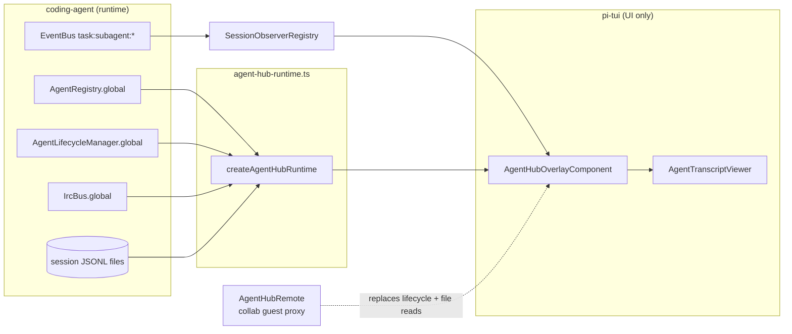

# OMP Agent Hub — the human-facing control surface

Status: research reference. **Oh My Pi (OMP) only.**
Source studied: [`can1357/oh-my-pi`](https://github.com/can1357/oh-my-pi) tag `v18.3.2` (commit `7853b4e`), the version
installed on this machine, read 2026-09-26, plus the bundled harness doc `omp://agent-hub.md`. Code wins where
code and docs disagree. Paths are repo-relative to that tag.

Companion: [`OMP-Hub-Substrate.md`](./OMP-Hub-Substrate.md) covers the machinery underneath (messaging, registry,
event bus, transcripts, artifacts, park/revive and the other prerequisites). DwarfHarness will build its own
interface, so this file documents OMP's Hub only as a reference: what it shows, what it can do, and exactly
what it needs from the substrate.

---

## 1. Name trap: "hub" means four things in OMP

| Name in OMP | What it actually is | Where |
|---|---|---|
| **Agent Hub** (`Alt+A`, legacy `Ctrl+S`) | Live roster + inspector + transcript/chat for the **running** subagents of the current session. **This document.** | `packages/tui/src/overlays/agent-hub.ts` |
| `/agents` hub | Editor for agent **definitions** (enabled, model, prewalk, advisor per agent type). Not runtime state. | `packages/tui/src/overlays/agents-hub.ts:1-11` |
| `/models` hub | Model browser. Unrelated. | `packages/tui/src/overlays/model-hub.ts` |
| Collab "hub topology" | The collab **host** is the authoritative hub that guests replicate from. | `omp://collab.md#architecture-notes` |

The agent-to-agent message bus is **not** a hub. It is the IRC bus (`packages/coding-agent/src/irc/bus.ts`).
The Agent Hub only *reads* one number from it, the per-agent "unread" count (see §5.7). See the substrate doc,
"Messaging".

---

## 2. What the Hub is

"One overlay, two views" (`agent-hub.ts:1-14`):

- **Table view (roster):** every registered agent **except `Main`**, because the main agent's conversation *is* the
  ambient screen. Each row shows status, an "unread IRC" count (see §5.7 for what it really counts), current or last
  task, and last activity.
- **Chat view:** one agent's transcript, read by incrementally tailing its session file, plus an input line.
  "Submitting revives a parked agent, then prompts/steers it; the message lands in the agent's persisted history
  via the normal prompt path."

A second section, `"activity"`, sits beside the agents section (`AgentHubSection = "agents" | "activity"`,
`agent-hub.ts:77`). It is a cross-agent feed of responses, tool calls, IRC messages and lifecycle events. It can
be filtered (`all | errors | responses | tools`) and scoped (`all | agent | subtree`) (`agent-hub.ts:78-79`).

Layout: a split pane (roster plus inspector) when the terminal is at least 96 columns wide
(`SPLIT_MIN_WIDTH`, `agent-hub.ts:73`); on narrower terminals `Tab` swaps between them (`omp://agent-hub.md`).

---

## 3. Architecture: the Hub is a projection behind narrow contracts

The most transferable design decision. The TUI package (`pi-tui`) never imports the runtime. It declares
**structural interfaces**, and the coding-agent package supplies implementations through one adapter,
`createAgentHubRuntime` ("Host services used by the roster, without exposing runtime implementation to tui",
`packages/coding-agent/src/modes/agent-hub-runtime.ts:20-46`).



### 3.1 The contracts (verbatim shape, key members only)

| Contract | Members | Purpose | Citation |
|---|---|---|---|
| `AgentHubRegistry` | `list()`, `get(id)`, `onChange(listener) → unsubscribe` | Roster source. Change-notification only; the Hub re-reads on change. | `agent-hub-types.ts:61-65` |
| `AgentLifecycleLike` | `ensureLive(id) → { prompt(text, { streamingBehavior: "steer" }) }`, `release(id, expected, { tombstone: true })` | The **only** two actions the Hub takes on agents. | `agent-hub-types.ts:67-70` |
| `IrcBusLike` | `unreadCount(id)` | Per-row badge. Counts only messages stuck in the mailbox after a **failed** live hand-off (§5.7). | `agent-hub-types.ts:72-74`; `irc/bus.ts:299-302` |
| `AgentTranscriptSource` | `fs` (open/read/stat subset), `parseEntries(text)` | Local transcript tailing; the runtime filters parsed entries to `message` and `model_change` only. | `agent-transcript-viewer.ts:46-49`; `agent-hub-runtime.ts:14-18` |
| `SessionObserverRegistry` | fed by EventBus channels `task:subagent:progress` and `task:subagent:lifecycle` | Live progress/usage snapshots for rows and the stats line. | `session-observer-registry.ts:3-7` |
| `AgentActivitySource` | activity rows (local index or remote) | The activity section. | `agent-hub.ts:171` |
| `loadPersisted(shouldContinue)` | wraps `registerPersistedSubagents(registry, sessionFile)` | Adds parked/aborted rows from disk while the overlay is open. | `agent-hub-runtime.ts:43` |
| `AgentHubRemote` (optional) | `chat(id, text)`, `kill(id)`, `revive(id)`, `readTranscript(id, fromByte)` | Collab guest: every action and transcript read is routed to the host. | `agent-hub.ts:121-128` |

Why it matters: because the Hub only needs these seams, **the same UI component drives local subagents and a
remote collab host's subagents**. The guest passes its replicated registry plus `hubRemote` into the same
factory (`packages/coding-agent/src/modes/controllers/selector-controller.ts:2168-2172`).

### 3.2 The record the Hub renders

`AgentRecordLike` (`agent-hub-types.ts:35-59`), key fields:

```ts
id; displayName; kind: "main" | "sub" | "advisor"; parentId?;
status: "running" | "idle" | "parked" | "aborted";
session: AgentHubSession | null;   // null when parked/aborted
sessionFile: string | null;        // the JSONL transcript
createdAt; lastActivity; activity?;
history?: { agent?, modelRole?, resolvedModel?, metrics?, readOnly?,
            outputPath?, patchPath?, branchName?, nestedPatchPaths? };
lifecycle?: { responseAt?, acceptedAt?, terminalAt? };
```

Rows sort by status with `running < idle < parked < aborted` (`STATUS_ORDER`, `agent-hub-projection.ts:20`).
`t` switches between a flat list and a parent/child tree built from `parentId` (`projectAgentTree`).

---

## 4. Actions and exactly what each calls

| User action | Local path | Collab-guest path | Constraints |
|---|---|---|---|
| **Open** (`Enter`/click) | Focus the main TUI on the agent; focusing calls `ensureLive`, which revives a parked agent (`agent-hub.ts:1494-1496`). | Opens the in-hub transcript viewer. | Advisors, `aborted` agents and remote agents always open the read-only in-hub viewer "instead of failing ensureLive" (`agent-hub.ts:1487-1491`). |
| **Revive** (`r`) | `lifecycle().ensureLive(id)` (`agent-hub.ts:1524-1525`) | `remote.revive(id)` (`:1518-1519`) | Only `parked` agents (`omp://agent-hub.md#roster-controls`). |
| **Kill** (`x`) | `lifecycle().release(id, ref, { tombstone: true })` (`:1553`) | `remote.kill(id)` (`:1542-1543`) | Immediate. The doc says a running turn is aborted first. The tombstone makes `aborted` survive a restart (substrate doc §7.5). |
| **Chat / steer** | `ensureLive(id)`, then `session.prompt(text, { streamingBehavior: "steer" })` (`agent-transcript-viewer.ts:551-554`) | `remote.chat(id, text)` (`:542-543`) | Steers a mid-turn agent; sends a normal prompt to an idle one. Uses the normal prompt path, so it is persisted in the agent's history. |

Design points visible here:

- **Uniform send semantics everywhere:** revive if parked, steer if running, prompt if idle. That holds for the focused
  editor, the full-screen viewer and collab guests (`omp://agent-hub.md#read-and-steer-a-subagent`).
- **Kill is compare-and-release.** `release` takes the `expected` record, not just the id. A newer agent that
  reused the same id cannot be killed by a stale click (the lifecycle manager binds every operation to the exact
  ref; see substrate doc §7 and §16).
- **Advisors are observability records, not peers.** They can be read and followed but never messaged, revived
  or killed. The same restrictions apply to collab guests (`omp://agent-hub.md#persisted-agents-and-advisors`).
- `Esc` while focused on a subagent **returns to main; it does not interrupt the subagent** (`omp://agent-hub.md`).

---

## 5. Data the Hub consumes, and how it keeps them honest

### 5.1 Two status vocabularies (easy to conflate)

- **Agent identity status** from the registry: `running | idle | parked | aborted` (`agent-hub-types.ts:7`).
- **Per-run execution status** from the EventBus lifecycle channel: `started | completed | failed | aborted`
  (`SubagentLifecyclePayload`, `session-observer-registry.ts:24-41`). The observer's `ObservableSession` uses
  `active | completed | failed | aborted` (`:48-68`).

An agent is a long-lived identity that can run many times (follow-ups, revivals). A run is a single execution.
The Hub shows the identity's status and uses the run channel for live progress.

### 5.2 Metrics without double counting

- Preferred: exact per-run usage from the observer's progress snapshot, labeled as `"active"` duration
  (`progressMetrics`, `agent-hub-projection.ts:26-61`).
- Fallback: sum usage from the live session's **own assistant messages**, and do **not** use `SessionStats`.
  `SessionStats` also includes usage embedded in completed `task` tool results, so a parent row would double-count
  its children in the aggregate header (`agent-hub-projection.ts:63-67`).
- On any failure, return nothing: "Missing metrics are preferable to a broken hub" (`:106-109`). The UI then shows
  `usage —` rather than an estimate (`omp://agent-hub.md#roster-and-inspector`).

### 5.3 Transcript tailing (local and remote)

`AgentTranscriptViewer` renders transcripts of agents with no live on-screen session: parked subagents,
advisors, collab guests (`agent-transcript-viewer.ts:1-15`).

- **Append-only tail:** it parses only newly appended JSONL while the file identity is unchanged and three
  **byte sentinels** (samples at offset 0, the middle and the end) still match. A rewrite, truncation,
  rotation or sentinel mismatch triggers a full rebuild, "so changed historical entries cannot leave stale
  components behind" (`:10-14`, `sentinelOffsets` `:114-118`, check `:264-281`).
- **Torn-line safety:** the text after the last newline is kept as `pending` and not parsed until completed
  (`:360`).
- **Race tolerance:** a file unlinked between `stat` and `read` falls back to a guarded full reload instead of
  throwing out of the poll timer (`:273-277`, `:348-353`).
- **Remote:** `readTranscript(id, fromByte)` mirrors the local incremental read: it returns complete JSONL lines
  from `fromByte` plus `newSize` (the next offset); `null` means "temporarily unavailable" and `error` means a terminal
  failure, "guests should surface it instead of retrying hot" (`agent-hub.ts:113-128`).

### 5.4 The activity feed

`AgentActivityIndex` tails each agent's transcript (initially the last 256 KiB), turns messages and tool calls
into one-line rows, and bounds memory at 256 rows per agent
(`packages/coding-agent/src/activity/index.ts:43-46`). A tool row's label is the call's intent field when present,
otherwise a per-tool summary (`argumentsSummary`, `:78-109`).

### 5.5 Persisted rows

When opened, the Hub runs `loadPersisted`, which scans the session's artifact tree
(`registerPersistedSubagents`). Each `<id>.jsonl` becomes a `parked` row, or an `aborted` row if a
`<id>.jsonl.tombstone` sidecar exists. Lineage is preserved, and `<id>.md` output and `<id>.patch` paths are attached to
the inspector (`agent-hub-runtime.ts:43`; details in substrate doc §7.6).

### 5.6 Render discipline

Data-change renders are coalesced to 100 ms, the relative-age column ticks every 5 s, and a double-`←` has a
500 ms window (`agent-hub.ts:83-87`).

### 5.7 What the "unread IRC" badge actually counts

`IrcBus.unreadCount(id)` returns the length of that agent's **mailbox** (`coding-agent/src/irc/bus.ts:300-301`). The
mailbox only holds messages whose live hand-off **failed**, for example because the recipient session was being
disposed. A delivered message is injected into the recipient's context and never buffered (substrate doc §3.3).
The badge is therefore normally `0`. A non-zero value means "messages stuck waiting for a `wait` or drain", not
"messages the agent has not looked at". `omp://agent-hub.md` calls it an "unread IRC count", which overstates it
(substrate doc §15).

---

## 6. Surfaces around the Hub (from `omp://agent-hub.md`)

- **Pinned jump list:** a `Subagents` block above the editor lists every live agent, both synchronous task calls
  and detached background spawns. The `display.pinnedAgents` setting controls it (`collapsed` by default, `full`
  or `off`).
- **Click to focus** (with `tui.mouse` on): clicking a live card or jump-list row focuses that agent and revives it
  if parked. Only rows in the live viewport are clickable, because scrollback cannot be mapped back to content.
- **Keys:** `j/k`/arrows select, `Enter` opens, `t` switches between flat and tree, `Tab` shows the inspector, `r` revives,
  `x` kills, and `Esc` closes. Chords can be remapped in `~/.omp/agent/keybindings.yml` (`app.agents.hub`,
  `app.session.observe`).
- **Agent-facing equivalents** (the Hub is the human surface only): `history://<id>` returns a transcript,
  `agent://<id>` the final output, `write agent://<id>` steers an agent, `agent://all` broadcasts, and `read proc://` lists jobs.

---

## 7. What any hub needs from the substrate (OMP's answer)

OMP's Hub works only because the substrate already provides everything below. The checklist is written in OMP
terms; each item is a section of `OMP-Hub-Substrate.md`.

1. **A registry with change events.** You must be able to list, get and subscribe to agents: `id`, `kind`,
   `parentId`, `status`, `sessionFile`, and usage/output metadata.
2. **A lifecycle manager exposing `ensureLive` and `release`.** With these, "open", "revive" and "chat" are all
   *make it live, then prompt*, and "kill" is *release with tombstone*. The Hub has no park action; parking is
   automatic (idle TTL).
3. **Steering through the normal prompt path** (`streamingBehavior: "steer"`), so human messages are
   persisted exactly like agent messages.
4. **Append-only JSONL transcripts per agent**, so any viewer can tail them by byte offset, and a remote proxy can
   serve the same byte ranges.
5. **A progress/lifecycle event bus** that is separate from the registry, for high-frequency usage updates
   without registry churn.
6. **A count of undelivered mail** on the message bus. In OMP this is the size of the failed-hand-off mailbox (§5.7).
7. **Durable markers on disk** (transcripts, `<id>.md` outputs, patches, `.tombstone` sidecars) so a restarted
   process can rebuild the roster without any in-memory state.
8. **A capability tier on records** (`kind: "advisor"`, `readOnly`, remote view-only) that lets the UI refuse
   actions without special-casing each surface.
