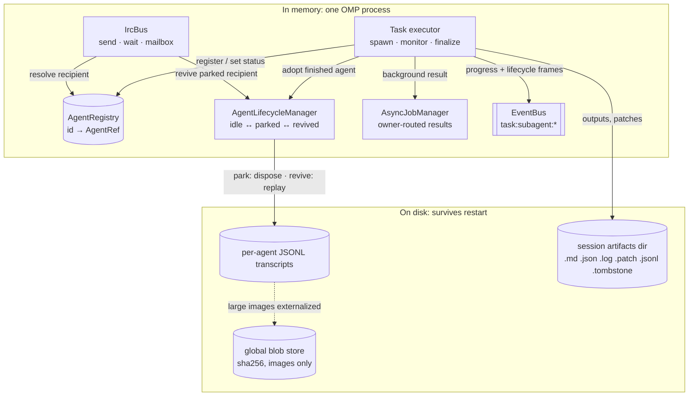
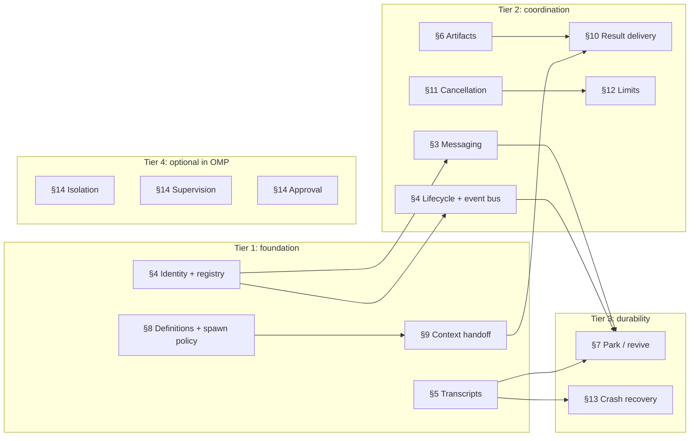
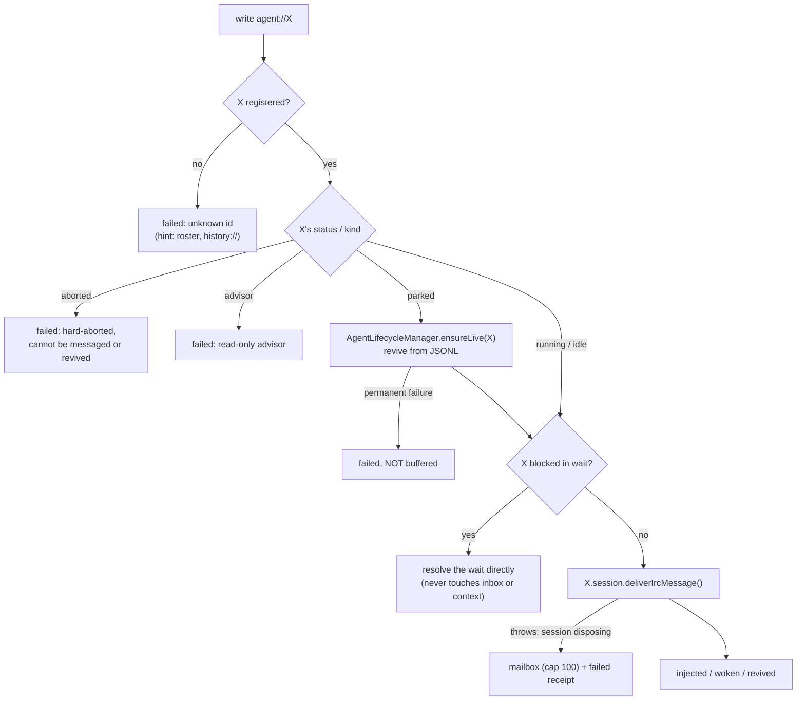
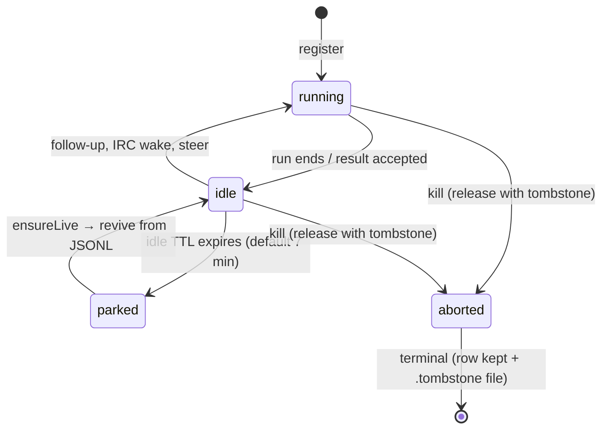

# OMP Hub Substrate: how Oh My Pi makes agents coordinate

Status: research reference for DwarfHarness's coordination core. **Oh My Pi (OMP) only.** Other harnesses are
covered by separate research.

Source studied: [`can1357/oh-my-pi`](https://github.com/can1357/oh-my-pi) tag `v18.3.2` (commit `7853b4e`), the
version installed on this machine, read 2026-09-26, plus the harness docs bundled in the binary (`omp://…`).
The code was read directly. Where code and docs disagree, the code wins, and the disagreement is listed in §15.

Companion: [`OMP-Agent-Hub.md`](./OMP-Agent-Hub.md) covers the human-facing roster UI, which is deliberately
kept out of this document.

**Citation convention.** Paths are relative to `packages/` in the tag, e.g. `coding-agent/src/irc/bus.ts`. The
stable anchor is the **symbol name** (`IrcBus.#deliver`). Line numbers are given where they were checked and
may drift by a few lines. `omp://x.md` is a bundled doc. `[INFERENCE]` marks a conclusion not directly seen in
code.

---

## Contents

- Part I: Orientation
  - [1. The substrate in one page](#1-the-substrate-in-one-page)
  - [2. Prerequisite map and build order](#2-prerequisite-map-and-build-order)
- Part II: Messaging
  - [3. Messaging (the IRC bus)](#3-messaging-the-irc-bus)
- Part III: The four core prerequisites
  - [4. Agent registry, lifecycle state machine and event bus](#4-agent-registry-lifecycle-state-machine-and-event-bus)
  - [5. Append-only, file-backed transcripts](#5-append-only-file-backed-transcripts)
  - [6. Artifacts: outputs, spills, patches, blobs](#6-artifacts-outputs-spills-patches-blobs)
  - [7. Park and revive](#7-park-and-revive)
- Part IV: Additional prerequisites
  - [8. Agent definitions, spawn policy and recursion depth](#8-agent-definitions-spawn-policy-and-recursion-depth)
  - [9. Context handoff to a child](#9-context-handoff-to-a-child)
  - [10. Result delivery and background jobs](#10-result-delivery-and-background-jobs)
  - [11. Cancellation and abort propagation](#11-cancellation-and-abort-propagation)
  - [12. Limits and budgets](#12-limits-and-budgets)
  - [13. Crash and turn recovery](#13-crash-and-turn-recovery)
  - [14. Optional in OMP: isolation, supervision, approval](#14-optional-in-omp-isolation-supervision-approval)
- Part V: Synthesis
  - [15. Corrections and doc-vs-code discrepancies](#15-corrections-and-doc-vs-code-discrepancies)
  - [16. Patterns OMP repeats everywhere](#16-patterns-omp-repeats-everywhere)
  - [17. Open questions](#17-open-questions)
  - [Appendix A: constants](#appendix-a-constants)
  - [Appendix B: source map](#appendix-b-source-map)
  - [Appendix C: glossary](#appendix-c-glossary)

---

# Part I: Orientation

## 1. The substrate in one page

**Plain terms.** A multi-agent harness needs to answer seven questions. Who exists? (registry) What is each one
doing? (lifecycle + events) How do they talk? (messaging) How does work come back? (results + artifacts) What survives a
crash? (transcripts) How do you free resources without forgetting agents? (park/revive) And how do you keep it from
running away? (spawn policy, cancellation, limits). OMP answers all seven with a small set of parts:

- **Three process-global, in-memory singletons**
  - `AgentRegistry`: the directory of every agent.
  - `AgentLifecycleManager`: the only owner of idle ↔ parked ↔ revived.
  - `IrcBus`: agent-to-agent message transport.
- **A background job manager** (`AsyncJobManager`) that routes each result to its owner.
- **A trivial synchronous event bus** (`EventBus`) for high-frequency progress.
- **Durable files on disk**: one append-only JSONL transcript per agent, a per-session artifacts directory, and a
  global content-addressed image blob store.

Everything in memory can be lost, because what matters is **rebuildable from disk**. A restarted process scans the
transcripts and marker files and reconstructs the roster as `parked` (or `aborted`) agents
(`coding-agent/src/registry/persisted-agents.ts` `registerPersistedSubagents`).



| Part | Responsibility | Where state lives | Survives restart? |
|---|---|---|---|
| `AgentRegistry` | Identity, lineage, status, pointers to transcript and outputs | Memory | Rebuilt from disk |
| `AgentLifecycleManager` | Idle-TTL parking, revival, kill with tombstone | Memory (timers) | Tombstones on disk |
| `IrcBus` | Message transport and `wait` wake-ups | Memory | Delivered messages persist *in the recipient's transcript*; undelivered mail does not |
| `AsyncJobManager` | Background spawns and owner-routed result delivery | Memory | No |
| `EventBus` | Progress/lifecycle frames for UIs, RPC and collab | Memory, synchronous | No |
| Transcripts | Every conversation, append-only | Disk (JSONL) | Yes |
| Artifacts | Final outputs, spilled tool output, patches | Disk (session dir) | Yes |
| Blob store | Large images, deduplicated by sha256 | Disk (global) | Yes |

## 2. Prerequisite map and build order

The ranking below follows OMP's own design: what every spawn passes through, and what OMP ships switched off by
default. The "hard vs optional" labels describe OMP's design, not a verdict for DwarfHarness.



| # | Prerequisite | Tier | Why it is needed (what breaks without it) |
|---|---|---|---|
| §4 | Identity + registry | 1 | Nothing can be addressed, listed, revived or killed. |
| §5 | Append-only transcripts | 1 | Nothing survives a crash. Park/revive, history reads and live tailing all depend on it. |
| §8 | Definitions + spawn policy + depth | 1 | No way to say what may be spawned; a task-spawning agent becomes a fork bomb. |
| §9 | Context handoff | 1 | Children start without an assignment, tools or a shared place to put results. |
| §3 | Messaging | 2 | Agents cannot steer, ask, answer or avoid colliding with each other. |
| §10 | Result delivery | 2 | The parent never learns what the child produced, or results leak into the wrong session. |
| §6 | Artifacts | 2 | Results are either bloated inline or lost; structured output cannot be validated. |
| §4 | Lifecycle + event bus | 2 | No reliable idle/running status; UIs poll or show stale state. |
| §11 | Cancellation | 2 | Runaway children keep spending; one agent can kill another's work. |
| §12 | Limits and budgets | 2 | Unbounded fan-out, runaway loops, hangs. |
| §7 | Park / revive | 3 | You must choose between leaking memory and forgetting agents. |
| §13 | Crash / turn recovery | 3 | An interrupted turn looks live, or a replay repeats side effects. |
| §14 | Isolation, supervision, approval | 4 | Off or headless by default in OMP; coordination works without them. |

---

# Part II: Messaging

## 3. Messaging (the IRC bus)

**Plain terms.** Any agent can send a short message to any other live agent by id, or to all of them. Sending
**never waits for a reply**. How the message arrives depends on what the recipient is doing:

- a recipient blocked in `wait` gets it immediately;
- a busy recipient sees it between tool calls;
- an idle recipient is woken into a new turn;
- a parked recipient is first revived from disk.

A child's *final result* travels on a separate channel (§10), not over the message bus.

### 3.1 Addressing: one flat namespace

- **Ids.** The main session is `"Main"` (`tui/src/overlays/agent-hub-types.ts:5`). Subagent ids come from a label or a
  generated `AdjectiveNoun` name (`coding-agent/src/task/name-generator.ts`), made unique per session as `Name`,
  `Name-2`, `Name-3` and dot-qualified for nesting as `Parent.Child` (`coding-agent/src/task/output-manager.ts`
  `AgentOutputManager.allocate`).
- **Visibility.** `AgentRegistry.listVisibleTo(id)` returns every non-advisor agent that is `running` or `idle`,
  except the caller. The code comment says "Flat namespace: every other agent is visible"
  (`coding-agent/src/registry/agent-registry.ts:333-335`).
- **Permission.** Parent→child, child→parent and sibling→sibling are all allowed. `parentId` changes the delivery
  *style* (§3.4), never *permission*.
- **How agents learn ids.** A peer roster is rendered into each child's system prompt: up to 32 rows, running
  before idle; parked peers are counted but not named (`coding-agent/src/task/executor.ts`
  `collectIrcPeerRoster`; `DEFAULT_PEER_ROSTER_LIMIT = 32`, `tui/src/tools/irc.ts`). The prompt tells agents to
  "Address peers by exact roster id; NEVER invent names"
  (`coding-agent/src/prompts/agents/subagent-system-prompt.md`). An agent is registered **before** its system
  prompt is built, so batch siblings appear in each other's first roster (`coding-agent/src/sdk.ts`, registration
  block around `:3805-3818`).
- **Why flat:** coordination such as "integration owner ↔ workers" or "don't edit my file" must work without the
  sender knowing the tree shape.

### 3.2 Sending: fire-and-forget with a delivery receipt

`write agent://<id>` is handled by `AgentProtocolHandler.write` (`coding-agent/src/internal-urls/agent-protocol.ts`),
which calls `executeSend` (`coding-agent/src/irc/messaging.ts`). That in turn calls `IrcBus.send`
(`coding-agent/src/irc/bus.ts:73`). `send` stamps a time-ordered Snowflake `id` and `ts`, delivers, and returns an
`IrcDeliveryReceipt`:

```ts
interface IrcMessage { id; from; to; body; ts; replyTo?; wakeRelay? }       // tui/src/tools/irc.ts
interface IrcDeliveryReceipt { to; outcome: "injected" | "woken" | "revived" | "failed"; error? }
```

The receipt reports **how the message reached the recipient, not what the recipient did with it**. The file
header explains the design choice: this "replaces the old auto-reply model: a `send` never blocks on the recipient
generating anything" (`irc/bus.ts:1-14`). **Why:** a blocking send deadlocks two agents that message each other.

### 3.3 Recipient resolution (`IrcBus.#deliver`)



These rules are listed in order in `irc/bus.ts` `#deliver`. Two details matter:

- A **permanent** revive failure returns `failed` **without** buffering, because "a permanent failure must not
  inflate unread counts".
- The mailbox holds only messages whose **live hand-off failed**. Successfully delivered messages are never
  buffered, since buffering them would double-deliver.

### 3.4 How the message enters the recipient (`IrcBridge.deliver`)

`coding-agent/src/session/irc-bridge.ts` turns the message into a context record, then picks an injection style
from the recipient's run state (verified at `irc-bridge.ts:195-232`):

| Recipient state | Sender | What happens | Returns |
|---|---|---|---|
| Streaming (busy) | Recipient's **parent** | `agent.steer({ role: "user", steering: true, … })`, a user-role steer that preempts like a human interjection | `injected` |
| Streaming (busy) | Anyone else | Pushed onto an interrupt queue and injected as an aside at the next step boundary (§3.5) | `injected` |
| Idle, plan mode | Anyone | Appended to context and persisted; **no autonomous turn** ("convergence stays user-driven") | `injected` |
| Idle | Anyone | `wakeForIrc([record])` starts a new turn | `woken` |

The record is `{ role: "custom", customType: "irc:incoming", content, details: { id, from, message, replyTo?, wakeRelay? },
attribution: "agent" }` (template `coding-agent/src/prompts/system/irc-incoming.md`).

**Why the parent/peer asymmetry:** the parent drives the child, so its message should interrupt like the user
would. A peer's message is advisory and must not abort side-effecting work.

### 3.5 Step-boundary injection into a busy agent

The session wires two hooks into the agent loop (`coding-agent/src/session/agent-session.ts`, around `:1736-1744`):

- `hasIrcInterrupts()`: a non-consuming peek that the loop polls while a tool batch runs. On a hit, the loop aborts
  **only interruptible** tools (for example, a `wait`) with `TOOL_INTERRUPT_ABORT_REASON`. Non-interruptible tools
  keep running (`agent/src/agent-loop.ts`, `checkAsideInterrupts`).
- `setAsideMessageProvider(() => irc.drainPending())`: at the batch boundary the loop drains queued records,
  interrupts first and then asides, FIFO within each (`irc-bridge.ts` `drainPending`).

**Why:** a peer that is blocked on this agent needs a prompt answer, but a running command's work must not be thrown
away.

### 3.6 Waking an idle agent and relaying its answer

- `AgentSession.#wakeForIrc` starts a fire-and-forget turn. If another turn owns the worker, it re-queues the records
  rather than racing (`agent-session.ts` `#wakeForIrc`).
- When the woken turn stops, `relayWakeTurnOutput` sends the turn's answer back to each sender that woke it, using
  `replyTo` and `wakeRelay: true` (`coding-agent/src/task/executor.ts` `attachIrcWakeTurnMonitor`,
  `relayWakeTurnOutput`, `buildWakeRelayBody`). The relay distinguishes a real answer, a provider failure, a
  cancellation and "produced no output", each with a `history://<id>` pointer.
- **Anti-loop rule:** records carrying `wakeRelay: true` never count as wake sources. In addition,
  `IrcBus.sentSince(from, to, turnStart)` skips relaying to a peer this agent already answered during the turn. Without
  both rules, two idle agents "ping-pong forever" (`executor.ts` relay code).
- At yield acceptance, `registerWakeJob` also registers an owner-routed job, so the **parent** receives the woken
  agent's yield through the normal result channel (§10).

### 3.7 Broadcast: `agent://all`

`executeSend` expands `all` to `listVisibleTo(sender)` and sends to each target, reporting "Broadcast delivered to
N of M peer(s)" (`irc/messaging.ts`). `agent://all` is write-only.

**Broadcast reaches only `running | idle` peers. Parked agents are not woken by a broadcast**; only a direct
`agent://<id>` revives one.

### 3.8 `wait`: block until something happens

`coding-agent/src/tools/wait.ts`:

1. Drain any already-queued message first (session inbox, then the bus mailbox) and return it.
2. If there is no running job, no live peer and no owned service, return "Nothing to wait for".
3. Otherwise race:
   - every running job;
   - a bus wait for this agent;
   - owned services;
   - the abort signal;
   - a **30-minute safety cap** (`WAIT_MAX_MS = 30 * 60_000`, `wait.ts:24`).
4. A message wins a photo finish against a job: the job remains deliverable later, but a lost message cannot be
   recovered.
5. If the last running peer stops while the agent waits only on peers, the wait aborts instead of hanging
   (`irc/bus.ts` wait liveness watcher).

Results and messages auto-deliver without `wait`. `wait` exists only for an agent that has nothing else to do
(`omp://tools/wait.md`).

### 3.9 Two read surfaces, deliberately separate

| URI | What it returns | Source | Properties |
|---|---|---|---|
| `agent://<id>` | The child's **final output** (`<id>.md`); `agent://<id>/<key>/<i>` extracts JSON from the `<id>.json` sidecar | Artifacts dir (§6) | Immutable, addressable, small |
| `history://<id>` | The agent's **transcript**, rendered | Live session in memory if running; the parked JSONL if parked; a disk scan otherwise | Live, mutable, potentially large |

**Why separate:** the output is the *deliverable* and the transcript is the *process*. Merging them would either
bloat every result read or make deliverables non-durable (`internal-urls/agent-protocol.ts`,
`internal-urls/history-protocol.ts`).

### 3.10 Guarantees and limits

- **Delivery:** effectively **at-most-once**. There is no acknowledgement or redelivery protocol. A failed live
  hand-off is buffered for a later `wait` or drain, but a permanent revive failure is dropped with a `failed` receipt.
- **Ordering:** message ids are time-ordered Snowflakes. Per recipient, interrupts drain before asides, FIFO within
  each queue. Mailbox and waiters are also oldest-first.
- **Backpressure:** there is **no rate limit** in `irc/`. The only bound is `MAILBOX_CAP = 100` per agent, which drops
  the oldest message (`irc/bus.ts:25`). Loop safety relies entirely on the `wakeRelay` and `sentSince` rules of §3.6.
- **Durability:** the bus is an in-memory singleton; its mailboxes, waiters and last-sent map are lost on restart.
  **Delivered** messages survive because they are written into the recipient's JSONL transcript (§5).
- **Session switches:** `/new` and switching sessions snapshot and clear pending IRC queues, so an old
  conversation's asides cannot leak into the new one; a rolled-back switch restores them (`irc-bridge.ts`
  `clearPending` / `restorePending`).
- **Refused targets:** self-sends, `aborted` agents and advisors.

### 3.11 What each piece prevents

| Mechanism | Failure it prevents |
|---|---|
| Non-blocking send + receipt | Deadlock between agents that message each other |
| Revive-on-message | Messages to parked agents vanishing |
| Waiter short-circuit | Latency and duplicate context for an agent that is explicitly waiting |
| Step-boundary asides | Mid-batch context corruption; killing running commands |
| Parent steer | Parents unable to redirect a busy child |
| `wakeRelay` + `sentSince` | Infinite ping-pong between idle agents |
| Separate `agent://` and `history://` | Bloated result reads; non-durable deliverables |
| Mailbox cap | Unbounded memory from undeliverable mail |

---

# Part III: The four core prerequisites

## 4. Agent registry, lifecycle state machine and event bus

**Plain terms.** The registry is the phone book: one record per agent, holding who it is, who its parent is,
whether it is working, and where its transcript and output live. The lifecycle manager decides when an idle agent
is put to sleep (parked) and woken (revived). The event bus is a loudspeaker for fast-changing progress, such as
tokens, the current tool and cost. It is kept separate so that UIs can follow along without flooding the registry.

### 4.1 The record

```ts
// coding-agent/src/registry/agent-registry.ts
interface AgentRef {
  id; displayName; kind: "main" | "sub" | "advisor"; parentId?;
  status: "running" | "idle" | "parked" | "aborted";
  session: AgentSession | null;   // "Null exactly when parked/aborted"
  sessionFile: string | null;     // the JSONL transcript; kept across park
  createdAt; lastActivity;
  activity?: string;              // one-line gist; running-only; emits no event
  history?: { agent?, modelRole?, resolvedModel?, metrics?, readOnly?,
              outputPath?, patchPath?, branchName?, nestedPatchPaths? }; // survives disposal
  lifecycle?: { responseAt?, acceptedAt?, terminalAt? };                  // run-scoped
}
type RegistryEvent = { type: "registered" | "status_changed" | "metadata_changed" | "removed"; ref };
```

Finished agents **stay registered** as `idle` or `parked`, so they remain addressable by `agent://`, `history://` and
IRC after their live session is gone (`agent-registry.ts:1-11`).

### 4.2 Registry operations and their guards

- **Scope:** one process-global `Map` behind `AgentRegistry.global()`. The SDK can inject a different registry
  (`sdk.ts`); agents registered elsewhere are not discoverable via `history://` or `agent://`.
- `register(input)` defaults to `running` and emits `registered`.
- `registerIfAvailable(input, expected)` is a **compare-and-swap for revival**. It registers only if the id is absent,
  or reuses only the *exact* detached `parked` ref. A delayed reviver can never claim an id whose previous generation
  was replaced or killed.
- `setStatus(id, status, expected?)` is the state machine. It rejects unknown ids and ownership mismatches, and
  **`aborted` is absorbing**: nothing may leave it. Leaving `running` clears `activity` and stamps `terminalAt`.
  Entering `running` clears `lifecycle`, so a reused agent cannot look "already accepted".
- `markResultAccepted` is the executor's run boundary. It moves a non-streaming `running` ref to `idle`. A ref that
  is still streaming is surfaced by `staleAcceptedRuns()` so the parent can cancel it instead of waiting forever.
- `setActivity` is running-only and **event-less**, which keeps per-tool-call churn off the listener path, and it
  strips terminal escapes from model text.
- `syncSessionStatus(id, session)` mirrors the session's own authoritative `running | idle` notifications into the
  ref (`session.subscribeRunState`).
- Listener errors are caught per listener, so one bad subscriber cannot break dispatch.

### 4.3 Lifecycle state machine



Removal (`unregister`) is the other exit: teardown, one-shot agents, or a non-tombstone release. `parked` is
durable and revivable, not terminal. `Main` is never adopted or parked (`agent-lifecycle.ts` `adopt`).

### 4.4 Identity

- **Names:** `AdjectiveNoun`, from 1202 adjectives × 355 animals. After 50 random attempts it falls back to
  `Task<n>` (`task/name-generator.ts`).
- **Uniqueness and nesting:** `AgentOutputManager.allocate` returns `base`, `base-2`, …, and for a nested spawn
  prefixes the parent, as in `Parent.Child`. Requested ids never contain `.`, because a dot marks nesting. On resume it seeds
  its taken set from existing `<id>.jsonl` and `<id>.md` files, so a reused name never overwrites old output
  (`task/output-manager.ts`).
- **Lineage** is recorded twice: `parentId` on the record and the dotted id.

### 4.5 The event bus

The entire implementation (`coding-agent/src/utils/event-bus.ts`):

```ts
class EventBus {
  #listeners = new Map<string, Set<(data: unknown) => void>>();
  emit(channel, data) { for (const h of this.#listeners.get(channel) ?? []) h(data); }  // synchronous fan-out
  on(channel, handler) { /* wraps handler in try/catch that logs; returns unsubscribe */ }
}
```

- **Three subagent channels**, all emitted only by the task executor:
  - `task:subagent:lifecycle`: `{ id, agent, status: "started" | "completed" | "failed" | "aborted", sessionFile?, detached?, … }`.
    `started` is sent at spawn; the settle status is sent after finalization.
  - `task:subagent:progress`: `{ agent, task, progress: AgentProgress, sessionFile?, detached?, … }`.
  - `task:subagent:event`: raw session events. Only the RPC surface consumes this one.
- **Two buses per session.** The session bus is for extensions; the root observability bus is for the HUD, RPC and
  collab. `emitSubagentFrame` publishes to both and skips the second emit when they are the same object. Subscribers
  deduplicate shared frames with a `WeakSet`.
- **Throttle:** progress is coalesced at the producer to one emit per `PROGRESS_COALESCE_MS = 150`
  (`executor.ts:1459`). There is no back-pressure; dispatch is synchronous.
- **Subscribers:**
  - the status-line and pinned-subagent HUD (`SessionObserverRegistry`);
  - the RPC surface;
  - the collab host, which mirrors lifecycle and progress frames to guests.
- **The parent agent does not subscribe for control.** It learns about children through result delivery (§10),
  `agent://`, `history://`, `proc://` and IRC.

**Two status vocabularies, not to be conflated:**

- **Agent identity:** `running | idle | parked | aborted`, held in the registry.
- **Single execution:** `started | completed | failed | aborted`, on the bus. An agent runs many times over its life
  (follow-ups, wakes, revivals).

### 4.6 Usage accounting

- Per run, `AgentProgress` accrues:
  - `requests`, one per assistant message;
  - `toolCount`;
  - `tokens` = input + output + cacheWrite. **cacheRead is excluded** because it re-reads cached context every turn;
  - `contextTokens`, the current context size;
  - `cost` (`executor.ts` progress handlers).
- For parked or aborted agents, metrics are **rebuilt from the transcript** by walking assistant messages
  (`persisted-agents.ts` `readPersistedAgentHistory`).
- **No roll-up up the tree.** Each agent's usage is independent. The roster header is a flat sum. The Hub
  deliberately avoids `SessionStats` for parent rows, because that includes usage embedded in completed `task`
  results and would double-count children (`tui/src/overlays/agent-hub-projection.ts:63-67`).

## 5. Append-only, file-backed transcripts

**Plain terms.** Every agent, main or sub, writes its conversation to its own file, one JSON object per line, and
only ever appends. That file is the source of truth. Resuming, reviving, reading history and watching live are all
"read the file". Compaction does not delete anything; it appends a marker that tells the reader where to start.

### 5.1 Layout

| What | Path |
|---|---|
| Main session transcript | `~/.omp/agent/sessions/<encoded-cwd>/<timestamp>_<sessionId>.jsonl` (`session/session-paths.ts`) |
| Session artifacts dir | Same path without `.jsonl` |
| Subagent transcript | `<artifacts dir>/<AgentId>.jsonl` (`executor.ts:3434`, `subtaskSessionFile`). Nested children recurse, because a child adopts its parent's artifacts dir. |
| Blob store (images) | `~/.omp/agent/blobs/<sha256>`, global |

`~/.omp/agent/agent.db` and `history.db` are SQLite files for settings, auth and prompt history. They are **not**
transcripts; `session/agent-storage.ts` is misleadingly named.

### 5.2 File format

1. **A fixed-width 256-byte title slot** as the first line (`SESSION_TITLE_SLOT_BYTES = 256`). A title change rewrites
   only this slot, never the body (`session/session-title-slot.ts`).
2. **The header:** `{ type: "session", version: 3, id, timestamp, cwd, parentSession?, … }`.
3. **Entries**, each `{ type, id, parentId, timestamp, … }` (`agent/src/compaction/entries.ts`). Types include
   `message`, `model_change`, `compaction`, `branch_summary`, `custom`, `custom_message`, `session_init`,
   `reset_boundary` and `title_change`.

- `id` and `parentId` make the log a **tree**. A mutable leaf pointer selects the current branch.
- `session_init` records the agent's **runtime contract**: system prompt, task, tool names, output schema and
  mode, spawn policy, and more. Cold revival needs it (§7).

### 5.3 Write pipeline and crash safety

Verified in `coding-agent/src/session/session-manager.ts` (`#appendToSessionFile`) and `session/session-storage.ts`:

- **One writer per file.** "The manager only ever writes one file at a time." Each append creates one child of the
  current leaf, updates the in-memory index, then writes one line.
- **Written before the call returns, no fsync.** The file is opened `O_APPEND`. It survives a process crash, but a
  power loss may drop the last page (`session-storage.ts:32, 46-48`).
- **No torn lines from failed writes.** Short writes loop; on any write error the writer calls
  `ftruncateSync(fd, originalSize)` to roll back the partial line (`session-storage.ts:274`).
- **Atomic full rewrites** handle migrations, moves, forks and targeted recovery:
  1. write a temp file;
  2. under a cross-process lock file, check that the expected size still matches (optimistic concurrency);
  3. atomically rename over the original. On Windows `EPERM`, move the original aside and restore it on failure.

  An epoch fence abandons a stale rewrite. A writer holding a replaced inode reopens the live path before appending.
- **Lazy creation.** A new session stays in memory until it has an assistant message, so empty `/new` sessions do
  not litter disk.
- **Persistence transform:**
  - strings over 500,000 chars are truncated with a notice, **except** signed or encrypted provider blocks, which
    must stay byte-exact or replay fails;
  - base64 images of 1 KB or more are moved to the blob store, and the blob bytes are written **before** the line
    that references them (`session/session-persistence.ts`).

### 5.4 Reading: one builder for every view

`buildSessionContext(entries, leafId, …)` (`coding-agent/src/session/session-context.ts`):

1. walks `parentId` from the leaf to the root, stopping on a repeated id to guard against corrupt cycles;
2. replays settings such as model and thinking level;
3. picks the emission boundary:
   - the latest `reset_boundary` (`/clear`) hides everything before it;
   - otherwise the latest `compaction` emits its summary, then entries from `firstKeptEntryId` onward;
4. strips dangling tool calls.

**The same function** produces:

- the LLM context;
- the live display transcript;
- the read-only history of a parked agent (`loadSessionMessagesReadOnly`);
- a collab guest's replica.

That is why "live view" and "resumed view" cannot drift apart.

**Compaction appends, never rewrites.** `/compact` appends a `compaction` entry and `/clear` appends a
`reset_boundary`. The full history stays in the file; only the projection changes.

### 5.5 Tailing a live transcript

Three consumers share one byte-offset contract: the Hub activity feed (`coding-agent/src/activity/index.ts`), collab
(`coding-agent/src/collab/host.ts`) and RPC (`coding-agent/src/modes/rpc/rpc-subagents.ts`).

- Request `fromByte`.
- Receive complete lines only (trimmed to the last `\n`) plus `newSize`, which becomes the next `fromByte`.
- If the file shrank, **reset** and re-read from 0, because a rewrite happened.

Collab caps each read at 4 MiB. `history://` does a full read-only reload instead of tailing.

### 5.6 Loading tolerates damage

- Only newline-terminated bytes are parsed.
- A final record that is complete but lacks a newline gets one added; a genuinely partial record is skipped as
  malformed.
- A missing file loads as empty.
- Files of 8 MiB or more are streamed (`session/session-loader.ts`).

### 5.7 Two different "append-only" layers

- The **file layer** is described above.
- The **provider layer** is `AppendOnlyContextManager` (`agent/src/append-only-context.ts`): an in-memory message
  array whose byte prefix is frozen so provider prompt caches keep hitting. Its only mutation is `replaceTail()`, which
  is legal only for compaction.

The file layer's append-only shape is what lets the cache layer grow monotonically.

## 6. Artifacts: outputs, spills, patches, blobs

**Plain terms.** Big or final things are stored as files, next to the transcript. The result that comes back
inline is kept small, and the rest can be fetched by reference.

### 6.1 Three identity schemes, deliberately separate

| Kind | Id | File | Location | Content-addressed? |
|---|---|---|---|---|
| Image blob | sha256 of the bytes | `<hash>` | Global `~/.omp/agent/blobs/` | **Yes**: deduplicated, idempotent (`session/blob-store.ts`) |
| Spilled tool output (`artifact://N`) | Monotonic integer per session | `<N>.<toolType>.log` | Session artifacts dir | No (`session/artifacts.ts`) |
| Subagent output (`agent://id`) | Agent name | `<id>.md` + `<id>.json` | Session artifacts dir | No (`task/output-manager.ts`) |
| Patch | Agent id | `<id>.patch`, `<id>.nested-<n>-<path>.patch` | Session artifacts dir | No (`task/isolation-runner.ts`) |
| Kill marker | Transcript path | `<sessionFile>.tombstone` | Beside the transcript | No |

The whole agent tree shares **one** artifacts dir and **one** integer id space: children adopt the parent's
`ArtifactManager` (`adoptArtifactManager`). With several sessions in one process, the same id can exist in several
directories, so resolvers search the **caller's own directory first**. `agent://` only reads a `.json` sidecar from the
same directory as the matching `.md`, so another session's `Worker.json` cannot answer.

### 6.2 Spilled tool output

When a tool's output exceeds the model-facing buffer (50 KB), the full sanitized stream goes to
`<N>.<tool>.log` and the model sees a bounded view plus `artifact://N` (`omp://blob-artifact-architecture.md`).

Every artifact is written by a **stage → verify size → atomic rename** sequence (`writeArtifact`). A short write never
leaves a truncated file that looks complete, and a failed rewrite never destroys the previous valid version. Tool
names are sanitized before becoming filenames.

### 6.3 A child's final output

When the child **yields** (its explicit "I'm done" tool call), `finalizeRunResult` (`task/executor.ts`) does the
following:

1. writes `<id>.md`;
2. if structured data exists, writes the `<id>.json` sidecar;
3. otherwise **deletes** any stale sidecar, so `agent://<id>/<field>` cannot return superseded data.

`<id>.md` is rewritten only on the initial run or a real yield. A revived agent that merely answers a peer message does
not overwrite its completed deliverable (issue #9518).

**The parent receives it two ways:**

- **Inline:** the result is capped at 500,000 bytes / 5,000 lines; the `task` tool shows a 5,000-char preview.
- **By reference:** `agent://<id>`, `outputPath`, and `history://<id>` for the process.

### 6.4 Structured output: one validator on both sides

- **Which schema applies:** the caller's `outputSchema` (by presence), then the agent definition's `output`, then
  the session's schema. The mode is `permissive` (default) or `strict` (`task/structured-subagent.ts` `resolveSchema`).
- **One implementation for both sides.** `buildOutputValidator` (`coding-agent/src/tools/output-schema-validator.ts`)
  is used by both the child's `yield` and the parent's finalize, "so a schema accepted in-tool cannot be rejected
  post-mortem".
- **Result status:**
  - `valid`;
  - `invalid`;
  - `unavailable`: the schema is unusable, or the run failed first, so provider or cancellation errors are never
    mislabeled as schema failures.
- **Enforcement.** Strict mode rejects every failure. Permissive mode rejects only genuine data failures; it accepts
  with a warning when the schema was overridden or unusable. A rejection becomes a `schema_violation` result with
  exit code 1, so the background job shows as **failed** (`executor.ts` `finalizeSubprocessOutput`).

### 6.5 Retention

- There is **no garbage collection** of blobs or artifacts in the runtime path. Blobs are grow-only and outlive
  sessions (`[INFERENCE]` from absence; the transcript report points to a separate `omp gc` command).
- Temp artifact dirs for runs without a session file are cleaned up unless the run is detached, retained on
  success, or needs recovery.
- `fork` copies the artifacts dir; blobs, being global, need no copy.

## 7. Park and revive

**Plain terms.** An idle agent still holds memory, a model connection and a file lock. Parking **throws the live
session away** but keeps the phone-book entry and the transcript path. Reviving builds a fresh session by
**replaying the transcript**. OMP does **not** snapshot in-memory state; the JSONL file *is* the saved state.

### 7.1 When parking happens

- **Only** on an idle timeout. `adopt` arms an unref'd timer, `task.agentIdleTtlMs = 420000` (7 min) by default,
  which re-arms each time the agent goes idle. A value of 0 or less disables parking (`registry/agent-lifecycle.ts`
  `#armTimer`; `task/settings.ts:299`).
- There is no manual park and no park-on-exit. Teardown releases agents; it does not park them. `Main` is never parked.

### 7.2 Park ordering (verified, `agent-lifecycle.ts:305-321`)

1. Yield one microtask, so a same-tick `ensureLive` or incoming message can cancel the park.
2. Re-check that the exact ref and session are still current.
3. **Commit:** `detachSession`, then `setStatus("parked")`. This happens "*before* dispose so callers never see a
   dying session".
4. `await session.dispose()`.

`ensureLive` during an in-flight park works as follows:

- **Before the commit:** it cancels the park and keeps the live session, avoiding a dispose/revive thrash.
- **After the commit:** it waits for the park to finish, then revives.

### 7.3 Two ways to revive

- **Warm (same process):** the executor handed the lifecycle manager a `revive` closure at adoption. The closure
  reopens the JSONL (`SessionManager.open`), then calls `createAgentSession` and `replaceMessages`.
- **Cold (after a restart):** the closure died with the process. `createPersistedSubagentReviverFactory`
  (`task/persisted-revive.ts`) reads the persisted `session_init` entry and rebuilds the **runtime contract**, not
  defaults:
  - message history;
  - model role and resolved model;
  - tool list (clamped to what was persisted);
  - output schema and mode;
  - system prompt;
  - spawn policy (deny by default for old files);
  - task depth (walked from the parent chain);
  - advisor opt-in.

  It also adopts the parent's `ArtifactManager`, re-runs extension init and re-attaches the IRC wake monitor.

Concurrent revivals of the same id **coalesce** into one promise bound to the exact ref. After the reviver's `await`,
identity is re-validated; if the ref changed or was killed meanwhile, the fresh session is disposed. A failed cold
revive drops its poisoned reviver so the next attempt rebuilds it.

### 7.4 What cannot be revived

- **Isolated runs.** Their worktree was merged and cleaned, and the parent was told messaging is impossible.
- **Files without a `session_init` contract**, or whose original cwd no longer exists. These are transcript-only,
  readable at `history://`.
- **Transcripts with no conversational history.**
- **`aborted` agents and advisors.**

### 7.5 Kill leaves a tombstone

`release(id, expected, { tombstone: true })`:

1. **synchronously, before any await:** `detachSession` + `setStatus("aborted")`. Otherwise the dying session's own
   cleanup could unregister the ref during the await (issue #10531);
2. dispose the session;
3. write `<sessionFile>.tombstone` as create-exclusive, mode 0600, tolerating "already exists".

The in-memory `aborted` row blocks re-adoption within the process. The sidecar file blocks it **across restarts**:
the disk scan registers the transcript as `aborted`, never `parked`.

### 7.6 Rebuilding the roster from disk

`registerPersistedSubagents` scans the artifact tree once per root:

- each `<id>.jsonl` becomes a `parked` ref, or `aborted` if a tombstone exists;
- advisors become non-peer rows;
- nested children keep their lineage;
- `<id>.md` and patch paths are attached.

Filesystem errors other than "not found" drop the scan latch so it retries, instead of looking like empty history
(`registry/persisted-agents.ts`).

---

# Part IV: Additional prerequisites

These are required by coordination in OMP but were not in the original list of four.

## 8. Agent definitions, spawn policy and recursion depth

**Plain terms.** Before anything runs, OMP decides whether this agent is allowed to spawn that one, and what it gets.

- **Definitions.** `AgentDefinition = { name, description, systemPrompt, tools?, spawns?, model?, output?, blocking?,
  autoloadSkills?, advisor?, source }` (`coding-agent/src/task/types.ts`). They are discovered from project, user,
  extension, plugin and bundled locations; the first match by exact name wins (`omp://task-agent-discovery.md`).
- **One gate for every spawn.** `resolveEffectiveSubagentPolicy()` (`task/structured-subagent.ts`) is shared by the
  `task` tool and eval `agent()`, so the guards cannot diverge. It:
  1. reloads settings;
  2. resolves the requested agent against the parent's spawn policy;
  3. checks depth, blocked self-recursion, disabled agents and plan-mode restrictions;
  4. validates the output schema.

  It is **side-effect free**; the `before_subagent_spawn` hook fires once, on real dispatch.
- **Spawn policy** (`task/spawn-policy.ts`): `*`, `true` or absent allows any agent; `""` or `false` denies all; a
  comma list is an allow-list.
- **Depth:** `canSpawnAtDepth(max, depth) = max < 0 || depth < max` (`task/types.ts:214`), with
  `task.maxRecursionDepth = 2` by default. It is enforced twice:
  - the preflight throws;
  - the executor strips the `task` tool from a child that is at the maximum depth.

  A spawn of the agent type named by `PI_BLOCKED_AGENT` is also refused, which stops `scout → scout → …` loops.
- **Why:** a task-capable agent spawning task-capable children without a bound is an exponential fork bomb against
  provider rate limits.

## 9. Context handoff to a child

**Plain terms.** A child starts from scratch. Exactly what it is given determines whether it can do the work and
return something addressable.

`buildExecutorOptions()` (`task/structured-subagent.ts`) is the handoff contract:

- **The assignment is the only user message:** "Complete assignment thoroughly: {{assignment}}"
  (`prompts/system/subagent-user-prompt.md`).
- **Shared batch context, plan reference, worktree note and the IRC peer roster go into the *system* prompt**
  (`prompts/system/subagent-system-prompt.md`). The assignment stays the single actionable message, and the
  system prompt stays cache-friendly.
- **Tools are the agent definition's subset.** `task` is added only when the agent has a spawn policy and depth
  allows it. A `yield` tool is always required, so every run ends with an explicit, validatable result.
- **Other inputs:** skills and autoloaded skills, rules, the workspace tree, and context files **minus AGENTS.md**
  (the child rediscovers it, which avoids double injection).
- **Shared plumbing:**
  - `parentArtifactManager` gives tree-wide unique artifact ids in one directory;
  - `parentAgentId` provides registry lineage;
  - parent telemetry and the eval session id are passed through.
- The resolved contract is persisted as `session_init` (`executor.ts:4066`, `appendSessionInit`), which is what
  makes cold revival possible (§7.3).

Name trap: `omp://handoff-generation-pipeline.md` describes `/handoff`, a compaction method. It is **not** the child
handoff.

## 10. Result delivery and background jobs

**Plain terms.** A spawn is either blocking (the parent waits for the answer) or background (the parent keeps
working and the answer arrives later, by itself, to the right agent).

- **Sync or background is decided per item.**
  - A definition with `blocking: true` runs inline.
  - Everything else becomes a background job when async is enabled.
  - The whole call runs synchronously if async is off (`task/index.ts`).
- **Job record:** `AsyncJob = { id, type: "bash" | "task" | "eval", status: "running" | "completed" | "failed" | "cancelled",
  abortController, resultText?, errorText?, structured?, ownerId?, agentId?, queued? }`
  (`coding-agent/src/async/job-manager.ts`).
- **Owner-routed delivery.**
  - A finished job goes **only** to its owner's registered delivery sink. Each session registers a sink for its
    own agent id.
  - The sink enqueues an `async-result` follow-up turn, which is the "results auto-deliver" contract.
  - If the owner has no live sink, the result is **dead-lettered**: dropped with a warning, with the job row kept.
    It is never delivered into another session (`job-manager.ts:142, 626`).
- **Reading never consumes delivery.** `proc://` lists and inspects jobs; the class comment reads "Reads never
  acknowledge delivery" (`internal-urls/proc-protocol.ts:63`). Only `wait` and cancel consume a result. A
  coordinator can therefore poll progress without eating the result it is waiting for.
- **Owner-scoped control:** an agent sees and kills only its own jobs (`async/job-control.ts` `visibleJobs`).
- **Agents with no job row are still visible.** Agents woken by a peer or revived from park run without a job
  row; `runningAgentsOutsideJobs` shows them anyway, and flags accepted-but-still-running leaks.
- **Retention:**
  - jobs are kept 5 min;
  - consumed results are evicted after 30 s;
  - retained artifacts are cleaned 60 s after delivery.
- **Auto-backgrounding:** a foreground tool is moved to the background after 60 s (`async/auto-background.ts`).

## 11. Cancellation and abort propagation

- **Per-run monitor.** Each run gets its own `AbortController`. `requestAbort(reason)` takes a reason of
  `"signal" | "shutdown" | "terminate" | "timeout" | "budget"`; it aborts the controller and calls `session.abort()`
  (`executor.ts` `createSubagentRunMonitor`).
- **Sources:**
  - the caller's signal (mapped to `shutdown` on process teardown);
  - the wall-clock timer;
  - the budget hard stop (§12).
- **Precedence:** `shutdown` overrides an in-flight `budget` abort, so teardown disposes the agent instead of parking
  it. A late `timeout` does not relabel a run that has already settled.
- **Fail fast:** `mapWithConcurrencyLimit` cancels siblings on the first real error, drains launched work, then
  rethrows. A settle-all variant exists for batches (`task/parallel.ts`).
- **Salvage:** a cancelled child still reports its last assistant text as "last activity", not "(no output)".
- **Scoping:** `proc://<id>/kill` only reaches the caller's own jobs. Teardown is bounded by
  `TASK_ABORT_CLEANUP_GRACE_MS = 10000` (`executor.ts:134`).
- **Leaf work:** native tokens and cooperative heartbeats cancel CPU/IO; the shell gets a 2 s grace, then a force
  kill (`omp://natives-rust-task-cancellation.md`).

## 12. Limits and budgets

| Limit | OMP default | Mechanism |
|---|---|---|
| Concurrent subagents | `task.maxConcurrency = 32` | Counting `Semaphore` resized from the live setting before every acquire. An abandoned waiter is removed on abort (issue #3464). Lowering the cap never admits past it (`task/parallel.ts`). |
| Running background jobs | `min(100, async.maxJobs)`; effective 100 | `AsyncJobManager`; queued jobs hold no slot. |
| Recursion depth | `task.maxRecursionDepth = 2` (-1 = unlimited) | §8. |
| Requests per run | `task.softRequestBudget = 200` (scout/sonic 100) | A ladder: past the budget, inject a wrap-up notice; at 1.5×, stop and force one final `yield`; after 5 more requests, hard-abort (`executor.ts:148-167`). |
| Wall clock | `task.maxRuntimeMs = 0` (off) | Backstop for provider stream hangs. |
| Inline output | 500,000 bytes / 5,000 lines | `task/types.ts:29-32`. |
| `wait` | 30 min | §3.8. |
| Mailbox | 100 per agent, drop oldest | §3.10. |

The budget ladder is the key idea: a stuck child is **asked to wrap up** before it is killed, so partial findings
survive.

## 13. Crash and turn recovery

- **Exit marker.** On teardown a `session_exit` custom entry is appended and flushed:
  `{ reason, kind: "normal" | "signal" | "fatal" | "process_exit", pendingToolCalls? }`. On resume, an interrupted tail
  gets a synthetic assistant message with `stopReason: "aborted"`, so an interrupted turn never looks live.
- **Tool replay is limited to fully failed batches** (`session/turn-recovery.ts` `toolReplayStart`). A partly
  successful batch is never re-run, because completed side effects must not repeat. The persisted leaf is reparented
  so the dropped results cannot resurface.
- **Provider flakiness:** `TurnRecovery` classifies stream stalls and resets and retries up to 3 times.
- **Placeholder results:** synthetic tool results keep tool_use/tool_result pairs intact.

This is recovery for a single agent. What makes it matter for coordination is that it relies on the same JSONL and
`session_init` that park/revive uses.

## 14. Optional in OMP: isolation, supervision, approval

OMP ships these switched off or headless. Coordination works without them.

- **Workspace isolation** (`task.isolation.enabled = false` by default; `task/worktree.ts`, `task/isolation-runner.ts`):
  - **Setup.** Each child gets a copy-on-write clone of the checkout, with its git metadata detached so it cannot
    touch the parent repo. Baseline capture refuses working trees larger than 1 GiB rather than exhausting memory.
  - **Merge back** happens in one of two modes:
    - patch mode: an idempotent `git apply`;
    - branch mode: commits to `omp/task/<id>` are cherry-picked under a repo lock, stopping at the first conflict.
  - **Never lose work:**
    - the patch is written *before* teardown, and the write throws if it fails;
    - a workspace whose diff cannot be written is kept as `.retained-*`;
    - a half-merged branch that carries commits is rescued.
  - **Without isolation,** siblings coordinate by convention: "don't edit files a sibling owns", enforced by the
    prompt and IRC.
- **Supervision** (advisors; `omp://advisor-watchdog.md`, `advisor/`): opt-in reviewer models read transcript deltas
  and inject notes at `nit`, `concern` or `blocker` severity. They are never peers.
  - `advisor/loop-guard.ts` bounds repeated identical tool calls with one redirect, then an abort.
  - Name trap: `advisor/watchdog.ts` only discovers the WATCHDOG.md/.yml config; it is not a runtime watchdog.
- **Approval** (`omp://approval-mode.md`): subagents run headless in `yolo` mode, and **approving the parent's
  `task` call is the authorization boundary**. A user's per-tool `deny` still blocks, and a `prompt` rule cannot be
  satisfied without a human, so it rejects.

---

# Part V: Synthesis

## 15. Corrections and doc-vs-code discrepancies

**Corrections to my earlier summary in this conversation:**

1. **"Content-addressed output/patch artifacts" is false.** Only **image blobs** are content-addressed. Outputs are keyed
   by agent name, spilled output by an integer, and patches by agent id (§6.1). The bundled doc
   `omp://blob-artifact-architecture.md` agrees with the code.
2. **"Park/revive serializes agent state" is imprecise.** Nothing in memory is serialized. Parking disposes the live
   session; reviving replays the JSONL and rebuilds the runtime contract from `session_init` (§7).
3. **The Hub's "unread IRC count" is not a general unread counter.** `IrcBus.unreadCount` is the size of the mailbox,
   which only holds messages whose live hand-off **failed**, so it is normally 0 (`irc/bus.ts:300-301`).
4. **The earlier `omp-install-layout` skill called `omp://agent-hub.md` "the inter-agent messaging design".** It is
   the human TUI; messaging is `irc/`.

**Doc-vs-code:**

| Doc says | Code does |
|---|---|
| Hub header "aggregates … usage" (`omp://agent-hub.md`) | A flat sum across rows; no hierarchical roll-up (§4.6). |
| `agent://all` "broadcasts to visible live peers" | Correct, but "live" excludes **parked**; broadcast never revives (§3.7). |
| Bare `history://` lists registered agents | Also merges on-disk subagent `<id>.jsonl` files not in the registry. |
| `task:subagent:*` channels emitted "on the parent event bus" | True, but only lifecycle and progress are consumed by the HUD and collab; the raw event channel is consumed only by RPC. |
| Async job cap | `DEFAULT_MAX_RUNNING_JOBS = 15` is only a fallback; the wired cap is `min(100, async.maxJobs)`, default 100. |
| `SessionEntry` union lives in `session-entries.ts` | The base union is in `agent/src/compaction/entries.ts`; coding-agent extends it. |

## 16. Patterns OMP repeats everywhere

These are OMP's recurring answers to concurrency and durability problems. Each appears in several sections above.

1. **Bind every async operation to the exact record.** `expected` refs are passed to `setStatus`, `release`,
   `registerIfAvailable` and revive, so stale work can never modify a newer agent that reused the id (§4.2, §7).
2. **Commit terminal state synchronously, before any `await`.** Examples: kill → `aborted`, and park → `parked`
   before dispose (§7.2, §7.5).
3. **Detach before dispose.** No caller can obtain a dying session (§7.2).
4. **Stage → verify → atomic rename**, plus size checks and epoch fences for rewrites (§5.3, §6.2).
5. **History is append-only; the projection is decided at read time.** Compaction, `/clear` and branching all append
   (§5.4).
6. **One builder for live, resumed and replicated views** (§5.4).
7. **Reading never consumes.** Examples: `proc://`, `history://`, snapshots (§10).
8. **Owner-routed delivery with a dead letter; never cross-session** (§10).
9. **Distinguish transport from behavior.** An IRC receipt says how the message arrived, not what the recipient did
   (§3.2).
10. **Separate fast progress from identity changes.** Progress goes on the event bus, coalesced at 150 ms; identity
    changes go through registry events (§4.5).
11. **Show missing as missing, never estimate.** Examples: `usage —`, and `unavailable` rather than `invalid`
    (§4.6, §6.4).
12. **Everything is bounded:** mailbox, peer roster, inline output, activity rows, `wait`, depth, concurrency and
    budgets (§12).
13. **Durable markers make the in-memory world rebuildable.** Examples: `.jsonl`, `session_init`, `.md`, `.patch`,
    `.tombstone` (§7.6).
14. **Never lose work.** Capture before teardown, and retain on failure (§14).
15. **Ask before killing.** The budget ladder asks for a wrap-up, then forces a yield, then aborts (§12).

## 17. Open questions

These points were not verified in code and matter if the design is followed closely:

- The exact line where the `wait` tool is injected into a child's tool list. The doc says it is added when async,
  IRC or services are available; `[INFERENCE]` it happens during SDK tool assembly.
- The exact persistence call site for a streaming **aside** `irc:incoming` record. It is inferred from comments. The
  plan-mode and wake paths were verified directly.
- Who raises `AbortReason "terminate"`.
- Whether a user-invoked `omp gc` reclaims blobs and artifacts; the runtime path has none.
- The provider-layer stream watchdog, which `task.maxRuntimeMs` backs up; it lives outside the files read.

---

## Appendix A: constants

| Constant | Value | Where |
|---|---|---|
| `task.maxConcurrency` | 32 | `task/settings.ts:223` |
| `task.maxRecursionDepth` | 2 (-1 = unlimited) | `task/settings.ts:259` |
| `task.maxRuntimeMs` | 0 (off) | `task/settings.ts:279` |
| `task.agentIdleTtlMs` | 420,000 (7 min); ≤0 disables parking | `task/settings.ts:299` |
| `task.softRequestBudget` | 200 (scout/sonic 100); stop at 1.5×; +5 grace | `task/settings.ts:312`, `executor.ts:148-167` |
| `task.isolation.enabled` | false | `task/settings.ts:24` |
| Async running-job cap | `min(100, async.maxJobs)` → 100 | `sdk.ts`, `async/job-manager.ts` |
| Job retention / consumed eviction / artifact cleanup | 5 min / 30 s / 60 s | `async/job-manager.ts` |
| Auto-background threshold | 60 s | `async/auto-background.ts` |
| `MAILBOX_CAP` | 100 | `irc/bus.ts:25` |
| `WAIT_MAX_MS` | 30 min | `tools/wait.ts:24` |
| `DEFAULT_PEER_ROSTER_LIMIT` | 32 | `tui/src/tools/irc.ts` |
| `PROGRESS_COALESCE_MS` | 150 | `executor.ts:1459` |
| `MAX_OUTPUT_BYTES` / `MAX_OUTPUT_LINES` | 500,000 / 5,000 | `task/types.ts:29-32` |
| Task result preview | 5,000 chars | `omp://tools/task.md` |
| Tool-output spill threshold | 50 KB | `omp://blob-artifact-architecture.md` |
| `artifact://` inline cap | 8 MiB | `internal-urls/artifact-protocol.ts` |
| `MAX_PERSIST_CHARS` | 500,000 | `session/session-persistence.ts` |
| `BLOB_EXTERNALIZE_THRESHOLD` | 1,024 (base64 chars) | `session/session-persistence.ts` |
| `SESSION_TITLE_SLOT_BYTES` | 256 | `session/session-entries.ts` |
| `CURRENT_SESSION_VERSION` | 3 | `session/session-entries.ts` |
| Streaming-load threshold | 8 MiB | `session/session-loader.ts` |
| Collab transcript read cap | 4 MiB | `collab/host.ts` |
| `TASK_ABORT_CLEANUP_GRACE_MS` | 10,000 | `executor.ts:134` |
| `AGENT_RELEASE_GRACE_MS` | 5,000 | `registry/agent-lifecycle.ts` |
| Isolation baseline budget | 1 GiB | `task/worktree.ts` |

## Appendix B: source map

All under `packages/coding-agent/src/` unless noted.

| Concern | Files |
|---|---|
| Message bus | `irc/bus.ts`, `irc/messaging.ts`, `session/irc-bridge.ts`, `tools/wait.ts` |
| Message types | `packages/tui/src/tools/irc.ts` |
| Agent loop hooks | `packages/agent/src/agent-loop.ts`, `packages/agent/src/live-steering.ts` |
| Registry and lifecycle | `registry/agent-registry.ts`, `registry/agent-lifecycle.ts`, `registry/persisted-agents.ts` |
| Event bus | `utils/event-bus.ts`, `packages/tui/src/overlays/session-observer-registry.ts` |
| Identity | `task/name-generator.ts`, `task/output-manager.ts` |
| Transcripts | `session/session-manager.ts`, `session/session-storage.ts`, `session/session-loader.ts`, `session/session-context.ts`, `session/session-persistence.ts`, `packages/agent/src/compaction/entries.ts` |
| Artifacts | `session/artifacts.ts`, `session/blob-store.ts`, `internal-urls/agent-protocol.ts`, `internal-urls/artifact-protocol.ts`, `internal-urls/history-protocol.ts`, `tools/output-schema-validator.ts` |
| Park / revive | `registry/agent-lifecycle.ts`, `task/persisted-revive.ts` |
| Spawn, handoff, limits | `task/index.ts`, `task/executor.ts`, `task/structured-subagent.ts`, `task/spawn-policy.ts`, `task/types.ts`, `task/settings.ts`, `task/parallel.ts`, `task/workpool.ts` |
| Jobs | `async/job-manager.ts`, `async/job-control.ts`, `async/auto-background.ts`, `internal-urls/proc-protocol.ts` |
| Recovery | `session/turn-recovery.ts`, `session/exit-diagnostics.ts` |
| Isolation | `task/worktree.ts`, `task/isolation-runner.ts` |
| Supervision | `advisor/runtime.ts`, `advisor/loop-guard.ts` |
| Bundled docs | `omp://tools/task.md`, `omp://tools/wait.md`, `omp://task-agent-discovery.md`, `omp://session.md`, `omp://blob-artifact-architecture.md`, `omp://approval-mode.md`, `omp://advisor-watchdog.md` |

## Appendix C: glossary

- **Agent / AgentRef:** one registered identity, which may run many times.
- **Run:** one execution of an agent, from spawn or wake to settle.
- **Main:** the top-level interactive agent; never parked, and not listed in the Hub.
- **Yield:** the child's explicit "I'm done" tool call, which carries its result and is validated against the output schema.
- **Steer:** a message injected into a running turn as a user-role interjection.
- **Aside:** a message injected between tool calls without interrupting running tools.
- **Wake:** starting a new turn for an idle agent because a message arrived.
- **Park:** dispose the live session after the idle TTL, keeping the identity and transcript path.
- **Revive:** rebuild a session from the JSONL (warm) or from the JSONL plus `session_init` (cold).
- **Tombstone:** the `aborted` registry row plus the `<sessionFile>.tombstone` file; makes a kill permanent.
- **Owner-routed delivery:** a background result goes only to the agent that spawned it.
- **Dead letter:** a result whose owner has no live sink; dropped with a warning, never rerouted.
- **Session artifacts dir:** the folder beside a transcript that holds outputs, spills, patches and child transcripts.
