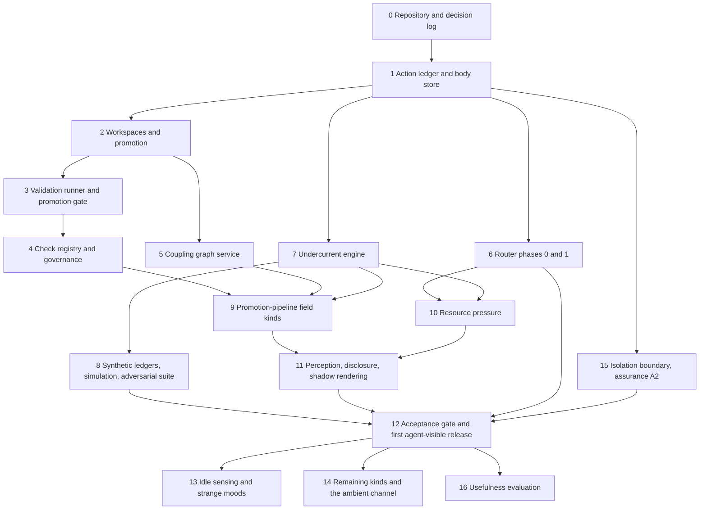

# Implementation roadmap: from the validation runner to a working Undercurrent

**Status:** Planning document, 2026-10-02. Written at the hand-off from design discussion to implementation in Claude Code. No code exists yet for any layer. This document orders the work, names the definitions each step depends on, and lists the questions each step must answer before or while it is built. It does not approve designs that the source documents mark as proposals.

## Start here

**Reading order for a fresh session.**

| Order | Document | Read for |
|---|---|---|
| 1 | This roadmap | Order of work, dependencies, open questions per step |
| 2 | `DESIGN-CORE-AND-LAUNCHERS.md` | Owner decisions D1–D18, the ledger (§3.2), workspaces and promotion (§3.5), rollout (§9), open mechanisms (§10) |
| 3 | `RESEARCH-ADMISSIBLE-VALIDATION.md` | Validation runner, evidence grades, check governance, assurance levels; V3 decided, V6 starting configuration |
| 4 | `DESIGN-UNDERCURRENT.md` (draft 0.3) | Field layer: kinds, propagation, graphs, perception, stability, Go package layout, ledger contract (§15.1), cross-layer dependencies (§15.2) |
| 5 | `DESIGN-ROUTING-LAYER.md` (draft 0.6) | Router contracts, R11 ledger events, §5.5 relationship to Undercurrent, rollout (§14) |
| 6 | `FIELD-PHILOSOPHY.md` | Constitutional constraints on the field layer; read when a step touches field semantics |

**Authority.** Owner decisions in the core document and the decisions recorded in section 1 of this roadmap are settled. Everything marked **[PROPOSAL]** or **[INFERENCE]** in any document is a recommendation that the build may revise, provided the revision is recorded (step 0 sets up the decision log for that).

**Working principles for every step.** Write the test before the code (the engine in particular is specified by properties, not examples). Never let a component read the wall clock inside anything that must be replayable. Never let any component trust an agent's report where a host observation is possible. Keep the core free of third-party dependencies unless a step names one.

## 1. Decisions carried into implementation

| Decision | Date | Source |
|---|---|---|
| Core first; the field engine is a standalone, gated package (D14) | 2026-09-30 | Core §2 |
| Append-only action ledger of typed deltas; content-addressed bodies (D15) | 2026-09-30 | Core §2 |
| Private scratch per work context as git worktrees; fast-forward-only promotion (D16–D18) | 2026-09-30 | Core §2 |
| Trial name for the field layer: Undercurrent | 2026-10-01 | Undercurrent §0 |
| The router's measurements reach the field layer only through ledger events (R11); router phase 1 must precede real-data resource pressure and any agent-visible impression | 2026-10-01 | Routing §5.4, §5.5, §14 |
| The promotion pipeline is the first field topic; resource pressure follows router phase 1 | 2026-10-01 | Undercurrent §15.3 |
| V3: an agent in the owning Corps may retire a check; the Orchestrator has the last say | 2026-10-02 | Validation §4.6.1 |
| V6 starting configuration: O4 plus canaries, sample re-runs off by default; the final floor is settled by an adversarial test suite | 2026-10-02 | Validation §4.9.1 |
| The harness should stay lightweight; functionality is paramount | 2026-10-01 | Design discussion |

## 2. Dependency map

Steps 1 through 6 are core and router work that the harness needs regardless of Undercurrent; they are listed here because Undercurrent cannot see real data without them. Steps 7 and 8 can start as soon as the ledger schema (step 1) is fixed, in parallel with steps 2 to 6, because the engine is tested against synthetic ledgers. Step 15 is a parallel track that raises the assurance ceiling; the first agent-visible release depends on whatever V6 floor the adversarial suite supports.

## 3. Steps

Each step lists its goal, what it delivers, the definitions it depends on, what is already decided, the questions the build must answer, and its exit criterion.

### Step 0. Repository, layout and decision log

**Goal.** A Go module whose structure mirrors the layer boundaries in the designs, so that the separations the documents depend on (core, router, Undercurrent, launchers) are enforced by package imports from the first commit.

**Delivers.** The module, a package layout, a `docs/` directory holding the design documents, a decision log, test conventions and a `CLAUDE.md` describing how to work in the repository.

| Definition | Meaning |
|---|---|
| Decision record | A short dated entry: the question, the decision, who made it (owner or build), and the documents it changes. Build decisions that revise a **[PROPOSAL]** go here. |
| Layer boundary | A package that may not import another; for example `undercurrent/...` may not import the router, broker or launchers (Undercurrent §13.1) |

| Question | Notes |
|---|---|
| Go version and minimum supported toolchain | Core D1 accepts a C toolchain for the GUI only; the core should build without cgo |
| Package layout | Suggested top level: `core/` (ledger, workspace, validation, broker later), `router/`, `undercurrent/` (law, graph, engine, perceive, render, sim), `cmd/dwarf-harness/` |
| How are import boundaries enforced | A test that walks package imports and fails on a forbidden edge is the simplest option |
| Test tooling | Standard `testing` plus property-based tests; `testing/quick` or a small generator package; fuzzing via Go's native fuzzing for parsers and record decoding |
| What goes in `CLAUDE.md` | Reading order, working principles from this roadmap, the decision-log rule, and the user's commit conventions |

**Exit criterion.** The module builds; the import-boundary test exists and passes; the decision log contains the decisions in section 1.

### Step 1. Action ledger and content-addressed body store

**Goal.** The single source of world facts (core D15). Every later component either writes typed events here or reads them. This is the step whose schema mistakes are most expensive, because Undercurrent replays from it.

**Delivers.** An append-only ledger with typed events, a reader with a cursor, a content-addressed store for large bodies, schema versioning, and the field contract from Undercurrent §15.1 represented in the event types.

| Definition | Meaning |
|---|---|
| Action delta | One typed event: actor, bound context, operation, targets, outcome, measurement path, start and end times or a pending marker, lineage hints, body references (core §3.2; Undercurrent §15.1) |
| Ledger sequence | A monotonic integer assigned on append; the only ordering replay uses |
| Event time | Time recorded by the host when it observed the event; replay uses this, never the wall clock at read time |
| Body | Any payload too large for the event (logs, diffs); stored by hash and referenced |
| Measurement path | How the host observed the fact (process exit, file scan, adapter response); distinguishes host observation from report |
| Cursor | A reader's position in the sequence; launchers, the router's consumers and Undercurrent each hold their own |

| Already decided | Source |
|---|---|
| Append-only, typed deltas, content-addressed bodies, never from an agent's report alone | Core D15, §3.2 |
| Field contract fields and events | Undercurrent §15.1 |
| Router events (provider status, headroom, budget crossings, usage attribution) | Routing R11 |

| Question | Notes |
|---|---|
| Physical storage | SQLite in WAL mode, an append-only segmented file, or both (file for events, SQLite for indexes). Core §10 item 3 leaves the relation to the session/view log open |
| Event encoding | JSON for inspectability or a binary encoding for size; a versioned envelope either way |
| Hash function for bodies | SHA-256 is the conservative choice and matches git's SHA-256 object format |
| Schema evolution | How a reader handles an event type it does not know, and how old events are upgraded on replay |
| Tamper evidence | Whether to chain events by hash now (cheap) and add external checkpoints later (assurance A3 in validation §4.9) |
| Retention | Which events may never be compacted because replay depends on them (Undercurrent Q16) |
| Write throughput target | Agent turns occur at human-scale rates; measure before optimizing |

**Exit criterion.** Events of every planned type can be written, read back by cursor and replayed in order after a restart; a synthetic ledger generator can produce every Undercurrent §15.1 event without missing fields; unknown event types are skipped safely by readers.

### Step 2. Workspaces, observation and fast-forward promotion

**Goal.** Private scratch per work context and core-performed promotion (core §3.5), with every workspace action recorded as a ledger event.

**Delivers.** Workspace registration, scratch worktree creation, host-side observation of changed paths and content hashes, fast-forward promotion with compare-and-swap on a core-owned canonical ref, and the workspace events in Undercurrent §15.1.

| Definition | Meaning |
|---|---|
| Workspace root | A registered git repository; v1 requires git (core §3.5) |
| Canonical | The core-owned ref that represents promoted state; recommended never to be checked out in the human's working tree (core §3.5) |
| Scratch | A linked worktree for one bound work context, on a context-specific branch, cut from canonical |
| Base commit | The canonical commit a scratch was cut from or last integrated |
| Observed change set | Changed paths and content hashes the host derives by scanning the scratch, never from the git index (core §3.5) |
| Promotion | Compare-and-swap of the canonical ref from the expected old tip to the scratch tip; refused if canonical moved (D18) |

| Question | Notes |
|---|---|
| Canonical ref identity and protection | Core §10 item 8. Which ref, where it lives, and how the core prevents child processes from moving it |
| Observation mechanism | Full scan, mtime-guided scan, or filesystem notifications; how untracked and ignored files are treated |
| Promotion authority | Who may promote: the context itself, its Orchestrator, or the owner for some roots (core §10 item 8) |
| The human's participation | How the owner's own edits enter canonical |
| Scratch retention and garbage collection | When dormant scratches and branches are removed |
| Per-workspace setup | Dependencies not tracked by git (`node_modules`, virtual environments); shared with validation question V4 |

**Exit criterion.** Core phase 1 gates from core §9: scratch paths are distinct per context, promotion refuses after canonical moves, and the host-derived promotion delta equals the promoted tree diff.

### Step 3. Validation runner and promotion gate

**Goal.** The host-owned runner that produces admissible validation evidence (validation §4.2) and gates promotion on affected checks (validation §4.8). Every promotion-pipeline field depends on it.

**Delivers.** A runner interface, subject materialization from tree hashes, check overlay, in-process canaries, outcome derivation, rerun and confirmation scheduling, the validation record in the ledger, and a promotion gate.

| Definition | Meaning |
|---|---|
| Check | Command plus defining files, identified by digest (validation §4.1) |
| Subject | Workspace state identified by a host-computed tree hash |
| Environment digest | Toolchain, sorted environment variables, platform and dependency set, digested in the style of a remote-execution action key |
| Overlay | Replacing same-path files in the materialized subject with the pinned check files before running |
| Canary | A sentinel check that must fail, run in the same process as the suite (validation §4.9.1) |
| Outcome states | Per attempt: passed, failed, timeout, skipped, incomplete, infra_failure, no_status. Per record: passed, failed, flaky, inconclusive (validation §4.3) |
| Assurance level | A1 to A3 (validation §4.9); A1 is the phase 1 target |

| Already decided | Source |
|---|---|
| Admissibility requirements | Validation §4.2 (proposal adopted as the working design) |
| Rerun counts from flake rates; repair confirmation | Validation §4.4, §4.5 |
| O4 plus canaries; sample re-runs off | Validation §4.9.1, owner 2026-10-02 |

| Question | Notes |
|---|---|
| V4: dependency materialization | Install per run, cache per environment digest, or snapshot per workspace; reproducibility versus speed |
| V5: gate check selection and time budget | Reverse dependencies through the coupling graph once step 5 exists; before that, a declared per-workspace check list |
| V1: flake-rate prior and confidence | Law parameters; start conservative and record the choice |
| Language adapters | How structured results are collected for Go (`go test -json`), Python (pytest JUnit XML) and Node.js (a JUnit reporter); how "the suite ran" is detected for each |
| Process control | Process groups, timeouts, `WaitDelay`, output size limits (core §3.3) |
| Concurrency and queueing | How many runs at once; the queue becomes a resource node for `resource_pressure` |

**Exit criterion.** The runner rejects every adversarial case in validation §5 that is in scope at A1: printed pass lines without a passing exit, skipped suites, suites that never ran, edited tests (overwritten by overlay), and a canary reported as passing. A promotion with a failing affected check is refused and recorded.

### Step 4. Check registry and governance

**Goal.** Make checks first-class: pinned identity, lineage, open failures, quarantine and the V3 retirement flow.

**Delivers.** A registry derived from ledger events, check lineage records, the retirement packet assembled by the host, the Orchestrator review hook, quarantine rules and human-oracle verdict events.

| Definition | Meaning |
|---|---|
| Check lineage | Author context, clone ancestry, model family, and derivation from other checks (validation §4.7; Undercurrent Q2) |
| Open failure | A failure at grade F2 or above that no repair or retirement has ended |
| Owning Corps | The Corps of the context that promoted the check's current digest (validation §4.6.1) |
| Retirement packet | Host-assembled evidence for a retirement, plus the agent's reason category and argument |
| Quarantine | Automatic suspension of a check past a law-defined flake rate |
| Human-oracle verdict | An owner-issued verdict recorded in the ledger; the only failure or repair source for work with no automated oracle |

| Question | Notes |
|---|---|
| Interim retirement authority before Corps exist | Corps arrive in core phase 2. Until then the owner is the only retirer |
| Exclusion of the repairing context and its clones | Kept in the proposal; confirm or drop (validation §4.6.1) |
| Orchestrator review criteria | Written as part of the Orchestrator skill suite; review is notify-and-overturn |
| V7: are human-oracle verdicts reversible, and by whom | |
| V8: are agent-authored reproduction checks promoted into the suite automatically after repair | |
| Quarantine threshold and release | Law parameters; how a quarantined check returns to service |

**Exit criterion.** A retirement by the repairing context is refused; a retirement by another agent takes effect and is reversible by the Orchestrator (or owner, before phase 2); every governance event replays correctly.

### Step 5. Coupling graph service

**Goal.** The evidenced dependency graph that carries propagation, and the separate encounter geometry that widens perception (Undercurrent §8). Its deltas live in the ledger.

**Delivers.** Static analyzers for the languages in use, declared edges, usage edges, graph versioning, graph-delta events, incremental updates on promotion and a periodic full rebuild.

| Definition | Meaning |
|---|---|
| Node | A location where a condition can exist: artifact or module, shared resource, work domain. Agents are never nodes |
| Coupling edge | An evidenced causal relationship; only these carry propagation |
| Encounter edge | A weaker relationship, such as co-access, that widens what an agent may perceive but never carries propagation |
| Graph version | Monotonic counter incremented on every structural change; reach caches key on it |
| Direction policy | Per field kind, which edge directions a signal travels (Undercurrent Q10) |

| Question | Notes |
|---|---|
| Q1: node granularity | File, package or module, directory; probably package or module for code and file for documents |
| Analyzer per language | Go: `golang.org/x/tools/go/packages`. Python and Node.js: tree-sitter bindings or language-native tools run as child processes. SQL: table references from query parsing |
| Non-code nodes | How documents, data files and external resources become nodes and edges |
| Q9: co-access admission | Rules that stop agents from manufacturing encounter reach |
| Q10: direction per kind | Needed before step 9 |
| Rebuild cadence | Incremental on promotion; full rebuild interval chosen by measured drift |

**Exit criterion.** Replay reproduces the graph at any ledger position; incremental and full rebuilds agree on a test repository; analyzers run as child processes that cannot block the core.

### Step 6. Router phases 0 and 1, with R11 events

**Goal.** The router's shadow mode and provider awareness, built with ledger emission from the start (routing §14).

**Delivers.** Context-bound routing in shadow, provider status tracking, scoped budgets, user-chosen provider changes, tail context modules, and R11 ledger events.

| Definition | Meaning |
|---|---|
| `ProviderStatus` | Availability at its true scope: provider, account, model and region where relevant (routing §6.4) |
| Headroom bucket | A band of remaining requests or tokens; a sample is written only when the bucket changes |
| Budget scope | A named agent or provider-account budget; an agent's exhaustion never marks the account exhausted (routing §9.8, §11) |
| Tail context module | Volatile content placed after the cached prefix with a declared token cost (routing R3, §6.5) |

| Question | Notes |
|---|---|
| Q28 and routing open question 7: headroom buckets and where they are configured | |
| Routing open question 8: disclosure scope of usage attribution | Ties to Undercurrent Q5 |
| Provider adapters | Core §8.3 recommends hand-written adapters for Anthropic and OpenAI; verify current rate-limit headers and error codes before coding, since provider details change |
| Context-module interface | Fix it here, since Undercurrent's renderer plugs into it in step 11 |

**Exit criterion.** Routing §14 phase 1 criteria, including the 0.6 addition: every status transition and budget crossing in the handover drills appears in the ledger with its correct scope.

### Step 7. Undercurrent engine (standalone)

**Goal.** The field engine as a pure function of ledger, law and time (Undercurrent §5), built and tested without any agent.

**Delivers.** `undercurrent/law` (loading, validation, hashing, versioning), `undercurrent/graph` consumers (reach computation by bounded best-path search), `undercurrent/engine` (owner goroutine, ledger cursor, source application, node state, reads at explicit times) and replay.

| Definition | Meaning |
|---|---|
| Field kind | A named quantity with its own law (Undercurrent §6) |
| Quantity class | Extensive (real consumption, sums) or evidential (deduplicate by lineage, sum distinct lineages, saturate) |
| Source mode | Impulse, level, sustained, rising |
| Arrival kernel | Bounded best-path propagation with first-arrival deduplication and a hard cutoff radius (Undercurrent §7.1) |
| Law | A versioned, hashed file defining kinds and source rules; its effective ledger position is recorded |
| Reach | The set of (node, gain) a source touches under a given graph version |

| Question | Notes |
|---|---|
| Q24: JSON or YAML for law files | JSON keeps the engine dependency-free |
| Q15: replay tolerance across architectures | Exact on the same architecture; relative tolerance across; explicit `float64` conversions at accumulation points |
| Q14: carrying state across law versions | Full replay is the default; snapshots are caches |
| Q20, Q21: hop latency and diffusion | Latency defaults to zero; diffusion deferred unless a kind needs it |
| Reach recomputation cost | Measure on synthetic graphs of realistic size before optimizing (Undercurrent §13.7) |

**Exit criterion.** Every property in Undercurrent §14.1 passes for synthetic kinds: boundedness, no echo, deduplication, hard radius, disconnection, persistence, exact removal, lineage, read neutrality, replay and law comparison.

### Step 8. Synthetic ledgers, simulation and the adversarial suite

**Goal.** The test apparatus that the acceptance gate and V6 depend on. Built alongside step 7, extended as kinds are added.

**Delivers.** A synthetic ledger generator, `undercurrent/sim` with stub agents for closed-loop stability tests, and the adversarial suite: field-level cases (Undercurrent §14.2) and validation-level cases, including ImpossibleBench-style tasks run by real agents once agents exist.

| Definition | Meaning |
|---|---|
| Stub agent | A model-free agent with response thresholds, sampling cadence, cooldowns and a simple action policy |
| Herding metric | Concentration of agents on one region over time |
| Oscillation metric | Periodic swings in regional occupancy |
| Impossible task | A task whose pinned checks cannot legitimately pass; any pass is a forgery or gaming |
| Forged-pass rate | Fraction of impossible-task runs that produce a passing validation record at a given assurance level |

| Question | Notes |
|---|---|
| Q25: what simulation results count as stable enough | Needs numbers before step 12 |
| Stub policies | Which policies approximate real agents well enough to be informative (Undercurrent §14.3 notes the limits) |
| V6 decision rule | The forged-pass rate, confirmation catch rate and canary catch rate that justify keeping O4 plus canaries, tightening to O2, or relaxing toward O1 |
| Which models the adversarial suite uses | Rates differ sharply by model (validation §3.2); test the models the colony will actually run |

**Exit criterion.** The simulation reproduces herding and oscillation when stability mechanisms are disabled and suppresses them when enabled; the validation adversarial suite runs end to end and reports per-level rates.

### Step 9. Promotion-pipeline field kinds

**Goal.** The first real field kinds, sourced from steps 2 to 5: post-promotion `interference`, context-local `epistemic_uncertainty` (staleness and flakiness), `dependency_strain`, then `affordance`.

**Delivers.** Source rules for each kind, the `git merge-tree` interference check after each promotion, graded interference using the validation runner, strain origin rules (check node when unattributed, culprit's changed nodes when attributed), the Q12 transitions, and lineage-based affordance.

| Definition | Meaning |
|---|---|
| Post-promotion interference | Overlap between a promotion's changed paths, or their coupling-graph neighbors, and an open scratch's changed paths, reported only to that scratch's owner |
| Interference grades | Textual (merge-tree conflict), build failure, test failure, coupling-only |
| Evidence grades | F1 to F4 and R1 to R3 (validation §4.4, §4.5) |
| Self-judged repair | A repair whose check was authored by the repairing lineage; produces no affordance until corroborated |

| Question | Notes |
|---|---|
| Q27: interference and staleness with overlap as one kind or two | Decide before writing source rules |
| V2: does an F1 observation seed any field effect | |
| Q2: lineage rule | Required for affordance and evidential deduplication; at minimum clone ancestry plus check content |
| Q12 | Proposed in the validation document; confirm |
| Q4 | Proposed; confirm as a whole now that V3 and V6 are settled |

**Exit criterion.** On a replayed ledger from real colony activity, each kind's values match hand-computed expectations for a set of recorded scenarios; §14.1 properties hold for each kind.

### Step 10. Resource pressure

**Goal.** `resource_pressure` from router R11 events and core queues (Undercurrent §9).

**Delivers.** Resource nodes for provider accounts, budget scopes, executors and the validation runner queue; level sources from headroom, status, budgets and queue depth; usage edges from consumers to resources.

| Definition | Meaning |
|---|---|
| Resource node | A shared finite capacity |
| Usage edge | A coupling edge from a consuming context's footprint to a resource, built from usage attribution |

| Question | Notes |
|---|---|
| Q11: mapping consumers to resources | Footprint-based or per-context edges |
| Q5: who sees attribution | Until decided, show pressure without attribution |
| Normalization | How headroom, budget fraction and queue depth become comparable amplitudes |

**Exit criterion.** Real router events from phase 1 drills produce pressure values that rise and fall with the drills; an agent-scope budget exhaustion never appears as account-wide pressure.

### Step 11. Perception, disclosure and shadow rendering

**Goal.** Turn field values into situated impressions for a bound context, render them, and log them without placing them in prompts (Undercurrent §10, §11.1; phase D).

**Delivers.** Footprints, encounter-neighborhood sampling, the disclosure projection, smoothing and per-agent thresholds with hysteresis, the renderer as a routing tail context module, and shadow logging with token measurement.

| Definition | Meaning |
|---|---|
| Footprint | Recency-weighted nodes touched by the bound work context |
| Disclosure projection | Policy mapping (kind, origin scope, audience scope) to exact, bucketed, delayed, aggregated or hidden |
| Impression | A rendered observation with a stable ID, grade and assurance level |
| Shadow mode | Impressions computed and logged but not shown to agents |

| Question | Notes |
|---|---|
| Q5: disclosure policy | Start with the owner's own view and same-context impressions only |
| Q8: threshold initialization and drift | |
| Q22: rendering format, token budget, label safety | Labels generated from identifiers, never copied from artifact content |
| Q6, Q9 | Ambient channel and co-access admission; can wait for step 14 |

**Exit criterion.** Shadow logs over real activity show impression volume and token cost per turn within a stated budget; no hidden kind or scope appears in any impression.

### Step 12. Acceptance gate and first agent-visible release

**Goal.** Pass the gate in Undercurrent §14.4 and show the first kinds to agents.

**Delivers.** A gate report (properties, adversarial cases, simulation, resource measurements, V6 results), the chosen V6 floor, and rendering switched on for the released kinds.

| Question | Notes |
|---|---|
| Which kinds are released first | Likely staleness and post-promotion interference, which need no validation floor, then strain at the V6 floor |
| V6 final floor | From step 8 results |
| Rollback | How to switch rendering off per kind without code changes (a law or configuration flag) |
| Agent instructions | Name retirement as the expected response to a check that appears wrong (validation §4.9.1) |

**Exit criterion.** The owner signs off the gate report.

### Step 13. Idle sensing and strange moods

**Goal.** Let idle agents encounter the field and enter strange moods (philosophy §9; Undercurrent §11.2, phase F).

**Delivers.** Threshold subscriptions, the wakeup scheduler with jitter, probabilistic response, cooldowns and a sensing allowance, and strange-mood notifications that cite impression IDs.

| Question | Notes |
|---|---|
| Q7: sensing allowance and cadence | Every wakeup is a paid model turn |
| Cooldown durations and insight identity | Philosophy §9 leaves them open |
| Q23: who may read an impression cited in a notification | |
| Depends on core phase 2 | Broker and role graph for notification routes; Orchestrator skill suite for interruption criteria |

**Exit criterion.** Wakeup volume stays within allowances in simulation and in a shadow period; notifications follow only permitted routes.

### Step 14. Remaining kinds and the ambient channel

**Goal.** `perturbation`, `surprise`, the ambient channel and, after the disclosure decision, pre-promotion interference and crowding.

| Question | Notes |
|---|---|
| Q3: private-work disclosure | Narrowed in the design discussion to whether an agent may learn that some unpromoted work elsewhere overlaps its own |
| Q6: ambient channel form | The only mechanism satisfying the unanticipated-discovery requirement |
| Q13: universe boundary | Needed for cross-colony perturbation |
| Q17: surprise baselines | |
| Q18: colony regime field | Probably not adopted |

**Exit criterion.** Each added kind passes §14.1 properties and the adversarial suite before release.

### Step 15. Isolation boundary and assurance A2 (parallel track)

**Goal.** Close core §10 item 8: an enforceable boundary protecting canonical refs, shared git metadata, the ledger and private files from same-user child processes. Raises validation assurance to A2.

| Question | Notes |
|---|---|
| Mechanism on Linux | Separate user, user namespaces (bubblewrap), Landlock (Linux 5.13 or later), Yama ptrace scope |
| macOS and Windows equivalents | Not researched in this round |
| Ledger write path | The ledger must be writable only by the core process |
| Performance cost per run | Measure; affects whether O2 becomes affordable |

**Exit criterion.** Child processes provably cannot move canonical, write the ledger or read another context's private files, under a stated threat model and tests.

### Step 16. Usefulness evaluation

**Goal.** Show whether Undercurrent improves the colony's work (Undercurrent Q26).

| Question | Notes |
|---|---|
| Metrics | Duplicated work, time from failure to repair, promotion refusals per promotion, conflicts caught before promotion, opportunities found |
| Counterfactual | Colonies or periods with the field hidden; replay can compute what the field would have shown |
| Cost side | Tokens spent on impressions and wakeups, validation compute |

**Exit criterion.** A report comparing field-on and field-off periods on the chosen metrics.

## 4. Open questions by blocking step

| Step | Questions it must answer |
|---|---|
| 1 | Storage, encoding, schema evolution, tamper evidence, Q16 retention |
| 2 | Canonical ref and protection, observation mechanism, promotion authority, setup costs |
| 3 | V1, V4, V5, language adapters |
| 4 | Interim retirement authority, repairer exclusion, V7, V8 |
| 5 | Q1, Q9, Q10, analyzers |
| 6 | Q28, routing open questions 7 and 8 |
| 7 | Q14, Q15, Q20, Q21, Q24 |
| 8 | Q25, V6 decision rule |
| 9 | Q2, Q4 confirmation, Q12, Q27, V2 |
| 10 | Q5 (attribution), Q11 |
| 11 | Q5, Q8, Q22 |
| 13 | Q7, Q23, cooldowns |
| 14 | Q3, Q6, Q13, Q17, Q18 |
| 16 | Q26 |

Question IDs beginning with Q are in `DESIGN-UNDERCURRENT.md` §17; IDs beginning with V are in `RESEARCH-ADMISSIBLE-VALIDATION.md` §8.
