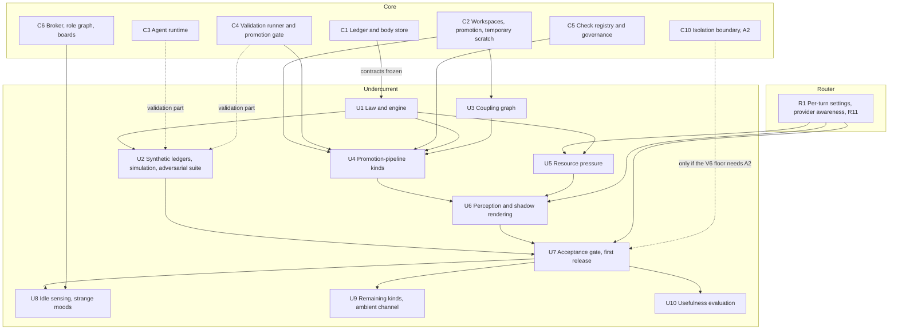

# Undercurrent roadmap: from the standalone engine to a working Undercurrent

**Status:** 2026-10-02. Formerly `ROADMAP-IMPLEMENTATION.md`. Steps 0–4, 6 and 15 of that roadmap moved to the core and router roadmaps when it was split (D19); the mapping table in `ROADMAPS.md` gives every old step its new ID. No code exists yet for any layer. This roadmap orders the field-layer work, names the definitions each step depends on, and lists the questions each step must answer before or while it is built. It does not approve designs that the source documents mark as proposals.

## Start here

**Reading order for a fresh session.**

| Order | Document | Read for |
|---|---|---|
| 1 | `ROADMAPS.md` | Step format, the dependency graph across roadmaps, the status board, the rules for several agents working at once |
| 2 | `DECISIONS.md` | Every owner decision, and the open items awaiting the owner |
| 3 | `CONTRACTS.md` | The contracts Undercurrent consumes (`ledger-format`, `ledger-reader`, `context-module`) and the one it owns (`law-format`), with their status |
| 4 | This roadmap | Order of the field-layer work, dependencies, open questions per step |
| 5 | `DESIGN-UNDERCURRENT.md` (draft 0.3) | Field layer: kinds, propagation, graphs, perception, stability, Go package layout, ledger contract (§15.1), cross-layer dependencies (§15.2) |
| 6 | `RESEARCH-ADMISSIBLE-VALIDATION.md` | Validation runner, evidence grades, check governance, assurance levels; V3 decided, V6 starting configuration |
| 7 | `DESIGN-ROUTING-LAYER.md` §5.5 | Where the router and Undercurrent meet: R11 ledger events and the tail context-module slot |
| 8 | `FIELD-PHILOSOPHY.md` | Constitutional constraints on the field layer; read when a step touches field semantics |

The steps Undercurrent waits for are in `ROADMAP-CORE.md` and `ROADMAP-ROUTER.md` (section 2); read a providing step before consuming its output. Read `DESIGN-CORE-AND-LAUNCHERS.md` where a step cites it.

**Authority.** Owner decisions in `DECISIONS.md` are settled. Everything marked **[PROPOSAL]** or **[INFERENCE]** in any document is a recommendation that the build may revise, provided the revision is recorded as a build decision (a B entry in `DECISIONS.md`). Anything a document marks as awaiting the owner goes back to the owner.

**Working principles for every step.** Write the test before the code (the engine in particular is specified by properties, not examples). Never let a component read the wall clock inside anything that must be replayable. Never let any component trust an agent's report where a host observation is possible. Undercurrent packages use the standard library only (D29). Build only against frozen contracts (D40). When a dependency is not ready, stop at the step's stop point and follow the rules in `ROADMAPS.md`; never write a stub, placeholder or fake of what the step waits for (D41).

## 1. Decisions carried into implementation

`DECISIONS.md` records every owner decision in full. These are the ones that shape Undercurrent most; the steps cite others where they apply.

| ID | Decision | Date | Bears on |
|---|---|---|---|
| D14 | Core first; the field engine is a standalone, gated package | 2026-09-30 | Every step; U1 and U2 are built and tested without agents |
| D20 | Core first; Undercurrent builds only against frozen contracts, and its early work is limited to foundations that need no real data | 2026-10-02 | Every step's stop point (sections 3 and 4) |
| R11 | Router measurements reach the field layer only as ledger events; router phase 1 precedes real-data resource pressure and any agent-visible impression | 2026-10-01 | U5, U6, U7 |
| V3 | An agent in the owning Corps may retire a check; the Orchestrator has the last say | 2026-10-02 | Governance events that U4 reads (C5); agent instructions in U7 |
| V6 start | O4 plus canaries; sample re-runs off by default; the final floor is settled by the adversarial suite | 2026-10-02 | U2 measures; U7 chooses the floor |
| D29 | Dependency policy. Undercurrent packages use the standard library only, enforced by the import-boundary test | 2026-10-02 | Every U package; Q24 (U1); analyzers (U3) |
| D23 | Temporary scratch for a second writer to one task. The ledger records the authoring context of each change; scratch events gain parent-scratch and authoring-context fields | 2026-10-02 | Undercurrent §15.1; source rules (U4); private work under Q3 (U9) |
| D33 | One colony log with one sequence holds actions, workspace and validation events, turn starts and ends, budget reservations and settlements, and router measurements | 2026-10-02 | The engine's only input (U1, U5) |
| D34 | Ledger storage is our own append-only log, standard library only; lookup indexes are rebuilt in memory at startup | 2026-10-02 | The engine reads it through `ledger-reader` (U1) |
| D35 | One JSON object per line in a versioned envelope. Readers declare the types they consume, skip the rest, and stop with a clear error on a consumed type they cannot decode; a missing field is absent, never a default | 2026-10-02 | The engine as a reader (U1) |
| D36 | SHA-256 for bodies and the record chain. The log is never deleted or compacted; bodies may be garbage-collected, so everything replay needs lives in the record. Resolves Q16 | 2026-10-02 | Replay (U1), source rules (U4), counterfactuals (U10) |
| D37 | Every ID is a UUIDv7. A gapless sequence is the only order replay uses; event time is UTC Unix nanoseconds, never decreasing within a colony; after a crash, unmatched starts get an `interrupted` end | 2026-10-02 | Replay and read times (U1) |
| D40 | Contracts between roadmaps. U1 owns `law-format`; Undercurrent consumes `ledger-format`, `ledger-reader` and `context-module` only once frozen | 2026-10-02 | U1, U6 |
| — | Trial name for the field layer: Undercurrent | 2026-10-01 | Undercurrent §0 |
| — | The promotion pipeline is the first field topic; resource pressure follows router phase 1 | 2026-10-01 | U4's kinds come first; U5 waits for R1 |
| — | The harness stays lightweight; functionality is paramount | 2026-10-01 | Impression token budgets (U6); the sensing allowance (U8) |

## 2. What Undercurrent needs from other roadmaps

Undercurrent reads nothing but the ledger (Undercurrent §15.1), so every real input comes from a step in another roadmap. No Undercurrent step consumes real data before the step that provides it is Done, and none builds against another roadmap's contract before the owner freezes it (D20, D40). A change to a frozen contract names every Undercurrent step it affects (D20).

| Capability | Provided by | Needed by | Why |
|---|---|---|---|
| Frozen `ledger-format` and `ledger-reader` contracts | C1 | U1, and through it every step | The record format, event catalogue and reader interface the engine is built against; U1 may not start before both are frozen |
| Workspace and promotion events, with D23's parent-scratch and authoring-context fields | C2 | U3, U4 | Graph updates on promotion; staleness and post-promotion interference |
| Real agents running turns | C3 | U2's validation part | Impossible-task runs need real agents |
| Validation runner and promotion gate | C4 | U4; U2's validation part | Without admissible validation records there is no failure or repair evidence (Undercurrent §15.2) |
| Check registry and governance | C5 | U4 | Check lineage, retirement (V3), quarantine and human-oracle verdicts start, end or qualify strain |
| R11 events (provider status, headroom, budget crossings, usage attribution) and the frozen `context-module` contract | R1 | U5, U6, U7 | Real-data resource pressure; the renderer's slot in the prompt tail; no agent-visible impression before router phase 1 (R11) |
| Broker and role graph | C6 | U8 | Strange-mood notifications travel only along permitted routes |
| Isolation boundary, assurance A2 | C10 | U7, only if the V6 floor needs A2 | Validation-derived sources above A1 (validation §4.9) |

C1–C6 and C10 are in `ROADMAP-CORE.md`; R1 is in `ROADMAP-ROUTER.md`. Undercurrent §15.2 records the same dependencies by design phase, and routing §5.5 and §14 record the router's side. In the other direction, R1 consumes U1's `law-format` only if headroom buckets are versioned with the law (Q28; `CONTRACTS.md`).

## 3. Dependency map

- **Edges.** The graph shows every "Waits for" entry of the U steps on the status board in `ROADMAPS.md`. Core and router steps appear only as inputs; their own order is in `ROADMAP-CORE.md` and `ROADMAP-ROUTER.md`.
- **Early work (D20).** U1 may start once the owner has frozen C1's `ledger-format` and `ledger-reader`; the field-level part of U2 follows U1. Both work on synthetic ledgers only. Every other step starts only when every step it waits for is Done. This replaces the earlier roadmap's statement that the engine could be built in parallel with core steps 2 to 6.
- **Dotted edges** are partial or conditional. C3 and C4 gate only U2's validation part. C10 gates U7 only if the V6 floor needs A2; the first agent-visible release depends on whatever V6 floor the adversarial suite supports.

## 4. Steps

Each step follows the format in `ROADMAPS.md`: goal, deliverables, what it waits for, its stop point, what it unblocks, what is decided, open questions, exit criterion and status. Definitions tables carry over from the earlier roadmap. A step's status changes here and on the `ROADMAPS.md` status board in the same commit.

### U1. Law and engine

Formerly step 7.

**Goal.** The field engine as a pure function of ledger, law and time (Undercurrent §5), built and tested without any agent.

**Delivers.** `undercurrent/law` (loading, validation, hashing, versioning), `undercurrent/graph` consumers (reach computation by bounded best-path search), `undercurrent/engine` (owner goroutine, ledger cursor, source application, node state, reads at explicit times) and replay. The `law-format` contract (D40): a standard-library Go package for versioned, hashed law files (kinds, source rules, parameters, effective ledger position; Undercurrent §13.4), golden samples for every type version, and its entry in `CONTRACTS.md`. Package paths are those proposed in Undercurrent §13.1 until the package-layout decision at C0.

| Definition | Meaning |
|---|---|
| Field kind | A named quantity with its own law (Undercurrent §6) |
| Quantity class | Extensive (real consumption, sums) or evidential (deduplicate by lineage, sum distinct lineages, saturate) |
| Source mode | Impulse, level, sustained, rising |
| Arrival kernel | Bounded best-path propagation with first-arrival deduplication and a hard cutoff radius (Undercurrent §7.1) |
| Law | A versioned, hashed file defining kinds and source rules; its effective ledger position is recorded. Its format is the `law-format` contract |
| Reach | The set of (node, gain) a source touches under a given graph version |
| Ledger sequence | The colony's gapless integer sequence; the only order replay uses (D37) |
| Event time | UTC Unix nanoseconds at observation, never decreasing within a colony (D37). The engine takes times only from events and read requests (Undercurrent §13.5) |

**Waits for.** C1: the owner has frozen `ledger-format` and `ledger-reader`.

**Stop point.** U1 may not start until both contracts are frozen (`CONTRACTS.md`). Once started it needs nothing else: it works on synthetic ledgers built against the frozen contracts and never reads a real colony ledger (D20). Its property tests generate their own random graphs and sources (Undercurrent §14.1). Q24 is the owner's to answer; if it is still open when the work reaches the law-file parser, stop there and report. The law-activation event is not needed for C1's freeze (see the open questions); adding its type to the frozen `ledger-format` needs the owner's sign-off (D41).

**Unblocks.** U2, U4, U5.

| Decided | Source |
|---|---|
| A standalone, gated package, tested without agents | D14 |
| Synthetic ledgers only, built against frozen contracts | D20, D40 |
| Standard library only; the engine imports nothing from the router, broker or launchers | D29; Undercurrent §13.1 |
| One colony log with one sequence is the engine's only input | D33 |
| The engine declares the event types it consumes and skips the rest; a consumed type it cannot decode stops it with a clear error; a missing field is absent, never a default | D35 |
| The log is never deleted or compacted, and bodies may be garbage-collected, so replay reads record fields only, never bodies. This resolves Q16 | D36 |
| Replay orders by the gapless sequence only; in-flight work is a start and an end that share an operation ID | D37 |
| U1 owns the `law-format` contract | D40; `CONTRACTS.md` |

| Question | Notes |
|---|---|
| Q24: JSON or YAML for law files | Open for the owner. D29 limits Undercurrent packages to the standard library, which favors JSON; YAML would match the routing configuration style (Undercurrent §13.4) |
| Q15: replay tolerance across architectures | Exact on the same architecture; relative tolerance across; explicit `float64` conversions at accumulation points |
| Q14: carrying state across law versions | Full replay is the default; snapshots are caches. D36 keeps the whole log, so full replay stays possible |
| Q20, Q21: hop latency and diffusion | Latency defaults to zero; diffusion deferred unless a kind needs it |
| Reach recomputation cost | Measure on synthetic graphs of realistic size before optimizing (Undercurrent §13.7) |
| Law activation event | Undercurrent §15.1 proposes it (**[PROPOSAL]**): the core emits it when the operator activates a law, with the law hash and the ledger position where the law takes effect, and under D36 the law content, or enough of it for replay, inline. Under D40 the type can join `ledger-format` by addition after the freeze, so it does not hold up C1. Which step builds the core's activation emitter is open |
| Interrupted operations | After a crash the core writes an `interrupted` end for every unmatched start (D37). How each source rule treats an operation whose outcome is unknown |

**Exit criterion.** Every property in Undercurrent §14.1 passes for synthetic kinds: boundedness, no echo, deduplication, hard radius, disconnection, persistence, exact removal, lineage, read neutrality, replay and law comparison. The `law-format` package passes against its golden samples.

**Status.** Waiting.

### U2. Synthetic ledgers, simulation, adversarial suite

Formerly step 8.

**Goal.** The test apparatus that the acceptance gate and V6 depend on. Built in two parts, and extended as kinds are added.

**Delivers.**

- **Field-level part.** A synthetic ledger generator, `undercurrent/sim` with stub agents for closed-loop stability tests, and the field-level adversarial cases (Undercurrent §14.2).
- **Validation-level part.** The validation-level adversarial cases, including ImpossibleBench-style tasks run by real agents, reporting per assurance level the forged-pass rate, the confirmation and canary catch rates, and the runner overhead (validation §4.9.1).

| Definition | Meaning |
|---|---|
| Stub agent | A model-free agent with response thresholds, sampling cadence, cooldowns and a simple action policy. It is the simulation's subject (Undercurrent §14.3), not a stand-in for C3's runtime |
| Herding metric | Concentration of agents on one region over time |
| Oscillation metric | Periodic swings in regional occupancy |
| Impossible task | A task whose pinned checks cannot legitimately pass; any pass is a forgery or gaming |
| Forged-pass rate | Fraction of impossible-task runs that produce a passing validation record at a given assurance level |

**Waits for.** U1; C3 and C4 for the validation part.

**Stop point.** Between the two parts. The field-level part needs only U1 and synthetic ledgers. The validation-level part needs real agents (C3) and the runner (C4). An agent that finishes the field-level part before both are Done stops there and sets the status to *Blocked: waiting for C3 and C4*; nothing stands in for the runtime or the runner (D41). The owner may assign the two parts to different agents (D41).

**Unblocks.** U7.

| Decided | Source |
|---|---|
| The field-level part uses synthetic ledgers only | D20 |
| Synthetic ledgers are stand-in data against the frozen `ledger-format`, which tests may use | D41 |
| Start with O4 plus canaries, sample re-runs off by default; this suite settles the final floor | V6 start; validation §4.9.1 |
| `undercurrent/sim` uses the standard library only | D29 |

| Question | Notes |
|---|---|
| Q25: what simulation results count as stable enough | Needs numbers before U7 |
| Stub policies | Which policies approximate real agents well enough to be informative (Undercurrent §14.3 notes the limits) |
| V6 decision rule | The forged-pass rate, confirmation catch rate and canary catch rate that justify keeping O4 plus canaries, tightening to O2, or relaxing toward O1 |
| Which models the adversarial suite uses | Rates differ sharply by model (validation §3.2); test the models the colony will actually run |

**Exit criterion.** Field-level part: the simulation reproduces herding and oscillation when stability mechanisms are disabled and suppresses them when enabled. Validation-level part: the validation adversarial suite runs end to end and reports per-level rates. U2 is Done when both parts are.

**Status.** Waiting.

### U3. Coupling graph service

Formerly step 5.

**Goal.** The evidenced dependency graph that carries propagation, and the separate encounter geometry that widens perception (Undercurrent §8). Its deltas live in the ledger.

**Delivers.** Static analyzers for the languages in use, declared edges, usage edges, graph versioning, graph-delta events (Undercurrent §15.1, **[PROPOSAL]**), incremental updates on promotion and a periodic full rebuild.

| Definition | Meaning |
|---|---|
| Node | A location where a condition can exist: artifact or module, shared resource, work domain. Agents are never nodes |
| Coupling edge | An evidenced causal relationship; only these carry propagation |
| Encounter edge | A weaker relationship, such as co-access, that widens what an agent may perceive but never carries propagation |
| Graph version | Monotonic counter incremented on every structural change; reach caches key on it |
| Direction policy | Per field kind, which edge directions a signal travels (Undercurrent Q10) |

**Waits for.** C2.

**Stop point.** U3 does not start before C2 is Done; its real inputs are C2's workspace and promotion events (D20). Usage edges are built from R1's usage attribution: until R1 is Done they are tested on synthetic ledgers only, and U5 connects them to real events. Stop before adding an analyzer dependency that lacks its D29 record or the owner's sign-off, and before adding the graph-delta type to a frozen `ledger-format` without the owner's sign-off (D41).

**Unblocks.** U4.

| Decided | Source |
|---|---|
| Undercurrent packages use the standard library only; separate helper programs may use cgo; `golang.org/x/*` needs a decision-log entry and any other module a dependency record. **[INFERENCE]** The analyzers run as child processes (exit criterion), so they fall under the helper-program rule | D29 |
| The core host is the only writer of the colony's ledger, so the graph service's deltas are appended through it | D26 |
| Replay needs every graph delta in the record itself, never only in a body | D36 |

| Question | Notes |
|---|---|
| Q1: node granularity | File, package or module, directory; probably package or module for code and file for documents |
| Analyzer per language | Go: `golang.org/x/tools/go/packages`. Python and Node.js: tree-sitter bindings or language-native tools run as child processes. SQL: table references from query parsing |
| Non-code nodes | How documents, data files and external resources become nodes and edges |
| Q9: co-access admission | Rules that stop agents from manufacturing encounter reach |
| Q10: direction per kind | Needed before U4 |
| Rebuild cadence | Incremental on promotion; full rebuild interval chosen by measured drift |
| Graph-delta events | Undercurrent §15.1 proposes the event (**[PROPOSAL]**): this step's graph service emits each delta with the graph version. Under D40 the type can join `ledger-format` by addition after the freeze, so it does not hold up C1; the addition needs the owner's sign-off (D41) |

**Exit criterion.** Replay reproduces the graph at any ledger position; incremental and full rebuilds agree on a test repository; analyzers run as child processes that cannot block the core.

**Status.** Waiting.

### U4. Promotion-pipeline field kinds

Formerly step 9.

**Goal.** The first real field kinds, sourced from C2, C4, C5 and U3: post-promotion `interference`, context-local `epistemic_uncertainty` (staleness and flakiness), `dependency_strain`, then `affordance`.

**Delivers.** Source rules for each kind; interference from the `git merge-tree` check after each promotion, which the core runs and records because Undercurrent never runs git (Undercurrent §15.1, **[PROPOSAL]**); graded interference using the validation runner; strain origin rules (check node when unattributed, culprit's changed nodes when attributed); the Q12 transitions; and lineage-based affordance.

| Definition | Meaning |
|---|---|
| Post-promotion interference | Overlap between a promotion's changed paths, or their coupling-graph neighbors, and an open scratch's changed paths, reported only to that scratch's owner |
| Interference grades | Textual (merge-tree conflict), build failure, test failure, coupling-only |
| Evidence grades | Failure grades F1 to F4 and repair grades R1 to R3 (validation §4.4, §4.5) |
| Self-judged repair | A repair whose check was authored by the repairing lineage; produces no affordance until corroborated |
| Authoring context | The context whose turn wrote a change. One promotion may carry changes written from several of one agent's contexts; the ledger records each change's authoring context (D23) |

**Waits for.** C2, C4, C5, U1, U3.

**Stop point.** U4 does not start before C2, C4, C5, U1 and U3 are all Done (D20). Q27 must be answered before any source rule is written; if it is still open, stop there and report. Source rules that read the interference-check result need the core's emitter; if no step has built it, stop before them. Adding the check-result type to a frozen `ledger-format` needs the owner's sign-off (D41).

**Unblocks.** U6.

| Decided | Source |
|---|---|
| Promotion is fast-forward only, so a refusal without overlap is plain staleness, not interference (Undercurrent §9) | D18 |
| A promotion may carry changes from several of one agent's contexts; scratch events carry the parent scratch and the authoring context (Undercurrent §15.1) | D23 |
| Source rules read record fields only: changed paths and their hashes, check digests, outcomes. Never a body such as a diff or a run log | D36 |
| An agent in the owning Corps retires a check; the Orchestrator has the last say | V3; validation §4.6.1 |
| Starting configuration: failures at A1 are visible and can start strain; a repair at A1 ends strain only after a confirming run; affordance requires A2; canaries in every run | V6 start; validation §4.9.1 |

| Question | Notes |
|---|---|
| Q27: interference and staleness with overlap as one kind or two | Decide before writing source rules |
| V2: does an F1 observation seed any field effect | |
| Q2: lineage rule | Required for affordance and evidential deduplication; at minimum clone ancestry plus check content |
| Q12 | Proposed in the validation document; confirm |
| Q4 | Proposed; confirm as a whole now that V3 is decided and V6 has a starting configuration |
| Interference-check emitter | Undercurrent §15.1 proposes the event (**[PROPOSAL]**): the core's workspace service emits the promotion, the scratch checked, the grade and the overlapping paths. Which roadmap builds that emitter is open. Under D40 the type can join `ledger-format` by addition after the freeze, so it does not hold up C1. One `git merge-tree --write-tree` took 0.09–0.15 s on the owner's machine (core Appendix A.7) |
| Temporary scratches | Whether an open temporary scratch (D23) counts as an open scratch for interference and staleness, and which of the agent's contexts receives the impression |

**Exit criterion.** On a replayed ledger from real colony activity, each kind's values match hand-computed expectations for a set of recorded scenarios; Undercurrent §14.1 properties hold for each kind.

**Status.** Waiting.

### U5. Resource pressure

Formerly step 10.

**Goal.** `resource_pressure` from router R11 events and core queues (Undercurrent §9).

**Delivers.** Resource nodes for provider accounts, budget scopes, executors and the validation runner queue; level sources from headroom, status, budgets and queue depth; usage edges from consumers to resources.

| Definition | Meaning |
|---|---|
| Resource node | A shared finite capacity |
| Usage edge | A coupling edge from a consuming context's footprint to a resource, built from usage attribution |

**Waits for.** R1, U1; C4 for the runner-queue node only.

**Stop point.** U5 does not start before R1 and U1 are Done, and it consumes no real router event before then (D20, R11). The validation runner's queue events come from C4, which U5 does not wait for: if C4 is not Done, that resource node is tested on synthetic ledgers only, and the step stops before connecting it to real events.

**Unblocks.** U6.

| Decided | Source |
|---|---|
| Router measurements reach the field only as ledger events; real-data resource pressure follows router phase 1 | R11 |
| Router measurements, budget reservations and settlements, and turn starts and ends share the colony log; the router's per-call decision record stays a separate file, which Undercurrent never reads | D33 |
| An agent may have several turns in flight, at most one per context, up to a per-agent limit; each call's maximum cost is reserved against every applicable budget scope and settled afterwards | D22 |
| The promotion pipeline is the first field topic; resource pressure follows router phase 1 | Owner, 2026-10-01; Undercurrent §15.3 |

| Question | Notes |
|---|---|
| Q11: mapping consumers to resources | Footprint-based or per-context edges |
| Q5: who sees attribution | Until decided, show pressure without attribution. Ties to routing open question 8 (R1) |
| Normalization | How headroom, budget fraction and queue depth become comparable amplitudes |
| Reservations | Whether budget pressure reads reserved spend, settled spend or both; D22 reserves before each call and settles afterwards, and both are in the log (D33) |

**Exit criterion.** Real router events from R1's drills produce pressure values that rise and fall with the drills; an agent-scope budget exhaustion never appears as account-wide pressure.

**Status.** Waiting.

### U6. Perception, disclosure, shadow rendering

Formerly step 11.

**Goal.** Turn field values into situated impressions for a bound context, render them, and log them without placing them in prompts (Undercurrent §10, §11.1; phase D).

**Delivers.** Footprints, encounter-neighborhood sampling, the disclosure projection, smoothing and per-agent thresholds with hysteresis, the renderer as a routing tail context module (`context-module`), and shadow logging with token measurement.

| Definition | Meaning |
|---|---|
| Footprint | Recency-weighted nodes touched by the bound work context |
| Disclosure projection | Policy mapping (kind, origin scope, audience scope) to exact, bucketed, delayed, aggregated or hidden |
| Impression | A rendered observation with a stable ID, grade and assurance level |
| Shadow mode | Impressions computed and logged but not shown to agents |

**Waits for.** U4, U5, R1.

**Stop point.** U6 does not start before U4, U5 and R1 are Done. The renderer is built only against the frozen `context-module` contract (D40); if the owner has not frozen it, stop before the renderer. Nothing reaches a prompt in this step.

**Unblocks.** U7.

| Decided | Source |
|---|---|
| Private contexts are keyed by `(agent_id, context_id)`; an impression binds to its context and is never carried into another (routing §5.5) | D21 |
| The renderer is a `context-module`, consumed only once frozen | D40; `CONTRACTS.md` |
| No agent-visible impression before router phase 1; this step stays in shadow | R11 |
| A stated per-turn token budget; nothing is rendered when nothing changed (Undercurrent §11.1) | Lightweight principle |

| Question | Notes |
|---|---|
| Q5: disclosure policy | Start with the owner's own view and same-context impressions only |
| Q8: threshold initialization and drift | |
| Q22: rendering format, token budget, label safety | Labels generated from identifiers, never copied from artifact content |
| Q6, Q9 | Ambient channel and co-access admission; can wait for U9 |
| Shadow log location | Undercurrent §14.4 renders shadow impressions "to the decision log", but rendering appends nothing to the ledger (Undercurrent §14.1, read neutrality) and the router's decision record is a separate file (D33). Where shadow impressions and their token counts are written |

**Exit criterion.** Shadow logs over real activity show impression volume and token cost per turn within a stated budget; no hidden kind or scope appears in any impression.

**Status.** Waiting.

### U7. Acceptance gate and first agent-visible release

Formerly step 12.

**Goal.** Pass the gate in Undercurrent §14.4 and show the first kinds to agents.

**Delivers.** A gate report (properties, adversarial cases, simulation, resource measurements, V6 results), the chosen V6 floor, and rendering switched on for the released kinds.

**Waits for.** U2, U6, R1; C10 if the V6 floor needs A2.

**Stop point.** U7 does not start before U2, U6 and R1 are Done. If the V6 floor chosen from U2's results needs A2 and C10 is not Done, stop before switching on any kind sourced from validation runs and set the status to *Blocked: waiting for C10*. V6 does not affect resource pressure or staleness, which the host measures without running agent-written code; under the starting configuration, affordance requires A2 (validation §4.9.1). Rendering is switched on only after the owner signs off the gate report.

**Unblocks.** U8, U9, U10.

| Decided | Source |
|---|---|
| Substantial testing before the field affects any agent; this gate is that test | D14; Undercurrent §14.4 |
| Router phase 1 precedes any agent-visible impression | R11 |
| Start with O4 plus canaries; U2's suite settles the final floor | V6 start |
| An agent in the owning Corps may retire a check; the Orchestrator has the last say | V3; validation §4.6.1 |

| Question | Notes |
|---|---|
| Which kinds are released first | Likely staleness and post-promotion interference, which need no validation floor, then strain at the V6 floor |
| V6 final floor | From U2's results |
| Rollback | How to switch rendering off per kind without code changes (a law or configuration flag) |
| Agent instructions | Name retirement as the expected response to a check that appears wrong (validation §4.9.1) |

**Exit criterion.** The owner signs off the gate report.

**Status.** Waiting.

### U8. Idle sensing and strange moods

Formerly step 13.

**Goal.** Let idle agents encounter the field and enter strange moods (philosophy §9; Undercurrent §11.2, phase F).

**Delivers.** Threshold subscriptions, the wakeup scheduler with jitter, probabilistic response, cooldowns and a sensing allowance, and strange-mood notifications that cite impression IDs.

**Waits for.** U7, C6.

**Stop point.** U8 does not start before U7 and C6 are Done. Interruption criteria come from the Orchestrator skill suite, which no step in `ROADMAPS.md` yet delivers; if the work reaches interruption handling without it, stop there and report.

**Unblocks.** None.

| Decided | Source |
|---|---|
| Strange moods are self-initiated, scoped interventions; a superior may interrupt one for emergencies only; an agent-wide cooldown and an insight-specific cooldown are handled separately | Owner decisions in philosophy §9 |
| A wakeup asks the core for a model turn, which counts against the agent's limit on simultaneous turns; each of its calls reserves its maximum cost first | D22 |
| Every wakeup is a paid model turn, so the allowance is a budget (Undercurrent §11.2) | Lightweight principle |

| Question | Notes |
|---|---|
| Q7: sensing allowance and cadence | Every wakeup is a paid model turn |
| Cooldown durations and insight identity | Philosophy §9 leaves them open |
| Q23: who may read an impression cited in a notification | |
| Depends on core phase 2 | Broker and role graph for notification routes (C6); Orchestrator skill suite for interruption criteria (no step yet) |

**Exit criterion.** Wakeup volume stays within allowances in simulation and in a shadow period; notifications follow only permitted routes.

**Status.** Waiting.

### U9. Remaining kinds and the ambient channel

Formerly step 14.

**Goal.** `perturbation`, `surprise`, the ambient channel and, after the disclosure decision, pre-promotion interference and crowding.

**Delivers.** Source rules for `perturbation` and `surprise`, the ambient channel, and, once Q3 is decided, pre-promotion `interference` and scratch-level `crowding` (Undercurrent §15, phases G and H).

**Waits for.** U7.

**Stop point.** U9 does not start before U7 is Done. Pre-promotion interference and scratch-level crowding wait for the owner's answer to Q3; if it is still open, stop before them. No added kind is shown to agents before it meets the exit criterion.

**Unblocks.** None.

| Decided | Source |
|---|---|
| Temporary scratches are private scratch, so their merge-backs are private work: they reach outward fields only as far as Q3 allows | D16, D23; Undercurrent §15.1 |
| One ledger per colony; every event carries the colony's globally unique ID, so ledgers can be combined for cross-colony experiments; cross-colony messaging needs its own design | D26 |
| Provider status transitions, a `perturbation` source, arrive as ledger events | R11 |

| Question | Notes |
|---|---|
| Q3: private-work disclosure | Narrowed in the design discussion to whether an agent may learn that some unpromoted work elsewhere overlaps its own. D23's merge-backs fall under it |
| Q6: ambient channel form | The only mechanism satisfying the unanticipated-discovery requirement |
| Q13: universe boundary | Needed for cross-colony perturbation |
| Q17: surprise baselines | |
| Q18: colony regime field | Probably not adopted |

**Exit criterion.** Each added kind passes Undercurrent §14.1 properties and the adversarial suite before release.

**Status.** Waiting.

### U10. Usefulness evaluation

Formerly step 16.

**Goal.** Show whether Undercurrent improves the colony's work (Undercurrent Q26).

**Delivers.** A usefulness report: the chosen metrics, field-on and field-off comparisons, and the cost side.

**Waits for.** U7.

**Stop point.** U10 does not start before U7 is Done; field-on periods exist only after U7's release.

**Unblocks.** None.

| Decided | Source |
|---|---|
| The log is never deleted or compacted, so replay can compute what the field would have shown in any period | D36 |
| Ledgers from different colonies can be combined, so field-on and field-off colonies can be compared | D26 |

| Question | Notes |
|---|---|
| Metrics | Duplicated work, time from failure to repair, promotion refusals per promotion, conflicts caught before promotion, opportunities found |
| Counterfactual | Colonies or periods with the field hidden; replay can compute what the field would have shown |
| Cost side | Tokens spent on impressions and wakeups, validation compute |

**Exit criterion.** A report comparing field-on and field-off periods on the chosen metrics.

**Status.** Waiting.

## 5. Open questions by blocking step

| Step | Questions it must answer |
|---|---|
| U1 | Q14, Q15, Q20, Q21, Q24 (owner), law activation event, interrupted operations |
| U2 | Q25, V6 decision rule, stub policies, adversarial-suite models |
| U3 | Q1, Q9, Q10, analyzers, non-code nodes, rebuild cadence, graph-delta events |
| U4 | Q2, Q4 confirmation, Q12, Q27, V2, interference-check emitter, temporary scratches |
| U5 | Q5 (attribution), Q11, normalization, reservations |
| U6 | Q5, Q8, Q22, shadow log location |
| U7 | Kinds released first, V6 final floor, rollback, agent instructions |
| U8 | Q7, Q23, cooldowns, interruption criteria |
| U9 | Q3, Q6, Q13, Q17, Q18 |
| U10 | Q26 |

Question IDs beginning with Q are in `DESIGN-UNDERCURRENT.md` §17; IDs beginning with V are in `RESEARCH-ADMISSIBLE-VALIDATION.md` §8. Q16, which the earlier roadmap listed under step 1, is resolved by D36. The questions of the earlier steps 1–4, 6 and 15 now live in `ROADMAP-CORE.md` and `ROADMAP-ROUTER.md`; D34–D36 settled most of step 1's. Q28 and routing open questions 7 and 8 belong to R1, and Q28's answer decides whether R1 consumes `law-format`.
