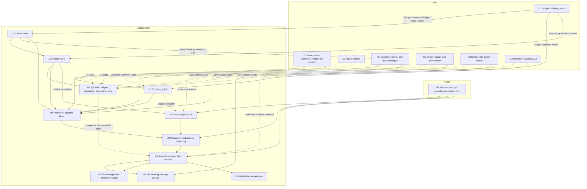

# Undercurrent roadmap: from the standalone engine to a working Undercurrent

**Status:** each step's status is in its **Status.** line below and on the [status board](ROADMAPS.md#status-board), and each contract's in [`CONTRACTS.md`](CONTRACTS.md). Steps 0–4, 6 and 15 of the former implementation roadmap moved to the core and router roadmaps when it was split (D19); the mapping table in `ROADMAPS.md` gives every old step its new ID. This roadmap orders field-layer work, names dependencies and acceptance gates, and records no completed runtime or release gate.

## Start here

**Reading order for a fresh session.**

| Order | Document | Read for |
|---|---|---|
| 1 | `ROADMAPS.md` | Step format, the dependency graph across roadmaps, the status board, the rules for several agents working at once |
| 2 | `DECISIONS.md` | Every owner decision, and the open items awaiting the owner |
| 3 | `CONTRACTS.md` | The contracts Undercurrent consumes (`ledger-format`, `ledger-reader`, and, for U3, `ledger-appender`), and the one it owns (`law-format`), with their status |
| 4 | This roadmap | Order of the field-layer work, dependencies, open questions per step |
| 5 | `DESIGN-UNDERCURRENT.md` (draft 0.4) | Field kinds, propagation, graphs, perception, stability, Go package layout, staged U1.L/U1.E, producer dependencies and acceptance gates |
| 6 | `RESEARCH-ADMISSIBLE-VALIDATION.md` | Validation runner, evidence grades, check governance, assurance levels; V3 decided, V6 starting configuration |
| 7 | `DESIGN-ROUTING-LAYER.md` §5.5 | Where the router and Undercurrent meet: R11 ledger events and the tail context-module slot |
| 8 | `FIELD-PHILOSOPHY.md` | Constitutional constraints on the field layer; read when a step touches field semantics |

The steps Undercurrent waits for are in `ROADMAP-CORE.md` and `ROADMAP-ROUTER.md` (section 2); read a providing step before consuming its output. Read `DESIGN-CORE-AND-LAUNCHERS.md` where a step cites it.

**Authority.** Owner decisions in `DECISIONS.md` are settled. Everything marked **[PROPOSAL]** or **[INFERENCE]** in any document is a recommendation that the build may revise, provided the revision is recorded as a build decision (a B entry in `DECISIONS.md`). Anything a document marks as awaiting the owner goes back to the owner.

**Working principles for every step.** Write the test before the code (the engine in particular is specified by properties, not examples). Never let a component read the wall clock inside anything that must be replayable. Never let any component trust an agent's report where a host observation is possible. Undercurrent packages use the standard library only (D29). Build only against frozen contracts (D40). When a dependency is not ready, stop at the step's stop point and follow the rules in `ROADMAPS.md`; never write a stub, placeholder or fake of what the step waits for (D41).

## 1. Decisions carried into implementation

`DECISIONS.md` records every owner decision in full. These are the ones that shape Undercurrent most; the steps cite others where they apply.

| ID | Decision | Date | Bears on |
|---|---|---|---|
| D14 | Core first; the field engine is a standalone, gated package | 2026-09-30 | Every step; U1 and U2 are built and tested without agents |
| D20 | Core first; Undercurrent builds only against frozen contracts, and its early work is limited to foundations that need no real data | 2026-10-02 | Every step's stop point (sections 3 and 4) |
| R11 | Router measurements reach the field layer only as ledger events; router phase 1 precedes real-data resource pressure and any agent-visible impression | 2026-10-01 | U5, U6, U7 |
| V3 | An agent in the owning Corps may retire a check; the Orchestrator has the last say | 2026-10-02 | Governance events that U4 reads (C5); the Corps-authority gate and U2's governance cases (C6); agent instructions in U7 |
| V6 start | O4 plus canaries; sample re-runs off by default; the final floor is settled by the adversarial suite | 2026-10-02 | U2 measures; U7 chooses the floor |
| D29 | Dependency policy. Undercurrent packages use the standard library only, enforced by the import-boundary test | 2026-10-02 | Every U package; Q24 (U1); analyzers (U3) |
| D23 | Temporary scratch for a second writer to one task. The ledger records the authoring context of each change; scratch events gain parent-scratch and authoring-context fields | 2026-10-02 | Undercurrent §15.1; source rules (U4); private work under Q3 (U9) |
| D33 | One colony log with one sequence holds actions, workspace and validation events, turn starts and ends, budget reservations and settlements, and router measurements | 2026-10-02 | The engine's only input (U1, U5) |
| D34 | Ledger storage is our own append-only log, standard library only; lookup indexes are rebuilt in memory at startup | 2026-10-02 | The engine reads it through `ledger-reader` (U1) |
| D35 | One JSON object per line in a versioned envelope. Readers declare the types they consume, skip the rest, and stop with a clear error on a consumed type they cannot decode; a missing field is absent, never a default | 2026-10-02 | The engine as a reader (U1) |
| D36 | SHA-256 for bodies and the record chain. The log is never deleted or compacted; bodies may be garbage-collected, so everything replay needs lives in the record. Resolves Q16 | 2026-10-02 | Replay (U1), source rules (U4), counterfactuals (U10) |
| D37 | Every ID is a UUIDv7. A gapless sequence is the only order replay uses; event time is UTC Unix nanoseconds, never decreasing within a colony; after a crash, unmatched starts get an `interrupted` end | 2026-10-02 | Replay and read times (U1) |
| D40 | Contracts between roadmaps. U1 owns `law-format`; Undercurrent consumes `ledger-format`, `ledger-reader` and `context-module` only once frozen | 2026-10-02 | U1, U6 |
| D47 | The flake-rate prior, confidence and quarantine threshold are versioned parameters in U1's `law-format`; C4 consumes them after C3 and U1 | 2026-10-02 | U1, C4 |
| D50 | Core owns the concrete writer and per-colony appender; only core, router and the graph service use its restricted contract | 2026-10-02 | U3 |
| D52 | Path A: harness agents are testing-only until C4's integrated validation/promotion gate passes and C4 is Done; U3 separates graph foundation from accepted-promotion integration | 2026-10-03 | U3's foundation can unblock U5 before full U3; U4 still waits for full U3 |
| D53 | Core-owned durable promotion requests outlive requesting turns and view connections; results belong to the original context. D52's unavailable-validator path remains immediately unavailable | 2026-10-04 | C1 lifecycle catalogue; U1, U3, U4 |
| D54 | Superseded by D77's bounded cumulative validation and serialized complete durable finalization; durable request order is preserved, not whole-pipeline serialization | 2026-10-04 | U4 promotion outcomes; U5 request/attempt/finalizer accounting |
| D55 | Crash recovery reconciles facts and missing bookkeeping, not execution: proven promoted is not applied again; proven not promoted ends interrupted, including queued requests; unknown effects block workspace promotions | 2026-10-04 | U1 replay; U3/U4 recovery effects |
| D56 | The original submitted snapshot stays immutable, separate from later scratch edits and D77's derived integration generations; acceptance delivers only the durable predecessor-to-integrated-target delta, not newer scratch work or automatic closure | 2026-10-04 | U3 graph diff; U4 interference and scratch lifecycle |
| D57 | Promotion cancellation is request-specific and separate from turn completion, `turn.cancel` and view disconnect; consumers cannot infer it from those events | 2026-10-04 | C1 lifecycle catalogue; U1, U4 |
| D58 | Request IDs, not matching content, identify submissions: same-ID replay retrieves state without rerunning; mismatched submissions error; different IDs stay separate and explicit retries use new IDs | 2026-10-04 | C1 lifecycle catalogue; U1, U3, U4 |
| D59 | Durable intent is the cancellation cutoff; guarded durable Git update precedes durable acceptance and slot release. Conditional crash reconciliation never retries execution or duplicates acceptance | 2026-10-04 | C1 lifecycle catalogue; U1, U3, U4 |
| D64 | Planned applicable policy changes hold new intents, resolve existing finalizations durably, then activate and freshly validate affected pre-intent requests under the same ID and immutable submission; preserve versioned attempt history | 2026-10-04 | U1 law activation/replay; U3/U4 promotion deduplication; U5 runner work |
| D65–D67 | Only the colony owner authorizes each exact validation-policy version; core executes and records immediate or one-off scheduled activation. Scheduled time is not-before eligibility, never a safety bypass. One active version colony-wide; affected workspaces switch together after intended finalizations resolve, without requiring identical checks/toolchains | 2026-10-04 | U1 law activation/replay |
| D68 | After activation, stop superseded validation children and confirm exit before replacement validation for that request; uncertain cleanup makes it wait. Activation need not wait for running old checks; retain actual outcomes and evidence, with termination/supersession not a failed check | 2026-10-04 | U1 history; U4 sources; U5 runner work |
| D69 | Deliberately adopted host-side required-check/environment changes use the same controlled cutover and fresh validation within the original request/submission even with unchanged law; under D77, bind evidence to the current derived generation/predecessor. No new snapshot, check-edit/retirement authority or erasure of pinned historical failure checks | 2026-10-04 | U1 replay; U3/U4 promotion deduplication; U5 runner work |
| D70 | If safe exclusive capture against host-managed writes/merge-back cannot begin immediately, return busy without snapshot/run, capture waiting/queueing, stopping writers or automatic retry; release scratch after actual capture and before validation | 2026-10-04 | C1 lifecycle catalogue; U3/U4 non-promotion outcomes; U5 actual work accounting |
| D71 | With validation available, compare the derived Git file tree with the actual durably accepted predecessor under D77; identical trees produce durable terminal no-change, not speculative redundancy. No required promotion checks, intent/ref update, acceptance or validated delivery, and no automatic scratch/history cleanup | 2026-10-04 | U1 replay; U3/U4 no accepted-promotion effects; U5 no fabricated runner work |
| D72 | C4 requires real declared automated checks and passing required evidence; empty/unconfigured/invalid gates are unavailable. Human-oracle verdicts remain C5 sources, not a C4 approval fallback; D73 settles initial required-check selection | 2026-10-04 | C4 handoff; U1/U4 evidence consumers |
| D73 | Q48 A: initial C4 non-no-op promotion runs every declared per-workspace required check regardless of changed paths, with actual passing bound evidence for each; not every available repository test. No initial path/graph exclusion or U3 selection dependency; future conditional selection needs separate approval | 2026-10-04 | C4 handoff; U3 boundary; U4 evidence; U5 actual attempts |
| D74 | Candidate contents use Git-compatible canonical representation under recorded workspace normalization settings and applicable repository attributes; raw disk observation hashes are distinct from Git candidate identity | 2026-10-04 | C2 capture inputs; U3 accepted delta; U4 evidence bindings |
| D75 | Local/global exclusions are explicit host-managed workspace inputs, imported/reviewed during setup with private-file exclusions preserved and pinned until deliberately updated; no silent following or rewriting personal Git config | 2026-10-04 | C2 capture inputs; not a new U1 law source |
| D76 | Captured scratch `.gitignore` rules, including edits in the submission, govern new-file eligibility for that same capture; D60 tracked changes remain included and D56 later edits cannot mutate the original submission | 2026-10-04 | U3/U4 accepted-delta consumers |
| D77 | Bounded concurrent cumulative integration validation per workspace; publish only a successful prefix in durable request order through one serialized complete durable finalization sequence. Original submissions remain immutable; derived generations, predecessors and exact evidence are separate. Invalidation requires rebuild/full validation, with child-stop, recovery, activation and cancellation safeguards retained | 2026-10-04 | C1 lifecycle catalogue; U1, U3, U4, U5 |
| D78 | Performance/capacity is feasibility before architecture choices, freeze or readiness, not deferred optimization: realistic every-change workload/cost/rework reasoning and a runtime verification plan, then measurements at the relevant implementation gate. Models are not benchmarks; refusing work is not throughput | 2026-10-04 | U1 workload assumptions; U3/U4 attribution and deduplication; U5 accounting; Core §3.5 owns the capacity analysis |
| — | Trial name for the field layer: Undercurrent | 2026-10-01 | Undercurrent §0 |
| — | The promotion pipeline is the first field topic; resource pressure follows router phase 1 | 2026-10-01 | U4's kinds come first; U5 waits for R1 |
| — | The harness stays lightweight; functionality is paramount | 2026-10-01 | Impression token budgets (U6); the sensing allowance (U8) |

## 2. What Undercurrent needs from other roadmaps

Undercurrent reads nothing but the ledger (Undercurrent §15.1), so every real input comes from a step in another roadmap. No Undercurrent step consumes real data before the step that provides it is Done, and none builds against another roadmap's contract before the owner freezes it (D20, D40). A change to a frozen contract names every Undercurrent step it affects (D20).

**Testing-only boundary (D52).** Before C4 Done, real runtime events may come from test-only agents, including authorized live-provider tests; they are not production activity or colony delivery. C2 provides workspace mechanics and a fail-closed promotion boundary, not accepted promotions: without the real validator, requests return unavailable, change no canonical ref and record no accepted promotion. No allow-all validator, temporary bypass or manual direct-ref workaround is permitted. C4 may exercise accepted/refused promotions through the real integrated validator on test workspaces to prove its gate. Real colony work begins only after that gate passes and C4 is Done; later role, field and isolation gates remain. This makes no C10/A2 claim and does not restrict engineers' normal development under D41/D46.

**Automated-check boundary (D72–D73; Q48 A).** C4 requires real declared automated checks; empty, unconfigured or invalid gates are unavailable, never vacuous success. Initial C4 non-no-op promotion runs the full declared per-workspace required-check list regardless of changed paths, and acceptance requires actual passing bound evidence for every required check. This is not every available repository test. No path applicability or graph-based exclusion is approved at initial C4; C4 does not depend on U3 for selection. Future conditional selection requires separate approval justified by real inventories, measured costs and compatible evidence, with no automatic adoption. Human-oracle verdict events remain C5 failure/repair sources; no C4 human-approval fallback or extra dependency is added. An owner-verdict-only promotion mode is not approved at C5 either and would need explicit design approval. Checks not run supply no fabricated passed/skipped evidence; D69 refresh, pinned historical failures, retirement/repair confirmation, assurance and lineage remain intact.

**Core lifecycle boundary (D53–D79).** Canonical promotion, activation, validation, cancellation, no-change and crash-reconciliation decisions live in `DESIGN-CORE-AND-LAUNCHERS.md`, `ROADMAP-CORE.md` and their recorded decisions; see those sources rather than duplicating their lifecycle here. Undercurrent's consumer rule is narrower: only actual durable accepted predecessor-to-target effects and bound required-check evidence can seed field sources (§15.1).

| Capability | Provided by | Needed by | Why |
|---|---|---|---|
| Required `ledger-format` and `ledger-reader` contracts (C1 must freeze) | C1 | U1, and through it every step | The record format, event catalogue and reader interface the engine consumes; U1 cannot build against them before owner freeze |
| Required `ledger-appender` contract (D50; C1 must freeze) | C1 | U3 | The graph service emits graph-delta events through this restricted interface; U3 cannot build against it before owner freeze |
| Workspace events, with D23's parent-scratch and authoring-context fields, and scratch lifecycle events (base advanced; closed; changed paths as full current sets) | C2 | U3 foundation, U4, U9 | Graph foundation; current base lag and open scratches (U4); occupancy lifetimes (U9). D36 forbids recovering them from bodies |
| Accepted-promotion and post-promotion interference-check events | C2's workspace service after C4's integrated validation/promotion gate | U3 promotion integration, U4 | C2 alone supplies no accepted promotions (D52); synthetic fixtures against frozen contracts remain permitted (D41). U3's real accepted-promotion integration waits for C4 Done |
| Real agents running test turns | C3 | U2's A1 suite | Impossible-task runs need real agents; before C4 Done all harness-agent work remains testing-only (D52) |
| Validation runner and promotion gate, with culprit-attribution and revert-or-repair events | C4 | U3 promotion integration; U4; U2's A1 suite; U5's runner-queue node | Without admissible validation records there is no failure or repair evidence (Undercurrent §15.2); grades F3 and R3 need attribution. C4 consumes U1.L's versioned validation parameters plus C3 and the frozen `law-format`, not U1.E (D47, B2). |
| Check registry and governance | C5 | U4; U2's governance cases | Check lineage, retirement (V3), quarantine and human-oracle verdicts start, end or qualify strain; the governance cases exercise the retirement flow. C5 follows C4 |
| R11 events (provider status, headroom, budget crossings, usage attribution) and the frozen `context-module` contract | R1 | U5, U6, U7 | Real-data resource pressure; the renderer's slot in the prompt tail; no agent-visible impression before router phase 1 (R11) |
| Broker and role graph, with Corps membership and the Orchestrator instruction set | C6 | U2's governance cases; U8 | The governance cases need an agent in an owning Corps and the Orchestrator's overturn; strange-mood notifications travel only along permitted routes, and their interruption criteria are part of the instruction set |
| Isolation boundary, assurance A2 | C10 | U2's A2 measurements; U7, only if the V6 floor needs A2 | Validation-derived sources above A1 (validation §4.9) |

C1–C6 and C10 are in `ROADMAP-CORE.md`; R1 is in `ROADMAP-ROUTER.md`. Undercurrent §15.2 records the same dependencies by design phase, and routing §5.5 and §14 record the router's side. In the other direction, R1 consumes U1's `law-format` only if headroom buckets are versioned with the law (Q28; `CONTRACTS.md`).

## 3. Dependency map

- **Edges.** The graph shows every "Waits for" entry of the U steps on the status board in `ROADMAPS.md`, plus U1.L's D47 law handoff to C4. Core and router ordering otherwise lives in `ROADMAP-CORE.md` and `ROADMAP-ROUTER.md`.
- **Early work (D20, D52, B2).** U1.L and U1.E wait for C1's frozen `ledger-format`/`ledger-reader`; U1.E also needs each relevant frozen producer contract. U1.L can complete independently and C4 consumes that frozen policy with C3, not U1.E. U2's field work needs U1.E and uses synthetic ledgers only. U5 may specify and test typed transforms with U1.L, R1 and U3's completed foundation, but its real source/engine integration and whole-step exit require U1.E, as `ROADMAPS.md` and `CONTRACTS.md` specify. U5 does not require U3's accepted-promotion stage except for actual runner input from C4. U4 needs U1.E and full U3. U3's foundation starts after C2 Done and frozen `ledger-appender`; accepted-promotion integration waits for C4 Done. Other work starts only when its stated prerequisites are complete. This replaces the earlier roadmap's statement that the engine could be built in parallel with core steps 2 to 6.
- **Dotted edges** are partial or conditional. U3's C4 edge gates accepted-promotion integration, not the graph foundation; the foundation's completed exit criterion unblocks U5 even while U3 overall is blocked. U5's runner-queue node waits for C4. U2's validation-level cases are staged by capability: C3 and C4 gate the A1 suite, C5 and C6 the governance cases, C10 the A2 measurements; no step delivers A3, so A3 rates are reported as not measured. U7 waits only for the U2 stages that cover the kinds it releases. C10 gates U7 only if the V6 floor needs A2; the first agent-visible release depends on whatever V6 floor the adversarial suite supports.

## 4. Steps

Each step follows the format in `ROADMAPS.md`: goal, deliverables, what it waits for, its stop point, what it unblocks, what is decided, open questions, exit criterion and status. Definitions tables carry over from the earlier roadmap. A step's status changes here and on the `ROADMAPS.md` status board in the same commit.

### U1. Law and engine

Formerly step 7.

**Goal.** The field engine as a pure function of ledger, law and time (Undercurrent §5), built and tested without any agent.

**Delivers.** Two separately trackable results: **U1.L** owns the `law-format` contract (D40), the selected strict typed JSON v1 field-law schema, exact immutable Git-blob SHA-256 identity, the two finite parser profiles, typed kinds/source rules/D47 parameters, effective-sequence handoff, golden contract vectors and its `CONTRACTS.md` entry. The existing Core `PolicyActivationManifest` separately binds the shared law hash to locally authorized validation/check/environment policy and activation identity; local values never enter the shared field-law artifact (§13.4). Parser limits and hash semantics are selected, not open calibration alternatives; actual value/workload calibration remains. **U1.E** is the standalone `undercurrent/graph` consumer and `undercurrent/engine`: bounded best-path reach, one owner goroutine, ledger-cursor ingestion of declared frozen producer events, source/lifecycle application, node state, explicit-ledger-time reads, deterministic replay and disposable verified cache. It uses synthetic ledgers until relevant producer contracts are frozen and remains subject to §14.1 and D78 workload/replay-capacity gates.

| Definition | Meaning |
|---|---|
| Field kind | A named quantity with its own law (Undercurrent §6) |
| Quantity class | Extensive (real consumption, sums) or evidential (deduplicate by lineage, sum distinct lineages, saturate) |
| Source mode | Impulse, level, sustained, rising |
| Arrival kernel | Bounded FIFO route-candidate traversal; candidate winners compare integer amplitude, then fewer hops, then lexicographic stable edge-ID bytes; one published contribution per source/node after complete traversal. Immutable prefixes, source/graph/law revision fencing and §13.7 candidate-work/memory caps apply; the cutoff bounds route depth, not fan-out (§7.1, §13.7). |
| Law | Strict versioned JSON field-law artifact with exact immutable Git-blob SHA-256 identity and typed kinds/source rules; Core's local policy activation manifest, epoch and effective sequence are separate (§13.4). |
| Reach | The set of (node, gain) a source touches under a given graph version |
| Ledger sequence | The colony's gapless integer sequence; the only order replay uses (D37) |
| Event time | UTC Unix nanoseconds at observation, never decreasing within a colony (D37). The engine takes times only from events and read requests (Undercurrent §13.5) |

C1 must formally freeze the `ledger-format` and `ledger-reader` contracts before U1 builds against them.

**Stop point.** Both results wait until C1 freezes `ledger-format` and `ledger-reader`. U1.L may then proceed against the selected schema/hash/parser profiles and pass its typed JSON/hash contract gate independently; C4 waits for U1.L's exact frozen parameters plus C3, not U1.E. U1.E uses synthetic ledgers only and retains the full engine/replay gate. Q24's strict JSON v1 schema, exact-byte hash, finite parser profiles and local-manifest/C4 binding are selected in §13.4; `contract/law` implements the schema, hash and profiles with golden vectors (ticket 04, B22). Core activation details stay in the canonical Core design/roadmap; the exact C1 event schemas, formal freeze, activation binding and recovery gates have not advanced here.

**Unblocks.** U1.E unblocks U2 and U4/U5's engine integration. U5's typed transform work may consume U1.L after its own scoped metric contract and the completed U3 graph foundation, but whole U5 completion requires the real U1.E engine. C4 consumes frozen U1.L plus C3, not U1.E (D47, B2).

| Decided | Source |
|---|---|
| A standalone, gated package, tested without agents | D14 |
| Synthetic ledgers only, built against frozen contracts | D20, D40 |
| Standard library only; the engine imports nothing from the router, broker or launchers | D29; Undercurrent §13.1 |
| One colony log with one sequence is the engine's only input | D33 |
| The engine declares the event types it consumes and skips the rest; a consumed type it cannot decode stops it with a clear error; a missing field is absent, never a default | D35 |
| The log is never deleted or compacted, and bodies may be garbage-collected, so replay reads record fields only, never bodies. This resolves Q16 | D36 |
| Replay orders by the gapless sequence only; in-flight work is a start and an end that share an operation ID | D37 |
| U1 owns the `law-format` contract, including versioned validation parameters | D40, D47; `CONTRACTS.md` |
| Core execution, replay, cancellation, no-change and crash-reconciliation outcomes follow the canonical D37/D55/D58/D59/D71/D77 decisions; field sources consume only actual durable accepted predecessor-to-target effects under §15.1 | D23, D37, D55, D58, D59, D71, D77 |
| Owner-authorized policy activation and controlled refresh follow Core D64–D69; U1.L is the sole field-law format source. Exact C1 schemas, bindings, cross-lane coordination and implementation remain unrun | D40, D47, D64–D69 |
| Core owns check declaration/evidence, durable result, admission and capacity semantics; U2/U4/U5 consume actual bound evidence/work only, never infer an effect or runner load | D63, D70, D72–D78 |

| Question | Notes |
|---|---|
| Q24: law-file encoding and validation | Selected strict typed JSON v1, exact Git-blob-byte SHA-256, two finite parser profiles and local activation/C4 bindings (§13.4). U2 values and workload calibration remain; neither the selection nor the owner's freeze (D114) approves or activates policy. |
| Q15: replay tolerance across architectures | Same-build/same-architecture replay is exact; candidate mixed tolerance is `abs(a-b) <= 1e-10 + 1e-8*max(abs(a),abs(b))`. Topology and route choices stay exact; this is an unmeasured comparison proposal, not a threshold-branch identity claim (§13.5). |
| Q14: replay/cache semantics | Historical replay follows recorded activation/evidence; alternate-law replay is explicitly counterfactual. Snapshots are disposable, atomic checksummed state+cursor caches keyed by ledger/chain, law timeline/hash, graph, engine semantics and evaluation time; any mismatch discards and rebuilds (§5). D36 keeps source history permanent. |
| Q20, Q21: latency and kernel | Deterministic ledger-time per-hop latency, including zero, uses an ordered bounded delayed-arrival heap with cancellation on source revision/end; `hop_count × latency_ms × 1,000,000` and source-time addition use checked signed-`int64` nanoseconds. Negative/overflowing delta conversions or due times make the affected source generation incomplete/unavailable atomically, with no partial arrivals or healthy zero (§7.2). Route search itself is FIFO: greater integer amplitude wins, then fewer hops, then lexicographic stable edge-ID bytes; flooring is per hop and partial traversal results never publish (§7.1). Initial law supports bounded first-arrival only, not diffusion; exhaustive tie/time/cap tests, per-kind values and future kernels need calibration and separate gates. |
| Reach recomputation and ingest cost | Apply D78 feasibility before architecture choices/freeze/readiness, using realistic every-change ledger, attempt/rework and replay loads; define a concrete runtime verification plan and measure at the relevant implementation gate (Undercurrent §13.7; Core §3.5). Do not substitute agent-turn frequency or refusals for accepted throughput |
| Policy and law activation mechanisms (Q38, Q41–Q45; D64–D69, D77) | Core §13.2 selects one pending durable owner-approved request, checked UTC not-before eligibility, exact target/expected-manifest binding, owner CAS cancellation/replacement, cross-workspace holds and overdue-restart reconciliation without execution replay. Core §13.9 owns positive child stop; new attempts never reuse old validation evidence. C1 event-schema freeze and C2/C4 crash/race/child-exit proofs remain unrun. Authority, one-off timing, shared policy scope and separate check/environment refresh stay unchanged; no new U1.E dependency for C4. Adding producer-ready events to a frozen ledger-format follows D40/D41 owner sign-off. |
| Interrupted operations and replay | D37/D55/D59 settle interruption versus actual request effects; D58 retains original request/submission identity while D77 separately binds derived candidates, predecessors, generations and attempts. §15.1 consumes only actual durable accepted effects; unknown/interrupted execution does not invent a source. C1 producer/source-rule and downstream replay/checkpoint schemas still require formal freeze and implementation, not a different cancellation cutoff or finalization order. |

**Exit criterion.** U1.L passes C1-frozen golden vectors for strict JSON v1, exact-byte hash/activation separation, the selected compact-v1 and standard-v1 parser boundaries, and all duplicate-key, schema, enum, kernel, edge-type, numeric-bound and configured size/count rejections. U1.E passes every applicable Undercurrent §14.1 property: deterministic typed routes and identities; lifecycle/no-echo; conservative lineage; scoped accounting; atomic graphs and honest coverage; exact source removal; checked signed-`int64` arrival-delta/due-time arithmetic with whole-generation invalidation on negative/overflowing conversion and no partial arrival/reach publication; delayed-arrival cancellation; replay/cache invalidation; mixed numeric comparison; unknown-not-zero; projection-before-selection; ambient/federation boundaries; prompt bounds; read neutrality; and explicit capacity exhaustion. Verify per-source-search and logical-task counters survive quantum yields, retries, restart, replay and cache rebuild; hard-cap exhaustion stays incomplete/unknown and is not automatically restarted under the same key. Compare FIFO route results with exhaustive simple-path enumeration on small integer graphs, including a flooring case where a stronger three-hop prefix and a weaker two-hop prefix tie at the destination; verify queued descendants survive intermediate-winner changes and cap/revision aborts publish no partial reach. Route candidates and immutable prefix bytes count against existing work and temporary-state caps.

**Status.** In progress (2026-10-12: U1.L is Done, D114; 2026-10-13: U1.E is blocked on producer freezes, tickets 07, 08, 09, 17 and 61, through ticket 59).

### U2. Synthetic ledgers, simulation, adversarial suite

Formerly step 8.

**Goal.** The test apparatus that the acceptance gate and V6 depend on. Built in two parts, and extended as kinds are added.

**Delivers.**

- **Field-level part.** A synthetic ledger generator, `undercurrent/sim` with stub agents for closed-loop stability tests, and the field-level adversarial cases (Undercurrent §14.2).
- **Validation-level part**, staged by capability. The A1 suite: ImpossibleBench-style tasks run by real agents through the runner, reporting the forged-pass rate, the confirmation and canary catch rates and the runner overhead at A1 (validation §4.9.1); needs C3 and C4. The governance cases: a repairer's retirement refused, and the Orchestrator reopening a retired check; need C5 and C6. The A2 measurements: the same rates at A2; need C10. No step delivers A3, so A3 rates are reported as not measured.

| Definition | Meaning |
|---|---|
| Stub agent | A model-free agent with response thresholds, sampling cadence, cooldowns and a simple action policy. It is the simulation's subject (Undercurrent §14.3), not a stand-in for C3's runtime |
| Herding metric | Concentration of agents on one region over time |
| Oscillation metric | Periodic swings in regional occupancy |
| Impossible task | A task whose pinned checks cannot legitimately pass; any pass is a forgery or gaming |
| Forged-pass rate | Fraction of impossible-task runs that produce a passing validation record at a given assurance level |

**Waits for.** U1.E; for the validation part, C3 and C4 (the A1 suite), C5 and C6 (the governance cases) and C10 (the A2 measurements).

**Stop point.** Staged. The field-level part needs U1.E and synthetic ledgers. The A1 suite needs real agents (C3) and the runner (C4); the governance cases need the registry (C5) and Corps membership with the Orchestrator route (C6); the A2 measurements need the boundary (C10). An agent that finishes a stage before the next stage's steps are Done stops there and sets the status to *Blocked: waiting for* those steps; nothing stands in for the runtime, the runner, the registry, the role graph or the boundary (D41). A3 is not waited for: no step delivers it, and the report says so. Q25 is fixed before the simulation runs and the V6 decision rule before the validation-suite runs, never after seeing their results. The owner may assign the stages to different agents (D41).

**Unblocks.** U7: each stage unblocks the release of kinds at the assurance level it measured.

| Decided | Source |
|---|---|
| The field-level part uses synthetic ledgers only | D20 |
| Synthetic ledgers are stand-in data against the frozen `ledger-format`, which tests may use | D41 |
| Initial validation profile remains O4+A1. The finite per-profile matrix and pass/fail/inconclusive transitions in `RESEARCH-ADMISSIBLE-VALIDATION.md` §4.9.1 are the sole Core release rule; unrun | V6 start; validation §4.9.1 |
| `undercurrent/sim` uses the standard library only | D29 |

| Question | Notes |
|---|---|
| Q25: what simulation results count as stable enough | Selected 20-seed, 1,000-epoch model-free protocol and per-seed denominators/pass thresholds in §14.3–14.4, including a separate whole-seed immediate-reversal aggregate and a rolling recovery-reversal default over the most recent 20 decision epochs (`≤0.10`, nonzero attempted-transition denominator), applied for 10 consecutive recovery epochs within 100 after the 20-epoch hotspot. Preregister the exact manifest before any run. No results or capacity claims. |
| Stub policies | Use model-free threshold/greedy, heterogeneous-threshold/cooldown and bounded-random exploratory policies in §14.3; these test deterministic mechanisms, not LLM behavior |
| V6 decision rule | Use only the Core-owned finite per-profile matrix and pass/fail/inconclusive transitions in `RESEARCH-ADMISSIBLE-VALIDATION.md` §4.9.1; no competing U2 threshold or post-result adjustment |
| Which models the adversarial suite uses | Rates differ sharply by model (validation §3.2); test the models the colony will actually run |

**Exit criterion.** Field-level part: the model-free simulation uses the real deterministic engine, declared per-kind behavior and disclosure, exact §14.3–14.4 preregistered outcomes and disabled-mechanism controls. Compare route search against exhaustive simple-path enumeration on small exact-integer graphs, including the cutoff-preserved equal-strength short-route counterexample; verify stable byte-order ties, immutable queued descendants and atomic unknown on route caps or revision changes. Charge candidate queue operations and prefix storage to the §13.7 bounds. This is not evidence of live-agent behavior. Validation-level stages remain separate and unrun: C3/C4 supply A1 evidence and apply the fixed V6 matrix, C5/C6 exercise governance, and C10/A2 remains separate/unproven; every unmeasured assurance level is reported. U2 is Done only when the field part and every applicable stage pass.

**Status.** Waiting.

### U3. Coupling graph service

Formerly step 5.

**Goal.** The evidenced dependency graph that carries propagation, and the separate encounter geometry that widens perception (Undercurrent §8). Its deltas live in the ledger.

**Delivers.** Two stages (D52):

- **Graph foundation.** Build typed nodes (artifact/module, declared check, registered resource and work-domain), dependency-to-consumer coupling edges, context-local encounter-only co-access, bounded producer analyzers, versioned deltas, and a deterministic full rebuild. Every multi-chunk graph mutation becomes visible atomically at one logical graph version; unknown/uncovered syntax and exhausted bounds remain explicit unknown coverage, never an empty graph. Test incremental/rebuild agreement on synthetic fixtures against staged C1 contracts. Only the graph service appends through the restricted appender; Core owns the writer/sequence (D50).
- **Accepted-promotion integration.** After C4 Done, connect incremental graph updates to actual durable acceptance, normal or reconciled, through C2's workspace service and C4's integrated validator (D59, D77). Use only the delta from the actual durably accepted predecessor to the accepted integrated target: B delivers `(M+A) → (M+A+B)`, not `M → (M+A+B)`, so A's changes are not credited again to B. Bind the effect to the original request/context, separate derived generation/predecessor and D23 authoring provenance. Retain D60 original-capture eligibility and D74–D76 normalization/ignore inputs; raw disk hashes, mutable Git index and later scratch contents are not accepted evidence (D56). No-change, intent and too-late cancellation are not acceptance; speculative redundancy is not terminal no-change. D62/D70 busy creates no extra snapshot, run or graph effect. Replay, recovery bookkeeping, invalidated-generation rebuilds and D64/D69 refresh do not duplicate promotion effects. Supersession is not a failed check; preserve actual attempt outcomes and bindings. This stage proves the real event path; foundation fixtures are not accepted promotions.

| Definition | Meaning |
|---|---|
| Node | Typed artifact/module, declared check, registered shared resource or owner-registered work domain; agents and guessed directory aggregates are never nodes |
| Coupling edge | An evidenced causal relationship; only these carry propagation |
| Encounter edge | A weaker relationship, such as co-access, that widens what an agent may perceive but never carries propagation |
| Graph version | One committed logical graph mutation version; chunked updates are invisible until the whole version commits, and reach caches bind to it |
| Direction policy | Selected causal orientation is `from_dependency → to_consumer`; each field kind has an approved edge-type/traversal whitelist. Encounter edges never propagate (Q10, §7.1). |

**Waits for.** Graph foundation: C2 Done and the owner-frozen `ledger-appender` contract (C1; D50). Accepted-promotion integration: the completed foundation and C4 Done (D52). U3 overall Done requires both stages.

**Stop point.** Staged: foundation waits for C2 Done and frozen `ledger-appender`; accepted-promotion integration waits for C4 Done, with no validator stand-in/direct-ref workaround. Foundation may complete and unblock U5 while U3 overall waits for C4 (D52). Until R1 is Done, usage-edge fixtures are synthetic only. Go resolution may use `golang.org/x/tools/go/packages` only with its explicit D29 dependency record/approval; otherwise coverage is unknown. Python uses the installed interpreter's standard-library AST without importing target code; Node/TypeScript uses only an already-installed native compiler/parser; SQL parsing is bounded. No package install or target execution. Unsupported syntax, dynamic edges, unavailable analyzers, stale graph or work-cap exhaustion report incomplete/unknown, never complete-empty. Graph mutation events remain subject to C1's staged producer-contract review; graph service uses only the restricted appender, while Core owns writer/sequence.

**Unblocks.** Completed graph foundation: U5. Full U3, including accepted-promotion integration: U4 (D52).

| Decided | Source |
|---|---|
| Undercurrent packages use the standard library only; separate helper programs may use cgo; `golang.org/x/*` needs a decision-log entry and any other module a dependency record. **[INFERENCE]** The analyzers run as child processes (exit criterion), so they fall under the helper-program rule | D29 |
| Only the graph service may append graph-delta events through the restricted appender contract; the core owns the concrete writer and one per-colony sequencer, and other Undercurrent packages remain readers | D50 |
| Replay needs every graph delta in the record itself, never only in a body | D36 |
| Graph foundation and accepted-promotion integration are separate gates; C4 gates the latter, not foundation consumers | D52 |
| Recovery bookkeeping, same-request replay, requirement refresh and derived-generation rebuilds must not duplicate a graph effect; distinct request IDs are not content-coalesced. Only actual durable acceptance, normal or reconciled, supplies the predecessor-to-integrated-target delta. Interrupted execution alone does not establish whether promotion occurred; cumulative target contents do not credit predecessors' work again | D23, D55, D58, D59, D77 |
| Initial C4 non-no-op promotion selects the full declared per-workspace required-check list, with no path/graph exclusion; C4 does not depend on U3 for selection | D73 |

| Source item | Resolution / remaining gate |
|---|---|
| Q1: node granularity | Selected typed artifact/module, declared check, registered resource and work-domain nodes; agents and guessed directory nodes excluded (§8.3). Analyzer coverage, rebuild cost and capacity remain measured gates. |
| Analyzer per language | Go module/package resolution requires explicit D29 approval for `golang.org/x/tools/go/packages`; without it, coverage is unknown. Python uses stdlib AST without target-code imports; Node/TypeScript uses an already-installed native parser; SQL uses bounded parsing. Helpers are isolated and bounded; unsupported syntax is unknown, not guessed. |
| Non-code nodes | Documents/data files are artifact nodes when covered by a bounded adapter; external resources require host registration and observed use/declaration. Hyperlinks alone are not runtime dependency edges (§8.2–8.3). |
| Q9: co-access admission | Selected bounded context-local encounter-only hint: qualifying host-observed use in one task/provenance group per rolling 30 days; require two groups, retain at most 64 identities and expose only a saturated lower-bound marker at the cap; keep at most eight neighbors by deterministic group-count/last-use/`NodeKey` order; expiry is 30 days. On saturation/expiry, rebuild deduplication from the authoritative bounded ledger; until complete, support is unknown and the encounter edge is omitted. Filter authority before ranking; no propagation or evidential support (§8.2, §10.3). |
| Q10: direction per kind | Selected dependency→consumer orientation with per-kind edge/traversal whitelist; strain, overlap, affordance and perturbation use only approved downstream dependencies; uncertainty local by default; resource pressure uses registered usage links only as its law allows; surprise local; encounter edges never propagate. Binary initial weights model exposure, not causal probability (§7.1; §8.2). |
| Rebuild cadence | Deterministic full rebuild at initial load, every 100 accepted structural changes, analyzer/configuration-epoch change or detected graph-version/digest mismatch; no polling. Rebuild an immutable tip in bounded low-priority work, compare digests and commit net changes atomically. Capacity/replay evidence remains unrun (§8.2, §13.7). |
| Graph-delta event schema | One replay-complete event family for atomic logical graph versions, including typed mutations, effective version and analyzer/coverage identity. Exact producer fields/order are C1 staged-contract work; only graph service appends via restricted `ledger-appender`, and Core sequences it. No frozen schema is claimed (D36, D50; §8.2, §15.1). |
| Recovery deduplication | D58 settles original request identity and D59/D77 settle ordered complete durable finalization; exact derived-candidate/predecessor/generation/attempt/reconciliation fields and downstream replay/checkpoints remain open under C1's contract. Do not invent a consumer-dedup schema |

**Exit criterion.** Foundation: replay at every cursor reconstructs whole logical graph versions; incremental deltas equal deterministic full rebuilds; approved directions/edge classes hold; co-access never transports; unsupported/over-budget coverage remains unknown; analyzer helpers are bounded and cannot block Core. Accepted-promotion integration, only after C4 Done, connects actual durable predecessor-to-integrated-target acceptance and proves replay/update agreement without duplicate attribution. U3 is Done only when both stages pass; record foundation completion separately so U5 need not wait for promotion integration (D52).

**Status.** In progress (foundation partial: ticket 61 S1–S5 landed, F-U3-61 frozen D130; 61's remaining criteria and ticket 62 wait for producer freezes: tickets 11, 15, 17; promotion integration: C4).

### U4. Promotion-pipeline field kinds

Formerly step 9.

**Goal.** The first promotion-derived field kinds, sourced from C2, C4, C5 and U3: one `epistemic_uncertainty` family for context-local staleness, flakiness and authorized overlap; `dependency_strain`; then `affordance`. There is no separate `interference` kind (§9).

**Delivers.** One deduplicated uncertainty/reason family from C2 lifecycle/base and changed-path facts, C4 check history, and only permitted post-promotion/private-overlap projections. F1 is reproduction-only, seeds no local or federated field source, and leaves authorized private diagnostics available; an existing C4 reproduction may be explicitly requested, but this rule schedules no autonomous validation job or model/provider turn. F2 reproduced failures are the minimum failure-field evidence and may sustain `dependency_strain`; F3 moves origin only to supported culprit nodes; F4 adds support metadata, not amplitude. R2 confirmed repair ends only its exact condition and emits a short affordance impulse; R3 may also make the repairing promotion a sustained affordance source. Retirement ends with uncertainty, never repair/affordance credit. All effects bind to exact durable acceptance/evidence, D23 authoring provenance and conservative lineage (§9).

| Definition | Meaning |
|---|---|
| Post-promotion overlap/staleness | One `epistemic_uncertainty` reason family: derive from the actual durable predecessor-to-integrated-target delta and measured base/path exposure. Private scratch overlap is recipient-scoped, coarse and only under current projection grants; never disclose scratch contents, paths, hashes, author identity or addressed source. |
| Evidence grades | F1 is reproduction-only and seeds no field source; authorized private diagnostics remain, and an existing C4 reproduction may be explicitly requested without an autonomous job/model turn. F2 reproduced failure is the minimum failure-field evidence; F3 attribution moves origin only to supported culprit nodes; F4 adds support metadata. R2 repair gives short affordance impulse; R3 may provide sustained affordance (§9; validation §4.4–4.7). |
| Self-judged repair | A repair whose check was authored by the repairing lineage; produces no affordance until corroborated |
| Authoring context | The context whose turn wrote a change. One promotion may carry changes written from several of one agent's contexts; the ledger records each change's authoring context (D23) |

**Waits for.** C2, C4, C5, U1.E, full U3 (both graph foundation and accepted-promotion integration).

**Stop point.** U4 waits for C2, C4, C5, full U1.E and both U3 stages; graph foundation alone does not suffice (D20, D52). Q27's choice is settled: one `epistemic_uncertainty` family, not an `interference` kind. Exact producer/evidence fields and source admissibility remain C1/C4 integration work; no local schema or readiness is implied.

**Unblocks.** U6.

| Decided | Source |
|---|---|
| Fast-forward publication may integrate cumulative candidates over expected predecessors; proven predecessor advancement is not stale refusal. Mismatch invalidates dependent evidence. Busy/no-change/intent is not evidence; only measured base/path overlap creates an overlap reason, within authorized projection | D18, D62, D70, D71, D77 |
| A promotion may carry changes from several of one agent's contexts; scratch events carry the parent scratch and the authoring context (Undercurrent §15.1) | D23 |
| Source rules read record fields only: changed paths and their hashes, check digests, outcomes. Never a body such as a diff or a run log | D36 |
| An agent in the owning Corps retires a check; the Orchestrator has the last say | V3; validation §4.6.1 |
| Starting configuration: failures at A1 are visible and can start strain; a repair at A1 ends strain only after a confirming run; affordance requires A2; canaries in every run | V6 start; validation §4.9.1 |
| C2 supplies host-observed scratch lifecycle/current changed-path sets and accepted predecessor-to-target deltas; Undercurrent derives one permission-scoped uncertainty family, not a separate interference event or kind | D36, D56, D77; C2; Undercurrent §§9, 15.1 |
| Culprit-attribution and revert-or-repair events are emitted by C4's rerun scheduling; the attribution algorithm is C4's choice. Preserve exact candidate/generation/predecessor and check/environment/law evidence: a cumulative failure alone does not identify its newest request as the culprit | D77; Undercurrent §15.1; `ROADMAP-CORE.md` C4 |
| Current base lag and the set of open scratches are read from C2's scratch lifecycle events (base advanced; closed) and from changed-path sets that are full current sets, never from bodies | D36; closure frozen in F2-05 (D115); base advanced: `ROADMAP-CORE.md` C2 **[PROPOSAL]** |
| Durable terminal results are immediately queryable through status/events and surface in the original context's next naturally scheduled turn; completion alone spawns no model/provider turn and never reroutes the result. Explicit waiting may continue normally and earlier queries remain possible. Independently authorized U8 wakeups are unchanged. Parallel validation does not change durable request order or the guarded predecessor check at serialized finalization | D53, D63, D77 |
| Source rules consume actual durable acceptance, not intent, too-late cancellation or an assumption that interrupted execution had no effect. Recovery bookkeeping, replay, derived-generation rebuilds and D64/D69 refresh must not duplicate promotion effects; different request IDs are not content-coalesced. Preserve every attempt's exact generation/predecessor and policy/check/environment bindings and actual outcome. Supersession/termination is not failure, real failure remains history, and invalidated/superseded evidence cannot authorize new intent. Changed required checks/environments need fresh validation even with unchanged law; D69 neither grants check-edit/retirement authority nor erases pinned failures | D55, D58, D59, D64, D68, D69, D77 |
| Original submission/base/capture and request/context stay immutable; acceptance delivers only the durable predecessor-to-integrated-target delta, bound to its derived generation and preserving D23 authoring provenance. It never credits predecessors' changes again to a later context, delivers newer scratch edits or implies scratch closure. D60 and D74–D76 capture inputs remain bound; raw disk hashes are not Git candidate identity or validation evidence. Cancellation is not inferred from turn completion, `turn.cancel` or disconnect | D23, D56, D57, D60, D74–D77 |
| D71/D77 true no-change compares the derived tree with the actual durably accepted predecessor; speculative redundancy cannot terminate the request. No-change is neither acceptance nor validation evidence and cannot establish repair, clear strain or supply affordance. Retain scratch work/history without automatic cleanup and preserve actual prior attempts and outcomes | D71, D77 |
| C4 evidence requires real declared automated checks and passing required evidence; empty/unconfigured/invalid gates are unavailable. Human-oracle verdicts stay C5 sources, not a C4 approval fallback or an approved human-only promotion mode | D72 |
| Initial C4 non-no-op promotion requires actual passing evidence for every declared per-workspace required check regardless of changed paths, bound to the exact derived generation/predecessor and applicable policy/check/environment; not every available repository test. Missing evidence cannot establish repair, clear strain or supply affordance; never fabricate passed/skipped evidence. Full required-set execution does not replace pinned-check, retirement, repair-confirmation, assurance or lineage obligations | D73, D77 |

| Source item | Selected policy / remaining gate |
|---|---|
| Q27: overlap and staleness | Resolved as one `epistemic_uncertainty` family with distinct reason grades; no second interference/crowding kind. C1 source semantics and duplicate-evidence behavior remain gates (§9). |
| Validation profile | The sole Core V6 procedure is `RESEARCH-ADMISSIBLE-VALIDATION.md` §4.9.1; `P-V2-F1-REPRODUCTION-ONLY` is adopted: F1 has no local/federated field source, authorized private diagnostics remain, an existing C4 reproduction may be explicitly requested, and this rule schedules no autonomous job/model/provider turn. F2 is minimum failure-field evidence; V6 remains release-blocking and unrun (V6 start; validation §4.9.1). |
| Q2: lineage rule | Distinguish effect reference, condition reference, conservative provenance group and audience authority; clone/input/check correlation groups prevent duplicate support but do not prove statistical independence (§6, §13.2). |
| Q12: failure and repair transitions | Use the host-bound F1–F4 diagnostic/reproduction and evidence path; F1 seeds no field source, F2 is minimum failure-field evidence, and F3/F4 attribution/support remain unchanged. R1–R3 repair transitions remain as specified: R2 short affordance impulse, R3 may add sustained affordance, retirement yields uncertainty not repair. Exact evidence schemas and duration/calibration remain implementation gates (§9). |
| Q4: admissible source path | F1 is reproduction-only with no field source; F2–F4 carry the host-evidence/assurance field path in validation §4.4–4.7. Model reports alone cannot create sources. C1/C4 evidence contracts and adversarial acceptance remain open. |
| Temporary/private scratches | Only host-observed lifecycle/path facts can support recipient-scoped coarse overlap/staleness under current grants; never expose scratch contents or mint an addressed signal. C2 lifecycle/event binding and U6 projection/revocation remain implementation gates (D23, D80). |
| Recovery deduplication | C1 still owns exact original-request/derived-candidate/predecessor/generation/attempt/reconciliation fields and downstream replay/checkpoints. Preserve D58/D59/D77 identity/order; U4 creates no consumer dedup schema. |
| Scratch after integrated acceptance | D56/D77 bind only the accepted predecessor-to-target delta; later scratch edits are neither re-delivered nor implicitly closed. The close producer event is frozen in F2-05 (D115); the exact base-advance event remains C1/C2 contract work, not an unresolved owner choice. |
| Required-check mechanisms and runtime capacity | D73 selects every declared per-workspace required check for initial non-no-op C4, independent of graph; exact C4 evidence/config schemas and D77/D78 bounds/capacity verification remain prerequisites. U4 consumes actual attempts, not fabricated load or independent check selection. |

**Exit criterion.** On replayed durable ledgers, every U4 kind matches hand-computed source/lifecycle cases and the applicable §14.1/§14.2 properties: F1 emits no local/federated field source and schedules no autonomous job/model turn; only explicit C4 reproduction may be requested. F2 is minimum failure-field evidence; only supported F2/F3 sustain/attribute strain; repair/retirement ends only its exact condition; R2/R3 affordance semantics, provenance deduplication, no-change/no-duplicate acceptance, unknown coverage, authorization-before-projection and no scratch-content leakage all hold. No result is claimed.

**Status.** Waiting.

### U5. Resource pressure

Formerly step 10.

**Goal.** `resource_pressure` consumes R1's versioned `router-headroom/v1` coalesced band/expiry scheme plus Core's typed budget, queue and actual-usage facts on registered resource nodes only. R1's ledger event and the field-law extractor are distinct identifiers; Router's typed provider availability is a separate `perturbation` source (§9, §15.1).

**Delivers.** Scoped resource-pressure levels for router headroom, Core budget exposure and real queue/use measurements, plus one bounded typed provider-availability perturbation per true status scope. Consume U3's versioned resource→consumer usage edges; U5 defines deterministic typed transforms, scope and disclosure, but builds no graph nodes/edges, recalculates spend, pools budgets or exposes raw provider/account headers. R1's band thresholds/cadence/expiry remain Router-owned; field response rules are separate (§15.1).

| Definition | Meaning |
|---|---|
| Resource node | A shared finite capacity, a node of U3's graph |
| Usage edge | Typed dependency-to-consumer link from a registered resource to its consuming context, built/versioned by U3 from host-attributed usage; per-kind traversal follows only its explicit law |

**Waits for.** R1, U1.E (including frozen U1.L) and the completed U3 graph foundation, not U3's full promotion-integration gate (D52); C4 gates only the actual runner-queue input.

**Stop point.** U5's typed transform work can start with R1, frozen U1.L and the U3 graph-foundation exit criterion; no real provider events arrive before R1 (D20, R11). Source lifecycle/propagation integration and the whole U5 exit require the actual U1.E engine; do not substitute a duplicate source store or claim integration from a parser alone. U5 need not wait for U3's C4 promotion stage solely for other resource inputs; D52 permits use of the foundation. Resource nodes/usage edges/versions come from U3; U5 adds none. Until C4 is Done, runner-queue events are synthetic only and any pre-C4 runtime data is testing-only (D52). Core supplies typed scope exposure; field code cannot reconstruct missing reservations or treat unknown as zero.

**Unblocks.** U6.

| Decided | Source |
|---|---|
| Router measurements reach the field only as ledger events; real-data resource pressure follows router phase 1 | R11 |
| R1 owns internal provider normalization and commits only the coalesced `router-headroom/v1` band plus expiry through Core's ledger; raw provider/account measurements do not become a field ratio stream. Scope is provider/account/(model, region when supplied)/metric across `requests`, `tokens`, `input_tokens`, `output_tokens`; the versioned provider scheme owns the `empty`, `critical`, `low`, `constrained`, `ample`, `unknown` boundaries and expiry/renewal/omission transitions. Field maps the five known bands to its own ordinal response weights; unknown/expired withdraws the source (§15.1). | R11, Q28; Undercurrent §15.1 |
| Provider availability | Read only Routing §6.4's typed `ProviderStatus.state` and true scope/`since`; any state except `available` yields one `1,000,000`-unit `perturbation` level per status scope, with a 15-minute field-freshness lease. `available`, missing or expired evidence withdraws; cause text/severity inference, per-consumer clones, provider calls/probes/retries and clearing Router's block are prohibited. This is separate from headroom/cost pressure (Routing §6.4; Undercurrent §15.1). |
| Paid-call accounting reserves maximum cost durably in Core before dispatch; persist dispatch intent/SENT before any network byte. Recovery may release reserved/no-intent only because dispatch is forbidden before that record; intent without final usage stays unknown and holds maximum indefinitely, with no automatic retry. For each configured stable `budget_limit_ref` and exact scope/currency, current-period settled cost plus all outstanding holds across periods is counted once per attempt in that limit's numerator. Period/config changes replace the active level for the same limit identity; separately enforced daily/monthly or distinct-scope limits remain separate. Retiring a limit withdraws only its field projection, never releases money; missing current evidence is unknown, not zero. Late settlement remains charged to its original period and releases that same hold. Exact source fields remain C1 contract work; usage detail stays source-context-only. | D21, D22, D25, D33, D79; Router/Core handoff; Undercurrent §15.1 |
| U5 consumes U3's completed graph foundation without waiting for its accepted-promotion gate; only the runner-queue node adds a C4 dependency | D52 |
| Distinguish pending promotion requests, queued/active C4 validation attempts, ordered finalizer backlog and actual existing runner resources; a pending request or validated candidate waiting for its predecessor need not consume a runner. D62/D70 busy creates no extra snapshot or attempt/load. Preserve actual capture/integration costs without relabeling them as validation. D71 true no-change runs no promotion checks; speculative redundancy is not terminal, and no outcome erases actual prior work. D64/D69 refresh and D77 invalidated-generation rebuilds are real attempt work within the original request, not accepted promotions. Confirm obsolete-child exit before replacement or resource reuse; uncertain cleanup waits, without delaying activation merely for running checks. No new workspace-promotion/finalizer resource node, source kind, usage edge or dependency. D63 passive notification is not a paid model wakeup/provider-load event; independently authorized U8 wakeups remain unchanged | D62–D64, D68–D71, D77 |
| Full required-set validation contributes actual attempts and observed resource use to existing accounting; a declared check without an actual attempt creates no fabricated runner load. No new source kind, resource node or usage edge is introduced | D73 |
| Capacity feasibility counts accepted changes separately from requests and attempts, including speculation, rework, contention and recovery costs. Require realistic every-change steady/burst workload reasoning before readiness, then measurements at the implementation gate. Busy/refused work and serialized backlog are not throughput. Core §3.5 owns the illustrative analysis; B4/B15 select four lanes provisionally, not as measured capacity or D52 implementation approval. U5 does not choose admission/queue/runner bounds | D78; B4/B15; `DESIGN-CORE-AND-LAUNCHERS.md` §§3.5, 13.2 |
| The promotion pipeline is the first field topic; resource pressure follows router phase 1 | Owner, 2026-10-01; Undercurrent §15.3 |

| Source item | Selected policy / remaining gate |
|---|---|
| Q11: consumer/resource mapping | U3 builds typed, versioned resource→consumer edges from actual bound-context use; U5 applies per-kind direction/metric law and cannot infer use from code footprint. Exact collection and supported-resource coverage remain U3/R1 implementation gates. |
| Q5: attribution/disclosure | Owner-selected permission-scoped pressure on explicitly shared resources and coarse private-overlap hints; exact usage/amount/consumer/provider detail stays source-context-only. U6 applies grants/coarsening before selection and rechecks at delivery (D80; §10.2–10.4). |
| Normalization | Selected U5 response: R1's coalesced bands map to `empty=1,000,000`, `critical=900,000`, `low=750,000`, `constrained=500,000`, `ample=0` field pressure units; this is not a reconstructed `remaining/limit` ratio. Core budget exposure, actual same-unit resource usage/capacity and runner-attempt/slot pressure use their typed finite ratio transforms; unlike/nested metrics never pool. R1 owns thresholds/cadence; U5 transform boundaries and real resource/capacity calibration remain unrun (§15.1). |
| Provider availability | The finite typed `ProviderStatus.state` lookup and 15-minute field lease in §15.1 are selected as a binary `perturbation` level, not as headroom or cost pressure; test replacement, withdrawal and no-probe/no-block-clear behavior. |
| Reservations | Each independently enforced limit has a stable `budget_limit_ref`; period/configuration changes replace, not accumulate, its active level, while distinct daily/monthly limits and scopes remain separate. Its numerator is current-period settled cost plus every outstanding hold across periods, each attempt once. Late settlement remains attributed to the original period; closing/retiring a limit ends only its projection and never releases money. Missing current evidence is unknown, not zero; ambiguous sent usage remains unknown with its max reservation held, with no automatic retry/release (§15.1; exact C1 fields remain open). |

**Exit criterion.** R1 proves its own band classification, expiry and renewal contract; U5 tests every authorized R1 band through the field-owned ordinal lookup and unknown/expiry withdrawal. Provider status tests use the existing typed Routing §6.4 enum, one source per true scope, 15-minute field lease and no provider probe/block clearing. Core exposure tests exercise stable `budget_limit_ref` replacement on period/config changes, separate simultaneous daily/monthly and distinct-scope limits, current-period settled cost plus each cross-period hold exactly once, no stale-level accumulation, retirement without releasing money, late settlement and missing-current-evidence unknown—not-zero behavior. Ratio transforms for budget, actual resource use and runner slots stay unit/scope-correct, use only authorized resource→consumer links and never show one agent-scope exhaustion as account-wide pressure. C4's runner node uses actual attempt resources only after C4 Done. Calibration, capacity and real-data gates remain unrun.

**Status.** Waiting.

### U6. Perception, disclosure, shadow rendering

Formerly step 11.

**Goal.** Turn field values into situated impressions for a bound context, render them, and log them without placing them in prompts (Undercurrent §10, §11.1; phase D).

**Delivers.** Context-bound footprints; host-grant disclosure projection before aggregation, ranking/top-k, ambient sampling, wakeup or mood eligibility; coarsened candidate values; revocation rechecks before delivery; smoothing and threshold hysteresis; sanitized Router `context-module` rendering; and a Core-owned bounded private shadow log with actual token measurement. Owner-selected pressure/overlap is limited to explicit scopes and grants (D80); no hidden source may change membership, order, count, timing or metadata (§10.2–10.5).

| Definition | Meaning |
|---|---|
| Footprint | Recency-weighted nodes touched by the bound work context |
| Disclosure projection | Host-owned policy mapping kind/metric/origin scope/audience grant to permitted coarse, delayed, aggregated or hidden output; deny absent/incomplete scope, filter before selection, recheck at delivery |
| Impression | A rendered observation with a stable ID, grade and assurance level |
| Shadow mode | Bounded Core-owned private diagnostic record, separate from action ledger and Router JSONL/decision records; never shown to agents or a model |

**Waits for.** U4, U5, R1.

**Stop point.** U6 waits for U4, U5 and R1. The renderer requires the frozen `context-module` contract (D40); absent that freeze, stop before rendering. Shadow-only output stays outside prompts and the action ledger. The exact index/query, six-item grammar, 384 estimated-token allocation and 4,096-byte hard block cap are selected in §10.3/§11.1; actual tokenizer/provider-cost measurement and the U2/U6 privacy/fairness gates remain. No output enters a prompt before U7's per-kind gate.

**Unblocks.** U7.

| Decided | Source |
|---|---|
| Private contexts are keyed by `(agent_id, context_id)`; an impression binds to its context and is never carried into another (routing §5.5) | D21 |
| The renderer is a `context-module`, consumed only once frozen | D40; `CONTRACTS.md` |
| No agent-visible impression before router phase 1; this step stays in shadow | R11 |
| Fixed per-turn envelope; nothing is rendered when there are no eligible changed impressions (Undercurrent §11.1) | Selected in this design lane |

| Source item | Selected policy / remaining gate |
|---|---|
| Q5: disclosure policy | Owner-selected permission-scoped shared-resource pressure plus coarse private-overlap hints, not private content or addressed delivery (D80). U6 enforces grants, coarsens before ranking/aggregation/ambient/wakeup and rechecks revocation at delivery; hidden candidates cannot perturb visible results (§10.2–10.4). |
| Q8: threshold initialization and drift | One context-local hysteresis profile and host-evidenced slow experience update are selected as candidates; coefficients are provisional, uncalibrated (§10.5, Q25). |
| Q22: rendering format, token budget, label safety | Selected six-item fixed-field envelope: four situated, one strength-biased ambient and one reserved exploration; 384 estimated-token allocation and 4,096 UTF-8-byte hard block cap. Exact authorization-bound index/query, field order, safe-label grammar and omission/revocation behavior are specified in §10.3/§11.1. Exploration uses at most one cyclic scan of the current authorized catalogue, skips non-fitting complete rows without marking them seen, emits the next complete fitting row and advances only on emission; if none fits, return the valid no-op with cursor unchanged. Actual tokenizer/provider-cost measurement, fairness/coverage and privacy side-channel evidence remain; no rendering design choice remains open. |
| Q6, Q9 | U9 uses the selected permission-filtered ambient channel; §10.3 fixes its slots and deterministic selection. U3 encounter-neighborhood coverage and U2/U9 fairness/coverage/churn remain evidence gates; ambient fairness counts only authorized, eligible, renderable context–region pairs, reports unrenderable pairs separately, and excludes denied candidates without a side channel (§8.2, §10.3, §14.3). |
| Shadow log location and access | Use Core-private `audit/undercurrent/shadow/<agent-id>/<context-id>/`; rotating, owner-only audited access; retain seven days or 64 MiB/context, whichever comes first. Store only cursor/revisions, projected authorized impression refs/token count and optional already-authorized rendered text. Logging failure marks evidence incomplete; it creates no field event. Per-kind `off/shadow/on` remains owner-controlled (§14.4). |

**Exit criterion.** In real-activity shadow, measure rendered token volume with the actual tokenizer and provider/cost adapter; test denied/revoked hidden candidates against count/order/timing/metadata side channels, scope binding, unknown-not-zero and sanitized labels. Exercise an oversized exploration row followed by a fitting row, no-fitting-row and bounded-scan cases; only a complete fitting authorized row advances the cursor, and denied/unrenderable candidates cannot perturb selection. Report fairness against authorized, eligible, renderable context–region pairs with unrenderable count/duration separate. Nothing reaches a prompt. The selected Q22 cap is fixed; its token/cost, privacy, fairness and disclosure gates remain unpassed until evidence is reviewed.

**Status.** Waiting.

### U7. Acceptance gate and first agent-visible release

Formerly step 12.

**Goal.** Pass the gate in Undercurrent §14.4 and show the first kinds to agents.

**Delivers.** A gate report (properties, adversarial cases, simulation, resource measurements, V6 results per assurance level that U2 measured, with every unmeasured level reported as not measured), the chosen V6 floor, and rendering switched on for the released kinds, each accepted per capability at the assurance level actually tested.

**Waits for.** U2's field-level part and each U2 validation stage that covers a kind it releases; U6; R1; C10 if the V6 floor needs A2.

**Stop point.** U7 does not start before U2's field-level part, U6 and R1 are Done. A kind is released only when its exact Core V6 profile/gate is satisfied, the applicable U2 assurance evidence actually exists and the owner authorizes it; an unmeasured level is reported as not measured. Apply the sole rule in `RESEARCH-ADMISSIBLE-VALIDATION.md` §4.9.1. If that rule's selected floor needs A2 and C10 is not Done, stop before switching on validation-derived kinds and set the status to *Blocked: waiting for C10*. Resource pressure or staleness are not validation-derived. Rendering remains off until the owner signs off the gate report.

**Unblocks.** U8, U9, U10.

| Decided | Source |
|---|---|
| Substantial testing before the field affects any agent; this gate is that test | D14; Undercurrent §14.4 |
| Router phase 1 precedes any agent-visible impression | R11 |
| O4+A1 remains selected; U2 and U7 apply only the finite Core V6 rule in `RESEARCH-ADMISSIBLE-VALIDATION.md` §4.9.1; it remains release-blocking and unrun | V6 start; validation §4.9.1 |
| An agent in the owning Corps may retire a check; the Orchestrator has the last say | V3; validation §4.6.1 |

| Source item | Selected policy / remaining gate |
|---|---|
| First released kinds | No automatic kind order. Each exact kind/law/graph-coverage/projection revision needs its §14.4 properties, adversarial cases, matching U2 evidence, D78 capacity and owner-authorized release; no separate `interference` kind or unmeasured assurance claim. |
| V6 per-profile result | Apply only the finite Core matrix/transitions in validation §4.9.1; report unmeasured profiles and wait for C10 if the selected release floor requires A2 |
| Rollback | Per-kind/law-version visibility can be disabled through a documented configuration/law transition; recheck queued delivery, keep retained evidence/history, and fail closed. Exact control schema is implementation work, not a release bypass. |
| Agent instructions | Name retirement as the expected response to a check that appears wrong (validation §4.9.1) |

**Exit criterion.** For every released exact kind/law and graph/analyzer coverage revision: required §14.1 properties and §14.2 adversarial cases pass; §14.3 simulation covers the actual mechanisms plus disabled controls; D78 capacity evidence and U6 privacy/withdrawal gates pass; U2 assurance level is actually measured; and the owner authorizes release. Report every unmeasured level. No report or gate has passed in this design.

**Status.** Waiting.

### U8. Idle sensing and strange moods

Formerly step 13.

**Goal.** Provide bounded idle-field sensing and self-initiated, scoped strange moods without per-event model calls, addressed field messages or a new approval hop (§11.2–11.3).

**Delivers.** Core-local keyed dirty sensing, coalescing, due-time reevaluation, jitter/fairness and explicit budget/turn ceilings; initial caps of 12 turns/colony/rolling hour, four/agent/rolling day and 5% of configured monthly sensing allocation; separate 30-minute agent-wide and 24-hour host-evidenced insight-family cooldown candidates; stable family identity, durable D37 event-time closure/restart handling, current-grant eligibility and notice lifecycle. A wakeup always uses ordinary Core scheduling/accounting; sampling itself costs no model turn.

**Waits for.** U7, C6.

**Stop point.** U8 waits for U7 and C6's broker, role graph and Orchestrator instructions; interruption/emergency mechanics cannot be substituted with an unowned route. D80/D84/B8 close stale OP2/OG1 and Grand-boundary question language with the adopted/resolved policy. U8 remains notify-not-ask for every configured role, with no extra ordinary mood approval, research or sign-off gate.

**Unblocks.** None.

| Decided | Source |
|---|---|
| Mood authority and route | Self-initiated scoped work, ordinary notice not prior approval, emergency-only interruption, concrete closure and two separate cooldowns. Notify-not-ask applies to every configured role; actual recipients follow the existing role graph and current permissions, not a broadcast. A Grand coordinates only its corresponding chain; owner is apex and approves Grand-initiated births. No blanket descendants, history access or new DM right (D80, D84, B8; philosophy §9, Undercurrent §11.3). |
| A wakeup asks the core for a model turn, which counts against the agent's limit on simultaneous turns; each of its calls reserves its maximum cost first | D22 |
| Every wakeup is a paid model turn, so the allowance is a budget (Undercurrent §11.2) | Lightweight principle |

| Source item | Selected policy / remaining gate |
|---|---|
| Q7: sensing allowance and cadence | Each wakeup is a paid ordinary model turn with durable reservation/accounting. Initial ceilings are 12/colony/rolling hour, 4/agent/rolling 24 hours and 5% monthly sensing allocation, always below owner ceilings; a missing cost ceiling denies sensing. They remain uncalibrated and unimplemented (§11.2). |
| Cooldown duration, identity and restart | Initial technical candidates are 30 minutes agent-wide and 24 hours per `(agent_id, host condition_ref, kind, authorized safe region)` family (stable source/impression ref fallback), with no text/LLM dedupe. Start on durable close using D37 logical time; crash closes interrupted moods, rollback never expires early. Positive host revision permits reconsideration only after both deadlines and current-grant checks; natural and paid turns share the gate. Implementation/fairness/clock tests remain unrun (§11.3). |
| Q23: notification audience | Stable impression reference shows no more than source impression/current grant allows; check current permission at delivery or emit a withheld marker. No reference is a bearer capability or history link (§10.2, §11.3). |
| Core integration | C6 supplies broker, role graph, configured recipients and Orchestrator emergency instructions; no field action selects a recipient, and chain coordination does not broaden authority. |

**Exit criterion.** Prove bounded keyed/coalesced scheduling, due-time persistence, fairness, selected cooldown-boundary/restart behavior and no model call from mere sampling under the actual implementation. Verify notify-not-ask behavior for each configured role while recipient resolution follows the current authorized role graph, Grand notices remain chain-specific with owner apex, revoked/hidden trigger details stay withheld, emergency-only interruption is evidenced, and paid wakeups obey Core reservation/accounting. No runtime result is claimed.

**Status.** Waiting.

### U9. Remaining kinds and the ambient channel

Formerly step 14.

**Goal.** Add host-grounded `perturbation`/`surprise`, permission-filtered ambient discovery and owner-selected federation across separately sovereign operators; no `interference`, `crowding` or regime field (§9–10.6).

**Delivers.** Local surprise sources only for completed canonical validation duration by check/environment/resource class, canonical outcome frequencies under that identity, and authorized shared-resource pressure by exact resource/scope/configuration; admitted upstream/provider and federated perturbation; mandatory unaddressed exploration over already-authorized coarse projections; and bilateral authenticated, bounded federated projections with per-operator import/export grants, law/protocol/assurance matching, revocation and replay safety. Shared pressure/overlap uses only D80's explicit scoped projection. Federation preserves separate ledgers and authority; no global coordinator, implicit trust, transitive relay, raw ledger or model-selected recipients (§9, §10.3, §10.6, §15.1).

**Waits for.** U3 graph foundation, U6 permission projection and U7 per-kind release; remote exchange also requires each operator's separately provisioned peer key, matching law/protocol and bilateral source grants (§10.6).

**Stop point.** U9 no longer waits for a Q3 owner answer: D80 adopts permission-scoped shared-resource pressure and coarse private-overlap hints. U9 still waits for U7's actual per-kind gates and the U3/U6 boundaries. Federation is an adopted capability (D81), not one merged universe; exact C1 event/projection schema, peer/key provisioning, protocol/hash compatibility, bilateral allowlists and bounded transport are pre-build contracts. No global trust, relay, authority or cross-colony account pooling; do not show unsupported fields until all their gates pass.

**Unblocks.** None.

| Decided | Source |
|---|---|
| Owner-selected private effects | Shared-resource pressure and coarse private-work overlap are permitted only under explicit source/audience grants; private contents and addressed recipient choice remain prohibited. Temporary-scratch facts are scoped observations, not public sources (D23, D80; §§9–10.4). |
| Federation keeps each colony/operator's authority and ledger separate; cross-colony projections require explicit enrollment, matching law/protocol and bilateral source/assurance grants, with independent revocation. No global coordinator, implicit trust or ledger merge. | D26, D81; §10.6 |
| Provider status transitions, a `perturbation` source, arrive as ledger events | R11 |
| Scratch occupancy lifetimes are read from C2's scratch lifecycle events (creation, base advanced, closed), never from bodies | D36; creation and closure frozen in F2-05 (D115); base advanced: `ROADMAP-CORE.md` C2 **[PROPOSAL]** |

| Source item | Selected policy / remaining gate |
|---|---|
| Q3: private-work disclosure | Resolved by D80: permission-scoped shared-resource pressure and coarse overlap hints, without contents or arbitrary recipients. Implement projection before selection and revocation checks; no new owner question remains (§10.4). |
| Q6: ambient channel | Selected permission-filtered unaddressed discovery with one mandatory exploration slot in the six-item envelope; the strength-biased ambient slot has a fixed SHA-256 preimage, checked `uint64` weights, at most 64 rejection attempts, and no biased fallback (§10.3). The authorized exploration catalogue is scanned cyclically at most once, non-fitting rows stay unseen, cursor advances only on a complete emission, and no fitting row yields the valid no-op. Fairness/coverage/churn, rejection-bound and hidden-candidate side-channel evidence remain U2/U9 gates. |
| Q13: universe boundary | Federation is selected among independently sovereign, explicitly enrolled operators; exact keys, bilateral grants, protocol/law hash, transport and replay contracts remain pre-build (D81; §10.6). |
| Q17: surprise baseline | Only canonical validation-duration, outcome-frequency and authorized shared-pressure observations are supported; use 128 prior samples per exact key, 32-sample warmup, median/MAD with 100 ms/10,000-ppm floors and `z_cap=6`, plus versioned Laplace-smoothed outcome frequency (§9). Privacy boundaries and profile are selected; sensitivity, false-alarm and coverage evidence remain U2/U9 gates. |
| Q18: colony regime | Selected non-adoption: no universal mood/morale/urgency/quality scalar without a distinct admissible concrete source. Actual capacity/disruption uses existing resource/perturbation kinds; future kinds must define source, units, persistence/end, propagation and disclosure and pass ordinary gates. No placeholder feature (§9). |

**Exit criterion.** For each new kind, applicable §14.1/§14.2 properties and U2/D78 gates pass; surprise follows only the selected bounded catalogue and remains local/measurable; ambient discovery resists top-k starvation without hidden-candidate side channels; federated facts retain origin assurance, use matching bilateral grants, cannot relay transitively, and become unknown—not zero—on stale/revoked coverage. Each operator can revoke/leave independently. No result or release is claimed.

**Status.** Waiting.

### U10. Usefulness evaluation

Formerly step 16.

**Goal.** Evaluate usefulness only after an exact U7 per-kind release, using a separately approved prospective controlled protocol (Q26), not replay or simulation as a benefit claim.

**Delivers.** A preregistered report comparing field-visible treatment with a concurrent field-withheld control at task/domain-cluster level, separate predefined outcomes and denominators, uncertainty intervals, prespecified subgroup results, and attention/privacy/provider/validation/capacity costs (§14.5).

**Waits for.** U7.

**Stop point.** U10 starts only after U7 releases the exact treatment kind and the owner separately approves Q26. §14.5 now fixes the co-primary outcomes/denominators, practical-effect margins, interference clusters, alpha/power and blinded-baseline sample-size procedure; the measured baseline and resulting numeric sample must be recorded before randomization. If baseline sufficiency fails, clusters bridge arms, the computed sample/cost exceeds the owner-approved budget or D78 capacity, enrollment stops at a budget/capacity limit, or the registered sample is not reached, do not randomize (or reduce the sample) and report U10 inconclusive. No crossover or benefit inference from field-off replay.

**Unblocks.** None.

| Decided | Source |
|---|---|
| An immutable source log supports audit/replay, but replay cannot establish changed agent behavior or usefulness and is not an experimental control | D36; Undercurrent §§5, 14.5 |
| Trial assignment is prospective and cluster-randomized; operator ledgers remain separate, with no cross-colony log merge implied | D26, D81; Undercurrent §10.6, §14.5 |

| Source item | Selected policy / remaining gate |
|---|---|
| Outcomes | Apply the four separately defined §14.5 co-primary estimands and denominators; freeze the blinded duplicate-work and useful-opportunity adjudication rubrics before baseline. Retain declined, failed, unavailable and incomplete tasks. |
| Counterfactual | Concurrent cluster-randomized field-visible versus field-withheld control; no crossover because learned behavior carries over. Hold or block tools, checks, model/provider, access and task allocation; analyze intention-to-treat (§14.5). |
| Cost/harms | Measure attention burden, token/provider cost, wakeups, context fairness, permission incidents and newly exposed information, plus validation compute. |

**Exit criterion.** Publish a benefit result only after the preregistered cluster-randomized study reaches its numeric sample against the concurrent control, passes contamination, separate provider-USD/validation-CPU cost and safety gates, and reports Bonferroni-adjusted results, registered denominators and uncertainty intervals for each outcome. §14.5 fixes the task-weighted cluster estimator and bounded bootstrap/power procedure; its baseline, numeric sample, code/seed manifest and evidence remain unrun. A baseline/budget/feasibility stop, underpowered sample or unresolved cross-arm contamination is inconclusive, not a negative or positive result. No benefit result is asserted by this plan.

**Status.** Waiting.

## 5. Remaining gates by step

| Step | Remaining prerequisite or acceptance gate |
|---|---|
| U1 | Law values are explicit U2 candidates but calibration remains unrun; U1.E §14.1/replay/§13.7 capacity and checked signed-`int64` arrival-time evidence; D64–D69 activation implementation/bindings and recovery gates; Q15 cross-architecture tolerance remains unmeasured. |
| U2 | The Q25 protocol/cutoffs are selected in §14.3–14.4 and the V6 rule is solely validation §4.9.1; freeze exact manifests before runs. P-V2-F1-REPRODUCTION-ONLY is adopted: F1 seeds no field source and triggers no autonomous job/model turn; authorized private diagnostics remain, and existing C4 reproduction requires an explicit request. F2 is minimum failure-field evidence. Field simulation, C3/C4 A1, C5/C6 governance and separate C10/A2 results remain unrun. |
| U3 | C2; honest language coverage, C1 graph-delta schema, atomic replay/rebuild and explicit-capacity evidence; co-access saturation/expiry deduplication must rebuild from bounded authoritative facts or stay unknown, with no exact count/edge while identities are incomplete. C4 gates promotion integration. |
| U4 | C2/C4/C5, U1.E and full U3; exact C1/C4 evidence/source schemas, lineage/retirement integration, per-kind properties, permission-scoped overlap and D78 capacity evidence. |
| U5 | R1/C1 exact band/status/fact contracts, U1.E for source/engine integration, and U3 foundation; exercise selected R1 band lookup/expiry and typed provider-status lease; verify stable budget-limit identity replacement/withdrawal without stale accumulation, preserve all cross-period holds exactly once and treat missing current evidence as unknown; actual budget/resource/runner inputs, finite capacity denominators and real workload/capacity calibration remain unrun. |
| U6 | U4/U5/R1 and frozen context-module; actual tokenizer/provider-cost measurement, threshold coefficients, selected Core-private shadow retention/access and projection/revocation/fairness side-channel evidence remain unrun. |
| U7 | U2 results per exact kind/assurance level, U6/R1, D78 capacity, disclosure gate, owner-authorized per-kind release and rollback control; C10 only if chosen V6 floor needs A2. |
| U8 | U7/C6 actual broker/role/instruction integration; selected sensing limits and cooldown/family/time/restart behavior need implementation, fairness, clock and emergency tests; no extra ordinary approval gate. |
| U9 | U3/U6/U7 gates; selected surprise catalogue/baseline needs sensitivity, coverage and privacy evidence; ambient coverage/cost uses only authorized renderable context–region pairs with unrenderable duration reported separately; exact bilateral peer/protocol/law/grant/transport/replay contracts remain unrun. |
| U10 | U7 exact release and separate owner-approved Q26 protocol; measure the §14.5 blinded baseline, check its sufficiency, compute and preregister the exact sample and cost before randomization, then meet D78/owner capacity limits. Infeasibility, budget stop or insufficient sample is inconclusive; no results claimed. |

Q identifiers are defined in `DESIGN-UNDERCURRENT.md` §17 and V identifiers in `RESEARCH-ADMISSIBLE-VALIDATION.md` §8. D36 resolves Q16 with a permanent ordered log. Q28 selects R1-owned versioned `router-headroom/v1`; the field response lookup is separate and Q28 does not make R1 consume `law-format`. The earlier roadmap's steps 1–4, 6 and 15 now live in the core/router roadmaps.
