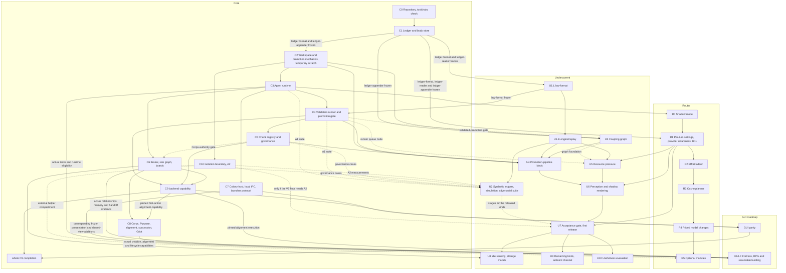

# Roadmaps: index, dependencies and working rules

**Status:** each step's status is on the [status board](#status-board), and each contract's in [`CONTRACTS.md`](CONTRACTS.md). This index is the entry point for anyone, human or agent, assigned a roadmap step. It holds the step format, cross-roadmap dependencies, status board and rules for parallel work (D19, D41). The roadmaps order work; they do not approve designs that source documents mark as proposals.

## Start here

| Order | Read | For |
|---|---|---|
| 1 | This file | Which roadmap owns your step, what it waits for, how to integrate |
| 2 | `DECISIONS.md` | Every owner decision; the open items awaiting the owner |
| 3 | `CONTRACTS.md` | The interfaces between roadmaps, and which are frozen |
| 4 | The roadmap holding your step | Goal, deliverables, decided items, open questions, stop point |
| 5 | The design sections your step cites | `DESIGN-CORE-AND-LAUNCHERS.md`, `DESIGN-ROUTING-LAYER.md`, `DESIGN-UNDERCURRENT.md`, `RESEARCH-ADMISSIBLE-VALIDATION.md`, `FIELD-PHILOSOPHY.md` |

`superceeded-Design.md`, `recipes/` and the legacy code stay in the archive folder `../dwarfharness/`, outside this repository. Do not read `superceeded-Design.md` or `recipes/`. The `OMP-*.md` files in `docs/` study a different harness and are reference only.

**Path A and the real-work gate (D52).** Keep C2 workspace mechanics → C3 agent runtime → C4 validated promotion. The owner approved the integrated Core C2 specification on 2026-10-12 (D112); C2's own F2 family must be frozen under D40 in parts, each part before the code that writes it (D113). C2/C3 refuse unavailable validation, with no bypass or fake acceptance. All harness agents and otherwise-unblocked layer work remain testing-only until C4's end-to-end gate passes and C4 is Done. C4 proves genuine accepted/refused promotions on test workspaces; real colony assignments and delivery begin only after that gate. C10 and later layer-release gates are unchanged.

**Promotion lifecycle (D53–D59, amended by D77; B5).** Core-owned durable requests may outlive their originating turn, retaining its context for results. D77 allows bounded parallel cumulative candidates (`M+A`, `M+A+B`, …) but publishes only the successful request-order prefix. Original submissions, derived generations, predecessors and attempts remain separately bound. A failed/withdrawn/cancelled local parent terminates its dependent suffix as `dependency_failed`; a removed foreign train predecessor rebuilds surviving submissions and reruns the full gate. One complete durable finalizer remains serialized: bound validation → durable intent → guarded Git update with durability → durable ledger acceptance → slot release. A ref movement, passing validation or intent alone is not acceptance. Preserve D55's no automatic post-crash execution restart, D58 authoritative same-ID dedup/mismatch error, D63 passive next-natural-turn results, D65 exact owner policy authorization, and D68 confirmed child exit.

**Capture, admission and results (D60, D62–D63, D70, D77; B4).** Original submissions include tracked changes/deletions and non-ignored new files; the mutable agent index is not authority. B4 amends D62 to a FIFO of at most four independently identified checkpoints per declared code-working context/workspace, with workspace slots scaling to four times declared pairs; this is a calibration envelope, not a colony cap. Admission precedes extra capture. D70 remains immediate capture-or-busy: no queued capture, waiting or writer interruption. Busy is neither a checkpoint nor delivered work. Keep local-parent failure distinct from foreign train-predecessor removal; do not silently rebase local descendants. Durable results remain available to the original context's next natural turn; completion does not trigger a model turn.

**Activation and freshness (D64–D69, amended by D77; B5).** Only the colony owner authorizes each exact policy version; Core records and executes immediate or one-off scheduled activation, where the time is not-before eligibility. Hold new intents, resolve already-intended finalizations durably, then switch the one colony-wide policy version across affected workspaces. An unresolved effect delays that shared switch. Fresh validation uses the same original request and immutable submission; only a still-current derived candidate may be reused. Confirm superseded child exit before replacement; adopted check/environment changes also use controlled cutover. Preserve scoped owner authorization and do not add automatic restart, recurring scheduling or post-crash execution retry.

**Capture and gate outcomes (D70–D73, amended by D77; B5–B6).** Immediate exclusive host-managed capture or busy; successful capture excludes writers/merge-back only while capturing. A derived tree identical to its actual durably accepted predecessor is terminal no-change, not a speculative-predecessor shortcut. C4 runs every declared per-workspace required check for each non-no-op candidate, regardless of changed paths; this is not every repository test and has no initial path/graph exclusion. Missing, empty or invalid gates are unavailable, and human approval cannot replace passing required evidence. Real acceptance remains testing-only until C4's complete end-to-end gate passes.

**Capture content and rule inputs (D74–D76; B4).** Candidate content uses Git-compatible canonical representation under recorded normalization settings, distinct from raw on-disk hashes; B1 does not force LF for other repositories. At a root, the Core-recorded scratch anchor is the trusted tracked-path eligibility baseline; a successor uses its immutable latest admitted local parent's sealed tree, distinct from its delta base even when tree IDs match. A foreign speculative predecessor and mutable agent index are never authority. Imported/reviewed local/global exclusions are explicit workspace inputs; captured scratch `.gitignore` edits govern that submission's new files but cannot hide tracked changes.

**Performance feasibility (D78; B15).** Correctness does not prove intended workload capacity. Evaluate every-change arrivals, steady/burst accepted throughput and latency, resource contention, speculative rework, checks and recovery; refusals move backlog to callers. Preserve the 12/20-agent workload example as an assumption, not observed arrivals. Four validation lanes remain a planning calibration, distinct from B4's four-checkpoint admission envelope. Freeze needs explicit assumptions and a measurement plan; actual concurrent resource costs are measured at the implementation gate. Infeasible declared workload fails; do not silently shrink it.

**Authority and model-call efficiency (D79).** Preserve the social/environmental vision on modest laptops with as few model calls as necessary. [Core roadmap §1.1](ROADMAP-CORE.md#11-authority-and-model-call-efficiency-guidance-d79) records literature-grounded starting guidance: local deterministic enforcement, context-scoped authority, safe revocation and no new approval bureaucracy. These are implementation directions, not frozen APIs, selected open policies or measured performance.

**D52 approval and dependency boundary.** B2–B15 record selected technical choices, while Core C2 remains the authoritative mechanism specification. The owner approved the integrated C2 boundary on 2026-10-12 (D112); C1 must freeze the relevant producer-ready families under D40. Neither this index nor a proposed event shape grants approval. C3 waits for C2 Done and the remote with CI; C4 can only claim validated promotion after its real gate. D78 performance evidence is required at its implementation gate, not an invented pre-build design choice. Any mechanism genuinely absent from the integrated source stays an open design item.

**Fortress pre-alpha boundary (D89–D96).** D96 authorizes consolidation, not exhaustive design closure or implementation. Shared creation/Purpose alignment, Corp Creeds, founding mythology and Incumbent/Aspirant succession are Core/terminal requirements as well as native GUI interactions. C3 owns generic first-action/continuation/ordinary-work guards; C8 integrates the required new-leader alignment with the actual pinned C9 **backend** skill/workflow capability. This adds no backward C3 dependency on C8 or GUI. D97–D102 specify the ordinary service-loss and officer-recovery procedure (Core §13.11): C3 owns the generic service-loss state, R1 the grouped outage prompt, C8 the outage Corps operation, owner stand-in and office handover, and C7 their projections. Exact attenuation, producer schemas, native terminal qualification and real art/accessibility/durability/resource gates remain open at their owning steps.

## The roadmaps

| Roadmap | File | Steps | Scope |
|---|---|---|---|
| Core | `ROADMAP-CORE.md` | C0–C10 | Repository and check command; ledger; workspaces; the agent runtime; validation; check governance; broker, colony host and launchers; later Corps and recipes; the isolation track |
| Router | `ROADMAP-ROUTER.md` | R0–R5 | Routing §14 phases 0–5 |
| Undercurrent | `ROADMAP-UNDERCURRENT.md` | U1–U10 | The field layer, from the standalone engine to the usefulness evaluation |
| GUI | `ROADMAP-GUI.md` | GUI parity, C9 GUI acceptance; GUI-F fortress/RPG acceptance | Native Fyne v2.8.1 display client with D89–D96's fortress, RPG creation/inspection and durable current presentation/build plans; bounded per-run cosmetic undo; launcher-contract-only; packaging/accessibility/performance remain gates |

## Step format

Every step records the following (D19):

| Field | Meaning |
|---|---|
| Goal | What the step is for |
| Delivers | What exists when it is done |
| Waits for | Steps or frozen contracts, in any roadmap, that must be done first |
| Stop point | Where an agent stops if a dependency is not ready, and what it may finish before then |
| Unblocks | Steps that wait for this one |
| Decided | Owner decisions and adopted proposals the step implements, with their sources |
| Open questions | What the step must answer before or while it is built |
| Exit criterion | The observable result that marks the step done |
| Status | One of the values below |

**Status values:** *Not ready: design open* (a design decision is missing); *Waiting* (a dependency is not done); *Ready*; *In progress*; *Blocked: reason* (stopped at the stop point); *Done*.

## Dependency graph

Notes on the edges:

- **Q28 and R1 headroom (B10/B13).** `router-headroom/v1` is R1 adapter/capability-versioned; it has no `law-format` dependency. R1's typed observations retain true provider/account/model/region/metric scope and expiry; the field consumes only currently authorized coarse band/freshness and applies its own law projection/normalization, without budget authority. C3's D25 active-context note enters R1's `context-module` once, with no duplicate fixed tail.
- **Dotted edges are partial or conditional.** U2's validation-level cases are staged by capability: the A1 suite needs real agents and the runner (C3, C4); the governance cases need the registry and Corps membership (C5, C6); the A2 measurements need the boundary (C10); no step delivers A3, so A3 rates are reported as not measured. U7 waits only for the U2 stages that cover the kinds it releases, and its gate report names the assurance levels not measured. C6's Corps-authority gate needs C5's retirement flow; the rest of C6 does not. U3's accepted-promotion integration waits for C4; U5 needs only U3's completed graph foundation. U5's runner-queue node needs C4's queue events; its other resources do not.
- **C10 and affordance.** Under the V6 starting configuration, affordance requires assurance A2 (validation §4.9.1), so agent-visible affordance needs C10 whatever floor the adversarial suite sets. Whichever U step first releases affordance waits for C10.
- **R5 external helpers.** R4 still precedes R5. External plugins/native helpers additionally require a supported, qualified C10 compartment and a complete finite host limit profile; they receive only their authorized immutable input and bounded result channel. Missing or unenforceable isolation/limits keeps the extension disabled. First-party in-process Go stages remain trusted Core code, not isolated plugins.
- **Law and validation parameters (D47, amended by B2/B6).** U1.L owns the strict law-format, including D47's versioned validation policy; C4 starts after C3, U1.L and owner-frozen `law-format`, and may satisfy that dependency without U1.E. U2/U4/U5 wait on the actual engine capability where required. C5 follows C4.
- **Promotion producer and graph consumers (D52).** C2 completion proves workspace mechanics and refusal without a real validator, not accepted promotion. C4 owns the end-to-end validated-promotion gate, including the exact promoted tree and recorded delta. U3's graph foundation starts after C2 and the frozen appender; its real accepted-promotion integration waits for C4, and both stages must pass for U3 to be Done. U4 waits for full U3. U5 can consume the completed foundation while U3 is blocked on promotion integration. C4 starts with its declared per-workspace check list and never waits for U3; this avoids a dependency cycle.
- **Ledger and view streams (D49, D50).** C1 owns the `ledger-appender` contract and the core-owned appender serializes durable writes and assigns colony sequence numbers; consumers build against the contract only after it is frozen. The contract is available only to core, router and the graph service. Durable view cursors use the colony sequence. Live model-text deltas use a separate ephemeral per-turn channel; attach atomically returns a current-text snapshot with its delta high-water index and continues without a gap. The stream is not replayed from the ledger.
- **Event emitters (B2).** Core C2 owns the single policy-activation manifest/transition and its event; U1.L defines law meaning, C4 owns required-check evidence, and C1 owns event encoding. Other assigned emitters: post-promotion interference checks and scratch lifecycle to C2; culprit attribution and revert-or-repair to C4; graph deltas to U3 through the Core-owned appender. C6 delivers the Orchestrator instruction set U8 needs for interruption criteria, together with V3's review criteria.
- **Canonical workspace ref (D48).** Each workspace's `main` is canonical and never checked out; owner and agent work uses branches, and normal promotions move `main` only through the core's validation-gated compare-and-swap path. Direct ref movement bypasses the gate and is unsupported; D46's full-check requirement for this repository remains in force.
- **C5 and Corps.** C5's exit criterion is owner-only: a retirement by the owner takes effect and replays, and repairer exclusion/quarantine mechanics are exercised with owner-issued events. C6 delivers explicit Corps membership and parent-link records with the role graph and owns the Corps-authority gate (V3; validation §4.6.1): a retirement by an eligible agent in the owning Corps takes effect, the repairing context and its clone lineage are refused under D86, and the Orchestrator can overturn. Other contexts of the same agent are not excluded by default. C6 waits for C5 for that gate only; routing §13's role drill is also at C6.
- **C9, C8 alignment and GUI phases (B8/B11; D91–D96).** C9's backend capability waits for C4/C5/C6. Its actual pinned skill/workflow execution is also a prerequisite for C8's mandatory first-action `grill-with-docs` alignment; neither whole C9 nor GUI parity is that prerequisite. C3 delivers generic guards/continuation before their C8 integration and does not wait backward on C8. The GUI roadmap waits on C7, selected Fyne v2.8.1 and C9 backend capability—not whole-step C9. Existing GUI-E parity then completes the remaining C9 GUI gate: `C9 backend capability → GUI parity → whole C9 completion`. GUI-F is separate, never a new prerequisite for GUI-E or whole C9. The native client still must pass its keyboard, non-color status, independent-cursor, reconnect/live-text, bounded-rendering and operational-projection scenarios.
- **C6, C7 and the router.** Core §9 phase 2 orders the broker before shared live attachment; neither strictly needs the other. R0, C6 and C7 retain their C3 dependency, not a new hard wait for C4. If built before C4 is Done, they exercise test workloads only (D52); runtime readiness is not readiness for real colony delivery.
- **C8/C9 design status.** B8 and D89–D102 record selected birth/role/memory/Griot, shared Purpose/alignment/succession, ordinary service-loss and typed workflow baselines, with explicit remaining producer work. C8's alignment requires C9 backend capability; whole C9 still includes GUI-E parity. Neither component completion nor a schema implies that the Core §13.11 service-loss procedure is implemented or that exact attenuation has been qualified.
- **The GUI roadmap.** `ROADMAP-GUI.md` owns native display-client parity, Fyne integration, launcher-protocol consumption, packaging and accessibility/performance gates. The [fortress GUI design](../.scratch/fortress-gui/spec.md) and separate GUI-F acceptance cover original modular art, nine-region directional relationships, administrator inspection, task stockpiles/representative runners, native-terminal reuse/fallback, staged creation/alignment, construction standards and previewed rearrangement. GUI-F consumes actual C3/C6/C8/C9-backend capabilities plus corresponding C7 owner-frozen additions; C7 base never waits for later producers or GUI. Current layout/drafts/build TODOs persist through Core's bounded replaceable presentation mechanism, while undo/history is bounded per GUI run and operational history remains append-only. Actual optional external-helper cases additionally need R5/C10 qualification, not a blanket gate on opening GUI. GUI-E parity remains independently deliverable; full fortress release must also pass GUI-F and native accessibility/packaging/workload gates.

## Status board

| Step | Title | Waits for | Status |
|---|---|---|---|
| C0 | Repository, toolchain, check command, decision log | Nothing; every owner input has arrived (D43–D46) | Done |
| C1 | Action ledger and body store | C0 | Done |
| C2 | Workspaces, observation, promotion, temporary scratch | C1; frozen `ledger-format`/`ledger-appender`; explicit D52 owner approval of integrated Core C2 boundary | In progress |
| C3 | Agent runtime | C2; owner: private remote with CI (D42) | Waiting |
| C4 | Validation runner and promotion gate; real-work gate | C3; U1.L and frozen `law-format` (D47); approved D52 boundary | Waiting |
| C5 | Check registry and governance | C4 | Waiting |
| C6 | Broker, role graph and Corps boards | C3; C5 for the Corps-authority gate | Waiting |
| C7 | Colony host, local IPC and launcher protocol | C3 | Waiting |
| C8 | Corps, Grand chains, clones, shared Purpose/alignment, succession, Griot publication | C6; C3 runtime guards/continuation and service-loss state; actual pinned C9 backend skill/workflow capability for first-action alignment, not whole C9/GUI | Waiting |
| C9 | Recipes, workflows and skills; whole-step includes GUI gate | C4, C5, C6; C7 + Fyne + C9 backend capability for GUI parity | Waiting |
| GUI | Native GUI launcher and C9 parity | C7; selected Fyne v2.8.1; C9 backend capability | Waiting |
| GUI-F | Fortress/RPG creation, inspection and resumable cosmetic building | GUI-A/B; actual C3/C6/C8/C9-backend capabilities; corresponding owner-frozen C7 additions; native acceptance gates | Waiting |
| C10 | Isolation boundary and assurance A2 | C2 | Waiting |
| R0 | Shadow mode | C3 | Waiting |
| R1 | Safe per-turn settings, provider awareness, R11 events | R0; C1's frozen `ledger-format`, `ledger-reader` and `ledger-appender` (D40, D50) | Waiting |
| R2 | Effort ladder | R1 | Waiting |
| R3 | Cache planner active | R2 | Waiting |
| R4 | Priced model changes | R3 | Waiting |
| R5 | Optional modules | R4; qualified C10 profile before enabling external plugins/helpers | Waiting |
| U1 | Law and engine capabilities | C1 contracts frozen; U1.L `law-format` before U1.E engine/replay | In progress |
| U2 | Synthetic ledgers, simulation, adversarial suite | U1.E for field simulation; validation cases: C3/C4 (A1), C5/C6 (governance), C10 (A2) | Waiting |
| U3 | Coupling graph service | Foundation: C2 and frozen `ledger-appender` (C1, D50); accepted-promotion integration: C4 (D52) | Waiting |
| U4 | Promotion-pipeline field kinds | C2, C4, C5, U1.E, U3 | Waiting |
| U5 | Resource pressure | R1, U1.E, U3's completed graph foundation; C4 for the runner-queue node | Waiting |
| U6 | Perception, disclosure, shadow rendering | U4, U5, R1 | Waiting |
| U7 | Acceptance gate and first agent-visible release | U2 (the stages for the kinds released), U6, R1; C10 if the V6 floor needs A2 | Waiting |
| U8 | Idle sensing and strange moods | U7, C6 | Waiting |
| U9 | Remaining kinds and the ambient channel | U7 | Waiting |
| U10 | Usefulness evaluation | U7 | Waiting |

A step's status is stated only here and in the step's `**Status.**` line where its roadmap has one, and both change in the same commit; a contract's version and status are stated only in the table of `CONTRACTS.md`. Other documents point to these places instead of stating a status (D116).

## Where the earlier single roadmap's steps went

| Old step | New step |
|---|---|
| 0 Repository, layout, decision log | C0 |
| 1 Action ledger and body store | C1 |
| 2 Workspaces and promotion | C2 |
| — (new, D19) | C3 Agent runtime |
| 3 Validation runner and promotion gate | C4 |
| 4 Check registry and governance | C5 |
| 5 Coupling graph service | U3 |
| 6 Router phases 0 and 1 | R0, R1 |
| 7 Undercurrent engine | U1 |
| 8 Synthetic ledgers, simulation, adversarial suite | U2 |
| 9 Promotion-pipeline field kinds | U4 |
| 10 Resource pressure | U5 |
| 11 Perception, disclosure, shadow rendering | U6 |
| 12 Acceptance gate | U7 |
| 13 Idle sensing and strange moods | U8 |
| 14 Remaining kinds and the ambient channel | U9 |
| 15 Isolation boundary, A2 | C10 |
| 16 Usefulness evaluation | U10 |

## Working across roadmaps

These rules implement D41, D42, D78, D79 and D116; the existing repository working rules remain in force.

1. **Assignment.** The owner assigns one agent per step, or per part of a step where the roadmap splits it.
2. **Isolation.** Each agent works in its own git worktree and branch.
3. **Integration.** Commit on your own branch whenever the tests you touched pass. Before `main` moves: rebase onto `main`, run `go run ./tools/check`, then fast-forward `main` (D46). A commit that changes only Markdown files since a passing check needs only the document check instead: links resolve and files are LF (D128). A slice merge runs the check with `-race=false`; each ticket's last code slice runs it in full (D129). `main` only moves forward.
4. **Owner sign-off first** for changes that touch a frozen contract, an owner decision or a new dependency.
5. **When blocked,** stop at the step's stop point, set its status to *Blocked* with the reason here and in the roadmap, and report. Never write a stub, placeholder or fake of what the step waits for. Tests may use stand-in data only against a frozen contract.
6. **Decisions.** A build decision that revises a [PROPOSAL] or [INFERENCE] gets a B entry in `DECISIONS.md`. Anything a document marks as awaiting the owner goes back to the owner.
7. **Contracts.** Read `CONTRACTS.md` before consuming another roadmap's interface. Build only against frozen contracts.
8. **Performance feasibility (D78).** Architecture choices affecting concurrency, queues, validation, capture or storage must include a workload/capacity argument and verification plan before the affected boundary is frozen. State actual arrival rates and resource limits, steady/burst accepted throughput and latency, contention, rework and recovery costs; distinguish assumptions/models from measurements. A safe design that cannot sustain the intended work is not ready merely because backpressure refuses excess submissions. Revisit the choice without weakening correctness; measure the actual path at its implementation gate.
9. **Model-call and laptop efficiency (D79).** Prefer deterministic local administration and accounting over added model calls or services. Include social, helper, compaction and retry work in calls, tokens, cost and latency per successful outcome; measure whole-process CPU/RAM, disk, idle work and contention on stated modest hardware. Lower call counts do not justify dropping intended behavior, privacy, validation or durability. Literature-grounded proposals remain revisable through rule 6, and owner-gated choices remain with the owner.
10. **Documents once per ticket (D116).** A ticket's documents land in one commit when the ticket closes: the ticket file with its claim, status and comments; its design brief and ruling; the owner's answers; one short B entry, which points to the ruling, the package documentation and the evidence instead of restating them; measurements; and status and contract-register changes. A slice that changes a contract or needs the owner's decision does not wait for the ticket's close: the documents that record that decision (its entry in `DECISIONS.md` and the register change) reach `main` with the slice (D41, D113); the ticket's other documents still land once, when it closes.

## Consolidation comment

### 2026-10-07 — D96 pre-alpha fortress alignment

[D96](DECISIONS.md#d96-pre-alpha-fortress-alignment-and-consolidation-boundary) authorizes this D89–D95 consolidation. The index now distinguishes C8's C9-backend first-action dependency, independent GUI-E parity and separate GUI-F producers, and records bounded presentation persistence without weakening operational history. Existing statuses, six Not-started contracts, D52's pending approval and unrun gates remain unchanged. Conditional edges retain their capability-specific meaning; this update neither closes the open attenuation/recovery/native-qualification work nor regenerates implementation tickets.

### 2026-10-08 — Ordinary service-loss procedure (D97–D102)

[D97–D102](DECISIONS.md#d97-officer-service-loss-causes-onset-held-questions-and-restoration-evidence) specify the ordinary service-loss and officer-recovery procedure that D96 left open (Core §13.11). The index now names its owners: C3's generic service-loss state, R1's grouped outage prompt, C8's outage Corps operation, owner stand-in and office handover, and C7's projections. Statuses, the six Not-started contracts, D52's pending approval and unrun gates are unchanged.
