# Roadmaps: index, dependencies and working rules

**Status:** 2026-10-02. No code exists yet for any layer. This file is the entry point for anyone, human or agent, assigned a roadmap step. It holds the step format, the dependency graph across roadmaps, the status board and the rules for several agents working at once (D19, D41). The roadmaps order the work; they do not approve designs that the source documents mark as proposals.

## Start here

| Order | Read | For |
|---|---|---|
| 1 | This file | Which roadmap owns your step, what it waits for, how to integrate |
| 2 | `DECISIONS.md` | Every owner decision; the open items awaiting the owner |
| 3 | `CONTRACTS.md` | The interfaces between roadmaps, and which are frozen |
| 4 | The roadmap holding your step | Goal, deliverables, decided items, open questions, stop point |
| 5 | The design sections your step cites | `DESIGN-CORE-AND-LAUNCHERS.md`, `DESIGN-ROUTING-LAYER.md`, `DESIGN-UNDERCURRENT.md`, `RESEARCH-ADMISSIBLE-VALIDATION.md`, `FIELD-PHILOSOPHY.md` |

`superceeded-Design.md`, `recipes/` and the legacy code stay in the archive folder `../dwarfharness/`, outside this repository. Do not read `superceeded-Design.md` or `recipes/`. The `OMP-*.md` files in `docs/` study a different harness and are reference only.

## The roadmaps

| Roadmap | File | Steps | Scope |
|---|---|---|---|
| Core | `ROADMAP-CORE.md` | C0–C10 | Repository and check command; ledger; workspaces; the agent runtime; validation; check governance; broker, colony host and launchers; later Corps and recipes; the isolation track |
| Router | `ROADMAP-ROUTER.md` | R0–R5 | Routing §14 phases 0–5 |
| Undercurrent | `ROADMAP-UNDERCURRENT.md` | U1–U10 | The field layer, from the standalone engine to the usefulness evaluation |
| GUI | Not yet written | — | Follows native toolkit selection (core §10 item 1) |

## Step format

Every step records the following (D19):

| Field | Meaning |
|---|---|
| Goal | What the step is for |
| Delivers | What exists when it is done |
| Waits for | Steps or frozen contracts, in any roadmap, that must be done first |
| Stop point | Where an agent stops if a dependency is not ready, and what it may finish before then |
| Unblocks | Steps that wait for this one |
| Decided | Owner decisions and adopted proposals the step implements, with their sources |
| Open questions | What the step must answer before or while it is built |
| Exit criterion | The observable result that marks the step done |
| Status | One of the values below |

**Status values:** *Not ready: design open* (a design decision is missing); *Waiting* (a dependency is not done); *Ready*; *In progress*; *Blocked: reason* (stopped at the stop point); *Done*.

## Dependency graph

```mermaid
flowchart TD
  subgraph Core
    C0[C0 Repository, toolchain, check] --> C1[C1 Ledger and body store]
    C1 --> C2[C2 Workspaces, promotion, temporary scratch]
    C2 --> C3[C3 Agent runtime]
    C3 --> C4[C4 Validation runner and promotion gate]
    C4 --> C5[C5 Check registry and governance]
    C3 --> C6[C6 Broker, role graph, boards]
    C3 --> C7[C7 Colony host, local IPC, launcher protocol]
    C6 --> C8[C8 Corps, clones, birth, Griot]
    C4 --> C9[C9 Recipes, workflows, skills]
    C2 --> C10[C10 Isolation boundary, A2]
  end
  subgraph Router
    R0[R0 Shadow mode] --> R1[R1 Per-turn settings, provider awareness, R11]
    R1 --> R2[R2 Effort ladder] --> R3[R3 Cache planner] --> R4[R4 Priced model changes] --> R5[R5 Optional modules]
  end
  subgraph Undercurrent
    U1[U1 Law and engine] --> U2[U2 Synthetic ledgers, simulation, adversarial suite]
    U3[U3 Coupling graph]
    U4[U4 Promotion-pipeline kinds]
    U5[U5 Resource pressure]
    U6[U6 Perception and shadow rendering]
    U7[U7 Acceptance gate, first release]
    U8[U8 Idle sensing, strange moods]
    U9[U9 Remaining kinds, ambient channel]
    U10[U10 Usefulness evaluation]
  end
  C3 --> R0
  C1 -->|contracts frozen| U1
  C2 --> U3
  C2 --> U4
  C4 --> U4
  C5 --> U4
  U1 --> U4
  U3 --> U4
  R1 --> U5
  U1 --> U5
  C4 -.->|runner queue node| U5
  U4 --> U6
  U5 --> U6
  R1 --> U6
  U2 --> U7
  U6 --> U7
  R1 --> U7
  C10 -.->|only if the V6 floor needs A2| U7
  C3 -.->|validation part| U2
  C4 -.->|validation part| U2
  U7 --> U8
  C6 --> U8
  U7 --> U9
  U7 --> U10
  C7 --> GUI[GUI roadmap]
```

Notes on the edges:

- **D20 limits early Undercurrent work.** U1 may start once C1's contracts are frozen, and the field-level part of U2 once U1 is done. Nothing else in Undercurrent starts before its listed dependencies are done.
- **Dotted edges are partial or conditional.** U2's validation-level cases need real agents and the runner (C3, C4); U2 stops there until both are done. U5's resource node for the validation-runner queue needs C4's queue events; the rest of U5 does not.
- **C10 and affordance.** Under the V6 starting configuration, affordance requires assurance A2 (validation §4.9.1), so agent-visible affordance needs C10 whatever floor the adversarial suite sets. Whichever U step first releases affordance waits for C10.
- **Possible U1 → R1 edge.** If Undercurrent Q28 (routing open question 7) puts headroom buckets in law files, R1 consumes `law-format` and waits for U1. Decide before R1 starts.
- **Unowned emitters.** These have no owning step yet; the listed steps hold them as open questions.
  - The core's law-activation event and the post-promotion interference-check event (Undercurrent §15.1, [PROPOSAL]): U1 and U4.
  - Culprit-attribution and revert-or-repair events (Undercurrent §15.1, needed for grades F3 and R3): C4 is the candidate [INFERENCE].
  - U8 needs the Orchestrator skill suite for interruption criteria, which no step yet delivers.
- **Possible U1 → C4 and C5 edges.** Validation §5 makes the flake-rate prior, its confidence and the quarantine threshold versioned law parameters, which are `law-format` (U1). C4 and C5 do not wait for U1; C4 holds the question of where these parameters live until `law-format` is frozen. Decide before C4 starts.
- **C5 and Corps.** Before Corps exist, the owner is the only retirer, and C5's exit criterion is met with that. The V3 rule (an agent in the owning Corps retires; the Orchestrator has the last say) takes effect when C6 delivers the role graph.
- **C9 and launchers.** C9's exit criterion (core §9 phase 4) names "either launcher", which needs C7 and the GUI roadmap. C9 is *Not ready* in any case.
- **C6 and C7.** Core §9 phase 2 orders the broker before shared live attachment; neither strictly needs the other.
- **C8 and C9** are *Not ready: design open* until the birth protocol, Griot cadence, Grand mandates, and recipe and workflow schemas are designed.
- **The GUI roadmap** waits for C7 and for toolkit selection.

## Status board

| Step | Title | Waits for | Status |
|---|---|---|---|
| C0 | Repository, toolchain, check command, decision log | Nothing; every owner input has arrived (D43–D46) | Ready |
| C1 | Action ledger and body store | C0 | Waiting |
| C2 | Workspaces, observation, promotion, temporary scratch | C1 | Waiting |
| C3 | Agent runtime | C2; owner: private remote with CI (D42) | Waiting |
| C4 | Validation runner and promotion gate | C3 | Waiting |
| C5 | Check registry and governance | C4 | Waiting |
| C6 | Broker, role graph and Corps boards | C3 | Waiting |
| C7 | Colony host, local IPC and launcher protocol | C3 | Waiting |
| C8 | Corps, Grand chains, clones, birth, Griot publication | C6; design | Not ready: design open |
| C9 | Recipes, workflows and skills | C4; design | Not ready: design open |
| C10 | Isolation boundary and assurance A2 | C2 | Waiting |
| R0 | Shadow mode | C3 | Waiting |
| R1 | Safe per-turn settings, provider awareness, R11 events | R0 | Waiting |
| R2 | Effort ladder | R1 | Waiting |
| R3 | Cache planner active | R2 | Waiting |
| R4 | Priced model changes | R3 | Waiting |
| R5 | Optional modules | R4 | Waiting |
| U1 | Law and engine | C1 contracts frozen | Waiting |
| U2 | Synthetic ledgers, simulation, adversarial suite | U1; C3 and C4 for the validation part | Waiting |
| U3 | Coupling graph service | C2 | Waiting |
| U4 | Promotion-pipeline field kinds | C2, C4, C5, U1, U3 | Waiting |
| U5 | Resource pressure | R1, U1; C4 for the runner-queue node | Waiting |
| U6 | Perception, disclosure, shadow rendering | U4, U5, R1 | Waiting |
| U7 | Acceptance gate and first agent-visible release | U2, U6, R1; C10 if the V6 floor needs A2 | Waiting |
| U8 | Idle sensing and strange moods | U7, C6 | Waiting |
| U9 | Remaining kinds and the ambient channel | U7 | Waiting |
| U10 | Usefulness evaluation | U7 | Waiting |

Update a step's status here and in its roadmap in the same commit.

## Where the earlier single roadmap's steps went

| Old step | New step |
|---|---|
| 0 Repository, layout, decision log | C0 |
| 1 Action ledger and body store | C1 |
| 2 Workspaces and promotion | C2 |
| — (new, D19) | C3 Agent runtime |
| 3 Validation runner and promotion gate | C4 |
| 4 Check registry and governance | C5 |
| 5 Coupling graph service | U3 |
| 6 Router phases 0 and 1 | R0, R1 |
| 7 Undercurrent engine | U1 |
| 8 Synthetic ledgers, simulation, adversarial suite | U2 |
| 9 Promotion-pipeline field kinds | U4 |
| 10 Resource pressure | U5 |
| 11 Perception, disclosure, shadow rendering | U6 |
| 12 Acceptance gate | U7 |
| 13 Idle sensing and strange moods | U8 |
| 14 Remaining kinds and the ambient channel | U9 |
| 15 Isolation boundary, A2 | C10 |
| 16 Usefulness evaluation | U10 |

## Working across roadmaps

These rules implement D41 and D42; `CLAUDE.md` in the repository repeats them.

1. **Assignment.** The owner assigns one agent per step, or per part of a step where the roadmap splits it.
2. **Isolation.** Each agent works in its own git worktree and branch.
3. **Integration.** Commit on your own branch whenever the tests you touched pass. Before `main` moves: rebase onto `main`, run `go run ./tools/check`, then fast-forward `main` (D46). `main` only moves forward.
4. **Owner sign-off first** for changes that touch a frozen contract, an owner decision or a new dependency.
5. **When blocked,** stop at the step's stop point, set its status to *Blocked* with the reason here and in the roadmap, and report. Never write a stub, placeholder or fake of what the step waits for. Tests may use stand-in data only against a frozen contract.
6. **Decisions.** A build decision that revises a [PROPOSAL] or [INFERENCE] gets a B entry in `DECISIONS.md`. Anything a document marks as awaiting the owner goes back to the owner.
7. **Contracts.** Read `CONTRACTS.md` before consuming another roadmap's interface. Build only against frozen contracts.
